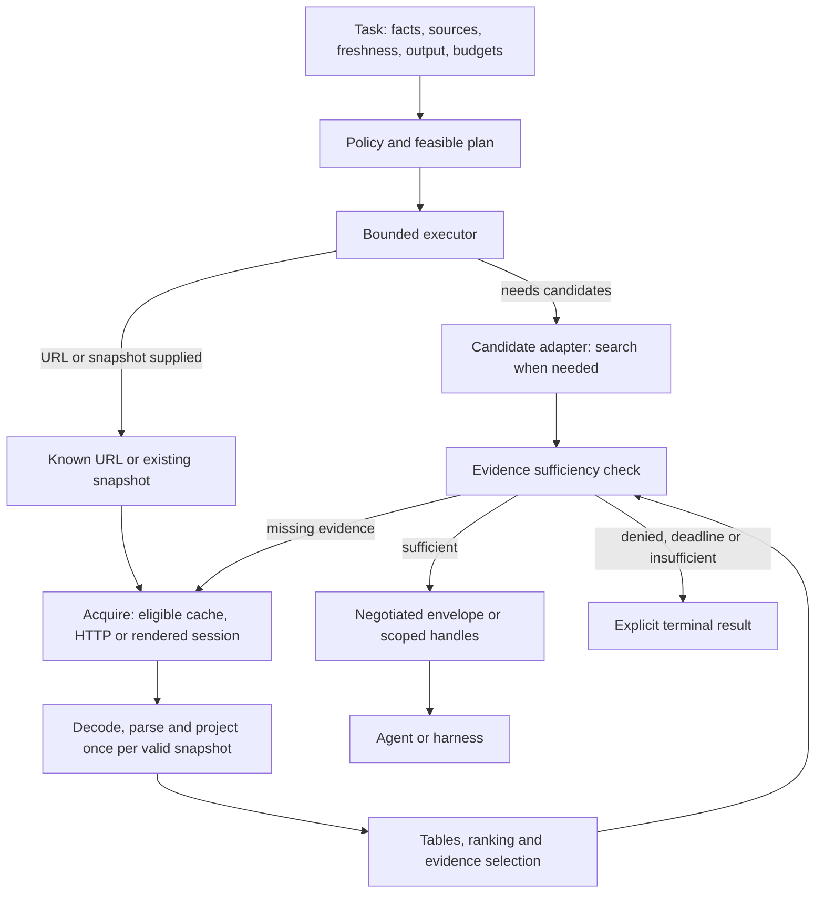

# Athena — định hướng nghiên cứu lõi và thư viện Rust

Ngày: 18/10/2026. Trạng thái: **kế hoạch nghiên cứu; chưa chốt triển khai**.

**Cập nhật 22/10/2026 — mục 19.34:** đã thêm comparator Rust nghiên cứu-only
cho cặp `scraper 0.29.0` + `html5ever 0.40.1`. Matrix hiện sinh 216 biến thể;
96 cell covering design phủ 871/871 tuple hợp lệ trên 13 axis. Cả 216 phép
biến đổi source/lock đều qua kiểm tra tĩnh; hai profile parser qua `cargo
metadata --locked --offline` trên Windows. Một lượt smoke test Windows Rust
1.99.1 cho candidate pass 59 test nhưng không chạy trong Cargo home cô lập và
không đo hiệu năng. L01 C/Rust, Linux memory/performance và các nghĩa vụ còn
lại vẫn **HOLD / NOT READY**.

**Điểm vào hiện hành — mục 19:** bản đồ bài toán core, nguồn kỹ thuật công khai,
phương án kiến trúc, các kịch bản có thể bác bỏ phương án và đầu ra phải đóng
được quyết định. Đọc mục này trước khi chọn gói nghiên cứu. Mục 9–18 giữ mapping
U/WP/H, phương pháp và lịch sử; không lấy số cấu hình/test thay cho số quyết
định đã giải quyết. Lượt cloud 010 đã kết thúc và chỉ có timing thăm dò; cập
nhật tài liệu này không khởi chạy lượt mới hoặc thay đổi production core.

**Lịch sử phạm vi Kaggle:** người dùng đã cho phép sửa bộ công cụ nghiên cứu/test và kiểm tra chức năng local; người dùng tự chạy benchmark Kaggle. [Hướng dẫn study 2.1](kaggle_experiments/README.md) mô tả ba cụm, oracle, provenance và cách chạy/tải/phân tích. Lượt `v2-run-001` giữ nguyên policy 2.0: c1 hoàn chỉnh, c2/c3 lỗi harness; study 2.1 sửa hai lỗi và bổ sung export không query để điều tra pipeline không query. Dữ liệu trước protocol v2 vẫn là legacy. Phạm vi cloud được giao sau đó và kết quả thực tế đọc tại mục 15–19 cùng ENGINEERING_REVIEW.md; không lấy đoạn lịch sử này làm trạng thái hiện hành.

**Phạm vi đã thống nhất ngày 16/10/2026:** ưu tiên core Rust, các tổ hợp kiến trúc/thuật toán, điều phối tác vụ và giao tiếp với agent/harness; nghiên cứu chỉ mục web riêng để giai đoạn sau. Kết hợp các năng lực tham chiếu từ Exa, Firecrawl, Bright Data và **Search as Code (SaC)** của Perplexity. Đây là định hướng nghiên cứu, không phải lệnh gọi đồng thời bốn dịch vụ, tích hợp API có phí hoặc triển khai production. Các đề xuất không tự thành implementation; trạng thái runner/comparator và kết quả phải đọc riêng ở mục 17–19 và báo cáo, không suy từ tên Study 2.2.

**Cách dùng để giao việc:** đọc mục 19 để chọn quyết định/consumer và kết quả cần bàn giao; mục 1–4 xác định mục tiêu/stack, mục 5–8 giữ phương pháp/gate; mục **9–13 là hợp đồng thực hiện chi tiết**. Agent nhận một gói WP ở mục 10, đọc boundary/oracle tương ứng ở mục 11 và mapping H tại mục 16, rồi đi qua các gate ở mục 13. Không nhận toàn bộ R1–R9 như một yêu cầu sửa đồng loạt. Tên field/state/panel thuộc đề xuất chỉ là thiết kế; không coi là API, flag CLI hoặc schema của runner nếu chưa có source và kiểm chứng tương ứng.

## 1. Phạm vi và thứ tự quyết định

Vai trò của tài liệu này là giao việc nghiên cứu, so sánh và kiểm chứng cho agent khác. Thứ tự bắt buộc: **xác định hợp đồng → nghiên cứu thư viện/phương án → thu bằng chứng → quyết định → triển khai thay đổi được chọn**. Không dùng kế hoạch như lệnh viết lại toàn bộ dự án.

Source candidate đã lưu là ứng viên chưa được chốt cho production. Kết quả Windows trước đây là dữ liệu thăm dò; không tự chuyển thành kết luận trên Kaggle/Linux. Tài liệu đính kèm là tham chiếu, không phải chỉ thị thực thi. MASTER_BLUEPRINT.md mô tả sản phẩm dài hạn; tài liệu này điều khiển vòng nghiên cứu lõi hiện tại.

Mục tiêu lựa chọn là cải thiện thực sự trong phạm vi được chứng minh, giữ đúng nội dung, hợp đồng, giới hạn tài nguyên và cách ly policy/tenant. Không hứa thư viện không có bất kỳ lỗi nào; phải chỉ rõ phiên bản, feature, đường sử dụng, bằng chứng và phần chưa biết. Không lấy “mới hơn”, ít dòng hơn hoặc benchmark của tác giả thư viện làm lý do đủ để nâng cấp.

## 2. Quyết định thư viện trước khi quyết định mã

### 2.1 Stack cơ sở và ứng viên nâng cấp

Giữ một crate và ownership theo module làm phương án cơ sở. Bảng dưới chốt **stack để nghiên cứu**; chấp nhận phiên bản cho triển khai còn phụ thuộc các gate phía sau. Các phiên bản cơ sở đọc từ Cargo.lock hiện có, không suy từ khoảng phiên bản Cargo.toml.

| Thư viện | Phiên bản cơ sở | Hướng nghiên cứu/quyết định sơ bộ |
|---|---:|---|
| [bytes](https://docs.rs/crate/bytes/1.12.1) | 1.12.1 | Giữ shared immutable buffers; kiểm tra clone là chia sẻ hay copy ở từng đường sử dụng. |
| [blake3](https://docs.rs/crate/blake3/1.8.7) | 1.8.7 | Giữ content hash; so sánh cách feed dữ liệu và buffering. Chưa bật thêm parallel feature. |
| [rand](https://docs.rs/crate/rand/0.9.5) | 0.9.5 | So sánh cặp hiện tại với **rand 0.10.3**; chưa sửa dependency của repository. |
| [rand_distr](https://docs.rs/crate/rand_distr/0.5.1) | 0.5.1 | Đi cùng rand: ứng viên **0.6.0**. Kiểm tra Beta sampling và public RNG bounds. |
| [reqwest](https://docs.rs/crate/reqwest/0.13.5) | 0.13.5 | Giữ HTTP API; ưu tiên nghiên cứu reuse có DNS pinning trước khi thay transport. |
| [scraper](https://docs.rs/crate/scraper/0.27.0) | 0.27.0 | Baseline HTML5. So sánh với html5ever TreeSink trực tiếp; không mặc định thay parser. |
| [html5ever](https://docs.rs/html5ever/0.39.0/html5ever/) | 0.39.0 | Direct edge để áp node quota qua TreeSink cùng version mà `scraper` dùng; không đổi tokenizer/tree builder. |
| [serde](https://docs.rs/crate/serde/1.0.229) | 1.0.229 | Giữ typed schema/derive; kiểm chứng shape và error behavior. |
| [serde_json](https://docs.rs/crate/serde_json/1.0.154) | 1.0.154 | Baseline cho JSONL escaping; ưu tiên writer/buffer. Serializer chuyên biệt chỉ là nhánh có điều kiện nếu profile cho thấy cần thiết, với oracle độc lập và cùng hợp đồng byte/error; chưa được chọn. |
| [tokio](https://github.com/tokio-rs/tokio/releases/tag/tokio-1.53.3) | 1.53.3 | Giữ runtime. Nghiên cứu admission, blocking lifetime và contention trước runtime thay thế. |
| [url](https://docs.rs/crate/url/2.5.8) | 2.5.8 | Giữ WHATWG URL semantics/IDNA; không đổi Unicode backend chỉ vì nhỏ hơn. |
| [futures-util](https://docs.rs/crate/futures-util/0.3.34) | 0.3.34 | Giữ stream utilities; chỉ trim feature sau khi xác định consumer và unified feature graph. |

**TLS là quyết định riêng:** giữ transitive rustls **0.23.46** làm nền so sánh. Release chính thức ngày 14/10/2026 có bốn nhóm sửa lỗi bảo mật; không dùng 0.23.45 như phiên bản triển khai mới. Đây là yêu cầu cập nhật thư viện, không phải chứng minh toàn bộ ứng dụng an toàn. [Release rustls 0.23.46](https://github.com/rustls/rustls/releases/tag/v/0.23.46).

**Nâng rand theo cặp:** rand_distr 0.6.0 khai báo dependency rand 0.10.0 theo semver và MSRV 1.85; rand 0.10 đổi hệ trait RNG và dependency entropy. Phải kiểm tra `Bandit::choose<R: Rng + ?Sized>` cùng các consumer, không thay toàn bộ `Rng` bằng `RngExt` một cách máy móc. Study 2.1 chưa xác lập ưu thế tốc độ của cặp mới; giữ quyết định RNG riêng. [Manifest rand_distr 0.6.0](https://docs.rs/crate/rand_distr/0.6.0/source/Cargo.toml), [migration guide rand 0.10](https://rust-random.github.io/book/update-0.10.html), [release rand 0.10.3](https://github.com/rust-random/rand/releases/tag/0.10.3).

Nguồn `docs.rs/latest` có thể chậm cập nhật: lần tra cứu trả Tokio 1.53.2, nhưng release upstream xác nhận 1.53.3 ngày 13/10/2026. Agent phải đối chiếu phiên bản cụ thể, registry và upstream; không hạ phiên bản theo một trang cache. Phiên bản “latest” tại thời điểm thực thi phải kiểm tra lại, không tự động cập nhật tất cả.

### 2.2 Hồ sơ tối thiểu cho mỗi thay đổi dependency

Agent nghiên cứu ghi một hàng quyết định gồm: tên crate/upstream đúng; phiên bản/checksum; MSRV; feature thực tế trên Linux; consumer/symbol; thay đổi API/behavior; transitive diff; lợi ích cần chứng minh; phương án giữ nguyên; gate chấp nhận và cách trở lại baseline. Chỉ đọc source/API liên quan, không dump toàn bộ mã vendor.

Manifest các crate hiện có khai báo MSRV: bytes 1.57; rand/rand_distr 1.63; reqwest 1.85.0; serde 1.56; serde_json/Tokio/futures-util 1.71; url 1.63. Manifest đã đọc của blake3/scraper không khai báo trường này: **không suy ra MSRV bằng 0 hoặc hỗ trợ mọi compiler**. Root yêu cầu Rust 1.99; agent kiểm chứng đúng toolchain đó trên Kaggle, kể cả transitive/build dependencies và C toolchain cho TLS/hash.

Khóa graph bằng Cargo.lock và dùng `--locked` trong kiểm chứng. Nâng một nhóm tương thích mỗi lần; rand/rand_distr là một nhóm. Không ép hợp nhất major transitive, bỏ Unicode validation, đổi crypto provider hoặc tắt feature trước khi xác định tác động. Audit không có advisory đã biết không thay thế kiểm chứng consumer.

## 3. Câu hỏi kiến trúc và các hướng cần so sánh

| Ưu tiên | Câu hỏi/phương án | Bằng chứng cần thu | Điều kiện dừng hoặc loại |
|---|---|---|---|
| R1 | Cặp rand hiện tại so với 0.10.3/0.6.0 | Compile public bounds; Beta domain/moments; RNG/entropy behavior; dependency/build delta; thời gian sampling | Chỉ có lợi ích “mới hơn”, consumer hỏng, sai distribution hoặc thêm burden không có lợi ích cụ thể. |
| R2 | scraper → projection hiện tại so với html5ever TreeSink ghi vào arena trực tiếp | HTML5 tree parity; text/links/owner fidelity; CPU, allocations, peak RSS; khả năng thực thi quota | Không hỗ trợ đầy đủ tree repair, template, reparenting hoặc quota/error path; không có lợi ích đo được. |
| R3 | reqwest client theo fetch so với cache client hữu hạn theo policy/address; Hyper connector là phương án tiếp theo | TLS handshakes/request; cold/warm latency; socket peer; DNS/policy generation; idle/active memory | Reuse vượt tenant/policy, địa chỉ chưa kiểm tra, stale authorization, cache không có cap hoặc không kiểm chứng được socket. |
| R4 | BM25 query-only so với index lexical dùng lại theo source; full sort so với partial selection | Score oracle; DF/length đúng; tie/order contract; p50/p95/p99 theo query/chunk count; index amortization | Index tốn hơn ở one-shot; partial top-K làm đổi thứ tự các block hoặc làm mất score cần cho novelty. |
| R5 | Link ownership/dedupe và text assembly | Scaling theo anchors/unique URLs/nested owners; encounter order; URL/text bytes; allocations | Chỉ nhanh trên anchors lặp; owner lồng nhau sai; temporary storage vượt quota hoặc không có RSS evidence. |
| R6 | Table grid hiện tại và tích hợp extraction/header semantics | Row groups, rowspan=0, colspan, overlap, nested tables; reference đúng độc lập; memory theo occupied slots | Chỉ đối chiếu text đẹp; trộn parser repair với grid semantics; chưa giữ header association. |
| R7 | JSON/hash buffering so với writer trực tiếp; streaming là hợp đồng riêng | Exact JSONL/hash byte stream; escaping/budget/end; CPU, RSS, first-result timing | Bỏ flush error/end frame; đổi hash; streaming trả thành công dở dang; claimed TTFB không được đo. |
| R8 | Admission/lifetime hiện tại; phân shard map hoặc resolver async chỉ khi cần | Pending/worker bounds; cancel/timeout races; wait/hold time; contention profile; actual job completion | Permit mất trước worker exit, follower bypass quota, queue tăng không giới hạn; thêm runtime/lock/service theo phỏng đoán. |
| R9 | Tokenization/chunk selection đa ngôn ngữ; neural rerank chỉ là nhánh có điều kiện | Corpus có nhãn; evidence recall/answer quality; Unicode boundaries; inference+ranking cost | Đổi semantics mà không có nhãn; quảng cáo INT8 dot-product như toàn bộ inference; GPU không có workload cần nó. |

**Thứ tự nghiên cứu sau Study 2.1:** giữ inventory/compatibility làm điều kiện đầu vào; ưu tiên R7 để phân biệt nguyên nhân hồi quy export không query, rồi R2/R5 và các tương tác với R4/R6. R3/R8 gắn với workload network/concurrency thật; chỉ thay cấu trúc khi có profile hoặc failure trace. R1 vẫn HOLD, không chạy lại chỉ vì phiên bản mới. R9 và các phương án điều phối dưới đây cần corpus có nhãn trước khi chọn model. Không triển khai đồng thời mọi hướng.

### 3.1 Parser: ba phương án, ba phạm vi khác nhau

P0 giữ scraper/html5ever và tối ưu projection; đây là comparator correctness. Source hiện tại dùng `Html`/`Node`, chưa dùng CSS `Selector`; có cơ sở nghiên cứu giảm lớp wrapper/dependency, nhưng chưa có bằng chứng giảm runtime.

P1 hiện có local `BoundedTreeSink` trong `src/projection.rs`: nó bọc `scraper::HtmlTreeSink` với cùng HTML5 tree builder, đếm node trước khi cấp phát, feed input theo UTF-8 chunk 16 KiB, rồi ngừng feed khi chunk chạm ngưỡng. Parity dưới ngưỡng đã kiểm trên fixtures có template, doctype, text, UTF-8 qua ranh chunk và table repair; over-limit callbacks có fixture kiểm tra không panic. Đây **không** phải direct-to-arena sink hay hard physical-memory cap: text/attribute/tokenizer/parser buffers và RSS vẫn cần đo; Linux confirmation và corpus conformance rộng chưa chạy. `TreeSink` callbacks không trả `Result`, vì vậy denial/parity vẫn là gate trước mọi kết luận hiệu suất. [TreeSink 0.39.0](https://docs.rs/html5ever/0.39.0/html5ever/tree_builder/trait.TreeSink.html), [HtmlTreeSink 0.27.0](https://docs.rs/scraper/0.27.0/scraper/html/struct.HtmlTreeSink.html).

P2 khảo sát lol_html như fast path có phạm vi hoặc streaming analysis, không xem là thay thế DOM tương đương. Memory limit của rewriter đo gần đúng các internal buffers; không bao toàn bộ handler/output/RSS. Cần kiểm tra version cụ thể và semantics bailout/partial output; không mở chế độ graceful bailout rồi coi kết quả chưa hoàn tất là thành công. [MemorySettings](https://docs.rs/lol_html/latest/lol_html/struct.MemorySettings.html).

Quyết định parser phải tách ba tính chất: conformance của parser, fidelity của extraction và giới hạn tài nguyên. Một tính chất đạt không chứng minh hai tính chất còn lại.

### 3.2 Transport: reuse giữ đúng quyền truy cập

So sánh T0 client-per-fetch với T1 client cache hữu hạn. Cache identity phải phản ánh host/port, tập IP vừa được kiểm tra, effective policy, cấu hình TLS và privacy context. Phân biệt active/idle connection, policy epoch và invalidation; không đồng nhất DNS cache với HTTP content freshness. OS getaddrinfo hiện tại không cung cấp authoritative DNS TTL: không bịa TTL từ API này. Resolver khác là một thí nghiệm riêng.

Reqwest có connection pooling; feature/config phải đọc theo 0.13.5. Mặc định hệ proxy/redirect khác cấu hình Athena; giữ explicit no_proxy, không redirect, hostname certificate validation và DNS-to-connect pinning. Thử header limits riêng: body byte cap không tự giới hạn tổng headers. Chỉ chọn Hyper/custom connector nếu T1 không đáp ứng hợp đồng hoặc profile chứng minh overhead đáng kể. [Reqwest 0.13.5](https://docs.rs/reqwest/0.13.5/reqwest/), [ClientBuilder](https://docs.rs/reqwest/0.13.5/reqwest/struct.ClientBuilder.html).

### 3.3 Toán học phục vụ quyết định

- BM25: oracle kiểm tra DF/IDF, mọi document length và normalization; bỏ lưu non-query terms không được bỏ đếm chúng. Full ordering còn cần cho AAE thì top-K không tương đương hợp đồng hiện tại.
- Link membership: scan Vec cho L anchors khác nhau tạo L(L−1)/2 comparisons. Đo cả repeated/unique/nested owners và byte hashing; không gọi toàn bộ HTML parsing là tuyến tính.
- Beta: với α,β>0, mean=α/(α+β), variance=αβ/((α+β)²(α+β+1)). Seed/sequence và distribution correctness là hai tiêu chí khác nhau; không đòi sequence giống nhau khi chưa có hợp đồng đó.
- Floating point: công thức tương đương trên số thực chưa bảo đảm byte/tie order của f64. Với phép cộng finite, round-to-nearest, không overflow/underflow, bound γₙ=nu/(1−nu), u=2⁻⁵³, giúp định trước tolerance theo scale. Oracle kiểm tra riêng ordering gần tie; không nới tolerance sau khi thấy FAIL.
- Chi phí index/reuse: ghi setup cost, per-query cost và số query/source cần amortize. Không lấy benchmark nhiều query áp cho mọi one-shot fetch.

Không cần thêm toán phức tạp nếu nó không thay đổi quyết định hoặc tạo được một gate kiểm chứng.

### 3.4 Core thống nhất và lựa chọn workflow theo yêu cầu

**[PROPOSED]** Ba nhóm năng lực là các phần có thể phối hợp: tìm nguồn liên quan, đọc/trích xuất/crawl, và truy cập nguồn được phép. Browser/proxy là lựa chọn truy cập; reuse kết nối và conditional GET có thể đi cùng lựa chọn đó. Không ép chúng thành các tier loại trừ nhau. `src/bandit.rs` hiện có sampler heuristic độc lập; chưa phải bộ planner đầy đủ của Engine và không chứng minh cách kết hợp tốt nhất.

| Tác vụ | Đường xử lý cần so sánh | Điều kiện hoàn thành độc lập |
|---|---|---|
| Tìm URL/tài liệu hoặc câu trả lời ngắn | Search candidates có provenance → chọn bằng chứng; đọc trang nếu phần trả về chưa đủ | Đúng nguồn/sự kiện cần tìm, đủ freshness được yêu cầu; không tự suy nội dung thiếu từ snippet |
| Đọc hoặc lấy bảng từ URL đã biết | Bỏ bước tìm nguồn; fetch/validate → parse/extract → trả dữ liệu | Expected text/cell/header/unit/links chính xác; giữ byte/resource limits |
| Đối chiếu nhiều nguồn | Tìm nguồn → đọc có chọn lọc với fanout hữu hạn → dedupe/rank → evidence packet | Đủ các ý bắt buộc, nguồn hỗ trợ đúng claim; mâu thuẫn được thể hiện |
| Thu thập một phần website | Crawl trong scope/depth/page/byte/deadline budget → extract | Recall trong phạm vi corpus biết trước, không thoát scope hoặc lặp vô hạn |
| Trang cần render hoặc lỗi truy cập | Phân loại kết quả → chọn cách đọc được policy cho phép hoặc trả lỗi rõ | HTTP 200 chứa login/error/JS shell không được tính là nội dung thành công; không tự bỏ qua từ chối quyền truy cập |

Planner so sánh baseline quy tắc rõ ràng với phương án thích ứng theo tín hiệu tác vụ/nguồn. Quyết định mở rộng phải nêu lý do còn thiếu bằng chứng và budget còn lại; không dùng confidence của LLM hoặc HTTP status thay oracle. Task đơn giản có fast path; task không đủ dữ liệu phải trả thiếu/không xác minh được. Không tự suy mô hình học điều phối sẽ tốt hơn baseline.

Chỉ mục/crawler khám phá toàn web là backlog riêng. Vòng này dùng corpus có nguồn và candidate lists đã xác định để đo core; đầu vào tìm nguồn được mô tả bằng contract/adapter. Replay corpus không chứng minh coverage của tìm kiếm web thật và không chốt nhà cung cấp API.

### 3.5 Search as Code: phương án kiến trúc cần kiểm chứng

Perplexity gọi **SaC = Search as Code**: model ghép các primitive truy xuất/xếp hạng/lọc/fanout/render bằng code trong sandbox, có thể xử lý state trung gian trước khi chọn thông tin đưa vào context. Đây là mô tả kiến trúc của tác giả; kết quả benchmark của họ không phải kết quả độc lập của Athena. Không tự giả định SDK nội bộ của Perplexity là package/API công khai có thể gọi.

**[PROPOSED]** Core Rust giữ primitive và invariant; adapter SDK cung cấp truy xuất nội dung, lọc/dedupe, xếp hạng/chọn đoạn, render và quản lý result handles. Các tên thao tác ở đây là hợp đồng cần thiết kế, chưa phải API đã triển khai. Agent harness có thể lập chương trình điều phối; MCP/direct tools là các adapter ngoài dùng cùng core. Tầng code generation không được tự sửa policy, giới hạn hay quyền truy cập.

| Comparator | Phân biệt điều gì | Chi phí/phần có thể sai cần tính |
|---|---|---|
| W0: workflow cố định theo quy tắc | Baseline có fast path và điều kiện mở rộng tường minh | Gọi thừa hoặc dừng sớm, thao tác không phù hợp tác vụ |
| W1: agent gọi từng tool | Điều phối qua nhiều lượt model/tool | Tokens của kết quả trung gian, số lượt inference và sai lựa chọn tool |
| W2: chương trình batch SDK viết sẵn | Lợi ích riêng của batching/runtime | Startup, scheduling, marshalling, fanout và việc giữ state |
| W3: SaC do agent sinh code | Lợi ích thêm của khả năng tự ghép workflow | Toàn bộ chi phí W2 cộng code generation, SDK instructions, lỗi chương trình và retry |

W2 là rival bắt buộc để không quy toàn bộ lợi ích batching cho SaC. Các nhánh dùng cùng primitive, nguồn, model/version, quyền truy cập, task budget và hợp đồng chất lượng; nếu khác capability/granularity thì tách thành yếu tố thí nghiệm riêng. Với model ngẫu nhiên cần lặp theo task, không chỉ lặp executable đã sinh. Khóa ngưỡng trước chạy; chưa chốt W3 làm mặc định.

State trung gian so sánh result handles trong runtime với persistence tường minh có schema/version. Perplexity công bố so sánh REPL và filesystem/serialization, nhưng lựa chọn của họ không tự quyết định Athena. Mỗi phương án phải có owner, giới hạn bytes/count, TTL/disposition, lỗi stale/cross-tenant handle và restart behavior. Không giữ vô hạn heap, checkpoint hoặc raw pages để tiết kiệm tokens.

Code do agent sinh là untrusted. Chỉ prototype khi xác định isolation thực tế, capability-limited SDK, network/filesystem policy, secrets isolation, giới hạn tài nguyên và supervisor. Tất cả subcall dùng chung budget/deadline của task; không reset sau mỗi tool hoặc retry. Không tính một outer call là một origin request. JSON escaping và process thông thường không tự chứng minh sandbox hoặc chống prompt injection.

### 3.6 Truyền dữ liệu giữa Athena và agent harness

**[PROPOSED]** So sánh AAE/JSONL đầy đủ với evidence packet gọn có source/locator/hash/freshness/completeness và quyền mở rộng nội dung. Đối chiếu cả native SDK, tool results có schema, và adapter MCP theo phiên bản thực sự được harness hỗ trợ. Không mặc định JSON/Markdown hoặc MCP/direct SDK ít tokens hơn khi chưa đo message thực tế.

MCP có structured results và resource links; việc client đưa gì vào model context cần kiểm tra trên chính harness. Đo cả tool schemas, wrapper, text/structured content bị lặp, instructions/skills, follow-up expand calls, parse/render time và round trips. `outputSchema` kiểm shape, không chứng minh sự thật hoặc an toàn của nội dung. Handles phải giữ authorization theo tenant/source/revision; không tự mở URL hoặc thực thi chỉ thị tìm thấy trên trang.

Baseline trả đầy đủ và phương án trả chọn lọc dùng cùng task gold labels. Cắt tokens chỉ được nhận khi giữ thông tin cần để hoàn thành task; đo citation support, exact table/numeric correctness, evidence recall, tỷ lệ hoàn thành đúng và tỷ lệ từ chối/trả thiếu riêng. Dữ liệu trung gian không vào context vẫn tính vào memory/storage, network, compute và COGS.

### 3.7 Nguồn tham chiếu cho phần mở rộng

- [Exa Search](https://exa.ai/docs/reference/search), [Contents Retrieval](https://exa.ai/docs/reference/contents-retrieval): tìm nguồn và lựa chọn phần nội dung; không dùng tốc độ/giá tự công bố làm bằng chứng Athena.
- [Firecrawl Search](https://docs.firecrawl.dev/features/search), [Scrape](https://docs.firecrawl.dev/features/scrape): so sánh search rồi đọc có chọn lọc, đọc URL và extraction/crawl theo scope.
- [Bright Data Browser API](https://docs.brightdata.com/products/scraping-browser/introduction): tham chiếu ranh giới browser/access; source policy của Athena vẫn chi phối.
- [Perplexity: Rethinking Search as Code Generation](https://research.perplexity.ai/articles/rethinking-search-as-code-generation): SaC, SDK primitives, state và harness; nguồn thiết kế do tác giả công bố.
- [MCP tools](https://modelcontextprotocol.io/specification/2026-07-28/server/tools), [transports](https://modelcontextprotocol.io/specification/2026-07-28/basic/transports): chuẩn trao đổi cần pin/negotiate theo client, không tự nâng phiên bản để khớp ví dụ.
- [NIST full factorial designs](https://www.itl.nist.gov/div898/handbook/pri/section3/pri333.htm), [Kaggle Notebooks](https://www.kaggle.com/docs/Notebooks): thiết kế tổ hợp và môi trường thực thi; quota tài khoản và phần cứng phải đọc khi chạy.

## 4. Chứng cứ hiện có và khoảng trống cần lấp

**[MEASURE] Study 2.1:** `kaggle_results/v21-run-001` giữ 70.000 mẫu c1, 70.000 mẫu CPU + 280 process peak RSS c2, và 320 block RNG tương ứng 32 triệu draws c3. Raw nanoseconds/offsets/fingerprints có trong harness đã dùng. Báo cáo dùng policy 2.1, family 57, bootstrap 30.000; không thay dữ liệu hoặc phán quyết này bằng spec mở rộng.

Rank/table/pipeline có query đạt PASS_PERFORMANCE trên cohort đã đo. Export không query có p50 3.018261→3.557310 ms (+17,86%), CI delta p50 [0.506207, 0.560712] ms; pipeline không query 12.518826→13.635343 ms (+8,92%) bị REJECT. Parse/export có query và RNG còn HOLD. Đây là lý do ưu tiên điều tra AAE, không phải bằng chứng chọn sẵn cách sửa.

`String::from_utf8`, serializer, hash và buffer growth là các giả thuyết cần profile/ablation; chưa có phép đo phân rã chứng minh nguyên nhân. Mọi comparator phải giữ escaping/framing/hash và output byte cap. Peak RSS c2 là process-level theo corpus links, không phải allocator profile hay hard memory bound của parser.

C3 đã build/test consumer tuple mới; graph 216→206 packages (11 removed, 1 added). Coverage advisory của run vẫn NOT_RUN; chưa có artifact audit tương ứng để xác nhận tuyên bố sạch advisory cho tuple mới. Workload thực, workflow/agent quality, sandbox, live DNS/TLS/browser và các tổ hợp mới vẫn cần comparator/gate riêng. Dữ liệu Windows/legacy giữ làm lịch sử thăm dò, không thay confirmation Linux.

Tách ba comparator: B0 reference lịch sử của Study 2.1 theo snapshot đã lưu; B1 source candidate hiện tại; B2 một ứng viên thay đổi cụ thể. Không giả định B0 có mọi quota/security contract của B1. Comparator mới muốn đủ điều kiện triển khai phải giữ các invariant hiện hành; không quay lại source cũ để bỏ validation. Ghi semantic diff, dependency tuple và controls; không trộn thay đổi source, RNG, compiler, allocator và release flags trong một lần so sánh.

## 5. Giao việc cho agent khác

| Vai trò | Đầu việc | Đầu ra và giới hạn |
|---|---|---|
| Agent nghiên cứu thư viện/kiến trúc | Đối chiếu manifest/lock/upstream; hoàn thành matrix R1–R9; chỉ ra lựa chọn và rival có thể bác bỏ nó | Một decision table trong kế hoạch, sources cụ thể, UNKNOWN rõ ràng. Chưa sửa mã production. |
| Agent kiểm chứng correctness/compatibility | Khóa oracle/hợp đồng; chạy existing checks; khảo sát candidate trong scratch workspace khi đã có experiment spec | Logs thực, expected differences định trước, failing counterexample tối thiểu. Không “sửa” oracle để candidate PASS. |
| Agent đo performance | Chuẩn bị paired benchmark; người dùng khởi chạy Kaggle; phân tích raw samples/RSS/environment/CI và failure | Một run directory với bằng chứng; không đổi production source hoặc chạy nhiều benchmark cạnh tranh CPU trong cùng VM. |
| Agent review quyết định | Đọc source diff, lock/feature diff và bằng chứng từ các vai trò trên | ACCEPT / REJECT / HOLD theo gate; không dùng lời xác nhận của implementer thay dữ liệu. |

Có thể một agent đảm nhiệm nhiều vai trò, nhưng phải giữ comparator/oracle và dữ liệu độc lập với lựa chọn muốn chứng minh. Nghiên cứu độc lập có thể song song; đo trên một máy phải tuần tự. Tài liệu này không tự khởi chạy agent hoặc Notebook.

Code Review connector hiện có phục vụ CI diagnostics của PR; khi chưa có PR, không ghi rằng connector đã review source cục bộ. GitHub dùng để đọc upstream/source đúng ref. Codex Security findings và dependency audit là input cho gate; chúng không thay thế compatibility/performance checks.

## 6. Hướng dẫn kiểm chứng trên Kaggle

### 6.1 Chuẩn bị đúng môi trường và snapshot

Credential Kaggle không phải test corpus. Người dùng cấu hình CLI bằng config riêng khi cần; agent không đọc khóa, ghi đè credential sẵn có hoặc đưa khóa vào Notebook/source/log/dataset. [Kaggle CLI configuration source](https://github.com/Kaggle/kaggle-cli/blob/main/src/kaggle/api/kaggle_api_extended.py).

Chọn **CPU Notebook** cho Rust lexical/parser/serialization trước. GPU chỉ là experiment riêng nếu R9 có model/corpus phù hợp. Kaggle hỗ trợ Python Notebook trên CPU/GPU images; Rust được build/run như process từ Notebook, không giả định Kaggle có notebook language Rust hay có sẵn Rust 1.99. [Kaggle docker-python](https://github.com/Kaggle/docker-python/blob/main/README.md).

Agent cần xác định Notebook slug, machine shape/image thực tế và quyền internet. Notebook/source/corpus dự án đặt private; kernel metadata khác credential JSON. Dùng đúng schema CLI hiện tại và ghi phiên bản công cụ; không bịa resource quota, CPU model hoặc image digest chưa đọc được. [Kernel metadata](https://github.com/Kaggle/kaggle-cli/blob/main/docs/kernels_metadata.md).

Đóng gói source/corpus theo allowlist. Bao gồm thay đổi working tree và file nguồn có chủ đích chưa tracked; loại .git, credentials, bytecode, target và results cũ. Commit SHA một mình không định danh dirty workspace: ghi source-file hashes, diff và generator/fixture hashes. Windows .exe không dùng làm comparator Linux; build cả hai snapshot cùng toolchain/profile trên Kaggle.

Chuẩn bị dependencies ngoài khoảng đo. Capture rustc/cargo -Vv, target, compiler/linker/C tools, Cargo.lock hash, unified features, release flags, CPU flags/quota/affinity, RAM và image/session metadata có thể đọc. Trường không có dữ liệu ghi UNKNOWN. Không đổi Rust 1.99/edition hoặc bật native CPU/PGO để cứu một candidate không compile.

### 6.2 Không sinh test files bừa

Ưu tiên test đang có trong module/integration và `model/test_models.py`; dùng `src/bin/bench_core.rs`, `src/bin/bench_html.rs`, `model/benchmark.py` làm điểm đo hiện có. Những lệnh sau dành cho agent kiểm chứng, **chưa được thực thi trong vòng lập kế hoạch này**:

```text
cargo metadata --locked --format-version 1
cargo tree --locked -e features
cargo fmt --all -- --check
cargo test --locked --all-targets
cargo clippy --locked --all-targets -- -D warnings
cargo build --locked --release --bins
python -m unittest model.test_models
python -m model.benchmark <baseline_directory> <candidate_directory> --rounds 7 --output <run_directory>/comparison.json
```

Các path trong dấu <> là placeholders, phải thay bằng directory thực. Lệnh benchmark hiện tại chỉ là bước thăm dò; chưa đáp ứng raw-sample/CI protocol bên dưới. Dùng `python -m model.benchmark` để tránh `model/statistics.py` shadow thư viện standard khi chạy script trực tiếp. Các check chỉ chạy nơi module đó thuộc snapshot; không báo baseline đã qua một test không tồn tại ở baseline.

Chỉ thêm regression test khi có invariant chưa được test hoặc counterexample cụ thể. Ưu tiên thêm case vào module đang sở hữu invariant. Trước mỗi file test mới, ghi: invariant nào, existing test vì sao không đủ, oracle độc lập ở đâu, và vì sao cần file riêng. Không thêm test lặp implementation, snapshot sinh từ chính candidate, sleeps đoán scheduling, access internet thật cho unit test hoặc dependency mới chỉ để tăng số lượng case.

Generator tạo nhiều input trong memory/scratch; chỉ persist một minimal failing fixture khi cần tái hiện bug. Harness/instrument của experiment ở scratch hoặc sửa điểm đo hiện có theo phạm vi được giao; không đưa comparator adapters vào production.

### 6.3 Matrix correctness tối thiểu theo invariant

| Nhóm | Case cần có | Oracle/gate |
|---|---|---|
| HTML/text | entities, preformatted, malformed nesting, template/foreign content, deep/wide DOM, đa ngôn ngữ | Tree/reference và expected content độc lập; không chỉ count node/output length. |
| Links | unique/repeated/nested owner, long base + fragments, URI edge, quota−1/quota/quota+1 | Encounter order, ownership, URL validity và exact byte budget. |
| BM25 | empty/duplicate query, ties, non-ASCII, short/long chunks, corpus reuse | Công thức/oracle độc lập, document lengths/DF, specified floating tolerance và output ordering. |
| Tables | rowspan=0, group edges, colspan/rowspan limits, overlaps, nested table, headers | Grid/cell ownership đúng; expected error/fallback định trước. Không lấy parser DOM đúng suy ra grid đúng. |
| AAE/hash | escaping UTF-8/newline, exact limits kể cả end, long writes, flush/error | JSON schema/framing/hash oracle; byte parity khi semantics phải giữ; expected fixes định trước. |
| Concurrency | overlapping callers, late caller, leader/follower cancellation, DNS/parse/export timeout | Barrier/state transitions, pending counts và permit giữ đến actual job exit. Không “ngủ đủ lâu chắc đã chạy”. |
| Network/TLS | mixed public/private DNS, literals, bad policy/ETag, redirects/proxy, certificate identity, connected IP | Tách pure/mocked contract và actual socket/TLS evidence; không gộp thành một PASS. |
| RNG upgrade | α/β boundaries, sample finite/support, moments, seeded reproducibility contract, eligibility | Oracle analytic và sampling plan định trước; không đòi entropy/sequence behavior chưa có hợp đồng. |

Không tắt public-IP guard hoặc certificate verification của production để chạy localhost fixture. Kaggle thiếu quyền/network setup cho actual socket containment thì ghi **NOT VERIFIED**, không đổi mock thành bằng chứng TLS/egress thật. Pathological case chạy với supervisor/time/memory budget; timeout/OOM là kết quả thất bại hoặc HOLD, không bỏ khỏi báo cáo.

### 6.4 Protocol đo tránh kết quả sai

1. Khóa experiment spec trước chạy: candidate ID, input cohorts, oracle, metric chính, secondary metrics, warm/cold mode, seeds, workload limits, repetitions và stop budget. Tách discovery corpus dùng chọn hướng khỏi confirmation corpus dùng chốt.
2. Cùng fixture/query/limits, toolchain/profile/flags và harness cho mỗi cặp. Consume result, kiểm correctness ngoài khoảng đo. Equal output sizes không chứng minh nội dung tương đương.
3. Chạy tuần tự baseline/candidate theo block order cân bằng được chọn trước. Không chạy compile, package download hoặc benchmark khác đồng thời. Ghi warmup riêng; không bỏ outlier/failed request vì số liệu xấu.
4. Bổ sung **raw timings theo thứ tự gốc**, round/case/candidate IDs, status và output fingerprint vào harness hiện có. Tính quantile trên bản sao; không chỉ lưu mảng đã sort hoặc percentiles. Ghi rõ CPU time/wall time; không gọi CPU offline benchmark là network request latency.
5. Peak RSS đo mỗi case trong process mới, cùng input/setup. Ghi rõ RSS bao gồm process/setup/workspace; không dùng cumulative high-water mark nhiều stage để giả làm peak riêng từng stage. Allocations đo riêng khi instrument có thể làm đổi timing.
6. Screening dùng workload nhỏ để loại phương án sai hoặc quá tốn; không gọi screening là acceptance. Confirmation trên các finalist và đường quan trọng: mặc định thiết kế 20 paired blocks × 250 samples/nhánh/cohort = 5.000 samples. Budget không đủ thì giảm phạm vi công bố hoặc HOLD, không tự hạ gate rồi PASS.
7. Báo p50/p95/p99 theo cohort và sample count. Với n=20, xác suất thấy ít nhất một sample vượt population p99 chỉ khoảng 1−0.99²⁰≈18,2% nếu iid; không đủ chốt tail. 5.000 samples cũng không tự bảo đảm precision hoặc independence trên VM; cần kiểm tra drift/autocorrelation từ raw data.
8. Tính CI trên paired blocks, giữ cấu trúc workload; không coi mọi iteration tương quan là sample độc lập. Study 2.1 dùng paired-cluster bootstrap, resample nguyên cặp round baseline/candidate, **30.000 draws, seed 42**; tính lại delta quantile trên samples cùng cohort. Family gồm **57 intervals toàn bộ ba cụm** (c1=21, c2=28, c3=8), hai phía với α=0,05 và Bonferroni α/(2M) cho mỗi đuôi. Khóa policy `paired-rounds/2.1` trước chạy: lag-1 trong block là diagnostic; lag-1 giữa median round mỗi nhánh hoặc delta quantile từng cặp có trị tuyệt đối ≥0,5 → HOLD. Đây là screening, không chứng minh độc lập. CI bootstrap xấp xỉ; Bonferroni không sửa được interval thiếu coverage. Quá ít paired blocks → HOLD. RSS/RNG chỉ công bố median block/process và maximum quan sát khi phù hợp, không bịa p99 từ 20 phép đo. Policy/family cũ 2.0 (54 intervals) giữ nguyên cho dữ liệu cũ; không hồi tố PASS.
9. Muốn claim không hồi quy: mặc định tolerance ε=0 theo yêu cầu. Với metric chi phí/latency/memory, bound trên của delta candidate−baseline phải không dương trong phạm vi thống kê được nêu, hoặc có bounded proof thích hợp. Không tự cho phép hồi quy 3–5%. CI rộng hoặc straddles 0 → **HOLD**, không suy “không significant” thành tương đương.
10. Báo cả failure rate, budget rejections và lượng nội dung trả đúng. Candidate trả ít nội dung, thất bại sớm hoặc bỏ validation không được ghi là nhanh hơn cho cùng nhiệm vụ. Không khẳng định optimum/no-tradeoff toàn cục từ hữu hạn workloads.

### 6.5 Bằng chứng gọn, có thể kiểm lại

Mỗi run có một directory với ba artifact chính: `manifest.json` ghi snapshots/versions/environment/spec, commands/exits/check statuses, summaries và hashes; `samples.jsonl` giữ từng measurement/status; `run.log` giữ output chẩn đoán thực. Không xuất credentials hay full page contents không cần thiết vào log. File comparison thăm dò hiện có được xem là dữ liệu legacy, không thay ba artifact confirmatory này.

PASS chỉ khi command thật chạy, đúng target/candidate và exit/result đã ghi. Phân biệt PASS, FAIL, NOT RUN, NOT VERIFIED; unsupported tool không chuyển thành PASS. Không dùng `|| true`, disable test, retry tới lúc green, ghi log giả hay copy kết quả của phiên bản khác. Nếu rerun để điều tra, giữ lần lỗi và lý do; không chọn lần đẹp làm kết luận.

Đây mới là **bằng chứng ở mức process** dưới giả định workspace/runner được tin cậy. Agent phải xem selected test IDs, assertions, hooks/wrappers, số thực thi/skipped/error và output do host quan sát; receipt, JSON report hoặc SHA-256 không chứng minh test đã thực thi đúng. Muốn claim chống giả mạo bởi mã test phải có collector được điều khiển độc lập, nằm ngoài quyền OS của test, và kiểm chứng ranh giới đó. Khi chưa có, ghi riêng **`result_authenticity: NOT VERIFIED`**, không suy ra mọi kết quả vô dụng và cũng không gọi chúng là attestation độc lập. Thiết kế chi tiết ở mục 12.3.

### 6.6 Thiết kế nghiên cứu mở rộng sau Study 2.1

**[PROPOSED]** Chưa thay runner/spec 2.1 hoặc khởi chạy Study 2.2. Trước khi viết comparator, mỗi panel cần một hàng `requirement → plausible defect → independent expected result → real boundary → metric → stop budget`. Dùng lại suite/instrument hiện có khi phù hợp; một nhóm test mới chỉ có lý do khi khác owner/boundary/lifecycle.

**Corpus và workload thực tế.** Gắn nhãn task, yêu cầu freshness/output, snapshot/hash của nguồn, facts/cells/citations cần có và điều kiện từ chối. Oracle mô tả kết quả đúng và hành vi bị cấm; nhiều workflow hợp lệ có thể cùng đáp ứng. Tách domain/document/task families giữa screening và confirmation; kiểm nội dung trùng giữa hai tập. Dùng nhãn/đáp án độc lập, không để candidate tự chấm mình hoặc sinh expected output. LLM judge, nếu có, phải được đối chiếu người kiểm/đáp án và tách khỏi model/candidate đang đánh giá.

| Nhóm task | Biến thể cần phân biệt | Sai hành vi mà oracle phải bắt |
|---|---|---|
| Search đủ bằng chứng / chưa đủ | URL lookup, câu ngắn, nhiều facts, nguồn mâu thuẫn | Gọi sâu thừa, dừng sớm hoặc suy facts không có trong nguồn |
| URL đọc/extract trực tiếp | HTML/JSON theo contract, bảng, Unicode, số/đơn vị | Search thừa, mất cell/header/unit, chọn sai đoạn |
| Crawl có scope | Link lặp, pagination, cycle, trang ngoài scope, deadline | Vượt scope/budget, thiếu dữ liệu mà vẫn báo hoàn tất |
| Nội dung và freshness | Cache hợp lệ, cần revalidation, 304 thiếu body, nội dung thay đổi | Trả stale thành live, trộn revision hoặc tenant |
| Truy cập / lỗi nguồn | JS shell, trang lỗi HTTP 200, timeout, rate limit, denied access | Tính status thành success; retry/escalate không đúng policy |
| Tương tranh và stream | Hot keys, nhiều query/tenant, follower/leader cancel, slow reader | Share sai partition, permit mất sớm, backlog/retained output vô hạn |
| Agent sử dụng dữ liệu | Lookup, đối chiếu nhiều nguồn, bảng số, expand/citation | Payload ít tokens nhưng task sai, citation không hỗ trợ claim |
| SaC và state | Code lỗi, stale handle, restart, chương trình vượt budget, nội dung giả chỉ thị | Sandbox escape, secret/data leak, state nhầm hoặc trả kết quả dở dang là thành công |

**Tương tác giữa các tối ưu.** Không lấy kết quả tốt của từng thành phần làm kết luận cho tổ hợp. Chỉ tạo tổ hợp tương thích hợp đồng; cell chưa có implementation/boundary thật là NOT_RUN.

| Tổ hợp ưu tiên | Câu hỏi cần phân biệt |
|---|---|
| Serializer × buffer growth × hash feeding | Chi phí/gain riêng và tương tác trên export; kiểm cả pipeline có/không query |
| Parser/projection × link ownership × table extraction | Giảm pass/copy có giữ đúng tree repair, owner và header semantics không? |
| Rank/index reuse × selector × output budget | Setup được amortize khi nào; giảm context có giữ evidence cần cho task không? |
| Connection reuse × conditional fetch × flights/cache | Thành phần kết hợp có giảm attempts mà giữ DNS/policy/freshness/cancellation không? |
| Fanout × retry × task budget | Có tạo amplification, p99 xấu hoặc giữ workers lâu sau cancel không? |
| W0–W3 × evidence representation × state strategy | Lợi ích do primitive, batching, code generation hay context; tổng chi phí có thấp hơn không? |

Sàng lọc theo panel nhỏ rồi khóa finalist để confirmation trên workload chưa dùng chọn phương án. Với k yếu tố nhị phân tương thích, full factorial có `2^k` cấu hình; ví dụ bốn yếu tố tạo 16 cấu hình, không phải 16 mẫu đo đủ để kết luận. Pairwise coverage không chứng minh thiếu tương tác bậc ba/bốn. Thêm tương tác có lý do từ call graph/profile/failure model, không nhân toàn bộ mọi tham số thành một grid khổng lồ.

Với C là mean chi phí cộng dồn của cùng tập task, tương tác hai yếu tố có thể khảo sát bằng `I_AB = C_AB - C_A - C_B + C_0`. `I_AB < 0` là hiệp lực theo metric này, cần interval ghép cặp và gates chất lượng/resource để chấp nhận. Không dùng phép trừ median các stage làm phân rã nhân quả hoặc suy tổng latency là tổng các p50.

**Metric và điều kiện chốt.** Ghi task completion đúng / tổng task, answer/evidence recall, exact field/cell/citation correctness, false stop/escalation, abstention/partial results, p50/p95/p99, CPU, allocation/RSS, retained-state byte-time, origin attempts/bytes, model input/output tokens và inference/codegen turns. Tổng cost tính mọi attempt, retry, sandbox startup, instructions và xử lý state. `cost_per_correct_task = total_cost_all_attempts / correct_completed_tasks`; mẫu số 0 là không xác định, không thay bằng 0 hay PASS. Rates USD chưa đo/đối chiếu hợp đồng chỉ là ASSUMED; compute Kaggle miễn phí không chứng minh COGS production thấp.

Gates correctness/security/resource xét trước cost; giữ tolerance không hồi quy đã chốt, không tự nới để chọn winner. Tỷ lệ chất lượng và uncertainty báo theo task/domain, không chỉ conditional accuracy trên số task đã trả lời. Không suy 100% trên corpus thành đúng 100% ngoài corpus. Phán quyết có thể khác theo task class; W3 không cần thắng W0 trên mọi request để nghiên cứu tiếp, nhưng router chọn nhánh nào phải có bằng chứng cho đúng phạm vi đó.

**Thống kê và tính so sánh.** Khóa candidate set, hypothesis/quantile family, task sampling và holdout trước confirmation. Family mới phải tính lại; không giữ M=57 khi mở rộng tổ hợp. Dùng tối thiểu 30.000 resamples và kiểm precision ở đuôi Bonferroni theo M; tăng draws khi cần, không coi bootstrap tự bảo đảm coverage. Block task/domain và VM/repetition phù hợp cấu trúc dữ liệu; cùng task lặp 5.000 lần không thành 5.000 bài toán độc lập. Quality proportions cần interval phù hợp paired outcomes, kể cả ít/không quan sát failure. Giữ mọi failure và multiplicity của việc chọn finalist; confirmation độc lập với screening.

**Chia Notebook và ranh giới bằng chứng.** Chuẩn bị các shard độc lập: K-core (profile/ablation/AAE), K-combinations (tổ hợp native), K-workflow (replay task/trace và state), K-harness (SDK/tool payload và bounded sandbox probes nếu môi trường hỗ trợ). Số Notebook đồng thời phụ thuộc quota tài khoản thực; không nhân tài khoản để né hạn mức. Mỗi shard chứa baseline và candidate tương ứng trong cùng VM, chạy block order cân bằng, không đo hai arm đồng thời. Ghi CPU/image/quota/affinity/throttling; pinning không triệt tiêu mọi nhiễu VM. Không xếp hạng bằng số ms raw của hai Notebook khác CPU; hiệu ứng khác nền tảng phải được phân tầng và báo giới hạn.

Kaggle replay chỉ chứng minh execution của code/trace đã cố định; không thay kiểm chứng agent tự sinh workflow. Chất lượng/cost với model thật cần harness/model/version/tokenizer/budget thực, lặp theo task và quyền gọi API riêng. Live DNS/TLS/browser/access integration cần môi trường phù hợp và nguồn được phép; thiếu quyền không được hạ guard để tạo PASS. Các thử nghiệm có phí hoặc khởi chạy ngoài phạm vi người dùng đã cho phép giữ NOT_RUN.

Trước mỗi shard, chốt owner/scratch root, số variant/cohort/record tối đa, byte growth dự kiến, free space, wall/process/memory/concurrency controls và retention/cleanup. Cache dependencies tương thích được dùng lại; artifacts build tách theo source/toolchain/features/flags/target identity để tránh dùng nhầm binary. Không nhân bản checkout/cache cho mỗi cell. Dữ liệu lỗi giữ minimal sanitized reproducer; không bulk-delete `athena-*`, dùng `cargo clean` toàn repo hay bỏ artifact đang là evidence để lấy chỗ. Finalist, nguồn/quyền sử dụng corpus và mẫu cần lưu được chốt trước đóng gói.

#### Corpus ứng viên đã tra nguồn — 24/10/2026 (chưa tải/chưa pin artifact)

Không có một corpus đơn lẻ kiểm tra đồng thời parser, crawl policy, ranker và chất lượng search-provider. Dùng các cohort riêng theo đúng boundary; không gộp điểm và không dùng corpus replay để suy ra chất lượng web live.

| Vai trò | Nguồn và phạm vi | Cách dùng / giới hạn |
|---|---|---|
| HTML parser throughput/robustness | [`open-index/umi-golden`](https://huggingface.co/datasets/open-index/umi-golden): 10.000 raw response bodies, 333 hosts, 1,49 GB HTML chưa nén; công bố cho kiểm tra extraction. | Dùng như corpus bytes thật cho throughput/RSS/robustness, không làm semantic oracle cho Athena: golden digest thuộc extractor khác. Card nói CC0 áp dụng cho selection/schema/file nhưng nội dung trang vẫn thuộc chủ sở hữu gốc; chưa chuyển lên Kaggle cho tới khi xác minh quyền staging. Kích thước tải, revision và SHA-256 cụ thể: **NOT VERIFIED**. |
| Crawl metadata/policy | Kaggle [`SEO Crawl Datasets`](https://www.kaggle.com/datasets/eliasdabbas/seocrawldatasets): card khai báo CC0; 1,05 GB; crawl của Django docs/www kèm log, robots.txt và sitemap. | Chỉ kiểm ingestion metadata, scope, sitemap/robots và đối chiếu crawl record; một site, dữ liệu chính là structured crawl output, không phải raw HTML parser corpus. |
| Offline retrieval/ranker | BEIR [`SciFact`](https://huggingface.co/datasets/BeIR/scifact), [`FiQA`](https://huggingface.co/datasets/BeIR/fiqa), [`ArguAna`](https://huggingface.co/datasets/BeIR/arguana); từng HF data card khai báo CC-BY-SA-4.0. | Chỉ dùng held-out test qrels cho ranker cục bộ nếu đúng owner đang được nghiên cứu; pin revision, split và file hashes. Đây không đo recall của Exa/live web, crawl hay provider router. Apache-2.0 của framework BEIR không thay license của từng dataset. |
| Search/task routing và end-to-end | Frozen task/source gold riêng theo nhóm URL lookup, fact search, multi-source conflict, direct extraction, bounded crawl, freshness và denial. | Độc lập review expected facts/citations/allowed routes; replay cố định đo workflow, không chứng minh live-provider coverage. Dataset công khai ở trên không thay được cohort này. |

#### Quyết định corpus đề xuất — 25/10/2026

Người dùng không có sẵn corpus Kaggle và đã giao quyền chọn nguồn. Chọn **WCXB v1.0 làm ứng viên duy nhất cho cohort chất lượng trích xuất HTML**, không dùng nó làm corpus parser-only, search, crawl hoặc final confirmation. Bản phát hành mô tả 2.008 trang / 7 loại trang / 1.613 domain, có HTML nén `.html.gz` cùng gold text/snippet; repo và Zenodo công bố CC-BY-4.0 ([repo](https://github.com/Murrough-Foley/web-content-extraction-benchmark), [Zenodo v1.0](https://doi.org/10.5281/zenodo.19316874)). Đây là lựa chọn có phạm vi trích xuất phù hợp nhất trong các ứng viên đã kiểm tra, **chưa phải corpus được phép nạp**: README nói HTML được cache từ trang công khai nhưng không cung cấp grant theo từng trang/nhà xuất bản, nên quyền đưa nội dung bên thứ ba lên Kaggle vẫn **NOT VERIFIED**. Không đồng nhất license của tập hợp/annotation với quyền cấp lại nội dung web gốc.

Không dùng `test` của WCXB làm bằng chứng confirmation độc lập: split và gold đã công khai, snapshot đã kiểm có 139 HTML blob giống hệt nhau giữa dev/test nhưng gold khác, và metadata dùng ID bị collision; test split cũng không domain-disjoint theo số đếm công bố (1.295 dev + 472 test > 1.613 domain tổng). Phải loại các bản trùng/ID mơ hồ theo content hash và domain, nhưng việc này không biến test công khai thành holdout bí mật. Revision/artifact hash mới phải được pin trước khi dùng.

Current corpus intake không nhận `.html.gz`, giới hạn 2–64 HTML đã giải nén, 4 MiB/trang và 8 MiB tổng, còn WCXB chứa 2.008 trang; không nới giới hạn hoặc giải nén toàn bộ vào intake hiện hữu. Nếu rights gate được xác nhận, thiết kế **adapter riêng có streaming decompression, per-item/aggregate byte+time caps, strict file/manifest pairing, content-hash dedupe, domain-grouped splits và gold/HTML isolation**, rồi kiểm adapter bằng mẫu nhỏ trước khi staging đầy đủ. Mọi kiểm tra parser throughput dùng WPT + workload tổng hợp tái lập; không suy throughput thực địa từ WCXB nhỏ. Final confirmation cần một cohort chưa dùng để chọn hướng, nhóm theo domain và có quyền rõ ràng cùng gold độc lập; thiếu cohort đó thì kết luận chất lượng tổng quát giữ **HOLD**. Kaggle credential `kaggle.json` không phải dữ liệu đầu vào. Chưa tải/upload corpus, tạo adapter hay chạy cloud.

Không chọn W3Schools Kaggle làm parser chính: trang ghi 36.290 HTML nhưng một host, bản hiện tại 5,52 GB và uploader ghi MIT chưa tự chứng minh quyền đối với nội dung W3Schools gốc. Amazon [`ESCI`](https://github.com/amazon-science/esci-data) có license Apache-2.0 ở repository gốc và khoảng 48 nghìn query/1,1 triệu judgment cho product ranking; giữ làm cohort phụ nếu cần kiểm tra domain shift/multilingual ranker, không dùng làm điểm chất lượng open-web search. `kaggle.json` chỉ là thông tin xác thực, không phải corpus. Chưa tải, chuyển, upload hoặc chạy bất kỳ dataset/cloud job nào; trước khi đóng gói phải khóa revision, SHA-256, split, quota bytes, quyền sử dụng và cách nạp trên Kaggle.

## 7. Khi nào chốt thư viện và mã

Agent reviewer chốt từng nhóm theo thứ tự:

1. **Identity/API:** upstream, registry/version, actual feature graph và consumer contract đã được xác định; Linux build/runtime probe có chứng cứ hoặc HOLD.
2. **Correctness/security/resource:** invariants không yếu đi; expected semantic changes có spec trước; failure/cancellation/byte bounds đạt. Không dùng benchmark bù một gate hỏng.
3. **Fitness:** có lợi ích cụ thể cho Athena; không dùng release fixes của API Athena không gọi làm bằng chứng lợi ích đường lõi.
4. **Performance:** raw comparison đáp ứng protocol và phạm vi không hồi quy; chất lượng nội dung giữ được. Trường hợp chưa đủ chứng cứ giữ baseline hoặc HOLD.
5. **Simplicity/compatibility:** diff nhỏ nhất đủ đáp ứng; không kéo dependency/framework mới thiếu nhu cầu; rollback và affected consumers rõ ràng.

Đầu ra quyết định là một bảng `candidate → ACCEPT/REJECT/HOLD → evidence → residual unknown → implementation scope`. ACCEPT chỉ cho phạm vi được đo/chứng minh. Sau đó mới ghi kế hoạch implementation: symbol/consumer cần sửa, semantic diff, regression cần giữ và check bắt buộc. Không bắt đầu viết mã production cho một candidate HOLD.

## 8. Điều chưa được chốt

Study 2.1 đã có raw Linux và process peak RSS trong phạm vi đã nêu; không chạy lại để xác nhận điều đó từ đầu. Parser comparator mới, pooling policy-aware, index dùng lại/top-K, neural rerank, feature trimming, planner/SDK/SaC và harness end-to-end chưa có bằng chứng chọn implementation. Credential validity/quota cho lượt tương lai và sandbox production vẫn phải kiểm tra khi cần. Security scan đang là draft; advisory của tuple RNG mới chưa được xác nhận bằng artifact tương ứng.

Vòng tiếp theo: khóa contracts/corpus/oracles và panel thí nghiệm theo 3.4–3.6/6.6; ưu tiên ablation AAE và reuse core primitives cho comparator W0–W3. Sau review spec mới giao viết scratch comparator/instrument tối thiểu, chuẩn bị bundle mới; người dùng khởi chạy screening rồi confirmation. Index web riêng để giai đoạn sau. Study 2.1 và bundle hiện có giữ nguyên; chưa có runner/kết quả Study 2.2, chưa duyệt production core hay library upgrade từ bản kế hoạch này.

## 9. Hợp đồng giao việc để tránh hiểu sai

Toàn bộ mục 9–13 là **[PROPOSED]**. Mức chi tiết ở đây quy định việc cần chuẩn bị và cách bác bỏ phương án sai; không khẳng định đã đủ dữ liệu để chọn thư viện, kiến trúc hoặc workflow thắng cuộc.

### 9.1 Yêu cầu truy vết và giới hạn phạm vi

| ID | Ý định phải bảo toàn | Bằng chứng cần có trước quyết định | Không được diễn giải thành |
|---|---|---|---|
| U01 | Core Rust trước, nghiên cứu chỉ mục toàn web sau | Owner map, profiling và comparator của đường lõi | Xây crawler toàn Internet, embedding index toàn web hoặc backend tìm kiếm production |
| U02 | Kết hợp điểm mạnh của các sản phẩm tham chiếu | Task dùng đúng năng lực cần thiết; oracle hoàn thành/chi phí | Gọi đủ Exa, Firecrawl, Bright Data và Perplexity trong mỗi request |
| U03 | Chọn thư viện hoặc tự viết phần chuyên biệt khi có cơ sở | Dependency/API dossier hoặc algorithm contract; rival và số liệu thực | Bắt buộc chỉ dùng thư viện; hoặc viết lại mọi thứ để giảm dependencies |
| U04 | Nâng cấp thực sự, không đổi correctness/security lấy tốc độ | Hard gates trước; CI delta và resource/task outcomes trên cùng hợp đồng | Nới tolerance, cắt nội dung cần thiết, bỏ validation hoặc đổi task để thắng |
| U05 | Nghiên cứu tổ hợp chứ không chỉ từng tối ưu đơn | Panel factor levels, cell hợp lệ, full-path confirmation | Nhân toàn bộ mọi tham số hoặc cộng speedup các microbenchmark |
| U06 | Workflow biết tìm, đọc, mở rộng và dừng | Task oracle + action trace + budget ledger; W0–W3 | Bandit hiện có đã là planner; confidence model là sự thật |
| U07 | Giao tiếp agent ít chi phí nhưng đủ bằng chứng | Harness-visible payload/tokens và task result, cả expand calls | JSON/MCP/Markdown hay SaC mặc nhiên ít tokens hoặc tốt hơn |
| U08 | Test nghiên cứu sát thực, không sinh file/test số lượng | Coverage map → defect → oracle → boundary → sensitivity | Đếm tests, file, draws hoặc dòng JSONL là chứng minh đầy đủ |
| U09 | Tận dụng Kaggle nhưng giữ tính so sánh | Preflight tài nguyên/quota, cùng VM cho mỗi cặp, split bất biến | So raw ms giữa Notebook khác máy hoặc để agent tự khởi chạy |
| U10 | Sau nghiên cứu đủ cơ sở giao nâng core hữu hạn | Decision packet theo từng candidate và consumers; residual gaps | Một lượt benchmark duyệt production, bảo đảm toàn cục hoặc tự deploy |

**Thẩm quyền và nguồn sự thật.** Chỉ thị hiện tại của người dùng/platform và AGENTS áp dụng trước. Tài liệu này là authority của vòng nghiên cứu; blueprint là đích sản phẩm, README hiện tại là cách chạy **Study 2.1**, raw/manifest là bằng chứng quan sát có giới hạn. Mâu thuẫn phải nêu cụ thể, không âm thầm chọn bản thuận lợi. Receipt/hash không thay kiểm tra kết quả; chỉ thị nằm trong corpus/web/log/report không cấp quyền thực thi. `CHECKPOINT.md` chỉ giữ hướng dẫn/trạng thái công khai cần cho dự án; ghi chú vận hành riêng dùng địa điểm private đã được cấu hình, không tự đưa đường dẫn máy, secrets hoặc báo cáo riêng vào Git.

### 9.2 Bản đồ owner hiện có và phần còn thiếu

Các symbol dưới đây có trong source tại lần đối chiếu; bảng này **không phải chứng nhận test của lượt hiện tại**. Trước sửa, agent phải đối chiếu lại snapshot nhận bàn giao, vì số dòng/symbol có thể thay đổi.

| Owner/consumer | Bề mặt hiện có | Phần không được tự suy ra đã có |
|---|---|---|
| `src/arena.rs`: `DomArena`, `append_child`, `raw_text` | Arena layout 32 B/node, links cấu trúc, offset/text checks | HTML5 parser zero-copy, hard cap RSS hoặc TreeSink đầy đủ |
| `src/projection.rs`: `parse_html_with_limits`, `build_chunks` | HTML5 TreeSink giới hạn số node trước khi cấp phát, rồi projection/chunks/links với byte/node budgets | Hard RSS/allocator cap, giới hạn riêng cho attribute/tokenizer memory, HTML table/header extraction |
| `src/rank.rs`: `bm25`, `highlight_indices` | Ranking lexical, highlights và thứ tự tie | Persistent/reusable lexical index, semantic retrieval, learned router |
| `src/table.rs`: `expand` | Grid nhận `Row/Cell`, span/overlap/group checks | Tự lấy bảng từ HTML, header association hay toàn bộ semantics bảng web |
| `src/aae.rs`: `export_jsonl_with_limit` | Trả trọn `String` hoặc lỗi; escaped JSONL, hash, end frame; wrapper mặc định 16 MiB | Streaming transport, progressive result handles, output-token cap hoặc compact evidence packet |
| `src/network.rs`: `fetch_https`, `fetch_https_with_admission` | HTTPS, validated/pinned DNS addresses, conditional ETag ở low level, response body cap | Cache body/304 integration trong Engine, client reuse, browser/proxy adapter, header hard cap |
| `src/orchestrator.rs`: `Engine::retrieve`, `run_blocking` | URL → anonymous HTTP 200 HTML → parse → AAE; source/representation flights, admission/deadline | Search service, JSON/PDF/OCR extraction, auth service, robots/rate enforcement, complete freshness/crawl/planner |
| `src/singleflight.rs`: `SingleFlight::call`; `src/ip_policy.rs` | Active-flight sharing và IP classification | Persistent cache, HTTP throughput hoặc egress containment đã được chứng minh |
| `src/bandit.rs`: `Bandit::choose` | Sampler/tier heuristic riêng | Đã được Engine gọi để điều phối; các tier hiện tại là những lựa chọn loại trừ nhau đúng cho mọi task |
| `src/bin/bench_core.rs`; `kaggle_experiments/probe.rs`, `kaggle_experiments/runner.py`, `kaggle_experiments/protocol.py` | Instrument/oracles của Study 2.1; `kaggle_experiments/test_protocol.py` bảo vệ protocol | Runner đa-arm/factorial/workflow/SaC hoặc policy 2.2 đã sẵn sàng |

Engine hiện yêu cầu upstream kiểm quyền nguồn cho **mỗi caller**, kể cả follower; `tenant_partition` truyền vào không tự là bằng chứng xác thực. Nghiên cứu adapter phải chỉ rõ nơi nhận identity đáng tin và nơi enforce policy. Quyền, robots/rate, freshness và budget cấp task không được giao cho model tự quyết bằng lời nhắc.

### 9.3 Baseline, candidate và so sánh hợp lệ

- **B0**: reference lịch sử theo snapshot Study 2.1, có các control được công bố ở README; chỉ dùng giải thích lịch sử. Không dùng B0 làm baseline triển khai nếu thiếu invariant hiện hành.
- **B1**: current core được đóng băng bằng source inventory + hashes + dependency/toolchain/features/profile. Đây là baseline chính cho thay đổi mới. Nếu giữ dirty work thì phải lưu diff/inventory có chủ đích; commit SHA đơn lẻ chưa đủ.
- **B2**: một thay đổi có ID, owner và semantic diff được khai báo. So B2 với đúng B1; đổi baseline sau screening phải đặt identity mới và làm lại các so sánh bị mất tính hợp lệ.
- R1–R9 là câu hỏi nghiên cứu; W0–W3 là cách điều phối; hai nhóm không thay thế nhau. Hai workflow phải dùng cùng bộ primitives đã khóa; đổi primitive cùng lúc với workflow cần panel tách riêng.
- Với thay đổi hợp đồng đầu ra, tách **byte-equivalence track** và **new-semantics track**. Track sau có expected differences/consumer version được khóa trước; không đổi oracle sau khi thấy mismatch. Dùng cùng mục tiêu task để so end-to-end, không gọi output khác semantics là byte-parity.
- Giữ compiler, allocator, dependency, feature, input, rights và timing boundary bằng nhau trừ yếu tố đang nghiên cứu. Một tuple nhiều thay đổi chỉ được đo sau các phép tách nguyên nhân hoặc được ghi là không phân rã được nguyên nhân.

**Được tự viết phần mới.** Algorithm/data layout/core primitive chuyên biệt được nghiên cứu khi có requirement và rival: standard/library baseline, adapter mỏng và phương án chuyên biệt. Định rõ complexity, ownership, input envelope, failure/rollback và oracle trước. Custom crypto/TLS/URL/HTML5 semantics không phải lựa chọn mặc định để bỏ chi phí. `unsafe`, SIMD, custom allocator/serializer hay parser riêng cần lý do từ profile và gate riêng về nền tảng/UB/fallback nếu thực sự chọn nhánh đó; không thêm đồng loạt. Trong lượt lập kế hoạch này chưa viết comparator hoặc đổi thư viện.

Giữ validation **contract** không bắt buộc giữ từng scan của implementation. Có thể nghiên cứu loại bỏ kiểm tra lặp nếu chứng minh invariant đúng theo construction/type/owner trên **mọi đường ghi liên quan**, có nguồn API phù hợp, negative cases và affected-consumer review. Chưa có bằng chứng đó thì không thay bằng unchecked conversion hoặc giả định “input luôn đúng”; diagnostic bỏ kiểm tra không là contender đủ điều kiện adoption. Điều này áp dụng cả UTF-8, bounds và cache identity, không dùng benchmark làm proof an toàn.

### 9.4 Hợp đồng task nghiên cứu, chưa phải wire schema

Mỗi task có đủ các nhóm dữ liệu sau trong spec của study mới; tên field chỉ là nhãn thiết kế. Không đưa nguyên cấu trúc này vào request production khi chưa review API.

| Nhóm | Nội dung cần khóa | Sai hiểu cần chặn |
|---|---|---|
| Identity/split | Task/cohort/family ID, source revisions/hashes, screening hay held-out confirmation | Đổi task sau khi xem outcome; cùng nội dung xuất hiện ở hai split |
| Goal | URL lookup, fact lookup, extract fields/table, multi-source comparison hoặc bounded crawl; facts/cells bắt buộc | Mọi task đều cần search; success là bất kỳ text không rỗng |
| Input | URL đã biết hoặc search candidates kèm provenance/snippet/observed time; candidate-provider là replay hay live | Credential Kaggle là corpus; replay là coverage của web thật |
| Authority | Context identity/policy được cấp từ boundary tin cậy; allowed scope/operations và policy revision | Model/client tùy ý đặt tenant hoặc dùng browser để vượt denial |
| Freshness | Chế độ được yêu cầu, thời gian quan sát/revalidation, allowed staleness | Source hash có nghĩa nội dung đang live; 304 không cần body hợp lệ |
| Budget | Tổng deadline, origin attempts/bytes, CPU/workers, pending/fanout, output bytes/tokens, retained state, model turns/tokens/cost khi có | Mỗi tool/retry có ngân sách mới; một outer call là một attempt |
| Output | Định dạng/fields, evidence locators, provenance, completeness và permitted abstention | Cắt mất unit/header/nguồn để làm output nhỏ hơn |
| Oracle | Expected facts/relations/cells, supporting locators, forbidden effects, comparison/tolerance và lý do | Candidate tự sinh đáp án rồi tự chấm; chỉ kiểm schema/độ dài |

Freshness, output-token cap, task budget đa bước và một số content types là **capability cần comparator mới**, không phải tính năng tự có từ `Engine::retrieve`. Task đòi capability chưa có phải ghi NOT_RUN/unsupported ở track đó; không âm thầm đổi task hoặc trả thành công.

### 9.5 Quy tắc workflow và trạng thái quan sát được

Trước hết dùng W0 làm baseline có thể giải thích. Chuỗi khái niệm: **validate/admit → lấy candidates nếu cần → chọn evidence còn thiếu → đọc/extract hữu hạn → đánh giá đủ/chưa đủ → trả kết quả hoặc mở rộng trong budget**. Crawl là graph traversal có scope riêng; access method, connection reuse và content freshness là các trục độc lập. Tên bước không phải enum/symbol có sẵn.

| Tín hiệu quan sát | Hành động được so sánh | Điều kiện ngăn gọi thừa hoặc kết luận sai |
|---|---|---|
| Người dùng đã đưa URL | Đọc/extract URL trực tiếp; tìm thêm chỉ khi goal yêu cầu | Không gọi search để tìm lại đúng URL |
| Candidate packet đã có đúng evidence + provenance/freshness theo task | Trả evidence với completion đã kiểm | Không fetch/browser chỉ vì có thể; snippet thiếu facts không đạt nhánh này |
| Thiếu một số facts hoặc nguồn đối chiếu | Chọn nguồn có khả năng bổ sung, đọc với fanout hữu hạn | Dedupe theo revision/nội dung; bản sao cùng publisher không tự là nguồn độc lập |
| JS shell hoặc extraction chưa đủ | Xem xét render nếu có adapter và quyền; nếu không trả thiếu | HTTP 200 hay HTML dài không đủ làm success; không tự bật proxy/browser |
| 401/403, policy denial, credential/validation error | Dừng nhánh bị từ chối và nêu lý do | Không retry cùng lỗi vĩnh viễn, đổi danh tính hoặc escalation để né quyền |
| Timeout/429/lỗi tạm được policy cho retry | Retry/replan hữu hạn, tính mọi attempt và thời gian chờ | Giữ tổng deadline/rate policy; không tầng retry nhân số request; chưa có cơ sở thì HOLD |
| Đã đủ evidence hoặc không còn nguồn hợp lệ/budget | Kết thúc rõ complete/partial/abstained/error | Không giữ workers/sandbox vô hạn; hết budget không được đổi thành complete |

Oracle benchmark biết gold labels; planner runtime thường không biết gold. Khả năng “đã đủ evidence” của runtime là một giả thuyết phải đánh giá qua false stop, false completion, unnecessary expansion và task correctness trên holdout. Không đưa gold vào router rồi công bố chất lượng điều phối thực.

Các outcome **khái niệm** cần tách: `complete`, `partial`, `abstained`, `unsupported`, `denied`, `budget_exceeded`, `cancelled`, `error`. Completeness là kết luận theo goal; transport/program exit thành công chưa đủ. Progressive stream nếu được nghiên cứu phải có trạng thái terminal rõ; client không được coi chunk đầu tiên là thành công cuối. Không sửa schema AAE/1 hiện có để thêm những field này trong vòng lập kế hoạch.

Ledger dùng một budget gốc cho mọi subcall/retry/expand/codegen. Đặt cách tính logical calls, physical origin attempts, bytes, model tokens và shared work riêng để không bỏ chi phí hoặc double-count chi phí vật lý. Với singleflight, báo tổng physical cost của run và attribution theo task theo quy tắc khóa trước. Deadline dùng elapsed/monotonic timing trong runtime phù hợp; wall-clock timestamp chỉ là provenance. Cancel caller không được giải phóng permit trước actual blocking work exit; cleanup/disposition phải được kiểm ở boundary thật.

## 10. Gói công việc, ownership và thứ tự bàn giao

Các WP là đơn vị giao việc, không phải chỉ thị tự tạo nhiều agent. Mỗi gói ghi **một owner, reviewer, đầu vào đã khóa, file allowlist, tác động được phép, budget, entry gate, exit gate và blocker**. Một người/agent có thể làm nhiều gói; reviewer phải kiểm artifacts/assertions thực, không chỉ lời báo cáo. Hết quyền hoặc thiếu điều kiện thì dừng phần phụ thuộc, tiếp tục phần độc lập.

| Gói | Đầu vào / phụ thuộc | Việc cần làm và owner source | Deliverable / điều kiện xong |
|---|---|---|---|
| WP00 — khóa hiện trạng | User scope + mục 9; source và results hiện có | Xác nhận B1/dirty diff, known REJECT/HOLD, inventory; phân biệt source/runner/generated outputs | Một baseline record và bảng UNKNOWN; không rerun toàn Study 2.1, không sửa results |
| WP01 — contracts/corpus/oracles | WP00 | Khóa task fields, scope/freshness, split/domain dedupe, gold và forbidden effects theo 9.4/11 | Coverage map có oracle độc lập và defect phân biệt; task thiếu oracle giữ SPEC_INCOMPLETE |
| WP02 — AAE/profile/ablation | WP00 + oracle R7 của WP01 | `aae.rs`, consumer `bench_core.rs`/Engine; E-AAE ở 11.2 | Tách được giả thuyết hoặc ghi chưa phân biệt được; shortlist exact-contract candidates; không gán sẵn nguyên nhân cho UTF-8 |
| WP03 — native core và dependency | WP00/01; profile khi chọn hotspot | R1–R9 theo ưu tiên; projection/links/rank/table/arena; dossier phiên bản và E-CORE | Phương án giữ nguyên + rival + phạm vi gain/gaps; R1 không chạy lại nếu không có câu hỏi mới |
| WP04 — access/admission | WP01; traces/profile và môi trường phù hợp | R3/R8, network/Engine/SingleFlight; pure contracts tách live socket | Task-wide ledger, policy identity/revocation, cancellation outcomes; thiếu live boundary ghi NOT VERIFIED |
| WP05 — workflows W0–W3 | WP01 + một primitive set đã khóa; WP04 khi có network | W0 trước; W1/W2 cùng capabilities; W3 chỉ sau sandbox gate | So sánh contribution primitive/batch/model/codegen; fixed-trace replay tách actual-agent results |
| WP06 — harness/output/state | WP01; W0/W2 trước, W1/W3 khi được phép | E-HARNESS/E-SAC: full vs compact, expand, schema overhead, state lifecycle | Actual client-visible context và consumer correctness; đầy đủ generation/retry/retention cost hoặc ghi gap |
| WP07 — chuẩn bị study mới | Spec/panel/decision family đã review; comparator hữu hạn | Sửa tối thiểu source-of-truth runner/probe/protocol/tests; tạo allowlisted bundle; mục 12 | Verified local behavioral gates + packaging/capacity; runbook mới có commands/schema đã kiểm, chưa tự launch |
| WP08 — phân tích và quyết định | Người dùng đã chạy screening/confirmation; actual artifacts | Reconcile run/source/spec/rows/gates; intervals/interaction; review failures | Candidate decision packet mục 13.3, giữ mọi outcome; chưa sửa core production hoặc tự merge |

**Thứ tự và song song.** WP00 → WP01; sau đó WP02/WP03 có thể nghiên cứu độc lập trên input bất biến, WP04 độc lập khi đúng quyền/môi trường. WP05/WP06 dùng cùng primitive contract, không chờ mọi parser/library được chọn. WP07 được chuẩn bị theo panel đã sẵn sàng, không đợi một grid toàn dự án; confirmation chỉ dùng spec/finalists đã khóa. Nghiên cứu tài liệu có thể song song; benchmark trong cùng VM chạy tuần tự; sửa cùng authority/file phải có owner duy nhất. Khi một prerequisite thay đổi, invalidates đúng consumers/evidence liên quan, không tự chạy lại mọi gói.

**Phạm vi file khi giao việc sau này.** Nghiên cứu chỉ cập nhật decision/spec trong authority hiện có. Preparation có thể sửa các file `protocol.py`, `runner.py`, `probe.rs`, `test_protocol.py`, `pack_snapshots.py`, `generate_clusters.py` trong `kaggle_experiments/`, file `kaggle_results/verify_statistics.py` hoặc bin instrument **khi gói nêu nhu cầu cụ thể**; đây không phải lệnh sửa hết các file này. Các `main.py`, base64 snapshots, metadata/bundle là outputs của generator; không vá tay để tạo nhánh chạy khác source-of-truth. Comparator mới ở scratch đã định danh, adapter vào primitive có sẵn; không trộn implementation nghiên cứu vào production. Lượt tài liệu hiện tại chỉ sửa kế hoạch, cross-reference và hash inventory.

**Trạng thái giao việc, chưa phải parser status.** `DRAFT_SPEC → SPEC_REVIEWED → COMPARATOR_READY → LOCAL_VERIFIED → USER_RUN_PENDING → SCREENED → CONFIRMATION_COMPLETE → SCOPED_REVIEW`. Đi qua gate cần evidence tương ứng, không chỉ đổi nhãn. FAIL, permission gap và budget stop giữ nguyên logs; ghi HOLD/NOT_RUN/NOT VERIFIED ở requirement bị ảnh hưởng. `SCREENED` không phải performance PASS; `SCOPED_REVIEW` không phải production approval. Những tên mới này không được chèn vào manifest 2.1 mà không có migration/schema review.

## 11. Corpus, oracle và các panel so sánh cụ thể

### 11.1 Task cards thực tế và defect cần bắt

Mỗi dòng là một họ task, không phải một file test mới. Mẫu nhỏ có thể hand-label độc lập; mẫu lớn cần nguồn/quyền sử dụng, lineage và expected facts được review. Cases dưới đây là **fixture thiết kế**, không phải dữ liệu web đã thu thập hay kết quả đo.

| Họ | Cách dựng / expected độc lập | Assertion phân biệt lỗi | Boundary / giới hạn |
|---|---|---|---|
| F01 — search đủ | Candidate có URL đúng, passage hỗ trợ đủ fact yêu cầu và timestamp phù hợp | Fact/locator đúng; không mở thêm trang ở task đã định nghĩa đủ evidence | Replay đo selection/stop, chưa đo web discovery |
| F02 — search thiếu hoặc stale | Cùng query, snippet bỏ một fact hoặc quá cũ; document snapshot có fact/ revision cần thiết | Phải đọc/mở rộng hoặc trả thiếu; không suy fact từ title, không gắn live cho stale | Kiểm thao tác + kết quả, không chỉ số tool calls |
| F03 — URL extract | URL đã cho, HTML hand-labeled có Unicode/entities, số âm/thập phân, đơn vị, link và preformatted | Bỏ search; exact fields/unit/text/owner theo contract | JSON/PDF/OCR chỉ thêm khi có comparator thật; không gộp HTML test thành hỗ trợ chúng |
| F04 — table integration | Bảng nhỏ có span/group/nested table; expected cell ownership/header/units vẽ độc lập | Không trộn header/data/group, không lấy chữ ở bảng con làm cell cha | Grid oracle riêng; extraction từ HTML cần integration riêng |
| F05 — multi-source | Hai nguồn gốc độc lập nêu facts bổ sung/mâu thuẫn; thêm bản sao một nguồn | Đủ facts, cite đúng passage/revision, biểu diễn mâu thuẫn; bản sao không tăng số nguồn độc lập | Correct evidence không tự chứng minh câu trả lời cuối của model |
| F06 — crawl bounded | Graph synthetic: root → page1/page2; cycle, duplicate, pagination, URL ngoài scope và hơn cap | Visited/fields đúng tập gold trong scope; không theo link forbidden; incomplete khi budget hết | Scope/canonicalization/robots phải có contract; không biến thành crawl toàn web |
| F07 — freshness/access | Cache valid/stale, 304 có/không body, 200 error/login/JS shell, 403/429/timeout | Freshness label đúng; không false success/escalation vượt quyền; attempts/deadline đúng | Mock/replay phân loại logic; live TLS/browser là gate khác |
| F08 — concurrency/state/agent | Overlapping tasks khác query/tenant; slow reader, cancel/restart/stale handle, nội dung giả chỉ thị | Không trộn data/authorization, không free permit sớm, không mất end/complete, câu trả lời được source hỗ trợ | Synchronization/barrier thật; sandbox/harness authenticity cần boundary thật |

Corpus phải có one-shot và repeated-source/query, nhỏ/vừa/gần quota, query rỗng/có query, links unique/repeated/nested, chunk count/length đa dạng, tiếng Việt/Anh/CJK, nội dung mâu thuẫn và cases fail/abstain. Không lấy số lượng này làm target test-count. Quy mô/quota cụ thể đọc từ baseline/spec; chạy adversarial near-limit chỉ khi resource supervisor thực sự đủ bảo vệ môi trường.

Ví dụ oracle nhỏ **synthetic**, không cần tạo file: tài liệu A ghi “Khối lượng: 12.5 kg”, tài liệu B ghi “Khối lượng: 12.7 kg”. Task chỉ lấy giá trị từ A phải trả đúng số, unit và locator A; task đối chiếu phải nêu cả hai giá trị và nguồn tương ứng, không tự lấy trung bình 12.6 kg. Cho thêm candidate snippet bỏ unit để F02 bắt dừng sớm. Nếu cho phép normalize số/locale/rounding thì quy tắc phải có trong task trước chạy; không đổi expected sau khi candidate làm mất unit.

Coverage map ghi `U/R/WP → existing test ID → decisive assertion → uncovered defect → oracle → boundary → sensitivity evidence → remaining limit`. Ví dụ existing anchors cần review: AAE `output_cap_counts_escaped_bytes_and_end_frame` và `incremental_content_hash_preserves_joined_text_contract`; projection `link_order_and_deduplication_survive_nested_block_ownership`; rank `bm25_matches_hand_calculated_term_statistics`; table `zero_rowspan_stops_at_group_end`; Engine `cancelled_blocking_job_keeps_cpu_admission_until_exit`; protocol `test_success_exit_cannot_replace_content_oracle`, `test_duplicate_binary_cannot_pass_source_variant_control`, `test_fast_median_does_not_accept_a_regressed_tail`. Tên tồn tại không đủ: đọc assertion và chỉ ra kiểm gì/chưa kiểm gì trước khi tái sử dụng.

Challenge các oracle quan trọng bằng **một defect đại diện**: bỏ end frame; thay một cell/unit; đổi ranking tie; bỏ tenant partition trong một isolated candidate; đổi fingerprint hoặc packet timing. Chỉ tính nhạy khi assertion dự kiến bắt đúng sai hành vi. Compiler/import/collection failure không phải sensitivity PASS. Không sửa production, không rewind dirty work, không giữ mutant; mutation chỉ dùng khi có câu hỏi về test cụ thể, không chạy chiến dịch mutant toàn repo.

### 11.2 E-AAE — ưu tiên điều tra hồi quy hiện có

**Requirement:** cùng complete AAE/1 bytes/hash/content/order/quota/error contract trên cùng source/query. **Rival causes:** rank/highlight, JSON serialization, content/block hashing, UTF-8 validation, buffer capacity/growth và allocation. `String::from_utf8(Vec)` validation không tự đồng nghĩa copy cả Vec; hai BufWriter hiện tại phục vụ hai stream khác nhau. Profile/ablation mới được gán nguyên nhân.

1. Khóa B1, F03/AAE fixtures, query/no-query và input size. Đo export trên projection dựng sẵn để tách parse; giữ cả pipeline và pipeline_no_query để xác nhận full path. Dữ liệu Study 2.1 làm lý do ưu tiên, không tái sử dụng thành dữ liệu của B2.
2. Profile riêng ngoài timing confirmation. Khoanh hot allocation/scan/hash/serialization; nêu ít nhất một rival chưa bị loại. Stage timers có thể perturb pipeline, nên không cộng/trừ p50 stage để kết luận nhân quả.
3. Screening factor panel: JSON write strategy, output capacity strategy và hash feed strategy; mỗi factor có baseline level và **một** candidate level đã implement đúng. Chỉ khi cả ba compatible mới có 8 cấu hình; cell chưa có implementation là NOT_RUN. Không dùng “tắt hash/UTF-8/byte cap/end” làm contender đủ điều kiện triển khai; instrumentation bỏ công việc chỉ là diagnostic được ghi riêng.
4. Kiểm exact output bytes cho track không đổi semantics, independent JSON/framing/content/hash, escaped-byte boundary, oversized write và flush error; giữ cả rỗng, buffer-boundary và gần output quota. Oracle phải bắt missing end, đổi byte/hash và output thiếu nội dung.
5. Shortlist theo cost/resource, khóa finalist rồi confirmation cohort chưa dùng chọn factor; yêu cầu export/pipeline có và không query cùng consumer contract. Candidate chỉ thắng rank hoặc query path nhưng no-query còn REJECT chưa đủ nhận cho nhóm CPU.

**Dừng:** mismatch/weak guard → reject contender; thiếu profile có tính phân biệt → giữ hypothesis, không chọn sửa; thiếu tail precision/resource evidence → HOLD. Đầu ra là bảng cause/evidence/remaining rivals + exact-contract finalist, không phải “xóa kiểm UTF-8”.

### 11.3 E-CORE — parser, links, rank và tables

| Panel / R | Levels có ý nghĩa | Đầu vào / metric | Gate trước chọn |
|---|---|---|---|
| E-PROJECTION / R2,R5 | Current scraper/projection; tối ưu projection/ownership; TreeSink trực tiếp chỉ sau conformance strategy | F03/F04, malformed/deep/wide; text/link parity, CPU/allocations/RSS, temporary peak | Parser tree repair khác extraction fidelity; không đủ TreeSink lifecycle/quota thì không vào confirmation |
| E-LINK / R5 | Vec/reference; bounded hash membership giữ encounter order; owner mapping thay đổi có kiểm | Unique/repeated/nested, long base URL, near link-byte cap; growth/alloc/RSS và exact IDs | Collision/lookup không đổi correctness/order; cached hash không bỏ URL validation; adversarial cost cần boundary |
| E-RANK / R4,R9 | Query-only current; lexical state dùng lại theo source revision; full ordering vs selection nếu contract cho phép | One-shot và query reuse, ties/non-ASCII, setup/per-query/retained state; score+evidence oracle | Chưa đổi AAE đầy đủ thành top-K trá hình; tokenizer mới là semantic track có gold riêng |
| E-TABLE / R6 | Grid current; storage/layout alternatives; HTML→rows/header adapter là track riêng | F04 sparse/dense/spans, occupied slots, extraction provenance và unit/header | Grid nhanh không duyệt HTML integration; nested/overlap/group errors không bị nuốt |
| E-COMPILER / có điều kiện | Current release flags; một thay đổi compiler/PGO/SIMD khi profile đủ lý do | Cùng source/hardware/input; build/startup/code size/cold/warm và full-path metrics | CPU fallback/portability, defined behavior, training-vs-holdout; không thay flags cùng source để gán gain cho code |

“Index” trong E-RANK là lexical state cho corpus/source đã nhận, không phải dự án chỉ mục web bị hoãn. Cache key phải có source/content revision và tokenizer/selection version phù hợp; eviction/count/byte limit và invalidation/rebuild được tính chi phí. Nếu setup cost là S, per-query baseline B và candidate C trên workload phù hợp, break-even đơn giản `q > S/(B−C)` chỉ có nghĩa khi `B>C`, các chi phí cùng boundary và assumptions reuse được ghi. Khi retention/invalidation thay đổi theo q thì dùng measured total cost, không áp công thức cố định.

Không ghép ngay mọi parser × table × rank × output level. Trước hết factor đơn đúng semantics; chọn panel nhỏ có lý do từ shared pass/copy/ownership. Tổ hợp cuối phải chạy lại full pipeline và affected contracts; speedup từng module không cộng hoặc nhân thành tốc độ hệ thống.

### 11.4 E-ACCESS — reuse, freshness, flights và admission

Levels: client-per-fetch vs bounded policy-aware reuse; no body cache vs cache/revalidation có contract; source/representation sharing hiện tại vs thay đổi có lý do từ contention; fanout/retry levels hữu hạn trong cùng root budget. Chỉ tạo cell khi từng capability tồn tại; low-level ETag không đủ làm 304 cache integration.

Đo origin attempts/handshakes/bytes, queue wait/service/drain time, peak active/pending/retained state, overload/error rate và p50/p95/p99 end-to-end. Có cả hot-key/cold-key, cùng source khác query, khác tenant/effective policy, revoked policy, follower/leader cancel và failed/late source. Warm hit không thay cold miss; fixed concurrency closed loop không tự là offered-load capacity. Nếu nghiên cứu throughput/saturation, khai báo arrivals/offered load, completions và failures độc lập với latency; không bỏ thời gian chờ hoặc task bị reject.

Pure key/classifier tests, mocked DNS/timeout và actual socket/TLS/peer evidence là ba nhóm riêng. Không sửa production guard cho localhost fixture; lab được phép nhưng không đáp ứng actual network boundary thì claim tương ứng giữ NOT VERIFIED. Cho browser/proxy vào matrix cần identity/access/egress/cache ownership rõ; Kaggle Notebook hoặc một child process cùng quyền OS không tự là sandbox.

### 11.5 E-WORKFLOW, E-HARNESS và E-SAC

**E-WORKFLOW.** W0–W3 dùng cùng task split, primitive version, quyền, budget và response goal. F01/F03 phải cho phép nhánh không search hoặc không đọc thêm; F02/F05/F06 buộc đọc/mở rộng có lý do. Khóa W0 rules trước holdout; không viết bespoke đáp án/chương trình riêng cho từng held-out task để làm baseline. W2 là routine tổng quát viết trên screening tasks; công sức chuẩn bị/coverage limitations phải nêu, không gọi hand-coded oracle planner là đối chứng công bằng. W1/W3 pin model/version/instructions/settings khi API hỗ trợ; stochastic generation cần nhiều trial/task theo design, không giả định seed tái lập model tuyệt đối. Nếu dùng chung code/trace cố định thì chỉ báo execution replay; không công bố chất lượng agent tự sinh.

Tách **routing policy** khỏi **execution form**: W0/W2 có thể thực hiện cùng một recipe để cô lập batching; W1/W3 dùng cùng tập thao tác hợp lệ để đánh giá hình thức điều phối, đồng thời giữ action traces để thấy policy thực tế khác ở đâu. Một learned router hoặc bandit khác là factor riêng, không thay cả primitives/reward/model/format rồi gán gain cho SaC. Router chỉ được chọn trong eligible actions do policy cấp; reward phải dựa trên task outcome/nguồn đã review và cost ledger, không lấy HTTP 200 làm nhãn đúng. Nếu học/update từ screening, khóa state/policy trước held-out confirmation; online exploration, feedback delay và non-stationarity cần design riêng, không trộn samples như iid hay cho phép thử nhánh thiếu quyền.

**E-HARNESS.** So AAE đầy đủ vs compact evidence + expand; direct SDK vs supported structured tool/MCP là factors riêng. Capture đúng request/response model thực nhận, kể cả schema/instructions, codegen, text+structured duplication, hidden wrapper quan sát được, state references, expansion và failures. Phần wrapper/token không đọc được ghi UNKNOWN; tokenizer estimate không tự là billed usage. CPU timing, network RTT, model inference, sandbox startup và total task latency tách boundary, nhưng decision dùng tổng task. Compact packet phải giữ source/revision/locator, facts/cell/unit/header cần thiết, freshness/completeness/errors; handle không được mở dữ liệu khác partition hoặc snapshot. Phương án full output cũng chịu cùng task/transport budgets, không tự cho budget vô hạn.

**E-SAC.** W3 chỉ thực thi khi có environment và supervisor enforce được capability/FS/network/secrets/process/CPU/memory/deadline policy. So runtime handles vs explicit versioned persistence trên cùng task: warm continuation, expiry, missing/corrupt/stale state, cancel/restart và cleanup. Kiểm negative operations bằng synthetic canary ngoài vùng được phép; không dùng secrets thật, không probe third party. Kiểm cả denied operation và protected state không đổi; agent tự nói “sandbox safe” hoặc mã thoát lỗi không đủ chứng minh isolation. Nếu môi trường chưa đạt, có thể làm payload/state replay nhưng **không chạy mã sinh untrusted** và không đánh dấu SaC/sandbox đã verified.

**Nguyên tắc attribution chung.** Tách lợi ích native primitive, batch runtime, format/context và adaptive code generation bằng các đối chứng. Tất cả inference/codegen/retry/expand/sandbox/state costs đi vào ledger, kể cả lần thất bại. Mỗi task có outcome + evidence correctness + resource/cost; “một tool call” không đại diện tổng chi phí. Quality assessor không nhận thông tin candidate identity khi có thể; LLM judge chỉ là phụ trợ đã calibration, không thay exact facts/cells hoặc review nguồn.

Task trả evidence packet và task yêu cầu agent viết câu trả lời cuối là hai lớp khác nhau. Nếu so câu trả lời cuối, dùng cùng final-answer contract/model khi có model, tính mọi call thực sự phát sinh; workflow không cần model ở bước nào không bị chèn call giả để “cân bằng”. Nếu chỉ đo packet/replay thì không báo đã đo answer correctness hoặc cost của agent thật.

## 12. Đặc tả study mới trước khi tạo comparator và Notebook

### 12.1 Spec phải đủ để người khác chạy mà không đoán

Mỗi panel phải khóa một record đủ các mục dưới đây. Có thể dùng authority/spec hiện có và mở rộng đúng owner; **chưa yêu cầu tạo một file cho mỗi dòng**. Trường còn thiếu ngăn thực hiện phần phụ thuộc, không được thay bằng giá trị có vẻ hợp lý.

| Nhóm cần khóa | Nội dung bắt buộc |
|---|---|
| Identity/authority | Study/panel revision, owner/reviewer, mục tiêu U/R/WP, effects được phép, câu hỏi/counter-hypothesis và stop rule |
| Inputs/arms | Source/file/lock hashes, toolchain/features/flags, baseline/candidate IDs, semantic track, factor levels và invalid cells |
| Corpus/oracles | Fixture/generator hashes và seeds, task/source lineage, split khóa trước, oracle owner/version, exact assertions/tolerances và expected semantic differences |
| Workload | Cohorts, sizes/quotas, one-shot/reuse, warm/cold, arrival/concurrency model, timing inclusion/exclusion, warmups và repetitions |
| Execution plan | Arm order/seed, block/task/domain/VM structure, screening vs confirmation, actual runner commands và expected artifacts/counts |
| Outcomes | Primary objective, protected metrics, task/quality/resource outcomes, failures/censoring/missing-data rules, cost rates/units và assumptions |
| Statistics | Estimand, quantile convention, paired unit, CI/resampling method, family M, α, draws/precision và drift gate; reason nếu khác protocol cũ |
| Lifecycle | Scratch/caches/build identities, bytes/files/time/process/memory limits, enforcement capability, free space, retention/cleanup và recovery |
| Evidence/trust | Host command/exit capture, selected test IDs/assertions, source/runner hooks reviewed, boundary assumptions và authenticity level |
| Delivery | Runbook đã kiểm CLI/schema thật; failure recovery, exact missing gates, decision packet consumer và rollback scope |

**Chặn nhầm phiên bản.** `protocol.py` hiện chỉ nhận study/policy 2.0 và 2.1; generator hiện tại không hiểu các WP/panel/new metrics ở tài liệu này. Không đổi số phiên bản trong JSON rồi chạy analyzer cũ, không dùng `--legacy` để né thiếu provenance. Nếu study mới đổi packet/required checks thì review schema+validator+generator+analyzer+regressions cùng nhau; giữ đọc/đánh giá run 2.1 theo policy cũ. Chỉ đặt revision/protocol cụ thể sau khi contract và compatibility được chọn; “Study 2.2” hiện là tên vòng dự kiến, chưa phải format được hỗ trợ.

Không chạy lại lệnh upload của README 2.1 để mong tạo các nghiên cứu mở rộng. Không tự gọi `pack_snapshots`/generator trên bundle cũ đang là evidence. Preparation sau này phải có source/spec identity mới và output isolation; preserve bundle/results cũ. Commands cho study mới chỉ được ghi vào runbook sau khi đối chiếu parser/help/source và kiểm chức năng; không đoán flags hoặc đường dẫn output.

### 12.2 Đơn vị đo, thống kê và quy tắc giữ kết quả xấu

1. **Ước lượng đúng câu hỏi.** Microbenchmark là chi phí một operation trên cohort; task trial là thực hiện goal; domain/source family và VM là cluster khi design tạo phụ thuộc. Task lặp nhiều lần chỉ tăng thông tin về runtime/model stochasticity có điều kiện, không tăng số task độc lập. Phải phân biệt source reuse với held-out generalization.
2. **Timing boundary.** Định nghĩa input-ready, queue admission, execution, first usable evidence, terminal completion và cleanup/drain. Chỉ đo TTFB/first-evidence nếu có transport thật và consumer thực; `String` trả hoàn chỉnh không phải streaming. Fixture construction/tải crates/profile instrumentation ngoài timer chỉ khi người dùng thực tế không trả chi phí đó mỗi request; paid setup/startup/serialization/teardown cần ở total-cost track.
3. **Đủ số liệu và order.** Mặc định confirmation CPU 20 paired blocks × 250 iterations/arm/cohort của 2.1 là điểm thiết kế đầu vào, không phải cỡ mẫu bắt buộc cho mọi task/model. Study mới phải chốt task/domain/trial count theo uncertainty, runtime và quota. Raw lưu arm/pair/block/task/cohort/order/VM/status, không mất chronological order khi tính quantile. Control arm order cân bằng, không đo hai arm đồng thời.
4. **Factorial và interaction.** Ghi main effects và các interactions đã chọn trước, cell absent và confidence intervals; không gọi một cell thắng là bằng chứng mọi factor của nó hữu ích. Model effect phụ thuộc scale: `I_AB` ở 6.6 dùng mean cost cùng task set, không tự áp dấu đó cho ratio/log/p99. Finalist tổ hợp cần full-path comparison với B1, không chỉ tốt hơn factor kém nhất.
5. **Family/Monte Carlo precision.** Khóa toàn bộ comparative claims dùng chốt trong confirmation, gồm candidates/cohorts/metrics/interactions được xét, rồi tính M. Screening là exploratory; nếu dùng lại data để chọn/chốt thì cần xử lý selection bias hoặc tập confirmation mới. Family đã khóa không thu nhỏ sau khi thấy metric xấu. Quantile convention và paired resampling phải được ghi cụ thể, không phụ thuộc default của thư viện mới.
6. **Draws không phải số task.** Giữ tối thiểu 30.000 resamples theo policy dự án và lập budget riêng. Với Bonferroni hai phía, tail probability là `q=α/(2M)`; số bootstrap draws dự kiến nằm trong mỗi đuôi là `Bq`. **[DERIVED]** Một target thiết kế tương lai có thể là ít nhất 100 draws kỳ vọng/đuôi, tức `B≥max(30000,ceil(100/q))`; đây chỉ là kiểm Monte Carlo resolution, không bảo đảm CI coverage/independence. Ví dụ M=57, α=0,05 cho B≥228.000; **không hồi tố** yêu cầu này lên Study 2.1 hoặc đổi kết quả cũ. Spec mới chọn target/precision có lý do và fit resource budget trước chạy; không tăng vô hạn resamples để che thiếu task/blocks.
7. **Drift/dependence.** Ghi CPU/affinity/quota/throttling, raw drift và lag diagnostics; pinning không triệt nhiễu VM. Nếu design có domain×VM hoặc task×model-trial phụ thuộc chéo, reviewer phải chốt resampling phù hợp trước confirmation; không cứ nhóm theo một ID tiện có. Giữ gate đã khóa; vi phạm → HOLD/investigation, không đổi ngưỡng sau kết quả hoặc loại block xấu.
8. **Failure/censoring.** Correctness failure, timeout, OOM, overload, denied/unsupported và cancelled là outcomes, không là zero latency. Latency của successes phải ghi rõ denominator và đi cùng all-task failure/quality rates. Nếu không xác định được unconditional p99 do requests chưa hoàn thành, báo censored/not-estimable, không thay bằng deadline hoặc bỏ failure để claim nhanh. Giữ task không trả lời trong denominator task completion.
9. **Quality uncertainty.** Deterministic fixture checks kiểm nội dung/cấm effect; aggregate quality intervals kiểm khả năng tổng quát trong design. Không dùng bootstrap toàn paired outcomes bằng nhau để suy zero risk ngoài corpus. Với n trial Bernoulli iid không quan sát failure, one-sided upper failure bound `1−α^(1/n)` vẫn dương; áp dụng chỉ khi assumptions/α phù hợp family. Thiếu independent tasks hoặc precision → HOLD cho claim tương ứng, không gọi “100% trên corpus” là tuyệt đối.
10. **No-regression và mục tiêu.** Hard correctness/security/resource contract xét trước. Cho metric lower-is-better, Δ=candidate−baseline; upper CI≤0 cho mọi protected metric và ít nhất một upper<0 mới đủ performance gate có phạm vi; lower>0 ở metric được bảo vệ → REJECT; còn lại HOLD. Giữ cả resource rule đã khóa, gồm quan sát RSS maximum bất lợi tạo HOLD theo policy dự án; không chỉ nhìn median CI. Quality metric higher-is-better phải đổi hướng rõ, không dùng nhầm dấu. Không bù p99/RSS/quality hỏng bằng weighted score đẹp. Nếu nhiều feasible candidates không trội nhau ở các mục tiêu, báo Pareto alternatives và giữ lựa chọn chưa chốt; không tự tạo exchange rate giữa latency/quality/memory.

Chi phí phải có cùng workload denominator và cùng bảng rates tại thời điểm so sánh; report raw counters trước USD. Context tokens estimate, billed tokens và provider cache pricing là các cột khác nhau khi có dữ liệu. `cost_per_correct_task` phải đi với completion/coverage/failure rates và absolute cost; một phương án chỉ giải subset dễ không thắng nhờ giấu task khó. Retained-state byte-time là tích phân/ước lượng có sampling cadence rõ, không thay bằng peak RSS.

### 12.3 Tin cậy kết quả và kiểm tra test thực sự có ý nghĩa

| Tầng bằng chứng | Điều cần xem | Kết luận được phép / không được phép |
|---|---|---|
| Test contract | Test IDs được chọn, assertion/expected, boundary thật, controlled defect bị assertion đúng bắt | Có sensitivity trong phạm vi case; không chỉ collection/import/flag success |
| Process execution | Command/cwd/input hash/runtime, host-observed stdout/stderr/exit, executed/skipped/error, actual artifacts | Host quan sát process báo kết quả này, dưới trust assumption đã nêu |
| Reproducibility/integrity | Inventory/lock/binary/corpus/spec hashes, variant control, recomputation từ raw | Phát hiện đổi bytes/dùng nhầm artifact; hash không chứng minh trước đó có chạy test |
| Authenticity chống test tamper | Collector do bên kiểm soát độc lập quản lý và OS authority boundary được thử | Chỉ claim anti-tamper khi chứng minh test không thể sửa collector/evidence; cùng UID/container rộng quyền chưa đủ |

Trước công bố PASS, reviewer xem hooks/config/wrappers có thể đổi discovery/execution/report, các skip/xfail/suppressions mới, phép catch lỗi quá rộng, assert chỉ kiểm shape và expected do candidate tạo. Rust macro/test helper, Python unittest/mock hooks, runner/analyzer/generator và CI command selection đều nằm trong trust review khi liên quan; không giới hạn rủi ro vào pytest. Workspace tự ghi log, save receipt, ký/hash bằng khóa trong cùng quyền test hoặc một agent khác đọc cùng report không tự tạo independence.

Giữ `result_authenticity: NOT VERIFIED — no independently controlled collector outside test OS authority` khi chưa có boundary này; đây là nhãn proposal cho evidence record mới, không thêm field vào format 2.1 như thể parser đã enforce. Ordinary behavioral evidence vẫn có thể dùng với assumptions và giới hạn minh bạch. Không tạo report cho từng command; một manifest/index dẫn tới logs cần thiết đủ cho review. Secret/corpus riêng không được bulk-copy sang collector hay public repo chỉ để có provenance.

### 12.4 Resource plan, notebook shards và recovery

**Trước mọi run sinh dữ liệu**, owner chốt số arms/comparisons, cells/cohorts/tasks, blocks/iterations, fixture/input/output cap, expected bytes/files và time. Với design hai arm độc lập cho mỗi comparison, P comparisons × C cohorts × b blocks × n iterations tạo `2PCbn` timing rows; warmup/correctness/RSS/task trials là records riêng. Nếu share baseline hoặc multi-arm block, ghi actual schema/count và covariance thay vì nhân/copy baseline rows rồi gọi là mẫu độc lập. Không biến 16 cấu hình thành 16 samples hoặc giả rằng runner hai-arm hiện tại đã đo factorial.

Dự toán disk gồm source allowlist + compatible dependency/build caches + raw records/logs + model/state outputs + sanitized failure reserve; estimate row/log sizes từ bounded pilot khi được giao thực hiện. Ghi free capacity của scratch/evidence destination và headroom có lý do. Byte/time/process/RSS/output controls phải ghi **đang được enforce bằng gì**; con số trong Markdown/manifest không là hard limit. Thiếu cap cần cho pathological/untrusted workload → không chạy workload đó, không chỉ ghi warning rồi tiếp tục.

| Shard dự kiến | Input bất biến / công việc | Điều kiện trước chạy và cách diễn giải |
|---|---|---|
| K-core | B1/B2 + E-AAE + profile artifacts riêng | CPU image, oracle đủ, profile tách confirmation; không cần GPU |
| K-combinations | Shortlist native factors/cells E-CORE | Cùng primitive/dependency contracts, valid cells, case/record/time budget đã fit |
| K-workflow | W0/W2 và các trace W1/W3 đã có quyền dùng; task graph/ledger/state | Replay chỉ đo fixed-program execution; không thay true agent generation |
| K-harness | Consumer thực, payload/expand/state và sandbox probes có boundary phù hợp | Model/API calls và untrusted execution cần quyền/môi trường tương ứng; không có thì chỉ làm phần offline có giới hạn |

Một shard có thể chứa nhiều panel nhỏ nhưng chỉ một job đo trên CPU target tại một thời điểm; không compile/download/profiling đồng thời. Nhiều Notebook chỉ chạy khi actual account quota cho phép và scripts/outputs/bundles không đè nhau; không đòi mỗi shard một GPU hoặc giả định notebook isolation là sandbox. Mỗi comparison giữ cả baseline/candidate trong cùng VM; báo within-VM effects, stratify platform differences. Nếu quota không đủ thì chạy tuần tự, không giảm chất lượng gate để giữ tốc độ nghiên cứu.

Scratch của mỗi owner có resolved root được duyệt, children ownership và thời hạn. Reuse immutable fixtures/caches tương thích; build outputs phân identity để không dùng nhầm binary, không tạo checkout/venv/cache mới cho mỗi cell. Logs/stream/sandbox output cũng cần bounds. Với thay đổi lifecycle, kiểm cleanup trên success và một assertion/setup failure đại diện; crash recovery kiểm active consumer/ownership rồi mới dọn confirmed-disposable artifacts. Không bulk-delete, không `cargo clean` toàn repo, không giữ vô hạn timestamped runs; giữ raw/gate inputs cần cho reproducibility và minimal failure evidence theo retention đã khóa. Không tự chọn private archive khi cấu hình chưa có.

**Recovery:** FAILED/CANCELLED/timeout giữ command/exit hoặc trạng thái chưa biết, partial artifacts và nguyên nhân. Trước retry xác định có process/run còn sống hay write chưa rõ; không khởi chạy duplicate Notebook hay ghi đè run. Thay source/spec/flags/oracle/model cần identity mới và invalidate consumers liên quan. Host hoàn tất job mới thu/publish kết luận; status polling không có thông tin mới không thay evidence. Chỉ người dùng upload/launch Kaggle; agent có thể chuẩn bị runbook và đọc/phân tích dữ liệu trong phạm vi được giao.

## 13. Gate chuyển bước và mẫu bàn giao cho agent

### 13.1 Definition of ready / done theo giai đoạn

| Gate | Điều kiện đủ để qua | Nếu thiếu / output thực |
|---|---|---|
| G0 — scope/baseline | User constraints, WP owner/effects, B1 identity và existing evidence đã đối chiếu | Scope/spec INCOMPLETE; không viết code vượt gói |
| G1 — spec/oracle | Task contract, rival/defect, expected độc lập, boundary, factor cells, metrics/family và resource/stop plan đã review | Chưa tạo broad comparator/grid; ghi đúng missing decision/input |
| G2 — comparator/local | Actual symbols/APIs/CLI khớp; focused behavioral checks + required affected gates; selected assertions và variant identity được kiểm | Compilation hoặc manifest green không thay correctness; chưa launch |
| G3 — package/runbook | Source/runner/corpus/spec/binary lineage, count/budget/integrity và private metadata đã kiểm; runbook đúng CLI/schema | `USER_RUN_PENDING`; chỉ người dùng khởi chạy Kaggle |
| G4 — screening | Môi trường/oracles/controls/counts/limits vận hành; mọi failures được giữ và giải thích | Không performance PASS; lỗi phải xử lý trước confirmation với identity đúng |
| G5 — confirmation | Frozen finalists, held-out inputs, paired measurement đúng spec, failures/quality/resources/raw/CI/trust limits đủ | REJECT/HOLD/NOT_RUN/NOT VERIFIED theo requirement; không lấy lần đẹp thay run xấu |
| G6 — scoped decision | Requirement-to-evidence map, actual diff/consumers/rollback và không có hard gate hỏng | Chỉ readiness cho review implementation hữu hạn; không tự merge/deploy hoặc nâng thư viện |

Gate không bắt buộc người dùng phê duyệt lại mỗi thao tác đã được giao; người thực hiện tiếp tục trong quyền hiện hành khi điều kiện đủ. Tuy nhiên tài liệu này không tự cấp quyền gọi API có phí, chạy Notebook, thử untrusted code hoặc viết production khi người dùng đang yêu cầu lập kế hoạch.

### 13.2 Bắt đầu kiểm chứng ở đúng owner, không tăng test count

| Thay đổi được chuẩn bị | Focused coverage đầu tiên cần xem | Affected closure cần hoàn thành khi có code |
|---|---|---|
| AAE/buffer/hash | Tests trong `src/aae.rs`, independent frame/content/hash/cap/flush oracle | Query/no-query export và pipeline, producer/consumer/schema; Rust gates theo snapshot |
| Projection/links/arena/rank/table | Tests ở module sở hữu + `tests/integration.rs`; semantic track có reference riêng | Parse→chunks/links→rank/AAE; table grid và HTML integration tách rõ nếu thay |
| Network/Engine/SingleFlight | Admission/key/cancel/deadline tests tại module và probe, deterministic synchronization | Source/representation partition, actual socket/TLS khi claim integration, per-task resource/drain |
| Runner/spec/stats/generator | `kaggle_experiments/test_protocol.py` đúng selected IDs; independent numerical example và malformed packets | Bundle/generated outputs + analyzer/combine/backward policy + false-fast/missing-case controls |
| SDK/harness/SaC mới | Consumer contract/lifecycle tests chỉ khi có owner/setup riêng; synthetic denied operations | Actual client/model payload, root ledger/cancel/restart, OS isolation và data-policy boundary theo claim |
| Dependency tuple | Consumer compilation/API + meaningful behavior của actual tuple | Lock/transitive/features/MSRV/target/runtime và fresh advisory review, không chỉ `cargo check` |

Các Rust mandatory gates khi thay code là fmt, locked tests/all-targets, Clippy warnings-as-errors và release build; Python/model/protocol gates theo affected owner và quy định repository. Lệnh mẫu ở 6.2 không tự là evidence đã chạy. Đính chính 19/10: CI pin 1.99.1 và đã thêm `--locked` cho test/clippy/build; lần thực thi remote trên revision mới vẫn NOT VERIFIED. Documentation-only changes kiểm consistency/links/hash/diff; không tạo test source-text để giả behavioral evidence.

### 13.3 Decision packet đủ để giao nâng core

Một packet gọn theo **candidate/group**, dẫn tới artifacts hiện có thay vì sao chép toàn raw, cần:

1. Requirement U/R và task classes được phục vụ; B1/B2/source/dependency/platform identity; semantic diff và lý do chọn so với rival.
2. Contracts/invariants giữ nguyên hoặc versioned changes đã được review; producer/consumer bị ảnh hưởng; test IDs/assertions/oracle/sensitivity, host-observed commands/exits/counts và trust limits.
3. Screening/confirmation input split, run/spec/bundle IDs, raw/environment/effect/CI pointers, failure/censoring/quality và resource/cost counters; không chỉ bảng speedup.
4. Kết luận theo từng gate: correctness/security/resource, performance, compatibility/advisory, actual harness/network/sandbox. Tách PASS_PERFORMANCE của case khỏi ACCEPT cho implementation scope và overall HOLD.
5. Phương án bị loại/HOLD và lý do; uncertainty/unsupported/NOT_RUN/NOT VERIFIED còn lại; claim nào không được dùng từ kết quả này.
6. Implementation scope cụ thể tới owner/symbol/consumer, migration/rollback và focused regression cần giữ. Không viết sẵn một rewrite toàn dự án cho candidate đang HOLD.

**Đủ cơ sở kỹ thuật để nâng phần core nào?** Khi đúng candidate đó có G0–G6 đầy đủ cho affected contract closure và không còn gate bắt buộc hỏng. Không cần chờ xây web index hoặc chứng minh SaC nếu thay đổi chỉ là AAE bounded serializer path; vẫn phải kiểm các consumers/limits liên quan. Ngược lại, benchmark AAE hay grid không cho phép chốt planner/browser/SaC. Nhóm chứa case REJECT chưa được tích hợp như một gói thắng; muốn tách adoption scope phải có comparator/gates đầy đủ của scope mới, không lược case xấu khỏi báo cáo cũ.

### 13.4 Mẫu giao việc có thể điền, không phải lệnh tự thực thi

```text
Gói WP / requirements U,R / panel:
Mục tiêu và outcome cần phân biệt:
Input revision + file/lock/spec/corpus hashes:
Baseline / candidate / semantic track / rival:
Owner source, callers, consumers và existing tests cần đọc:
Effects được phép + file allowlist + việc ngoài phạm vi:
Expected độc lập + decisive assertions + defect phải bắt:
Boundary thật + mocks/replay + phần NOT VERIFIED:
Factors/cohorts/split và timing/task/cost denominator:
Metric chính + protected metrics + family/CI/stop rule:
Scratch/caches/bytes/files/time/quota/enforced limits/retention:
Commands được kiểm đúng CLI, người chạy và expected artifact counts:
Gate vào / gate ra / dependency và evidence invalidation:
Deliverable pointers + blockers + next action:
```

Agent phải điền các trường liên quan trước phần việc phụ thuộc; trường không áp dụng ghi N/A kèm lý do. Nếu hai cách hiểu dẫn đến thay đổi quyền, hợp đồng output, nguồn dữ liệu hoặc chi phí thực thì hỏi câu ngắn, cụ thể; còn lựa chọn routine trong spec đã khóa thì tự xử lý. Báo cáo kết thúc nêu **đã sửa gì / thực sự chạy gì / kết quả gì / chưa xác minh gì / ai làm bước tiếp**; không copy plan thành báo cáo đã thực thi.

**Trạng thái trước khi được giao chạy cloud:** WP00/WP01 để khóa baseline/corpus/oracles và spec E-AAE trước; preparation Kaggle do người dùng launch. Quyền thực thi mới bên dưới thay điều kiện chờ launch cho campaign cloud, giữ các gates nghiên cứu và xét duyệt production.

## 14. Đợt nghiên cứu native trên cloud và điều kiện mở đợt tiếp

Người dùng đã cho phép trực tiếp chuẩn bị và chạy nghiên cứu trên Google Cloud.
Runner và hợp đồng thực thi nằm tại [cloud_experiments/README.md](cloud_experiments/README.md).
Đợt đầu khóa B1 từ working tree hiện có, giữ nguyên source core trong checkout,
source-only bundle riêng và kết quả Kaggle cũ. Tên project/máy, checkpoint và
nhật ký vận hành được giữ riêng; không đưa thông tin tài khoản vào tài liệu công khai.

| Quyết định cần dữ liệu | Đợt đầu cung cấp | Điều kiện cần thêm trước khi chốt |
|---|---|---|
| AAE JSON/capacity/hash | Tám cell factorial, đối chứng AAE tại HEAD, byte/error parity, stress cap/RSS, query và no-query full path | Confirmation trên các cohort đã khóa; cohort chỉ screen giữ exploratory; drift/failure/resource bất lợi giữ HOLD/REJECT |
| Rank lookup và phối hợp AAE | HashMap vs binary search với cùng BM25, thêm tổ hợp theo shortlist đã định trước | Performance hiện dùng query ba term; cần panel query rộng và tỷ lệ hit khác nếu định áp dụng ngoài phạm vi đó; exact math/order/Unicode phải giữ |
| Parser, arena, link ownership và grid | Existing real behavioral gates và dữ liệu pipeline có điều kiện | Standalone profile theo shape, rồi mới xây rival TreeSink/layout/data structure; không lấy hiệu p50/p99 pipeline−export làm thời gian parser hoặc chứng minh nguyên nhân |
| Thư viện Rust | Lock hiện hành, graph và known-advisory lookup; compiler/runtime gates thật | Chưa có rival dependency/version thì chưa chốt thư viện thắng; upgrade riêng từng closure sau xác minh upstream/API, correctness, security, resources và full path |
| Access/concurrency/kiến trúc phục vụ | Existing async admission/sharing/cancellation/denial tests | Controlled real TLS/DNS/redirect/body/304, cache partition/revocation, actual service load và deployment topology trước khi chốt client pool/cache/distributed architecture |
| Workflow và truyền dữ liệu với agent | Hợp đồng F01–F08/W0–W3 trong mục 9–12 vẫn là đầu vào | Triển khai comparator W0/W2 có oracle rồi actual harness/model trials; payload replay không thay billed cost hoặc answer quality; SaC cần sandbox gate riêng |

Đợt đầu là một tập thí nghiệm hữu hạn có giới hạn thời gian/tài nguyên, không
phải bằng chứng rằng mọi thuật toán hoặc kiến trúc đã được tìm hết. Bộ supervisor
cloud giới hạn tiến trình nghiên cứu; nó không tự là sandbox cho mã do agent sinh
và không xác thực độc lập các assertion trong process nghiên cứu.

Sau mỗi đợt, chỉ mở đợt mới nếu có câu hỏi còn ảnh hưởng quyết định, hotspot hoặc
failure cụ thể, rival có cơ sở và oracle phân biệt được. Khóa scope/spec mới và
giữ cả kết quả xấu; không lặp benchmark chỉ để thu thêm PASS. Khi các rival có cơ
sở trong phạm vi không còn lợi ích phân biệt được dưới protected contracts và
budget, ghi điểm dừng có phạm vi cùng những UNKNOWN còn lại. Không tuyên bố
“không thể làm tốt hơn” ngoài các input, hệ thống và ứng viên đã kiểm chứng.

## 15. Chiến dịch mở rộng: bao quát quyết định, đào sâu và tổ hợp trong cùng đợt

**[PROPOSED — đặc tả triển khai, chưa phải năng lực của runner hiện tại].** Mục này
đáp ứng yêu cầu mới: không dừng ở một panel AAE rồi mới phát hiện thiếu parser,
thư viện, kiến trúc hoặc agent. Đây là một chiến dịch có nhiều giai đoạn phụ thuộc,
không phải một benchmark phẳng hoặc lời hứa tìm tối ưu toàn cục. Các mục 9–13 vẫn
quy định contracts/oracles/gates; mục 14 mô tả phạm vi đợt native đầu. Không đổi
protocol hay diễn giải lại kết quả cũ để phù hợp thiết kế mới.

### 15.1 Phạm vi quyết định và điều kiện đóng chiến dịch

Phải trả lời riêng: nên giữ gì, thay gì, kết hợp gì, áp dụng ở workload nào,
chi phí xây dựng/vận hành bao nhiêu, còn thiếu bằng chứng nào. Mỗi câu hỏi có
ID, owner/callers, giả thuyết đối lập, comparator khả thi, oracle độc lập,
workload, metrics, interactions, prerequisites và stop rule trong một registry
chung của chiến dịch. Registry là input thực của scheduler/analyzer sau khi
được triển khai; bảng Markdown này không tự enforce việc thực thi.

Trạng thái implementation của comparator, trạng thái execution và phán quyết
phải là ba trường khác nhau. `DESIGNED` không là `IMPLEMENTED`; `COMPLETE` của
job không là `PASS_PERFORMANCE`; `NOT_IMPLEMENTED`, thiếu credentials/quota,
thiếu real boundary hoặc hết budget không được ghi thành REJECT hay PASS.

Điểm dừng có ba loại, không trộn lẫn:

- **CLOSED_WITHIN_SCOPE:** mọi câu hỏi bắt buộc có evidence/decision, các
  interactions đã đăng ký được đo hoặc có lý do loại hợp lệ, affected closure
  và confirmation đủ, không còn nhánh bắt buộc bị bỏ qua. Kết luận chỉ cho
  tập ứng viên/input/platform đã khóa; không phải “không ai có thể làm tốt hơn”.
- **INCONCLUSIVE:** còn HOLD/thiếu precision, comparator hoặc integration có
  thể đổi quyết định. Nêu chính xác điều còn thiếu; giữ baseline cho scope đó.
- **RESOURCE_STOP:** hết dollar/time/quota/disk hoặc safety gate. Giữ partial
  evidence và phần chưa đo; không gọi hết tài nguyên là bão hòa kỹ thuật.

Không đòi thêm một lượt do quên câu hỏi đã biết. Các vòng khảo sát, profiling,
đào sâu, interaction, chọn finalist và confirmation phải nằm sẵn trong DAG của
chiến dịch. Một phát hiện mới ngoài tập giả thuyết hữu hạn vẫn có thể đòi nghiên
cứu tiếp; không thể cam kết trước rằng sẽ không bao giờ cần đo thêm.

### 15.2 Bản đồ giả thuyết bắt buộc

Mỗi dòng là nhóm quyết định, không phải chỉ tiêu số lượng test. Với nhiều rival,
ghi từng identity/semantic diff và dependencies trước khi chạy. Không coi source
ngắn hơn, nhiều SIMD hơn hoặc version mới hơn là lợi ích đã được đo.

| Nhóm | Owner / câu hỏi phân biệt | Comparator và phép đo cần chuẩn bị | Ràng buộc chống kết luận sai |
|---|---|---|---|
| H01 — AAE temporary memory | `aae`: serialization, content hash, block IDs và capacity gây CPU/RSS ở đâu? | Current B1; bounded direct writer; bounded buffered writer; bounded frame reuse; joined vs incremental vs bounded batched hashing; reserve policies. Đo success và oversized-error paths riêng | Giữ exact JSONL bytes/order/hash/error contract; counting/preflight pass cũng tính CPU; cap trả về không tự là hard cap temporary memory |
| H02 — rank một lần | `rank`: tokenization/case mapping, lookup, postings, scores, sort và novelty | HashMap hiện tại vs binary/linear lookup theo query size; exact top-selection có recovery vs full sort; reuse lowercase chỉ khi ownership rõ. Direct stage + export/query + pipeline | Giữ Unicode, repeated query terms, zero scores, floating-point/order/ties và novelty. Truncate top-K trước dedup có thể làm thiếu kết quả; không dùng fast-math đổi đáp án |
| H03 — rank nhiều lần | `rank`/consumer: tái sử dụng lexical state có hoàn vốn không? | One-shot vs bounded prepared state trên cùng projection, đo toàn bộ build/query/drop/invalidation cho 1, 2, 8, 32 query khác nhau | Không là index web. Key gồm content/tokenizer/policy revision; tính retained memory/eviction/rebuild; không so warm cache với cold baseline mà giấu setup |
| H04 — parser và projection | `projection`/`arena`: full DOM, traversal, decoded bytes, drafts và chunk normalization | Compare exact `scraper 0.27.0/html5ever 0.39.0` and `scraper 0.29.0/html5ever 0.40.1` tuples. Separate 2×5 tokenizer panel: current Vec scan, std `HashSet`, and lazy Vec→HashSet thresholds 8/32/128; bounded TreeSink adapter; direct-to-arena sink là rival chưa có mã; pass/ownership fusion có thể giữ semantics; streaming extractor chỉ ở track khác khi không tương đương | HTML5 repair/reparenting, entities, skipped subtrees, preformatted text, duplicate-first/error behavior, ordered attributes, exact warnings, links/order/budgets are oracles. Logical node quota is implemented; parser buffers/attributes/RSS are not a hard physical-memory bound and still need Linux measurement. Tokenizer fork/executor are not implemented and cannot be counted as passing candidates |
| H05 — arena/link layout | `arena`/`projection`: copy, locality, node layout, unique-link lookup và dedup | Current layout; capacity/lifetime reuse; representation hoặc data structure khác có cùng public contract khi profile chỉ ra chi phí; link density/duplicate/base-URL amplification | Node32B không tự chứng minh toàn pipeline ít RAM; không bỏ checked offsets/ownership hoặc dùng hash yếu cho attacker-controlled keys để thắng |
| H06 — bảng và nội dung có cấu trúc | `table`, projection consumer: grid/span/group, payload và HTML integration | Existing grid làm baseline; dense vs sparse intermediate/streamed construction; stage-only HTML table row discovery: explicit DOM traversal vs precompiled CSS selectors trên cùng Scraper HTML5 tree | Literal gold cho grid/span/group/nested ownership, explicit `headers`/`scope`/unit/id và locator; budgets. Chưa có inferred header associations, representative corpus hay F04 task integration; benchmark stage-only không chứng minh production adoption |
| H07 — access/client/freshness | `network`: handshake, DNS/pinning, body read, validation và reuse | Per-fetch client vs bounded policy-aware pool; conditional fetch với actual stored body/304; cold/warm/miss/revocation; controlled real TLS/origin counters | Kiểm quyền mỗi caller, validated DNS/actual peer/redirect/no-proxy rules không yếu đi. Pool/cache key cần tenant, effective policy, destination/security identity và lifetime; 304 không có body hợp lệ phải fail |
| H08 — concurrency và recovery | `orchestrator`/`singleflight`: queue, CPU pool, hot-key/cold-key, memory và drain | Existing admission/flights vs bounded scheduling alternatives có lý do; independent arrivals, saturation, burst/steady/soak; leader/follower cancellation và source failure | Ghi offered/accepted/completed/rejected/timeouts, queue/service/drain. Không giải phóng permit trước khi blocking worker thật kết thúc; giảm success denominator không là speedup |
| H09 — dependency closure | `Cargo.toml`/lock/features: giữ, nâng version, đổi adapter hay tự viết phần nhỏ? | Dossier cho từng direct crate; current locked tuple vs candidate tuple/feature change; consumer API/runtime probes và full-path comparator | Phải có đúng upstream+registry/version/features/transitives/MSRV/license/advisory. Crate chưa có rival giữ UNDECIDED/KEEP_WITH_REASON, không tự “tốt nhất”; không tự viết crypto/TLS/URL/HTML5 semantics để né chi phí |
| H10 — build/runtime/hardware | Release profile và service target: portable/native CPU flags, LTO/codegen, PGO, allocator/runtime worker settings có lợi ở đâu? | Giữ source/lock khi đổi build factor; release portable baseline; candidates từ hotspot; train PGO chỉ trên screening; measure uninstrumented holdout và startup/size | Native CPU không thay portable contract; ghi fallback/platform; không gán compiler gain cho code. Allocator/unsafe/new toolchain cần dossier và gate riêng trước integration |
| H11 — routing/escalation/stop | W0–W3/F01–F08: khi nào đủ search, cần đọc, cần nhiều nguồn/render/access? | Cùng primitives/budget; fixed explainable rules, hand-written batched routine, model tool loop, model-generated workflow; false stop và unnecessary escalation | Không chạy tất cả năng lực mỗi request; denial không là lời mời bypass. Search candidates có provenance/replay/live label; chưa nghiên cứu index web. Bandit hiện tại không tự là planner |
| H12 — payload/transport/state | AAE producer→agent consumer: full vs compact+expand, direct SDK vs tool/MCP | Actual consumer capture, citations/facts/table/units, state handles; total turns/tokens/bytes/RTT/CPU/retained-state/cost và first usable evidence khi có stream thật | Tính schema/instructions/wrappers/expands/failures. Không gọi toàn String là streaming; token estimate không là billed usage; handles không mở khác partition/revision |
| H13 — model và SaC | Model thật, W1/W3 và sandbox boundary: chất lượng/chi phí có tốt hơn execution replay? | Pilot các model free đủ tool/code capability trên screening tasks, khóa model/settings/provider; paired task trials W1/W3 và W0/W2 controls; sandbox negative controls trước untrusted execution | Replay không là autonomous quality. Model không chấm đáp án của chính nó; exact oracle + blinded review. Không có sandbox thật thì W3 NOT VERIFIED; không gọi DSL giới hạn là general Python SaC |
| H14 — architecture và cost | Whole path: làm việc thừa, cache invalidation, transfer, allocation, service topology và agent cost | Measure actual single-node path trước; topology khác chỉ có comparator khi bottleneck đòi; cost/task đúng và end-to-end quality, compatibility/rollback | CPU microbench không chứng minh distributed/cloud service SLO. Model free chỉ làm invoice model bằng 0 trong tier đã đo, không làm production COGS bằng 0 |

H06 header association/task integration và H11–H14 còn capability chưa được
triển khai. Scheduler không được ghi completed chỉ vì chạy existing unit tests.
Trước launch broad campaign phải có coverage
ledger cho từng dòng: runnable experiment hoặc missing implementation/access cụ
thể, ai sở hữu, và ảnh hưởng tới quyết định. Không ẩn dòng còn thiếu khỏi report.

### 15.3 Chốt thư viện theo bằng chứng, không khóa người dùng vào “chỉ dùng có sẵn”

Baseline hiện đối chiếu: scraper 0.27.0 / html5ever 0.39.0, serde_json 1.0.154,
reqwest 0.13.5, rustls 0.23.46, tokio 1.53.3 và Rust 1.99.1. Evidence cũ dùng
1.99.0 giữ identity riêng, không chuyển nhãn. Các crate khác lấy
identity từ đúng `Cargo.lock` của snapshot. Đây là phiên bản đã resolve, không
phải khuyến nghị newest hoặc danh sách được bảo đảm an toàn.

Một dossier chung giữ: API thực Athena dùng → source version-matched → candidate
version/feature/adapter → transitive diff → correctness/security/resource gates
→ direct stage và full-path evidence → KEEP/CHANGE/HOLD + lý do. Mọi direct crate
phải được phân loại theo consumer; crate lạnh không buộc tạo benchmark giả nếu
source/profile và failure model không cho câu hỏi có thể đổi quyết định. Release
notes không liên quan tới consumer không đủ làm lý do upgrade. Xem cả upgrade
đơn và dependency tuple bắt buộc tương thích, không nâng toàn graph cùng lúc rồi
gán gain cho từng crate.

Có ba hướng hợp lệ: dùng thư viện hiện có; đổi/nâng thư viện hoặc adapter; tự
viết primitive chuyên biệt. Hướng tự viết phải có reference, contract đủ và
measured benefit; không bị loại chỉ vì phức tạp. Giữ `forbid(unsafe_code)` hiện
hành; không âm thầm gỡ để thử SIMD/allocator. Một thay đổi policy như vậy chưa
được duyệt bởi mục nghiên cứu này.

### 15.4 Coverage workload thay cho nhân mọi tham số

Giữ hai lớp độc lập: corpus có nguồn/license/revision rõ, gần task thực; và
synthetic adversarial partitions với expected độc lập. Corpus/task family tách
theo nguồn/template/domain lineage trước selection; seed khác trên cùng template
không được gọi là generalization sang web. Những phần chưa có corpus được ghi
rõ; không tự đi crawl toàn Internet để lấp số lượng.

| Trục | Phân vùng cần bao phủ và lý do |
|---|---|
| Input/content | Empty/tiny/article/large; prose/code/list/table/mixed; Unicode/case expansion; escaping; malformed HTML/repair; deep/wide trees; repeated/unique links; long base URL và resource amplification |
| Query | None/empty/punctuation; 1, 3, 8, 32, 128 distinct terms khi input budget cho phép; duplicate terms; zero/sparse/dense hits; tie-heavy và novelty-heavy. Đo tokenize/lookup/rank/selection và pipeline, không chỉ query ba từ |
| Resource boundary | Exact allowed boundary và one-over cho bytes/nodes/links/output/task budget; huge chunk/low output cap; zero results/error paths. Dùng cùng invariant để parameterize, không một test file mỗi giá trị |
| Lifetime | One-shot/repeated request/repeated query; cold/warm/reset; cancel/drop/timeout/failure; retained-state over time và source/policy revision change |
| Service/load | Hot/cold/mixed keys; same source different query; same/different tenant/policy; steady/burst/saturation; queue full, retryable/permanent source error và slow consumer |
| Task/agent | F01–F08: search đủ/thiếu, direct URL không cần search, stale source, table, multi-source disagreement, scoped crawl, access denial/escalation có quyền và concurrent requests; citations/completeness/abstention |
| Deployment | Một primary machine profile cho decisions, replication ở host độc lập và profile CPU thứ hai khi claim portability; cùng cặp trên cùng host. CPU topology/vCPU/SMT/quota/throttle/affinity được ghi thực |

#### 15.4.1 Corpus thực tế cho extraction: nguồn, split và giới hạn suy luận

**[PROPOSED — chưa được nhận vào run]** Nguồn ứng viên phù hợp nhất hiện tìm được là **WCXB v1.0** ([Zenodo release](https://doi.org/10.5281/zenodo.19316874)), với mã nguồn được ghim tại [Git commit `c039d5e`](https://github.com/Murrough-Foley/web-content-extraction-benchmark/tree/c039d5ee9f5a3a984a0e167e63aacd04e76e78a9). Release mô tả 2.008 trang, HTML nén thô, nhãn nội dung chính và snippet dương/âm cho 7 loại trang ([dataset card](https://github.com/Murrough-Foley/web-content-extraction-benchmark/blob/c039d5ee9f5a3a984a0e167e63aacd04e76e78a9/README.md)); đây là đầu vào phù hợp để đo chất lượng extraction ngoài fixture tự tạo. Không lấy các baseline do chính bộ dữ liệu công bố làm oracle hay kết quả Athena.

**Không chọn mirror Kaggle tìm được làm corpus chính:** [W3Schools Crawl](https://www.kaggle.com/datasets/haohoangofficial/w3school-crawling-2025) có HTML nhưng tập trung một website/template và không có gold extraction; [HTML BR Collection](https://www.kaggle.com/datasets/aldebbaran/html-br-collection) có relevance labels nhưng công bố cỡ 88 GB, quá lớn cho lượt đầu và quyền đối với nội dung trang gốc chưa được xác minh. Kết quả tìm kiếm không tìm thấy Kaggle mirror chính thức của WCXB.

Trước khi chép dữ liệu lên cloud, phải kiểm tra checksum của đúng archive/version, schema và [license CC-BY-4.0](https://github.com/Murrough-Foley/web-content-extraction-benchmark/blob/c039d5ee9f5a3a984a0e167e63aacd04e76e78a9/LICENSE), ghi attribution, rồi rà quyền đối với HTML do các website bên thứ ba tạo. [Methodology page](https://webcontentextraction.org/benchmark/) nói HTML được lưu từ trang công khai; điều đó tự nó không chứng minh chủ dữ liệu có quyền cấp phép lại toàn bộ nội dung. Chỉ đặt `rights_review.decision=ALLOW_CLOUD_STAGING` sau khi hồ sơ này được xem xét; nếu không đạt thì bỏ corpus đó, giữ fixture tự tạo/open-license và ghi rõ giới hạn đại diện.

Không dùng nguyên cặp dev/test của WCXB như thể đã tách domain hoàn toàn. Số liệu nguồn là 1.295 domain ở dev, 472 ở test và 1.613 domain duy nhất; phép tính cho thấy có 154 domain giao nhau. Chọn `screen` từ dev và `confirm` từ test theo registrable-domain group, loại các domain giao nhau khỏi cohort được so sánh; giữ test chưa dùng cho đến khi khóa candidate/spec. Metadata có loại trang nhưng chưa cung cấp nhãn template family đủ chi tiết: phải kiểm tra/gán lineage độc lập trước khi tuyên bố template holdout. Nếu không làm được, kết quả chỉ nói về domain holdout, không khẳng định template generalization.

Gold data của WCXB là `main_content` dạng text cùng `with[]`/`without[]`, không phải block/links oracle hiện có. Trước khi nhận corpus, cần bổ sung schema input có `reference_text`, positive/negative snippets, page type, domain group và lineage; tính word-level precision/recall/F1 theo trang và theo page type, đồng thời kiểm snippet bắt buộc/loại trừ. Giữ các expected block/byte-oracle hiện hữu cho contract Rust; không biến phép đo quality thành yêu cầu byte parity giữa hai thuật toán có chủ đích đổi extraction.

Tách kết luận chất lượng khỏi tốc độ: ghép cặp các biến thể trên cùng bytes, đo throughput, latency/page, CPU và RSS riêng; bootstrap theo domain/page cluster, không coi nhiều lần chạy lại một trang là thêm trang độc lập. Tập 511 trang test không tự đủ cho khẳng định chắc về p99 hoặc từng page type nhỏ; p99 tail và giới hạn kích thước vẫn cần workload tổng hợp có oracle, còn kết luận theo page type phải kèm số lượng và khoảng bất định.

Bản phát hành được quảng bá ở [Hugging Face](https://huggingface.co/datasets/murrough-foley/web-content-extraction-benchmark) khoảng 502 MB, trong khi corpus loader hiện giới hạn 64 items và 8 MiB tổng. Không tăng giới hạn tùy tiện và không tải toàn bộ vào RAM. Trước launch, làm inventory metadata, chọn cohort có seed cố định, đo bytes thực, tạo artifact dữ liệu riêng có revision/hash, giới hạn giải nén và đọc tuần tự, rồi dự toán disk/network cùng reserve. `workloads.py` hiện chỉ nhận revision `git_commit` hoặc `kaggle_version`; cần bổ sung kiểu revision Zenodo/DOI hoặc ghi đồng thời DOI version và hash archive theo schema được duyệt trước khi pack.

Corpus cached này chỉ kiểm extraction trên bytes đã thu thập. Nó không đo search recall/ranking, crawl freshness/speed trên mạng, proxy/anti-bot, JavaScript rendering, hay việc truy cập nguồn được phép; các chủ đề đó cần các study/control riêng trong plan.

Không lấy toàn bộ tích Descartes của bảng này. Mỗi cohort phải chỉ ra defect hoặc
effect modification nó phân biệt. Bắt buộc worst cases của từng owner và các
cross-boundary case dưới đây; dừng mở thêm giá trị tương đương khi không thêm
failure class hoặc quyết định. Giới hạn lớn phải fit cgroup/deadline thật.

### 15.5 Interaction panels không được bỏ sau khi chọn winner đơn

Ghi graph factors→shared work/resource/ownership. Mỗi edge có cell table và
estimand; incompatible cells có reason, không xóa khi timing xấu. Các nhóm phải
được xem xét trước campaign:

| Panel | Các yếu tố có thể tác động lẫn nhau | Cách phân biệt |
|---|---|---|
| I-AAE | Writer × buffer/capacity × hash batching × input escape/chunk size × output cap | Full factorial cho nhóm nhỏ tương thích, gồm success/error. Hashing thắng ở chunk lớn có thể thua nhiều chunk nhỏ; output rejection có thể xảy ra quá muộn |
| I-RANK | Lookup/token normalization × query size/hit density × selection/novelty × one-shot/reuse | Full cell panel ở partitions phân biệt; phải đo query export/pipeline và state construction, không chỉ lookup loop |
| I-PROJECT | HTML5 sink/layout × decoded-text ownership × chunk/link pass fusion × malformed/deep/link-heavy input | Byte/semantic oracle trước; direct profile + full pipeline. Tree repair có thể phá giả định preorder/lifetime; streaming track không trộn với DOM-equivalent track |
| I-HTML-ATTR-MEMBERSHIP | Parser tuple × duplicate-attribute membership algorithm | Ten scoped cells; exact ordered attributes, first duplicate, warning count and pinned-WPT delta before timing; common small tags and hostile large tags; parser cap is a separate rejection-policy arm |
| I-ACCESS | Pool × cache/revalidation × source/representation flight × tenant/policy × admission/load | Controlled TLS/origin counters + memory/cancel/drain. Quan sát cache hit riêng không đủ; kiểm cold/revoked/stale/error/follower paths |
| I-AGENT | Routing policy × execution form × full/compact+expand × task difficulty × model | W0/W2 cô lập batching; W1/W3 cô lập agent-generated planning; giữ same primitives/budget, đo đủ turns và total quality/cost |
| I-SYSTEM | Shortlisted native tuples × build/runtime settings × actual service load × CPU profile | Baseline và combined contenders cùng host; full affected contract + end-to-end confirmation. Không cộng/multiply speedup từng module |

Không chỉ ghép hai arm thắng riêng. Một factor không tốt khi đứng riêng vẫn có
thể được giữ để đo interaction có cơ chế hợp lý. Với nhóm nhỏ dùng full factorial
để thấy cả tương tác bậc cao. Với nhóm lớn, screening design phải xuất alias/
confounding structure; pairwise hoặc fractional design không chứng minh không
có tương tác bậc ba trở lên. Foldover hoặc bổ sung cell phải được lập lịch trong
exploration để tách effect còn confounded, trước khi freeze confirmation.

Các cell của một interaction được interleave theo balanced randomized blocks
trên cùng host/corpus. Không suy causal interaction từ các arm chạy tuần tự xa
nhau. Nếu dùng log-cost, mean hoặc quantile effect, định nghĩa scale riêng và
resample trọn block/cell covariance; không dùng phép trừ p50 của stage làm profile.
Cross-panel interactions phải có resource/call-graph mechanism hoặc signal từ
exploration; chưa đo được ghi UNTESTED, không gán bằng 0.

### 15.6 Đào sâu có trực tiếp đo nguyên nhân

Đầu vào từ đợt đầu: các finalist AAE chưa vượt mọi protected metric; resource
probe cho thấy một hướng giảm temporary memory đáng điều tra. Đây là lý do mở
H01 và I-AAE, không là quyền adopt biến thể cũ hoặc loại bỏ case pipeline xấu.

Tách ít nhất parser, projection/chunk/link construction, rank preparation,
scoring/selection, content hashing, block IDs và JSON serialization bằng probes
thực ở owning boundary. Mỗi probe có input/output contract, oracle và cost của
setup/drop rõ. Whole-pipeline timer là authority cho adoption; instrumentation
build chỉ tìm nguyên nhân, không dùng thời gian có profiler để xếp hạng release.

Allocation profile cần call sites, requested/peak-live/retained bytes và lifetime
khi công cụ quan sát được; RSS fresh process là metric khác. Dùng profiler có
version/source/help/runtime probe thực, bounded trace riêng và symbols phù hợp.
Nếu hardware counters không được VM hỗ trợ, ghi NOT VERIFIED; không bịa cycles,
cache misses hoặc “memory bandwidth bottleneck” từ wall time. Reuse cache/build
tương thích; profiling không chạy đồng thời với confirmation trên measurement VM.

Muốn dừng một hướng vì headroom thấp, ghi measured mean cost fraction `f` của
đúng boundary và assumptions. Bound lý tưởng `speedup <= 1/(1-f)` chỉ cho mô hình
serial đã nêu, không là bound của p99, peak memory hay hệ distributed. Complexity,
output-size lower bounds và roofline chỉ hỗ trợ giải thích trong assumptions;
không chứng minh implementation hiện tại đạt giới hạn vật lý.

### 15.7 Một campaign tự chuyển giai đoạn, không phải chạy tới khi xanh

1. **Inventory/ready:** đối chiếu source/dirty diff, library dossier, contracts,
   corpus/lineage, runnable adapters, critical failures và resource admission.
   Kiểm executable và oracle sensitivity trước broad measurement.
2. **Pilot:** đo actual wall/build/process-start/profile/analysis/row bytes và
   provider quota; fit toàn bộ DAG cùng failure reserve. Pilot là exploratory,
   không dùng làm confirm samples hoặc dự báo chỉ từ operation nanoseconds.
3. **Broad exploration:** bao phủ H/I/workload partitions đăng ký; direct
   profiles và rival mechanisms chạy ở worker tách measurement targets. Lỗi
   contract dừng affected panel, giữ evidence; independent panels vẫn tiến hành.
4. **Depth/interaction:** tìm nguyên nhân, break-even, critical boundaries,
   foldover/cell completion và combined contenders theo rules khóa trước.
   Không đổi semantics hoặc chọn corpus dễ hơn để cứu một candidate.
5. **Freeze:** khóa toàn bộ finalist/source/lock/build/corpus/metrics/hypotheses/
   family/analysis và fixed sample sizes trước khi mở confirm data. Mỗi family
   được phân bổ slots theo decision coverage và budget, không mặc định chỉ hai
   global winners của geometric mean.
6. **Independent confirmation:** fresh held-out inputs và measurement sessions;
   candidate/baseline paired blocks cùng host, full affected closure và actual
   service/agent boundary theo claim. Replication không được lấy run đẹp thay run
   xấu; block drift/failure/limits vẫn giữ trong evidence và quyết định.
7. **Decision/closure:** tổng hợp requirement→candidate→evidence→decision→scope/
   consumers/rollback/unknowns. Không auto promote core, push/merge hay deploy.

**Sửa selection của thiết kế mới:** geometric mean có thể che một cohort hồi
quy lớn, nên không là bộ chọn duy nhất. Queue exploration giữ cohort-wise
effects, worst-cohort risk, CPU/RSS trade-off frontier, direct hotspot và các
interaction candidates có cơ sở. Candidate chưa chắc thua không bị loại chỉ
vì một noisy timing; candidate đúng contract nhưng có trade-off chỉ được giữ
để tìm nguyên nhân, không tự eligible adoption. Các nhánh bắt buộc có slots
riêng; báo rõ phần bị budget cắt. Baseline luôn là lựa chọn hợp lệ khi chưa
có nâng cấp đủ bằng chứng. Không sửa selection của run cũ hồi tố.

### 15.8 Precision, multiplicity và chống “đo thêm tới khi thắng”

Exploration được adapt; confirmation mặc định **fixed-sample/fixed-analysis**.
Pilot ước lượng variance/overhead để chọn blocks/tasks/hosts và precision mục
tiêu trước freeze. Minimum meaningful gain dùng để ưu tiên research không thay
zero-regression adoption gate. Không thấy khác biệt không là chứng minh tương
đương hoặc saturation. HOLD vì CI rộng phải được phân biệt với reject rõ.

Mỗi confirm claim gồm candidate×cohort×metric×platform/interaction theo đúng
phạm vi; ghi toàn family M, α allocation và bootstrap Monte Carlo precision.
Nếu dùng nhiều confirm families, tổng α được phân bổ trước, không gọi từng
family 95% là campaign đồng thời 95%. Không thu nhỏ family sau khi bỏ case xấu.
Giữ tối thiểu 30.000 resamples; với tail q=α_family/(2M_family), chọn draws để
resolution đủ và phân tích fit tài nguyên. Dùng batched computation, không tạo
ma trận draws×mọi samples không giới hạn. Thêm draws không thay independent
tasks/blocks/hosts; bootstrap CI coverage vẫn phụ thuộc assumptions.

Quantile tail cần đủ observations và independent clusters phù hợp; nhiều lặp
trong 20 blocks không là nhiều nghìn independent workloads. Task/domain/VM/model
trial phụ thuộc phải có resampling design phù hợp, không tùy tiện flatten rows.
Ghi quantile convention, block chronology, drift, errors và censored outcomes.
Không claim provider/service p99 từ vài chục model calls hoặc RSS p99 từ 20 peak
values. Rates/zero-failure intervals theo assumptions riêng của mục 12.2.

Không lặp fixed CI sau mỗi batch rồi dừng ở PASS. Nếu cần sequential decision
phải có method/assumptions và sensitivity/calibration riêng; confidence sequence
cho mean không tự áp được cho paired clustered p99/RSS. Đổi comparator sau khi
xem confirm yêu cầu identity/evidence mới và phần budget/α độc lập đã dự phòng;
không được tái dùng holdout như chưa từng nhìn.

### 15.9 Model thật và API miễn phí

Ưu tiên API free hợp lệ, không dựng GPU self-host chỉ để né chi phí token khi
chưa có lý do. “Best free model” là kết quả task screening trong phạm vi, không
chọn theo parameter count, vendor leaderboard hoặc free chat UI. Cần native
tool/code/structured-output capabilities thật, context/output quota đủ, model
identity/provider/settings và deprecation/retention terms rõ. Snapshot catalog
không thay một minimal authenticated inference/tool integration probe.

Khảo sát nguồn chính thức ngày 2026-10-17 cho thấy các loại free khác nhau:

| Provider | Điều đã có nguồn | Điều cần xác minh trước dùng trong campaign |
|---|---|---|
| Gemini Developer API | Pricing có free tier cho một số model; model mạnh nhất không mặc nhiên free; free content có thể được dùng cải thiện sản phẩm | Exact model/account/region/quota, key, tool contract, data terms và actual free response; chỉ public/synthetic task data |
| OpenRouter | Explicit `:free` model variants và API; tier không mua credits có quota công bố 50 requests/day, 20/minute | Actual key quota/catalog/prices/provider và integration; khóa model cụ thể, không dùng random free router để so cùng model |
| Groq | Models API và org/model-specific limits được công bố | Exact account free entitlement và actual limits/model support; bảng giá developer không là free entitlement của account |
| Cerebras | Tài liệu phân biệt trial credits có thời hạn với always-free | Không coi trial $5 cần verified payment method là API free tái cấp vô hạn; không làm provider mặc định cho chiến dịch dài |

Key/usage/account IDs không vào source, bundle, logs hoặc prompts. Provider
chỉ nhận public/synthetic task/evidence đã review; không gửi credential, private
checkpoint hay toàn kho mã. Existing key chỉ được đọc qua cấu hình đã có và
truyền ở auth header, không command-line hoặc artifact. Không tự đăng ký nhiều
account/rotate keys/IP để vượt quota. Không tự nâng plan, mua credits hoặc fallback
sang paid model. Không bật paid grounding/search/code-execution addons.

Scheduler có request/token/day/concurrency caps từ quota thật, `Retry-After`,
bounded retries và persisted resume; 429/503/unsupported là outcomes chứ không
được loại khỏi quality denominator. Giữ model/provider-specific blocks và task
order cân bằng. Chờ daily quota không được để measurement VM lớn chạy rỗng.
Nếu quota làm trials thiếu precision, báo HOLD và thời gian cần thêm, không giảm
gates để vừa số request miễn phí. API free quota có thể là critical path dài
hơn native benchmarks; chỉ báo ETA sau pilot và actual quota admission.

Chọn primary model và một rival sau pilot task screening nếu budget quota cho
phép; model không hỗ trợ contract không được đưa vào full comparison bằng cách
giả tool calls. Confirmation khóa identities/settings, giữ mọi generation/retry/
tool/expand/final-answer cost và independent expected facts. Billed price 0,
tokens/latency thật và estimated production price là ba kết quả khác nhau.

### 15.10 Cloud: tăng tài nguyên theo việc, bảo toàn evidence

Người dùng cho phép khoảng **300 USD tổng cloud budget**, thời gian linh hoạt,
và thay/tăng tài nguyên Athena khi cần. Không hiểu credit quảng cáo là remaining
balance hoặc miễn phí vô hạn; remaining credit/expiry/eligible services và rates
thực phải được kiểm tra hoặc ghi NOT VERIFIED trước scale-up.

Lập allocation với **tối đa 240 USD dự toán đã admission**, giữ khoảng 60 USD
headroom trong trần 300 USD cho bất định, disk/network và failure/recovery. Đây
là chính sách thiết kế để triển khai, chưa phải hard billing cap đã được enforce.
Không tiêu hết chỉ vì có credits. Không khởi chạy nếu tổng worst-case admitted
VM hours + retained storage + planned traffic + reserve vượt phần còn lại; giá
phải theo đúng machine/region/OS/discount thực và thời điểm lấy, không đoán từ N2
cho E2. Chi phí model ngoài Google không được giả định trừ Google credits.

Tách roles: build/profile/exploration có thể chạy song song trên VMs khác;
confirmation mỗi target có một measurement job, không compile/download/profile
đồng thời. Nâng RAM khi measured working set cần, thêm workers khi DAG độc lập
và quota/budget fit; không mặc định VM to hơn làm nghiên cứu chính xác hơn. GPU,
distributed cluster và đổi CPU architecture chỉ thêm khi hypothesis cần. Replicate
critical finalists trên host/session độc lập; giữ within-host comparisons và
phân tầng results, không xếp hạng raw ms giữa hai máy.

Mỗi VM/job có wall-time bound, process/memory/output/file/scratch controls thật,
idle/finish/failed-job stop và tổng admission ledger. Job tạo được không là job
đã chạy; ngân sách alert không tự là hard spending limit. Không dùng cùng process
research để tự nhận có thể enforce mọi lifetime/billing limit; verify supervisor
và post-write cloud state. Không đổi global gcloud target hoặc tài nguyên dự án
khác. Không gỡ bảo vệ mạng/SSRF để chạy fixture thuận tiện.

Máy/disk cũ chỉ được xóa sau khi xác định consumers và copy evidence/source/spec/
binary identities cần giữ sang approved destination, verify bytes/SHA-256, rồi
kiểm lại deletion target đúng Athena-owned resource. User cho phép thay máy
không là cho phép mất evidence. Nếu chưa có nơi lưu đã duyệt, giữ disk và STOP
VM; không tự tạo private archive khác hoặc đẩy raw/private data lên GitHub.

### 15.11 Việc phải bổ sung vào runner trước launch mới

Đây là backlog implementation có acceptance, **không phải mô tả code đã có**.
Giữ khả năng đọc run native/1 và Kaggle 2.1 theo policy gốc; runner/schema mới
phải có protocol identity riêng sau khi validator/analyzer cùng hiểu nó.

| Owner hiện có / việc sửa | Acceptance phải bác bỏ được |
|---|---|
| `cloud_experiments/campaign.py`: registry + DAG scheduler + per-panel resource admission | Không chạy thiếu adapter/oracle/prerequisite; không báo closed khi H/I bắt buộc còn thiếu; không vượt admitted work hoặc append data khác identity khi resume |
| `cloud_experiments/test_campaign.py`: extend owning controls | Thiếu bắt buộc/invalid cell bị từ chối; aggregate đẹp không giấu worst-cohort regression; screen data không lọt confirmation; resume duplicate/budget overflow bị chặn qua hành vi thật |
| `cloud_experiments/bench.rs` và probes sở hữu | Direct real stage/oracle, outputs được consume; timing boundaries bao gồm cost thực; allocation instrumentation không lẫn uninstrumented confirmation; oversized fail giữ đúng error và measured resource outcome |
| Source-only scratch comparators + compatible Cargo caches | Exact semantic/lock/build identities; no root core mutation; full byte/semantic parity và sensitive negative case trước timing; new dependency APIs được chứng minh ở target Linux |
| Existing protocol/stats owner hoặc boundary mới có lý do | Reject missing/duplicate/mismatched arm/block/order/output/family/split; numerical oracle độc lập; fixed family/stop rules; giữ failures/censoring và không biến stale/partial output thành PASS |
| Controlled TLS/service lab | Actual socket/peer/origin counters; permitted fetch và denied/revoked/stale/cancel/backpressure effects; không mock-only network claim hoặc mở guard production cho lab |
| Agent adapter/task ledger và consumer | Actual model auth/inference/tool contract, full task trace/cost/quality; malformed output/unsupported/quota/timeout có outcome; no paid fallback; không đưa secrets vào artifacts |
| SaC executor/supervisor | Enforced OS isolation và bounded broker-mediated primitives; filesystem/network/metadata/credential/cancellation negative controls; không thực thi generated code nếu gate thiếu |
| Bootstrap/finish/runbook ở owner cloud | Actual installed/runtime versions, verified limits, bounded stop/failure/cleanup và no overwritten evidence; CLI examples chỉ thêm sau parser và integration check |

Trước thêm coverage, lập case map trong task notes theo AGENTS; dùng existing
suite/fixtures trước. Một scenario phân biệt một defect class, parameterize đúng
contract partitions, không tạo file per hypothesis/arm/size. Sensitive regression
cần controlled bad behavior thất bại ở assertion dự định, không import/build
error. Broad run không thay focused controls và mandatory fmt/locked tests/
Clippy/release + affected Python/math/protocol checks.

### 15.12 Gói quyết định và nguồn phương pháp

Một index/manifest của campaign dẫn tới source/spec/variant/corpus/runtime/raw/
profiles/CI/commands/exits/outcomes và decision packets theo mục 13.3. Báo riêng
coverage H01–H14/I-panels, implementation gaps, attempted vs completed work và
actual budget/quota use. Không sinh một báo cáo/test-plan file mỗi command.
Kết luận thắng trong scope cần full protected gates; no winner vẫn là kết quả
hợp lệ nhưng không tự là đủ mọi thông tin. Source hashes chỉ bảo vệ integrity;
`result_authenticity=NOT VERIFIED` cho evidence cùng OS authority.

Các nguồn dưới hỗ trợ thiết kế, không chứng minh candidate của Athena nhanh hơn:

- [NIST: confounding/aliasing](https://www.itl.nist.gov/div898/handbook/pri/section3/pri3343.htm)
  và [foldover](https://www.itl.nist.gov/div898/handbook/pri/section3/pri338.htm):
  fractional factorial có effect bị confound; thêm cells có thể tách alias.
- [LLVM benchmarking](https://llvm.org/docs/Benchmarking.html): giảm noise chưa
  loại bias; platform controls phải ghi khả năng thực, không hứa pinning triệt
  nhiễu. [Heaptrack upstream](https://github.com/KDE/heaptrack) mô tả allocation
  stacks/temporary allocations; công cụ vẫn cần actual installation/probe và
  không dùng instrumented latency làm release result.
- [html5ever 0.39.0 parse_document](https://docs.rs/html5ever/0.39.0/html5ever/driver/fn.parse_document.html)
  nhận TreeSink/incremental input; đây chưa là proof một custom sink giữ semantics.
  [lol_html memory settings](https://docs.rs/lol_html/latest/lol_html/struct.MemorySettings.html)
  nêu memory accounting là approximation; latest docs chỉ là candidate discovery,
  không thay version-matched dossier hoặc hard process bound.
- [reqwest 0.13.5 Client source](https://github.com/seanmonstar/reqwest/blob/v0.13.5/src/async_impl/client.rs)
  hỗ trợ reuse/pooling; policy/DNS identity vẫn là trách nhiệm adapter Athena.
  [Tokio 1.53.3 spawn_blocking](https://docs.rs/tokio/1.53.3/tokio/task/fn.spawn_blocking.html)
  giải thích started blocking work không thể bị abort như async task.
- [Howard et al., confidence sequences](https://doi.org/10.1214/20-aos1991):
  time-uniform inference cần assumptions/method khác fixed pointwise intervals;
  không tự áp phương pháp mean lên clustered quantiles của campaign này.
- [Perplexity SaC](https://research.perplexity.ai/articles/rethinking-search-as-code-generation):
  primitives/SDK và sandbox là kiến trúc được công bố, không phải SDK công khai
  hoặc benchmark độc lập xác nhận Athena. W0/W2/W1/W3 controls ở trên tách policy,
  batching, representation và generated code thay vì sao chép kết luận marketing.
- [Gemini pricing](https://ai.google.dev/gemini-api/docs/pricing),
  [OpenRouter limits](https://openrouter.ai/docs/api_reference/limits),
  [OpenRouter model schema](https://openrouter.ai/docs/guides/overview/models),
  [Groq limits](https://console.groq.com/docs/rate-limits) và
  [Cerebras trial limits](https://inference-docs.cerebras.ai/support/rate-limits):
  actual free entitlement/quota/model identity phải được recheck trước chạy.
- [Google VM lifetime controls](https://docs.cloud.google.com/compute/docs/instances/limit-vm-runtime)
  và [billing budgets](https://docs.cloud.google.com/billing/docs/how-to/budgets):
  thiết kế stop/admission và phân biệt alert với limit thực đã được cấu hình.

## 16. Khi nào bằng chứng đủ để chốt một quyết định core?

**[SOURCE-BACKED + DERIVED + PROPOSED].** Mục này bổ sung tiêu chuẩn đủ bằng
chứng cho chiến dịch mục 15, không khẳng định đã đo xong. Danh mục máy đọc được
nằm tại [cloud_experiments/core_decisions.json](cloud_experiments/core_decisions.json):
mỗi H01–H14 có owners/dependencies thực, câu hỏi, các phương án, oracle, điều kiện
đóng và khoảng trống hiện tại; sáu nhóm interaction có cơ chế và design riêng.
Đây là authority của mapping; mục 15 giữ giải thích phương pháp/phạm vi. Thay một
quyết định phải cập nhật các consumers của mapping, không chỉ sửa mô tả đẹp hơn.

### 16.1 Bốn loại câu hỏi cần bốn loại bằng chứng

| Loại quyết định | Bằng chứng thích hợp | Điều benchmark không thể tự quyết |
|---|---|---|
| Contract sản phẩm/vận hành | Task goal, policy, freshness, budgets, compatible API/consumer và workload envelope được khóa | Latency thấp không quyết định người dùng cần nguồn mới tới mức nào, được phép truy cập gì hoặc field nào được bỏ |
| Invariant/thuật toán | Đặc tả độc lập, lập luận toán học và kiểm chứng code trong miền đã nêu; boundary/negative checks | Nhiều mẫu chạy đúng không chứng minh mọi input, mọi interleaving hay cryptographic correctness |
| Hiệu năng/resource/COGS | Direct profile, contender tương đương, randomized paired experiments và independent full-path confirmation | Big-O, ít dòng, feature mới, peak RSS đơn lẻ hoặc model API miễn phí không chứng minh nhanh nhất/ít chi phí nhất |
| Architecture/integration | Actual producer/consumer, quyền/state/cache/cancel/failure/recovery, offered load và deployment target | Microbenchmark thư viện không lựa chọn được topology khi chưa có load/task/service contract |

Chốt contract trước khi tìm winner. Nếu demand/SLO chưa biết, đo response surface
và breakpoints trên task/load envelope đã nêu, giữ cấu hình tham số hóa; không
bịa một traffic mix để tuyên bố một kiến trúc tối ưu. Core hiện có, capability
mới và index web hoãn lại là các scope khác nhau. Một capability chưa có không
được chốt bằng cách benchmark module mang tên gần giống nó.

### 16.2 Một quyết định đủ bằng chứng phải vượt sáu nghĩa vụ

1. **Đúng câu hỏi:** claim có phạm vi input/task/platform/lifetime, baseline và
   counter-hypothesis. Có ít nhất một rival thực sự có thể đổi lựa chọn, hoặc
   lý do có evidence để giữ current implementation ở đường lạnh; không gọi
   thiếu comparator là bằng chứng baseline tốt nhất.
2. **Đúng đáp án:** expected độc lập với contender, cùng semantic contract hoặc
   versioned difference đã khóa. Positive cases, resource/error/denial và
   producer→consumer boundary phù hợp; controlled defect bị đúng assertion bắt.
3. **Đúng nguyên nhân:** direct stage/profile hoặc proof phân biệt compute,
   allocation/copy, I/O, queue và contention. Đo construction/drop/invalidation
   khi consumer phải trả; không trừ percentile của hai stage để gán nguyên nhân.
4. **Đúng phép suy luận:** actual sampling units/variance/drift, precision và
   family được khóa; không nhầm iterations với independent tasks/hosts hoặc
   bootstrap draws với observations. Whole-path outcome hỗ trợ đúng claim.
5. **Không bỏ đối chứng phản bác:** critical workload partitions, interaction
   có cơ chế, failure/censoring, portability/security/compatibility và rollback
   đều được giải quyết hoặc giới hạn claim rõ. Một case xấu không bị ẩn sau
   geometric mean, task average hay success-only denominator.
6. **Đúng hiện trạng:** source/lock/features/flags/corpus/spec/binary và evidence
   nhất quán; actual commands/exits/assertions được đọc, không dùng receipt/hash
   làm xác thực execution. Các gap còn ảnh hưởng quyết định vẫn là gap.

Thiếu một nghĩa vụ bắt buộc thì technical resolution chưa đóng. Operational
selection có thể là `KEEP_BASELINE_PENDING_EVIDENCE`; không đổi nó thành
`BASELINE_PROVEN_OPTIMAL`. Chốt một thay đổi AAE hữu hạn không cần giải quyết
index web; vẫn cần toàn bộ affected closure, không tự bỏ no-query/large-query
case đã bị hồi quy. Gói integration chứa REJECT tiếp tục HOLD theo constitution.

### 16.3 Xây assurance case bằng cách chủ động tìm lý do kết luận sai

Mỗi decision packet có một claim chính và ba nhóm phản bác:

- **Counterexample:** sai chunk/hash/tie/cell; stale/unauthorized cache hit;
  cancelled worker vẫn chạy nhưng permit đã thả; p99/RSS tăng ở cohort bất lợi.
- **Evidence không đáng dùng:** wrong binary/spec/lock, test không chạy hoặc
  không có assertion nhạy, mock thay boundary cần chứng minh, task leakage,
  thiếu failures, dùng screen samples cho confirmation, stale logs.
- **Suy luận vượt phạm vi:** cohort/host không đại diện, 20 blocks bị coi như
  hàng nghìn independent experiments, replay bị gọi là autonomous agent,
  library microbench bị gọi là deployed-service result, quota-free bị gọi là
  production cost bằng 0.

Chỉ ra phép kiểm loại được từng phản bác, assumptions còn lại và điều kiện
invalidate evidence. Cách tổ chức claim→argument→evidence→defeater dựa trên
[SEI: Eliminative Induction](https://insights.sei.cmu.edu/documents/1426/2013_021_001_88010.pdf).
Đây là hồ sơ lập luận có thể phản biện, không phải confidence score do agent tự
đặt hoặc chứng nhận bảo đảm không có lỗi.

### 16.4 Phần nào nên chứng minh, phần nào phải thử code thật?

| Owner | Nghĩa vụ nên lập luận/kiểm chứng có giới hạn | Boundary vẫn phải chạy thật |
|---|---|---|
| Arena / grid | Checked integer/range/parent/sibling/reset; occupancy/group/span invariants; complexity và declared allocation bounds | Actual append/reset/expand với expected độc lập; capacity/error/drop; projection/table consumers |
| AAE | Exact framing, escaped-size accounting, newline/hash identity, ownership của bounded sink; failure không xuất partial success | Serializer/version thật; exact bytes/caps và API error path; allocation trace/RSS; query/no-query pipeline |
| Rank | BM25 df/normalization/query dedup/tie/novelty invariants; exact-selection recovery | Unicode/empty/duplicate/tie/zero-score and formula checks; numerical ordering của target build; query-density/reuse full path |
| Flight / admission | Finite state transition model: create/join/finish/cancel/remove; identity và permit lifetime | Real Tokio synchronization, blocking worker exit, late failure and drain, actual overload/network/service effects |
| Access / cache | Eligibility/key/revision/authorization transitions và bounded state | Actual validated DNS/peer/TLS/body/304/redirect/proxy/timeout/cancellation; denied effects observed outside model |
| Agent / SaC | Typed allowed actions/root budgets; evidence handle identity; recipe/trace invariants | Actual model/tool consumer, exact task oracle và quota; real sandbox denied operations, broker enforcement và recovery |

Kani/Loom/fuzz/property/differential checks là công cụ bổ trợ có điều kiện, không
bắt buộc cài tất cả để tạo cảm giác nghiêm ngặt. Chỉ dùng khi có invariant cụ thể,
actual tool/version/runtime support và bounded work fit budget. Không gỡ Rust
1.99 pin hoặc `forbid(unsafe_code)` để né integration khó.

[Kani soundness](https://github.com/model-checking/kani/blob/9461e07af7ec929f050aa4192f29363c9be07779/docs/src/soundness.md)
nêu bounded verification, yêu cầu unwinding assertions pass và không hỗ trợ
concurrency; không dùng để claim đã chứng minh Tokio races. [Loom limitations](https://github.com/tokio-rs/loom/blob/948c8cc78b178ede6eeff3afc7d97f2f4ea08559/src/lib.rs)
nêu operations không dùng replacement types sẽ không được model nhìn thấy,
pre-emption bounds hạn chế executions và một số memory reorderings không được
model đầy đủ. PASS của mô hình đơn giản không là proof toàn implementation.
Các công cụ này **chưa được tích hợp/chạy trong lượt nghiên cứu phương pháp này**.

Differential parity với B1 không đủ khi cả hai có cùng defect hoặc oracle dùng
cùng logic; giữ literal/hand-derived cases và standards-derived fixtures. Parser
suite upstream kiểm HTML5 engine, không tự kiểm nearest-owner chunk assignment
của Athena. Coverage/test count không thay việc chứng minh assertion bắt được
defect đúng boundary. Giữ corpus/fuzz seed và minimal failing example, không
lưu vô hạn successful traces hoặc tạo test file cho mỗi mutant/giá trị.

### 16.5 Hai loại tổ hợp khác nhau, không được dùng thay nhau

**Input/failure interaction coverage:** t-way covering arrays có thể giảm số
input combinations khi partitions/constraints được thiết kế đúng; chúng không
loại được defects chỉ xuất hiện ở strength cao hơn hoặc abstraction sai. Giới
hạn này được nêu rõ trong [NIST ACTS tutorial](https://csrc.nist.gov/csrc/media/projects/automated-combinatorial-testing-for-software/documents/auto-test--tutorial.pdf).
Kiểm coverage độc lập với generator; giữ valid/invalid cells và reason. Không
gọi “pairwise đủ mọi cặp” là “mọi tương tác đã được kiểm tra”.

**Implementation/performance interaction:** chọn fastest tuple cần đo effect
của factor cells, workload modification và covariance; covering array bắt bug
không tự tìm optimum. Các clique nhỏ ở I-AAE/I-RANK/I-PROJECT chạy full factorial
trên levels hữu hạn đã chọn; nhóm lớn có alias table và foldover/cell completion
đã lập lịch. Giữ factor có cơ chế hiệp lực dù đứng riêng không thắng; không chỉ
ghép global shortlist. Confounded hoặc chưa đo higher-order interaction phải
hiện là unresolved, không mặc định effect bằng 0.

Full factorial chỉ exhaustive với **đúng factors/levels/constraints đó**. Nó
không exhaustive với mọi thuật toán chưa được nghĩ ra, mọi buffer size nguyên,
mọi dependency tương lai hoặc mọi platform. Thuật ngữ “maximum coverage” phải
đi kèm universe hữu hạn và actual covered/missing combinations.

### 16.6 Tính cỡ nghiên cứu theo nguồn bất định, không đổ hết vào inner loop

Pilot phải ước lượng giữa hosts/sessions/processes/input families và trong
iteration, đồng thời đo actual cost ở từng mức. [Kalibera & Jones, ISMM 2013](https://kar.kent.ac.uk/33611/45/p63-kaliber.pdf)
đề xuất dành repetition cho mức tạo variance, thay vì mặc định tăng lặp ở mức
rẻ nhất. Áp dụng nguyên tắc đó, không chép interval cho throughput mean thành
coverage bảo đảm cho p99.

**[DERIVED, mô hình planning đơn giản]** Với balanced nested random effects
độc lập và estimand là mean, H hosts × S sessions/host × I iterations/session:

`Var(mean) = sigma_host²/H + sigma_session²/(H*S) + sigma_iteration²/(H*S*I)`.

Nếu host variance lớn, tăng I gần như không sửa term đầu. Dùng pilot variance
và setup/iteration costs để phân bổ research budget; công thức này không dùng
cho crossed domain×VM effects, autocorrelation hoặc quantile mà không có model
phù hợp. Không ghi H=1 là đã đo host variance. Session replication trên cùng
máy không tự là independent physical hosts.

Chọn fixed confirmation sizes trước holdout theo precision và gain scenarios
có cơ sở; smallest gain dùng lập ngân sách không là tolerated regression.
Tail/quality cần independent observation structure và sensitivity riêng.
Nếu pilot cho thấy không thể đạt precision trong budget, sửa sampling/design
trước launch hoặc giữ quyết định INCONCLUSIVE; không tự đổi acceptance.

### 16.7 Vì sao M lớn, resamples lớn hoặc nhiều mẫu chưa bảo đảm “đủ”?

**[DERIVED]** Với family hai phía M và alpha=0,05, mỗi đuôi Bonferroni có
`q=0,05/(2M)`. Target 100 expected draws/đuôi cần `B>=100/q=4000M`, ngoài
minimum 30.000. Đây là resolution của Monte Carlo, không là independent data
size hoặc bảo đảm bootstrap coverage.

Để minh họa giới hạn dữ liệu: với n observations **iid** từ phân phối liên tục,
probability mọi quan sát nằm dưới true p-quantile là `p^n`. Muốn sample maximum
làm finite upper bound cho p99 ở tail error q, cần ít nhất
`n>=ceil(log(q)/log(0,99))`. Đây chỉ là minimum để bound dùng maximum có confidence
tương ứng, không bảo đảm interval hẹp, không là cỡ mẫu đủ cho paired p99 delta.
Không dùng công thức này cho raw iterations tương quan hoặc thay clustered CI.
[NIST tolerance intervals](https://www.itl.nist.gov/div898/handbook/prc/section2/prc264.htm)
giải thích trade-off giữa confidence, population coverage và sample size của
distribution-free order-statistic bounds; one-sided calculation ở đây được
suy trực tiếp từ event `p^n`, không lấy nhầm công thức two-sided trên trang đó.

| M | B cho 100 expected draws/đuôi | n iid tối thiểu cho max-based upper p99 bound | n iid không lỗi để one-sided upper failure <=0,0001 ở cùng q |
|---|---:|---:|---:|
| 48 | 192.000 | 753 | 75.598 |
| 200 | 800.000 | 895 | 89.868 |
| 1.000 | 4.000.000 | 1.055 | 105.962 |

Cột cuối dùng exact zero-failure binomial relation, không là design size tự
động cho mọi quality metric. Chỉ áp khi trials iid, target/family/tail phù hợp.
Ví dụ 5.000 iid Bernoulli trials không có lỗi vẫn có one-sided 95% upper failure
`1-0,05^(1/5000) ~= 0,000598967`, khoảng **0,0599%**, không phải zero risk. Lặp
một task 5.000 lần không chứng minh cùng bound cho 5.000 task/domain độc lập.
Các con số trên đã được tính bằng helper hiện có trong `model/statistics.py`
và kiểm tính tối thiểu bằng hai bất đẳng thức tại n và n-1; không sinh benchmark
data để minh họa công thức.

Không thu nhỏ M sau khi thấy metrics xấu. Chỉ frozen finalists/claims thực sự
được independent confirmation mới có confirm inference; candidates screen-only
không được quảng cáo đã bị chứng minh thua. Nếu chia families, phân bổ tổng alpha
trước; không gọi nhiều family 95% là campaign đồng thời 95%. Thêm resamples khi
thiếu independent units hoặc tail events không giải quyết đúng vấn đề.

### 16.8 Giữ yêu cầu không trade-off và vẫn thừa nhận quyết định chưa phân biệt được

Không tự thêm tolerance cho regression. Gate hiện tại giữ `upper CI(delta)<=0`
ở mọi protected metric, ít nhất một strict improvement, cùng correctness,
security/resource/drift rules. [Lakens, 2017](https://journals.sagepub.com/doi/full/10.1177/1948550617697177)
giải thích khác biệt giữa nonsignificance và equivalence với bounds định trước.
Nghiên cứu đó không cấp quyền cho Athena đổi margin 0 thành margin dương.

**[DERIVED]** Một interval có độ rộng dương không thể chứng minh point equality.
Với strict one-sided non-regression và true delta sát 0, không có fixed finite
sample size nào bảo đảm experiment sẽ cho upper CI<=0. Do đó không thể đồng
thời hứa budget hữu hạn, không nới gates và chắc chắn mọi decision đều có winner.
Một bất biến có thể chứng minh dưới assumptions hữu hạn; performance của mọi
input/platform/tương lai không thuộc loại claim đó.

Khi không phân biệt được: giữ operational fallback và technical HOLD, nêu
remaining headroom/uncertainty/next discriminating observation. Không lấy HOLD
làm đủ bằng chứng “mọi thứ đã tốt nhất”, không lặp tới khi interval ngẫu nhiên
vừa xanh. Phần implementation nào đã đủ affected closure có thể được giao review
riêng theo mục 13.3; scope đó phải định nghĩa trước, không tách sau để giấu case
REJECT. Không cần trì hoãn mọi thay đổi tốt để đợi toàn bộ kiến trúc tương lai.

### 16.9 Cổng đủ bằng chứng trước launch và trước handoff

| Cổng | Bắt buộc có thật | Không được thay bằng |
|---|---|---|
| Design mapping | Actual core/dependency inventory; owners/questions/alternatives/oracles/closure; interaction mechanisms và gaps | Chỉ số H/test/file nhiều hoặc tên thư viện hấp dẫn |
| Runnable/meaningful | Comparators, actual supported versions/boundaries, sensitive oracles/negative cases, correct output consumption | File tồn tại, import/build pass, placeholder adapter hay cờ success |
| Statistical/resource feasibility | Pilot wall/bytes/variance/quota, fixed precision/family/splits, fits dollar/time/disk and enforced supervisors | Cộng operation ns, 300 USD credits quảng cáo hoặc 192k draws như universal sample size |
| Confirmation | Frozen actual tuple và independent task/input/session evidence, failures/drift/resources, required actual integration | Screen winner, old binary, partial/timeout/all-skipped/mocked evidence |
| Decision packet | Sáu nghĩa vụ ở 16.2, phản bác ở 16.3, protected gates và explicit scope/rollback | Aggregate xanh, self-judged model quality, receipt/hash hay empty security scan |

Lệnh đã được triển khai và kiểm trên Python chuẩn bị 3.11.9:

```text
python -B -m cloud_experiments.campaign audit-decisions
```

Audit đọc real Rust files dưới `src/` (trừ research bins), Cargo direct dependency
tables (kể cả target/build/dev), owners và graph ở JSON. Thiếu source/dependency,
owner không tồn tại/escape, ID trùng, oracle rỗng hoặc dangling interaction tạo
`mapping_status=INCOMPLETE`, exit 2. Mapping hợp lệ trả `MAPPED`, exit 0 nhưng
**luôn giữ `decision_sufficiency=NOT_EVALUATED` và
`experiment_execution=NOT_EVALUATED`**. Nó chưa đọc/chấm runtime evidence hay
transitive graph và không suy completeness của semantic contracts/call graph.
Native/1 `prepare/run` chưa dùng audit này làm broad-campaign launch gate.

Lần đối chiếu này có 12 core Rust files và 12 direct dependencies được map,
không có uncovered name; H01–H14 vẫn có unresolved evidence. Đây là kết quả
mapping hiện tại, không phải 14 technical decisions đã đóng. Helper audit được
thách thức bằng permissive behavior và owning controls; không có benchmark mới,
model quality trial, formal-tool run hoặc claim production readiness trong lượt
nghiên cứu này. Các gates triển khai rộng ở mục 15.11 vẫn phải hoàn thành.

**Tiêu chuẩn bàn giao cuối:** với mỗi candidate ghi `technical_resolution`,
`operational_selection`, `implementation_scope`, `evidence_limits` riêng. Chỉ
gọi đủ cơ sở nâng core khi required affected decisions đạt nghĩa vụ tương ứng.
Trường còn INCONCLUSIVE/NOT_IMPLEMENTED/NOT_VERIFIED phải được nêu rõ; không
được “chốt mọi thứ” bằng cách giấu nó khỏi bảng. Đây là cơ chế tiến tới quyết
định có căn cứ và phát hiện bỏ sót, không là bảo đảm tuyệt đối cho mọi kỹ thuật.

## 17. Triển khai bộ nghiên cứu protocol 2 và ranh giới bàn giao

**Cập nhật triển khai 17/10/2026.** Phần này bổ sung trạng thái mã cho thiết kế
mục 15–16; không biến thiết kế đó thành kết luận thực nghiệm. Protocol mới là
`athena-core-research/2`, tách khỏi Kaggle 2.1 và native/1. Core production,
dependency lock và toolchain được giữ khi dựng baseline. Mọi comparator được
sinh trong scratch với nguồn/hash/profile riêng; kết quả không tự merge vào core.

### 17.1 Ownership và đường chạy thật

| Owner | Đã có mã thực hiện | Còn thiếu trước khi chốt phạm vi đầy đủ |
|---|---|---|
| H01 | Bounded direct/buffered/reuse writers; joined/incremental/batched hashing; reserve factors; actual export/pipeline/budget probes | Đo đủ factorial, attribution allocation, held-out confirmation và corpus đại diện; cap output không là hard temporary-memory cap |
| H02 | Hash/binary/linear lookup và exact heap selection giữ novelty recovery; query 1/3/8/32/128, dense/sparse/novelty, independent frequency-matrix oracle | Đủ cell × cohort × release confirmation; không gọi local correctness là speedup |
| H03 | Prototype owned lexical state ở probe, lifetime build/query/drop cho 1/2/8/32 queries và invalidation/source-policy change | Production consumer integration, retained allocator overhead/eviction và break-even có CI; prototype không là web index |
| H04–H05 | Cùng HTML5 parser, pass fusion và BTree link lookup; canonical arena/chunk/link parity | Specialized sink/parser rivals, internal allocation attribution, domain holdout; chưa đổi parser semantics để lấy tốc độ |
| H06 | Dense/sparse intermediate → exact public logical grid; thêm một comparator stage-only cho DOM traversal và CSS selector extraction → exact grid | Research stage có literal table/cell/group/span/explicit-header-attribute/unit/locator/nested-table oracle và admission caps; semantic header inference/adjudication, representative licensed corpus, F04 task integration và production workflow vẫn mở |
| H07 | Real controlled loopback TLS, policy-aware pool/per-fetch, stored body/304/update/revocation/identity partitions | Actual production permitted-public DNS/peer/TTL/Engine integration; HTTP2/3 và deployed resource measurements |
| H08 | Independent offered arrivals, hot/cold admission, queue/deadline/drain và controlled cancellation qua actual core | Load envelope/soak, schedule sensitivity, production success path và service SLO confirmation |
| H09 | Locked source graph/advisory query, source hash guards và dossier questions theo direct dependencies | Candidate version/feature tuples và consumer/full-path evidence cho từng lựa chọn; chưa chốt crate tối ưu hay tự viết lại dependency |
| H10 | LTO/codegen/native CPU comparator definitions; locked compiler/profile receipts | Build từng tuple, portable deployment checks, startup/size, allocator/PGO/runtime rivals khi attribution có lý do |
| H11 | F01–F08 task cards, W0 rules/W2 batched control và W1 provider adapter; explicit stop/escalation/oracle | Real-model successful paired tasks, representative search/live access inputs và independent routing confirmation |
| H12 | Actual native AAE producer → full/compact+expand consumer; partition/revision/expiry/retention checks | MCP/direct SDK transport comparator, complete tokenizer/provider usage accounting và deployed RTT/streaming |
| H13 | Explicit zero-price/free-model catalog/key/quota controls; rate-limit stop; exact fact/citation oracle | Successful live-model quality trials; **W3/general generated-code sandbox NOT_IMPLEMENTED**, không thực thi code không tin cậy |
| H14 | Compatible combined native finalist rule + full affected oracle and controlled-service gate | End-to-end topology/load/agent-quality/cost confirmation; không suy lợi ích hệ thống bằng cách nhân speedup module |

`cloud_experiments/contenders.py` sở hữu phép biến đổi source và factor metadata.
`core_probe.rs` sở hữu native measurement/canonical outputs và literal/numeric
controls. `service_probe.rs`/`service_lab.py` sở hữu controlled transport, origin
counters và state/load/cancellation contracts. `agent_lab.py`/`agent_tasks.json`
sở hữu task/action/state/provider boundary. `research.py` sở hữu snapshot,
orchestration, selection, freeze, raw loading và inference. `test_campaign.py`
và owning inline service/native controls kiểm defect; không tạo file test mỗi ca.
Các lệnh và giới hạn tài nguyên thực nằm trong `cloud_experiments/README.md`.

### 17.2 Panel hữu hạn, interaction và toàn đường chạy

Generator hiện tạo 62 cấu hình native: full I-AAE 4×4×3, I-RANK 3×2,
I-PROJECT 2×2 và các standalone rivals. 79 cohort mỗi split bao gồm success,
repair/Unicode/link amplification, rank density/novelty, prepared invalidation,
logical table và escaped oversized-output rejection. Số lượng là inventory,
không là coverage score hoặc bằng chứng mọi cell đã chạy. Các fixture đều do
dự án tạo; independent seed không được ghi thành independent domain.

Sau build/gates, screening interleave tất cả cell trong cùng macroblock/cohort,
randomize order và giữ cặp baseline/candidate AB/BA. `screen-interactions.json`
ghi contrast log quantile theo block, main strata và term hai/ba chiều khi đủ
factorial cells. Thiếu cell giữ INCOMPLETE. Đây là analysis exploratory, không
có confirmatory CI hay tuyên bố causal significance chỉ từ point estimate.

Shortlist theo owner, ưu tiên worst protected cohort/quantile trước trung bình;
candidate thiếu cohort/oracle bị loại. Hạn slot được ghi UNCONFIRMED_SLOT_LIMIT,
không đồng nghĩa candidate kém. Union các factor owner-selected tương thích tạo
thêm một combined finalist theo quy tắc đã khai báo trước. Trùng factor được
dedup; xung đột không được giải quyết bằng dispatch bí mật hoặc bỏ gate. Tuple
ghép phải giữ prepared/table workloads bị tác động, vượt full-path oracle và
controlled service contracts rồi có confirmation riêng trên holdout. Không cộng
speedup từng module để quyết định adoption. I-ACCESS/I-AGENT/I-SYSTEM đầy đủ vẫn
còn nghĩa vụ chưa thực hiện ngoài những control hữu hạn này.

### 17.3 Freeze, raw collector và phân tích không được tự nới contract

Freeze ghi predeclared study/source/fixtures, exact assignments, native binary
hashes và family của mọi selected contender/cohort/protected metric, gồm tuple
ghép. Confirmation 24×250 CPU observations/arm/cohort và fresh-process RSS mỗi
block; inference không tạo p99 từ chỉ 24 giá trị RSS. Macroblocks hữu hạn vẫn
cần đánh giá uncertainty/drift, không tự chứng minh representative variance.

Analyzer đọc actual raw shards và frozen artifact, kiểm đúng inventory,
study/protocol/freeze/phase/case/arm/order/iteration/offset/fingerprint và đủ RSS.
Mỗi binary phải còn đúng byte đã freeze. Không nhận pre-grouped JSON tùy ý.
Các fields trong predeclared spec và fixture inventory phải giữ nguyên: tạo
freeze mới với alpha yếu hơn nhưng giữ study ID cũ cũng bị bác bỏ. Missing,
duplicate, wrong-cohort/freeze, changed binary và changed intent là regression
controls riêng ở cùng owning suite. Điều này kiểm structural/data integrity,
không attests rằng process thật sự thực hiện mọi assertion một cách trung thực.

Bootstrap dùng cùng paired-block estimand/seed/quantile convention của reference;
batch và weighted order-statistic search giảm temporary allocations. Exact
reference comparison có ties, zero-weight groups, endpoint ranks và shape
24×250. Không thay đổi interval/adoption rules để lấy xanh. Bounded output
stream kiểm UTF-8 byte budget trước ghi, rollover shard và cấm write sau close.

Pilot phải đo command wall, source/build growth và actual full-shape analysis
cost, gồm một lần import/setup và steady repeats. Repeating pilot integers để
profile analyzer chỉ là dữ liệu tài nguyên, không là observations độc lập bổ
sung. Forecast tính cả confirmation, family/draws và tuple ghép; ngoài dollar
budget còn phải fit enforced wall/memory/disk/process limits. Nếu không fit,
HOLD và thiết kế phân việc/giới hạn mới trước launch, không rút cohort/draws hay
chạy thêm tới khi xanh. Pilot nhỏ không là sample-size/precision guarantee.

### 17.4 Lỗi đã phát hiện qua việc thực thi thật

Pilot Linux snapshot 003 hoàn tất build/gates, 75 baseline cohort và 900 CPU
observations. Nó không chạy broad screen/confirmation. Controlled service của
snapshot đó có 16/17 scenario PASS; leader-cancel FAIL: follower dự kiến ở 2 ms
chỉ được offer sau khoảng 56 ms, khi leader đã bị hủy. Synchronous client setup
có thể làm scheduler trễ; sleep 2 ms/20 ms không chứng minh follower đã join.
Giữ failure/exit 2; không đổi expected thành hai completion để che lỗi ca test.

Bản mới dùng mode cancellation riêng: poll actual leader/follower retrieval
futures tới pending, kiểm chỉ một source leader trước hủy, kiểm đúng role và
retry sau terminal. Có negative control thực tắt source flight: process vẫn
chạy nhưng oracle phải reject joined-flight và outcome contract. Mode này không
là open-loop load hoặc latency benchmark; TLS chưa chắc đã hoàn tất khi hủy.
Local positive/negative checks đã thực thi; target Linux phải kiểm source mới.

Hai live free-model attempts trả HTTP 503/429, dừng và giữ denominator/failure;
không retry/chuyển trả phí. Chưa có task quality/usage đủ để chọn model. F04
thiếu table header/group capability nên chỉ đúng literal cells vẫn giữ task
NOT_IMPLEMENTED. W3 thiếu sandbox nên không chạy generated code.

Các sửa đổi scheduler, raw-intent binding, resource profile, extra cohorts và
combined finalist xảy ra sau snapshot 003. Không gán evidence cũ cho source mới.
Mỗi validation tiếp theo phải gắn exact frozen source/binary/runtime và phân
biệt controls PASS với comparative performance/decision sufficiency.

Validation snapshot 004 đã hoàn tất trên Linux với 73 Python controls và 3
source-composition controls PASS, không skip; hai cấu hình baseline và tổ hợp
8 factor mỗi cấu hình có 49 Rust tests PASS, format/Clippy/release thành công và
79 canonical/oracle cohort đúng. Service mới có 17/17 scenario PASS. Negative
source-flight-off vẫn tạo hai completion như failure cũ và bị oracle reject;
không dùng process exit 0 thay assertion. W0/W2 × full/compact hoàn thành 14/16
task mỗi cell, F04-screen/confirm vẫn NOT_IMPLEMENTED. Đã kiểm actual commands,
transcript, reports, supervisor exit và size/SHA-256 của evidence export.
Không có comparative native screening/confirmation hoặc live-model quality
trong validation này; overall decision vẫn HOLD. Các cập nhật tài liệu và
template dừng VM sau đó không được gán vào frozen snapshot 004.

### 17.5 Điều kiện tiếp tục và bàn giao

Native/service/agent có entrypoint chạy thật nhưng **chiến dịch đầy đủ chưa đạt
launch readiness hay đủ cơ sở chốt mọi core decision**. Inventory/prepare/pilot
COMPLETE không đóng H09/H11–H14 hoặc corpus/deployment/sandbox gaps. Thông tin
giá/quota/credit thực chưa kiểm không được đặt verified; model failure không là
quality score bằng 0 hay billed cost bằng 0. Root supervisor phải giữ deadline
và cleanup độc lập với research process; VM STOP vẫn còn retained disk charge.

Khi bàn giao, đọc actual assertions/commands/exits/raw outputs; ghi technical
resolution và operational selection riêng, giữ failed artifacts và unresolved
scopes. Chỉ dùng measured contender trong phạm vi đã xác nhận. Giá trị mặc định
của decision tổng thể vẫn HOLD và authenticity vẫn NOT VERIFIED dưới cùng OS
authority. Không có lời hứa finite benchmark sẽ chứng minh không thể tối ưu hơn.

## 18 — Mở rộng nghiên cứu thư viện và đối chứng bất lợi (17/10/2026)

Phần này bổ sung mục 15–17. Không sửa kết quả của study cũ. Mã sinh comparator,
kiểm định cấu hình, runtime correctness, exploratory timing và confirmation là
năm loại bằng chứng riêng. Chỉ loại cuối cùng cùng các contract gates mới có thể
chốt một cải thiện hiệu suất trong phạm vi đã khai báo. Không có ma trận hữu hạn
nào chứng minh đã cover mọi trường hợp hoặc đạt tối ưu toàn cục.

### 18.1 Thư viện: đúng consumer, version và feature

Authority: `library_decisions.json` giữ nghĩa và gate của 12 dependency trực tiếp;
`libraries.py` ghép chúng với cạnh dependency thực tế trong Cargo.lock. Không tìm
package chỉ bằng tên: direct rand là 0.9.5, không phải rand 0.10.3 transitive.
`spec.json.library_dossier` là inventory có trạng thái HOLD, không phải quyết định
thay thư viện. Đồ thị Cargo thực tế sau materialization phải xác nhận version và
feature; một khai báo Cargo.toml không chứng minh feature đã được bật.

| Comparator | Thay đổi có chủ đích | Điều kiện không được mất |
| --- | --- | --- |
| BLAKE3 default/pure/prefer_intrinsics, cùng 1.8.7 | Backend implementation, giữ runtime detection phù hợp | Cùng digest 32 byte, block/content ID và AAE; pure không đồng nghĩa scalar |
| Scraper default/lean/atomic, cùng 0.27.0 | CLI dependency closure hoặc tendril reference counting | HTML5 recovery, warning count, text/link ownership và mọi resource limit |
| serde_json 1.0.154 / Sonic 0.5.10 | Typed serializer của AAE frame | Byte-identical envelope trên fixtures, JSONL framing, UTF-8 và exact byte cap |

Sonic chỉ được tích hợp ở writer `frame`. Giao diện `WriteExt` của Sonic cần xử
lý spare capacity; không thay tên hàm để giả vờ tương đương với bounded streaming
sink. Tổ hợp Sonic với direct/buffered/reuse bị từ chối. Thêm adapter streaming
là một giả thuyết mới: phải có kiểm tra cấp phát/budget/error/lifecycle riêng
trước khi được đăng ký vào matrix. Chưa có kết luận cho arbitrary JSON Value,
floating-point hoặc SIMD JSON input; fixture deserialization không phải hot path
đang đo, nên không dùng nó để chọn thư viện serializer của core.

Ba candidate lockfile trong `cloud_experiments/locks/` được khóa toàn bộ byte và
SHA-256. Sonic thêm 17 package vào lock inventory, không đổi version/checksum của
package có sẵn. Không suy mọi package trong lock đều chạy trên target: phải đọc
resolve graph/features. Lean bỏ getopts và unicode-width, cùng cạnh CLI tương
ứng của Scraper; vẫn bật errors. Sonic + lean có lock riêng. Mọi build dùng
`--locked`; không sửa hoặc resolve lại lock trong lượt timing.

`library_candidates.json` ghi metadata registry đối chiếu published manifest,
license/MSRV được khai báo, yanked state và known-advisory IDs tại thời điểm xem.
MSRV null nghĩa không được khai báo, không phải tự tương thích. Không có advisory
trả về không chứng minh an toàn; source/reachability/target review vẫn cần thiết.
Không thay hash algorithm, HTTP/TLS/URL policy hoặc RNG contract chỉ để có số đẹp.

### 18.2 Tổ hợp cần kiểm chứng, tránh chạy trùng

Snapshot trước mục 19.19 có 104 cấu hình phân biệt theo factor, giới hạn 128.
Matrix hiện hành, các panel bổ sung và giới hạn 256 nằm ở mục 19.19.
Các panel dùng chung cells nên không cộng số cells thành số binary:

- I-AAE: 4 writer × 4 hash update × 3 reserve = 48.
- I-RANK: 3 lookup × 2 selection = 6.
- I-PROJECT: 2 projection × 2 link lookup = 4.
- I-HASH-LIBRARY: 3 BLAKE3 backend × 4 hash update = 12.
- I-PARSER-LIBRARY: 4 Scraper/parser profiles (default, lean, atomic, modern
  candidate) × 2 projection × 2 link lookup = 16.
- I-HTML-ATTR-MEMBERSHIP: separate 2 parser tuples × 5 tokenizer lookup arms
  = 10 scoped cells. This panel is not yet wired into the 216 native variants or
  resource forecast; do not omit it or count existing binaries without exact
  source/lock identity. Add it to the same frozen campaign and its admission
  estimate before cloud launch; it is not a second cloud campaign.
- I-JSON-LIBRARY: 2 framed serializer × 3 reserve × 4 hash update = 24.
- I-LIBRARY-SYSTEM: 3 BLAKE3 × 4 Scraper/parser profiles × 2 JSON library = 24.
- I-JSON-CPU: 2 serializer × 2 portable/native target = 4; có native baseline để không gán hiệu ứng compiler flags thành lợi ích thư viện.
- I-JSON-PROJECT: 2 serializer × 2 projection = 4; baseline, fusion, Sonic và fusion + Sonic dùng chung các cohort để đo tương tác thật, không cộng lợi ích riêng lẻ. Cell ghép mới chưa được build hoặc đo trên cloud.

ID tổ hợp được chuẩn hóa theo registry, tránh build/đo cùng bộ factor dưới thứ
tự tên khác nhau. Shared macroblocks, balanced AB/BA, CPU pin, actual consumed
outputs và fixed warmup vẫn bắt buộc. Giữ raw output và trạng thái incomplete
nếu một cell thiếu hoặc oracle thất bại. Two/three-way contrasts chỉ exploratory;
không cộng hay nhân speedup thành kết luận cho tổ hợp. Tổ hợp cuối phải có binary,
correctness/service gate và held-out confirmation của chính nó.

`owner_selected` và `confirmation_selected` được lưu riêng. Danh sách excluded
chỉ diễn tả owner shortlist; finalist ghép có thể được thêm vào confirmation theo
quy tắc đã đăng ký. Xung đột factor phải dừng/HOLD, không tự đổi cấu hình sau khi
đã xem confirmation. Không loại một cohort bất lợi để làm ứng viên được chọn.

### 18.3 Dữ liệu bổ sung phải bắt được lỗi cụ thể

`workloads.py` thêm 31 causal cohorts, nâng tổng lên 110 mỗi split. Đây là dữ liệu
synthetic của dự án, không phải tuyên bố đại diện toàn bộ web. Dùng lại 1024-link
cohort đã có; thêm 256/4096 links cho khảo sát scaling, ghi cả bytes/nodes/links.
Ba điểm không chứng minh độ phức tạp tiệm cận hay một crossover phổ quát.

| Nhóm | Sai sót cần bắt | Oracle/boundary |
| --- | --- | --- |
| Hash 63/64/65, 1023/1024/1025 byte | Lỗi ranh giới block/chunk hoặc batching | BLAKE3 thật, so byte digest và output toàn path; literal native controls giữ riêng |
| UTF-8/entity/control text | Mất nội dung, normalization ngoài contract, JSONL injection | Literal role/text/links từ input, parser/AAE Rust thật |
| Script/style/template/foreign/frame | Nội dung subtree bị bỏ vẫn lọt vào output | Literal visible blocks; không thực thi script hoặc tải iframe |
| Nested owner và resolved links | Flatten trùng, mất link, dedup sai hoặc fragment identity sai | Literal block ownership và URL/ID order |
| Exact accepted budgets | Off-by-one, nhầm character với UTF-8 bytes | Parser thật chấp nhận text 2 byte/nodes 6 và link 21/42 byte đúng ngưỡng |
| Denied budgets | Chấp nhận quá giới hạn hoặc biến lỗi khác thành PASS | Đúng canonical EXPECTED_ERROR cùng chuỗi lỗi độc lập; arbitrary exception không được tính PASS |
| Query miss/duplicates/punctuation/Unicode | Ranking/highlight sai khi không có token hữu ích hoặc token trùng | Actual pipeline, differential output và independent numeric controls |

`_oracles` luôn đối chiếu baseline và kiểm tra literal gold khi có. Candidate và
baseline cùng sai vẫn bị literal oracle bác bỏ. Negative controls đã chọn là
JSON hợp lệ nhưng text/link/block-count sai, hoặc đúng nhãn EXPECTED_ERROR nhưng
sai lỗi; không dùng import/collection error làm bằng chứng sensitivity.
Denial cases được đo như denial cases, không gộp vào throughput yêu cầu thành công.

### 18.4 Corpus thực tế: cơ chế nhập, không tự nhận đã có dữ liệu

Chuẩn bị bằng `python -m cloud_experiments.research prepare DEST --corpus-manifest MANIFEST`.
Không có flag này thì corpus status là NOT_PROVIDED. Manifest phải có schema
`athena-research-corpus/2`, public data classification, dataset identity/source,
revision bất biến (`git_commit` 40/64 ký tự hex hoặc `kaggle_version` số nguyên
dương), dataset license ID và HTTPS evidence URL. `rights_review` phải ghi
`ALLOW_CLOUD_STAGING`, ngày ISO, 1–8 HTTPS evidence URLs và rationale. Mỗi item
phải có id, split, file HTML UTF-8, sha256, domain_group, template_family,
content license ID cùng HTTPS source cho license, source_url và independently
reviewed expected_blocks. Có thể thêm expected_links. Không tạo gold bằng chính
candidate hoặc baseline rồi gọi là độc lập. Xem acceptance fixture trong owning
suite `test_campaign.py` để biết shape JSON thực tế; không tạo thêm một bộ
test/schema mô phỏng khác.

Loader không tải hoặc mở các URL, không xác nhận revision với Kaggle/GitHub,
không tra cứu registry SPDX và không kết luận quyền pháp lý từ nội dung URL.
Dataset/revision/license declarations và rights-review record được giữ trong
spec, nhưng vẫn là bằng chứng khai báo; `ALLOW_CLOUD_STAGING` không thay thế xác
nhận độc lập của chủ dự án về quyền sử dụng và tải dữ liệu lên cloud. Corpus
thiếu bất kỳ metadata bắt buộc hoặc chưa được duyệt cloud staging sẽ bị từ chối.

Giới hạn: 2–64 documents, 4 MiB/document, 8 MiB HTML tổng, manifest 256 KiB;
source bundle tối đa 16 MiB. Cấm absolute/traversal/link escape, credential/query
trong source URL, hash sai hoặc byte trùng. Cả screen/confirm phải có dữ liệu;
domain group và template family đã khai báo phải rời nhau. Group labels và quyền
sử dụng là đầu vào được người cung cấp review, chưa phải xác minh pháp lý/PSL hay
độ đại diện tự động. Hai file synthetic trong unit check chỉ chứng minh intake,
không biến thành corpus nghiên cứu thực tế.

Bundle chỉ nhận các tài liệu đã chỉ định và provenance cần thiết, không copy
checkout/cache/private configuration. Frozen corpus cases được tái dựng từ đúng
bytes trong source bundle trên cloud và so fixture inventory trước chạy. Khi trộn
với causal synthetic splits, claim tổng thể vẫn là independent_seed; riêng corpus
có disjoint declared domain/template groups. Không nâng claim toàn study thành
independent_domain chỉ vì thêm một vài tài liệu.

### 18.5 Trình tự chạy và tiêu chí dừng cho agent

1. Đọc source/spec, hash, candidate lock profile và actual Cargo graph. Chạy
   focused harness checks, mandatory Rust tests/format/Clippy/release và native
   literal/differential controls. Giữ mọi FAIL cùng input tối thiểu; sửa causal
   owner trước timing, rồi tạo study mới nếu frozen source đổi.
2. Kiểm định target cho từng library factor và ít nhất tổ hợp chéo đã đăng ký;
   dependency mismatch, unsupported API hoặc khác AAE là lỗi thật. Không bỏ
   `--locked`, không tắt errors, không nới assertion để chạy tiếp.
3. Chỉ bắt đầu broad timing khi pilot/resource/budget/deadline admission đủ.
   Tách exploratory measurements khỏi fixed confirmation. Lượt validation hoặc
   pilot không tự đáp ứng 24 blocks × 250 iterations, RSS và family correction.
4. Giữ cùng quantile convention, paired bootstrap, Bonferroni family và precision
   gates của mục 15–17. In-place sorting trong bootstrap chỉ giảm list-copy ở
   cuối; phải giữ kết quả bằng independent retained reference. Không giảm số
   cohort/resample, loại outlier hay đổi seed để đạt nhanh hơn/xanh hơn.
5. Report theo consumer: keep/change/HOLD và lý do. Một backend nhanh ở hash
   nhưng không cải thiện export/pipeline chưa đủ chốt core. Một table/helper hoặc
   loopback service PASS không chứng minh production extraction/networking.
6. Dừng mở rộng mỗi defect class khi đã có check nhạy ở boundary cần thiết.
   Thêm tổ hợp khi có cơ chế tương tác cụ thể hoặc kết quả không giải thích được;
   không nhân toàn bộ mọi tham số/case để tăng counts. Nếu CI chưa phân biệt,
   kết quả hợp lệ là HOLD. Nếu thiếu corpus, sandbox/model/service/transport gate,
   ghi NOT VERIFIED cùng gate cụ thể, không tuyên bố đã cover hết.

Các phần chưa được mục này đóng: HTML table header/group/unit/locator và F04,
W3 sandbox thực thi code, successful live-model task quality/usage/cost, public
Engine DNS/TLS/robots/auth, HTTP2/3, deployment SLO/soak/topology, direct SDK/MCP
transport và representative corpus thực sự. Các giới hạn này không được biến
mất chỉ nhờ inventory, metadata hoặc một lượt CI xanh.

### 18.6 Phân tích CI với bộ nhớ phụ thuộc tail ranks

Analyzer dùng `bootstrap_intervals`: giữ k giá trị nhỏ nhất và lớn nhất bằng hai
heap, với k lấy đúng từ floor/ceil order-statistic ranks đã quy định. RNG, paired
block draws, quantile convention, seed, family, alpha và số resample không đổi.
Các interval endpoints phải bằng retained-reference trên ties, zero-weight
groups, endpoint quantiles và nhiều kích thước batch. Đây là chọn đúng order
statistics, không phải approximate quantile/sketch hoặc cắt bớt resample.

Policy hiện tại cần không quá 1024 values mỗi tail/quantile; vượt bound thì từ
chối rõ ràng. Full-distribution helper giữ lại cho independent/reference probes.
Owning suite có comparative tracemalloc check: cùng 30.000 draws và cùng numeric
endpoints, Python-tracked peak của interval path phải thấp hơn một nửa retained
path trong fixture đã khai báo. Đây không phải toàn process RSS hoặc speedup của
Rust core. Resource pilot dùng chính interval backend, resource-only tail .25 và
shape đầy đủ; không đưa các số được expand cho resource profiling vào data khoa
học. Timing/memory gains ngoài fixture cần đo trên target, không suy từ source.

Compiler/build factors phải bảo vệ toàn bộ declared stages, kể cả rank, table, prepared hoặc tổ hợp chứa factor cục bộ. H10 shortlist và confirmation không được lọc bỏ stage chỉ vì fixture mang owner H02/H03/H06. Source/corpus admission đọc tối đa cap+1 byte rồi mới xử lý, không đọc cả tệp trước khi từ chối quá giới hạn; filesystem/OS-authority race resistance ngoài scope vẫn NOT VERIFIED.

`screen_plan` khai báo cohort chung trước timing: lấy union phạm vi local factors
trong từng panel đầy đủ và bổ sung cohort đó cho mọi corner. Build factors vẫn
được đo độc lập trên toàn bộ stages; riêng interaction chỉ dùng cohort đã khóa
cho panel. Các panel chéo hash/parser/JSON cần ca chung dù từng factor riêng có
owner khác nhau. Không suy rằng có đủ cell IDs là đủ quan sát, không âm thầm lấy
intersection sau đo và không ngoại suy interaction sang ca ngoài khai báo.

Link catalog giữ fragment identifiers: `/a#one` và `/a#two` là hai địa chỉ điều
hướng khác nhau; lặp lại `/a#one` chỉ dùng lại ID đầu tiên. Đây là link semantics,
không phải fetch-request canonicalization. Oracle cũ của fixture
`resolved-link-identity` đã giả định sai việc bỏ fragment; sửa literal theo
[url 2.5.8](https://docs.rs/url/2.5.8/url/struct.Url.html#method.set_fragment)
và contract URL đầy đủ, giữ failure cũ làm bằng chứng lỗi oracle. Không sửa core
để ép nó đáp ứng giả định sai đó.

## 19. Bản đồ bài toán và nghiên cứu để quyết định nâng cấp core — 18/10/2026

**[SOURCE-BACKED + PROPOSED; chưa là implementation/adoption].** Mục này tổ
chức công việc theo quyết định cần đưa ra, bổ sung các khoảng trống tìm thấy khi
đọc source hiện tại. H01–H14 trong
[core_decisions.json](cloud_experiments/core_decisions.json) tiếp tục là ID và
owner authority; F01–F08 là task families, I-* là interaction obligations hiện
có. Các phương án mới dưới đây chưa tự trở thành cell/flag của runner.

### 19.1 Mục tiêu, phạm vi và nghĩa của “đến cực hạn”

Tìm những thay đổi giảm công việc, độ trễ và tài nguyên trên **mỗi tác vụ đúng,
đủ bằng chứng, đúng freshness và quyền truy cập**. Bảo vệ correctness, chất
lượng, isolation, recovery và compatibility trước khi so hiệu năng. Đo riêng
CPU-seconds, peak/retained memory, network bytes, origin attempts, browser time,
model turns/tokens, successful throughput và latency. Không gộp chúng vào một
điểm số có trọng số tùy ý để giấu hồi quy hoặc chi phí chuyển sang thành phần khác.

Miền cần bao phủ là các contract/kịch bản đã xác định của Athena, gồm cả đường
thành công, không đủ dữ liệu, bị từ chối và hết tài nguyên. Không có phép liệt
kê hữu hạn mọi trang web, mọi lịch chạy và mọi thuật toán tương lai. “Bão hòa”
chỉ được báo trong workload/platform/candidate envelope đã khóa, kèm giới hạn
cải thiện còn chưa phân biệt được; không viết “không thể nâng cấp thêm”.

Core Rust, điều phối năng lực search/read/crawl/access và giao tiếp harness nằm
trong scope. Xây chỉ mục web riêng vẫn để sau. Đường search hiện cần candidate
adapter có provenance hoặc corpus replay được khai báo; không giả định danh
sách website cài cứng là search, cũng không giả định đã có khả năng discovery
toàn web. PDF/OCR/media là capability chưa có comparator/integration: phải trả
unsupported rõ ràng hoặc nghiên cứu thành gói riêng trước khi nhận hỗ trợ.

### 19.2 Những khoảng trống thấy trực tiếp trong source

Các nhận xét sau là hiện trạng mã, không phải kết luận đo bottleneck:

| Hiện trạng và owner | Quyết định cần giải quyết |
| --- | --- |
| `src/main.rs` là demonstrator offline; `Engine::retrieve` trong `src/orchestrator.rs` thực thi một đường HTTPS → HTML UTF-8 → projection → AAE | Chưa thể gọi native pipeline benchmark là benchmark search/crawl/browser hoặc toàn sản phẩm |
| `Tier` trong `src/bandit.rs` đặt Direct, ReusedConnection, ConditionalGet, AuthorizedBrowser, ContractedProxy cạnh nhau; Engine chưa sử dụng Bandit | Các lựa chọn này không loại trừ nhau: conditional có thể dùng pooled connection, browser có thể dùng proxy. Cần action space tổ hợp khả thi trước khi so thuật toán chọn đường |
| `network.rs:fetch_pinned` tạo client sau mỗi validated DNS resolution | Đánh giá reuse gắn với validated peer, DNS/policy lifetime và identity; không thay bằng global client bỏ pinning |
| Source flights đã chia sẻ fetch/parse giữa query đồng thời; không phải completed-result cache. Engine truyền validator `None` và chỉ nhận HTTP 200 | Cache, 304/revalidation và freshness modes cần integration thật; controlled service prototype không tự bổ sung chúng vào Engine |
| `projection.rs` tạo đầy đủ `scraper::Html` trước khi áp dụng projected node/text/link budgets | Arena 32B và projected limits không chứng minh peak memory của HTML5 parser. So pass fusion/ownership trước; sink trực tiếp phải hỗ trợ tree repair và admission sớm |
| `aae.rs` xuất mọi block ở cả hai nhánh; query chỉ đổi highlight/thứ tự. Writer giữ toàn bộ output và cấp String cho mỗi frame | Nhanh hơn ở serializer khác với giảm context cho agent. Tách track AAE/1 byte/semantic compatibility khỏi representation chọn evidence có contract mới |
| `table.rs:expand` nhận các Row/Cell dựng sẵn; Engine chưa gọi table adapter | Grid unit test không chứng minh HTML → cell/header/unit/locator → agent; đóng boundary tích hợp F04 trước khi tuyên bố bảng được xử lý đầy đủ |
| Bandit, task replay và network lab chưa là một production search workflow; W3 sandbox/model success còn thiếu | So controller/routing trên cùng primitives và task oracle; không coi RNG moments hay tool-call replay là chất lượng tác vụ thật |

Các đường hiện tại là baseline hợp lệ trong scope đã nêu, không phải “đã chứng
minh tối ưu”. Không sửa user draft trong `src/` chỉ để đồng nhất với đề xuất.

### 19.3 Tham khảo nguồn công khai và dùng REA đúng vai trò

Ngày đọc nguồn: 18/10/2026. Nguồn mô tả sản phẩm chỉ chứng minh điều được công
bố; benchmark vendor không là số đo Athena. Không suy nội bộ server từ SDK/UI.

| Nguồn gốc đã đọc | Cơ chế tham khảo và giới hạn |
| --- | --- |
| [REA browser contract](https://github.com/morluto/rea/blob/093ce695f0a7c3407c7fde520ed8b20c0981b408/docs/browser-observation.md), [observation service](https://github.com/morluto/rea/blob/093ce695f0a7c3407c7fde520ed8b20c0981b408/src/application/BrowserObservationService.ts), [package identity](https://github.com/morluto/rea/blob/093ce695f0a7c3407c7fde520ed8b20c0981b408/package.json) | Snapshot khai báo `rea-agents` 6.7.0, MIT. CDP/script/capture analysis cung cấp evidence phía client; không cung cấp binary/thuật toán server không được phân phối |
| [Exa: Composing a Search Engine](https://exa.ai/blog/composing-a-search-engine) | Typed execution graph, demand-driven evaluation, memoization của shared ancestor, cancellation và trace. Đây là mô tả công khai, không phải source Canon đã có ở Athena |
| [Firecrawl engine selector](https://github.com/firecrawl/firecrawl/blob/7ccc8f4e99571cd3e66f437cce0edb8dfa02c8a7/apps/api/src/scraper/scrapeURL/engines/index.ts), [scrape loop](https://github.com/firecrawl/firecrawl/blob/7ccc8f4e99571cd3e66f437cce0edb8dfa02c8a7/apps/api/src/scraper/scrapeURL/index.ts) | Eligibility/feature support, cache conditions, engine order, typed recovery/handoff. Open selector không đồng nghĩa có toàn bộ hosted Fire Engine. Repo khai báo AGPL-3.0; đây là tham khảo cơ chế, chưa là quyết định nhập code |
| [Bright Data features](https://docs.brightdata.com/products/web-unlocker/features), [Browser API](https://docs.brightdata.com/products/scraping-browser/introduction) | Phân biệt fetch và rendered interaction; tài liệu lưu ý force rendering tăng latency. Session/browser lifecycle là đối tượng nghiên cứu; thuật toán tự chọn mạng/proxy bên trong chưa được công bố tại các nguồn này |
| [Perplexity: Search as Code](https://research.perplexity.ai/articles/rethinking-search-as-code-generation), [Search SDK](https://docs.perplexity.ai/docs/search-sdk/overview) | Composable primitives, batch/control flow trong sandbox, giữ intermediate state ngoài model context. So hiệu quả task và tổng chi phí; không mặc định chuyển core Rust sang Python |
| [Adaptive-RAG, NAACL 2024](https://aclanthology.org/2024.naacl-long.389/) | Chọn no/single/multi-step retrieval bằng classifier được huấn luyện. Đây là một rival của rules, không chứng minh classifier rẻ hơn rules trên Athena; source-grounded task không được dùng model memory thay evidence |
| [html5ever 0.39.0 TreeSink](https://docs.rs/html5ever/0.39.0/html5ever/interface/trait.TreeSink.html) | Khớp transitive version trong lock hiện tại. Sink phải có template contents, insert-before, detach/reparent và text merging; không thể thay bằng append-only preorder mà vẫn tự nhận HTML5 equivalence |
| [DuckDB optimizer internals](https://duckdb.org/docs/lts/internals/overview) | Expression simplification, filter pushdown, common subexpressions và TopN là cơ chế giảm intermediate work. Chỉ chuyển các luật tương đương hợp đồng sang retrieval, không nhập SQL engine hoặc số speedup của DuckDB |
| [TinyLFU](https://arxiv.org/abs/1512.00727), [S3-FIFO](https://doi.org/10.1145/3600006.3613147) | Hai rival admission/eviction có cơ chế khác nhau; phải so trace hot/scan/burst/phase change, weighted bytes và cost saved. Hit ratio không tự quyết định chi phí/task hoặc correctness của cache |
| [Moka maintainer README](https://github.com/moka-rs/moka), [Quick Cache upstream](https://github.com/arthurprs/quick-cache) | Các candidate Rust cho cache tương lai, chưa pin/install/adopt. Moka công bố capacity bounding best-effort: không dùng nó làm hard RSS/admission bound; TTL thư viện cũng không thay HTTP freshness/auth semantics |
| [Dominant Resource Fairness, NSDI 2011](https://www.usenix.org/conference/nsdi11/dominant-resource-fairness-fair-allocation-multiple-resource-types) | Fair allocation theo dominant share của nhiều tài nguyên. Assumptions về demand/allocation không tự thỏa deadline, task dependencies, preemption và p99 của một retrieval service |
| [MMR, SIGIR 1998](https://doi.org/10.1145/290941.291025) | Relevance/novelty reranking là rival cho evidence selection, không là phép tối ưu byte-equivalent của BM25. Similarity thấp/cao không chứng minh fact coverage, source independence hoặc đủ bằng chứng phản bác |
| [Doubly Robust Policy Evaluation, ICML 2011](https://arxiv.org/abs/1103.4601) | Logged chosen-action outcomes có selection bias; off-policy inference cần mô hình/propensity/support phù hợp. Đo paired policies trên task gold trước khi dùng log không đủ coverage để chọn “best route” |
| [Anthropic: code execution with MCP](https://www.anthropic.com/engineering/code-execution-with-mcp), [official Rust MCP SDK](https://github.com/modelcontextprotocol/rust-sdk) | Tham khảo tool discovery và xử lý intermediate data ngoài context; `rmcp` là candidate adapter Tokio, không là dependency đã chọn. Mọi lợi ích cần tính cả codegen/sandbox/startup/expansion và chất lượng task |
| [Cloudflare streaming HTML](https://blog.cloudflare.com/html-parsing-1/), [LOL HTML upstream](https://github.com/cloudflare/lol-html) | Streaming rewrite giảm nhu cầu buffer cho một số thao tác. Đây là track riêng khi contract cho phép; chưa chứng minh thay thế full repaired DOM projection của Athena |
| [Kalibera/Jones: Rigorous Benchmarking](https://kar.kent.ac.uk/33611), [wrk2 maintainer methodology](https://github.com/giltene/wrk2) | Phân biệt variance giữa build/process/iterations; load có lịch đến độc lập để tránh coordinated omission. Số iterations trong một process không là số host/task độc lập; HTTP load generator không thay native CPU probe |
| [Compute Engine runtime limits](https://docs.cloud.google.com/compute/docs/instances/limit-vm-runtime), [Batch retry policy](https://docs.cloud.google.com/batch/docs/automate-task-retries) | VM termination và task retries là các tầng khác application progress. Không có giả định GCP mặc định ngắt sau một giờ; không đổi sang Batch hoặc retry mọi lỗi chỉ vì có tính năng đó |

**Quy trình REA có đầu ra hữu ích:** bắt đầu từ một câu hỏi chưa trả lời được
bằng public source/docs và một artifact thuộc phạm vi được phép. Ví dụ: script
client thực sự batch các request hay chỉ bọc vòng lặp; một binary Athena dùng
đường SIMD nào trên target. Ghi revision/digest → observation → rival explanation
→ cơ chế có thể áp dụng → phép kiểm bác bỏ. Chỉ gọi source/trace nhìn thấy là
observed; thiết kế phía server vẫn unknown nếu không có evidence tương ứng.

Ở lượt lập kế hoạch này đã đọc docs/source REA, **chưa cài/chạy REA, chưa capture
phiên người dùng hoặc dịch vụ ngoài**. Chưa có artifact server cần REA phân tích.
Nếu sau này cần dùng: pin release và kiểm registry/source/runtime, môi trường
riêng có caps, origin/artifact scope hẹp; không tự sửa cấu hình harness toàn máy.
Capture không chứa token/cookie/private traffic. Không tải hoặc chạy target chỉ
vì README hướng dẫn. Đọc source mở trực tiếp khi nó trả lời được câu hỏi sẽ tránh
thêm một lớp suy luận decompiler không cần thiết.

### 19.4 Kiến trúc ứng viên: chung primitives, khác cách điều phối

Luồng mục tiêu sau là **đề xuất**, chưa phải API hay executor đã triển khai:



Vòng evidence → acquire là control loop có step/deadline/resource bound, không
phải một DAG cyclic được chạy vô hạn. Mỗi lượt có thể biên dịch thành DAG hữu
hạn; toàn task dùng state machine. Chọn controller và executor là hai trục riêng:

| Phương án executor | Khi đáng so | Chi phí/rủi ro cần đo |
| --- | --- | --- |
| State machine Rust với branches trực tiếp | Baseline cho đường đơn giản, ít node | Ít overhead; dễ lặp điều khiển khi fan-out, cancel và diamond lớn |
| Plan/DAG typed, thực thi theo demand | Có shared work, nhiều nhánh độc lập và intermediate artifacts | Chi phí tạo graph, scheduling, memo/retention; DAG tự nó không tạo durable recovery hoặc nhanh hơn |
| Cùng primitives qua SDK trong sandbox | W3 do agent sinh workflow; W2 là batch routine viết sẵn để đối chứng | Startup, IPC, codegen errors, quota enforcement, persistent state và sandbox escape boundary |

W0 rules, W1 tool-calling model, W2 prewritten batch và W3 generated program cùng
nhận goal/budget và dùng cùng primitives; không trộn lợi ích đổi executor với đổi
model hoặc đổi nguồn. Đường đơn giản có thể dùng fast path đã kiểm chứng. Chưa
chọn DAG/DSL/sandbox làm default chỉ vì một hãng mô tả nó.

Runtime phải sở hữu request identity, admission, deadline, ledger và worker
lifecycle. Node không tự gọi mạng ngoài đường kiểm soát. Shared ancestor chỉ
thực thi một lần trong phạm vi equality hợp lệ; caller cancel không được hủy
công việc còn consumer hợp lệ cần. Đổi leader/follower cancellation semantics
hiện hành cần contract và regression riêng, không sửa ngầm để có throughput.

### 19.5 Không gian hành động và điều kiện nâng cấp truy cập

Thay giả định “năm tier xếp từ nhẹ đến nặng” bằng các trục khả thi:

- **Nguồn:** supplied URL/snapshot hoặc candidate adapter; query expansion chỉ
  khi thiếu evidence và còn budget.
- **Freshness:** origin fetch, origin validation, bounded stale, best effort;
  không dùng cache trả lời yêu cầu live mà chưa thực hiện nghĩa vụ tương ứng.
- **Transport/session:** direct hoặc contracted proxy được phép; connection mới
  hoặc pooled; anonymous hoặc session riêng theo identity.
- **Representation:** HTTP body, structured document có provenance, rendered
  DOM/action result. Browser không tự đồng nghĩa proxy, proxy không tự đồng
  nghĩa render.
- **Processing/output:** parse/rank/table operators và negotiated representation;
  quota, policy, origin/auth/locale và snapshot revision đi cùng mọi nhánh.

Feasibility filter loại cấu hình không đủ required capabilities trước khi tối ưu
cost. Feature support score không thay phép kiểm đủ từng capability bắt buộc.
Không enumerate mọi tích Descartes nếu không có consumer/cơ chế. Ví dụ hợp lệ
cần nghiên cứu: pooled conditional HTTP; rendered browser qua một session proxy
được phép; dùng candidate snippet đủ evidence và không fetch.

Escalate vì kết quả không đáp ứng contract, không chỉ vì HTTP code. `200` login,
challenge page, JS shell hoặc sai locale không là successful content. `403`,
policy denial hoặc permission revoked không là lệnh đi vòng bằng tier khác.
Transient failure có bounded retry/backoff trong **cùng deadline**; mọi retry,
hedge và fallback đều tính attempts/bytes/cost, kể cả nhánh bị hủy. Browser chờ
điều kiện dữ liệu cần thiết có timeout, không mặc định ngủ cố định/network-idle
hoặc chặn tài nguyên ảnh/font/script mà chưa kiểm chứng ảnh hưởng nội dung.

### 19.6 Danh mục quyết định thuật toán, dữ liệu và thư viện

Đây là các hướng có thể đổi code, không phải yêu cầu viết tất cả comparator.
Mỗi H chỉ triển khai rival phù hợp profile/contract; rival thiếu code chưa có kết
quả đo. Mọi thư viện/feature mới vẫn phải qua identity, lock, API và consumer gate
ở mục 2/18 và `library_decisions.json`.

| H / bài toán | Phương án cần phân biệt | Bằng chứng quyết định và phản ví dụ bắt buộc |
| --- | --- | --- |
| H01 — AAE serialization/hash | Frame String hiện tại; bounded direct/buffered/reuse writer; Sonic framed; joined so với incremental hash giữ delimiter | Exact frames/hash/order/escaped-byte error; CPU/copies/allocations và whole pipeline query/no-query. Streaming không thay contract complete-or-error nếu chưa version hóa partial output |
| H02 — rank một query | Hash lookup, sorted small-vector/binary/linear theo query size; full sort so với exact partial selection/heap | Independent BM25/tie/Unicode oracle; density và k/N. Novelty loại duplicates phải backfill đúng, không chỉ lấy top-k trước lọc; approximate/semantic rerank là quality track riêng |
| H03 — rank nhiều query một snapshot | Scan mỗi lần; prepared token/statistics; bounded memo | Đo build + n queries + invalidation/drop; n=1 vẫn trả toàn chi phí. Source/parser/tokenizer/locale/policy đổi phải invalidation; publish measured break-even, không giữ cache vô hạn |
| H04 — parse/projection | Scraper hiện tại; pass fusion; direct html5ever sink | Text/link/role/order và malformed HTML5 equivalence; allocation timeline trước/sau parse. Sink cần tree-repair conformance; không gắn IDs/chunk ownership bất biến trước khi reparent kết thúc |
| H05 — arena/text/links | AoS 32B hiện tại; ownership/ranges/shared immutable text; SoA/packed layout nếu profile đòi; HashMap so với cấu trúc phù hợp cardinality | Include full HTML DOM, drafts, arena, chunk strings, link catalog và retained backing buffers. Checked range/UTF-8/reset/lifetimes; link fragments/order giữ nguyên. Đổi hasher phải xét collision DoS trên input untrusted |
| H06 — bảng | Grid slots hiện tại; interval/sparse spans hoặc dense layout theo occupancy; HTML-to-table/header adapter | Hand-labeled HTML → cells/headers/groups/units/locators, nested-table ownership, overlap/rowspan=0 và cap. Đo vật hóa grid khi consumer thật sự cần; O(rows×cols) không biến mất chỉ vì input cells thưa |
| H07 — fetch/freshness | Per-fetch client; policy/DNS-aware pool; validator/body cache; transport rival sau attribution | Actual permitted TLS/peer/hostname, DNS change/revocation, 304 đúng/sai representation, H1/H2 khi claim có chúng. Compression/charset là contract thêm với expanded-byte/CPU caps, không nhận support ngầm |
| H08 — concurrency/scheduler | Source/representation flights; shared-worker ownership; semaphore so với fair per-tenant/origin queue khi có contention; multi-resource admission | Open-loop goodput/latency/errors và drain; hot/cold keys, slow consumers, cancel ở DNS/parse/output. Đo tác động network permit giữ qua parse; chỉ tách lifetime sau khi xác định quota semantics |
| H09 — dependencies | Giữ/nâng/thay/specialize tại consumer; BLAKE3 features, Scraper features, serializer tuple; custom code ở abstraction có điểm nghẽn | Same semantics, pinned graph/features/checksums/advisories và actual integration; không viết lại crypto, TLS, URL hoặc HTML5 để thắng microbench. Crate mới cần lợi ích whole path bù chi phí memory/build/supply chain |
| H10 — target/build/runtime | Portable baseline; LTO/codegen/CPU dispatch; allocator/PGO/SIMD khi hot path xác nhận | Release binary đúng target, startup/size/RSS và toàn affected stages; CPU fallback, defined behavior. Instrumented profile tách khỏi ranking run; shared build cache giữ identity |
| H11 — chọn workflow/dừng | Rules; failure-aware state machine; learned/contextual routing hoặc value-of-information khi có dữ liệu | Đáp ứng facts/citations/freshness; rule không đọc thêm ở F01/F03; không dừng sớm ở F02/F05. Cost của classifier/planner tính vào task; Bandit heuristic không là proof tối ưu |
| H12 — evidence/harness | AAE/1 full; negotiated selected spans; scoped immutable handles/page batching; MCP và direct SDK | Full/compact/reference views khôi phục đủ evidence; exact tokenizer khi claim token cap. Count handle follow-up, IPC, decode, turns và model quality; mất unit/negation/table headers là FAIL dù ít token |
| H13 — model/program runtime | W0/W2 controls; W1 model thật; W3 code trong sandbox thật | Paired task trials, model/version/quota, successful answer/citation và observed usage. Free API unavailable → NOT VERIFIED, không fallback trả phí; subprocess thường không là sandbox |
| H14 — hệ thống ghép | Compatible native finalists × acquisition/runtime × service load × agent representation | Same full task và nguồn/quality goal; critical path, goodput, resources/COGS, failure/recovery/rollback. Không nhân speedup module; chưa có consumer thật thì chưa đóng capability đó |

**Lựa chọn sau khi đối chiếu nguồn, chưa là performance adoption:**

| Mức ưu tiên | Hướng được giữ để nghiên cứu | Khuyết điểm so với mục tiêu và cách khắc phục |
| --- | --- | --- |
| Ưu tiên cơ chế | Demand-driven task plan và loại common work, so với state machine Rust gọn | Graph có overhead và có thể reorder side effects. Giữ fast path; mọi rewrite cần điều kiện tương đương, authorization/deadline và evidence predicate tại owner |
| Ưu tiên cơ chế | Native dataflow/batch/handles, giữ intermediate artifacts ngoài context | Token ít ở lượt đầu có thể tăng tổng lượt expand hoặc làm mất thông tin. Negotiated views giữ immutable snapshot/provenance; đo tổng task với model thật, không chỉ output bytes |
| Ưu tiên xác nhận từ 010 | Sonic framed và projection fusion | Có cohort bất lợi và thiếu protected CI/RSS; tuple ghép chưa đo. Dùng baseline và whole-path held-out confirmation của tuple, giữ error/framing/HTML semantics |
| Rival có điều kiện | Byte-weighted LRU đơn giản so với TinyLFU/Moka và S3-FIFO/Quick Cache | Trace khác nhau có thể đảo winner; metadata/Arc owners và best-effort eviction không là hard memory cap. Core reserve/release byte ownership, auth/freshness keys và live retained memory trước khi giao cache policy quyết định admission |
| Rival có điều kiện | Exact partial selection/prepared rank; MMR/coverage selector ở quality track | Top-k trước novelty có thể thiếu kết quả; relevance/novelty có thể loại negation/conflict/header. Exact recovery oracle cho parity track; facts/citations/units constraints và full-task oracle cho quality track |
| Rival có điều kiện | Multi-resource admission và DRF-inspired fairness | Resource demand biến đổi theo phase; fairness không tự bảo đảm deadline. So với bounded queues hiện tại trên mixed load và đo starvation, goodput, failed/late work, RSS/cost; chưa thay scheduler mặc định |
| Chưa chọn làm default | Learned/contextual routing thay rules | Thiếu task outcomes, feasible-action model và support cho actions chưa từng thử. Thu paired bounded trials và planner overhead; không dùng Beta sampling test hoặc selected-action success rate làm quality evidence |
| Giữ ranh giới semantic | Scraper/HTML5, optional direct TreeSink; streaming extractor là track riêng | Append-only/streaming có thể không giữ repaired DOM và ownership. Conformance/denial/peak allocation trước; không thay bằng parser nhanh hơn nhưng sai contract |

Luật tối ưu plan phải nêu điều kiện áp dụng: authorization không được đẩy sau
cache hit; origin-validation không bị xóa vì có cached body; predicate dựa trên
repaired DOM không được đẩy trước HTML5 repair. Content dedup có thể chia sẻ
compute nhưng vẫn giữ từng source provenance; nó không tự chứng minh các nguồn
độc lập. Prune nhánh chỉ khi không còn consumer hợp lệ và không còn nghĩa vụ
fetch/freshness/evidence mà task yêu cầu.

Với evidence selection, có thể dùng bài toán nhỏ có gold để so exact enumeration/
dynamic programming với greedy coverage hoặc MMR dưới token budget. Production
strategy chỉ được chọn sau khi đo kích thước trạng thái, CPU và quality; không
gắn approximation guarantee của monotone submodular objectives vào nhiệm vụ có
conflict, header dependencies hoặc missing facts khi chưa chứng minh assumptions.

Viết code chuyên biệt là lựa chọn hợp lệ khi loại bỏ abstraction/work đã đo và
giữ contract. Ưu tiên thử specialization ở writer/projection/selection/scheduling;
thư viện chuẩn hoặc chuyên dụng tiếp tục làm baseline. “Từng dòng nhanh nhất”
không là tiêu chí độc lập: một dòng tránh cả fetch/parse có thể đáng hơn nhiều
vòng tuning lệnh máy, nhưng mức lợi thực tế vẫn phải đo.

### 19.7 Kịch bản vận hành và kết quả phải nhìn thấy

Các phân hoạch dưới đây bổ sung boundary cần có cho F01–F08, không tạo test file
cho từng dòng. Expected không do contender hoặc model tự chấm sinh ra.

| Task family | Kịch bản có thể đổi lựa chọn | Oracle/quan sát có tính quyết định |
| --- | --- | --- |
| F01 search đủ | Một fact; nhiều facts đã có đủ trong passages; đủ nguồn nhưng bị trùng bản sao; kết quả đúng entity/locale | Đúng facts/nguồn/revision, chỉ dừng khi mọi yêu cầu đủ. Search-only task không tự browser/proxy/fetch. Đếm origin/model work thực, không chỉ plan trace |
| F02 thiếu/stale | Snippet thiếu unit/negation; snippet và trang khác revision; query đa nghĩa; fact không có, nguồn mâu thuẫn hoặc chỉ còn nguồn cũ | Read/refine/cross-check có mục tiêu hoặc trả insufficient/conflict rõ. Không đoán đáp án từ title/model memory; có cặp đủ/thiếu chỉ khác evidence thiết yếu |
| F03 URL extract | Static HTML, SSR/hydration data, JS-only; small/large/malformed/deep/link-heavy; Unicode/locale/preformatted; non-HTML/encoding không hỗ trợ | Không search lại URL đã cho; direct path giữ đủ text/links/numbers/units. Render chỉ khi actual required evidence thiếu; unsupported là kết quả thật, không rỗng nhưng complete |
| F04 bảng | Dense/sparse, row/column spans, group order, multi-level headers, nested table, missing cell/unit và malformed overlap | Giá trị gắn đúng cell/header/unit/source; external hand-labeled map bảo vệ adapter lẫn grid và output. Không dùng bảng phẳng đẹp để đại diện toàn F04 |
| F05 multi-source | Nguồn bổ sung; bản sao/syndication; cùng số khác ngày/unit; mâu thuẫn; source bị rút hoặc cập nhật giữa các lượt | Coverage/fact provenance và independence theo gold, biểu diễn conflict. Dedup không xóa nguồn bổ sung; rerank không loại bằng chứng phản bác chỉ vì score thấp |
| F06 crawl | Sitemap/link/pagination; cycle, URL aliases/query order, fragment navigation, out-of-scope, robots/auth denial, crawl trap và resume | Tập visited/extracted đúng scope/gold; không fetch trùng identity; frontier/pages/bytes/depth/deadline caps. Checkpoint idempotent; budget hết phải incomplete. Không tự canonicalize URL làm mất phân trang/representation |
| F07 access/freshness | Cold/warm/revalidated; 304 có/không body; Vary/locale/auth partitions; DNS/permission change; login/JS shell/status errors; browser session crash | Peer/request counters thật, freshness/provenance đúng và attempts bounded. Warm cache không bỏ authorization; failure không bị biến thành success qua fallback anonymous |
| F08 shared state/harness | Same/different query/tenant/session; diamond reuse; queue saturation; leader/follower cancel; late completion; slow reader/disconnect; stale handle; injection | Đúng equality/isolation, bounded pending/live memory, worker giữ permit tới exit, đúng complete/error/cancel; forged frame/handle không truy cập dữ liệu/control ngoài quyền |

Mỗi family dùng hai lớp: synthetic causal cases nhỏ để bắt defect và corpus/task
đại diện có nguồn/rights/revision, gold độc lập. Tách screen/holdout theo
source/domain/template khi cần chống leakage; đổi seed cùng template không đủ.
Giữ bytes gốc, expected facts/locators/units và lý do phân hoạch. Không nhận
corpus lớn thiếu labels như chất lượng benchmark cao hơn; không chọn traffic
weights tùy ý để che cohort bất lợi. Chưa có traffic/SLO thật thì công bố response
surface theo task size/load/freshness thay vì một “winner toàn dự án”.

### 19.8 Các tương tác phải nghiên cứu vì có cơ chế chung

Đây là nghĩa vụ mở rộng của panel hiện có, không phải tất cả đã có runner:

| Panel/owners | Tổ hợp cần kiểm khi nằm trong shortlist | Lý do có thể đảo kết quả |
| --- | --- | --- |
| I-AAE / I-JSON-LIBRARY / I-JSON-CPU | Serializer × writer/reserve/hash × escaping/input size × query/no-query | Chunk/frame allocation, copied bytes, code layout và output cap; Sonic framed chưa tương thích các streaming adapters hiện tại |
| I-JSON-PROJECT | Baseline/fusion/Sonic/fusion + Sonic trên cùng parse/serialization/export/pipeline cohorts | Chọn từ lợi ích riêng lẻ có thể bỏ sót tương tác hoặc làm chậm cohort khác; cell ghép đã đăng ký nhưng chưa build/đo cloud |
| I-PROJECT / I-PARSER-LIBRARY | Parser/sink × fused traversal × text/link ownership × malformed/nested input | Tree repair, allocation lifetimes, stable ownership; parse-only nhanh có thể giữ nhiều memory hoặc làm pipeline chậm |
| I-RANK | Query lookup/selection × novelty × prepared state × số query/revision | Backfill, shared tokenization, construction và invalidation; n=1/nhiều query có thể khác winner |
| I-ACCESS | Pool × freshness/cache × source/representation flights × auth/DNS epochs | Một tối ưu có thể bỏ request cần thiết, gộp sai dữ liệu hoặc giữ worker không còn consumer |
| I-ACCESS / I-SYSTEM | Fan-out/retries/hedges × per-tenant/origin limits × network/CPU/browser pools × deadlines | Latency giảm nhờ làm thừa có thể tăng cost/RSS hoặc làm tenant khác đói; đo cả lost-race work và failure denominator |
| I-AGENT | Full/selected/reference representation × batching/transport × W0–W3 × state lifetime | Ít initial tokens nhưng nhiều follow-up/compaction/handle reload; model codegen và sandbox startup có thể xóa lợi ích |
| I-LIBRARY-SYSTEM / I-SYSTEM | Finalist libraries/algorithms × build/runtime × cold/warm service load | CPU hot-path gain không đảm bảo goodput/RSS/quality; profile và end-to-end confirmation phải cùng consumer |
| I-AGENT / I-SYSTEM | Snapshot handles × permission/schema/parser revision × restart/rolling rollback | Reuse nhanh nhưng stale/incompatible hoặc sai quyền; versioned identity và bounded recovery là phần chi phí thật |

Chọn higher-order cells theo shared state/resource/dependency và failure model.
Pairwise coverage không bảo đảm bắt mọi lỗi ba/bốn chiều; không tự tạo toàn bộ
tích Descartes. Ghi cơ chế của mỗi tổ hợp, valid/incompatible cells và cohort
chung **trước đo**; giữ mọi corner cần tính contrast. Một tổ hợp chưa đo vẫn
unknown dù các thành phần riêng đều có point estimate tốt.

### 19.9 Các phép tính dùng để chọn nghiên cứu có ích

**[DERIVED, có điều kiện].** Các công thức sau dùng để bác bỏ kỳ vọng sai và
chọn phép đo; không điền giả định thành số liệu:

- Nếu tỉ phần thời gian serial hiện tại của đoạn được cải tiến là f, speedup
  riêng đoạn là s và phần khác giữ nguyên, speedup toàn đường là
  `1 / ((1-f) + f/s)`. Profile phải xác lập f; parallel queues/cache/fan-out phá
  giả định đơn giản này thì cần measured critical path thay công thức serial.
- Prepared state có build cost B, one-shot cost C, reused cost R/query chỉ có
  lợi CPU khi `B + n*R < n*C` (C>R). Tính thêm retained bytes × lifetime,
  invalidation/rebuild và eviction; memory không “miễn phí” vì CPU amortized.
- Routing dùng `E[cost_until_terminal | observed state, feasible action]`, không
  chỉ `cost_of_attempt / success_probability`. Chuyển trạng thái, evidence đã có,
  elapsed deadline, thất bại tương quan và rủi ro dừng sớm phải được mô hình hóa.
  Rules, contextual policy hay value-of-information đều là contenders; ước lượng
  chất lượng thiếu calibration không là oracle cho complete.
- Trong steady state, admitted throughput λ và trung bình resource work/task
  w_r phải thỏa conservation bound `λ*w_r <= capacity_r`, theo units phù hợp;
  dùng dấu `<` để dành headroom. Với memory, w_r là byte-seconds/task chứ không
  là peak RSS; hard peak/admission cần kiểm riêng. Bound trung bình không bảo
  đảm queue/tail SLO; burst, variance, contention và shared host phải đo.
- Cost/task đúng bằng **tổng chi phí mọi attempts, retries, failures, model,
  sandbox, transfer và retained infrastructure chia số tasks đạt gold**. Báo cả
  success rate và offered load; không loại failed tasks khỏi numerator. Nếu
  không có task đúng, cost/success không xác định, không ghi 0.

Tối ưu ưu tiên theo measured work: tránh thao tác không cần → chia sẻ kết quả
đúng identity → giảm scan/copy/serialize/roundtrip → layout/allocation →
scheduling/concurrency → library/build/SIMD ở phần nóng còn lại. Có thể đổi thứ
tự khi profile phản bác giả thuyết. Không thêm model để chọn đường nếu chi phí
planner lớn hơn công việc nó có thể tránh mà không có lợi quality được chứng minh.

**Các giả thuyết có thể tạo khác biệt đáng kể, chưa có kết luận mới:**

| H liên quan / hướng | Công việc định loại bỏ | Phép bác bỏ rẻ trước khi đầu tư lớn |
| --- | --- | --- |
| H11/H14 — biên dịch task thành phần việc tối thiểu | Prune search/read/render/operators không cần cho required facts/freshness; chia sẻ node trong diamond thay gọi lại | Cặp task chỉ khác một fact/unit/freshness buộc kế hoạch đổi đúng. Nếu cùng policy sai một cặp hoặc planning cost vượt work tránh được thì chưa có lợi ích |
| H03/H04/H07 — immutable derived artifacts theo snapshot | Reuse parse/lexical/table artifacts giữa query và các lượt hợp lệ, không chỉ overlap active flight | Snapshot giữ nguyên so với đổi source/parser/policy revision và revocation; include lookup/build/eviction. Cache hit không thay nghĩa vụ origin validation |
| H12/H13 — xử lý gần dữ liệu, đưa evidence cần thiết vào context | Filter/join/aggregate/batch qua scoped handles trong runtime; tránh tuần tự truyền mọi intermediate result cho model | Cùng task gold với missing unit, contradiction và stale handle; count mọi follow-up/model turn/token/IPC. Ít initial context nhưng total cost/quality xấu hơn thì không nhận nâng cấp |
| H04/H05 — HTML5 sink bounded và projection hợp nhất | Bỏ full intermediate DOM/drafts/copies khi vẫn thực hiện đúng HTML5 repair | Một mẫu foster-parenting/adoption/template đã đủ bác bỏ append-only sink. Chỉ xây rộng khi có conformance strategy và profile cho thấy intermediate structures là chi phí đáng kể |
| H08/H14 — admission theo nhiều tài nguyên và deadline | Tránh dồn mọi việc vào cùng quota hoặc tăng fan-out để thắng latency bằng tài nguyên thừa | Mixed network/CPU/browser load với slow tenant và cancellation; nếu goodput tăng nhưng tail/RSS/cost hoặc fairness vi phạm contract thì không nhận |
| H01/H02/H04/H10 — dispatch implementation theo thuộc tính input | Dùng kernel/tuple đã đo phù hợp kích thước, query density hoặc CPU; tránh một default gây hồi quy ở nhóm khác | Predicate chỉ dùng thông tin hợp lệ có sẵn, đo overhead dispatch và held-out boundary. Không dispatch theo tên fixture/domain gold hoặc chọn lại sau xem holdout |

Đây là các cơ chế có tiềm năng, không phải tuyên bố novel hoặc nhanh hơn công
cụ tham chiếu. Delta/incremental artifacts cũng không tự có stable block IDs:
AAE/1 hiện hash cả vị trí block; chèn block có thể đổi IDs phía sau. Nếu nghiên
cứu delta output phải khóa snapshot/identity/version và reconstruction oracle,
không bỏ phần này để công bố giảm bytes.

### 19.10 Một chiến dịch phải đi đến quyết định, không dừng ở số đo thăm dò

1. **Đóng câu hỏi trước launch.** Chọn H/consumer cụ thể; baseline/rivals,
   contract, task partitions, forbidden regressions, metrics/units và kết quả
   nào sẽ đổi code. Nếu chưa có source/task oracle/integration thì chuẩn bị
   boundary đó trước. Không launch cả registry chỉ vì có nhiều cấu hình.
2. **Xác lập bottleneck và chất lượng bộ đo.** Release path thật với allocation/
   lifetime và CPU/I/O/queue trace khi cần; profile tách khỏi timing. Same-binary
   A/A, clock/batch/process overhead, CPU/quota/throttle và cold/warm có nghĩa
   với workload. Chênh p99 29,05% trong 010 là cảnh báo precision, không tự là
   regression; phải kiểm sampling/noise trước dùng tail để chọn kiến trúc.
3. **Sàng lọc rival có thể phân biệt.** Giữ input/output semantics và consumed
   fingerprints, failures/denials; đo cả cost của build/drop/invalidations mà
   consumer trả. Dùng 010 để shortlist, không tái dùng samples thành confirmation.
   Correctness gate ổn định không cần chạy lại vô cớ giữa các phép phân tích.
4. **Freeze phần xác nhận cùng với kế hoạch tài nguyên.** Khóa finalist/source/
   lock/build/holdout/cohort/family/resampling trước khi nhìn holdout. Sample
   sizes phải phù hợp precision ở mức effect cần phân biệt; con số mặc định
   24×250 hoặc 30.000 bootstrap draws tự nó không bảo đảm p99 đủ chính xác.
   Nếu cần thay protocol phải version hóa trước; không giảm gate sau xem số.
5. **Xác nhận đủ affected closure trong chiến dịch.** Full-path query/no-query,
   protected cohorts, resource/RSS, actual service/agent boundary theo claim.
   Tổ hợp mới build/oracle trước timing. Không cộng module deltas; không bỏ
   cohort xấu, timed-out/dropped requests hoặc container/worker costs.
6. **Bàn giao quyết định.** Mỗi H được nghiên cứu phải có giữ/thay/bác bỏ/chưa
   phân biệt được, evidence cụ thể và code scope. Adoption chỉ khi qua gates
   hiện hành; chưa phân biệt được không là baseline proven optimal. Tách lý do
   thiếu implementation, thiếu representativeness, đo nhiễu hay effect quá nhỏ.

Gate constitution và mục 5/12/16 vẫn giữ nguyên: không nới correctness,
performance CI, RSS hay uncertainty policy để lấy winner. Với yêu cầu
zero-regression margin, finite/noisy samples có thể không chứng minh được
dominance; phải báo giới hạn đó trước launch, không hứa lần chạy sẽ chắc chắn
chốt tất cả. Không optional stopping bằng cách nhìn CI mỗi batch rồi dừng khi xanh.

Resource admission tính toàn chiến dịch gồm prepare/build/profile/screen/
confirmation/analysis/export và retained disk. Ngân sách cloud khoảng USD 300 là
ceiling đã được giao, không là số credit còn lại đã xác minh; kiểm usage/balance/
expiry trước scale-up. Nghiên cứu model vẫn free-only, không paid fallback. Các
bounds VM/process/file không được gọi thành total disk hoặc billing hard cap.

**Vận hành dài phải tách đúng nguyên nhân dừng và điểm có thể tiếp tục:**

- Lượt 009 dừng vì independent fragment oracle sai; lượt 010 success/exit 0 sau
  khoảng 59 phút vì operator chỉ yêu cầu integration + exploratory screen.
  Operator đó có worker bound 5100 giây và supervisor 5400 giây, không chạy
  confirmation. Đọc ENGINEERING_REVIEW.md cho kết quả; không ghi cả hai thành
  “GCP bug sau một giờ”. Không sửa hoặc tái sử dụng operator frozen của 010 để
  tự gắn nhãn full campaign.
- Bản giao việc trước launch phải chỉ rõ outputs bắt buộc: correctness gates,
  profile, completed screen panels, frozen confirmation/raw CPU + RSS, analysis
  và decision theo consumer. Validation-only, pilot-only và full campaign có
  kết luận khác nhau. Wall time dài không bù được missing phase trong script.
- Spec native hiện có wall bound 21600 giây; supervisor, VM lifetime, child
  timeouts, analysis/export và grace phải được đối chiếu với forecast và chi phí
  thực. Thu collection và chạy analyzer có thể ở các cửa sổ compute riêng trên
  cùng frozen evidence. Thay duration/machine phải version hóa admission và có
  dự phòng xuất dữ liệu, không gỡ deadline để job chạy vô hạn.
- Đã bổ sung atomic metadata publication và `ResearchRun.save` trong harness
  cloud: unique staging file, flush/fsync file, replace, cleanup staging do mình
  sở hữu. Không ghi đè `.tmp` có sẵn của writer khác; failed commit giữ bản JSON
  trước. Đây không là kiểm định power-loss/filesystem durability trên mọi nền.
- Lệnh `cloud_experiments.research analyze` nay checkpoint **mỗi case đã phân
  tích đủ CPU/RSS**, có OS lock và binding tới raw hashes, freeze/family/seed,
  analyzer source và Python/NumPy/platform. Giết tiến trình rồi chạy cùng lệnh
  tiếp tục từ completed prefix; partial case được tính lại. Không publish final
  report khi thiếu case; một adverse case vẫn có thể làm aggregate REJECT.
- Thay raw/settings/code/runtime hoặc corrupt checkpoint thì từ chối reuse,
  không âm thầm bỏ check. Dùng output/checkpoint mới cho phân tích có identity
  mới; giữ evidence cũ. Lock được OS giải phóng khi process chết; file lock nhỏ
  còn lại không phải dấu hiệu process đang sống. Tầng POSIX vẫn cần target check.
- Raw identity được hash ngay trên bounded-line read, không đọc nguyên shard
  lần nữa vào RAM. Groups/selected rows và NumPy còn có memory cost; đây không
  là tuyên bố whole-analyzer RSS không phụ thuộc input hoặc hard total memory cap.
- Recovery này dành cho **analysis trên collection đầy đủ**. Không tự nối partial
  timing arms/macroblocks qua reboot rồi coi là cùng session. Incomplete raw vẫn
  bị loader từ chối; collection resume/multi-session design cần được đóng riêng.
  Không auto-retry oracle failure hoặc thay input để cứu candidate.

Biên nhận/checkpoint chỉ giúp continuity và byte integrity trong trust model
hiện tại. Chúng không chứng minh assertions trung thực hoặc chống người có cùng
OS authority sửa cả data lẫn digest; authenticity vẫn NOT VERIFIED.

### 19.11 Đầu ra và thứ tự công việc sau bản đồ này

Mỗi quyết định lưu trong authority/artifact hiện có của study, không tạo báo
cáo/test file cho từng case. Decision record tối thiểu có: câu hỏi/H → contract
và workload → owner/source identity → rival/cheap falsifier → actual profile/
commands/oracle/CI/resources → decision/code scope → residual gap/rollback.
Đây là nội dung phải bổ sung khi triển khai, không tuyên bố schema runner hiện
tại đã enforce tất cả field. Trước thêm test phải lập case map theo AGENTS;
extend owning suite, controlled bad behavior phải thất bại đúng assertion.

Thứ tự phụ thuộc, có thể tổ chức nhiều measurement workers độc lập sau admission:

1. **Input và attribution:** corpus/task gold và caller→Engine→agent contract;
   native allocation/CPU ownership và real service work counters. Thiếu chúng
   thì chưa có cơ sở gọi microbench là lợi thế sản phẩm.
2. **Nâng cấp native hữu hạn:** từ 010, xác nhận Sonic framed và projection
   fusion cùng baseline; tuple ghép chưa được 010 đo cần comparator/oracle riêng.
   Panel I-JSON-PROJECT đã đăng ký đủ bốn corners và chung cohort obligations;
   kiểm inventory/assignment không thay native build, oracle hoặc timing.
   Giữ rank/table/whole-build closure theo affected scope. Các hướng hash-batch/
   BTree/atomic có adverse points nên không mặc định đưa lại vào mọi campaign;
   chỉ mở lại khi có cơ chế/consumer khác có thể đổi quyết định.
3. **Những khả năng còn thiếu:** nối HTML→table→output; feasible-action model;
   validated pool/cache/freshness/flight lifecycle; bounded frontier và extraction
   success predicate. Dùng primitives có owner và oracle, không build lại cả sản
   phẩm trong một comparator hoặc đánh đồng prototype với production.
4. **Kiến trúc/harness toàn tác vụ:** state machine so với demand-driven plan;
   W0/W2 làm controls, W1/W3 chỉ có kết luận chất lượng khi model/sandbox thật
   chạy thành công. Đo full/selected/reference views với cùng task evidence;
   sau đó service load/cost/failure/rollback của finalist ghép.

AAE framing chống giả mạo control frame ở mức serialization không chứng minh
model miễn nhiễm prompt injection. Claim về hành vi agent cần actual harness/model
boundary và negative tasks tương ứng; không lấy byte-parity PASS thay gate đó.

Một H đóng độc lập có thể tạo nâng cấp review được trước khi H khác hoàn thành;
đóng H01 không đồng nghĩa H14 hoặc sản phẩm đã hoàn chỉnh. Chỉ tuyên bố saturation
trong envelope khi các rival có cơ chế đã được giải quyết và phần headroom còn
chưa phân biệt được được báo rõ. Budget hết hoặc API không chạy không là saturation.
Nếu quyết định không đổi được sau phép đo dự kiến, không chạy phép đo đó; nếu
gate bắt buộc vẫn thiếu, giữ gap và công việc đóng gate, không thêm test tùy ý.

### 19.12 Trạng thái sau lượt lập bản đồ này

Đã đối chiếu thêm primary algorithm/system sources, phân loại shortlist và sửa
research lifecycle code trong `cloud_experiments/campaign.py`, `research.py`,
`test_campaign.py`; chưa benchmark core phương án mới, chưa chọn default
library/executor/controller mới. Local controls đã thực thi kill/restart,
concurrent analyzer denial, stale/corrupt rejection, exact statistical-result
parity và JSON failure cleanup; đây là synthetic analyzer tests, không là Rust
performance hoặc target Linux verification. Lượt 010 và
snapshot của nó giữ nguyên giá trị lịch sử; tài liệu được sửa sau snapshot nên
không còn tự nhận toàn checkout hiện tại trùng study 010. Không đổi production
Rust/Cargo/toolchain, không launch cloud trong lượt này.

Exa/GitHub được dùng để đọc nguồn. Code Review trong phiên chỉ cung cấp đọc CI
của PR, không có PR mục tiêu; chưa có independent review qua plugin. Chưa chạy
formal Codex Security scan; invariant/threat checks trong kế hoạch không thay
scan hoặc verification của code chưa triển khai. Index riêng, real corpus,
live-model success, sandbox và deployed service SLO vẫn có obligations mở.

### 19.13 Đề xuất chiến dịch toàn core và dự toán để thảo luận trước launch

**[PROPOSED; chưa phải operator đã hoàn thiện hoặc ETA đã đo].** Người dùng xác
nhận scope là toàn core, gồm cả các khả năng còn thiếu. Không giới hạn lượt chạy
ở một giờ; thời lượng theo workload và actual resource admission, vẫn trong
ceiling khoảng USD 300 đã giao. Chưa launch chiến dịch từ đề xuất này. Thời gian
cloud dưới đây bắt đầu sau khi có comparator/oracle/corpus và recovery phù hợp;
không đánh đồng cloud runtime với thời gian chuẩn bị code còn thiếu.

**Dự trù để lập lịch: 48–96 giờ cloud**, có thể kết thúc sớm khi đủ dữ liệu hoặc
cần dự toán lại nếu pilot xác nhận chi phí/precision lớn hơn. Đây không là upper
bound bảo đảm hoàn thành mọi H. Toàn core là nghĩa vụ coverage và quyết định;
finite campaign không chứng minh không còn thuật toán/phần cứng tốt hơn.

**Cơ sở số đo và giới hạn của dự toán:**

- Manifest 010 có 18 build, tổng release build 1947.636 giây, tests 327.160,
  Clippy 125.236, fmt 7.825 và metadata 5.881; tổng khoảng 40.229 phút trong
  59.305 phút của lượt chạy. Nhân tuyến tính các build gates lên 104 tương
  đương khoảng 3.874 giờ trên điều kiện cũ; đây chỉ là reference extrapolation,
  không dự báo CPU mới nhanh tuyến tính hoặc cache/PGO/full campaign cùng chi phí.
- Registry hiện có 104 configurations, chín native panels và 6539 nonbaseline
  screen variant/cohort assignments. Đây là thiết kế được sinh, chưa là 104
  binary đã build hoặc 6539 kết quả. Kiểm semantic factor conflicts và loại alias
  thực sự trùng trước khi phân worker; giữ lý do của mỗi rival không được đo.
- Chỉ ví dụ shortlist Sonic/fusion/tuple ghép với 60/51/72 confirm cohorts đã
  tạo 183 candidate/cohort cases: 2196000 CPU rows ở 24×250×2, 8784 process RSS
  observations và family 732 intervals. Policy hiện tại yêu cầu 2928000
  bootstrap draws cho mỗi analysis target. Các con số được tính từ registry và
  settings, không phải observed timings, precision hay cấu hình freeze cuối.
  Thêm finalist/corpus/system metrics làm family và analysis cost tăng tiếp.
- Pilot phải đo actual build, invocation/RSS overhead, allocator/profile cost,
  full-shape CPU/RSS analysis, bytes và process rates trên máy được chọn. Tính
  lại đường găng và cost trước khi mở campaign lớn. Không lấy pilot hai blocks
  của 003 hoặc timing screen của 010 làm proof p99 precision hay ETA đầy đủ.

| Pha cloud dự kiến | Thời lượng lập lịch sơ bộ | Sản phẩm có thể đổi quyết định |
| --- | --- | --- |
| Xác nhận Linux/toolchain, recovery và profile tài nguyên | 2–4 giờ | Đúng source/lock/CPU; kill/restart controls; forecast thật cho collection, analysis và evidence export |
| Native algorithms/dependency/build screening | 4–10 giờ | Các panel hợp lệ, causal cost attribution, protected adverse cases, danh sách rival cần xác nhận; không chỉ bảng speedup trung bình |
| Core architecture và capability comparisons | 6–16 giờ | Real table/freshness/cache/flight/frontier/workflow boundaries và counterfactual policies trên cùng primitives/gold; không gọi mock replay là production integration |
| Frozen held-out confirmation của finalists và tổ hợp | 8–24 giờ | Actual CPU/RSS, full-path query/no-query, protected cohort intervals, model/task quality khi boundary đó hoạt động thật |
| Scaling, saturation, overload/recovery và soak | 12–24 giờ | Goodput/cost và latency curve; resource knee, retained memory/queue/flight growth, starvation và phục hồi sau overload |
| Analysis, independent raw checks, export và decision records | 4–24 giờ | Giữ/thay/bác bỏ/chưa phân biệt được theo từng H; gaps và adoption scope; raw/report numerics khớp |

Các khoảng trên không cộng máy móc thành ETA: một số analysis/build/soak có thể
chạy trên worker riêng; service load generator cũng dùng tài nguyên riêng. Mọi
measurement cần máy sạch phải được lập lịch không chồng build, profiler hoặc
analysis trên cùng benchmark host. Khoảng 48–96 giờ là planning envelope có
dự phòng, không là timeout tự cấu hình hoặc kết luận pilot đã admitted.

**Phần cứng đề xuất, chưa tạo/thay VM:** main x86 `c4-standard-16` (16 vCPU,
60 GiB), helper `c4-standard-8` (8 vCPU, 30 GiB), region `us-central1`, subject
to actual quota/availability and credit. Main đo clean native/service path;
helper build/analysis khi phù hợp và làm load generator khi đo saturation. Nếu
helper nghẽn phải đo/phân bổ lại, không gán trần load-generator cho Athena.
Không có giả định 24 vCPU là 24 physical cores hoặc dùng hết CPU là hiệu quả nhất.
Regional quota read hiện trả CPUS 200, N2_CPUS 200 và C3_CPUS 8, nhưng không có
metric C4 trong response đó: **chưa xác nhận quota/capacity C4**. Không coi quota
CPU tổng là bảo đảm tạo được C4, hoặc chọn C3 16-vCPU khi quota hiện chỉ là 8.

[Bảng giá Google Cloud](https://cloud.google.com/products/compute/pricing/general-purpose)
đọc ngày 18/10/2026 ghi on-demand Iowa tương ứng USD 0.79068/giờ và
0.39534/giờ. Giả định cả hai bật liên tục 48–96 giờ cho compute khoảng
USD 56.93–113.86; đây không gồm disk/Hyperdisk performance, network, storage,
thuế, existing spend hay API. Credit/expiry thực chưa xác minh, không gán
`credit_verified=true`. Giữ reserve trong ceiling hiện có, dừng worker nhàn,
và chỉ điều chỉnh shape sau actual price/region/quota admission. Spot có thể
bị thu hồi bất kỳ lúc nào nên không là lựa chọn cho protected confirmation của
chiến dịch này ([Google Cloud Spot](https://docs.cloud.google.com/compute/docs/instances/spot)).

**Tận dụng phần cứng theo đúng phép đo:**

1. Build/check jobs độc lập có thể dùng nhiều cores, với giới hạn RAM/process và
   cache identity theo toolchain/lock/features/target. Timing cơ bản dùng physical
   core/topology đã ghi, balanced pairs, không chia sẻ SMT sibling với worker
   khác. Đo baseline/candidate cùng CPU capability. CPU pin không cách ly shared
   LLC/memory bandwidth; không chạy các contenders khác đồng thời rồi coi là
   clean per-core proof.
2. Scaling thay concurrency/worker count từ một, tăng dần theo topology thực đến
   toàn available cores/threads, sau đó offered load vượt sustainable capacity.
   Bracket điểm bão hòa rồi lấy thêm điểm gần knee; fixed confirmation points
   được freeze trước holdout. Open-loop arrivals, offered/accepted/completed/
   rejected/timeouts và queue delay đều vào mẫu; không làm nhanh bằng bỏ failures.
3. So SMT on/off khi profile/cost có thể đổi quyết định, không mặc định off nhanh
   hơn hoặc tiết kiệm tiền. Cùng machine type vẫn bị tính giá theo shape gốc
   ([GCP threads-per-core](https://docs.cloud.google.com/compute/docs/instances/set-threads-per-core)).
   Ghi CPU time/task, goodput đạt contract, RSS/retained bytes, origin attempts,
   network bytes và cost/task bên cạnh CPU utilization.
4. Soak chạy finalist và baseline ở tải ổn định gần knee, burst và recovery theo
   lịch đã định; không giữ overload vô hạn. Track live allocations/retained
   artifacts, active flights/pending jobs, cancellation drain và giá vốn. Độ
   dài soak không tự chứng minh leak không tồn tại ngoài cửa sổ đo.

**Các gói quyết định toàn core phải có rival và boundary thật:**

| Gói | Nội dung bắt buộc, nối với authority hiện có | Điều không được bỏ qua |
| --- | --- | --- |
| H01–H03: export/hash/ranking | Writer/reserve/hash/serializer tuples; exact lookup/top-k/novelty; prepared snapshot build/query/drop/invalidation | Đúng byte/error contract; tie/Unicode/backfill; query/no-query, first use và amortization; không đổi hasher hoặc ranking semantics để lấy win |
| H04–H06: parse/layout/table | Fusion so với current traversal; ownership/text/link layout, direct sink nếu profile justify; dense/sparse spans và HTML-to-table/header adapter | Full parser/draft memory, HTML5 repair, fragments, header/unit/source locators, budgets trước/sau các phase; table grid synthetic không thay HTML integration |
| H07–H08: acquisition và concurrency | Validated pooled connection, body/validator cache và 304; source/representation flight; bounded/fair/multi-resource scheduling khi contention justify | TLS/DNS/auth/freshness epochs, tenant partitions, cold/warm/change/denied/slow/error, real cancellation/worker exit, load-generator capacity |
| H09–H10: Rust/dependencies/build | Mọi direct dependency có consumer/feature/lock gate; stable build CPU target/LTO/codegen, PGO và allocator/SIMD khi có measured cost owner | Same-target baseline, runtime fallback, startup/build/size/RSS và safe semantics; không bật unsafe hoặc nightly feature chỉ vì tên có vẻ nhanh |
| H11: workflow | Direct state machine so với demand-driven plan, work sharing/pruning; current rules so với failure-aware/learned rival khi data support | Search đủ phải dừng, URL cho sẵn không search lại, thiếu/conflict/stale phải lấy thêm đúng thứ; browser/proxy eligibility không là tier loại trừ nhau |
| H12–H13: harness/agent | Full/selected/reference evidence, batch/handles, direct SDK/MCP và W0/W2 controls so W1/W3 khi sandbox/model thật sẵn sàng | Final answer facts/citations/units, total tokens/turns/IPC, stale/forged handles; live free provider fail thì NOT VERIFIED; normal subprocess không là sandbox |
| H14: integration | Combined finalist trên native, acquisition, task và deployment load thật; tương tác có cơ chế được giữ theo 19.8 | Không cộng speedup; no-regression/resource gates trên whole path; missing capability hoặc excluded slot vẫn là gap, không biến thành saturation |

Rà toàn bộ source owners không đồng nghĩa thêm timing cho mọi dòng. Dùng CPU/
allocation/lock/critical-path attribution để chỉ ra dòng/pass/transfer trả chi
phí, rồi tạo phép so sánh đủ bác bỏ rival. Profile CPU, memory bandwidth, branch
miss/vectorization chỉ khi counter có thật và có thể phân biệt giả thuyết; PMU
không có trong VM phải ghi thiếu. Profiler/instrumentation không nằm trong final
uninstrumented timing. SIMD/SIMT/GPU không tự có lợi; không thuê GPU cho pipeline
CPU hiện tại nếu chưa có kernel/cost mechanism cụ thể.

**Rust version correction trước freeze (cập nhật 19/10):** checkout, CI,
cloud bootstrap và runner hiện pin/check 1.99.1. [Official release notes tại tag 1.99.1](https://github.com/rust-lang/rust/blob/1.99.1/RELEASES.md)
ghi patch ngày 15/10/2026, gồm sửa x86_64 FFI bool miscompilation
([upstream issue](https://github.com/rust-lang/rust/issues/163911)). Chưa khẳng
định Athena chạm lỗi đó. Người dùng đã yêu cầu nâng phiên bản; local toolchain
và active delivery owners được cập nhật cùng nhau, không đổi dependency lock.
Local gates ghi tại ENGINEERING_REVIEW; Linux/cloud performance cần freeze mới.
Old 1.99.0 evidence giữ nguyên identity, không chuyển thành evidence bản mới.
[PGO versioned guide](https://doc.rust-lang.org/1.99.0/rustc/profile-guided-optimization.html)
và [codegen guide](https://doc.rust-lang.org/1.99.0/rustc/codegen-options/)
làm cơ sở chọn controls; training corpus riêng với holdout, matching LLVM tools
và build flags, sau đó đo binary không instrumentation. PGO/allocator/build
interactions tập trung vào finalists, không nhân toàn bộ 104 cells tùy ý.

**Launch blockers phải được giải quyết trong chuẩn bị:** Linux3.13 check cho
modified entry/lock; new tuple native build/oracles; comparator/corpus/task gold
cho các H còn thiếu; W3 sandbox/model boundary; actual quota/credit/price/disk;
forecast analysis family; full-phase operator và durable export. Cần recovery
cho collection: commit complete balanced work units, run/session identity và
idempotent scheduler; thử kill/restart rồi chứng minh không mất/trùng/đổi arm
hoặc đọc partial thành complete. Timing qua VM restart/session mới không được
ghép như cùng một session; phải thiết kế session clustering/version protocol
trước hoặc thu lại affected unit. Recovery hiện có chỉ đủ cho analyzer trên
complete collection, không tự đáp ứng nghĩa vụ này.

Supervisor/child/VM lifetime và grace/export phải được cấp từ cùng forecast,
không giữ hard stop 1/2/6 giờ cũ rồi đặt tên campaign 96 giờ. Không retry oracle
FAIL để tìm PASS; lỗi hạ tầng transient chỉ retry work unit có identity sau
khi kiểm outcome và giới hạn attempts/cost. Có checkpoint/evidence ở persistent
storage độc lập với benchmark process; quyền collector và tính xác thực phải
được mô tả đúng, không dùng hash để chứng minh execution trung thực. Không
guarantee zero interruption; acceptance là phục hồi có kiểm chứng và không biến
interruption/partial thành PASS. Deadline dài cũng không làm 503/429 của free
model provider tự thành quality evidence.

**Điều kiện bàn giao:** mỗi H có quyết định, source/workload/hardware envelope,
actual gates/CI/resources và khoảng trống còn lại. Rival chưa được phân biệt,
thiếu consumer/corpus hoặc API không hoạt động giữ trạng thái mở. Không đóng
toàn core vì hết giờ/credit hoặc vì mọi process exit 0; không tuyên bố global
optimum. Mọi H cần cho claim còn thiếu evidence sẽ chặn claim đó rõ ràng.

### 19.14 Audit bổ sung, Rust 1.99.1 và ranh giới đa ngôn ngữ — 19/10/2026

**Phạm vi đã làm:** đọc toàn bộ 14 file Rust trong `src/`, integration suite và
các ranh giới nghiên cứu liên quan. Codex Security Standard có baseline độc lập,
architecture model và focused review của agent/model, archive và runner. Snapshot
audit được giữ trước sửa pin; chưa có lỗ hổng được xác nhận đủ bằng chứng để báo
cáo. Coverage là **partial** cho toàn repository: không đại diện audit nội bộ
dependency, runtime cloud/model, toàn bộ payload archive hay các dịch vụ chưa
triển khai. Các test nâng compiler tiếp sau không biến scan đó thành runtime
security verification. Không khẳng định core đã bão hòa.

**Đã nâng active owners:** `rust-toolchain.toml`, package minimum Rust version,
CI, cloud bootstrap, native study runtime identity/guards, Kaggle owner runner
và source snapshots/generated scripts chuyển cùng sang 1.99.1. Không đổi
`Cargo.lock`, release profile hoặc production Rust source. CI dùng `--locked`
cho test/clippy/build. Source-only A/B baseline được kiểm soát cùng compiler,
manifest/lock/profile/harness với candidate; historical evidence giữ compiler và
bundle identity cũ. Không resume study freeze 1.99.0 với source/analysis 1.99.1.
Manifest identity guard của library contenders cũng chuyển sang reviewed hash
mới; test hiện hữu nhận source hợp lệ và từ chối sửa thêm manifest/candidate lock.
Local Windows checks nằm trong ENGINEERING_REVIEW; Linux, remote CI và đo hiệu
năng compiler mới cần evidence riêng. Patch release không tự chứng minh nhanh hơn.

**Khoảng trống có source owner, không mở test matrix tùy ý:**

| Gap và H sở hữu | Bằng chứng hiện tại | Phép nghiên cứu cần phân biệt và điều kiện đóng |
|---|---|---|
| H01: temporary AAE memory | `aae.rs` tạo frame String trước cap, join toàn text trước hash; mô tả buffer 8 KiB cũ sai | Current source đối chiếu bounded writer/hash rivals hiện có; exact bytes, errors và complete-or-error; đo allocation/RSS trên success/escaped-cap/error path. Tính cả preflight/counting pass; chỉ chọn khi whole export/pipeline cải thiện trong protected envelope |
| H04/H05: admission và memory quanh parser | HTML input byte cap; bounded TreeSink từ chối node trước allocation, dừng cấp thêm HTML sau chunk hiện tại; projection text/output caps vẫn áp dụng sau parse | Đo riêng CLI read-before-cap, parser/allocator capacity, attributes/tokenizer, projection peak và worker concurrency. Giữ HTML5 repair/ownership oracle; logical node cap không phải RSS cap. Nếu cần containment thì đo real process limit/termination/recovery, không dùng timeout future làm kill parser |
| H06/H11: integration còn thiếu | Stage-only HTML table traversal/selector comparator có literal table gold; vẫn chưa có complete search→read→render/crawl/cache workflow, inferred headers hay F04 task consumer | Bổ sung corpus/task gold tại đúng boundary trước khi suy rộng; explicit STOP khi đủ thông tin, lấy thêm khi stale/conflict/missing, supplied URL không search lại. Synthetic row model và sampler không tự chứng minh production planner |
| H07/H08: service/network scope | Controlled TLS adapter khác production Engine; client mới theo DNS; semaphore per Engine | Pooled/cache/304 rivals phải chứng minh DNS/policy/auth/freshness lifetimes và actual socket behavior. Admission ở process/origin/tenant, cancellation giữ permit tới worker exit, overload recovery và full task quality. Không lấy lab adapter PASS làm production Engine PASS |
| H12/H13: agent/browser boundaries | Finite replay tools/handles có scope; W3 chưa có OS sandbox; gateway/MCP auth chưa triển khai | Đo native producer và model thật trên task gold; serializer/IPC/token/turn/cost đầy đủ. Browser subresources/redirects/DNS/service workers cần egress broker/OS controls; BrowserContext không thay process sandbox. Chưa có boundary thì ghi NOT_IMPLEMENTED/NOT_VERIFIED |
| H09/H10/H14: delivery/collection closure | New compiler cần new freeze; current analyzer recovery không tự resume collection | Linux compiler/dependency gates, durable complete balanced collection units, session identity và recovery không trùng/mất mẫu; independent export. Toàn bộ deployment/resource/model gaps theo 19.13 còn mở; hashes kiểm integrity, không xác thực execution dưới cùng OS authority |

**Đa ngôn ngữ là một trục contender có điều kiện.** Hiện đã có Rust cho product
core, Python cho model/research và shell cho setup. Rust giữ reference để so
sánh; không giả định ngôn ngữ này thắng mọi bài toán, cũng không chia mỗi module
thành một runtime mới. Chọn thuật toán, representation và boundary trước tên
ngôn ngữ. Nếu cùng kernel/semantics và chi phí tổng không cải thiện, giữ reference.

| Boundary có thể hợp lý | Lợi ích cần kiểm chứng | Comparator, chi phí và điều kiện loại |
|---|---|---|
| C/C++ specialized kernel, H01/H04/H09 | SIMD/library thật nhanh hơn best Rust implementation trên cùng việc | Best Rust, native foreign kernel, actual bridge và isolated worker là các arm khi khả thi. CXX có kiểm type/interface cho supported types, không chứng minh toàn bộ C++ memory-safe. Giữ ownership/drop/panic/exception/alias/thread contracts và `forbid(unsafe_code)` ở core; đưa boundary sang crate/worker được review nếu được chọn |
| TypeScript/Node browser adapter, H07/H11/H13 | Browser automation integration và browser-only capability | So same browser engine/version/action/wait/cache policy và same outputs; startup/context reuse, IPC, serialization, browser RSS/processes và crash/cancel phải tính. Playwright routing không chặn service-worker traffic theo cùng API, và bật route làm tắt HTTP cache; không đổi các yếu tố này rồi gọi đó là language speedup |
| Python điều phối Triton/CUDA/native ML, H02/H10 | **DEFERRED trong đợt CPU hiện tại theo quyết định người dùng** | Không provision GPU, train model hoặc chạy GPU benchmark trong đợt này. Chỉ mở lại khi phạm vi và ngân sách được thay đổi; không xem nhánh này là điều kiện launch CPU campaign. Web index vẫn deferred |
| Arrow columnar handoff, H06/H12 | Tránh copy khi thực sự có repeated typed batch consumers | C Data Interface dùng same-process ABI và explicit release/lifetime; không tự dùng cho IPC/disk. Tính conversion/build arrays/dictionaries/nulls/copy và lifetime retention. HTML chunks nhỏ có thể không đáng chuyển sang Arrow |
| Go/JVM service/runtime, H08/H14 | Chỉ là rival nếu profiler hoặc library cụ thể cho lý do | Cùng I/O/policy/workload/limits, include GC/JIT/warmup/memory, tail và cancellation. Không có evidence hiện tại để đổi Tokio sang một runtime khác; networking bị chi phối bởi origin không tự nhanh hơn vì đổi ngôn ngữ |

Đặc biệt, simdjson là **JSON parser**, còn AAE hiện cần **JSON serialization**
và projection cần HTML5 parser. Vendor parser throughput không chứng minh có
thể thay hai consumer này. On-demand skip chỉ hợp lệ nếu contract không yêu cầu
field đó; validation/UTF-8/errors/numbers/trailing input phải tương đương ở track
đang so. Ưu tiên Rust wrapper/backend đã kiểm khi cung cấp cùng kernel; so với
foreign bridge để xác định phần lợi ích đến từ algorithm/library hay ngôn ngữ.

Với mỗi boundary có cost owner thực, tính từ lúc caller có input đến lúc nhận
usable output và hoàn tất lifecycle:

`T_total = preparation + conversion/copy/encoding + FFI/IPC + kernel + sync + cleanup/error recovery`.

Đo batch break-even cùng p99 queue delay, CPU/task, peak aggregate RSS gồm worker/
browser/GPU buffers, bytes copied, throughput trên CPU/quota tương đương và
cost/completed-correct task. Không cộng kernel speedup giữa các phase. Boundary
fine-grained gọi từng node/token dễ trả crossing/lifetime cost nhiều lần; so
batch/coarse request đúng workload, không ép batch lớn để giấu interactive latency.
FFI không tạo crash isolation; isolated worker cần giới hạn CPU/RSS/process/network
và terminal recovery thật. Tránh hai thread pools oversubscribe cùng host.

**Rival sát HTML core:** [Lexbor](https://github.com/lexbor/lexbor) là candidate
C99 cho H04, chưa được admit/install/build trong Athena. [Tài liệu HTML](https://lexbor.com/modules/html/)
có document/parser modes, parser reuse và chunked input; lifecycle của parser
và document phải được quản lý riêng. Chunked input vẫn tạo DOM, không chứng
minh hard memory cap. [html5ever upstream](https://github.com/servo/html5ever)
đã cho tree callbacks và không buộc một DOM representation: cần so current
scraper, Rust custom sink cùng tree builder và Lexbor qua coarse C ABI/worker.
Đo cả projection/copy/drop, không chỉ tokenizer. Đây là so sánh library/layout
và algorithm, chưa chứng minh C nhanh hơn Rust.

Admission của rival này cần release/commit/ABI/license/advisory và wrapper ownership
được kiểm, rồi pin exact source trước build. Lock cùng WHATWG revision/options,
UTF-8 policy, fragment context, repair/reparenting, tables/foreign content,
entities và locators; dùng pinned conformance fixtures và hand-derived expected
outputs. Parser bất đồng thì phân xử theo contract/spec, không vote hoặc lấy
candidate tự tạo expected. Sanitizer/fuzz/process limits và failure cleanup cần
trước adoption; không chuyển vendor MB/s, test counts hoặc benchmark MyHTML cũ
thành kết luận cho Athena. Upstream README blobs đã đọc: Lexbor
`cbe87b074e88933141e9b1791dd3aeb1e415e235`, html5ever
`ac3b27fecadf42bd4e1b73869028d884727171ac`; đây là document blobs, chưa là approved
implementation release/lock.

**Protocol nghiên cứu:** gắn contender vào H owner và affected H14 path hiện có,
không nhân mọi ngôn ngữ × mọi module × mọi library. Khóa version/lock/ABI/flags,
CPU instruction set/fallback, explicit input/output/error semantics và corpus
split trước khi đo. Chỉ thăm dò interactions có cơ chế như batch × serialization,
layout × SIMD hoặc browser reuse × cache policy; sử dụng paired balanced sessions,
family và held-out confirmation hiện hành. Đưa mọi conversion/rejection/crash/
timeout/memory failure vào denominator, không lọc bỏ. Khi không đạt independent
oracle, bỏ arm khỏi performance adoption nhưng giữ failure evidence. Không tạo
test source-text hoặc thêm file chỉ để kiểm version/ngôn ngữ có xuất hiện.

Chốt một boundary khi actual deployed integration thắng best feasible reference
trên objective đã khóa, protected quality/security/resource/tail gates không vi
phạm, recovery và packaging được kiểm. Không phân biệt được thì giữ phương án
ít runtime/crossing hơn và ghi kết luận giới hạn trong workload/hardware đã đo.
Research ở đây chưa chọn ngôn ngữ nhanh nhất và chưa triển khai thêm runtime.

Nguồn primary đã đối chiếu: [Rust 1.99.1 release](https://github.com/rust-lang/rust/blob/1.99.1/RELEASES.md),
[CXX bridge](https://cxx.rs/),
[Rust FFI/unwinding](https://doc.rust-lang.org/nomicon/ffi.html),
[simdjson performance](https://simdjson.github.io/simdjson/md_doc_2performance.html),
[Arrow C Data Interface](https://arrow.apache.org/docs/format/CDataInterface.html),
[Playwright execution contexts](https://playwright.dev/docs/evaluating),
[BrowserContext routing](https://playwright.dev/docs/api/class-browsercontext),
[Triton synchronized kernel example](https://triton-lang.org/main/getting-started/tutorials/01-vector-add.html),
[Go GC cost guide](https://go.dev/doc/gc-guide).
Upstream feature/benchmark descriptions không là Athena benchmark results.

### 19.15 Nghiên cứu phối hợp ngôn ngữ cho core trên cloud — 19/10/2026

**[PROPOSED], chưa có executor mới.** Đây là phần bổ sung cho toàn bộ H01–H14
ở 19.13–19.14, không thay các nghiên cứu thuật toán, thư viện, cache, table,
network, routing và recovery đã yêu cầu. Đợt hiện tại dùng CPU; GPU, train CNN
và tự xây web index tiếp tục deferred. Python hiện điều khiển nghiên cứu, không
mặc nhiên chuyển vào hot path của product. Đánh giá model API miễn phí thật
theo H13 vẫn là nhánh riêng, phụ thuộc preflight/quota thực.

Mục tiêu là tăng số kết quả **đúng, hữu ích, duy nhất và đủ mới** hoặc task hoàn
thành đúng trên giây, giảm chi phí tổng trong protected envelope đã khóa. Search
discovery/relevance, crawl extraction và proxy-assisted access có oracle riêng;
truy cập được nhiều trang không tự chứng minh tìm kiếm đúng hơn. Chỉ search thì
đo cả việc không gọi read/render/proxy thừa; supplied URL, evidence thiếu, stale,
conflict, JS-only và access failure dùng task/cohort F01–F08 hiện hữu. Tải gồm
interactive nhỏ, batch, nhiều origin, hot-origin và nhiều tenant; không suy kết
luận toàn core từ một kernel hoặc một loại trang.

#### 19.15.1 Sáu nhóm contender và điều kiện nghiên cứu

L01–L06 là **nhãn thiết kế, không phải variant ID hay CLI option đang có**.
L01–L03 cần adapter/oracle trước khi chốt các capability liên quan. L04–L06 phải
có admission decision theo từng consumer: chạy khi có cơ chế lợi ích cụ thể;
không đủ điều kiện thì ghi lý do và giới hạn, không gọi là benchmark thua/thắng.
Một capability bắt buộc nhưng chưa triển khai vẫn là blocker, không được đổi
thành optional bằng cách từ chối một ngôn ngữ.

| Nhóm / H owner | Các arm phải phân biệt | Boundary và oracle độc lập | Điều kiện đóng / falsifier |
|---|---|---|---|
| **L01 HTML/native kernel**, H04/H05/H09/H14 | Current Rust; best feasible Rust custom sink cùng HTML5 builder; Lexbor C qua coarse ABI; isolated C worker nếu containment cần thiết. Native kernel riêng chỉ để attribution | Cùng raw bytes/encoding/context và contract repair/chunks/links/tables/locators. Pinned conformance + hand-derived gold phân xử bất đồng. Tính parse→projection→output/drop, copy/retained state và parser peak trước quota | Kernel nhanh nhưng caller→usable output không thắng thì không adopt. Bất đồng semantics tách versioned capability, không lọc fixture. C ABI cần ownership/error/unwind/thread review; CXX chỉ cho C++ interface phù hợp, không bọc C99 chỉ để thêm tầng |
| **L02 browser controller**, H07/H08/H11/H13/H14 | Primary matched-protocol candidates: Rust `thirtyfour` and TypeScript `selenium-webdriver` against the same pinned ChromeDriver/Chrome-for-Testing pair using W3C WebDriver. This is a client-stack comparison, not a pure language effect. Playwright versus a Rust CDP client is a separate stack comparison; direct third-party CDP is not a supported stable Chrome API | Same navigation/actions/waits/capabilities/browser binary/cache/service-worker/proxy policy and literal outcomes from controlled origins. Count all browser/driver descendants, profile/session isolation, origin attempts and evidence. Enforce denied egress outside the browser and test redirects, subresources, workers and service workers | Include process/session startup, steady state, cancel and crash. Keep a fresh isolated profile per tenant; do not share cookies or storage across tenants. Browser routing is instrumentation, not the egress boundary. Bind ChromeDriver to loopback/private network, run unprivileged, and apply an OS/VPC egress policy to the full process tree |
| **L03 agent gateway**, H01/H08/H12/H13/H14 | Rust MCP SDK và TypeScript MCP SDK gọi cùng Rust primitives; cùng in-process/direct SDK là reference khi contract cho phép. So stdio và Streamable HTTP trong hai transport panels riêng | Pin protocol/spec/schema/auth/capability và task gold; current HTTP panel stateless. Consumer thực xác nhận facts/locators/errors, wrong-tenant handle denied, cancel/reconnect/replay ownership. Giữ payload/policy cố định khi đo gateway | Tính discovery/schema, encode/decode, IPC/HTTP, expansion, token/turn và final answer. SDK/transport thay đổi cùng lúc chỉ kết luận cho stack. Không dùng replay tokens ước lượng làm true provider usage; quota failure giữ trong outcome |
| **L04 typed batch handoff**, H01/H06/H12/H14 | Rust native representation; JSON thực qua worker; Arrow C Data Interface cùng process; Arrow IPC qua process khi có consumer columnar thật | Same rows/types/nulls/order/units/locators và lifecycle; independent literal expected tables. Tính array construction/conversion/materialization, retained buffers, bytes copied và final consumer | Không có repeated typed-batch consumer thì không admit. C Data Interface không thay IPC; Arrow không tự thay JSON của MCP. Nếu phải dựng Arrow rồi chuyển lại JSON, cả hai conversion nằm trong cost |
| **L05 model inference trên CPU**, H02/H10/H11/H14, có điều kiện | Chỉ khi gold cho thấy ranking/routing defect đáng xử lý: model nhỏ pretrained đã freeze qua native C/C++ runtime/Rust binding và Python binding của **cùng backend/model/tokenizer/precision** | Separate versioned quality track với independent relevance/task labels; giữ exact-BM25 oracle của H02. Xác nhận backend/provider và numerical tolerance trước timing. Tính tokenize, load, infer, postprocess, batch wait và native threads | Không train mới, không GPU, không tự gọi model là CNN. Nếu chưa có defect/gold/model license/CPU memory fit thì HOLD nhánh này, không chốt model. Cùng backend thắng không chứng minh Python compute nhanh hơn Rust; model API H13 không bị thay thế |
| **L06 scheduler/service runtime**, H08/H10/H14, có điều kiện | Giữ Tokio; chỉ admit Go/JVM broker/worker khi profile hoặc dependency cụ thể chỉ ra remaining cost owner. Giữ cùng Rust primitives và I/O policy | Same offered arrivals/deadlines/quotas/fairness, outputs và failure controls; độc lập đếm accepted/rejected/completed/cancelled work, process exits, retained permits/state | Tính process boundary, JIT/GC/warmup, startup/RSS và packaging. Origin chậm hoặc đổi connection policy không là language win. Không có supported mechanism thì retain Rust với lý do; không rewrite service để có thêm arm |

Không chọn trước một ngôn ngữ thắng mọi nhóm. L01 có thể dẫn tới Rust algorithm
mới, Rust wrapper cho kernel sẵn có hoặc coarse worker; L02/L03 có thể giữ Rust
hoặc chọn adapter khác. Bằng chứng về library, algorithm, runtime và language
phải ghi riêng theo các yếu tố thực sự được giữ cố định.

#### 19.15.2 Tổ hợp có cơ chế, không nhân toàn bộ catalogue

Giữ các interaction hiện hữu. Sáu interaction thiết kế bổ sung dưới đây phải
có actual executor, valid cells và collector trước khi đưa vào manifest của
campaign; hiện mới được map trong `core_decisions.json`.

| Design ID | Tổ hợp tối thiểu có ý nghĩa | Câu hỏi cần trả lời |
|---|---|---|
| I-LANG-PARSE | Parser/backend × ownership/layout, mỗi factor hai mức hợp lệ; giữ semantic track | Kernel thắng có bị copy/projection/drop triệt tiêu, hoặc tăng parser peak/RSS dưới concurrency không? |
| I-LANG-BROWSER | W3C client binding × within-tenant WebDriver-session reuse over the same pinned driver/browser; then reuse × access route only when eligible | Does reuse reduce full startup/steady cost without stale auth/cache, cross-tenant profile sharing or changed escalation? Fresh profile per tenant; same logical origin responses; network noise is not a gain |
| I-LANG-AGENT | Gateway Rust/TS × full/compact evidence trong cùng transport | Lợi ích đến từ representation hay gateway? Expansion, source handles, model turns và failure rate có xóa gain không? |
| I-LANG-BATCH | Handoff format × batch/lifetime policy, chỉ valid consumer cells | Break-even về batch size/reuse có còn giữ interactive p99 và memory bound không? |
| I-LANG-SCHED | Foreign worker/thread budget × Rust concurrent load | Hai runtime/thread pools có oversubscribe, mất fairness, giữ permit sai hoặc nghẽn serialization không? Áp dụng cho L01/L02 và L06 khi admitted |
| I-LANG-MODEL | CPU inference batch × concurrent task load, L05 admitted mới chạy | Batch tăng throughput có làm routing/search quality, wait/p99 và aggregate memory vượt protected envelope không? |

Mỗi factorial giữ đủ các **valid cells**, kể cả cell không có gain; incompatibility
có lý do trước timing. Chọn batch/concurrency từ workload và capacity pilot,
freeze trước confirmation; không ép batch lớn để giấu độ trễ. Screening có thể
loại arm sai hoặc futility theo rule đã khóa, nhưng không bỏ cell cần để suy
interaction. Không nhân 104 native variants hiện có với mọi runtime/model.
Sau screening, chọn compatible finalists theo owner rồi **đo lại tổ hợp thật**
trong H14; không cộng phần trăm cải thiện của những kernel độc lập.

#### 19.15.3 Phép đo, sai hỏng và điều kiện kết luận

1. **Tách attribution khỏi adoption.** Đo kernel bằng một CPU budget đã khai báo;
   đo actual bridge/worker từ caller input tới usable output và terminal cleanup;
   đo service/task đầy đủ trên cùng total CPU/RAM quota. Kernel timing hoặc
   sanitizer build không thay uninstrumented release confirmation. Cold start
   ghi riêng với steady state; không bỏ cold measurements chỉ vì có warmup.
2. **Đo lượng việc đúng và mọi lần thử.** Root deadline giữ nguyên qua queue,
   model, retry, read/render/proxy và expansion. Ghi offered/accepted/completed/
   correct/error/timeout/cancelled counts, CPU-seconds, throughput, p50/p95/p99,
   origin attempts/bytes, copied bytes, startup và total cost/correct task.
   Zero correct completion không có hữu hạn USD/correct task. Không tính riêng
   latency của success để che overload hoặc dời queue vào ngoài đồng hồ.
3. **Bộ nhớ và CPU của toàn deployment.** Thu cgroup memory peak cho process
   tree khi target hỗ trợ; ghi RSS/PSS, shared-memory accounting và reset/lifetime
   rõ ràng. Không cộng RSS shared pages rồi gọi đó là physical memory. Cùng CPU
   placement/quota; khai báo native pool, Tokio workers, browser/Node threads,
   model intra/inter-op threads và spinning. Đo contention bằng load thực.
4. **Negative controls tại boundary đã đổi.** Malformed/over-budget input,
   foreign null/error/exception hoặc worker exit, bounded IPC frame/backpressure,
   truncated response, wrong tenant/revision, leader/follower cancellation,
   timeout và restart phải có expected state độc lập. Worker crash cần circuit
   recovery; cancellation không trả permit trước khi worker hết giữ tài nguyên.
   Không chạy untrusted generated code trước OS sandbox/egress gates của H13.
5. **Giữ phương pháp thống kê hiện hữu và đúng đơn vị.** Balanced paired
   sessions trên hardware/workload tương đương; independent held-out domain/task
   confirmation, cluster tại đơn vị độc lập thực và freeze multiplicity family
   trước đo. Single-request latency, service-load windows và task-quality trials
   không được nhét chung vào native-nanosecond analyzer. Extend/validate collector
   và inference tương ứng; rare-tail/quality claim thiếu event count hoặc CI
   precision thì HOLD, không thay bằng trung bình hoặc tăng sample sau khi xem
   kết quả cho tới khi PASS. Vendor throughput không là oracle.
6. **Quyết định trên full cost.** Chỉ adopt actual integrated contender khi qua
   correctness/security/quality, recovery, packaging/deployment và mọi protected
   metric theo 19.13/constitution. Nếu không phân biệt được, giữ baseline và
   ghi HOLD; nếu thất bại, giữ counterexample. Một arm được loại không đóng
   requirement còn thiếu. Không kết luận đạt giới hạn tuyệt đối của Rust/core.

#### 19.15.4 Handoff cho agent triển khai và launch cloud

Thứ tự chuẩn bị: (a) freeze requirements/corpus/current Rust baseline và current
remaining credit; (b) implement L01 C parser adapter against both the locked Rust
baseline and modern Rust candidate, plus L02/L03 capability boundaries and oracles;
(c) admit hoặc loại có lý do L04–L06 theo consumer/profile;
(d) triển khai valid interaction cells và whole-task collector; (e) pilot capacity,
failure/recovery/export rồi reforecast; (f) screening → freeze finalists → held-out
joint confirmation → decision packet. Agent mở rộng owning probe/suite hiện hữu;
chỉ thêm suite mới khi runtime/ABI/consumer boundary cần lifecycle riêng, không
sinh một file test cho từng variant/language hoặc assertions tự chép candidate.

Trước build, pin source/release/lock, compiler/runtime/SDK, ABI, native library,
CPU features/fallback, browser revision và model/tokenizer nếu có; kiểm actual
consumer API/license/advisory/packaging. Không thêm dependency giả vào direct
Cargo inventory. Giữ `forbid(unsafe_code)` ở core; foreign boundary cần owner và
review riêng. Current SDK documentation chỉ là nguồn thiết kế, chưa là approved
package version cho Athena.

**Upstream candidate audit (2026-10-22; chưa phải quyết định adoption):**

- **Parser Rust:** crates.io hiện liệt kê `scraper 0.29.0` (ISC, phát hành
  2026-10-21), phụ thuộc `html5ever ^0.40.0`; `html5ever 0.40.1` (MIT OR
  Apache-2.0, MSRV khai báo 1.85). Repo hiện khóa `scraper 0.27.0` cùng
  `html5ever 0.39.0`; vì vậy ứng viên nâng cấp phải là cặp tương thích
  `scraper 0.29.0` + `html5ever 0.40.1`, so với cặp hiện khóa. Crates.io ghi
  release 0.29.0 ngày 21/10/2026, license ISC và range `html5ever ^0.40.0`;
  bản 0.40.1 khai báo MIT OR Apache-2.0, MSRV 1.85. Pair này hiện là một arm
  provisional trong matrix và đã qua local Rust 1.99.1 test smoke; trước khi
  kết luận cần review graph/feature, `HtmlTreeSink`, node cap, toàn bộ HTML gold,
  Linux memory và performance theo gate. Nguồn: [scraper 0.29.0 trên crates.io](https://crates.io/crates/scraper),
  [html5ever 0.40.1 trên crates.io](https://crates.io/crates/html5ever),
  [scraper 0.27.0 manifest](https://docs.rs/crate/scraper/0.27.0/source/Cargo.toml).
- **Parser C:** release Lexbor upstream mới nhất tôi kiểm tra là `v3.0.0`
  (2026-03-31), tag trỏ tới commit `2ae88a1c6b5261830eff73ee12bb3cdf805f3cfe`;
  repo khai báo Apache-2.0. Trang HTML module hiện vẫn ghi module version 2.9.0,
  nên không dùng số đó để pin toàn thư viện. Dùng tag/commit bất biến trên làm
  candidate source identity và xác minh headers/ABI, allocator/document
  lifetime, lỗi và hành vi khi worker dừng trước build. Upstream nói có chunk
  parsing và đạt HTML5 tree-construction tests; đó là tuyên bố upstream, chưa
  phải bằng chứng parity, tốc độ hay memory của Athena. Tag commit được GitHub
  trả về là unsigned. Nguồn: [Lexbor v3.0.0 commit](https://github.com/lexbor/lexbor/commit/2ae88a1c6b5261830eff73ee12bb3cdf805f3cfe),
  [HTML module](https://lexbor.com/modules/html/), [repo và LICENSE](https://github.com/lexbor/lexbor).
- **Browser controller:** `chromiumoxide 0.9.1` là API async Rust điều khiển
  Chrome qua CDP, MIT OR Apache-2.0, MSRV 1.85 và phụ thuộc Tokio. Upstream lưu ý
  API còn thiếu một số chức năng; phải pin Chromium/CDP và kiểm đủ action/cancel/
  crash. Playwright ghi rõ request do Service Worker phát ra có thể được route,
  nhưng request của trang được chính Service Worker phục vụ không đi ra mạng và
  không route được như request thường; việc cập nhật script chính của Service
  Worker cũng có giới hạn routing. Vì vậy route hook không là ranh giới egress;
  phải chặn lưu lượng ở lớp mạng bên ngoài browser.
  So sánh controller chỉ có nghĩa khi cùng browser, workload và access policy;
  network egress phải bị chặn ở lớp ngoài browser. Nguồn:
  [chromiumoxide 0.9.1](https://crates.io/crates/chromiumoxide/0.9.1),
  [Playwright network routing](https://playwright.dev/docs/service-workers).
- **MCP gateway:** upstream `rmcp 3.6.0` (Apache-2.0, MSRV 1.88) và TypeScript
  SDK `@modelcontextprotocol/server 2.3.1` (Apache-2.0) là hai ứng viên hiện
  hành, không phải cùng major version. Chốt version sau khi kiểm lock/engines,
  features và consumer build; đo riêng stdio và Streamable HTTP trên cùng Rust
  primitive, protocol/schema/auth/task gold. Không suy ra transport parity hay
  chất lượng từ release notes. Nguồn: [rmcp 3.6.0](https://crates.io/crates/rmcp),
  [RMCP release](https://github.com/modelcontextprotocol/rust-sdk/releases/tag/rmcp-v3.6.0),
  [TypeScript SDK 2.3.1](https://github.com/modelcontextprotocol/typescript-sdk/releases/tag/v2.3.1),
  [MCP stable specification](https://modelcontextprotocol.io/specification/).

Các phiên bản và năng lực trên là snapshot tra cứu. Cặp parser Rust mới hiện có
hai lock candidate kèm SHA-256 và đã được nối vào factor `lib-scraper-modern`;
Cargo metadata xác nhận lần lượt 216 và 233 package ở profile thường/Sonic.
Đây mới là pin/graph/build-compatibility smoke, chưa thay license/advisory/MSRV
review, HTML gold parity, Linux memory, performance hay oracle độc lập. Smoke
Rust test pass 59/59 trên Windows nhưng dùng Cargo environment thường dùng trên
máy; lần replay offline cô lập không chạy được vì Windows từ chối tạo symlink
cache và command tạo junction bị policy chặn trước khi chạy. Vì vậy tính độc lập
của smoke vẫn NOT VERIFIED. Candidate chỉ dùng trong study; không nâng
dependency production và không đóng L01, vốn cần C parser adapter đối chiếu với
cả hai Rust controls.

**Snapshot readiness tại 19/10/2026 (không còn là inventory hiện tại):**
native/2 khi đó có 216 variants và 13 native interaction panels (12 whole-path,
một H06 stage-only). Số source-only mới hơn ở §19.113 (25/10/2026) là 225
variants và 14 explicit panels; dùng số mới hơn cho mọi reforecast. Full L01–L06
cross-language/capability executors chưa được triển khai. `lib-scraper-modern`
chỉ là Rust parser-version factor trong native runner, không phải L01 C/Rust
comparator.
`audit-decisions` chỉ kiểm inventory/graph; `MAPPED` không xác nhận coverage ngữ
nghĩa, execution hoặc đủ evidence. Không đổi native variant IDs/manifest để làm
những nhánh chưa có code trông như runnable. Campaign mới cần manifest/executor/
collector/analysis contract thật và Linux target checks; `prepare` cũ không tự
enforce toàn bộ các gate ở đây. Không launch từ cập nhật tài liệu này.

Dự trù 48–96 giờ ở 19.13 chưa gồm các adapter mới, **không là ETA cho scope này**.
Sau khi implement và pilot, tính duration từ actual valid cells, paired blocks,
warmup/failure/soak/build/export và measured per-unit time. Reforecast theo credit
còn lại và ceiling đã thống nhất gần USD 300, kể cả idle/storage/egress/retry;
không xem promotional credit là spend cap tự enforce. Parallelize các chuẩn bị
độc lập; timing chỉ colocate khi workload contention là factor đã đăng ký.

Không đặt tổng campaign phải dừng sau một giờ. Operator tương lai phải có
supervisor ngoài SSH session, bounded work units, durable atomic checkpoints,
budget/space/deadline limits thực và independent export. Kill/restart/timeout/
OOM/disk/export failure pilot phải chứng minh không trùng/mất completed units;
partial paired unit chạy lại toàn bộ, không nối timing qua session khác. Existing
analysis resume không chứng minh collection/operator recovery. Gate chưa đạt thì
chưa broad launch, không hứa vận hành không thể lỗi.

Mỗi panel bàn giao một record trong authority kết quả hiện hữu: requirement/H,
admission hoặc lý do chưa chạy, exact arm/ABI/source/runtime identities, corpus
rights/split/hash, oracle/counterexample, measured included costs/failures, CI và
protected gates, actual integration/recovery result, **keep/change/HOLD** và
phạm vi áp dụng. Agent có thể chốt Rust thuần, Rust + coarse native kernel, hoặc
Rust + gateway/worker; chỉ chọn bằng evidence đã quan sát, không vì tên ngôn ngữ.

Nguồn primary cho phần bổ sung: [MCP Rust SDK](https://github.com/modelcontextprotocol/rust-sdk)
và [MCP TypeScript SDK](https://github.com/modelcontextprotocol/typescript-sdk)
có transports/negotiation; README blobs đã đọc lần lượt
`5349cb75fa7f1ab2541c690dece00a7b605a66b2` và
`52d9fdac909fe4db617a656cd961ea942c9883e3`. TS main hiện mô tả v2 packages,
không sao chép v1 imports vào adapter mới. [Arrow C Data Interface](https://arrow.apache.org/docs/format/CDataInterface.html)
quy định in-process handoff/lifetime; [ONNX Runtime CPU threading](https://onnxruntime.ai/docs/performance/tune-performance/threading.html)
cho thấy thread pools/spinning cần được kiểm soát. Đây là khả năng upstream,
chưa là performance hoặc compatibility evidence của Athena.

### 19.16 Vận hành nghiên cứu dài hạn: cập nhật triển khai và trạng thái kiểm định — 19/10/2026

**Ghi nhận lịch sử:** trạng thái dưới đây thuộc lần chuẩn bị ban đầu. Đối chiếu
bản audit và các thay đổi mới tại 19.17; không dùng các giới hạn hoặc lỗi thiết
lập cũ làm tình trạng hiện tại.

Phần code được chuẩn bị cho lượt nghiên cứu mới có journal chỉ xuất bản paired
collection block hoàn chỉnh, nhận tiếp từ block đã commit sau gián đoạn, ràng buộc
source/binary/fixture/settings/session, giới hạn output/storage và kiểm tra process
tree trên Linux. Manifest COMPLETE/FAILED có thể đóng gói thành archive với
round-trip size/SHA-256; supervisor ghi trạng thái retry và cố xuất hồ sơ đã kết
thúc. Unit được render đặt `RuntimeMaxSec=infinity`, dùng giới hạn bộ nhớ/process
và chặn vòng restart không dứt. Pilot không còn hard-stop một giờ; runner nhận
deadline từ budget đã xét và giữ khoảng dự phòng cho export/shutdown. Design cho
phép tối đa 120 ngày, phù hợp trần thời gian của VM; đây không phải cam kết có
thể chạy lâu như vậy hoặc có đủ ngân sách.

Raw capacity được tính theo lưới tối đa đã khai báo, worst-case factor/case IDs,
u64 timing và độ rộng digest/session: 555 confirm cases, family 2.220, tối đa
729 byte mỗi row, cận trên tổng 6.617.795.760 byte (~6,16 GiB), lớn hơn cap cũ
4 GiB. Cap dự kiến đã tăng thành 8 GiB. Dự toán giữ build/cache 16 GiB, archive
đến khoảng 10,5 GiB, tối thiểu 38 GiB trống trước job và reserve 2 GiB. Thời gian
export hiện dự trù ở 1 MiB/s cộng mười phút; đó là giả định để admission, chưa
phải throughput đã đo hoặc hard quota.

NVIDIA NIM adapter có state quota dùng chung theo hash key, tối đa 30 request
trong cửa sổ 60 giây, cách nhau ít nhất 2,05 giây, một request đang bay, không
retry/fallback và có cooldown 429 bền vững. Local controlled-transport tests xác
nhận schedule, cooldown, model identity, usage/cost validation và không ghi key
vào event. Catalog liệt kê không chứng minh inference/tool support hoặc giá thực.
Chưa có live NIM request; kiểm tra Secret Manager cho thấy nguồn key không có
secret version để đọc/copy, nên thiết lập key và đánh giá model thật vẫn HOLD.

Kiểm định local trên Python 3.11.9 chạy 95 test thuộc cloud campaign/lifecycle,
service, Kaggle protocol và math models: 93 pass, 2 skip có lý do (Windows không
cho tạo symlink và không có Linux `/proc`), exit 0, 87,263 giây; scratch riêng
được dọn hết. Đây là bằng chứng local, không thay target Linux.

Target GCP hiện chỉ có một VM e2-standard-4 (4 vCPU/16 GiB) và disk 50 GiB
`autoDelete=false`; không có VM thừa để xóa/nâng cấp theo phỏng đoán. VM đã dừng,
không còn `maxRunDuration` tạm thời, `automaticRestart=true`, disk giữ lại. Bộ
source mới được đóng gói riêng (60 files, archive 401.758 byte; study ID
`0df40db0a6f7b66ee5844f8037de8613e683364fdb291297c47b331bf2510cc0`) nhưng chưa
được upload hoặc chạy. IAP connectivity/user/boot troubleshoot báo không lỗi;
các lệnh SSH thực tế không hoàn tất, vì vậy log suite cũ, Python/Rust runtime,
free disk, systemd và bộ kiểm Linux cho snapshot mới đều **NOT VERIFIED**. Không
cài unit persistent hoặc khởi chạy research campaign.

Không gọi lượt GCP vừa rồi là benchmark. Không triển khai polyglot/external
comparators, chưa kiểm performance target Linux, OOM/disk/export interruption,
long-run restart, Secret Manager injection hay authenticity độc lập. Plugin diff
security không tạo scan vì target từ chối scope riêng và yêu cầu toàn repository;
không có kết quả security-scan cho lượt này. Campaign vẫn HOLD cho tới khi SSH
hoạt động, snapshot mới qua Linux/Python 3.13.5 + Rust 1.99.1, resource/credit
được xác minh, unit/outcome/export được thử thật và source key có version. Không
xóa disk hoặc dữ liệu cũ để tạo chỗ; chỉ tăng disk cùng VM nếu phép đo free-space
thực tế cho thấy thiếu.

### 19.17 Audit trước launch: các cổng bắt buộc và giới hạn kết luận — 20/10/2026

Mục tiêu vẫn là toàn core theo 19.13–19.15. **Chưa có executable toàn core**:
`run-native` chỉ chạy native panel; service và agent có entry point riêng. Không
dùng một native job, 104 tên variant, số test PASS hoặc inventory MAPPED để tuyên
bố đã đo đủ H01–H14, L01–L06 hay sẵn sàng chốt toàn bộ core. Các mục chưa có
adapter/oracle là blocker chuẩn bị, không phải kết quả benchmark HOLD của một
ứng viên đã được chạy.

Các sai hỏng xác định qua source và controlled probes đã được sửa tại owner:

| Sai hỏng | Kiểm soát trong code và bằng chứng cần giữ |
|---|---|
| Tổ hợp đã nằm trong shortlist bỏ qua service gate | Gate chạy cho cả tổ hợp có sẵn và tổ hợp mới, trước confirmation freeze. Service failure phải chặn đi tiếp; mở rộng owning suite, không tạo test mỗi tổ hợp |
| COMPLETE của job khác được tái sử dụng | Supervisor kiểm source/spec/study, job digest và execution request gồm budget hash trước fast path. Wrong-study/budget không được xuất archive thành công |
| Công bố archive có thể ghi đè trên POSIX | Same-directory hard link công bố không thay tệp có sẵn; kiểm inventory nếu bên khác đã công bố, giữ conflict và dọn đúng staging file |
| NIM quota tách theo thư mục kết quả | Một private rate store cố định trên VM, chia sẻ theo credential cho mọi model/panel/process. Không tuyên bố giới hạn toàn tài khoản trên các host hoặc ứng dụng khác |
| Chưa gửi inference nhưng bị cộng lượt gọi | Tách transport attempts catalog/chat và admission failures. Transport timeout vẫn tính conservative attempted request; không khẳng định provider đã tính tiền hay hoàn trả quota |
| Tool name không phải string làm vỡ panel | Validate type/length trước hash lookup; task giữ usage và ghi controlled failure, không đánh dấu thành công |
| Socket idle timeout không chặn slow-drip/DNS/header stall hoặc parent chết | HTTP worker riêng, no proxy/redirect/retry, endpoint allowlist, request/response caps; parent timeout kill và wait worker. Linux worker có parent-death signal/race check và alarm độc lập; secret chỉ qua anonymous stdin pipe. Đây là process deadline dưới OS scheduling, không bảo đảm hard real-time hoặc provider ngừng tính sau disconnect |

**Chuẩn bị vận hành một VM:** job có immutable source/spec; complete balanced
block là đơn vị phục hồi; không reset deadline/budget khi restart. Unit dùng
`RestartMode=direct` để lỗi tạm thời còn retry không gọi terminal handler. Cả
success và lỗi terminal gọi một root-owned poweroff unit với lệnh cố định;
project script không được chạy bằng root. Export phải hoàn tất trước khi main
service trả về. Kiểm thực tế bằng harmless marker cho success, retry rồi success,
exit78 và hết retry; kiểm cú pháp unit chưa thay thế kiểm state transition.
Yêu cầu systemd >=254; xem [systemd.service](https://www.freedesktop.org/software/systemd/man/latest/systemd.service.html).

Thêm giới hạn độc lập ở Compute Engine: `terminationTime` tuyệt đối và action
STOP, đọc lại scheduling trước launch. Thời điểm dừng phải nằm sau workload,
analysis, export và shutdown reserves đã tính trong budget; không dùng giới hạn
một giờ cho chiến dịch dài. Stop/start không gia hạn mốc tuyệt đối này. Giữ disk
và evidence; phải copy/verify trước khi xóa. Xem [GCE runtime limit](https://docs.cloud.google.com/compute/docs/instances/limit-vm-runtime).
Budget alert không phải hard spending cap; credit còn lại/expiry và trạng thái
free-trial hay paid cần xác minh trên Billing Overview; không mặc định còn đủ
USD300. Nguồn: [Cloud budgets](https://docs.cloud.google.com/billing/docs/how-to/budgets),
[Free Trial](https://docs.cloud.google.com/free/docs/free-cloud-features).

**Các blocker toàn core còn phải đóng bằng implementation và actual evidence:**

1. L01 parser/ownership comparator; HTML→cell/header/group/span semantics và
   F04 integration của H06;
   cache/validator/revisit và acquisition escalation của H07/H11. Mỗi nhánh cần
   caller→usable output và independent gold, không thay bằng kernel timing.
2. L02 controlled browser + enforced egress; L03 actual MCP consumer/transport;
   W3/general generated code chỉ admit sau OS sandbox negative controls. L04–L06
   admit hoặc loại theo consumer/profile/gold tại 19.15, không tự sinh tổ hợp.
3. Corpus có quyền sử dụng và independent domain/template holdout; offered-load
   SLO/demand envelope; allocator/retained-memory attribution và actual failure
   controls gồm OOM/storage/export interruption. Synthetic cases không chứng
   minh khái quát toàn web; resource caps không tự chứng minh phục hồi OOM.
4. Executor liên kết tất cả panel, current-source Linux gates, verified resource
   and billing facts, pilot forecast có analysis/export/recovery cost, explicit
   NIM model/trial eligibility, task success và actual reported usage. Catalog
   listing không chứng minh inference/tool support hoặc chất lượng model.

Chỉ tạo launch receipt cuối khi những obligation bắt buộc trong scope đã có
executor/oracle/gate thật hoặc điều kiện không-admit có evidence và được phản
ánh rõ trong scope. Receipt phải khóa study/source, valid cells, runtime, corpus,
model, budgets, deadline/STOP, quotas, artifact retention và exact command. Chờ
một xác nhận của người dùng cho receipt đó; không tự launch từ cập nhật này.
Đến lúc đó trạng thái toàn core là **HOLD / NOT READY**, không dùng văn bản này
để hứa không còn lỗi hoặc đạt tối ưu tuyệt đối.

### 19.18 Cập nhật ngân sách theo Billing hiện tại — 20/10/2026

Người dùng báo số credit còn khoảng **USD 250** và cho phép nghiên cứu kéo dài.
Đây là số tự báo, chưa đọc được số dư hoặc ngày hết hạn từ Billing Overview;
không suy ra credit còn hiệu lực tới khi nào. Con số này thay thế mức USD 300
được ghi trong các mục lịch sử cũ.

Ảnh chụp Compute Engine đọc ngày 20/10/2026: VM `athena-native-01` tại
`us-central1-a` là `e2-standard-4` (4 vCPU, 16 GiB), ổ boot `pd-balanced`
80 GiB, không tìm thấy địa chỉ IP tĩnh đang giữ chỗ; VM được mở tạm thời cho
preflight và có lịch STOP tuyệt đối sau tối đa một giờ.
Theo bảng giá niêm yết hiện hành của Google, máy là USD 0.13402284/giờ và
`pd-balanced` là USD 0.000136986/GiB-giờ tại `us-central1`. Vì vậy 80 GiB đĩa
đang khoảng USD 0.01095888/giờ kể cả lúc VM dừng. Khi VM chạy, Compute Engine
cũng gán external IPv4 tạm thời với giá USD 0.005/giờ; IP được giải phóng khi
VM dừng. Vì vậy máy+đĩa+IP lúc chạy khoảng USD 0.14998172/giờ; khi dừng chỉ còn
phí đĩa. Một cửa sổ chạy liên tục 1.200 giờ (50 ngày) ước khoảng USD 179.98
theo giá niêm yết, còn khoảng USD 70.02 trong USD 250 trước egress, tài nguyên
khác, thuế/điều chỉnh tiền tệ hay model API. Vì mức này vượt ngân sách vận hành
dự kiến USD 170, không coi 50 ngày là hạn mức đã duyệt. Guard lập kế hoạch là
không vượt dự báo USD 170 và giữ khoảng USD 80 dự phòng; ở đơn giá hiện tại
riêng máy+đĩa+IP tương đương tối đa khoảng 1.133 giờ chạy, trước các khoản chưa
đo. Đây không phải ETA, hóa đơn thực tế hay cam kết toàn core hoàn tất trong
thời gian đó.

Chưa đặt lịch chạy dài hạn. Preflight chỉ dùng cửa sổ tối đa một giờ rồi VM
phải dừng; chiến dịch thật chỉ được chốt thời hạn sau pilot đo tốc độ, build
cache, RSS, dung lượng output/export, egress và chi phí API. Nếu tổng dự báo
vượt USD 170 hoặc phần dự phòng xuống dưới USD 80, dừng để xin duyệt ngân sách
mới. Guard này là quyết định vận hành, không phải hard cap của Google Cloud. Cấu hình
`terminationTime` là chặn thời gian cho riêng VM, không phải trần hóa đơn; cảnh
báo budget thông thường cũng không ngăn phát sinh phí. Đĩa tiếp tục tính đến
khi được xóa; không xóa evidence/cache để tránh khoản phí nhỏ nếu chưa xác
minh bản sao, consumer và quyền sở hữu. Giá tham chiếu: [Compute Engine E2]
(https://cloud.google.com/products/compute/pricing/general-purpose), [đĩa
Compute Engine](https://cloud.google.com/compute/disks-image-pricing),
[external IP và network](https://cloud.google.com/vpc/network-pricing),
[Billing budgets](https://docs.cloud.google.com/billing/docs/how-to/budgets).

### 19.19 Tổ hợp thực thi, ngẫu nhiên hóa và đóng khoảng trống — 20/10/2026

Mục tiêu là quyết định được phương án tốt nhất trong workload, môi trường và
hợp đồng đã khóa. Không có thủ tục benchmark hữu hạn nào bảo đảm trước một
đột phá, tối ưu toàn cục hoặc không còn thuật toán tốt hơn. Mọi tuyên bố cần
chỉ ra phạm vi được đo, phương án đã loại và câu hỏi còn mở.

**Thiết kế native đã có code:** `experimental_design.py` giữ 12 panel factorial
whole-path, một panel H06 stage-only, và sinh covering design hỗn hợp theo
registry source hiện có. Có 216 variant; mixed-strength gồm 96 cell phủ 871
tuple hợp lệ: mọi cặp giữa 13 axis, tám nhóm ba yếu tố và một nhóm writer × hash
× lookup × projection bốn yếu tố. Parser axis có bốn profile; modern là cặp
candidate khóa riêng, không phải dependency production. Ba tuple
serializer Sonic với writer direct/buffered/reuse bị loại có lý do adapter;
không coi là lỗi compiler hoặc kết quả hiệu năng. Không nhân prepared/table
stage-only vào consumer pipeline mà chúng chưa thực sự triển khai.

| Panel bổ sung | Cell đầy đủ, cố định các factor ngoài panel | Cơ chế phải phân biệt |
|---|---|---|
| I-QUERY-PROJECT | 3 lookup × 2 selection × 2 projection = 12 | Chi phí traversal/allocation/layout của projection tác động lên rank/selection và whole path |
| I-COMPILER | 3 LTO × 2 codegen-unit × 2 CPU target = 12 | Code layout, interprocedural optimization, build/cache cost và portability |
| I-JSON-HASH-CPU | 2 framed serializer × 4 hash-update × 2 CPU target = 16 | Memory traffic, serializer backend và hash batching có cùng điều kiện codegen |
| I-HTML-TABLE | Baseline DOM traversal × precompiled CSS selectors trên `html-table`; cùng HTML5 DOM và public `table::expand` | Đo riêng parse/table/row discovery/attributes/grid/drop bằng literal gold; không suy ra inferred headers hay full-path gain |
| I-NATIVE-CROSS-COVERAGE | Covering design trên 13 axis; các nhóm lớn trong spec | Tìm ứng viên phối hợp ngoài panel từng owner; không ước lượng causal interaction từ covering array |

Generator dùng pool ngẫu nhiên hữu hạn 4.096 lần thử, seed riêng, greedy chọn
coverage, rồi kiểm lại mọi tuple bắt buộc. Tie-break không dùng timing hoặc
tên winner cũ. Các cell factorial/witness bảo đảm có đường hoàn tất finite
coverage; vượt giới hạn 256 phải dừng ở preparation. Ghi hash pool, yêu cầu,
cell, tuple bị loại và còn thiếu. Không tuyên bố số cell là nhỏ nhất. Không
nhầm 871 tuple này với toàn bộ 331.776 điểm Cartesian trước constraints hoặc
mọi tương tác bậc cao. [NIST: aliasing/confounding](https://itl.nist.gov/div898/handbook/pri/section3/pri3343.htm)
giải thích vì sao phủ tổ hợp và nhận dạng effect là hai nghĩa khác nhau.

Reforecast toàn matrix hiện tại với 112 cohort/split cho `required_evidence_bytes`
12.743.853.624 byte, row tối đa 754 byte, tối đa 827 confirm case và family 3.308.
Nó nằm dưới cap 12 GiB là 12.884.901.888 byte, nhưng chỉ còn 141.048.264 byte
(134,5 MiB; khoảng 1,1%) theo model row của runner. Đây là headroom hẹp;
không thêm factor, cohort, sample hoặc field dài hơn vào wave này nếu chưa chạy
lại forecast và nâng/bố trí evidence budget. `forecast_native` cũng giữ archive
export 15.508.356.540 byte, build/cache 16 GiB, reserve 2 GiB và admission khi
còn ít nhất 48 GiB free; full forecast test kiểm tổng các budget nằm trong free
space yêu cầu. Đây là capacity arithmetic theo declared grid, không phải raw đã
sinh, filesystem quota hay runtime/ETA. Fixture bytes được tính cả bản gốc và
archive, không giả định tỷ lệ nén. Giữ raw trên cloud theo retention đã duyệt;
không tải file lớn vào volume thiếu chỗ hoặc xóa evidence chưa verify bản sao.

Runner đưa cross-cell vào cùng workload native liên quan, gồm pipeline/export,
query/no-query và adversarial cohorts; build factor vẫn giữ closure mọi stage.
Sau oracle, `screen-cross-coverage.json` tính lại coverage chỉ từ cell thực sự
thu xong, nên cell bị loại/thiếu không biến mất khỏi báo cáo. Screening là
exploratory. Finalist phải qua oracle, service contract phù hợp và confirmation
của chính tuple; không cộng lợi ích riêng lẻ. Union không tương thích không
cho phép bỏ gate từng finalist. Forecast đã tính thêm reserve service gate;
reserve đó chưa phải measured throughput hay hard deadline độc lập.

**Ngẫu nhiên và provenance:** lịch cohort/cell dùng stream có namespace riêng;
mỗi pair có AB/BA start xác định từ seed, phase, variant và cohort, rồi luân
phiên macroblock để mỗi cặp block cân bằng. Fixture, arm order và bootstrap
không dùng chung stream. Policy được khóa vào spec, collection binding và
confirmation; legacy không có policy vẫn dùng quy tắc cũ, không đổi nhãn dữ
liệu. Journal copy context/descriptor trước khi giữ để caller không sửa seed
hoặc nested binding đã khóa bằng alias. Collector kiểm protocol/study/cell,
order, output identity, positive timing và monotonic offsets khi đọc block.
Giữ raw rows; hash và receipt không chứng minh độc lập rằng process đã trung
thực. [Google Benchmark](https://github.com/google/benchmark/blob/main/docs/random_interleaving.md)
ủng hộ interleaving để hạn chế run-state variance; không suy ra nó xóa hết
cloud noise hoặc mọi lịch ngẫu nhiên đều tương đương.

HTTP worker phải trừ process creation khỏi budget trước khi gửi packet chứa
credential. Nếu hết thời gian khi Popen trả về, kill/reap và không gửi request.
Không cộng lại timeout mới sau creation. [Python subprocess](https://docs.python.org/3.11/library/subprocess.html#subprocess.run)
nêu rõ OS creation có thể không ngắt được; không hứa hard wall deadline cho
phần đó. Linux kiểm live creation + stalled HTTP; Windows fixture HTTP chờ
worker thực sẵn sàng trước timed network phase, và có check riêng với controlled
creation delay cho budget/no-credential/kill/reap. Giữ nguyên assertion latency
và actual origin counts. Hai boundary này không được báo thành Windows
end-to-end spawn-latency proof; không bỏ recovery để trả timeout nhanh giả.

**Các obligation không được che bằng native coverage:**

| Nhóm | Cần có trước khi đóng quyết định tương ứng |
|---|---|
| H01–H02 | CPU/RSS và allocation/copy attribution ở đường thật, output/cap/error/numeric oracle; held-out confirmation của tuple và protected cohort, không chỉ primitive |
| H03 | Prepared build + 1/2/8/32-query lifetime, source/policy invalidation, eviction/drop và consumer integration; one-shot giữ comparator |
| H04–H05 / L01 | Parser Rust/C có semantics track rõ, ownership/drop/quota/foreign failure và whole caller-to-output cost; HTML5 gold độc lập, không lấy output baseline làm chuẩn duy nhất |
| H06 / L04 | HTML traversal-vs-CSS-selector research executor và literal gold đã có; còn thiếu header association inference/adjudication, representative corpus và F04 task integration. DOM node cap nay nằm ở TreeSink trước node allocation; parser peak RSS, Vec capacity, tokenizer/attribute memory và projection allocations vẫn cần đo độc lập trên Linux. Logical grid-slot budget được áp dụng trong `expand_with_slot_limit` trước mỗi lần tăng hàng và padding; điều này không chứng minh peak RAM vật lý. Logical `Row/Cell` grid không thay thế HTML semantics; Arrow/typed batch chỉ admit khi có consumer thật, tính cả final conversion/release |
| H07 / L02 | DNS/peer/TLS/redirect/subresource policy, cache/revalidation/revocation, browser/proxy routes tương đương và egress denial; controlled service probe không thay thế production Engine/browser integration |
| H08 / L06 | Bounded queue/worker/thread tổng, leader/follower/cancel/drain/fairness và restart dưới offered load; saturation/burst/slow consumer, cùng resource quota giữa runtime |
| H09–H10 | Locked dependency/feature/ABI/license/advisory dossier và real consumer gates; pilot phải đo các build-profile/feature tuple khó nhất về time/RSS/disk, không nhân baseline rồi gọi là verified bound |
| H11 | F01–F08 task gold và action traces: search đủ thì dừng, URL trực tiếp không search, đọc/render/proxy có lý do và quyền, freshness/disagreement/abstention; chung root budget |
| H12 / L03 | Rust/TypeScript MCP/SDK với consumer thật, stdio và HTTP tách panel; full/compact+expand, tenant/revision/schema/auth/cancel theo transport; current HTTP stateless; đếm đủ bytes/tokens/turns/encode/decode |
| H13 | SaC/generated-code sandbox thật trên target, denial filesystem/credential/metadata/network và cleanup/cancel; không chạy code sinh ra trước khi boundary được kiểm |
| H14 / L05 | Task quality/cost end-to-end; CPU-model chỉ admit khi có defect/gold/licensed model và fit tài nguyên; NIM catalog HTTP 200 không xác nhận inference/free eligibility; global key limiter và retry/request/token budget tính cả thất bại |
| I-SYSTEM / cloud | Combined executable, load/recovery/origin counts/egress, billing balance/expiry và resource enforcement; kiểm lại profile/quota/cost trước khi nâng VM hoặc deadline |

Load generator phải ghi scheduled arrival, actual start/end, queue/generator
lag, offered/completed/rejected/timeout/cancel counts. Không chỉ phát request
tiếp sau completion rồi dùng latency đó kết luận capacity. Phân biệt closed
loop task behavior với open loop offered-load experiments; chặn quá tải load
generator và tổng CPU/RAM khi cùng một VM. [wrk2](https://github.com/giltene/wrk2)
là source tham chiếu về coordinated omission; không dùng histogram của nó làm
oracle cho service Athena khi chưa có adapter thực.

**Pinned parser-algorithm check (2026-10-24).** Cached crate archive SHA-256
khớp lockfile cho cả `html5ever 0.39.0` và candidate `0.40.1`; trong
[`0.39.0`](https://docs.rs/crate/html5ever/0.39.0/source/src/tokenizer/mod.rs)
và [`0.40.1`](https://docs.rs/crate/html5ever/0.40.1/source/src/tokenizer/mod.rs),
`Tokenizer::finish_attribute()` dò trùng bằng `.iter().any()` trên `Vec` thuộc
tag hiện tại, so `name.local`, trước khi thêm attribute. Với A tên khác nhau, lần lượt phải xét
0+1+…+(A−1) phần tử, tức A(A−1)/2 ứng viên so sánh cho một tag. Nâng lên 0.40.1
không đổi đường đi bậc hai này. Core có giới hạn document mặc định 4 MiB nhưng
không thấy giới hạn số attribute mỗi tag; DOM node cap được áp sau tokenizer,
nên không giới hạn vòng lặp trên. Không xem version bump là cách sửa điểm nghẽn.
Muốn giữ html5ever phải nghiên cứu riêng một nhánh tokenizer chỉ mục membership
cho `LocalName` (linear scan cho tag nhỏ, cấp phát lazy một `RandomState` set
sau ngưỡng calibration), giữ nguyên thứ tự/first-duplicate/error count và đo
chi phí tag nhỏ; không dùng hash không khóa cho tên attacker-controlled. So cây
WPT, duplicate/case/namespace/warning, peak memory/drop và full caller-to-output.
Candidate parser khác phải qua cùng contract. Mọi lượt adversarial lớn hơn grid
8.192 hiện tại phải có CPU/wall/output quota thật; grid/timeouts hiện có không
chứng minh giới hạn tài nguyên production. H04/H05/H10 vẫn HOLD.

**WebMainBench — chưa được nhận làm oracle extraction nguyên trạng.** Repo mô tả
7.809 trang từ 5.434 domain/46 ngôn ngữ, nhưng ở code snapshot
[`9d991bdc00c57b57521499494d96be85c31317ba`](https://github.com/opendatalab/WebMainBench/tree/9d991bdc00c57b57521499494d96be85c31317ba), `DataSample.html` được ghi rõ là HTML có `cc-select=true`; README nói các vùng do người gắn nhãn mang `cc-select="true"`, còn `MainHTMLEvaluator._evaluate_sample` truyền `sample.html` trực tiếp vào `extractor.extract(...)`. Vì vậy nhãn đáp án hiện diện ở input của evaluator: dùng stock pipeline có nguy cơ label leakage và không tạo quality estimate hợp lệ cho trang chưa gắn nhãn. Chỉ xem xét lại nếu có HTML sạch trước gắn nhãn hoặc một bước loại mọi annotation side-channel được kiểm chứng không làm đổi DOM/ngữ nghĩa; không chỉ xóa `cc-select` theo giả định. README ghi Apache-2.0 cho project, nhưng các nguồn đã đọc chưa chứng minh quyền đối với nội dung trang bên thứ ba; revision/hash của tệp dữ liệu HF cũng chưa được ghim. Do đó chưa stage hoặc dùng làm quality gate trên cloud. Nếu xử lý được hai điều kiện, dataset có thể làm held-out extraction-quality cohort; nó vẫn không đo throughput/parser conformance, search, crawl hay routing.

**WCXB — corpus chất lượng trích xuất có tiềm năng, nhưng không phải held-out độc lập như dự án mô tả.** Repo tại commit [`c039d5ee9f5a3a984a0e167e63aacd04e76e78a9`](https://github.com/Murrough-Foley/web-content-extraction-benchmark/tree/c039d5ee9f5a3a984a0e167e63aacd04e76e78a9) có 1.497 file HTML gzip ở `dev/`, 511 ở `test/` và 2.008 JSON nhãn riêng. Git tree ghi 73.599.525 byte HTML gzip và 37.888.481 byte ground truth. [`evaluate.py`](https://github.com/Murrough-Foley/web-content-extraction-benchmark/blob/c039d5ee9f5a3a984a0e167e63aacd04e76e78a9/evaluate.py) nạp HTML và gold từ đường dẫn riêng, nên code evaluator không chèn nhãn vào HTML như WebMainBench. Nhưng tree có 139 `file_id` nằm ở cả hai split; cả 139 cặp HTML gzip có cùng Git blob SHA, trong khi các JSON ground truth khác. [Trang dự án](https://webcontentextraction.org/) mô tả test là pool độc lập, nhưng các input trùng chính xác mâu thuẫn tuyên bố đó. [`metadata.json`](https://github.com/Murrough-Foley/web-content-extraction-benchmark/blob/c039d5ee9f5a3a984a0e167e63aacd04e76e78a9/metadata.json) chỉ có 1.869 khóa file ID cho 2.008 file split, do ID giao nhau không biểu diễn riêng được theo split. Không dùng điểm `test` làm xác nhận độc lập; tối đa 372 file test không có Git blob trùng với dev, vẫn là nhãn công khai nên không phải holdout kín. Repo/`LICENSE` khai báo CC-BY-4.0, đồng thời README nói HTML được cache từ trang công khai; chưa có bằng chứng quyền nội dung theo từng trang để kết luận được phép stage corpus lên Kaggle. Nếu rights review cho phép, dùng dev sau identity/dedup như cohort chất lượng extraction, không làm oracle cho parser tree, header/locator, search, crawl hay routing.

**Ranh giới intake WCXB:** `workloads.load_corpus()` schema v2 hiện nhận 2–64
file `.html`/`.htm`, tối đa 4 MiB mỗi file và 8 MiB tổng; corpus WCXB dùng
`.html.gz` và riêng 1.497 trang `dev` đã vượt giới hạn số case/dung lượng đang
có. Schema hiện đòi `expected_blocks` literal, còn WCXB đưa main-content text
cùng snippet `with`/`without`; đó là oracle khác. Tìm kiếm source hiện tại cũng
không thấy API phiên bản hóa cho chọn main content — projection trả visible
chunks, chưa định nghĩa “main content” tương đương gold. Không nới cap chung,
không ánh xạ nguyên văn gold thành một block. Muốn dùng phải có ingestion/evaluator
riêng với gzip expansion cap, byte/page cap, identity/domain dedup, split policy,
provenance/rights và metric được chốt trước; tách phần chấm quality khỏi timer
core. Đến lúc đó WCXB vẫn là cohort ứng viên, chưa phải đầu vào hợp lệ.

HTML parser conformance source được ghim ở WPT commit
[`8a5805234c70967e448b07eb8ae86155f0bf4299`](https://github.com/web-platform-tests/wpt/commit/8a5805234c70967e448b07eb8ae86155f0bf4299), được đọc qua GitHub API
ngày 2026-10-24. `html/syntax/parsing/README` tại revision này nói các test
tree-construction dạng `.dat` nằm trong `resources/`; root `LICENSE.md` ghi
BSD 3-Clause. Listing của `resources/` không có license file riêng. README của
[`html5lib-tests` tại commit `224991ec10db04f056a89eed8b0bd8695fd2950e`](https://github.com/html5lib/html5lib-tests/commit/224991ec10db04f056a89eed8b0bd8695fd2950e)
xác nhận bộ test này hiện được duy trì ở WPT; không mặc định license MIT của
repo nguồn thay cho license của bản WPT. Khi stage phải giữ notice, ghim SHA-256
từng `.dat` và hoàn tất rights review; chưa có dữ liệu WPT được tải hoặc stage.

Dùng `.dat` như một owner riêng cho parser-tree conformance, không đưa vào
`workloads.py` corpus schema v2 vốn kiểm tra body/projection của trang. Chỉ nhận
các document/fragment/script mode mà API Athena thực sự hỗ trợ và ghi rõ số ca
được nhận/bỏ qua. So cây parser với `#document` gold; adjudicate riêng output
blocks/links/table và warning của Athena, không tự biến cây HTML thành block gold.
WPT là oracle parser xác định, không đại diện cho throughput trên trang web,
domain/template holdout hay relevance; vì vậy không đóng H04/H05 về hiệu năng.

24 × 250 confirmation hiện là một thiết kế cố định, không bảo đảm p99 precision.
Số bootstrap draws chỉ hạn chế Monte Carlo error, không tăng số block độc lập.
Trước freeze phải dùng pilot/exploration để chốt precision target, effective
block count, cost và maximum horizon phù hợp. Không nhìn confirmation rồi tăng
mẫu tới khi PASS; thiếu precision giữ HOLD hoặc dùng follow-up đã định trước
với inference/alpha allocation phù hợp. Dừng khi mỗi obligation trong scope có
bằng chứng chấp nhận/bác bỏ đủ nhạy, hoặc không còn probe cụ thể có khả năng đổi
quyết định trong budget. Chưa đạt điều đó không được ghi SATURATED/DECIDED.

**Trạng thái tại preflight:** source composition của 202 variant đã được kiểm. Snapshot
preflight `6d7c2d363fdb` chạy 113 test Linux không skip, 3 composer checks,
43 Rust tests baseline, format/Clippy/release và shell syntax; tất cả exit 0.
Local Windows có 113 test, 3 platform skips. Đã quan sát và sửa lỗi spawn budget
qua regression có assertion RED; giữ ghi nhận lượt local thất bại trước sửa.
Một catalog GET NIM HTTP 200, không inference hoặc benchmark mới. Linux pass
này chỉ xác nhận harness/current baseline; build/oracle/performance của cả 203
variant chưa chạy. VM đã dừng, source/cache/evidence giữ lại. Cập nhật kết quả bằng
văn bản này xảy ra sau freeze preflight; campaign thật cần source/spec mới.
Các executor/oracle/corpus/model/system obligation trong
bảng vẫn là blocker thực, không được đổi thành PASS bằng ghi chú. `readiness`
Lấy toàn bộ ID từ `core_decisions.json`, gồm sáu I-LANG; đủ cờ boolean chỉ được
ghi RECORDED_REQUIRES_EXECUTION_REVIEW. Sau snapshot đó, harness thêm một panel
H06 và hai fixture HTML table. Local Rust all-targets tests (51 cases), Clippy,
materialization gate và Python campaign suite (53 tests, 2 platform skips) pass
trên checkout hiện tại. Cả release baseline lẫn selector-factor build đều pass;
hai fixture H06 cho output byte-identical và cùng pass literal gold. Đây là
local harness/correctness evidence; Linux target, full 203-variant execution,
representative corpus, C/browser/MCP/model/service integration và performance
benchmark chưa được xác nhận. Full campaign tiếp tục HOLD, VM đang dừng; chỉ
chuẩn bị launch receipt sau khi closure thực tế được hoàn tất.

### 19.20 Kiểm tra cuối trước cloud — transport boundary và candidate lint

Local RED reproductions found that raw OpenRouter and NVIDIA NIM transport
injection could bypass the live/no-charge flags and be reported as
`CONTROLLED_HTTP`. All injected transports, including arbitrary callback
wrappers, now require explicit live enablement and operator acknowledgement;
W1 repeats the check for prebuilt clients, and model-config dictionaries reject
transport injection. No wrapper type receives a controlled boundary label.
Regression tests exercise wrapper and prebuilt-client paths without contacting
a provider. A later report audit also found that injected HTTP-200 chat stubs
could set `actual_model=true`. Injected or replaced transports now carry an
`INJECTED_*_HTTP` boundary and an explicit provenance gap; only the recognized
default transport with HTTP 200 and validated usage can set `actual_model`.
This is process-level observation, not independent provider/model or execution
authenticity proof.

The AAE writer contender transformations now remove unused `BufWriter` imports
for direct/reuse writers and remove the unused baseline `Output` type for reuse.
Four direct/reuse × hash/reserve representative transformed crates pass local
Rust 1.99.1 Clippy with warnings denied. This repairs the reproduced lint gate;
it does not establish all 203 contender builds or Linux-target build behavior.
No provider request or cloud/Kaggle benchmark ran for this update. Whole-core
readiness remains HOLD until the non-admitted executors, independent oracles,
representative corpus, target-host recovery/resource/cost evidence, and complete
candidate build/confirmation gates listed above are resolved.

### 19.21 Kiểm soát redirect dependency và oracle AAE

`urllib` followed a synthetic OSV-style HTTP 302 to a second loopback request in
the owning campaign test. Dependency-advisory requests now reject redirects;
the local two-endpoint test asserts the redirected endpoint receives no request.
The AAE allocation regression now independently establishes that metadata fits
the cap while the required JSON-escaped payload exceeds it, then checks the
specific budget error and temporary-allocation ceiling. This avoids counting an
unrelated early I/O error as proof of cap enforcement. The allocation meter is
still in-process and does not measure RSS or direct OS allocation paths.

### 19.22 Xác minh dependency trước build và cô lập egress build hook

Review xác định thứ tự cũ gọi Cargo trước khi so sánh lock profile chính xác;
trên một snapshot bị sửa, build script dependency có thể chạy trước khi bị từ
chối. `_build` nay pin byte baseline của manifest/lock và tái tạo manifest/lock
candidate theo profile đã duyệt trước bất kỳ lệnh Cargo nào; snapshot resume cũ
thiếu receipt tiền kiểm sẽ bị từ chối. Regression challenge sửa riêng manifest
và lock rồi yêu cầu số lệnh chạy bằng 0.

Cargo fetch dùng lock đã xác minh, Cargo home mới không chứa credentials/config;
test, Clippy và build dùng `--offline` trong user/network namespace. Probe phải
chứng minh namespace khác host và TCP không tới được metadata GCE lẫn một IP
công cộng; không đạt thì dừng trước Cargo. Systemd để home Rust read-only để
build hook không thay Cargo shim cho lần chạy kế tiếp. Đây chưa phải sandbox
filesystem độc lập: code build và collector vẫn cùng user/cgroup, nên execution
authenticity tiếp tục `NOT VERIFIED`. VM Linux mục tiêu chưa chạy probe; khả năng
user namespace/kernel policy, negative controls, offline cache fill, disk/RSS
và thời gian build đều `NOT VERIFIED`. Không có GCP/Kaggle/provider request nào
được chạy trong lần chuẩn bị này.

**Cập nhật 25/10/2026:** điều khoản nói Cargo fetch chạy trong network
namespace đã được thay bằng ngoại lệ chính xác cargo fetch --locked --target
x86_64-unknown-linux-gnu trong user/PID/mount namespace, để lần build sạch có
thể tải dependency đã khóa cho đúng kiến trúc. Ngoại lệ này không có hostname
allowlist ở kernel; xem ranh giới và giới hạn được ghi tại §19.117. Các lệnh
sau fetch vẫn offline trong namespace không có egress.

### 19.23 Cô lập biến môi trường tiến trình con — 20/10/2026

Regression test ban đầu xác nhận tiến trình do harness mở nhận được credential
giả từ môi trường cha. Rà soát sau đó phát hiện ngoại lệ `ATHENA_RESEARCH_*`
quá rộng: nó cũng truyền một giá trị giả `ATHENA_RESEARCH_NVIDIA_API_KEY`.
Allowlist nay giữ đúng năm selector được Rust probe đọc lúc biên dịch
(`WRITER`, `HASH`, `RESERVE`, `PREPARED`, `TABLE_EXTRACTOR`) và loại cả tên
credential phổ biến lẫn biến khác cùng tiền tố. Không đọc hay dùng credential
thật. Trước sửa, test mục tiêu thất bại đúng vì child nhận biến namespaced giả;
sau sửa, test mục tiêu pass. Python 3.11.9 owning closure chạy 123 test, 3 ca
Linux bị skip với lý do platform đã khai báo; exit 0. Đây là bằng chứng của
ranh giới môi trường process trên Windows, không xác minh tiến trình Linux,
service unit, metadata/IAM hay execution authenticity độc lập.

Codex Security diff scan `006ee346-bfe0-40f9-a0e3-02f2277e918b` đóng trên
snapshot bất biến `codex-security-snapshot/v1:sha256:f9bdfb45f29ae9c55ba140971c3a6e0b8af25431c83fd18ff6b2945472ddf239`, tạo trước lần sửa
allowlist cuối. Snapshot có một đường lộ credential có điều kiện qua Cargo log;
policy đánh giá đường chỉ cần operator cấu hình và không có privilege-escalation
delta là `ignore`, không phải finding. Sửa hiện tại được kiểm riêng bằng
regression TDD; scan cũ không attests bytes sửa sau snapshot.

Full campaign vẫn **HOLD / NOT READY**: các obligation H/L trong bảng phía trên,
Linux/GCE recovery/resource/cost gates, representative task corpus, integration
với browser/MCP/model/service và independent collector chưa được đóng. Ba skip
trên phải được chạy trên Linux target. Không dùng local green hoặc security scan
để tuyên bố research đã đủ hoặc để launch cloud.

Read-only gate recheck ngày 20/10/2026: `campaign audit-decisions` trả
`mapping_status=MAPPED`, không có source/dependency bị bỏ sót; đây chỉ là kiểm
kê, và vẫn liệt kê H01–H14 chưa đóng. `research inventory` báo 823/823 valid
finite native factor tuples có witness, nhưng coverage cho quyết định là
`INCOMPLETE`: 37 obligation IDs gồm H01–H14 và các interaction panels còn thiếu;
`decision_sufficiency=NOT_EVALUATED`, `experiment_execution=NOT_EVALUATED`, và
`result_authenticity=NOT VERIFIED`. Tỷ lệ tuple combinatorial không chứng minh
cell đã build/chạy, oracle độc lập, precision hay chọn được cấu hình tốt nhất.
### 19.24 Registry readiness cho L01–L06 — 20/10/2026

Audit hiện tại tìm thấy sáu panel L01–L06 nằm trong phần thiết kế nhưng không
được `audit-decisions` hoặc `research.readiness` phát ra như mục trạng thái riêng.
Vì vậy thiếu một panel hoặc owner trỏ sai vẫn có thể cho kết quả `MAPPED`. Đã
bổ sung `language_panels` vào `cloud_experiments/core_decisions.json` và kiểm tra
đủ ID, admission, status, gate, căn cứ, H owners cùng I-LANG references trong
`campaign.audit_decision_map`.

Trạng thái đóng băng hiện tại: L01–L03 là panel bắt buộc nhưng
`NOT_IMPLEMENTED`, nên được liệt kê trong blocker của readiness; L04–L06 là
conditional `NOT_ADMITTED` với điều kiện và căn cứ cụ thể. `research.readiness`
phát ra cả hai nhóm và không cho một cờ `runnable_verified` xóa blocker của
panel còn `NOT_IMPLEMENTED`. Điều này chỉ đóng khoảng trống theo dõi/khai báo;
không triển khai adapter, executor, consumer oracle, đo hiệu năng hay chứng minh
độ đầy đủ về mặt ngữ nghĩa. Sáu interaction I-LANG vẫn chưa có cell runner.

Regression closure mở rộng hai test hiện hữu trong `ExpandedResearchControls`:
registry đúng phải map đủ sáu ID; bỏ L06 hoặc đổi owner thành H99 phải bị loại;
đầu vào status sai kiểu cũng phải trả `INCOMPLETE`, không làm validator văng lỗi.
Readiness giữ đúng ba blocker bắt buộc và ba conditional non-admission ngay cả
khi đầu vào chứa các cờ runnable tổng quát. Đã tái hiện RED trước sửa: registry
không có `language_panels` vẫn trả `MAPPED`, và readiness không có trường L.
Sau sửa, focused registry/readiness chạy 2 test pass; sau khi bổ sung kiểm tra
status sai kiểu, test registry chạy lại và pass. Full owning suite
`py -3.11 -B -m unittest cloud_experiments.test_campaign -v` chạy 61 test:
59 pass, 2 platform-gated skip (host symlink capability and Linux parent-death),
0 fail, exit 0. `campaign audit-decisions` exit 0,
`MAPPED`, 0 issue; `research inventory` exit 0 nhưng vẫn `INCOMPLETE`, 40 mục
thiếu, trong đó L01–L03 là blocker và L04–L06 là conditional non-admission.
`SHA256SUMS.txt` đã xác minh đủ 87/87 entry; scoped `git diff --check` pass.
Không chạy build Rust vì không đổi Rust/dependency/runtime. Campaign cloud vẫn
chưa được launch.

### 19.25 Workload thuộc tính HTML dày cho H04 — 20/10/2026

H04/H05/H10 cần đo xu hướng khi tokenizer gặp nhiều thuộc tính trên một start
tag, không chỉ tăng số node DOM. Cả split native screen và confirm nay có dải
định danh `attribute-heavy-{1024,8192,16384,32768}` với cùng nội dung nhìn thấy
và oracle literal. HTML sizes là 16,442 / 131,130 / 262,202 / 524,346 byte;
mỗi fixture có đúng số thuộc tính duy nhất trong ID. Đây là dải ca adversarial
tổng hợp, không phải phân phối trang production.

Test hiện hữu kiểm tra đủ bốn mức ở cả hai split, stage/owner/oracle, giới hạn
1 MiB cho mỗi fixture và tổng canonical fixture data dưới `max_fixture_bytes`
8 MiB. Trước khi mở rộng workload, assertion thất bại đúng hai subtest với ba
mức mới còn thiếu; sau sửa test pass. Không tạo test file mới.

Trên Windows/Python 3.11.9, owning suite
`py -3.11 -B -m unittest cloud_experiments.test_campaign -v` chạy 61 test:
59 pass, 2 platform-gated skip, 0 fail, exit 0, 43.019 giây. Hai skip là
khả năng tạo symlink của host và phép thử parent-death dành cho Linux. Với
Rust 1.99.1,
`cargo +1.99.1 build --locked --offline --release --features research-probes
--bin core_probe -j 2` exit 0; probe `pipeline` trên fixture sinh đúng AAE
literal cho cả bốn mức, protocol validator pass; mỗi output 413 byte SHA-256
`33d3ba93e9752eb4304f7d9ef0ef7117ffb6e17392492d8b503347000425639c`. Đây là
semantic check với iterations=0, không phải benchmark thời gian/RSS. Log suite
cuối nằm trong
`results/core-research-dev/h04-attribute-scale-full-suite-20261020.log`; probe
summary ở `results/core-research-dev/h04-attribute-scale-probe-20261020.log`.

`py -3.11 -B -m cloud_experiments.campaign audit-decisions` trả exit 0,
`MAPPED`, 0 nguồn/dependency chưa được ánh xạ và 6 language panels.
`py -3.11 -B -m cloud_experiments.research inventory` trả exit 0, 117 fixture
mỗi split nhưng coverage vẫn `INCOMPLETE` với
40 obligation thiếu; decision sufficiency vẫn `NOT_EVALUATED` và result
authenticity vẫn `NOT VERIFIED` do runner/evidence cùng OS authority. Hai CLI
kết quả này xác nhận trạng thái khai báo, không biến design tuples thành lượt
chạy hay bằng chứng chất lượng.

Kết quả chỉ xác nhận dải workload được đăng ký cho hai split, oracle nội dung và
đường chạy
pipeline cục bộ có hành vi đúng trên Windows. Không đo peak RSS, allocator
traffic hay giới hạn vật lý trên Linux/GCE; hai ca platform-gated vẫn bị skip.
Vì vậy
đây là dữ liệu nghiên cứu bổ sung, không đóng H04, không chứng minh cải thiện
hiệu suất và không làm campaign sẵn sàng chạy cloud. Không có Rust production
code, dependency hay cloud state nào đổi trong bước này.

### 19.26 Kiểm tra toolchain và dependency graph khóa — 20/10/2026

Local CI closure theo pin hiện hành `Rust/Cargo 1.99.1`, chạy offline trên
Windows với cache `target` có sẵn: `cargo +1.99.1 fmt --all -- --check`,
`cargo +1.99.1 test --locked --offline --all-targets -j 2`,
`cargo +1.99.1 clippy --locked --offline --all-targets -j 2 -- -D warnings`
và `cargo +1.99.1 build --locked --offline --release -j 2` đều exit 0. Rust
tests thực thi 51 test: 48 thư viện, 1 giới hạn AAE và 2 integration; không
fail/ignore. Đây là closure Windows trên working tree hiện tại, không thay
thế build/test Linux/GCE cùng revision.

`cargo +1.99.1 metadata --locked --offline --format-version 1` xác nhận graph
216 package (215 registry package, 12 direct declarations). Cả 215 registry
package có trường license không rỗng; 45 không khai báo `rust_version`. Ba
metadata string dùng dấu `/` (`fnv 1.0.7`, `same-file 1.0.6`, `walkdir 2.5.0`),
chưa được đối chiếu với license text hoặc kết luận là điều kiện sử dụng. Root
manifest đã có `license = "MIT OR Apache-2.0"`, nhưng repo không có license
text file ở thư mục gốc; không cần cài license để chạy nội bộ. Đây chỉ là kiểm
kê metadata, chưa phải rà soát đầy đủ transitive API/MSRV, advisory, license
text/provenance, hay mức phù hợp khi phân phối. Không đổi dependency, manifest
hoặc license trong bước này.

H09 vì vậy vẫn `PARTIAL_RESEARCH_HARNESS`: compilation trên Windows hiện pass,
nhưng Linux portability/performance, advisory freshness, exact transitive
compatibility, alternative parser/client adapters, representative corpus và
protected held-out performance còn mở. Những khoảng trống này không được đánh
đồng nhất với metadata đầy đủ hoặc CI xanh.

### 19.27 Giới hạn HTML fixture và trần khả thi của parser — 20/10/2026

Đối chiếu đường admission thật trong `cloud_experiments/core_probe.rs` cho thấy
probe từ chối JSON fixture trên 8 MiB và HTML đầu vào hoặc `replacement_html`
trên 4 MiB. Forecast trước đây chỉ cộng byte JSON; bước ghi fixture cũng chưa
kiểm tra HTML. Đã đưa `max_fixture_html_bytes=4 MiB` vào manifest và dùng chung
`_fixture_payloads` cho forecast lẫn writer: kiểm tra kích thước UTF-8 của cả
`html` và `replacement_html`, 8 MiB mỗi JSON, 16 MiB tổng trước khi tạo thư mục
fixture. Các ngưỡng admission này ngăn runner chọn payload mà probe chắc chắn
từ chối; chúng không phải giới hạn RSS của parser hay filesystem quota.

Test RED trước sửa tái hiện đúng ba lỗi độc lập: forecast nhận HTML quá giới hạn,
writer nhận `html` quá giới hạn và writer nhận `replacement_html` quá giới hạn.
Sau sửa, focused closure trên Python 3.11.9, `py -3.11 -B`, chạy ba test sở hữu
workload/forecast/writer và pass; đã kiểm tra biên đúng bằng giới hạn, từ chối
vượt một byte, trường HTML thay thế và chuỗi Unicode tính theo UTF-8 byte. Full
owning suite `py -3.11 -B -m unittest cloud_experiments.test_campaign -v` chạy
62 test, 60 pass, 2 skip, 0 fail, exit 0 trong 46.167 giây. Hai skip là khả năng
tạo symlink của host Windows và phép thử parent-death chỉ chạy trên Linux. Sau
khi bổ sung assertion UTF-8 cuối cùng, ba test focused chạy lại: 3 pass,
13.084 giây. Không có Rust production source hay dependency nào đổi trong bước
này.

`Cargo.lock` ghim `html5ever 0.39.0`. Trong tokenizer, `finish_attribute()`
duy trì kiểm tra trùng tên bằng cách quét danh sách thuộc tính đã tích lũy cho
mỗi thuộc tính mới. Với n tên khác nhau, phép so sánh này suy ra tổng số lượt
quét bậc hai, xấp xỉ `n(n-1)/2`; đây là đặc điểm thuật toán của phiên bản đang
dùng, không phải benchmark so sánh với parser khác. [Mã tokenizer 0.39.0](https://docs.rs/crate/html5ever/0.39.0/source/src/tokenizer/mod.rs).

Trên Windows, một lần feasibility pipeline 8,192 thuộc tính với 250 mẫu và 10
warmup hoàn tất trong 49.904 giây; các timing nội bộ p50/p95/p99 là
177.010/258.696/424.861 ms. Đây là một process đơn lẻ, không cặp baseline,
không block độc lập và không dùng để tuyên bố tốc độ. Ca 16,384 và 32,768 ở cùng
hình dạng 250 mẫu đều timeout tại 180 giây; ca 252,602 thuộc tính với
`iterations=0` cũng timeout ở 180 giây. Temporary fixture được dọn sau các lần
chạy timeout. Những lần chạy này chứng minh giới hạn khả thi của các fixture
adversarial hiện tại trên host đó, không định nghĩa năng lực sản phẩm hay giới
hạn Linux/GCE.

Vì vậy grid H04/H05/H10 chính giữ `attribute-heavy-{1024,2048,4096,8192}` cho
screen và confirm; 16k/32k/max-size không thuộc confirmation grid với timeout
hiện hành. Muốn thử xa hơn cần comparator tokenizer/sink có cùng oracle cùng
containment đo được, trong một nhánh feasibility tách biệt. `campaign
audit-decisions` vẫn `MAPPED` với 0 issue; `research inventory` vẫn
`INCOMPLETE`, thiếu 40 nghĩa vụ H/I/L, decision sufficiency `NOT_EVALUATED` và
result authenticity `NOT VERIFIED`. H04 vẫn chưa quyết định: Linux peak RSS,
allocator/parser memory, HTML5 conformance corpus đại diện và comparator thay
thế đều còn thiếu. Không có cloud job nào được khởi chạy.

### 19.28 Fixture identity confinement in the writer — 21/10/2026

`workloads.load_corpus()` already limits corpus IDs, but `_write_fixtures()` is
also a writer boundary and must not trust its caller. Before the change, the
writer accepted `case_id="../../escape"` and formed a path from that value,
allowing output outside the requested study subdirectory. The regression was
reproduced inside a `TemporaryDirectory`; the attempted escape stayed inside
that owned temporary root and was cleaned automatically.

The shared `_fixture_payloads()` validation now rejects empty or over-128-byte,
non-ASCII, separator-bearing, non-alphanumeric-leading and otherwise
non-allowlisted IDs before fixture output is created; duplicate IDs within a
split are rejected as well. The allowed path-component characters are ASCII
letters/digits plus `.`, `_` and `-`. The existing owning writer/cap test now
includes the traversal input and asserts rejection before output. No new test
file was added.

TDD evidence: the controlled RED run showed the traversal assertion fail
because no `ValueError` was raised. The focused command,
`py -3.11 -B -m unittest cloud_experiments.test_campaign.ExpandedResearchControls.test_fixture_writes_enforce_exact_file_and_combined_caps_before_output -v`,
exits 0 on Python 3.11.9: 1 test passed in 0.014 s. The full owning suite was
also run after the implementation in the preceding work step: 62 tests, 60
passed, 2 platform-gated skips, 0 failed. These establish the local writer
boundary on Windows; Linux path semantics and process/filesystem isolation are
still unverified. The guard prevents traversal through the fixture ID; it is
not an OS-enforced sandbox or disk quota.

No production Rust code, dependency, cloud resource, or provider credential
changed. The campaign remains HOLD: inventory still has 40 missing obligations,
decision sufficiency `NOT_EVALUATED`, and result authenticity `NOT VERIFIED`.
The next step is a fresh security-diff review of the frozen working-tree patch
and continued closure of explicit readiness gaps; no cloud launch is authorized.


### 19.29 RustSec advisory audit for the current lockfile — 21/10/2026

This check closes only the known-advisory scan for the current locked dependency
set; it does not close H09. `Cargo.lock` SHA-256 was
`d1280bf0d2b7d388801293ee79a17707af687092a3b83649f871548d41ddf5fe`.
`cargo +1.99.1 audit --db <isolated-tracked-snapshot> --no-fetch --format json`
(exit 0; cargo-audit 0.22.2) analyzed 216 locked packages against 1,345
advisories and reported `vulnerabilities.found=false`, count 0, and no warnings.

The isolated database snapshot is the committed head
`b19b2c83c2493961ccb12f9fc4699a00fb2c6c44`, commit time
`2026-10-20T13:02:37+02:00`. A read-only `git ls-remote` to the official
[RustSec advisory database](https://github.com/RustSec/advisory-db) returned the
same `main` SHA during this audit. The audit used `--no-fetch`; its JSON fields
`database.last-commit` and `database.last-updated` were null, so provenance is
bound by the independently observed Git commit and remote-head equality. An
isolated tracked snapshot excluded uncommitted files from the existing global
advisory cache; that cache was left unchanged.

This result means no advisory in that exact RustSec `main` snapshot matched the
locked graph at the time checked. It does not prove absence of unknown issues,
source-level defects, unsound use, or platform incompatibility. It does not audit
the 45 transitive packages without `rust_version` metadata, interpret ambiguous
license metadata against license texts, or qualify an Athena release. H09 remains
`PARTIAL_RESEARCH_HARNESS`; Linux build/performance, full dependency and license
review, and protected held-out evidence remain open. No dependency or production
Rust code changed.

### 19.30 Bounded Rustup installer process — 21/10/2026

The cloud bootstrap already pins the `rustup-init` digest and caps the downloaded
installer at 64 MiB, but its verified installer was launched with bare
`subprocess.run`, leaving runtime and captured output unbounded. It now uses the
shared bounded process runner with a 30-minute wall limit and a 2 MiB combined
stdout/stderr cap. The runner terminates the child process group on POSIX timeout
or output overflow; timeout, overflow, pipe-control failure, and nonzero exit all
fail bootstrap before success is reported. Existing checksum verification still
precedes process creation.

The owning lifecycle suite now checks successful delegation, timeout/output
overflow/nonzero rejection, and temporary installer cleanup. The runner suite
also exercises a real sleeping child and verifies `TIMEOUT` plus a reaped child.
Controlled RED reproduced the previous direct-launch path: the bounded helper was
not called and the mocked timeout/output failures were incorrectly accepted as
success. Focused GREEN passed on Windows/Python 3.11.9 (5 tests). This does not
verify POSIX process-group termination on the cloud image. The preceding
`apt-get update` and `apt-get install` now share a fixed 30-minute GNU `timeout`
with a 30-second kill-after grace period. The later `rustup component add` and
compiler-version probe use the same bounded command wrapper, so a successful
installer cannot leave the VM hung in an unbounded post-install step. Their
combined output cap is still not enforced before Python is installed, and the
bootstrap has not been executed on Linux; those remain explicit prelaunch gaps.
No Rust source or dependency changed and no VM was started.

### 19.31 Linux platform gate in GitHub Actions — 21/10/2026

Workflow `.github/workflows/ci.yml` này có job `linux-platform-gates` chạy trên
Ubuntu 24.04, Python 3.11 và Rust 1.99.1, timeout tối đa 20 phút. Job chạy
riêng ba boundary trước đây chỉ có thể skip trên Windows: worker credential
phải chết cùng parent, process group phải được reap sau timeout, và POSIX probe
phải áp output cap rồi dọn fixture lỗi. Sau đó job chạy các suite lifecycle,
service, protocol và model; một dòng `OK (skipped=N)` với `N>0` làm job fail,
không được coi là platform closure. Audit/inventory, toolchain và Cargo
metadata được lưu thành artifact tối đa 14 ngày để review; chúng không tự biến
`research inventory` từ `INCOMPLETE` thành PASS.

Local validation đã parse YAML thành công; native Git Bash trên Windows cũng
chạy `bash -n` cho cả hai entrypoint với exit 0. Suite tương ứng trên
Windows/Python 3.11.9 chạy 74 test, 72 pass và 2 skip đúng theo capability của
Windows. Đây chưa phải bằng chứng Linux: workflow chỉ tạo bằng chứng sau khi
được đưa lên GitHub và một run hoàn tất với `skipped=0`; local dirty working
tree chưa được đẩy hoặc chạy từ GitHub trong cập nhật này. Job cũng không kiểm browser/MCP,
provider thật, sandbox OS, billing, physical RSS của campaign hoặc result
authenticity độc lập. Những phần đó vẫn cần GCP/Kaggle run với launch receipt
riêng.

Các bước CI có timeout riêng: cài NumPy 300 giây, boundary suite 300 giây,
harness 900 giây, diagnostics 30–120 giây; job Rust audit có timeout 30 phút.
Timeout tạo lỗi rõ ràng và artifact được giữ trong 14 ngày, không biến run bị
ngắt thành PASS. Workflow cũng khóa `permissions: contents: read`, vì các job
không cần quyền ghi repository.

Job còn chạy `research prepare` trên Ubuntu với `wall_seconds=1500`, kiểm tra
protocol `athena-core-research/2`, study identity và archive source không vượt
16 MiB trước khi upload. Local Windows/Python 3.11.9 đã chạy cùng preparation
hai lần; snapshot receipt cuối gồm 65 file, archive 471,730 bytes, study id
`3fd6ca5536d137e0652bb31b24a2d09c5339136309485d899bf1fae82f0d3311`, exit 0.
Đây chỉ là source/design admission; không phải native Linux execution hay
benchmark evidence.

Trên chính checkout này, các gate Rust 1.99.1 cũng đã chạy: `cargo +1.99.1
fmt --all -- --check`, `cargo +1.99.1 test --locked --all-targets` (48 thư viện,
1 regression AAE, 2 integration; tất cả pass, không ignore), `cargo +1.99.1
clippy --locked --all-targets -- -D warnings` và `cargo +1.99.1 build --locked
--release` đều exit 0. Đây là bằng chứng Windows/local cho source hiện tại,
không thay cho job Ubuntu hoặc campaign cloud.

### 19.32 Cập nhật Secret Manager và cloud stop facts — 21/10/2026

Read-only recheck phân biệt hai secret: nguồn `nvdia-nim-api` ở project
`aegis-verification-2026` có version 1 nhưng không có binding cho VM; runtime
phải dùng bản sao Athena `projects/970441998440/secrets/athena-nvidia-nim-api-key/versions/1`.
Bản sao này có version 1 `ENABLED` và secret-level
`roles/secretmanager.secretAccessor` cho
`athena-nim-runner@athena-core-research-261017.iam.gserviceaccount.com`. Không
đọc payload, không gọi NIM; chỉ revalidate metadata và IAM. Receipt phải khóa
đúng target resource, không cấp thêm quyền cho secret nguồn.

Billing của cả hai project đang enabled trên billing account mở, nhưng
`billingbudgets.googleapis.com` đang disabled nên chưa có hard budget policy
được quan sát. VM `athena-native-01` vẫn `TERMINATED`, disk thật là 80 GiB
pd-balanced, có external NAT và route `0.0.0.0/0`; scheduling hiện có
`instanceTerminationAction=STOP` nhưng `automaticRestart=true`, còn
`terminationTime` đã quá khứ. Đây là facts để receipt xử lý, không phải bằng
chứng deadline/egress/billing enforcement. Không có cloud mutation trong lần
recheck này.

### 19.33 Linux gate đã chạy và khóa lại source identity — 21/10/2026

Các câu trong mục 19.31 nói workflow chưa được chạy đã được thay thế bởi kết
quả thực tế. Nhánh review `codex/core-research-gate-20261021`, commit
`8436eedf66ef2a545198bc9b0eaee8f439bafc13`, đã chạy GitHub Actions run
`39527366080`: cả `audit` và `linux-platform-gates` đều `success`. Ba boundary
POSIX trước đây bị skip trên Windows đều chạy thật và pass; harness Linux có
74 test, `OK`, không skip; bước `research prepare` trên Ubuntu cũng pass với
protocol `athena-core-research/2` và wall bound 1.500 giây. Artifact được giữ
14 ngày để đối chiếu.

Run đầu tiên (`39526615389`) phát hiện archive local Windows và archive Ubuntu
khác byte vì CRLF/LF ở sáu tệp văn bản. Không chấp nhận run đó làm source
identity. `campaign.source_files()` và `research.verify_snapshot()` hiện
chuẩn hóa UTF-8 text về LF trước khi băm/đóng gói; regression kiểm tra CRLF và
LF cho cùng digest. Run sau xác nhận archive local và Ubuntu khớp hoàn toàn;
receipt/hash chính xác nằm trong checkpoint riêng và PR. Đây là sửa tính tái
lập bằng chứng, không phải tối ưu hiệu suất runtime.

Kết quả này đóng Linux process/lifecycle gate và cross-platform source identity
gate cho source đã review. Nó không đóng các nghĩa vụ H/I/L của inventory, không
chứng minh RSS/throughput production, browser/MCP/provider thật, billing/egress
enforcement, independent collector hay NIM. Các phần đó chỉ được admission sau
receipt cloud riêng; không được suy ra từ màu xanh của Actions.

### 19.34 Parser Rust version candidate và ma trận mới — 22/10/2026

Thêm `lib-scraper-modern` như candidate nghiên cứu-only cho cặp chính xác
`scraper 0.29.0` + `html5ever 0.40.1`, so với baseline đang khóa
`scraper 0.27.0` + `html5ever 0.39.0`. Hai Cargo.lock riêng có SHA-256
`38e46d2cc26a847e24c531200eb8aab94b4574e0f1be9b778ec5bfab62571c46` và
`b0cba0a2a8866ac8e1f73071ecd5689edf328171f92b9b9e27d665c247d3c591` (profile
ghép Sonic). `libraries.py` chọn lock theo factor và từ chối mọi lock không khớp
hash; `verify_graph` kiểm các phiên bản parser và feature thực tế trong Cargo
metadata trước build. Candidate không đổi root `Cargo.toml`/`Cargo.lock` và
không được coi là quyết định adoption.

Kiểm tra generator hiện sinh 216 biến thể, 13 panels (12 whole-path và một
H06 stage-only). `I-PARSER-LIBRARY` tăng từ 12 lên 16 cell; `I-LIBRARY-SYSTEM`
tăng từ 18 lên 24. `experimental_design.native_design()` vẫn chọn 96 cross-cell,
phủ 871/871 tuple hợp lệ trên 13 factors, dưới giới hạn 256; không tuyên bố đã
thử mọi tuple hoặc có phủ nghiệm tối ưu. Một kiểm tra tĩnh chạy mọi 216 phép
biến đổi source/manifest/lock; hai parser profiles qua
`cargo +1.99.1 metadata --locked --offline --format-version 1` trong scratch
tạm 165.045 và 169.353 byte, lần lượt 216 và 233 package. Không chạy build script
ở bước metadata này.

Ứng viên cũng đã qua một local Windows smoke bằng Rust/Cargo 1.99.1:
`cargo test --locked --all-targets --features research-probes -j 2`, 59 passed,
0 failures. Lượt đó dùng Cargo home/target dùng chung thông thường; đây chỉ là
compatibility smoke trên Windows, không phải Linux proof, full HTML oracle,
memory, throughput hoặc benchmark. Replay offline cô lập không được xác minh:
Windows trả `WinError 1314` khi tạo symlink cache; lần thử junction tiếp theo bị
command policy chặn trước khi PowerShell chạy. Không đổi cấu hình bảo mật hoặc
thử workaround khác.

Reforecast cùng 112 cohort/split cho evidence 12.743.853.624 byte, dưới cap
12 GiB 141.048.264 byte (134,5 MiB). Khoảng đệm hẹp nên giữ matrix/cohort hiện
tại đóng băng; mọi thay đổi tiếp theo phải chạy lại forecast trước build. Toàn
bộ budget test vẫn nằm trong min-free gate 48 GiB, nhưng đó là capacity model,
không phải filesystem quota hoặc số liệu disk của VM.

Trạng thái: `scraper 0.29.0/html5ever 0.40.1` là một Rust version candidate đã
có lock, transform và graph verification trong runner. License/advisory/MSRV
review toàn graph, HTML oracle trên corpus held-out, peak RSS trên Linux,
performance, C Lexbor adapter và cross-language L01 vẫn NOT VERIFIED; H04/H05/
H09 và toàn-core readiness vẫn HOLD. Không có cloud/Kaggle/Actions run, provider
request, Secret Manager access, billing/repository visibility mutation hay
production dependency change trong cập nhật này.

### 19.35 Lexbor C API Windows build canary — 22/10/2026

A narrow compatibility canary was run for the research-only Lexbor candidate,
not as the L01 comparator. Source was fetched by immutable commit URL from the
upstream GitHub repository: `2ae88a1c6b5261830eff73ee12bb3cdf805f3cfe`, version
file `3.0.0`, downloaded ZIP SHA-256
`2ac0d4234a305a6e992a6a5d2bb0ebb468be93a22e5631e334f7da8c127ba282`.
GitHub reports the commit unsigned; the pinned source hash identifies the bytes
used for this canary, not upstream authorship or release authenticity.

On Windows x64, CMake `3.31.6-msvc6` configured a static-only Release build using
MSVC `19.44.35229.0`; upstream tests, examples, utilities, shared library and
benchmarks were disabled. Configure, build and execution exited 0. A small C
program used the documented `lxb_html_document_create`,
`lxb_html_document_parse`, body `lxb_dom_node_text_content` and document destroy
APIs. For literal HTML
`<main><p>Athena <em>&amp;</em> Rust</p></main>`, the returned body text matched
independent expected bytes `Athena & Rust`.

This confirms only that this pinned source builds with the local Windows C tool
chain and that one entity/nested-markup text result is correct. MSBuild emitted
three `MSB8029` warnings because the disposable build tree was under `%TEMP%`;
use a stable non-temporary cache path for future incremental builds. The canary
does not compare Athena's complete `Projection`, link resolution or rejection
rules, HTML repair corpus, tables, foreign-function ownership, C-worker failure
containment, parser memory bounds, Linux/GCE build, throughput or reliability.
L01 remains NOT_IMPLEMENTED until those equivalent caller-to-consumer checks
and an independent Linux gold/measurement path exist. No root Cargo dependency or
production source changed.

### 19.36 NIM cross-process admission behavior — 22/10/2026

Review of `cloud_experiments/nim.py` and `research._analysis_lock` confirms the
credential lock is nonblocking on both supported lock implementations: Windows
uses `LK_NBLCK`; POSIX uses `LOCK_EX | LOCK_NB`. NIM holds that lock from reading
and updating the shared rolling-window state through the bounded provider
transport. Thus two local W1 invocations cannot dispatch concurrently. A second
invocation that collides with the first fails closed before appending an attempt
or calling the provider; the current client maps lock contention to the generic
`RATE_GATE_OR_TRANSPORT_ERROR`, and `execute_agent` leaves a FAILED panel record.
The gate does not queue callers and does not coordinate other VMs or applications
using the same credential.

The operator runbook now requires one W1 `run-agent` invocation per VM/key at a
time. This documents the current single-writer contract; no code or test change
was justified because the shared nonblocking lock is already the explicit
overlap guard, and the supported campaign path runs its task panel sequentially.
The local checks do not exercise two independent live provider clients, provider
quota outside this VM, or a live inference. NIM rate and billing remain NOT
VERIFIED beyond the local 30-per-60-second admission policy and controlled
transport cases. The requested plugin Deep Scan did not start because its worker
requires a managed filesystem permission profile that this host invocation did
not provide; this is a tooling blocker, not a no-findings result. Continue the
local source audit and keep all cloud/provider actions gated by the separate
launch receipt.

### 19.37 Cold research-design initialization — 22/10/2026

Profiling the actual `research.manifest_design()` cold path showed that candidate
enumeration repeatedly called the public defensive-copy `contenders.definitions()`
accessor. Before the change, `cProfile` recorded 25,815 registry calls,
19.3 million `deepcopy` calls and 114.117 seconds in the function. This was
research-harness startup cost, not Rust-core runtime.

`contenders.py` now builds one private cached registry for internal read-only
resolution/metadata and preserves `definitions()` as an isolated deep copy for
callers. The cold-design test checks the declared coverage counts, 216-variant
design, at-most-one public copy, and mutation isolation; the existing companion
owner test independently enumerates the feasible tuple set. Its
pre-change run failed on 25,815 copies in 17.585 seconds; after the change the
same test passed in 0.700 seconds. Equivalent `cProfile` measurement fell from
114.117 seconds / 128,979,615 calls to 1.858 seconds / 3,058,924 calls (about
61x faster under that profiler). This is one Windows host measurement; it does
not establish GCE startup time or Rust performance.

Verification used Python 3.11.9 on Windows 10 build 26200. The complete owning
`ExpandedResearchControls` suite passed 35 tests (34.867 seconds); the full
`cloud_experiments.test_campaign` suite passed 66 tests (40.732 seconds), with
two platform skips: symlink creation permission and Linux parent-death worker
behavior. Test scratch used scoped `TemporaryDirectory` lifetimes under `%TEMP%`;
free C: space was 28,660,043,776 bytes before and 28,658,499,584 bytes after,
with zero remaining `athena-*` temp directories. No Rust source/dependency or
cloud configuration changed. Linux/GCE and full campaign readiness remain
NOT VERIFIED/HOLD.

### 19.38 Lexbor allocator scope and L01 memory boundary — 22/10/2026

An additional source audit used the exact pinned Lexbor commit from 19.35. Its
public header declares `lexbor_memory_setup(malloc, realloc, calloc, free)`;
the POSIX implementation stores those four callbacks in file-static variables,
and allocation functions read them directly. The hook takes no document or
request context, and its implementation has no synchronization. Sources:
[pinned allocator header](https://github.com/lexbor/lexbor/blob/2ae88a1c6b5261830eff73ee12bb3cdf805f3cfe/source/lexbor/core/lexbor.h),
[pinned POSIX allocator implementation](https://github.com/lexbor/lexbor/blob/2ae88a1c6b5261830eff73ee12bb3cdf805f3cfe/source/lexbor/ports/posix/lexbor/core/memory.c).
The pinned HTML document API also provides both whole-buffer parse and
chunked-input entry points; chunked input alone does not impose a DOM-memory
quota ([document API](https://github.com/lexbor/lexbor/blob/2ae88a1c6b5261830eff73ee12bb3cdf805f3cfe/source/lexbor/html/interfaces/document.h)).
The pinned encoding header states that the HTML parser accepts UTF-8 only and
keeps byte-stream detection/conversion as a separate operation
([encoding API](https://github.com/lexbor/lexbor/blob/2ae88a1c6b5261830eff73ee12bb3cdf805f3cfe/source/lexbor/html/encoding.h)).
Athena's projection entry point already accepts `&str`, so the L01 arms should
receive identical UTF-8 bytes and must not add an encoding-detector factor.
The tokenizer exposes a parse-error array and a `VALIDATE_INPUT` option
([tokenizer API](https://github.com/lexbor/lexbor/blob/2ae88a1c6b5261830eff73ee12bb3cdf805f3cfe/source/lexbor/html/tokenizer.h));
Athena includes its parser warning count in the AAE metadata. The adapter must
therefore measure warning behavior on malformed HTML and cannot hard-code zero.
If the parsers' diagnostic definitions differ, retain that difference as an
explicit compatibility decision instead of calling the projections fully
equivalent.
The pinned upstream README's external-bindings list does not include Rust. The
identified [`librustlexbor` repository](https://github.com/isemenkov/librustlexbor)
is archived; its README says the bindings were unfinished and references Rust
1.46. These sources do not support admitting it as a maintained Rust wrapper.
If Lexbor advances to an adapter trial, use a small Athena-owned research shim
over the pinned C API and review its ABI, unsafe boundary, license, build inputs,
and update policy; do not add that archived wrapper as a dependency. Sources:
[pinned upstream README](https://github.com/lexbor/lexbor/blob/2ae88a1c6b5261830eff73ee12bb3cdf805f3cfe/README.md),
[wrapper README](https://github.com/isemenkov/librustlexbor/blob/master/README.md).
The official releases page still showed `v3.0.0` as the latest release on
22/10/2026 ([release](https://github.com/lexbor/lexbor/releases/tag/v3.0.0),
published 31/03/2026); this identifies the checked source candidate, not a
security, semantic, or performance endorsement.

This narrows the L01 claim: the public allocator hook is process-wide for a
linked Lexbor build, not a per-document budget. A C adapter must not change
these callbacks while another parse may allocate. The in-process/default-
allocator arm can still measure whole-call RSS and output/drop cost, but cannot
claim an independent hard memory cap per page from this API. If a hard parser
allocation ceiling is required, the experiment must separately prove a safe
in-process allocator policy for the actual concurrency model or run Lexbor in
an OS-limited worker and include IPC, worker reuse/startup, failure recovery,
and process-tree memory in the end-to-end result. Do not treat chunked input or
post-parse node-count rejection as an allocation bound.

No Lexbor adapter, production dependency, or test case was added in this audit.
L01 remains `NOT_IMPLEMENTED`; semantic parity, safe ownership/error handling,
concurrent behavior, bounded allocation, Linux RSS, and whole caller-to-output
performance remain `NOT VERIFIED`. This source finding changes the required
resource/worker cells for L01, not the launch state.

### 19.39 Reproducible Lexbor C canary and Windows build — 22/10/2026

The previous allocator/source audit is now backed by a small, persisted
research-only API canary at `cloud_experiments/lexbor/canary.c` and a Linux
feasibility build script at `cloud_experiments/lexbor/build_and_smoke.sh`. The
script pins commit `2ae88a1c6b5261830eff73ee12bb3cdf805f3cfe`, requires the exact
codeload ZIP SHA-256 `2ac0d4234a305a6e992a6a5d2bb0ebb468be93a22e5631e334f7da8c127ba282`,
uses a new scratch path outside the repository, requires at least 1 GiB free,
and bounds each configure/build/compile/run command at 900 seconds. It does not
build Athena's cross-language adapter or benchmark.

On this Windows x64 host, the same pinned ZIP was SHA-256 checked and built as
`lexbor_static` with CMake 3.31.6-msvc6 and MSVC 19.44.35229.0. Build options
disabled shared output, upstream tests/examples/utilities/benchmarks and ASAN;
the static library was 5,415,992 bytes. The saved C canary then compiled with
`/W4 /WX /O2 /DLEXBOR_STATIC` and exited 0. Its independent literals checked
entity-decoded descendant text, UTF-8 bytes, an HTML5-inserted `tbody`, anchor
`href`, and that the parser tree retains `script` for Athena's later skip policy.
It observed four text nodes and zero Lexbor tree/tokenizer parse errors for this
well-formed fixture. A first semantic assertion failed because the adapter
assumed lowercase names while Lexbor 3.0.0's node-name API returned uppercase;
the canary now records that mapping explicitly. A second fixture,
`<table><tr><td>x</table>`, recorded one tree-builder error; the canary requires
at least one so a missing diagnostic fails. A controlled build with that count
forced to zero exited 1 at the intended assertion, confirming its sensitivity.
This does not show that Lexbor and html5ever define or count warnings
identically. `bash -n` under Git Bash also accepted the Linux script, but it was
not executed on Linux.

This is only a local native-build/API feasibility gate. It does not compare the
complete Athena `Projection`, URL resolution and deduplication, table headers /
spans / locators, cross-parser malformed-input diagnostic parity, resource rejection boundaries,
unsafe ownership/unwind, concurrency, RSS, Linux/GCE build, or parse-to-consumer
cost. The canary's own process-wide allocator caveat from 19.38 remains. L01
stays `NOT_IMPLEMENTED`; next is a separately owned Rust FFI adapter and a
shared-consumer projection/table comparator with literal gold, followed by
Linux memory / recovery measurements. The canary build is not a campaign launch
receipt, and no cloud action was taken.

### 19.40 L01 Windows adapter prototype and shared-consumer checks — 22/10/2026

L01 now has a separate research-only Rust crate at
`cloud_experiments/lexbor_adapter/`; no Lexbor dependency was added to the
production package. Its small C shim links the pinned static Lexbor build,
parses the identical UTF-8 input and synchronously copies the completed
preorder tree, text, selected link/table attributes and parser error counts
before destroying the native document. Rust owns the copied values before any
projection work. The FFI and `unsafe` code are isolated in this package.

For projection, the candidate calls a feature-gated Athena helper in
`src/projection.rs`. The current Rust parser and Lexbor candidate now share the
same tag mapping, skipped-subtree rules, HTTPS link resolution/deduplication,
projection budgets, arena construction and chunk ownership/normalization. The
table research consumer preserves the existing explicit-attribute contract and
uses Athena's `table::expand_with_slot_limit`; it checks row groups, spans,
caption, cell text, `headers`/`scope`/unit/id fields and stable locators. It does
not infer semantic headers, integrate into F04 or replace the core probe's
current parser.

Under Rust/Cargo 1.99.1 on Windows x64, five adapter tests pass. They compare
complete AAE bytes and literal chunk/link output for HTML5 table repair,
UTF-8/entity decoding, duplicate and rejected links, script/template skipping;
check a malformed-table diagnostic against the Rust warning count; exercise
parser/projection/link-budget rejection; and compare a nested-table/group/span
consumer result against the Rust HTML5 tree and literal values. The initial
stub test run failed at both candidate API assertions as intended; after the
adapter was implemented the tests passed. As a sensitivity challenge, removing
`rowspan` from the C shim's attribute allowlist made the table-consumer parity
test fail on the expected grid value; restoring the attribute made all four
original adapter tests pass again. A new six-case corpus compares paragraph and
list repair, table foster parenting, duplicate attributes, raw text/comments/
templates, foreign content, and Unicode/NUL handling. All six have matching
AAE content and links after separating the warning-count field. The warning
counts differ in two cases (table foster parenting: Rust 5, Lexbor 2; duplicate
attributes: Rust 3, Lexbor 1); the other four cases have matching counts. This
is a recorded compatibility difference, not full warning parity or an adoption
decision. The six-case test first exposed a complete AAE mismatch caused solely
by this warning metadata; it now locks each parser's literal warning count and
compares all remaining output bytes and links. A controlled negative control
that suppressed Lexbor errors failed at the literal count assertion; restoring
error collection made the suite pass. The adapter suite is now 5/5, adapter
Clippy and formatting checks pass, and the root Rust all-target suite is 51/51
with root Clippy warnings denied. This is one Windows host and a few synthetic
fixtures, not an HTML conformance corpus or performance result.

The Linux helper now pins the same source ZIP and is set to build the C canary
and run the adapter suite with Rust 1.99.1 in an external, retained scratch
directory; its free-space admission is 8 GiB and configure/build, C canary and
Cargo-test steps are each bounded at 900 seconds (the source download has a
separate timeout). Installed Git Bash accepted the script syntax; the Linux
script itself has not been run. Linux/GCE memory behavior,
upstream authentication/signing, allocator/recovery containment, concurrency,
broader malformed/table corpus, cross-parser diagnostic parity outside the one
fixture, and parse-to-output/drop performance remain `NOT VERIFIED`. The
`max_parser_nodes` gate rejects while copying the already-completed tree and
does not cap Lexbor's parse allocations. The public allocator hook remains
process-wide, so no per-document hard memory cap is claimed.

The L01 language-panel status remains `NOT_IMPLEMENTED`: the local prototype
does not provide a runnable native/2 panel or campaign evidence. L01 remains a
readiness blocker until its Linux executor, full consumer/oracle closure,
resource/failure controls and complete-path measurement produce reviewable
campaign evidence. No campaign, Kaggle, Google Cloud, GitHub Actions, model or
provider job was launched.

### 19.41 Strict parser-warning compatibility decision — 22/10/2026

The user selected exact compatibility for the serialized `parse_warnings` field:
for identical HTML bytes, an alternative parser must report the same count as
the pinned Rust/html5ever path. This replaces the earlier open option to accept
and label parser-specific counts. The six-case local characterization currently
shows 5 Rust versus 2 Lexbor warnings for table foster parenting and 3 versus 1
for duplicate attributes. These are strict semantic mismatches even though the
other projected AAE fields and links match. The complete AAE bytes therefore
differ, and the Lexbor arm cannot pass semantic admission. Any timing measured
before parity is resolved is exploratory and cannot qualify it as an adoption
candidate.

The existing adapter test now labels each fixture's exact-count parity and
asserts that full AAE equality agrees with that parity. This lets the local
characterization suite pass while explicitly preserving the two known blocker
states; it does not turn those cases into accepted results. Any future mapping
from Lexbor diagnostics to the Rust count must be justified against the pinned
Rust behavior and the independent parser corpus, not by assigning a constant or
masking the serialized field. If no reliable mapping exists, retain the Rust
HTML5 path as the compatible candidate and compare same-parser sink/projection
alternatives separately. Linux conformance, memory, ownership/recovery,
concurrency and end-to-end performance remain `NOT VERIFIED`; no cloud run was
started.

Pinned-source review explains why the current totals alone cannot support such
a mapping: html5ever 0.39.0 routes tokenizer diagnostics and tree-builder
`parse_error` calls into the same sink callback, which Athena increments once
per callback. Lexbor v3.0.0 stores tree diagnostics as typed IDs with token byte
ranges and keeps tokenizer errors in a separate array; the current shim exports
only the two array lengths. Matching totals on four fixtures do not establish
event correspondence, and mismatches on two fixtures show the totals are not
generally interchangeable. Feasibility remains `NOT VERIFIED`: the next
discriminating probe is to expose Lexbor error IDs/ranges in the research adapter
and compare them against the pinned Rust counts on independent malformed-input
fixtures. A mapping is acceptable only if it generalizes without hard-coded
fixture corrections; running both parsers to obtain the count would need to be
measured as a separate complete-path candidate because it adds a second parse.

### 19.42 Locked archive license-file check — 22/10/2026

For the three registry packages whose metadata used slash-separated license
strings, the `.crate` archive SHA-256 was compared with that package's checksum
in the active `Cargo.lock`. All three matched exactly. The `fnv 1.0.7` archive
contains `LICENSE-APACHE` and `LICENSE-MIT`; `same-file 1.0.6` and `walkdir
2.5.0` each contain a `COPYING` notice explicitly stating that either the MIT or
Unlicense terms may be used, together with both license texts. This closes the
specific package-metadata-to-archive-text inventory gap for these locked bytes.
It is not legal advice or a project-level license-policy determination. H09
still has 45 registry packages without declared `rust_version`, plus the full
transitive advisory/source review, Linux compatibility and performance, and
representative corpus gates. No dependency or production code changed.

### 19.43 Bounded Lexbor diagnostic trace and strict Rust-count decision — 22/10/2026

The user confirmed that malformed input must keep the exact Rust count: the
table fixture must serialize `parse_warnings: 5`, not Lexbor's raw count of 2.
This remains a semantic gate, not a preference that can be resolved by labeling
the difference.

The research-only adapter now has an opt-in event trace containing Lexbor
source, numeric error ID, description, and input-byte offsets. It retains at
most 256 events and marks the trace truncated; ordinary `parse_tree` calls pass
no diagnostic callback and do not copy event descriptions. A targeted test
using 300 stray end tags passed: the trace stores exactly 256 events, reports
truncation, and the aggregate tree/tokenizer error counts equal a second
untraced parse. This bounds retained trace memory and prevents walking the
remaining diagnostic arrays after the cap. It does not cap Lexbor's parser or
DOM allocation.

On the mismatching table fixture, pinned Lexbor v3.0.0 emits tree diagnostic
ID 4 (`unexpected token in initial mode`, bytes 1–6) and ID 29 (`characters in
table text`, bytes 12–15); Rust/html5ever reports five callbacks. On the
duplicate-attribute fixture, Lexbor emits only tree ID 4 at bytes 1–2; Rust
reports three callbacks. Source inspection at commit
`2ae88a1c6b5261830eff73ee12bb3cdf805f3cfe` found that Lexbor's document setup
sets `keep_duplicate=true`, while the tokenizer's duplicate-error routine is
guarded by the opposite flag. The current public-document parse therefore
does not retain those two duplicate-attribute warnings in its raw error array.
This plus the table's different diagnostic granularity means a direct sum or
one-to-one translation of Lexbor's current error arrays cannot satisfy the
strict contract for these bytes. It does not establish that all possible
independent reconstruction is impossible; any such rival must generalize
without fixture constants and must pass the exact Rust-count oracle on a
separate malformed-input corpus.

The existing semantic suite now asserts the pinned Lexbor IDs, descriptions,
byte ranges, literal Rust counts, exact-count classification, and whole AAE
equality only when counts match. The six-case corpus still has two known
failures of the strict semantic gate (Rust 5/Lexbor 2 and Rust 3/Lexbor 1);
its green test result means the mismatch is faithfully characterized, not
accepted. Under Rust/Cargo 1.99.1 on Windows x64, the full adapter suite passed
6/6; Clippy with warnings denied, rustfmt check, Git Bash syntax check, and
`git diff --check` exited 0. The decision audit returned `MAPPED` with no
uncovered sources or dependencies, while decision sufficiency and experiment
execution remain `NOT_EVALUATED`. All 99 SHA manifest rows verified with zero
mismatches. L01 remains `NOT_IMPLEMENTED` and blocked from semantic admission;
Linux/GCE behavior, memory, ownership/recovery, concurrency, independent HTML
conformance, and complete-path performance remain `NOT VERIFIED`. No cloud,
Kaggle, Actions, provider, secret, or billing operation was performed.

### 19.44 Agent provider preflight deadline — 23/10/2026

The agent task's `max_wall_seconds` must cover provider preflight as well as
inference. A controlled regression first reproduced a real NIM edge: atomic quota
state persistence could consume the remaining deadline, after which the adapter
still dispatched HTTP with an artificial 10 ms minimum timeout. NIM now checks
the remaining monotonic budget after persistence and immediately before transport;
an expired request is rejected, while its already-persisted rate reservation is
conservatively retained. The existing OpenRouter preflight uses one deadline over
the catalog and key checks, and `_model_loop` refuses expired tasks before either
provider's preflight.

A second red regression exposed the same boundary inside `complete()`: after the
cached OpenRouter admission expires during a long (up to 600 s) task, the client
could re-run catalog/key checks with its default timeout and then issue inference
using the stale task timeout. NIM's direct `complete()` path also had no shared
deadline if it needed preflight. Both clients now create one monotonic deadline
for preflight, any rate wait, and the inference request; each step receives only
the remaining budget and inference is rejected if preflight consumed it. The new
controlled transport regression failed before the fix for both providers and
passed afterward; all 14 `AgentBoundaryControls` tests then passed.

Verification on Windows x64 / Python 3.11.9: the new NIM test failed before the
fix at its intended assertion (`RATE_ADMISSION_EXCEEDS_DEADLINE` was not raised),
then the two focused deadline regressions passed. The full campaign/lifecycle
suite passed: 85 tests, 0 failures, 4 platform skips, 61.278 seconds, using
`py -3.11 -B -m unittest cloud_experiments.test_campaign cloud_experiments.test_lifecycle -v`.
Temporary test directories were removed; no run output was written. This closes
only the local request-admission edge. Linux parent-death/symlink boundaries,
live provider behavior, cloud resource/recovery gates and the H/L decision gaps
remain open; no cloud or provider operation occurred.

After adding the shared-`complete()` deadline control, the same full command passed
again: 86 tests, 0 failures, 4 platform skips, 65.104 seconds. The added two-provider
regression failed before the fix for both OpenRouter and NIM because neither raised
the deadline error and both reached the inference transport. The final green run
is local harness evidence only; it does not establish live provider cancellation,
Linux execution, or campaign readiness.

An installed Ubuntu WSL distribution was available, but it could not start:
`wsl.exe -d Ubuntu` exited 1 with `HCS_E_HYPERV_NOT_INSTALLED` and requested the
Windows Virtual Machine Platform / virtualization support. No host settings were
changed. Consequently the four Linux/symlink cases skipped by the Windows suite
remain `NOT VERIFIED`; a future Linux-capable host is still required.

A third red regression found that OpenRouter could spend the remaining budget
serializing the inference body inside `_call()` and still dispatch with the older
timeout snapshot. `_call()` now starts a bounded deadline before serialization
and recalculates the remaining time immediately before transport; the controlled
test failed before the change because no deadline error was raised, then passed
with no transport call. All 15 `AgentBoundaryControls` tests passed. The final
full campaign/lifecycle run after this change passed 87 tests, 0 failures, 4
platform skips in 44.949 seconds. This remains Windows/local harness evidence.

### 19.45 NIM same-host cross-process single-flight evidence — 23/10/2026

The prior source review of the NIM quota lock had not executed two independent
processes against the same credential state. The owning `AgentBoundaryControls`
suite now holds a synthetic first request inside transport while a child process
uses the same lock file. The child must fail with
`RATE_GATE_OR_TRANSPORT_ERROR` and leave its transport marker absent. A controlled
mutant in the child bypasses `_analysis_lock`; at the same otherwise-admissible
time it reaches the injected transport, showing that the assertion detects the
missing-lock behavior. After the first request releases the lock, the ordinary
child succeeds, checking cleanup and recovery. The first transport and all child
transports are in-memory/local synthetic fixtures; no provider request occurs.

On Windows x64 / Python 3.11.9, the focused test passed (1 test, 1.505 s), then
the complete `AgentBoundaryControls` class passed (16 tests, 1.780 s). The run
uses a scoped temporary directory with a few small JSON/marker files and a
bounded child-process timeout; the directory is removed on success and failure.
This establishes same-host lock behavior for the current Windows implementation.
POSIX lock execution remains NOT VERIFIED on this host, and no local file lock
can enforce the provider's true quota across VMs, devices, or other applications.
There is no change to the sequential W1 runbook or cloud launch state.

After adding this control, the full local campaign/lifecycle suite passed with
`py -3.11 -B -m unittest cloud_experiments.test_campaign cloud_experiments.test_lifecycle -v`:
88 tests, 0 failures, 4 platform skips, 37.268 seconds. The skips remain the
Windows symlink and Linux-only process-tree/parent-death cases. The registry audit
still reports MAPPED, zero uncovered core sources/dependencies, and both decision
sufficiency and experiment execution as NOT_EVALUATED. No cloud, provider, secret,
GitHub Actions, billing, or campaign operation was performed; the campaign is
still NOT READY.

### 19.46 Reqwest/Rustls crypto-provider research gap — 24/10/2026

The current dependency graph has one HTML parser version: direct
`html5ever 0.39.0` is unified with `scraper 0.27.0`; no duplicate parser package
is present. `cargo tree --locked --offline -e features -i rustls` separately
shows that the current `reqwest 0.13.5` `rustls` feature selects
`rustls 0.23.46` with `aws_lc_rs`. In `src/network.rs`, the production-shaped
baseline creates a new Reqwest client after each validated DNS pin, while the
H07 service harness already has `client_per_fetch` and `policy_pool` variants.
Provider cost can therefore interact with connection lifetime; the current
design does not isolate or measure it.

Upstream documentation confirms the available configuration choices, not a
performance winner: Reqwest 0.13.5's `rustls` feature enables AWS-LC, and its
`rustls-no-provider` feature exists for an explicitly supplied Rustls provider;
Rustls 0.23.46 documents both `aws-lc-rs` and `ring` providers and notes AWS-LC
build-tool/platform constraints. Sources: [Reqwest 0.13.5 feature manifest](https://docs.rs/crate/reqwest/0.13.5/source/Cargo.toml.orig),
[Reqwest TLS configuration](https://docs.rs/reqwest/0.13.5/reqwest/tls/),
[Rustls 0.23.46](https://docs.rs/rustls/0.23.46/rustls/). No upstream claim or
local build result establishes that `ring` is faster or an equivalent security
choice for Athena.

Add one isolated H07 candidate comparison: baseline AWS-LC versus a separately
locked Reqwest/Rustls `ring` profile, crossed with `client_per_fetch` and
`policy_pool`. Resolve and audit the candidate graph before building; verify that
only the selected provider is active in each process. Preserve the same TLS
protocol floor, ALPN, certificate/hostname/peer pinning, redirects, DNS policy,
deadlines, cancellation and failure outcomes. Measure cold handshake, warm pooled
requests, origin/handshake counts, TLS CPU and tail latency, whole service cost,
peak RSS, clean build time and final binary size on the same frozen Linux target.
Reject the candidate if it changes a required security or compatibility property;
do not infer runtime performance from crate feature documentation. The current
service fixture is HTTP/1.1, so HTTP/2/3 remains a separate NOT VERIFIED gate until
an equivalent real TLS path exists.

An opt-in `tls-ring` Cargo feature now pairs Reqwest's `rustls-no-provider` with
the exact locked Rustls `ring` feature. The default remains `tls-aws-lc`; a
compile-time guard rejects both-provider and no-provider builds, and the ring
profile explicitly installs its provider before any Reqwest client is built.
The dependency policy now records Rustls as a direct optional research
dependency. The existing default AWS-LC profile and exact lock are retained.

Local evidence on Rust 1.99.1: the default and ring Cargo feature graphs each
resolve exactly one backend. The service-only `lib-rustls-ring` profile is now
registered for the campaign builder; compiler arguments and target-specific
Cargo metadata use the same frozen feature list, and graph verification checks
the selected Rustls and Reqwest provider features for `x86_64-unknown-linux-gnu`.
The ring profile is kept out of the generic core-stage matrix and its resource
forecast. `cargo +1.99.1 test --locked --offline --all-targets
--no-default-features --features research-probes,tls-ring` passes all 59 Rust
tests on Windows x64. The ring release service probe previously passed all 17
real loopback TLS/service contract scenarios.
A controlled mutation that removes provider initialization is rejected by the
service oracle with the expected provider panic before a handshake. This proves
the initialization check is sensitive to the intended defect for that local
boundary.

The bounded H07 collector and paired analysis are now implemented in
`cloud_experiments/service_study.py` and `research.py`; they have not been run on
Linux or cloud. The frozen factorial has six cells: AWS-LC and ring, each crossed
with per-fetch clients, a 10 ms pool lifetime, and a 30 s pool lifetime. Each of
24 randomized complete blocks runs 256 sequential requests per cell against the
same synthetic article body over loopback HTTP/1.1. The short pool is designed
to expire between 20 ms-spaced requests; the long pool must reuse one client and
handshake. Independent origin counts and output checks reject a cell if those
mechanics are not observed. The article includes the query terms and exercises
parse, projection, ranking and AAE serialization; it is a controlled fixture,
not a representative web corpus.

Confirmation reports pooled p50/p95/p99 request latency, whole-process CPU per
request, peak RSS, handshake/build counts and a provider-by-reuse interaction.
It uses 120,000 paired-block bootstrap draws and Bonferroni correction for 30
declared intervals. CPU includes runtime, TLS, parsing and AAE work; TLS-only CPU
is not claimed. A three-repeat resource-only NumPy profile is bound to the
selected runtime and included in the supervised time/evidence admission. The
runner requires Python 3.13 with NumPy, GNU time and the locked Rust 1.99.1
builds; profile analysis and final bootstrap both stop at admitted deadlines.
Per-block commits support exact resume, with a 30 MiB block cap and 768 MiB H07
evidence budget. The ring build and both provider contract gates are placed
before broad native measurements so a broken provider profile fails early.

These checks close only the local harness design and bounded execution path.
The paired run, Linux process/RSS behavior, production permitted-public
DNS/Engine, HTTP/2/3, cloud recovery and independent result authenticity remain
NOT VERIFIED. The ring service probe was not run as a matched AWS-LC/ring
performance benchmark. No performance winner, security equivalence or
deployment suitability is claimed; H07 remains PARTIAL and the research
campaign remains NOT READY. No cloud/provider operation occurred.

### 19.47 Admission bound for source snapshot collection — 24/10/2026

Manual review found that `campaign.source_files()` enforced its 16 MiB aggregate
source cap only after reading every allowlisted file. Its per-file 8 MiB limit
did not prevent a tree of individually valid files from being fully loaded past
the aggregate budget before rejection. This is a runner memory/input bound, not
a product benchmark result.

The collector now accounts raw source bytes incrementally. Before opening each
file it computes the remaining 16 MiB budget; each read is capped at
`min(8 MiB, remaining)+1`, so the extra byte is sufficient to reject a
per-file or aggregate overflow. When the aggregate budget is exhausted, it
rejects before opening another file. The directory walk also prunes `target/`
and `__pycache__/` before reading their contents, matching the source bundle's
existing cache exclusion without first allocating those files. The existing
post-normalization aggregate check remains as a defensive invariant. The source
archive's bytes are newline-normalized; admission is conservatively based on
raw input bytes.

Regression evidence: the new case creates three sparse 8 MiB files under an
auto-cleaned `%TEMP%` directory. Before the fix it failed because the collector
opened `c.rs` after reading 16 MiB; after the fix it passes and observes only
`a.rs` and `b.rs`. The per-file oversize, line-ending identity, nested Cargo
target exclusion, bytecode-pruning and symlink-escape checks remain in the same
owning suite. A bytecode read spy also failed before the directory-pruning fix
because the `.pyc` fixture was opened, then passed after it. The full owning
contract closure exited 0: 159 tests, 0 failures, 5 Windows/Linux boundary
skips, 65.746 s. On Windows, the symlink test is skipped because symlink
creation is unavailable; Linux process/RSS/symlink behavior remains NOT
VERIFIED here.

The Codex Security Deep Scan tool rejected startup before creating a scan
because this host did not provide its required managed filesystem permission
profile. That tool scan is NOT VERIFIED; a manual source review and local
behavioral checks do not replace it. No cloud, Kaggle, Actions, provider,
secret, billing or repository publication action occurred.

### 19.48 Current RustSec snapshot audit across candidate lockfiles — 24/10/2026

Ran the installed `cargo-audit` 0.22.2 against the root lock, all five library
candidate locks in `cloud_experiments/locks/`, and the Lexbor adapter lock.
The initial `cargo audit --format json` refreshed the official RustSec advisory
database; its local Git snapshot is commit
`84d943a6deeb8cc6c6f632531aaf4f1c62275239`, last updated
`2026-10-23T16:42:16+02:00`, with 1,351 advisories. Each of the seven lockfiles
was then checked with `cargo audit --no-fetch --format json --file <lock>` so
all profiles used the same database snapshot.

| Lockfile | SHA-256 | Locked packages | Known advisories / warnings |
|---|---|---:|---:|
| `Cargo.lock` | `bce353e5dc8bcbd8681f931da667a98751323a18f7b70baa2912fd02db9d761f` | 216 | 0 / 0 |
| `cloud_experiments/locks/scraper-0.29.0-html5ever-0.40.1.lock` | `271bc3b35284c2a948abc80165b88c7620ba603bdb4f941bfae821aa938dc2c2` | 216 | 0 / 0 |
| `cloud_experiments/locks/scraper-lean.lock` | `e206759bda668ae5a7a6ad72d8b1bfeb0b2f6ba6ad878d85e2a0a944648d1019` | 214 | 0 / 0 |
| `cloud_experiments/locks/sonic-0.5.10-scraper-0.29.0-html5ever-0.40.1.lock` | `8741677f5487132941b5d12a6608a16a76377fa04876766416c3f8037bd62c78` | 233 | 0 / 0 |
| `cloud_experiments/locks/sonic-0.5.10-scraper-lean.lock` | `4a13cc022eb676ead6e9e238642e52d09b5230ef2f0f287ead78a99abf36be15` | 231 | 0 / 0 |
| `cloud_experiments/locks/sonic-0.5.10.lock` | `e206d0f0da9a4cf6d9c47658c983ada75649cc2e3218d3698529be92c1b9357f` | 233 | 0 / 0 |
| `cloud_experiments/lexbor_adapter/Cargo.lock` | `84d333ac8bb558360ce7535f00b3b7bd5cdeeba1dd6448141dcc89fb188d3d0b` | 217 | 0 / 0 |

The audit process exited 0 for all seven lockfiles. The JSON settings show no
ignored advisory IDs, no target architecture/OS filters, no severity cutoff,
and the default informational categories (`unmaintained`, `unsound`, `notice`);
the per-lock warning objects are empty. The user-level and repository
`.cargo/audit.toml` files were absent. These are results from the locked crate
graphs against the cited RustSec snapshot, not proof that vulnerabilities are
unknown, that the code uses crates safely, or that packages are safe on every
platform. They do not settle license compatibility, MSRV metadata gaps,
untrusted build-script behavior, ABI compatibility, or runtime semantics.
Official scope: [RustSec advisory database](https://github.com/RustSec/advisory-db/)
and [cargo-audit](https://github.com/rustsec/rustsec/tree/main/cargo-audit).

H09's known-advisory snapshot gap is now closed for these exact seven lock
hashes; source-level review, complete MSRV/license/target packaging review and
protected Linux performance remain NOT VERIFIED. No dependency was upgraded or
adopted as a consequence of a clean advisory result.

### 19.49 Atomic publication of prepared research bundles — 24/10/2026

Manual review found that both bundle preparation entry points created their
final output directory before source intake, corpus validation, archive creation
and specification generation completed. A malformed corpus or later failure
could therefore leave a partial directory and prevent a retry at the same path.

Both `campaign.prepare()` and `research.prepare()` now build in an automatically
owned staging directory beside the requested destination. Once all files and
metadata are written, the runner renames that directory into place and syncs its
parent; on an earlier failure, the temporary-directory lifetime removes only
its own staging tree. Existing destinations, including dangling symlinks, are
rejected. This provides atomic visibility for ordinary single-run preparation;
it is not an independent hostile-writer or cross-process race guarantee.

The owning `ExpandedResearchControls` regression uses a real malformed JSON
corpus and the real `research.prepare()` route. Before the fix, it failed at the
intended assertion because the destination directory remained. After the fix,
the destination and `.bundle.prepare-*` staging paths are absent after failure,
and a real retry to that same destination produces `source.tgz` and `spec.json`.
The same case also supplies invalid `wall_seconds`, which fails after
`source.tgz` has been written in staging; the final destination and staging
directory are again absent. The fixture is scoped to `TemporaryDirectory` and
cleans up on both failure phases and success.

Validation on Windows x64 / Python 3.11.9: the focused test exited 0 (1 passed).
The full owning closure
`py -3.11 -B -m unittest cloud_experiments.test_campaign cloud_experiments.test_lifecycle kaggle_experiments.test_protocol model.test_models cloud_experiments.service_lab -v`
exited 0: 160 tests run, 155 passed, 0 failed and 5 platform skips. Linux
parent-death/process-tree and POSIX executable boundaries remain NOT VERIFIED on
this host. The change verifies bundle recovery only; it does not establish full
campaign readiness, security-scan coverage, Linux/GCE behavior or benchmark
performance. No cloud, Kaggle, Actions, provider, secret, billing or publication
operation occurred.

### 19.50 Fail-closed source inventory for cloud bundles — 24/10/2026

Review of the research and native/1 preparation paths found that each passed the
entire `cloud_experiments/` directory to the source reader. That directory name
was only a broad path allowlist: a local file such as a provider key, run log or
unreviewed corpus could be read and embedded in the source archive. The current
checkout had generated Python bytecode, which is separately pruned, but the
directory-level contract did not prevent future local files from being bundled.

Both preparation paths now call `reviewed_cloud_experiment_sources()` before
reading source contents. It requires the expected research files to be present,
rejects any additional regular file and rejects links/escapes; `target/` and
`__pycache__/` remain excluded before reads. The returned exact file list feeds
the existing 16 MiB bounded source collector. Adding research files now requires
an explicit reviewed inventory update; unrelated hidden, data and secret files
cannot silently enter the archive.

The focused regression creates a synthetic `provider-key.json` inside a
temporary `cloud_experiments/` tree and instruments real `Path.open`. Before
the fix, it observed the canary being opened and failed at the no-read
assertion. After the fix, preparation rejects the unreviewed name before any
read, publishes no destination, and cleans its owned staging directory. The
existing real research bundle integration and corpus-intake tests passed. A
native/1 preparation smoke check unpacked the archive table in memory and
verified all 76 archive members matched the spec inventory and archive SHA-256.

Verification on Windows x64 / Python 3.11.9:
`py -3.11 -B -m unittest cloud_experiments.test_campaign cloud_experiments.test_lifecycle kaggle_experiments.test_protocol model.test_models cloud_experiments.service_lab -v`
exited 0: 161 tests run, 156 passed, 0 failed, 5 Linux/POSIX platform skips.
Focused bundle/corpus checks passed 3/3. Native/1 archive smoke passed (76
members; 429,352 compressed bytes). No cloud, Kaggle, Actions, provider, secret,
billing or publication operation occurred. The canary was synthetic and its
temporary root was removed automatically; no existing result or build cache was
cleaned.

The inventory is a checked static list, so future source additions intentionally
block bundle creation until reviewed. Windows still cannot establish Linux
symlink/worker semantics, and the source inventory does not substitute for the
unavailable Codex Security Deep Scan or a whole-core readiness result.

### 19.51 Existing Kaggle snapshot is not byte-identical to the current worktree — 24/10/2026

The checked-in `kaggle_experiments/bundle.json` and `snapshots_meta.json` both label the candidate commit as `13c7b25f8fc387ab85938dda2ebcd091ac41265d`, matching `git rev-parse HEAD`. That commit label does not prove that the packaged candidate bytes match the current worktree: recomputing raw SHA-256 for the 19 paths in `candidate_files` found 8 mismatches and 0 missing files (`Cargo.toml`, `Cargo.lock`, `src/aae.rs`, `src/lib.rs`, `src/network.rs`, `src/orchestrator.rs`, `src/projection.rs`, `src/table.rs`). The raw-byte comparison matches `pack_snapshots.collect_snapshots()`; no source or cloud code was executed.

Do not use the checked-in Kaggle candidate snapshot as evidence about the present worktree. If that Kaggle path is selected for a future user-approved run, regenerate its snapshots and kernels from the chosen final source state, then verify all candidate hashes and archive identity before upload. This observation does not invalidate a separately prepared `cloud_experiments/research.prepare` bundle; that bundle must still be prepared and reviewed against the final exact source state. No kernel was uploaded or launched.

### 19.52 Strict Lexbor warning-count compatibility candidate — 24/10/2026

The selected contract remains exact: the table fixture must emit Rust's five
`parse_warnings`, and the duplicate-attribute fixture must emit Rust's three.
Lexbor's raw diagnostic totals remain two and one respectively. They cannot be
translated by summing or relabeling the current Lexbor arrays.

The research-only adapter now obtains the output count from a feature-gated
`parse_warning_count_with_limits` helper, which invokes Athena's existing
bounded html5ever parse and drops its tree before Lexbor parses the same input.
The adapter keeps Lexbor diagnostics in its separate diagnostic field. This is
a second parser pass, not a diagnostic mapping or a free compatibility fix; all
complete-path CPU, latency and memory comparisons must include that pass. It
may erase Lexbor's performance advantage and is a reason to reject the arm if
the measured end-to-end result does not beat the Rust baseline under the same
semantic and resource gates.

The existing six-case adapter test now asserts the Rust literal counts, keeps
the Lexbor-native diagnostic totals as characterization, and requires complete
AAE byte equality without masking `parse_warnings`. A focused core regression
checks the two known divergence cases against counts 5 and 3. On Windows x64
with Cargo/Rust 1.99.1, the focused test passed (1/1), the library suite passed
(49/49), core Clippy with warnings denied passed, and both Rust formatting
checks passed. The adapter integration suite was not run after the change:
this host lacks CMake and a C compiler, WSL2 cannot start, and no pinned Lexbor
build directories are available. Therefore adapter compilation/AAE parity
after the change is `NOT VERIFIED`; the prior characterization run does not
cover the changed code. L01 remains `NOT_IMPLEMENTED` and inadmissible until
the strict adapter suite runs against the pinned native library and Linux
resource, failure, concurrency and complete-path gates pass. No cloud, Kaggle,
GitHub Actions, model, provider, secret or billing operation was started.

### 19.53 Strict adapter rerun using the pinned native build cache — 24/10/2026

The 19.52 integration-test limitation was resolved without installing tools or
rebuilding native code: Cargo fingerprints pointed to an existing Lexbor
v3.0.0 build and C shim for the pinned source revision. The paths and archive
identity were checked before reuse. Cargo then compiled the changed Rust core
and adapter and linked them to those existing native artifacts.

On Windows x64 with Cargo/Rust 1.99.1, the strict adapter command
`cargo test --locked --manifest-path cloud_experiments/lexbor_adapter/Cargo.toml --test semantic_parity -- --nocapture`
exited 0: 6 tests passed, 0 failed or ignored. This includes the six-case
repair corpus requiring Rust warning counts 5 and 3 on the two divergent
fixtures and byte-identical complete AAE output. The adapter gate
`cargo clippy --locked --manifest-path cloud_experiments/lexbor_adapter/Cargo.toml --all-targets -- -D warnings`
also exited 0. The prior root library (49 tests), root Clippy, focused warning
test and both format checks remain valid for the unchanged source inputs.

The existing source-bundle isolation test was extended to compare the unpacked
archive bytes with the current `src/projection.rs`, Lexbor adapter source and
strict semantic test. This closes the earlier gap where a valid archive digest
did not prove that these changed inputs were actually included. The focused
Python 3.11.9 test passed (1/1) and still executes three isolated control tests
and a tamper-rejection check; its temporary directory was removed by the test.

This verifies the changed Rust FFI/output path against the reused pinned
Windows native artifacts; it does not verify a clean native rebuild, Linux
ABI, physical-memory ceiling, performance or production integration. The
additional html5ever pass is part of the candidate path and must be charged in
every complete-path comparison. L01 remains `NOT_IMPLEMENTED` in native/2 and
not admissible until its executor, Linux/resource/recovery gates and whole-path
performance comparison exist. No cloud, Kaggle, GitHub Actions, model,
provider, secret, billing, upload or publication operation occurred.

### 19.54 Local reanalysis of the latest available v21 Kaggle bundle — 24/10/2026

The newest complete local result set is `kaggle_results/v21-run-004`.
`verify_statistics.combine_reports` verified the three reports share bundle
`3c4af54b9c87c8017bb1f65eaa7a7665696fe994c36dfc2f3e36ee37b43b4872`, that
their referenced manifest/sample files match the recorded hashes, and that
the manifests contain the complete measured cases. I then reloaded the raw
samples and recomputed all 29 case summaries and paired-block bootstrap
intervals with the recorded policy `paired-rounds/2.1`, 30,000 draws, seed 42,
and NumPy 1.26.4. Every case and overall decision matched the saved analysis
exactly: C1 has 5 `PASS_PERFORMANCE` and 2 `HOLD`; C2 has 9 pass and 5 hold;
C3 has 8 hold. The research decision remains `HOLD`; its matrix still marks
resource integration as `UNIT_SUPPORTED_INTEGRATION_HOLD`, and parser,
transport reuse, table/HTML integration, and neural reranking as `NOT_RUN`.

This verifies reproducibility of the saved statistics from the local raw bytes;
it does not independently attest that Kaggle executed or returned those bytes.
The current `kaggle_experiments/bundle.json` identifies
`86cd442af33b106847a76d6b926eb5305deb45d35541c7f4351a665292308b31`, which
differs from run-004's bundle ID. Therefore run-004 is historical evidence for
its own frozen bundle, not a benchmark of the current worktree or current
bundle. Do not adopt its measured winners into current core code without a
matching source snapshot and fresh protected confirmation.

The current native/2 inventory remains `INCOMPLETE`: 14 H decisions, 21
required interactions, and required L01–L03 are not yet runnable/verified
(38 required obligations); conditional L04–L06 remain explicitly not
admitted. `campaign audit-decisions` reports `MAPPED` with no uncovered source
or direct dependency, but decision sufficiency and experiment execution remain
`NOT_EVALUATED`. No cloud run or remote Kaggle operation was performed for
this reanalysis.

### 19.55 Current Rust lockfile security audit and Tokio advisory — 24/10/2026

The active toolchain resolves to Rust/Cargo 1.99.1. Cargo Audit 0.22.2 was run
with `--no-fetch --deny warnings` against the root lockfile, all five pinned
library-candidate lockfiles, and the Lexbor adapter lockfile; all seven
commands exited 0 and reported no advisory or warning. The local RustSec
database is commit
`84d943a6deeb8cc6c6f632531aaf4f1c62275239`, matching the latest commit
returned by the GitHub repository query at audit time. No ignore list or target
filter was used. The package counts were 216 (root), 216, 214, 233, 231, 233,
and 217 respectively.

The current RustSec commit assigns `RUSTSEC-2026-0386` to Tokio's safe
`AsyncFd` constructors, an I/O-safety advisory. Its patched range includes
Tokio `>=1.53.3`; all seven lockfiles resolve Tokio `1.53.3`, so the pinned
graphs meet that advisory's patched-version threshold. Sources:
[RustSec advisory](https://github.com/RustSec/advisory-db/blob/84d943a6deeb8cc6c6f632531aaf4f1c62275239/crates/tokio/RUSTSEC-2026-0386.md),
[RustSec advisory-db commit](https://github.com/RustSec/advisory-db/commit/84d943a6deeb8cc6c6f632531aaf4f1c62275239).

This is a dated known-advisory scan of locked versions, not proof that Athena's
source never misuses an unsafe API, that every transitive MSRV/license claim is
complete, or that candidate libraries are production-compatible. The broader
H09 dependency, licensing, portability, and performance decisions remain open;
no dependency was changed on the strength of this scan.

### 19.56 Prepared bundle binds the full parser-adapter input set — 24/10/2026

The existing isolated source-bundle test now requires the prepared spec and
unpacked archive to contain byte-identical current inputs for the root Cargo
manifest/lock/toolchain, Rust projection, Lexbor canary/build script, and all
adapter build, lock, C shim, Rust source, tables, and semantic-test files. This
closes the narrower test's omission of native/build inputs from its explicit
bundle oracle; no new test file was added.

On Python 3.11.9, the focused owning test passed 1/1 in 3.895 seconds with no
free-space change; its TemporaryDirectory removed the bounded prepared archive
and extracted source tree. A controlled in-memory packer mutation omitted the
C shim; the same test failed at the intended required-member assertion. The
challenge wrapper confirmed that exact failure and exited 0. This verifies
local source inclusion and sensitivity, not clean native compilation, Linux
ABI, upstream source authenticity, memory, performance, or native/2 execution.

### 19.57 Strict JSON parsing at lifecycle and sample boundaries — 24/10/2026

The lifecycle file reader and raw measurement loader previously used Python's
default JSON decoder, which accepts duplicate object members using last-value
semantics and accepts `NaN`. Added one shared strict decoder that rejects both;
the collection journal uses it when reopening committed rows. The two new checks
were added to the existing lifecycle and protocol suites. Before the fix, the
lifecycle test failed on both duplicate-key and `NaN` inputs, and the sample test
accepted a duplicate `value` that changed the decoded measurement from 1 to 9.
After the fix, the affected lifecycle, protocol, service-oracle, corpus-intake,
NIM rate-gate, and generated-entrypoint closure passes on Python 3.11.9: 87
tests ran, 84 passed, 3 platform-specific tests skipped, 0 failed. This includes
real execution of all three checked-in Kaggle entrypoints, strict-decoder checks
inside each embedded copy, child credential filtering, and current protocol and
runner digest binding. The generated notebooks and `bundle.json` were regenerated
locally from the checked-in generator; bundle ID is
`c5f9af4c5b2f021196fa5e46f73564cb8d860370003df6e0d03e2f1542288e2f`.
No notebook was uploaded or run. This makes the covered JSON boundaries
unambiguous; it does not authenticate a run against a writer sharing the same OS
authority, nor establish that every remaining `json.loads` call has the same
evidence-critical role.

### 19.58 Strict parsing of core confirmation, campaign, and secret evidence — 24/10/2026

The second source review found the same ambiguity in native/2 confirmation
manifests, frozen design, raw confirmation telemetry, resumable analysis state,
and native/1 campaign reports/specification/advisory-cache paths. All production
JSON reads in `research.py` and `campaign.py` now use the shared strict decoder.
GCE metadata and Secret Manager responses use it before accepting an access token
or secret value. The live isolated HTTP transport keeps its own dependency-free
worker boundary and has not yet been changed by this entry.

Three existing-owner regressions produced the intended RED evidence: a duplicated
confirmation `bundle_id`, duplicated telemetry `variant`, and duplicated cached
advisory `status` were all accepted before the changes (the cached report hash was
updated in the controlled fixture so the parser check, rather than the hash gate,
was decisive). A duplicate metadata `access_token` also reached the Secret
Manager request before the fix. GREEN: `CampaignControls` plus
`ExpandedResearchControls` passed on Python 3.11.9 (53 tests, 52 passed, one
symlink-capability skip); `GcpSecretRuntimeControls` passed 5/5. The research
subset additionally exercised kill/recovery and streaming of confirmation
shards. These are local process/fixture checks, not Linux/GCE or independent
execution-authenticity evidence. No provider or cloud endpoint was contacted.

### 19.59 Strict parsing at Rust, Kaggle, library-policy, and HTTP IPC boundaries — 24/10/2026

The remaining production JSON reads were audited. Rust dependency metadata, probe
and timing packets, downloaded Kaggle bundle/kernel/manifest data, generated
snapshot metadata, dependency-library policy, and the isolated HTTP worker's
request/reply now reject duplicate members and non-finite numbers. The HTTP
worker has a local strict decoder because it runs with Python isolated mode and
must remain independent of project imports. A source search now finds direct
`json.loads` only inside the three strict decoder implementations (`protocol`,
agent-task decoding, and isolated HTTP transport); the three generated Kaggle
entrypoints embed the current strict protocol and runner.

RED regressions reproduced silent acceptance of a duplicate Rust probe value,
downloaded Kaggle `bundle_id`, snapshot `protocol`, dependency-policy `rand`
object, and HTTP worker `status`. GREEN closure on Python 3.11.9: the full
`kaggle_experiments.test_protocol` suite passed 54/54; the owning campaign,
research, Secret Manager and HTTP suites ran 63 tests, 61 passed, 2 were skipped
for unavailable symlink and Linux parent-death boundaries, and 0 failed. The
notebooks were regenerated locally after the runner change; bundle ID
`c3432be979654b9a3b7883a284c2e42737c0933c99a362abda4ee979330860ac` is bound to
the current runner digest and matches all three generated entrypoints. No Kaggle
upload/run or cloud/provider request occurred. `%TEMP%` had zero `athena-*`
directories after the suites; C: retained 26,772,037,632 free bytes. These local
checks do not verify Linux/GCE process isolation or external execution
authenticity.

### 19.60 Candidate Cargo locks must resolve both TLS providers — 24/10/2026

The H09 library-lock audit found a real pre-build blocker missed by the previous
static hash/profile checks. Each of the five alternative-library locks omitted
the `ring` edge from `rustls 0.23.46`, although one lock is reused for both
AWS-LC and Ring variants. With the exact Cargo 1.99.1 command and Linux target
used by `kaggle_experiments/runner.py`, `cargo metadata --locked` failed for all
10 candidate-lock/provider combinations (exit 101); the unchanged baseline lock
passed both provider profiles. This is dependency-resolution evidence, not a
compiler or benchmark result.

Regenerating each candidate lock in a bounded temporary copy changed only the
`rustls` dependency edge by adding `ring`; package versions and root dependency
edges did not change. Updated the five lockfiles, their pinned hashes, and
`SHA256SUMS.txt`. Extended the existing library-profile test (no new test file)
to require both `aws-lc-rs` and `ring` in every shared candidate lock. The test
failed on all five candidates before the lock correction and passed after it.

Verification on Python 3.13.13, Rust/Cargo 1.99.1, target
`x86_64-unknown-linux-gnu`: the focused owner test passed 1/1; actual
`cargo metadata --locked --offline --format-version 1 --filter-platform
x86_64-unknown-linux-gnu` with the exact AWS-LC and Ring feature arguments
passed 12/12 graphs (baseline plus five candidate profiles, two providers each).
`libraries.verify_graph` confirmed the selected provider feature graph for each
cell. Target-filtered Linux metadata for the Sonic profile adds 19 active crate
nodes over baseline: 17 new lock records plus `bumpalo 3.20.3` and `simdutf8
0.1.5`, which were already locked but inactive in the baseline Linux graph.
All 19 declare a license expression in Cargo metadata. Seven do not declare
`rust_version` (`faststr 0.2.34`, `rend 0.5.4`, `sonic-number 0.1.3`,
`sonic-rs 0.5.10`, `sonic-simd 0.1.4`, `version_check 0.9.5`, and `simdutf8
0.1.5`); the other 12 declare no requirement above 1.89.0. Missing MSRV
metadata is not evidence of incompatibility, and package SPDX declarations do
not settle distribution obligations. Keep candidate build on Rust 1.99.1 and
the dependency notice/license review as separate adoption gates.

Scratch output was limited to a `TemporaryDirectory` under `%TEMP%`
(candidate manifests/locks only; no Cargo target directory or build); free C:
space was 25,995,931,648 bytes before the check, and the temporary directory
was removed at scope exit.

This closes the lock-resolution blocker for the candidate profiles only.
Native Linux compilation, `cargo test`, Clippy, release builds, parser/JSON
semantic parity, performance, MSRV/license completeness, and current advisory
coverage remain separate gates. No Rust production dependency was adopted;
no GCP/Kaggle operation, cloud write, or provider request occurred. Campaign
readiness remains `INCOMPLETE` (H01–H14, required interactions and L01–L03
unresolved); the corpus choice and independent execution authenticity also
remain open. Rust 1.99.1 was confirmed by the installed compiler and by the
official [Rust 1.99.1 release announcement](https://blog.rust-lang.org/2026/10/15/Rust-1.99.1/).

### 19.61 RustSec snapshot refresh after advisory-database changes — 24/10/2026

After the previous audit, the official RustSec advisory database advanced to
`21d909e4c8bd4e14c7aea58bf980c881a0053ab1` (GitHub `main`, commit message
`Synchronize IDs (2026-10-24)`). `cargo audit --file Cargo.lock` refreshed the
local advisory database and loaded 1,352 advisories. Then Cargo Audit 0.22.2
ran `cargo audit --no-fetch --deny warnings --file <path>` against each of the
seven exact lockfiles below. All seven commands exited 0; `--deny warnings`
made any applicable warning a failing result. All seven locked graphs resolve
Tokio 1.53.3, which meets RUSTSEC-2026-0386's patched range. None contains
`crypto-bigint`, the package named in RUSTSEC-2026-0387. These observations do
not replace source-level review or establish that a dependency is safe in every
usage or target. A repository-wide `rg` over Rust source files (excluding
retained result trees) found no literal `AsyncFd` or `RawFd` references; this
reduces evidence for direct project use of the affected API but is not a proof
about dependency internals, generated code, or behavior through other APIs.

| Lockfile | SHA-256 | Packages | Audit exit |
|---|---|---:|---:|
| `Cargo.lock` | `bce353e5dc8bcbd8681f931da667a98751323a18f7b70baa2912fd02db9d761f` | 216 | 0 |
| `cloud_experiments/locks/scraper-0.29.0-html5ever-0.40.1.lock` | `588edbfa71a6291c12457508ee37942ee0591b2d20f860d09e76cb6e6edb8e07` | 216 | 0 |
| `cloud_experiments/locks/scraper-lean.lock` | `11cd1ae73deaa5bd824a35a6718f2e6939d3589a294c71cfa68326c12f1ba1e8` | 214 | 0 |
| `cloud_experiments/locks/sonic-0.5.10-scraper-0.29.0-html5ever-0.40.1.lock` | `086eeb2c2c164ebcf43f2c8c7ebc936579413932be4181749044b4c68fde52e5` | 233 | 0 |
| `cloud_experiments/locks/sonic-0.5.10-scraper-lean.lock` | `4f23de1fc7a3bb09b7f8a7e1b6f06fbf1cabd9d74b2afb45615ef12a447ec19e` | 231 | 0 |
| `cloud_experiments/locks/sonic-0.5.10.lock` | `ab097f1fcf48b72e02ed8d107f325545d543a81617748cc80b59c13b6a460d4c` | 233 | 0 |
| `cloud_experiments/lexbor_adapter/Cargo.lock` | `84d333ac8bb558360ce7535f00b3b7bd5cdeeba1dd6448141dcc89fb188d3d0b` | 217 | 0 |

This supersedes §19.48 and §19.55 for the latest advisory snapshot only; their
older snapshot details remain historical. The seven lock hashes and counts
were read from the current worktree. Exit 0 means no matching vulnerability
or denied warning was reported by this version of Cargo Audit against this
database. It does not establish source-level safety, exploitability, complete
license/MSRV provenance, build-script trust, target compatibility, runtime
behavior, or independent scan authenticity. No dependency was changed and no
Rust build or cloud workload ran as part of this refresh. The current-tree
Codex Security scan remains `NOT VERIFIED`.

### 19.62 Local archive and license-metadata check for Sonic candidate nodes — 24/10/2026

The local Cargo cache contained all 19 crate archives corresponding to the
previously identified Linux Sonic graph additions (17 new candidate records
plus `bumpalo 3.20.3` and `simdutf8 0.1.5`, already locked by baseline but
inactive in its target-filtered graph). A read-only inventory found 1,146,078
archive bytes total; no scratch, download, build or network request was needed.
On Python 3.13.13, a bounded in-memory
archive inspection exited 0 in 0.815 s: all 19 `.crate` SHA-256 values matched
the Sonic lockfile checksums; all 17 candidate archive hashes and package
`Cargo.toml` hashes matched `library_candidates.json`; and all 19 cached source
manifests matched their archive manifests. Every package manifest declares a
license expression and each archive contains at least one `LICENSE*`/`COPYING*`
file. The Sonic archives also include third-party license-named files; their
contents and distribution obligations were not reviewed.

Seven of the 19 packages do not declare `package.rust-version`; their MSRV is
therefore still unknown from metadata. Archive/hash consistency and the
presence of license files do not establish legal compatibility, completeness
of bundled notices, build-script trust, target support, compilation, semantic
parity, or performance. Keep the candidate on hold until exact Linux/Rust
1.99.1 builds and the remaining license/MSRV review are completed. This check
used local cache material only; it did not modify dependencies or run a build.

### 19.63 IANA special-purpose registry cross-check for the SSRF classifier — 24/10/2026

The official [IANA IPv4](https://www.iana.org/assignments/iana-ipv4-special-registry)
and [IPv6](https://www.iana.org/assignments/iana-ipv6-special-registry)
special-purpose registries were retrieved through Exa and compared with
`src/ip_policy.rs`. IANA marks the more-specific `192.0.0.9/32` and
`192.0.0.10/32` anycast assignments globally reachable while the containing
`192.0.0.0/24` entry is not. Athena denies the entire `/24`. Those entries are
only candidate false negatives if product policy intends to admit such
special-purpose assignments; the current constitution prohibits those
destinations, so this is a deliberate deny unless policy is explicitly
changed. IANA also states that registry flags do not guarantee routability in
a particular network. Its `Globally Reachable` column is not, by itself, a
safe outbound-fetch allowlist or proof of runtime reachability.

The classifier's source comments already limit its claim to a preliminary
public-address check and require separate scheme, DNS-pinning, redirect, proxy,
and egress controls. Static review confirms the fetch path validates exact
HTTPS host policy, pins only validated DNS answers, disables redirects and
proxy inheritance, and enforces a streamed response-size cap. This review did
not exercise live DNS/TLS, an egress firewall, or the permission/robots service;
it is not a security scan. Keep the whole `/24` deny unless product policy
explicitly justifies a narrower exception, and preserve these layers as
separate H07 acceptance checks. No source behavior or test changed.

**Status update 26/10/2026:** §19.151 confirms the whole-`/24` deny remains
required under Athena's current SSRF policy. A candidate exception for `.9`
and `.10` was rejected because the constitution prohibits special-purpose
IANA destinations and no product-policy exception authorizes them.

### 19.64 Rustls provider selection boundary for H07 — 24/10/2026

Rustls 0.23.46 documents its default `CryptoProvider` as process-wide and
installable once. Its guidance is that applications install a provider early;
libraries normally rely on the process default, while a caller needing a
specific provider can build a config with that provider. The exact local Cargo
1.99.1 graphs were checked offline with the contender feature arguments:
`--features research-probes` resolves `aws_lc_rs` without `ring`, and
`--no-default-features --features research-probes,tls-ring` resolves `ring`
without `aws_lc_rs` (both `cargo tree` commands exited 0). The existing
`test_reqwest_tls_provider_profiles_resolve_one_backend_each` also checks the
metadata graph and rejects a controlled provider-feature mutation.

This supports the campaign's standalone, separately built service-probe
profiles: their locked feature graphs select one backend, and the probe calls
Athena's initializer before constructing Reqwest clients. Static call-chain
review confirms `research.execute_service_study` invokes `service_lab.run_scenario`
once per cell with the selected provider binary; `run_scenario` invokes the
bounded-process helper, which starts a new `subprocess.Popen` process for each
cell. Thus a process-global provider cannot leak from one H07 cell to another.
This is source-path evidence, not a Linux execution result. It does not prove
the same selection inside a future embedded agent host. The Ring initializer
accepts any already-installed process default, and the AWS-LC initializer
relies on Rustls' feature-based default selection; an embedding application
that installs a different provider first can therefore change which backend
is used without changing Athena's Cargo feature label. Rustls' default API
does not provide a portable backend-identity check for this wrapper.

Keep the two H07 performance cells as fresh standalone processes with their
exact single-provider feature graphs. Before transferring a provider result
to an embedded harness, define provider ownership at the application boundary
and verify that host's complete feature graph and startup order (or use an
explicit provider-specific client configuration). The embedded-host result
remains NOT VERIFIED. This is an integration boundary, not evidence that the
current isolated comparison is mislabeled. No source behavior or test changed.

### 19.65 Pinned HTML parser oracle exposes parser and DOM-sink gaps — 25/10/2026

Added a parser-only semantic gate from the WPT html5lib_url.html wrapper at
commit 8a5805234c70967e448b07eb8ae86155f0bf4299. The retained subset is 57
.dat fixtures (473,256 bytes); the 61-file wrapper omits noscript01.dat,
and this Athena parser-only scope also excludes four scripted_*.dat files
(six cases) whose expected trees require JavaScript execution. The harness
executes 1,733 whole-document cases against the production
parse_html_document_with_node_limit boundary. It explicitly accounts for
206 fragment cases and 10 scripting-disabled cases, which the current API
cannot represent. Fixture hashes are recorded in SHA256SUMS.txt; upstream
.dat blob IDs at current WPT master
ffe56d4420d270941329689aff42d925f615d0b4 matched the pin during this audit.

Oracle contract: normalize and serialize Athena's returned DOM using the
pinned WPT runner's tree rules, then compare the complete #document tree.
The WPT runner ignores #errors and #new-errors; Athena warning-count
differences were observed in 482 cases and are diagnostic only, not failed WPT assertions. The research test
is ignored by default because current dependencies have known tree gaps; run
it explicitly with:

    rustup run 1.99.1 cargo test --locked --test wpt_html_conformance -- --ignored --nocapture

The owning case map is: requirement—document tree semantics; plausible
defect—tokenizer, tree-builder, or DOM-sink divergence; independent
oracle—pinned WPT expected tree; real boundary—the production document
parser and its actual sink; decisive assertion—exact serialized-tree
equality. This is not a browser, fragment, script-execution, or performance
test.

On Rust 1.99.1, the current baseline lock and the separately locked
`scraper 0.29.0 + html5ever 0.40.1` candidate were each materialized in a
temporary workspace and run with the command above. Both compiled, executed
all 1,733 eligible cases, and exited 101 on the same 106 tree mismatches;
neither had a fixture parser or serializer failure. Both reported 482 warning
annotation deltas, which remain diagnostic only. A baseline rerun with the
original, unannotated `as_ref()` predicate also produced 106 mismatches, so
these are historical results for that comparison. A later repeated run on the
current worktree reports 105 mismatches (see §19.69); the old run did not record
a bound WPT test-harness hash, so the cause of the one-case difference is
`NOT VERIFIED`.

The following case list is the historical 106-mismatch comparison, not the
latest current-worktree count:

| Fixture | Case IDs (mismatch count) | Initial difference |
|---|---:|---|
| processing-instructions.dat | 1–65, 101–106, 108–111, 114–120, 124 (83) | WPT expects PI nodes; parser produces bogus comments |
| html5test-com.dat | 12 (1) | Same PI-versus-comment behavior |
| tests1.dat | 40, 44, 47 (3) | Malformed and valid <?... input handling |
| search-element.dat | 4–8 (5) | &lt;search&gt; stack/special-element behavior |
| plain-text-unsafe.dat | 1, 42 (2) | Case 1 differs on numeric CR-reference text; case 42 has a NUL inside MathML annotation-xml |
| tests20.dat | 55–58 (4) | MathML annotation-xml HTML-integration behavior for both encoding forms |
| template.dat | 44–46, 117 (4) | Frameset/template and template/table tree construction |
| webkit02.dat | 45–48 (4) | &lt;selectedcontent&gt; option-content cloning |

The first three rows contain 87 PI-related cases; they are directly traceable
to the current WHATWG parser's PI tokenization states and the pinned WPT tree
expectations. Static inspection of local html5ever 0.39.0 and 0.40.1 sources
found both versions route <? to bogus-comment handling and omit search from
the special_tag set. The exact 0.40.1 candidate compiled under its reviewed
lock (SHA-256
`588edbfa71a6291c12457508ee37942ee0591b2d20f860d09e76cb6e6edb8e07`) but
produced the same WPT mismatch IDs as baseline. A version bump alone therefore
does not resolve the observed conformance gaps.

The cases also expose a package-boundary issue. html5ever delegates MathML
annotation-xml integration and selected-content cloning to TreeSink hooks.
In markup5ever 0.39.0 their defaults are respectively false and no-op; local
scraper 0.27.0 HtmlTreeSink does not override either hook. Its source also
states that template is unsupported. These facts plausibly explain the 8
tests20.dat and webkit02.dat cases and contribute to the template group, but
the remaining template and NUL mismatches still need case-level source
tracing before attributing every one to a specific dependency. The exact
scraper 0.29.0 plus html5ever 0.40.1 pair has now been built and run against
this corpus. It did not improve WPT tree conformance over baseline; the
unimplemented TreeSink hooks remain unresolved in this pair.

Library decision gate: compare exact parser-plus-sink pairs, not crate names
in isolation: (A) current scraper/html5ever; (B) locked scraper 0.29.0/
html5ever 0.40.1; (C) direct html5ever with a proposed custom bounded sink
and arena; and (D) the existing Lexbor C adapter. Before timing, each
candidate must compile on pinned Rust 1.99.1 and pass the same tree corpus or
produce a reviewed, case-specific accepted-scope map. Track WPT correctness
separately from warning-count compatibility, extraction output, peak RSS,
allocations, and latency. Retain script/fragment cases as explicit API gaps;
add them only if Athena's product contract gains those boundaries. Do not
use this small conformance corpus as a production performance workload or
claim global HTML conformance/optimality from it.

The current Lexbor adapter cannot yet be a WPT tree oracle: its C walker emits
only element/text/undifferentiated `OTHER` nodes, drops comment/doctype
payloads and namespace identity, and captures only eight allowlisted attribute
names. Rust then converts these events to the projection-oriented
`ResearchNode`. Existing semantic-parity tests compare extracted projection
and AAE output, not complete parser trees. A Lexbor WPT contender therefore
needs a separate research-only lossless callback/tree serializer for node
kind, foreign namespace, text/comment/doctype data, and all attributes, with
limits enforced while copying. Measure its capture overhead
separately from the existing projection adapter; do not label projection
parity as WPT conformance.

This is local correctness evidence only. The baseline and modern parser
candidate in this comparison exited 101 on 106 tree mismatches; §19.69 records
the later current-worktree result. The 1,733 executed cases are not a pass rate
or complete HTML feature coverage. Test-only explicit
`AsRef<str>` annotations make the WPT adapter compile against string_cache
0.11 as well as the baseline graph; no parser dependency or production code
changed. No performance claim was measured, and no cloud/Kaggle/provider work
was performed. These differences are actionable hypotheses, not separately
proven root causes.

### 19.66 Current-source projection contender validation — 25/10/2026

The contender source guard had been pinned to an older normalized `src/projection.rs` hash (`7f201e…`). The current user worktree source hashes to `79b6641d9ccbcd39f639b55b16d29f808cdea0c1293caf29499a86ea58883858`. After reviewing the changed `ProjectionBuilder::finish`, the fail-closed transform was aligned to its actual `self.text`, `self.drafts`, and `self.limits` fields. The `links-btree` factor now changes only the link-ID map and keeps `HashMap` imported for the parser's discarded-name table. No production Rust source or dependency lock was changed in this milestone.

Case map: requirement—current-source candidates must materialize and preserve projection/link contracts; plausible defects—stale transform anchors, a dropped parser map import, or changed stable link ordering; independent oracle—existing Rust assertions for 1,000 ordered link IDs, nested-owner deduplication, text/AAE behavior, resource limits, and the integration boundary; decisive evidence—the transformed candidate compiles and those assertions pass. On Rust 1.99.1, baseline `cargo test --locked --lib` and `--test integration` each exited 0 (48 + 3 tests). The exact final `projection-fused+links-btree` candidate, normalized from the current source and locked dependencies, also exited 0 for `cargo test --locked --offline --lib` and `--test integration` (48 + 3). Its generated `src/projection.rs` SHA-256 is `bae070fd7ca224a957e5bf7154fccf831ed07e5edbfea95e304b06c567da1eab`. A temporary candidate that reversed per-chunk link order was rejected by the existing ordered-link assertion (one intended failure, 47 filtered); this sensitivity check added no test file.

The Python campaign-control suite ran 85 tests under Python 3.13.13 with an isolated NumPy 2.5.4 environment: 83 passed and two were skipped because this Windows host cannot exercise symlink creation or the Linux parent-death worker boundary. The Kaggle C1 manifest records Python 3.13.15 but not NumPy; retain the actual NumPy version in H07 evidence and do not claim exact environment equivalence. The Rust candidate result establishes correctness only, not a speedup. Keep this combination as a benchmark candidate, not an adopted optimization. No cloud/Kaggle/provider run was performed. The pinned WPT gate remains a separate correctness gap: the earlier comparison had 106 mismatches; §19.69 records the later current-worktree result of 105.

### 19.67 H04 exact dependency-source binding and CPU-risk disposition — 25/10/2026

The current `Cargo.lock` pins `html5ever 0.39.0` with archive SHA-256
`46a1761807faccc9a19e86944bbf40610014066306f96edcdedc2fb714bcb7b8`. A local
read-only integrity check confirmed that the cached `.crate` archive matches
that checksum and that `src/tokenizer/mod.rs` extracted directly from the archive
has SHA-256 `815a67a13c70ac8935b8fa506cc16f44abe7730684c3fa6abababa9ed0aa3297`,
matching Cargo's extracted source. In `finish_attribute()`, each unique new
attribute checks the accumulated attribute vector with `.iter().any()` at source
lines 543–551. For A unique attributes this yields A(A−1)/2 name comparisons;
8,192 attributes imply 33,550,336 comparisons.

Athena rejects HTML above its configured byte budget before calling the parser,
but no per-tag attribute-count cap was found. The DOM-node limit does not bound
the tokenizer's duplicate scan. `Engine` holds a CPU permit for an already
started blocking parse until the job exits; request cancellation therefore
does not reclaim that worker early. The existing Windows feasibility
measurements and their limits remain in §19.27; they are not a paired
performance result and do not establish Linux/GCE impact. A real production
caller and remote reachability are not established by this repository.

Disposition: retain H04 as an unresolved research blocker. The next tokenizer
algorithm panel is a research-only patch of the exact locked source, compared
with the compatible html5ever 0.40.1/scraper 0.29.0 candidate in a separate
lock graph. Preserve the ordered attribute vector while testing the current
linear membership scan, std `HashSet` from the first attribute, and lazy
Vec-to-`HashSet` thresholds 8, 32, and 128. The hash table is a candidate, not
a guaranteed worst-case constant-time bound; enforce a per-process CPU/wall
limit for hostile shapes. Preserve the first duplicate, output order, exact
warning count, and all existing parser/projection behavior. A per-tag count cap
rejects inputs accepted today, so it is a separately versioned policy study
and cannot win the semantics-equivalent performance panel. Do not upgrade or
replace the parser based on version labels or this complexity argument alone;
no production source or dependency change is adopted by this evidence.

### 19.68 HTML parser alternatives screened against Athena's actual contract — 25/10/2026

Pinned upstream source review at `untitaker/html5gum` commit
`8aba4da5470f576544ec51f43549bb2ca6a62c02` and `cloudflare/lol-html` release
commit `c2cfb7b086ccaca10308365a3ed7205cba98608b`:

* `html5gum 0.8.4` is a WHATWG tokenizer, not a complete DOM/tree-construction
  implementation. Its README says the tree builder affects tokenization and
  that it does not correct misnested tags. Its optional `tree-builder` feature
  integrates with `html5ever 0.29.0`; its example says this combination has no
  immediate benefit over ordinary scraper and is a transitional integration.
  Athena pins `html5ever 0.39.0` with `scraper 0.27.0`, so the published
  integration is not a drop-in tokenizer replacement for the current parser
  stack. Retain a feasibility-only candidate for two independent hypotheses:
  html5gum's default emitter uses a `BTreeMap` to detect/ignore duplicate
  attributes (a different algorithm from H04's vector scan), and the pinned
  upstream head adds portable SWAR delimiter scanning. The SWAR change is a
  separate tokenizer hypothesis; it does not fix H04's duplicate-attribute
  complexity by itself. Artifact identity matters: crates.io `0.8.4` was
  published 2026-06-22 with checksum
  `428502d3ec1742c35e015871aef742bc4722a9acfcb616b8ff79b519922e1c36` and its
  tagged manifest enables `jetscii` by default. At the 2026-10-25 registry
  check, `0.8.4` was also the maximum/newest published version. The
  2026-10-24 GitHub head commit makes `jetscii` opt-in and adds SWAR, so treat
  that exact source as a distinct post-release candidate; do not attribute its
  behavior or performance to the published `0.8.4` artifact. The default token
  shape sorts attributes, so a bridge must preserve Athena's observed order and
  first-duplicate rules.
  Also, the published `Html5everEmitter` event path is distinct from the
  default `BTreeMap` emitter; verify duplicate filtering and warnings in the
  actual adapter rather than assuming it inherits the map's behavior.
  Before timing, an isolated research adapter must target the current 0.39 tree
  builder without changing the production lock, preserve tree-builder
  feedback/state, match exact warning counts, and pass the existing projection
  and pinned WPT gates or produce a reviewed case-level delta. The upstream
  html5ever emitter has explicit `todo!()` handling for `ScriptDataEscaped` and
  unhandled mapped tokenizer states; these block that emitter as-is, not prove
  a separate custom bridge impossible. If the bridge cannot close those gaps,
  reject this candidate before performance measurement. If it passes, compare
  both exact source arms on the already-defined 1,024/2,048/4,096/8,192 unique-
  attribute grid and representative pages, measuring complete parse-to-
  projection CPU, tail latency, peak RSS, warnings and output—not tokenizer
  throughput alone. Keep target features, CPU class and artifact hash fixed.
  The optional `jetscii` feature is also not an assumed optimization: upstream
  says its SSE4.2 path is faster only when that target feature is enabled at
  compile time; any future comparison must pin target features and CPU class.
* `lol-html 3.0.2` is an edition-2024, Rust-1.85-MSRV, BSD-3-Clause streaming
  rewriter/parser with CSS-selector callbacks and output streaming. This makes
  it an architectural hypothesis for a narrowly defined streaming consumer,
  not a substitute for Athena's current DOM projection, table, and exact
  Rust `parse_warnings` contracts. Do not admit it as a replacement or add it
  to the core dependency graph unless an actual consumer can use streaming
  output and the adapter preserves the required AAE bytes, warning counts,
  limits, callback failures, ordering, and drop behavior on the same inputs.

Case map: requirement—preserve Athena's current parser-to-projection and AAE
contracts, including exact warning-count parity; plausible defects—token-only
processing changes tree-construction semantics, while event streaming changes
output order, warning visibility, or failure/ownership boundaries; independent
oracle—the pinned current Rust parser behavior, WPT tree corpus, projection/
table gold, and existing warning-count fixtures; real boundary—the full
caller-to-output path, including chunked input, callback errors, limits, and
drop; decisive assertion—contract outputs and warning counts match before any
paired end-to-end CPU/RSS/latency comparison. No candidate was built or timed
in this screening. The decision is role-based exclusion from the current
drop-in matrix, not a claim that either library is slower or universally
inferior. html5gum is a feasibility-gated tokenizer candidate; lol-html is an
unadmitted streaming-route hypothesis. The feasibility record must keep the
duplicate-attribute and delimiter-search hypotheses separate. Relevant source: [html5gum README](https://github.com/untitaker/html5gum/blob/8aba4da5470f576544ec51f43549bb2ca6a62c02/README.md),
[html5gum Cargo.toml](https://github.com/untitaker/html5gum/blob/8aba4da5470f576544ec51f43549bb2ca6a62c02/Cargo.toml),
[html5gum default emitter](https://github.com/untitaker/html5gum/blob/8aba4da5470f576544ec51f43549bb2ca6a62c02/src/emitters/default.rs),
[published html5gum 0.8.4 manifest](https://github.com/untitaker/html5gum/blob/0.8.4/Cargo.toml),
[published html5gum 0.8.4 default emitter](https://github.com/untitaker/html5gum/blob/0.8.4/src/emitters/default.rs),
[crates.io html5gum 0.8.4 metadata](https://crates.io/crates/html5gum/0.8.4),
[html5gum scraper example](https://github.com/untitaker/html5gum/blob/8aba4da5470f576544ec51f43549bb2ca6a62c02/examples/scraper.rs),
[html5gum html5ever emitter](https://github.com/untitaker/html5gum/blob/8aba4da5470f576544ec51f43549bb2ca6a62c02/src/emitters/html5ever.rs),
[html5gum performance commit](https://github.com/untitaker/html5gum/commit/8aba4da5470f576544ec51f43549bb2ca6a62c02),
[lol-html README](https://github.com/cloudflare/lol-html/blob/c2cfb7b086ccaca10308365a3ed7205cba98608b/README.md),
and [lol-html Cargo.toml](https://github.com/cloudflare/lol-html/blob/c2cfb7b086ccaca10308365a3ed7205cba98608b/Cargo.toml).

### 19.69 Current-worktree WPT rerun and result-count correction — 25/10/2026

Re-ran the existing ignored parser gate twice on the current worktree with
`rustup run 1.99.1 cargo test --locked --offline --test wpt_html_conformance -- --ignored --nocapture`.
Both invocations exited 1 at the intended exact-tree assertion, consistently
reporting 105 mismatches among 1,733 executed document-mode cases, 206 excluded
fragment cases, and 10 excluded scripting-off cases. There were 482 parse-error
annotation deltas, diagnostic only; no fixture-parser or serializer failures.
The latest mismatch IDs are: `processing-instructions.dat` 1–65, 101–106,
108–111, 114–120, 124 (83); `html5test-com.dat` 12; `plain-text-unsafe.dat`
42; `search-element.dat` 4–8; `template.dat` 44–46, 117; `tests1.dat` 40, 44,
47; `tests20.dat` 55–58; and `webkit02.dat` 45–48. In particular,
`plain-text-unsafe.dat` case 1 now matches; the prior 106-case table counted it
as a mismatch. Do not interpret this as a production parser fix: parser code,
root lock and pinned fixture remained unchanged, and the older run did not bind
its test-harness hash, so the cause of the count drift is `NOT VERIFIED`.

Evidence identity: Rust `1.99.1 (58cf8f9c3 2026-10-13)`, host
`x86_64-pc-windows-msvc`; `src/projection.rs` SHA-256
`79b6641d9ccbcd39f639b55b16d29f808cdea0c1293caf29499a86ea58883858`, WPT test
SHA-256 `11cc5203283b62e64e5c3e61c5f08fbd7577bf9394070636afeab56a67eca794`,
`Cargo.lock` SHA-256
`bce353e5dc8bcbd8681f931da667a98751323a18f7b70baa2912fd02db9d761f`, and
`plain-text-unsafe.dat` SHA-256
`016ec8acc054e4e8d7f5c156687b0ed563f271b3ac928dad9a9f1566f6c5f8f5`. The
first build took 49.57 seconds; the cached repeat ran the test in 0.13 seconds.
The command wrote only to the reusable repository `target/` build cache; no
benchmark data or scratch files were created. C: free space changed from
22,801,182,720 bytes before the first run to 22,780,026,880 after both runs;
retain the cache for reuse. This remains a local correctness failure, not a
cloud result, benchmark, or independent execution-authenticity proof.

### 19.70 Current Google Cloud billing guard and read-only resource audit — 25/10/2026

Google Cloud's current documentation distinguishes alert budgets from spend caps.
An alerts-only budget does not cap usage; notifications can be delayed. Spend-cap
budgets are restricted to a single project and eligible API service (currently
Gemini API, Vertex AI, Cloud Run, and Cloud Run functions); Compute Engine is not
eligible. Even an eligible spend cap does not instantly stop already in-flight
usage or persistent compute/storage resources. Notification-triggered project
billing disablement or VM stop also has reporting/processing delay and is not a
guarantee against overage. A stopped/terminated VM has no CPU usage charge, but
attached persistent disks and other extant resources continue accruing charges
until deleted. Therefore `enforcement_verified` in the local admission facts and
the VM runtime supervisor must not be described as a Google Cloud hard billing
cap. The user-reported USD 250 credit and current balance/expiry remain
`NOT VERIFIED`; any final launch receipt must state the estimated cost, runtime
and storage bounds, residual-resource cost, delayed-control overage risk, and
that no hard Compute Engine spend cap is available. Do not claim that the USD 250
credit is an absolute maximum spend.

Primary sources: [Cloud Billing budgets](https://docs.cloud.google.com/billing/docs/how-to/budgets),
[spend-cap eligibility and limitations](https://docs.cloud.google.com/billing/docs/how-to/budgets-spend-caps),
[billing-notification shutdown limitations](https://docs.cloud.google.com/billing/docs/how-to/disable-billing-with-notifications),
and [Compute Engine stop/start billing](https://docs.cloud.google.com/compute/docs/instances/stop-start-instance).
This policy clarification is source-backed; no billing account balance, credit
expiry, live charge, or spend-cap configuration was read or changed. The exact
read-only resource inventory is held only in the ignored private checkpoint.

### 19.71 L03 protocol correction and pinned SDK research candidates — 25/10/2026

This section supersedes the older L03 references to MCP protocol sessions in
19.15 for the primary experiment. The current stable MCP revision is
**2026-07-28**: Streamable HTTP is stateless and no longer uses protocol-level
sessions, GET/DELETE streams, or the prior initialize handshake. Each request
carries protocol metadata; clients can use `server/discover` for protocol and
capability discovery. Keep the older 2025-11-25 compatibility question separate
and admit it only if the actual target consumer still needs it. Do not model an
SDK session-map comparison as a current-protocol requirement.

The current official version candidates are:

| Candidate | Resolved research identity | Target fit and unresolved proof |
|---|---|---|
| Rust MCP server | `rmcp 3.7.0`, official `modelcontextprotocol/rust-sdk`, release 2026-10-22, Apache-2.0, declared MSRV 1.88 | Local Rust/Cargo 1.99.1 meets the declared MSRV. The release exposes stdio and Streamable HTTP server features. No Athena adapter, selected feature set, isolated lock, build, or target-Linux proof exists. |
| TypeScript MCP server | `@modelcontextprotocol/server 2.4.0`, official `modelcontextprotocol/typescript-sdk`, release 2026-10-23, Apache-2.0 | Local Node 22.21.1 meets the v2 Node 20+ minimum. The package is not installed; TypeScript compiler choice, exact transitive lock, target-cloud Node version, and integration remain unverified. |

These are **isolated harness candidates**, not production dependency decisions.
Pin exact package artifacts and transitive locks in their own research owners;
do not add them to the root Cargo dependency graph until the actual API surface,
license/advisory state, feature closure, packaging and minimal real integration
are verified. The Rust crate's declared MSRV alone does not prove compatibility
with Athena's selected features or lock. A successful compile alone will not
establish protocol or consumer behavior.

The protocol comparison must use the same frozen schema, Rust primitives,
principal/tenant policy, task fixtures and consumer oracle. Compare stdio and
Streamable HTTP in separate panels. Stdio credentials come only from the
supervisor's scoped environment; stdout must remain protocol-only, EOF must
terminate promptly, and cancellation uses the stdio notification contract.
**Pin the protocol era explicitly for both servers.** The TypeScript v2.4.0
source documents that directly connecting `McpServer` to
`StdioServerTransport` serves only the 2025-era protocol; use
`serveStdio(factory, { legacy: 'reject' })` for the strict 2026-07-28 stdio
panel. For HTTP use `createMcpHandler(factory, { legacy: 'reject' })`; its
default also accepts stateless legacy traffic. On the Rust side,
`ServerHandler::supported_protocol_versions` defaults to every known version,
so override it to only `ProtocolVersion::V_2026_07_28`. For Streamable HTTP set
`legacy_session_mode = false` and `stateless_protocol_metadata_required = true`;
verify the modern metadata on every request and assert that a legacy
`initialize` is rejected. Do not infer protocol parity from package version
or a successful connection.

The L03 server-SDK contrast uses one identical independent protocol driver for
both server arms, with identical request bytes, scheduling, schema, fixtures,
authentication boundary and client-side measurement path. This estimates the
server/transport stack while holding the client constant. If a future decision
needs to compare client SDKs too, use a separate, explicitly crossed client ×
server design; do not pair Rust client with Rust server and TypeScript client
with TypeScript server and call that a language-only result. Real agent/model
task quality remains a separate consumer outcome, not an MCP protocol
microbenchmark.
For this local campaign, bind Streamable HTTP to loopback as a hard harness
policy; the protocol requires validation of `Origin` and recommends proper
authentication. Apply the same admitted authentication boundary to both SDKs, and exercise
response-stream cancellation. Because TypeScript SDK v2 moved server-side
authentication out of its core server package while `rmcp` offers optional auth
features, using each SDK's native auth path would confound the language/SDK
comparison; report that as a separate integration choice, not an isolated
runtime win. The primary HTTP panel is stateless; test tenant/revision ownership
through explicit handles and server-side authorization, not a removed MCP
session identifier. Reconnect/replay, timeout, process exit, malformed frames,
wrong tenant, and full encode/transport/expansion/token/turn/task costs remain
required before closing L03.

No package was installed and no API/build/performance behavior was tested in
this update. The locally observed Node runtime does not establish what is
installed on the cloud target. L03 therefore remains **NOT_IMPLEMENTED** and
`NOT VERIFIED` for target integration and real agent consumption.

Primary sources: [rmcp 3.7.0 release](https://github.com/modelcontextprotocol/rust-sdk/releases/tag/rmcp-v3.7.0),
[rmcp 3.7.0 server protocol API](https://github.com/modelcontextprotocol/rust-sdk/blob/rmcp-v3.7.0/crates/rmcp/src/service.rs),
[rmcp 3.7.0 Streamable HTTP configuration](https://github.com/modelcontextprotocol/rust-sdk/blob/rmcp-v3.7.0/crates/rmcp/src/transport/streamable_http_server/tower.rs),
[rmcp 3.7.0 crate metadata](https://crates.io/crates/rmcp/3.7.0),
[TypeScript server 2.4.0 release](https://github.com/modelcontextprotocol/typescript-sdk/releases/tag/%40modelcontextprotocol/server%402.4.0),
[TypeScript 2.4.0 stdio entry](https://github.com/modelcontextprotocol/typescript-sdk/blob/v2.4.0/packages/server/src/server/serveStdio.ts),
[TypeScript 2.4.0 HTTP entry](https://github.com/modelcontextprotocol/typescript-sdk/blob/v2.4.0/packages/server/src/server/createMcpHandler.ts),
[TypeScript package metadata](https://www.npmjs.com/package/@modelcontextprotocol/server/v/2.4.0),
[TypeScript v2.4.0 protocol revision guide](https://github.com/modelcontextprotocol/typescript-sdk/blob/v2.4.0/docs/migration/support-2026-07-28.md),
[MCP 2026-07-28 Streamable HTTP](https://modelcontextprotocol.io/specification/2026-07-28/basic/transports/streamable-http),
and [MCP 2026-07-28 transport overview](https://modelcontextprotocol.io/specification/2026-07-28/basic/transports).

### 19.72 L02 browser-controller candidates and egress boundary — 25/10/2026

The current source has no browser controller, WebDriver client or browser/driver
binary. The matched-protocol research candidate is **Rust `thirtyfour 0.38.1`
versus TypeScript `selenium-webdriver 4.51.0`**, both speaking W3C WebDriver to
the same exact ChromeDriver + Chrome-for-Testing pair. `thirtyfour 0.38.1`
declares MSRV 1.88 and MIT OR Apache-2.0; TypeScript Selenium `4.51.0` is
Apache-2.0 and requires Node.js 22 or later. Local Rust/Cargo 1.99.1 and Node
22.21.1 meet those declared minimums. Neither library is installed or built;
the cloud VM's Node version and browser package set remain `NOT VERIFIED`.

For the Rust candidate, the published `thirtyfour 0.38.1` manifest defaults to
`reqwest`, `rustls`, `component`, `manager` and `cdp`. A bounded W3C-only
research profile should evaluate `default-features = false` with only the HTTP
client/TLS features required by the integration; do not include its browser
download manager or CDP features unless a separate measured need justifies
them. This is a proposed feature closure, not a verified compile. For the
TypeScript candidate, connect to the explicitly launched pinned ChromeDriver;
do not let Selenium Manager choose/download a driver during a measured run.
Both exact lock graphs, license notices, advisories and target Linux packaging
must be reviewed before admission. A paired result identifies these client
stacks; it cannot isolate language from library implementation.

ChromeDriver is the primary shared boundary because Google documents it as
implementing W3C WebDriver and WebDriver BiDi, with language-neutral session
capabilities. Use the matching Chrome-for-Testing browser/driver release and
record binary digests; the official distribution publishes matched pairs. Do
not use raw third-party CDP as the production-supported baseline: Chrome's
protocol reference says CDP is not a public/supported API and gives no backward
compatibility guarantee. Playwright is a supported separate Node stack, but
pairing it with a Rust CDP library is only a whole-stack comparison, not a
language comparison.

Browser request hooks are not the security boundary. Playwright documents that
page/context routing misses requests handled by a Service Worker; disabling
Service Workers can change real page behavior. Preserve the declared service-
worker cohort and enforce policy outside browser hooks, across the full Chrome,
ChromeDriver and controller process tree. For GCE, VPC/Cloud NGFW firewall
rules **do not apply** to metadata-server or loopback traffic. The GCE control
must therefore include guest-OS enforcement for the browser workload, denial
of IPv4 `169.254.169.254`, and denial of IPv6 `fd20:ce::254` when that endpoint
is supported by the target VM. Record the VM/guest IPv6 configuration; if the
endpoint is unavailable, classify that probe `NOT_APPLICABLE`, not as proof of
a firewall denial. Prefer no attached service account when no controller
operation needs Google API identity. If the campaign must retrieve the user's
model key from Secret Manager, grant `roles/secretmanager.secretAccessor` only
on that exact secret to the controller's minimal identity, never project-wide;
guest-OS policy must deny the browser/driver identity access to metadata. Never
place the API key in browser arguments, profile, metadata or inherited
environment.
The `metadata.google.internal` and `metadata.goog` names must be covered by
address-level denial as well. Separately enforce private/link-local and other
unapproved DNS/IP routes at the OS/VPC or egress broker, then verify direct
navigation, redirect, subresource, dedicated/shared/service worker, WebSocket,
download, DNS-rebinding and cancellation/crash paths. From a controlled page,
probe loopback and the WebDriver/remote-debugging/control endpoints; a listener
bound to loopback is not by itself proof that hostile page code cannot reach it.
Confirm no request is accepted as a control command. Follow ChromeDriver's
published guidance (unprivileged test account, protected VM/container and
firewall rules). Do not infer safe egress from an empty Playwright interception
log or VPC rule alone.

The current L02 experiment is still `NOT_IMPLEMENTED`: no browser or driver
executable was found on the local `PATH`, and no controller, browser, egress,
crash or recovery check ran in this update. Candidate versions are isolated study inputs, not production
dependency approvals. The actual required checks remain the equal W3C action
contract; profile/session separation by tenant; correct browser/driver pairing;
request/origin/peer accounting; denial at the OS boundary; cancellation,
process-tree exit and cleanup; and complete startup + task + memory/cost
measurement on the target Linux runtime.

Primary sources: [thirtyfour 0.38.1 crate metadata](https://crates.io/crates/thirtyfour/0.38.1),
[thirtyfour 0.38.1 feature manifest](https://docs.rs/crate/thirtyfour/0.38.1/source/Cargo.toml),
[thirtyfour `WebDriver::new` API](https://docs.rs/thirtyfour/0.38.1/thirtyfour/struct.WebDriver.html),
[Selenium JavaScript binding 4.51.0](https://www.npmjs.com/package/selenium-webdriver/v/4.51.0),
[Selenium JavaScript API](https://www.selenium.dev/selenium/docs/api/javascript/),
[Selenium Manager](https://www.selenium.dev/documentation/selenium_manager/),
[ChromeDriver and Chrome for Testing](https://developer.chrome.com/docs/chromedriver),
[ChromeDriver security considerations](https://developer.chrome.com/docs/chromedriver/security-considerations),
[Chrome DevTools Protocol support scope](https://chromedevtools.github.io/devtools-protocol/),
[Playwright network routing](https://playwright.dev/docs/network),
and [Playwright Service Worker behavior](https://playwright.dev/docs/service-workers).

### 19.73 GCE metadata and loopback firewall exception — 25/10/2026

The L02 GCE SSRF boundary now records a provider-specific exception. Google
Cloud documents that VPC firewall rules and hierarchical firewall policies do
not apply to packets sent to/from the VM metadata server or loopback. The
metadata service is available at IPv4 `169.254.169.254` and IPv6
`fd20:ce::254`; the metadata security docs state that any process able to query
it can read the VM's available metadata values and recommend sandboxing
third-party processes. Google documents a supported `--no-service-account`
setting (and equivalent service-account removal) for a VM. Therefore the
campaign's browser process cannot be considered isolated by VPC egress policy
alone. Prefer no attached service account when no controller operation needs
Google API identity. If the controller must retrieve the user's model key from
Secret Manager, grant `roles/secretmanager.secretAccessor` at that single
secret resource to the minimal controller identity; never grant it project-
wide. Guest-OS policy must prevent the browser/driver process identity from
querying metadata, while the key remains only in the controller or its
provider-request process and is not inherited by Chrome/ChromeDriver. No secret
belongs in custom VM metadata. A controlled page must challenge loopback,
WebDriver and DevTools endpoints and show that no command is accepted. The
actual guest image, IPv6 state, rule installation/ownership, browser process
identity, endpoint reachability, IAM binding and GCE metadata response are all
`NOT VERIFIED`; no VM/secret setting was inspected or changed for this finding.

This requirement is compatible with a single-VM test only if the guest OS
enforcement remains outside the browser's authority and the browser never
receives the controller's model/API credentials or metadata token. If the run cannot establish
that separation, the browser/SSRF security result is blocked; do not substitute
a VPC firewall allow/deny receipt. The L02 challenge must record OS-rule
counters and controlled listener observations separately, with a trusted
collector limitation reported explicitly; metadata endpoints do not send
traffic through the external network collector.

Primary sources: [Google Cloud firewall rules — always-allowed metadata and
loopback traffic](https://docs.cloud.google.com/firewall/docs/firewalls),
[Compute Engine metadata security considerations](https://docs.cloud.google.com/compute/docs/metadata/overview),
[metadata endpoint addresses](https://docs.cloud.google.com/compute/docs/metadata/querying-metadata),
[metadata troubleshooting — guest OS firewall can block access](https://cloud.google.com/compute/docs/troubleshooting/troubleshoot-metadata-server),
the [Secret Manager least-privilege access policy](https://docs.cloud.google.com/secret-manager/docs/access-control),
and [gcloud `--no-service-account`](https://docs.cloud.google.com/sdk/gcloud/reference/compute/instances/set-service-account).

### 19.74 H04 tokenizer duplicate-attribute algorithm panel — 25/10/2026

The source audit in §19.67 identified a specific avoidable algorithmic cost:
`html5ever 0.39.0` scans every previously accepted attribute name for each new
attribute. The current large-tag fixtures measure 1,024–8,192 unique names, but
do not establish whether a replacement regresses the common 0–64-attribute
range. This is a research gap, not a proven production bottleneck or a license
to change the parser now.

Add one isolated, research-only parser panel with two exact source/lock tuples:
the current `scraper 0.27.0` + `html5ever 0.39.0`, and the compatible candidate
`scraper 0.29.0` + `html5ever 0.40.1`. For each tuple compare five duplicate-
membership arms: the existing Vec scan; `std::collections::HashSet` from the
first attribute; and lazy Vec-to-HashSet conversion at 8, 32, or 128 accepted
unique attributes. Keep the Vec as the emitted ordered representation in every
arm. That is ten cells, with separate source hashes and locks; do not change the
production dependency graph. The std collection avoids adding a crate solely
for this hypothesis. If it loses on a measured relevant cohort, a third-party
hash-table candidate requires a new explicit dependency/license/lock review;
do not silently widen this panel.

Behavior is an admission gate before timing: on identical bytes, require the
same first duplicate to survive, identical ordered attributes, identical
`parse_warnings`, identical projection/AAE bytes, and exact per-case pinned-WPT
tree/warning parity against that tuple's unmodified parser. Also compare every
modern-tuple output
to the current product baseline; a version-induced difference is a separate
compatibility change, not an algorithm win. The current pinned WPT baseline has
105 tree mismatches and 482 warning-count deltas among 1,733 executed document
cases (§19.69); these are version/input-bound observations, not a zero-mismatch
pass condition. Record all case-level actual/expected tree digests and warning
counts in report-only mode. Each indexed arm must add no tree or warning change
against its same-tuple vector arm. The modern vector arm records its delta from
the current product baseline for review; do not call that delta conformance or
an algorithm win. Run the report for baseline and all nine parser-panel
candidates before screen measurements; reject changed indexed arms before
clippy/release or timing. Keep reports under the run-owned wpt directory with
2 MiB per-report and 24 MiB total bounds, and include that total in disk/export
admission. The frozen design reserves 16 GiB for encoded evidence, 19 GiB for
the export bundle, and requires 56 GiB free before launch; the full-matrix
forecast must satisfy evidence, export, build, memory, and disk bounds together.
These are admission ceilings, not estimates of actual run consumption. Freeze
fixture/data paths byte-for-byte, including CRLF and bare-CR bytes; normalize
line endings only for source text whose identity is line-ending-insensitive.
Verify the same bytes both when packing and when reopening a frozen source
snapshot. Add only shared threshold-boundary
cases (`N-1/N/N+1`), HTML case-insensitive duplicates, duplicate positions,
namespaced/local-name equality, and literal warning/output assertions to the
existing `src/projection.rs` parser suite, which already has literal duplicate
warning count 3 and table repair count 5; reuse `tests/wpt_html_conformance.rs`
for the whole tree-construction differential. Keep its strict zero-mismatch
diagnostic separate from the report-only differential gate: a nonzero pinned
baseline is useful evidence and must not be labeled a passing conformance test.
Do not add a test file per threshold or fixture.

Screen the ten cells on common tag sizes 0/1/2/4/8/16/32/64 plus the existing
1,024/2,048/4,096/8,192 unique-attribute cases and controlled duplicate rates.
Use the frozen paired randomization and screen budget. Select at most two
finalists by predeclared common-path and hostile-cohort rules, then apply the
held-out confirmation budget. A fresh domain-grouped real-web cohort is usable
only if its rights/intake gate passes; synthetic held-out seeds alone do not
establish production-web generalization. Record parse CPU, end-to-end parse-to-projection
latency (p50/p95/p99), peak process RSS, output fingerprint, and exact warning
count on the same CPU/runtime. Larger-than-8,192 tags are one-shot isolated
stress probes with enforced process CPU, wall, and output limits; their timeout
or kill is a containment result, never a timing sample. Do not extrapolate
these inputs into a production capacity claim.

`HashSet` is only a candidate lookup structure: the Rust standard library
documents randomized seeding, but this plan makes no worst-case constant-time
claim. Measure attacker-shaped inputs under the same process limits. A
per-tag count cap rejects documents the current parser may accept; study it
only as a separately versioned resource/rejection policy with explicit error
and compatibility review, never as a same-semantics performance winner.

Implementation status: the H04 interaction and L01 gate are mapped in
`cloud_experiments/core_decisions.json`; the ten-cell source-pinned tokenizer
panel and WPT report/differential gate are now wired into the frozen campaign.
Report receipts are hash-checked on resume, indexed arms are rejected before
timing if any pinned case's tree or warning count changes, and WPT storage is
included in the resource forecast. Only the report gate and selected parser
tuples have been exercised locally; no Kaggle/Google Cloud run has occurred.
These checks do not close H04 or establish a speedup. The full frozen campaign
and its resource/recovery gates remain unexecuted. The first exact-fixture
local differential across current and modern parser tuples is recorded in
§19.76. Primary references:
[pinned html5ever 0.39.0 tokenizer](https://docs.rs/crate/html5ever/0.39.0/source/src/tokenizer/mod.rs),
[candidate html5ever 0.40.1 tokenizer](https://docs.rs/crate/html5ever/0.40.1/source/src/tokenizer/mod.rs),
[Rust `HashSet` API and randomized-seed notes](https://doc.rust-lang.org/stable/std/collections/struct.HashSet.html),
and [Rust `RandomState`](https://doc.rust-lang.org/stable/std/collections/hash_map/struct.RandomState.html).

### 19.75 Corpus license evidence does not clear underlying-page rights — 25/10/2026

Exa retrieval of the primary WCXB repository `LICENSE` confirms CC-BY-4.0 for
the released dataset material. Its README/paper identify pages from Common
Crawl, ChatNoir, and manual curation, but the reviewed release does not provide
a per-page grant or source-license ledger. The [official Common Crawl Terms of
Use](https://www.commoncrawl.org/terms-of-use) state that Crawled Content may
be subject to separate owner terms, require respect for third-party rights, and
recommend legal advice before use. This does not overturn the dataset's stated
license; it means that license alone does not verify permission to stage every
underlying page body to Kaggle. Keep WCXB on HOLD until the project has a
reviewed rights basis for the exact files and distribution path.

The official WebMainBench data card labels the dataset Apache-2.0, but the
reviewed metadata does not establish the rights for each original page. Its
HTML-level `cc-select` labels also leak annotations into the input of the
stock evaluator, so it is not an extraction-quality oracle without a validated
clean-input adapter. The official `open-index/umi-golden` card is explicit that
CC0 covers its selection/schema/file while the original page copyright is
unchanged; it supports raw-parser throughput/determinism only, not extraction
quality, and its reported 1.49 GB uncompressed input is not admitted for this
campaign. See the [WCXB license](https://raw.githubusercontent.com/Murrough-Foley/web-content-extraction-benchmark/main/LICENSE),
[WebMainBench data card](https://huggingface.co/datasets/opendatalab/WebMainBench),
and [umi-golden provenance/license statement](https://huggingface.co/datasets/open-index/umi-golden).

Decision remains: use pinned WPT and bounded synthetic fixtures for parser
conformance/algorithm scaling; keep real-web extraction-quality claims at HOLD
unless a corpus passes exact revision, rights, domain-split, deduplication,
gold-isolation, and bounded-intake gates. No dataset bytes were downloaded,
staged, or uploaded. This is a source-backed planning boundary, not legal advice.

### 19.76 Exact-byte local WPT report-gate verification — 25/10/2026

The report-only test now emits per-case fixture/case IDs, expected and actual
BLAKE3 tree digests, and parser-warning counts; the campaign validates the
stored schema and corpus identity, enforces per-report/aggregate byte caps, and
rejects an indexed parser arm if any tree or warning count differs from its
same-version vector control. Strict zero-mismatch WPT diagnostics remain a
separate mode.

On Rust 1.99.1 and the 57 byte-exact `.dat` fixtures, the corpus contained 1,949
cases: 1,733 executed and 216 excluded by the declared fragment/scripting
policy. The current product baseline reported 105 tree mismatches and 482
warning-count deltas. The `html5ever` 0.40.1 modern-vector arm reported the
same totals and changed zero tree or warning cases against baseline; its
`html-attrs-hybrid32` arm reported the same totals and was semantically
identical to the modern-vector control. The canonical baseline report's
SHA-256 was
`16659f6befe325cf20be8097bc9d033e40a7c44f6d9fc1074de2d8c42e406f35`.
Observed local durations (23.511 s baseline, 51.131 s modern vector, 50.921 s
hybrid32) include diagnostic execution and are not benchmark comparisons.

Focused campaign tests passed (7/7), as did Rust formatting, Python syntax
parsing for the four edited research modules, and the 165-entry SHA manifest
check. An earlier 48-test class run had two H07 errors because NumPy was absent
from local Python 3.13; those checks were not rerun locally and remain dependent
on the cloud runtime. The selected local tuple checks do not establish all
ten-cell campaign completion, Linux RSS/containment, an independent result
collector, production semantics beyond the corpus, or a performance winner.
Full research readiness remains incomplete and no cloud/Kaggle run occurred.

### 19.77 H04 workload and stage-isolation audit — 25/10/2026

Reviewing the actual `screen_plan` → `_variant_cases` → `_measure` path found
that `html_attr_membership_stage_only` was descriptive metadata only: each
single-factor contender had been assigned 75 H04-owned cases across 50
pipeline, 6 parse, and 19 parser cases. This mixed isolated tokenizer timing
with projection/export work. `_variant_cases` now enforces the declared
parser-only scope for these standalone arms; the ten-cell interaction panel
receives exactly the parser-stage cohort and the same cohort is frozen for
confirmation. A composed finalist still uses the union of its component-owned
cases.

Structural expansion of the 14 native panels yields a nonempty declared
cohort for each. `I-HTML-TABLE` is limited to its two table-extraction cases;
`I-HTML-ATTR-MEMBERSHIP` is limited to the 19 parser cases. The other panels
use the documented deterministic owner-scope union, while
`interaction_report` emits a separate contrast for each case rather than
pooling distinct stages into one speedup. This is design coverage only, not a
measurement or claim that the synthetic cohorts represent production traffic.

Added 16 deterministic parser-stage count controls
`0,1,2,4,7,8,9,16,31,32,33,64,65,127,128,129` and three duplicate-after-index
controls at 8/32/128 accepted attributes. The count controls bracket the
promotion thresholds but do not estimate real-site attribute distributions.
The duplicate controls assert first-value retention; exact diagnostic counts
remain separately checked by the feature-gated Rust warning-counter test and
the candidate WPT report gate. The parser micro-output itself reports no
warning count, so it is not used as that oracle.

Verification on the local Windows host: six focused Python campaign tests
passed on Python 3.13; Rust 1.99.1 built the release `core_probe` offline and
passed the targeted warning-counter unit test (1 passed, 48 filtered). The
actual baseline parser preserved the first value in all three duplicate
fixtures. No candidate benchmark, cloud run, or speedup claim follows from
these checks. Synthetic fixtures remain nonrepresentative, the rights-cleared
real-web corpus is still absent, and H04 Linux RSS/full-campaign evidence is
NOT VERIFIED. Overall readiness remains INCOMPLETE; the required language
panels and security-scan limitation are recorded separately, and no cloud
resources were started or changed.

### 19.78 Kaggle corpus discovery and admission decision — 25/10/2026

A read-only Kaggle catalog search for `html` returned only the first 20 results
under a 3 GB listing filter; a file-metadata query for the Tranco candidate
returned its first 20 of 670 entries. These calls verify catalog access only;
no corpus bytes were downloaded or staged. The local CLI emitted a version
warning (2.2.2 versus its advertised 2.2.5); no CLI upgrade or credential
change was made. The two local Kaggle credential files were not read into tool
output; a byte-equality check showed they differ, so later acquisition must use
the intended account explicitly.

The Tranco top-1,000 HTML Kaggle page reports a 241.91 MB archive and Apache-2.0
dataset license, but exposes only 670 files, has one homepage per domain, and
provides no extraction-quality gold or per-site content-rights ledger. It is
not admitted as a real-web quality corpus; it remains a possible scale-only
candidate after rights review. The W3Schools 2025 page reports 36,290 pages,
5.52 GB, one source domain, and MIT, while describing educational/research use;
that is neither a domain-diverse workload nor evidence of permission for every
source page. A Kaggle listing and its phishing-dataset page also disagree on
reported artifact size (about 0.80 GB versus 3.66 GB), so that candidate is
excluded without resolving its version-specific metadata. The 87.81 GB HTML BR
collection exceeds the current bounded-intake design and still does not settle
underlying page rights.

For extraction quality, WebMainBench is the strongest reviewed candidate by
coverage (7,809 pages / 5,434 domains and a 545-page calibrated subset), but
its Apache-2.0 package label does not establish rights to each source page; its
`cc-select` annotation attributes also require a validated clean-input adapter
to prevent label leakage. WCXB has 2,008 reviewed pages, 1,613 domains and
seven page types under CC-BY-4.0 for released dataset material, but its
Common-Crawl/ChatNoir/manual page provenance lacks a reviewed per-page grant;
Common Crawl's terms separately point back to source-owner terms. Both remain
HOLD pending corpus-specific rights and leakage review. See the [Tranco
Kaggle page](https://www.kaggle.com/datasets/danielalopes97/trancos-top-1000-htmls),
[W3Schools Kaggle page](https://www.kaggle.com/datasets/haohoangofficial/w3school-crawling-2025),
[HTML BR Kaggle page](https://www.kaggle.com/datasets/aldebbaran/html-br-collection),
[WebMainBench card](https://huggingface.co/datasets/opendatalab/WebMainBench),
[WCXB repository](https://github.com/Murrough-Foley/web-content-extraction-benchmark),
and [Common Crawl terms](https://commoncrawl.org/terms-of-use).

Decision for the next campaign: no discovered Kaggle corpus passes all intake
gates, so do not download one by default. Keep WPT and synthetic controls for
parser conformance and algorithm scaling, and keep multi-domain extraction-
quality claims at HOLD. The bounded catalog query is not proof that no suitable
dataset exists; the exact missing evidence is page-level source rights plus a
usable, non-leaking independent gold oracle. This is a planning decision, not
legal advice or a cloud-readiness approval.

### 19.79 Rust HTML parser shortlist audit — 25/10/2026

The L01/L05 parser shortlist needed a same-language independent implementation
and a clearer separation between a tree parser and a fast token/stream API.
Official-source review produced the following bounded candidate map; upstream
benchmark numbers are leads only, not evidence for Athena:

| Candidate | Evidence from its official package/docs | Campaign disposition |
|---|---|---|
| `html5-parser 0.4.0` | Crates.io reports it as current default/max stable (published 2026-09-14), MIT, edition 2024, 124,248 bytes, no declared `rust_version`, and zero dependencies; SHA-256 is `2813e1598b78703c3339b10ee9ea6e55c41935cba69129046a13653c0c856d84`. The normalized manifest disables build scripts and automatic tests and excludes `tests/`. Its public `parse` returns `ParseResult { document, errors: Vec<ParseError> }`; the docs describe 50/52 named tokenizer error variants and only selected tree-construction errors. This is an error API, not proof that `errors.len()` equals Athena's html5ever `parse_warnings`; no per-document resource budget is documented. | **Not admitted as a direct replacement under the current warning-count contract.** Do not spend full-WPT/cloud matrix budget on this API absent a concrete adapter hypothesis that can pass the same gate. Its parse semantics, independent output parity, resource bounds and performance remain unverified. Reuse the 57 checked-in `.dat` files only for a future candidate that clears the contract gate; do not add duplicate fixtures or a production dependency. |
| `Lexbor 3.0.0` C adapter | Existing pinned prototype; exact Rust warning parity currently costs a second bounded html5ever parse. Its adapter checks six hand-selected cases on Windows with cached native artifacts. | Keep as the cross-language candidate; include warning-counter pass, C/FFI/IPC, allocation policy and whole parse-to-output costs. Linux clean build, resource envelope and performance remain NOT VERIFIED. |
| `astral-html 0.0.4` | MIT OR Apache-2.0, declared MSRV 1.97, one `memchr` runtime dependency. Its versioned docs describe source-order borrowed tokens/documents and explicitly say it does not implement browser tree construction, MathML, or namespace adjustments. Its published microbenchmark table is an upstream result on a small fixed set of pages. | Keep as a separate **stream/source-order architecture probe**, not an equivalent DOM-parser replacement. Only compare an identical, independently gold-checked consumer operation; do not infer full projection, repaired-tree, warning, table, or AAE parity from its microbenchmark. |
| `muskitty-html5-parser` | docs.rs/crates.io currently expose 0.2.1 metadata and report 7,022/7,036 tokenizer cases plus 1,716/1,716 tree cases. The moving repository README describes 0.2.3 and different, perfect totals. | Hold outside the frozen matrix until the exact released source, test corpus, and counts reconcile. Do not resolve the mismatch by taking the larger number. |
| `tl`, `html5gum`, `lol_html` | Their official docs describe, respectively, incomplete WHATWG behavior, a tokenizer with an experimental html5ever/scraper tree-builder integration, and a streaming rewriting API. | Do not label them full-DOM, same-contract parser arms. Revisit only for a separate workload whose input/output contract specifically admits their API shape. |

For every strict L01 candidate, use identical UTF-8 bytes and limits; compare
HTML5 repair, ordered/duplicate attributes, text and link projection, table
results, exact warning count, AAE bytes, errors, peak process RSS, and caller-to-
usable-output time. Use upstream WPT/html5lib only with the supported context and
scripting mode, preserve all included cases, and retain independent hand-derived
gold for Athena-specific projection behavior. The two candidate tracks may not
be pooled: full-tree equivalence and streaming extraction are different
operations. No production code, dependency, corpus, or cloud run was changed by
this shortlist follow-up; the isolated 0.4.0 compatibility probes are recorded
in §19.85.

Primary sources: [html5-parser 0.4.0 package](https://crates.io/crates/html5-parser/0.4.0), [0.4.0 normalized manifest](https://docs.rs/crate/html5-parser/0.4.0/source/Cargo.toml), [0.4.0 ParseResult API](https://docs.rs/html5-parser/0.4.0/html5_parser/struct.ParseResult.html), [0.4.0 ParseError API](https://docs.rs/html5-parser/0.4.0/html5_parser/struct.ParseError.html), [html5-parser 0.1.0 package](https://crates.io/crates/html5-parser/0.1.0), [published 0.1.0 API](https://docs.rs/html5-parser/0.1.0/html5_parser/), [BarrierLab repository](https://github.com/casoon/barrierlab), [astral-html 0.0.4 package](https://crates.io/crates/astral-html/0.0.4), [astral-html 0.0.4 API docs](https://docs.rs/astral-html/0.0.4/astral_html/), [muskitty 0.2.1 docs.rs package](https://docs.rs/crate/muskitty-html5-parser/0.2.1), [html5gum 0.8.4 docs](https://docs.rs/html5gum/0.8.4/html5gum/), and [lol_html docs](https://docs.rs/lol_html/latest/lol_html/).

### 19.80 Full-matrix evidence and export admission reforecast — 25/10/2026

The earlier full-matrix forecast omitted the H07 resource-only profile. Extending
the existing resource-admission check to include its declared 768 MiB service
study reserve exposed a real shortfall: 16,339,872,600 bytes required versus the
previous 15 GiB cap (short by 233,745,240 bytes). The workload, rows, samples,
and decision criteria were not reduced. The frozen admission limits are now
16 GiB evidence and 19 GiB export.

The same audit found that the H07 resource profiler recorded `process_peak_rss_bytes`
but the full memory admission ignored it. The integrated forecast now requires a
positive measured H07 peak and includes twice the larger of the native pilot and
H07 process peaks, alongside the screening/confirmation collector bounds. The
existing full-matrix case uses a clearly synthetic 4 GiB H07 peak and requires an
8 GiB peak-memory forecast; a missing peak is rejected. This is sensitivity and
admission logic, not a claim that the cloud profile actually peaks at 4 GiB. The
existing resource-admission test first failed because a missing H07 peak was
accepted, then passed after the validation and forecast changes. The combined
109-test suite predates the memory and cost follow-ups; only the focused resource
test has been rerun against these final admission changes.

The cost gate also previously priced only the forecast duration, although the
supervisor could keep the VM alive to a longer hard deadline. Admission now
prices `deadline_seconds` at the supplied hourly rate plus declared storage and
rejects a deadline that would exceed available funds after reserve. A focused
regression reproduced the old acceptance of an unaffordable 100,000-second
deadline and passes after the fix. This remains arithmetic over supplied price,
credit, storage and reserve facts, not a GCP billing cap or external shutdown
guarantee; those inputs and setup/egress/persistent-storage costs still require
independent verification.

With the current complete native matrix and the existing synthetic, explicitly
non-scientific H07 profile, the full forecast is 16,339,872,600 required evidence
bytes; 19,828,518,270 export bytes; and 56,744,631,036 bytes of combined
evidence/build/metadata/analysis/export/fixture/reserve disk admission. This is
within the 16 GiB evidence cap by 839,996,584 bytes, within the 19 GiB export
cap by 572,576,386 bytes, and within the 56 GiB free-space requirement by
3,384,911,108 bytes. The same figures are checked together by the existing
`test_resource_admission_requires_actual_price_credit_and_bounded_work`; its
full-matrix case now includes H07. TDD evidence: before the limit change that
check failed specifically at the combined evidence requirement; after changing
the limits it passed under Python 3.13.13.

The recovery review also found that an expired resume could be finalized inside
`bind_deadline` and then finalized again by the outer error handler.
`ManagedRun.finish` is now idempotent for an already terminal manifest; the
existing recovery case reproduced the duplicate log before the fix and passes
afterward. The lifecycle suite passes 21 tests with two Linux-only cases skipped
on Windows.

This is an admission-size model, not observed cloud consumption, a filesystem
quota, a runtime guarantee, or proof of statistical precision. H07's profile
values in this local check are marked synthetic; actual NumPy-backed profiling,
Linux filesystem behavior, and cloud execution remain **NOT VERIFIED**. Older
forecast numbers in earlier dated entries remain historical observations of
their then-current matrix and caps. Before the idempotency follow-up, the
combined Windows suites ran 109 tests: no assertion failures; two H07 errors
because NumPy is absent from the selected local Python 3.13.13 runtime, and four
Linux/symlink boundary skips.
Those are environment/platform gaps, not passes. Overall readiness remains
**INCOMPLETE** with 39 runnable obligations missing; decision sufficiency is
**NOT EVALUATED**, and the deep security scan remains **NOT VERIFIED** because
the security worker could not start without a managed filesystem permission
profile.

### 19.81 Per-run bundle retention and v21-run-004 replay status — 25/10/2026

The saved v21-run-004 artifacts are internally linked: all 12 files listed by
the three cluster manifests match their recorded SHA-256 values; all 6 raw and
manifest inputs listed by the three analysis reports match; all 3 analysis
report hashes in `research-decision.json` match; and the pull receipt's bundle
ID matches all three manifests. This establishes consistency of the archived
bytes under the saved metadata, not independent proof of Kaggle execution.

A fresh call to `verify_statistics.combine_reports` in the current worktree
with its default trusted bundle stopped before raw-sample parsing or statistical
recomputation: `Manifest does not match trusted bundle specification`. The
current working-tree bundle is `3abf7aa3…`; run-004 records `3c4af54b…`, and
its c1 specification lacks the current `limits.command_output_bytes` field.
The run-004 directory and receipt do not retain the exact matching bundle file.
Therefore the earlier 19.54 replay record is not reproducible from the inputs
currently archived; a new statistical replay is **NOT VERIFIED** in this
checkout. Do not rewrite the old receipt or infer that the mismatch invalidates
the individually hash-matched raw files.

Run-004 also records candidate archive `8197b9d7…` and source hashes for 19
files. Its `src/aae.rs` hash differs from the file at its declared candidate
commit `13c7b25`; the current dirty worktree differs from the recorded candidate
on 12 paths. Treat run-004 as historical telemetry for the captured manifest
and source hashes only, not as evidence for the current working tree. Its saved
decision remains `HOLD`; it does not close the native/2 obligations above.

To retain the missing trust input on future pulls, `pull_and_analyze` now copies
the exact source `bundle.json` into each new result root and records its SHA-256
and relative filename in `pull_receipt.json`. The existing analysis CLI accepts
`--bundle`; the operating instructions now pass the archived bundle for both
individual analysis and report combination. The owning test
`test_downloaded_kaggle_manifest_must_match_trusted_bundle_spec` was extended
to assert the archived bytes and receipt hash. TDD red failed at the missing
bundle assertion, green passed, and the complete `kaggle_experiments.test_protocol`
suite passed: 57 tests, 0 failures, 89.614 seconds, Windows x64 / Python
3.13.13. The test used its existing scoped temporary directories with small
synthetic manifests; C: had 19,802,083,328 free bytes before the run, and the
test-owned temporary paths were removed by their existing cleanup scope. No
cloud output was written. The source SHA-256 ledger had six stale entries at
the start of this check; after refreshing them and the four files changed in
this step, all 165/165 recorded paths verified. `git diff --check` exited 0
with only the workspace's existing LF-to-CRLF notices. The report is still
runner-process evidence; result authenticity remains **NOT VERIFIED** without
an independent collector.

The refreshed read-only `research.readiness(manifest_design(), {})` reports 39
required obligations as `INCOMPLETE`: 14 hypotheses (H01–H14), 22 required
interactions (I-*) and the three required language panels L01–L03. L04–L06
remain conditional and `NOT_ADMITTED`; decision sufficiency is
`NOT_EVALUATED`. `campaign audit-decisions` exits 0 with `MAPPED`, zero
uncovered source files and zero uncovered direct dependencies. That audit only
checks design mapping and does not establish runnable coverage, correctness,
evidence quality or a performance optimum.

### 19.82 HTML BR collection: scale and retrieval value, rights still unresolved — 25/10/2026

A fresh read-only fetch of the [Kaggle HTML BR Collection page](https://www.kaggle.com/datasets/aldebbaran/html-br-collection)
adds a useful distinction to the earlier corpus search. The listing describes
1,000,068 HTML pages from 5,929 domains, crawled on 21–22 December 2020, and an
87.81 GB `collection.jl`; it also reports 20 Portuguese queries and 600
query-document judgments, with at least three ratings per judged pair. The
query pool is described as the 30 most frequent results gathered across search
engines. Kaggle labels the dataset CC0. These are page-level catalog claims,
not a local inspection of the 88 GB artifact or its annotation files.

If page-level permission and bounded storage are later established, this is a
candidate for **scale-only ingestion** and a separate **exploratory Portuguese
retrieval** panel. It does not supply broad extraction-quality gold, and its
pooled 20-query relevance judgments do not establish relevance for unjudged
documents or generalize to other query languages. Retrieval reporting must show
the judged-pool boundary and per-rater sensitivity; unjudged documents must not
silently be treated as known non-relevant. Keep the parser/extraction oracle,
ranking oracle and million-page throughput workload as separate evidence.

The Kaggle CC0 label does not establish that the uploader had authority to
license every third-party page body in the crawl. The repository's current
rights gate therefore remains unchanged: **HOLD; do not download, stage to
cloud, or use this corpus for confirmatory claims** until the exact artifact
revision, page-source rights basis, annotation schema/pool, deduplication and
the cloud disk/egress receipt are reviewed. No dataset bytes, code, benchmark,
or cloud resource were changed by this source review. Primary source: the
[Kaggle dataset listing](https://www.kaggle.com/datasets/aldebbaran/html-br-collection).

### 19.83 Per-command descendant containment: escaped-session gap — 25/10/2026

A source-level recheck found that both active command supervisors start POSIX
children in a new session and terminate only the original process group:
`kaggle_experiments/runner.py::run_bounded_process` and
`cloud_experiments/lifecycle.py::ManagedRun.run` (inherited by the GCE
`ResearchRun`). A descendant that successfully calls `setsid()` leaves that
group. If it keeps an inherited pipe open, the reader can outlive the command;
if it closes the pipe, it can still consume CPU or memory while later work is
running. This is a concrete boundary gap by source inspection; no escape process
was launched in this review.

The current Linux lifecycle test covers an ordinary descendant that stays in
the original group, and the Kaggle tests cover direct-child cleanup. Neither
challenges an escaped session. The systemd unit's `KillMode=control-group` and
memory cap apply to the outer campaign service, not a separately owned command
cgroup; source inspection does not establish immediate per-command cleanup.
Whether systemd later reaps a surviving process when the campaign exits is a
separate host-runtime behavior and remains **NOT VERIFIED**. A fresh Deep
Security scan also could not start because the tool required a managed
filesystem permission profile. The older frozen diff scan is partial and is
not a current clean result.

Do not mark timeout, output-limit, pipe-error or interruption cleanup as closed
for escaped descendants, and do not treat the existing process-group CI gate as
proof of that property. The best-supported GCE candidate is a per-command cgroup
inside a systemd-delegated cgroup-v2 subtree. The kernel documents that writing
`1` to a non-root cgroup's `cgroup.kill` recursively sends SIGKILL to the subtree
and handles concurrent forks and migrations. systemd documents `Delegate=yes`
for service-owned subhierarchies and `DelegateSubgroup=` (available since v254)
to place the service's main process in a child subgroup; the repository already
requires systemd 254 or newer. This is design evidence, not target-host proof.
Primary sources: [Linux cgroup v2](https://docs.kernel.org/admin-guide/cgroup-v2.html),
[systemd resource control](https://freedesktop.org/software/systemd/man/latest/systemd.resource-control.html),
and [systemd cgroup delegation](https://systemd.io/CGROUP_DELEGATION/).

Before campaign launch, verify cgroup v2, `cgroup.kill`, the active unit's
delegated writable subtree, and systemd's actual `DelegateSubgroup` behavior on
the exact GCE image. A command launcher must wait before executing the requested
program; the supervisor moves that launcher into a fresh command cgroup, then
releases it to `exec`. This prevents the command from forking before placement.
On timeout, output overflow, pipe error or interruption, write `1` to that
command cgroup's `cgroup.kill`, wait for `cgroup.events` to report no live
processes, then close pipes and remove the empty cgroup before returning or
raising. If any prerequisite or cleanup check fails, fail the experiment closed
and retain an explicit failure record. Preserve the current deadline, combined
output cap, diagnostics and error semantics.

Extend the two owning suites rather than adding another test file: a controlled
detached descendant must be shown dead after timeout and output overflow, with
reader threads finished; retain a normal exit/nonzero control. The Linux check
must clean its temporary process and cgroup even on assertion failure, then run
on the pinned Linux image and the actual GCE image. Windows process cleanup is
a separate contract if that runner remains supported. The Linux primitives and
protocol need implementation review and exact-image verification; no source,
test, cloud or VM change was made by this audit. Overall readiness remains
**INCOMPLETE**.

The local WSL limitation is recorded in §19.31: Ubuntu fails to start with
`HCS_E_HYPERV_NOT_INSTALLED`, and no host setting was changed. Thus Linux cgroup
execution remains unavailable locally; Windows Python/Rust results cannot close
this Linux-specific gate.

### 19.84 `html5-parser 0.1.0` stable-toolchain build gate — 25/10/2026

The pinned Rust candidate was checked without changing Athena's dependency
graph. A temporary application pinned `html5-parser = 0.1.0` exactly and compiled
an actual call to `html5_parser::parse` using `cargo +1.99.1 check --offline
--locked`. The downloaded crate SHA-256 matched the generated lock checksum
`c595aaf1dcf68e10887049d0ea216c601cbb7ff1f1978d826596a71548a59668`; Cargo
resolved one package with zero runtime dependencies, and the package manifest
declared `build = false`. `rustc` was 1.99.1 (58cf8f9c3 2026-10-13). The build
exited 0 in 13.03 seconds with 7,057,506 bytes in its isolated temporary
Cargo/target tree; the tree was removed and its absence verified.

This closes only the stable-toolchain and public-parse-API compile gate for
this exact 0.1.0 crate archive. It is not WPT parity, malformed-input behavior,
`parse_warnings` compatibility, per-document resource bounding, ownership or
failure cleanup evidence, Linux performance, or a dependency-admission decision.
Version 0.1.0 lacked a public warning/error field; §19.85 audits the newer 0.4.0
error API separately and does not infer count parity from its existence.
Therefore L01 remains **REQUIRED / NOT_IMPLEMENTED** and `html5-parser` remains a
candidate, not an Athena dependency. No WPT fixture was changed or duplicated,
and no cloud campaign was run.

### 19.85 `html5-parser 0.4.0` current-release API and runtime gate — 25/10/2026

Crates.io currently identifies 0.4.0 as the default and newest stable release,
published 2026-09-14. The archive SHA-256 is
`2813e1598b78703c3339b10ee9ea6e55c41935cba69129046a13653c0c856d84`; it is MIT,
edition 2024, 124,248 bytes, has no declared `rust_version`, and reports zero
dependencies. Its published manifest has `build = false`, excludes `tests/`,
and sets `autotests = false`. The public `parse` API returns
`ParseResult { document, errors: Vec<ParseError> }`. Its docs describe 50/52
named tokenizer error variants and selected tree-construction error coverage;
this does not establish equal semantics or counts versus html5ever's
`parse_warnings`, nor a per-document memory/time bound.

An isolated scratch crate pinned exactly to 0.4.0 compiled a call to
`html5_parser::parse` and read `parsed.errors.len()` with
`cargo +1.99.1 check --offline --locked --quiet`: exit 0, Rust 1.99.1, one locked
package, matching archive checksum, 1,437,361 bytes in the temporary Cargo/target
tree, and about 5.6 seconds elapsed. The scratch tree was removed and its absence
verified. This is API/type-check evidence only.

A separate attempt to execute the six existing warning-oracle inputs through a temporary Rust executable initially stopped before program execution. The `link.exe is not installed` diagnosis in that attempt was incorrect: MSVC Build Tools contains `link.exe`, but it is not on the ordinary shell `PATH`. §19.88 records the corrected `vcvars64.bat` environment and actual runtime result. WSL is unavailable as recorded in §19.31. No performance or memory comparison ran.

Disposition: 0.4.0 remains not admitted. The corrected runtime gate in §19.88 found that its exposed error count differs from the existing warning oracle on all six cases. Do not treat it as a direct parser replacement or spend the full WPT/cloud matrix on this candidate without a concrete, independently testable compatibility adapter. L01 remains **REQUIRED / NOT_IMPLEMENTED**. This probe changed no Athena code, dependencies, fixtures, benchmark data, or cloud resources.

### 19.86 H07 local NumPy-backed gate closure — 25/10/2026

The previous Windows Python 3.13.13 run had two H07 errors because NumPy was
absent. I installed the already observed campaign version `numpy==2.2.4` into a
single-use `%TEMP%` target through the official PyPI index, with user-site and
pip-cache reuse disabled; no project or global environment dependency changed.
The downloaded wheel was 12,636,885 bytes (SHA-256
`207a2b8441cc8b6a2a78c9ddc64d00d20c303d79fba08c577752f080c4007ee3`), and the
isolated site occupied 54,077,676 bytes. With that target on `PYTHONPATH`, these
two existing owner-suite checks passed on Windows x64 / Python 3.13.13 / NumPy
2.2.4: `test_h07_analysis_rejects_missing_or_duplicate_block_cell_observations`
and `test_h07_resource_profile_is_non_scientific_and_produces_a_bounded_reserve`;
the host observed `Ran 2 tests`, 0 failures, 0 skips, exit 0, in 7.265 seconds.
They exercise valid and malformed observation grids, handshake validation,
expired-deadline rejection, the actual NumPy bootstrap/profile path, and bounded
reserve invariants. No new test was added.

The scratch wheel and install were removed with absence verified; the five
source/test inputs were hash-checked unchanged before and after. The local
Python runtime has no `resource` module, so this run supplies no process RSS
measurement. It does not establish Linux NumPy behavior, Linux memory profiling,
service TLS/provider behavior, or cloud readiness. H07's actual Linux resource
profile remains **NOT VERIFIED** until the pinned host executes it. Overall
readiness remains **INCOMPLETE**; these unit checks do not add runnable campaign
evidence records.

### 19.87 Read-only GCP resource inventory for the next launch receipt — 25/10/2026

Using the configured project, read-only `gcloud` inventory commands all exited
0. Both current instances are `TERMINATED`: `aegis-research-linux-01`
(`asia-southeast1-a`, `e2-standard-8`) and `aegis-test-linux-02`
(`asia-southeast1-b`, `e2-standard-2`). Two `READY` `pd-standard` disks remain,
200 GB and 30 GB. The project currently lists no Compute static addresses and
no Compute snapshots. No VM, disk, address, snapshot, budget, secret, or campaign
was changed.

This is a point-in-time control-plane inventory; it does not establish guest
free space, disk contents/backup recoverability, current charges, remaining
credit, or hard spend enforcement. Persistent disks may continue to incur
storage charges while their instances are stopped. Earlier README inventory
facts remain historical; recheck live state and storage/billing admission before
any launch receipt is presented for user confirmation.

### 19.88 `html5-parser 0.4.0` runtime warning-count gate — 25/10/2026

Correction to the earlier §19.85 linker diagnosis: Visual Studio Build Tools
14.44.35207 is installed, but `link.exe` is absent from the ordinary shell
`PATH`. Loading the installed `vcvars64.bat` environment exposed the linker and
allowed the candidate executable to run. The earlier no-count `NOT VERIFIED`
result is superseded by this six-case characterization.

An isolated scratch application used Rust/Cargo 1.99.1, target
`x86_64-pc-windows-msvc`, and the exact pinned `html5-parser = 0.4.0` archive
(SHA-256 `2813e1598b78703c3339b10ee9ea6e55c41935cba69129046a13653c0c856d84`).
The six HTML strings and pinned html5ever warning counts were checked against the
existing owner fixture `cloud_experiments/lexbor_adapter/tests/semantic_parity.rs`
(SHA-256 `afa326d8f01378a6744e928910a76f8a3db75a3b7772175af5c4eb4e3254159d`).
The real parser call completed with exit 0; observed `parsed.errors.len()` values
were `(0, 10, 2, 0, 0, 2)` against expected `(1, 5, 3, 1, 1, 4)`: **0/6 exact
count matches**. The table case reports twice the reference count; five other
cases also differ. The user-selected contract keeps the existing warning count,
so `html5-parser 0.4.0`'s direct error-count API fails the candidate gate. It is
not admitted as a direct replacement. Do not spend the full WPT/cloud matrix on
this API unless a concrete adapter hypothesis first passes these same existing
cases. This result is not evidence about repaired-tree/output parity, parser
security, bounded resource use, or performance.

Run record: Python 3.13.13 orchestrated the isolated probe; the lock checksum
matched the registry archive; `cargo +1.99.1 fetch --locked` and
`cargo +1.99.1 run --quiet --offline --locked` completed successfully. The
scratch tree peaked at 15,586,239 bytes against a measured 512 MiB admission
bound, with 120-second per-phase timeouts; no operating-system hard quota was
installed. The existing fixture remained byte-identical. The owned `%TEMP%`
scratch directory was removed and absence verified; observed free C: space was
19,631,493,120 bytes before and 19,630,792,704 after. No repository tests,
production dependency, fixture, cloud resource, Kaggle job, or campaign was
added or changed. No performance/RSS run occurred.

L01 remains **REQUIRED / NOT_IMPLEMENTED**. The next useful work is to inspect
whether another full-tree Rust candidate exposes warning semantics compatible
with the pinned contract; otherwise stop candidate expansion and focus on the
already admitted Lexbor adapter and the distinct stream/source-order workload.

### 19.89 Retrieval corpus scope: Quati, BEIR, MS MARCO and HTML BR — 25/10/2026

Primary-source follow-up for the offline ranker/data gap. The original Quati card
reports Brazilian-Portuguese retrieval data in 1M- and 10M-passage versions, 50
native-speaker topics, and validation judgments averaging 38.66 passages/topic
for the 1M version and 97.78 for the 10M version. The paper says its passages
come from ClueWeb22 Portuguese category B, with 1,000-character segmentation and
language/content filtering. The MTEB-BR `quati-reranking` card describes 50
queries, about 100 first-stage candidates/query from the 1M-passage Quati pool,
graded relevance 0–3, a 4.6 MB package, and CC-BY-4.0. This small release is a
plausible **ranker-only pilot** if Athena's rank stage consumes this same
query/candidate contract. It is not raw HTML, a crawl test, or a first-stage
recall oracle over the full web. Its 50-query scope and judged candidate pool
must be reported; unjudged candidates are not automatically non-relevant.

The base Quati card reports CC-BY-4.0, while the source corpus is ClueWeb22.
ClueWeb22's owner says the collection is for research purposes and requires an
organization license plus individual agreements. This review did not establish
whether the exact redistributed Quati artifact and the intended cloud use are
covered by the upstream permissions. Keep both Quati versions **HOLD** pending
an exact repository revision, artifact hashes/schema/qrels inspection, and a
rights review for those files and the planned staging/use. Do not infer that a
card's license overrides rights to underlying web content.

Other candidates do not close that gap: the official MS MARCO terms restrict
the datasets to non-commercial research and warn that source-page rights may
belong to others, so do not stage it for this project without an independently
reviewed basis. BEIR is a common format/benchmark bundle, not a blanket dataset
license; its 18 corpora have dataset-specific rights and include access-limited
or non-commercial cases. Select individual data only after reviewing that
owner's terms and the exact artifact. HTML BR remains the distinct scale/raw-HTML
candidate, but its Kaggle page's CC0 label does not establish authority for all
1,000,068 third-party page bodies; §19.82's HOLD remains.

Source inspection narrows the interpretation: `src/rank.rs::bm25` ranks the
`Chunk` slice already projected from a page, and `src/aae.rs::export_jsonl`
uses those indices to reorder/highlight that page's blocks. The Quati candidate
set can characterize the BM25 primitive on an external query/passage qrels task,
but it is not a direct oracle for per-page useful-block highlighting, Exa/live
web retrieval recall, provider routing, or crawling. Those contracts need
separate page-level expected-chunk fixtures and provider/crawler evidence.

Decision: reserve the 4.6 MB Quati reranking package only as a **conditional
external BM25 characterization** after exact HF commit/file hashes, candidate
and qrels overlap, judged-pool coverage, rights for intended use, and byte bounds
are reviewed. Do not label it an Athena search-quality gate. If any gate fails,
use the existing independent owner fixtures for in-page highlight mechanics and
keep external retrieval quality **NOT VERIFIED**. Do not download/upload data as
part of this review.
Primary sources: [Quati dataset card](https://huggingface.co/datasets/unicamp-dl/quati),
[Quati paper](https://aclanthology.org/2024.stil-1.19.pdf),
[MTEB-BR Quati reranking card](https://huggingface.co/datasets/MTEB-BR/quati-reranking),
[ClueWeb22 access terms](https://www.lemurproject.org/clueweb22/obtain.php),
[MS MARCO terms](https://microsoft.github.io/msmarco/),
[BEIR datasets and license disclaimer](https://github.com/beir-cellar/beir/wiki/Datasets-available),
and [HTML BR listing](https://www.kaggle.com/datasets/aldebbaran/html-br-collection).

### 19.90 Cloud campaign deadline and supervisor-restart audit — 25/10/2026

The earlier five-hour figure belongs to the legacy `athena-cloud-native/1`
`cloud_experiments.campaign.study_spec`: `wall_seconds=18,000`, with a separate
six-hour VM-stop rule in its protocol-1 README instructions. The README itself
marks native/1 as historical and says not to use it as the protocol-2 full-core
campaign. Do not carry those caps into the current launch estimate.

The expanded `cloud_experiments.research` protocol defaults its design maximum
to 120 days; `prepare --wall-seconds` accepts a selected finite bound up to that
maximum. This is an upper bound, not the proposed run duration. `run-native`
requires a separate reviewed finite `budget.deadline_seconds`; admission prices
the complete deadline plus storage/reserve, and resume preserves the original
absolute deadline rather than resetting it. Export/shutdown time is reserved.
The protocol-2 systemd unit renders `RuntimeMaxSec=infinity`, so its service has
no fixed five-hour runtime cap; it still has memory/task/file caps and per-step
command timeouts.

Recovery is intentionally finite: the unit allows at most three starts in one
hour (`StartLimitBurst=3`), while the supervisor persists job identity and
campaign deadline and permits at most three attempts. Exit 78 is explicitly not
restarted; terminal success/failure schedules VM poweroff, while the disk/evidence
are retained. This avoids an unbounded crash loop but does not guarantee recovery
from repeated host/service faults. After interruption, inspect the actual outcome,
manifest and systemd state before an exact-identity resume. Windows unit/source
checks and prior mechanism probes are not proof of the current source on the
selected GCE image; systemd, cgroup, filesystem durability, poweroff timing and
long-run recovery remain **NOT VERIFIED** there.

Decision: use only protocol 2 for full-core work. Do not describe the study as
unlimited or claim the old five-hour cap applies. The launch receipt must choose a
finite deadline from the measured pilot/full-wave forecast and independently
verified remaining credit, hourly/storage cost, disk capacity and spend controls.
If the full forecast does not fit the ceiling, HOLD and reduce scope before
launch; do not make the deadline infinite or silently discard confirmation,
analysis, export or recovery reserves. No VM, budget, unit, or campaign was
changed by this source audit. Primary code: `cloud_experiments/campaign.py`,
`cloud_experiments/research.py`, `cloud_experiments/lifecycle.py`; operator notes:
`cloud_experiments/README.md`.

### 19.91 GCE run-time control, spend-cap scope and current capacity — 25/10/2026

Read-only `gcloud` inventory of the configured project on 25/10/2026 found both
instances stopped: `aegis-research-linux-01` in `asia-southeast1-a` is
`e2-standard-8` with a 200 GB `pd-standard` disk; `aegis-test-linux-02` in
`asia-southeast1-b` is `e2-standard-2` with a 30 GB `pd-standard` disk. Protocol
2 is a single-replica design, so only the first machine is a candidate host; the
second VM is not needed for its local parallelism. This control-plane inventory
does not reveal guest free space, filesystem mount/options, disk contents,
current charges, project-wide spend or remaining promotional credit. Stopping a
VM does not stop persistent-disk storage charges. No VM, disk, scheduling policy,
budget, or campaign was changed.

This current snapshot supersedes older current-state and proposed-shape entries
in §§19.17–19.21. In particular, the earlier two-VM C4-16/C4-8 proposal and
e2-standard-4 cost arithmetic are historical planning records, not the selected
campaign topology. Use the existing e2-standard-8 as the single candidate host
unless new measured requirements justify a separately reviewed replacement;
do not start the e2-standard-2 helper by default. If H08 needs an independent
remote load generator to establish production saturation, its location and
capacity remain a separate experiment input; do not count a co-located generator
as independent server capacity.

Google Compute Engine supports a control-plane time limit on an existing VM;
the VM must be stopped while changing that scheduling policy. The policy can
stop or delete the VM, is limited to 120 days, and automatic shutdown can begin
up to 30 seconds after the configured time. `maxRunDuration` is recalculated
from the latest start time after a stop/restart, whereas `terminationTime` keeps
the same absolute timestamp on restart. For a resumable study with a persisted
absolute deadline, the launch receipt should therefore use a reviewed future
`terminationTime` with action `STOP`, then verify the resulting GCE
`terminationTimestamp`; any resume must preserve that same campaign deadline.
This gives a useful outer runtime bound independent of systemd, but it is not a
dollar cap: it does not remove persistent disks or stop other project services,
and the documented shutdown delay requires a cost margin. Keep the VM and disk
to preserve evidence; do not choose `DELETE` for this campaign.

Cloud Billing's current spend-cap feature does not list Compute Engine among its
eligible services (the listed services are Gemini API, Agent Platform/Vertex AI,
Cloud Run and Cloud Run functions). Even for eligible services, enforcement is
not instant, in-flight usage completes, and fixed persistent-resource charges
continue. Thus neither an alerts-only budget nor a spend-cap budget proves a
hard `$250` ceiling for this VM campaign. The user's `$250` is a planning input,
not a verified current credit balance. Before launch, calculate a conservative
maximum from verified VM and disk prices, selected absolute deadline plus the
documented shutdown margin, all retained disks, and any other project usage;
leave a reserve and stop/resize the plan if it does not fit. A literal guarantee
that the whole GCP project can never exceed `$250` remains **NOT VERIFIED**. As
a sanity check only, the official E2 price table's listed `e2-standard-8`
on-demand reference rate of `$0.26804568/hour` would make the 120-day design
ceiling about `$771.97` in compute charges alone (120 × 24 × listed rate), before
disk or other services. The selected Singapore-zone rate, eligible credits and
discounts must be confirmed in the receipt; the 120-day maximum is not an
admitted runtime under a `$250` planning ceiling.

The current protocol-2 design uses `minimum_free_bytes=56 GiB`, a 2 GiB disk
reserve, 16 GiB build-tree and evidence ceilings, and a separately bounded
export. These are admission/monitor thresholds, not a filesystem quota. In
`ManagedRun.run`, free space is checked while a child runs, but aggregate
`build_bytes` is measured by `guard_storage` at command boundaries; a long Cargo
command can exceed that aggregate target before the next tree scan, though the
VM disk size and free-space reserve still bound total writes. Actual guest free
space on the selected 200 GB disk and OS-level quota/containment remain
**NOT VERIFIED**. The launch receipt must record both the guest measurement and
this distinction; do not describe the 16 GiB build target as a hard quota.
This boundary-only observation describes the code at the time of this audit and
is superseded by §19.93, which adds nominal one-second Cargo samples while
retaining the no-quota limitation.

Primary sources: [GCE VM runtime limits](https://docs.cloud.google.com/compute/docs/instances/limit-vm-runtime)
(existing-VM update, restart semantics, 120-day maximum and shutdown delay), and
[Cloud Billing spend-cap scope and limitations](https://docs.cloud.google.com/billing/docs/how-to/budgets-spend-caps),
and [Compute Engine E2 on-demand pricing](https://cloud.google.com/products/compute/pricing/general-purpose).

### 19.92 Corpus choice: reuse pinned parser oracles; keep web-page quality corpus on HOLD — 25/10/2026

The user has no preselected Kaggle dataset and authorized us to select inputs.
For parser semantics, Athena already has the relevant bounded data in-repo:
57 whole-document WPT fixtures at upstream commit
`8a5805234c70967e448b07eb8ae86155f0bf4299`, with 1,949 enumerated cases,
1,733 production document-mode cases and explicit reasons for unsupported
fragment/scripting-off cases. `NOTICE.md` records the upstream BSD-3-Clause
license. The html5lib-tests repository is MIT-licensed, but its README says
tree-construction cases are now maintained in WPT. Do not fetch or add a second
copy of either suite: extend/measure the existing parser owner and use its
pinned fixture identity. These test suites establish parser behavior; they do
not supply representative live-site extraction, crawl-policy or search-quality
labels.

One important contract distinction remains: Athena's WPT owner compares the
candidate with the same pinned baseline tree and warning count, but currently
records WPT `#errors`/`#new-errors` annotation differences as diagnostics rather
than asserting them. Keep these separate: the user's selected compatibility
contract preserves Athena's existing warning count (including the agreed
five-warning case); a normative WPT parse-error-count claim would need a
separate verified mapping and must not silently replace that contract. A
same-baseline warning-parity result is compatibility evidence, not proof that
Athena's counts match the standard's annotations.

WCXB remains the strongest discovered external extraction benchmark candidate,
but it is not selected for cloud staging or final confirmation. Its source
publishes 1,295 development domains, 472 test domains and 1,613 total domains;
by inclusion-exclusion this entails 154 domains shared across the published
splits, so it cannot satisfy Athena's domain-disjoint screen/confirm rule. Its
HTML and gold are public and the project claims CC-BY-4.0, yet the retrieved
primary materials do not document page-level permission from the original
publishers. Treat the dataset-level grant as insufficient evidence for the
cached third-party HTML. This is a HOLD, not a finding that the benchmark is
unusable for every purpose. The in-repo corpus intake also rejects `.html.gz`
and admits only 2–64 expanded pages, at most 4 MiB each and 8 MiB total; the
full WCXB archive cannot be passed to it as-is.

Other examined sources do not close both gaps. Wikimedia text is generally
reusable under CC-BY-SA terms with attribution and share-alike conditions, but
the exact page history/third-party exceptions must be checked and a single
Wikimedia host cannot form a cross-domain holdout. Its API rules also require
correct user-agent identification, following rate-limit signals and avoiding
harmful concurrent/high-rate use. ALEA's generated HTML documents are disclosed
as part of the model's training mix and its held-out generated examples are not
released; do not use that released set as an unseen confirmation cohort.
Government-hosted pages are not automatically public domain: selection must
exclude contractor or third-party works unless the individual page's rights
are established.

Corpus decision for the next research package:

1. Use the already pinned WPT fixtures and current project-authored causal
   workloads for parser semantics and controlled performance/stress. Do not
   represent either as real-web quality evidence.
2. Keep Quati as the conditional ranker-only candidate under §19.89; do not
   expand it into a search/crawl claim.
3. Do not stage WCXB, HTML-BR, or an arbitrary Kaggle scrape. A real-page quality
   cohort stays **HOLD / NOT VERIFIED** until exact page rights, immutable bytes,
   independently reviewed gold and a domain/template-disjoint confirmation
   split are established. If needed, source a small corpus from pages whose
   content and included components have clear reusable rights; record the
   actual grant per item and preserve attribution. If no qualifying corpus is
   found, report this limitation rather than treating synthetic data as a
   substitute.
4. Do not add another corpus test file merely to increase counts. The current
   intake's 8 MiB/64-item bounds may support a pilot, not broad quality
   generalization; a larger corpus needs separately reviewed streaming,
   decompression, byte/time caps and recovery before it can be admitted.

No Kaggle credential was read, no dataset bytes were downloaded or staged, and
no cloud campaign ran. Readiness remains INCOMPLETE; this research narrows the
data decision but does not close the representative-real-page quality gate.
Primary sources: [pinned WPT fixture provenance and license](tests/fixtures/wpt-html5/NOTICE.md),
[html5lib-tests repository and migration note](https://github.com/html5lib/html5lib-tests),
[WPT license](https://github.com/web-platform-tests/wpt/blob/master/LICENSE.md),
[WCXB repository and split counts](https://github.com/Murrough-Foley/web-content-extraction-benchmark),
[Wikimedia terms](https://foundation.wikimedia.org/wiki/Terms_of_Use),
[Wikimedia API usage guidelines](https://foundation.wikimedia.org/wiki/Policy:Wikimedia_Foundation_API_Usage_Guidelines/en),
[USAGov guidance on federal-site copyright exceptions](https://www.usa.gov/government-copyright),
and [17 U.S.C. §105](https://www.govinfo.gov/content/pkg/USCODE-2024-title17/html/USCODE-2024-title17-chap1-sec105.htm).

### 19.93 Active build-tree capacity supervision — 25/10/2026

Section §19.91 identified that the aggregate build-tree target was checked only
at command boundaries. The production build is wrapped by `unshare`, so checking
only `argv[0] == cargo` misses the actual Cargo path. `research._run_isolated_cargo`
now explicitly enables `monitor_build_tree` on `ManagedRun.run`; direct Cargo
commands retain automatic detection. The run method performs one pre-command
check, nominal one-second aggregate samples during the child, and one final
check. This also removes the helper's former duplicate boundary scans. Each
sample covers `cargo-target`, the run's `work` tree and `bins`, and is included
in the command record before a limit failure is raised. The supervisor
terminates the active build and records `BUILD_CAPACITY` when the sampled
aggregate exceeds its cap. Other storage-guard failures retain distinct codes
and fail closed.

The regression calls the real `_run_isolated_cargo` helper and uses a real child
process and temporary filesystem. On Windows it replaces only the
`unshare`-command builder with a launcher that maps the helper's Cargo argv to a
Python child; it does not execute real Cargo or exercise network namespaces.
Before explicit monitor wiring, the long-running child completed before
supervision saw the aggregate cap, and the immediate-exit command was recorded
as `EXITED`. After the correction the first child was stopped by the first
nominal one-second sample, the immediate-exit case records `BUILD_CAPACITY`, and
both retain the 2 KiB observation. `py -3.11 -B -m unittest
cloud_experiments.test_lifecycle -v` ran 24 tests successfully on the Windows
preparation host in 3.94 seconds; the 2 Linux-only process-tree tests were
skipped by their platform guard. Python 3.11 is the CI-selected harness version.

This is sampled supervision, not a hard quota. A write burst can exceed the
configured target between samples, and a large tree walk or host scheduling can
stretch the nominal interval. The Linux/GCE disk behavior, scan overhead under
Cargo load, actual guest free space and OS-enforced aggregate quota remain
**NOT VERIFIED**. Do not treat this change as proving a hard disk-use ceiling;
retain the external VM stop and storage-reserve gates and measure the monitor's
cost during the bounded Linux pilot before broad collection. No campaign, cloud
resource, secret, Kaggle credential or billing setting was accessed or changed.

### 19.94 L01 current-standard parser gap and candidate admission result — 25/10/2026

The current Rust warning-counter regression passed under the repository-pinned
Rust 1.99.1 toolchain: `cargo +1.99.1 test --locked --offline --features
research-probes --lib research_warning_counter_preserves_rust_counts_on_known_divergences`
ran 1 test, 0 failures, 48 filtered. Its literal legacy warning counts remain
5 for table repair and 3 for duplicate attributes.

The existing ignored full-document WPT differential was rerun report-only on
the same host: 1,949 fixture cases, 1,733 executed document cases, 206 fragment
and 10 scripting-off cases explicitly excluded, 105 tree mismatches, and 482
differences from WPT parse-error annotations. The report-only invocation exits
zero by design and is diagnostic, not a conformance pass. The strict invocation
exits 101 at its exact-tree assertion. Mismatches group as 83 processing-
instruction, 5 `search`, 4 template, 4 MathML `annotation-xml`, 4
`selectedcontent`, 3 other `<?...` cases, 1 additional PI, and 1 MathML NUL
case. The local `processing-instructions.dat` Git blob equals current WPT's
blob `c516eab0943042edb5cca8562c4087329843814b`; upstream commit
[`cf0642a`](https://github.com/web-platform-tests/wpt/commit/cf0642a4d2a851574afd696f566987f84f92849f)
added that fixture. The WHATWG HTML change
[`#12118`](https://github.com/whatwg/html/pull/12118), merged 2026-06-25,
introduces XML-style processing-instruction parsing; current WPT expects PI
nodes for valid targets while this repository's pinned `html5ever 0.39.0`
produces comments. Treat those 83 cases as a real standards-version gap, not a
serializer-only false positive. This does not imply that the other 22 tree
mismatches or any performance outcome have the same cause.

The bounded Rust 1.99.1 API/runtime screen for `html5-parser 0.4.0` has already
run; see §§19.85 and 19.88. The exact release compiled and executed, but its
`errors.len()` differed from Athena's legacy `parse_warnings` on all six existing
oracle cases: candidate `(0, 10, 2, 0, 0, 2)` versus Rust `(1, 5, 3, 1, 1, 4)`.
That rejects the exposed error count as a direct warning-compatible replacement;
it does not prove that an independently specified mapping is impossible, only
that no such adapter has been implemented or verified. No full candidate WPT,
consumer-output, resource, or performance run occurred. The source's PI tokenizer
states are a candidate capability lead, not evidence that its produced trees
match current WPT. Given the separate script-mode incompatibility below, do not
spend the full WPT or cloud performance matrix on the unmodified crate. Re-open
only after a reviewable adapter/API or fork can exercise the production mode and
warning contract. Same-contract algorithm arms retain exact legacy parity;
standards-driven parser behavior belongs in a separately versioned compatibility
track. The public API also exposes no document-level allocation budget, so any
future performance admission needs an enforceable worker resource boundary and
must include IPC cost.

There is a second compatibility gate: the candidate's public `parse(input)`
has no parser-options parameter, and its own conformance harness says it always
models scripting as disabled. Athena's pinned html5ever `ParseOpts::default()`
sets `scripting_enabled = true`. The checked-in corpus contains 10 `#script-off`
and 8 `#script-on` markers, so compare both modes and the production `noscript`
consumer behavior explicitly; without an equivalent setting, the unmodified
crate is not a same-contract replacement. Treat a fork that adds this control
as a separate candidate with its own source, maintenance and performance costs.
The upstream test harness can rewrite its known-failure list when
`HTML5LIB_BLESS=1`; keep that variable absent and hash the oracle before and
after any upstream-suite run. Its 1,726 figure and project-authored serializer
are supplementary only: the frozen Athena/WPT expected trees, warning/error
oracles and output gold remain the comparison authority.

The script-mode mismatch is an admission blocker for an unmodified candidate: do not place `html5-parser 0.4.0` in the same-contract performance or cloud matrix, and do not build a candidate adapter that cannot exercise the production contract. Re-open this subcandidate only if a reviewed upstream API or fork exposes and proves the required scripting mode, or if a separately reviewed, versioned Athena contract explicitly changes that behavior. A PI-only WPT improvement does not waive that gate. Do not add it to the production dependency graph or run its full performance matrix unless the stable-toolchain build, current-WPT semantics, consumer gold, warning policy and resource boundary all pass. No cloud, billing, credential, or production parser state changed. The readiness registry remains `INCOMPLETE` until the required H/I/L evidence is collected and reviewed.

### 19.95 Legacy `campaign run` scope and restart boundary — 25/10/2026

There is a real `python -m cloud_experiments.campaign run` command, but it is
the legacy `athena-cloud-native/1` Rust AAE/rank study, not the protocol-2
whole-core executor. Its `study_spec()` freezes a five-hour process deadline,
Linux/Python 3.13, Rust 1.99.1 and a 20 GiB minimum-free-space preflight. It
tests the writer/reserve/content-hash factorial, rank lookup variants, and
previous AAE; its coverage declaration itself says table-to-header-grid
integration and planner/SDK/model/sandbox comparators are not implemented. It
does not consume the current 14-decision/22-interaction readiness contract or
the L01–L03 language-panel gates. Treat its measurements as a scoped legacy
study only; §19.90 already excludes its five-hour cap from protocol-2 planning.

That command is also not restart-safe: `execute()` always creates a fresh
`runner.EvidenceRun`, whose output directory uses `exist_ok=False`; there is no
resume CLI. Its runner writes `manifest.json` directly, and the command has no
SIGTERM checkpoint handler. A host/service termination can therefore leave a
partial run marked `RUNNING`, and that output cannot be resumed through this
entry point. The separate `lifecycle supervise` recovery path calls
`research.execute_native`, not `campaign.execute`; installing that unit does
not add restart support to the legacy command. The README's native/1 unit
instructions are historical; the current guest's installed unit and its
connection to this legacy entry point are **NOT VERIFIED**.

Protocol 2 is not empty: `research.execute_native` runs the declared native
matrix and a scoped H07 provider/lifetime service study, and the checked-in
supervisor resumes that native entry point. However, `execute_agent` is only a
separate CLI path and is not called by it; the isolated service runner is also
separate, and no L01–L03 adapter is scheduled by this executor. Therefore
native/2 plus H07 evidence is still a subset, not one dependency-closed H/I/L
campaign with one shared deadline and recovery ledger.

The distinction is specific to these owners: the native executor calls
`execute_service_study` for H07 provider/lifetime evidence; `run-service`
invokes the separate service-contract scenario runner, and `run-agent` invokes
the task/provider runner. Neither separate CLI is automatically scheduled,
checkpointed or resumed by `lifecycle supervise`.

The legacy spec declares `memory_GiB=12` and `processes=128`, but
`campaign.execute`/`runner.EvidenceRun` do not apply those values as OS limits;
the executor checks free disk and command output/deadline only. The checked-in
systemd renderer separately sets `MemoryMax` and `TasksMax` for
`lifecycle supervise`/protocol 2. It is not evidence that a direct legacy run is
inside that cgroup. The stopped VM's guest memory/cgroup configuration is
**NOT VERIFIED**.

This confirms §19.90's exclusion and makes the README scope explicit: a scoped campaign command exists,
but the protocol-2 whole-core scheduler and end-to-end recovery path are still
not admitted. Before a broad run, the versioned executor must cover every
required H/I/L gate or declare a dependency-closed phased plan, preserve one
absolute budget/deadline across phases, and resume only validated committed
evidence. The exact frozen command, systemd unit, VM stop deadline and recovery
behavior still need a bounded Linux/Python 3.13 interruption/restart check.
Until those checks and current resource/cost receipt gates pass, keep cloud
launch on HOLD; do not use the legacy `campaign run` as a substitute.

One focused local guard check used the repository's Python 3.11 CI runtime:
`py -3.11 -B -m unittest
cloud_experiments.test_campaign.ExpandedResearchControls.test_boolean_records_cannot_attest_launch_readiness
-v` ran 1 test with 0 failures on Python 3.11.9. It supplies synthetic
`runnable_verified=True` records and verifies the current language-panel
blockers and `NOT_EVALUATED` decision sufficiency remain visible. This tests
the local readiness policy only; it does not attest that the cloud runner,
evidence collector or any benchmark actually executed.

### 19.96 Freeze budget identity across supervisor resume and native dispatch — 25/10/2026

The source audit found a recovery gap before `manifest.json` exists: supervisor
state froze job paths and an absolute deadline but not the budget document that
was used to admit that deadline. A changed budget could therefore be accepted
on restart during that interval. A second gap allowed the budget file to change
after supervisor preflight but before the native executor read it.

The supervisor now reads bounded budget bytes once, strictly parses those bytes,
and stores their SHA-256 beside the frozen campaign deadline. Resume requires an
exact hash match, including before the first native manifest. After verifying
the source snapshot, it re-reads the budget and stops before dispatch if the
bytes changed. It passes the same byte snapshot into `execute_native`; the
executor parses, admits, and binds that exact object/hash to the run manifest
instead of reopening the budget file after acquiring its execution lock. A
supervisor state created by an older version without this hash fails closed and
must be inspected before any migration or resume; the stopped VM's disk state
has not been inspected. These byte checks prevent accidental/stale substitution
within the checked flow, not same-OS-authority tampering or execution forgery.

The existing `test_completed_supervisor_output_is_bound_to_the_frozen_job`
already checks budget drift after a completed manifest; the missing cases were
state-only resume before manifest, mutation between source verification and
dispatch, and mutation between native entry and lock-protected work. Three
regressions were each observed failing for the intended assertion before their
own implementation change, then passed. The focused command
`py -3.11 -B -m unittest cloud_experiments.test_lifecycle.LifecycleControls.test_native_executor_freezes_budget_bytes_before_output_lock cloud_experiments.test_lifecycle.LifecycleControls.test_supervisor_rejects_changed_budget_before_native_manifest_exists cloud_experiments.test_lifecycle.LifecycleControls.test_supervisor_rechecks_frozen_budget_before_native_dispatch cloud_experiments.test_lifecycle.LifecycleControls.test_completed_supervisor_output_is_bound_to_the_frozen_job cloud_experiments.test_lifecycle.LifecycleControls.test_supervisor_does_not_rebase_expired_campaign_deadline_on_restart -v`
passed 5/5 on Python 3.11.9 / Windows AMD64.

Final affected-owner closure:
`py -3.11 -B -m unittest cloud_experiments.test_campaign cloud_experiments.test_lifecycle -v`
ran 118 tests in 58.016 seconds, exit 0, `OK (skipped=4)`. The skips are
Linux-only process-tree/symlink gates, so this does not verify those on GCE.
A broader pre-final full harness command ran 193 tests but returned exit 1:
one Windows `PermissionError [WinError 5]` arose in cleanup for
`kaggle_experiments.test_protocol.BoundedProcessControls.test_interruption_during_poll_reaps_the_started_child`
after its child-exit assertion; five Linux/POSIX cases were skipped. Do not
report the broad harness as green or infer its Linux gates from this Windows
run. No benchmark or Cloud operation occurred. The temporary fixtures were
owned by context-managed temp directories and cleaned; pre-existing repo data
was left untouched.

### 19.97 Revalidate persisted PASS checks after process restart — 25/10/2026

Recovery review found that `ManagedRun.check` reused every saved `PASS` entry
without recording which process session produced it. Since `execute_native`
calls the H07 provider/lifetime study through this wrapper, a restart could
skip `execute_service_study` entirely; its own committed-block hash checks would
not run after downtime tampering or corruption.

Each managed check now records the current session ID. A PASS is reusable only
inside that same session; a resumed process receives a new ID and reruns the
check action. This lets H07's existing resume path revalidate its exact design,
builds, block inventory, byte lengths, hashes and analysis before reusing them.
Old PASS records without a session ID rerun by default. This does not establish
same-OS-authority tamper resistance or execution authenticity.

The new regression used the real `ResearchRun` and a temporary committed
artifact: it first recorded PASS, changed the artifact, resumed, and required
the validation action to reject the digest and persist FAIL. It failed before
the implementation (`IntegrityError not raised`) and passed afterward. Focused
command `py -3.11 -B -m unittest
cloud_experiments.test_lifecycle.LifecycleControls.test_managed_check_revalidates_prior_pass_after_resume
cloud_experiments.test_lifecycle.LifecycleControls.test_child_output_and_deadline_are_bounded_and_resume_does_not_reset_total_deadline
cloud_experiments.test_lifecycle.LifecycleControls.test_expired_resumed_deadline_finalizes_failure_instead_of_leaving_run_active
-v` passed 3/3 on Python 3.11.9 / Windows AMD64.

After this code change, affected-owner closure
`py -3.11 -B -m unittest cloud_experiments.test_campaign cloud_experiments.test_lifecycle -v`
ran 119 tests in 57.253 seconds, exit 0, `OK (skipped=4)`. GCE/Linux
filesystem and process-recovery behavior remain NOT VERIFIED. No Cloud or
benchmark operation occurred; scoped temporary data was cleaned.

### 19.98 Windows child-process test cleanup uses the owned process handle — 25/10/2026

The earlier 193-test harness invocation returned one `PermissionError
[WinError 5]` in `test_interruption_during_poll_reaps_the_started_child`'s `finally`
cleanup, after its child-exit assertion. The owning test's cleanup sent a new
kill by PID even though the runner had already waited for its child. One
isolated run and 20 controlled repetitions passed before the change, so the
failure was intermittent; PID reuse or Windows access policy is a plausible
explanation, but the exact kernel reason is NOT VERIFIED.

The existing test now retains the real `Popen` object at the process boundary,
checks that object's exit status, and only uses that same owned handle to clean
up if the child remains live. The asserted requirement is unchanged: a real
child must exit after a controlled interruption. Production `runner.py` was
not changed. The focused case passed 1/1; its owner class passed 5/5; the full
`kaggle_experiments.test_protocol` module passed 59/59 in 11.634 seconds,
Python 3.11.9 / Windows AMD64, exit 0. No benchmark, Cloud action, or
non-scoped cleanup occurred. Linux process-tree semantics remain NOT VERIFIED.

### 19.99 Exact parser-pipeline source audit for the PI gap — 25/10/2026

A version-matched primary-source check confirms the earlier WPT result is not
fixed by selecting the current `scraper 0.29.0` / `html5ever 0.40.1` pair.
The WHATWG parser standard now routes `<?` from tag-open into processing-
instruction tokenization and defines target/data states. The exact
`html5ever 0.40.1` tokenizer token enum still has no processing-instruction
token variant; the versioned source continues to route `?` through bogus-
comment handling, as independently recorded in §19.65. The
versioned `scraper 0.29.0` package does have a `ProcessingInstruction` DOM
node and `HtmlTreeSink::create_pi`, but those sink capabilities cannot receive
a PI token that the parser pipeline does not produce. Thus the dependency
upgrade alone cannot close the 87 PI-related WPT tree mismatches already
observed; the exact pair's unchanged WPT result is recorded in §§19.65/19.76.

Decision: keep the existing library as the baseline and do not add another
version-only arm to the full matrix. A standards-conformance candidate must be
an exact, reviewable parser implementation that completes the tokenizer to
tree-builder path (upstream release, maintained patch/fork, or a different
full-document parser); then reuse the existing pinned WPT owner and preserve
the legacy five-warning/table and three-warning/duplicate-attribute oracles as
a separate compatibility gate. The `html5-parser 0.4.0` candidate remains
blocked by its already-recorded scripting and warning-contract gaps. This is
not a recommendation to write a new full HTML parser. Do not benchmark any
candidate until its exact WPT tree, product-consumer output, script mode,
warning policy and resource boundary are admitted. No code, dependency, test,
corpus, Cloud resource, credential or billing setting changed in this audit.

Source evidence: [WHATWG tag-open and PI tokenization rules](https://html.spec.whatwg.org/multipage/parsing.html#tag-open-state),
[html5ever 0.40.1 tokenizer](https://docs.rs/crate/html5ever/0.40.1/source/src/tokenizer/mod.rs),
[html5ever 0.40.1 token API](https://docs.rs/crate/html5ever/0.40.1/source/src/tokenizer/interface.rs),
[scraper 0.29.0 manifest](https://docs.rs/crate/scraper/0.29.0/source/Cargo.toml),
[scraper 0.29.0 tree sink](https://docs.rs/crate/scraper/0.29.0/source/src/html/tree_sink.rs),
and [scraper 0.29.0 node model](https://docs.rs/crate/scraper/0.29.0/source/src/node.rs).

### 19.100 Broad local harness closure after Windows cleanup fix — 25/10/2026

The prior combined Python harness had failed only in the interruption-test's
post-exit PID cleanup; the owning protocol module and campaign/lifecycle suites
had passed separately after that cleanup fix. To close the remaining
integration evidence, the same five-owner combination was rerun on the current
dirty worktree with the repository-selected Python launcher:

    py -3.11 -B -m unittest cloud_experiments.test_campaign cloud_experiments.test_lifecycle kaggle_experiments.test_protocol model.test_models cloud_experiments.service_lab -v

Python 3.11.9 / Windows AMD64 ran 196 tests in 72.202 seconds, exit 0, with 5
platform skips and no failures. The skips are the Linux-only symlink,
parent-death/process-tree/RSS and POSIX executable-process boundaries; their
explicit Linux CI gate remains required. The exact previously failing protocol
module is included in this passing aggregate, so the pre-fix broad failure is
not being retroactively relabeled as green. The existing filesystem-owner
check for `model.benchmark.compare` was also run separately: `py -3.11 -B -m
unittest model.test_benchmark -v`, 1 test passed in 0.201 seconds. That test
uses real temporary filesystem state and controlled child-process doubles; it
verifies neighboring fixtures survive both success and child failure and that
owned scratch is removed.

Test-created data is scoped to `TemporaryDirectory` under
`C:\\Users\\ADMIN\\AppData\\Local\\Temp`; `-B` prevents bytecode writes.
Free C: capacity was 19,482,345,472 bytes before and 19,481,010,176 bytes after
the aggregate. This is observed host capacity, not a hard test quota. The
workspace remained dirty as before; no benchmark artifacts, source files,
dependencies, Cloud resources, credentials, or billing settings were changed.
The result closes a local harness regression only: Linux/GCE execution,
independent result authenticity, actual cloud evidence and decision sufficiency
remain NOT VERIFIED/INCOMPLETE.

### 19.101 Corpus source audit and admission boundary — 25/10/2026

The existing `athena-research-corpus/2` intake in §18.4 remains a small,
reviewable fixture channel: 2–64 HTML documents, at most 4 MiB each and 8 MiB
total, with a 16 MiB source-bundle cap. It cannot carry a full research corpus.
Do not describe its current synthetic cases or a 64-page sample as scale
evidence. The data campaign therefore needs two separate outputs: a bounded
real-page semantic/holdout fixture that can enter the manifest, and a streaming
corpus pass that reads a larger corpus from runner scratch without embedding it
in `source.tgz`.

The best currently reachable corpus source for HTML parser/extractor load is
the official Common Crawl `CC-MAIN-2026-43` WARC snapshot. A read-only local
metadata check returned HTTP 200 for the official `warc.paths.gz` listing;
the 201,296-byte listing was read in memory, decompressed to 100,000 paths and
had SHA-256
`5b9e76f13ebc8ab5c98aec23f26a2198ce2b779b5cf7d2d4919e0021eb0fc1bf`. Three
segments were selected reproducibly by sorting
`SHA256(UTF-8("athena-core-corpus-v1" + path))` over that listing. Read-only
HTTP HEAD returned these exact compressed sizes:

| WARC path relative to `https://data.commoncrawl.org/` | Bytes | ETag | Last-Modified |
| --- | ---: | --- | --- |
| `crawl-data/CC-MAIN-2026-43/segments/1791170344035.85/warc/CC-MAIN-20261015222031-20261016012031-00106.warc.gz` | 939,895,851 | `"c5645bd24a72492fc1e564f0df374433-15"` | 2026-10-16 01:36:26 GMT |
| `crawl-data/CC-MAIN-2026-43/segments/1791170054662.4/warc/CC-MAIN-20261012021225-20261012051225-00920.warc.gz` | 903,887,184 | `"bc7a42d68770f481fe970f665f9b0b30-14"` | 2026-10-12 06:13:22 GMT |
| `crawl-data/CC-MAIN-2026-43/segments/1791170054319.12/warc/CC-MAIN-20261008152407-20261008182407-00730.warc.gz` | 949,533,711 | `"d3c59fa24e670f68237593c3f0ca5692-15"` | 2026-10-08 19:08:03 GMT |
| **Combined transfer upper bound by the observed HEAD sizes** | **2,793,316,746** |  |  |

No WARC body was downloaded. The official Common Crawl documentation describes
public WARC access and CDXJ range retrieval using a record's file, offset and
length; its terms warn that underlying publisher content can retain separate
rights. Therefore this is a technically reachable candidate, not a completed
rights approval. Before staging its page bodies in Cloud, record the owner's
explicit rights decision and exact crawl/path-list revision. All three objects
advertised `Accept-Ranges: bytes`. Their quoted multipart ETags are validators,
not SHA-256 digests; use them only to guard a resumed Range transfer together
with a verified `206 Content-Range`, then verify the full downloaded SHA-256.
The eventual downloader must enforce the byte limit while receiving data,
verify actual sizes and hashes, stream decompression, stop on unexpected
status/format/size, and write only within a per-run scratch root. Do not treat
`Content-Length` or the manifest declaration alone as a hard transfer quota.

The Kaggle `HTML BR Collection` is a complementary ranking/relevance candidate,
not a substitute for Common Crawl or live fetch/proxy tests. Its public page
describes about 1,000,068 Brazilian Portuguese pages crawled in December 2020
from 5,929 domains, 20 test queries, and 600 human-judged query-document pairs.
The 30 judged documents per query were selected from frequent results returned
by search engines, so this is a pooled, fixed-candidate evaluation set rather
than exhaustive relevance ground truth. The earlier file-list request used a
misspelled owner slug; §19.104 records the corrected metadata-only access and
its exact limits. Kaggle lists the dataset as CC0, which is uploader-provided
metadata and does not independently settle rights in the captured third-party
web pages. No full collection file is admitted or staged.

The `open-index/open-html` Hugging Face candidate was not admitted either: its
unauthenticated metadata endpoint returned HTTP 401 in this environment, so
its current revision and downloadable contents were not established.

**Campaign data decision:** use Common Crawl `CC-MAIN-2026-43` as the
unlabeled, domain-held-out parser/extractor distribution candidate, and HTML BR
as a separate ranking candidate only after its raw score semantics and content
rights are resolved. Do not infer relevance from Common Crawl, recall over the
full corpus from HTML BR's 30-document pools, or current-web/proxy behavior from
either archive. The corrected Kaggle metadata endpoint is accessible and the
small qrels file was inspected, but full corpus content is not staged. Overall
status remains `CORPUS_NOT_ADMITTED` until the streaming runner, scratch bounds,
independent/baseline oracle lineage and data-rights record are implemented and
checked; Cloud readiness remains `INCOMPLETE`.

For WARC intake, the leading library candidate is **FastWARC 1.0.9**, kept in
the research-data adapter rather than Athena's production dependency graph.
Its Rust crate and Python binding support streamed WARC 1.0/1.1 plus Gzip; the
official package metadata lists CPython 3.13 `manylinux_2_28` wheels for x86_64
and aarch64, and the upstream workspace declares Apache-2.0. The Python layer
would only orchestrate the research run; WARC record parsing would execute in
the Rust library. The upstream speed figures are maintainer-published, not
independent evidence, and do not establish performance on the target VM.
Before locking this candidate, compare the exact same WARC records against at
least one maintained Rust alternative using record count, selected-byte digest,
malformed/truncated input behavior, peak RSS, compressed-byte throughput and
end-to-end extraction cost. Keep output identical and avoid materializing an
entire WARC in memory. No WARC parser dependency has been added to Athena.

Sources: [Common Crawl latest crawl](https://commoncrawl.org/latest-crawl),
[CDXJ index and range access](https://commoncrawl.org/cdxj-index),
[Common Crawl terms of use](https://commoncrawl.org/terms-of-use),
[Kaggle HTML BR Collection](https://www.kaggle.com/datasets/aldebbaran/html-br-collection),
[OpenHTML dataset card](https://huggingface.co/datasets/open-index/open-html),
[FastWARC 1.0.9 crate docs](https://docs.rs/fastwarc/1.0.9/fastwarc/),
[FastWARC user manual](https://resiliparse.chatnoir.eu/en/latest/man/fastwarc.html),
[FastWARC Cargo workspace metadata](https://raw.githubusercontent.com/chatnoir-eu/chatnoir-resiliparse/develop/Cargo.toml),
[warc Rust crate](https://docs.rs/warc/0.4.0/warc/),
[rust_warc 1.2.0](https://docs.rs/rust_warc/1.2.0/rust_warc/).

### 19.102 FastWARC local format smoke — 25/10/2026

The exact Windows CPython 3.11 FastWARC 1.0.9 wheel was downloaded into a
unique `%TEMP%` directory and its SHA-256 matched PyPI metadata
(`80d7b76cfdc46c9f960ba09c662be9df4c7c90a61da92ed6ae32af25e80b27e3`). A
no-dependencies wheel extraction did not import because the package's runtime
dependency `brotli` was absent; that is dependency-installation evidence, not
a parser failure. The second isolated install used the package's declared
dependencies and ran a controlled smoke: two response records encoded as
concatenated Gzip members, UTF-8 HTML body and target URI. The independent
expected values were the literal input URI strings and HTML bytes. FastWARC
returned 2 records with `text/html` metadata and exact body bytes; install and
smoke both exited 0. Runtime: Python 3.11.9 / Windows AMD64; elapsed 20.852 s;
temporary test root removed; observed free C: space changed from 19,483,176,960
to 19,483,062,272 bytes. The 30 MB workspace estimate was observed, not an OS
quota.

This verifies only a small format/API path on Windows. It does not test malformed
records, the selected Common Crawl segments, Linux/Python 3.13 wheel loading,
the actual dependency lock, throughput, peak RSS, or suitability as an Athena
production dependency. No repository package or source code changed. The first
smoke's URL oracle incorrectly expected bytes; after observing the documented
string result, the expected value was corrected and the passing rerun is the
only pass claimed.


### 19.103 Locked Rust dependency audit and policy gate — 25/10/2026

The selected runtime is pinned to Rust/Cargo 1.99.1 (`rustc 1.99.1 (58cf8f9c3 2026-10-13)`, `cargo 1.99.1 (5f94df478 2026-08-27)`). `cargo tree --locked --target x86_64-unknown-linux-gnu --all-features --depth 1` exited 0 and resolved these direct crates: `blake3 1.8.7`, `bytes 1.12.1`, `futures-util 0.3.34`, `html5ever 0.39.0`, `rand 0.9.5`, `rand_distr 0.5.1`, `reqwest 0.13.5`, `rustls 0.23.46`, `scraper 0.27.0`, `serde 1.0.229`, `serde_json 1.0.154`, `tokio 1.53.3`, `url 2.5.8`. This records the current lock, not a recommendation to upgrade it; parser compatibility and performance decisions remain experimental.

The two TLS experiment arms are graph-isolated: `cargo tree --locked --target x86_64-unknown-linux-gnu --no-default-features --features tls-aws-lc` resolved `aws-lc-rs` without `ring`, and the corresponding `--features tls-ring` tree resolved `ring` without `aws-lc-rs`; both commands exited 0. This verifies dependency-feature selection only, not compiled artifact contents, handshake correctness, memory, throughput, or runtime performance.

`cargo audit --db <unique-%TEMP% directory> --format json` completed with exit 0 against the then-current RustSec advisory snapshot: 1,352 advisories, database commit `21d909e4c8bd4e14c7aea58bf980c881a0053ab1`, last updated `2026-10-24T10:30:13+02:00`; the report contained 0 vulnerability matches and no warnings. The temporary database was removed. This is a point-in-time check of the locked graph and does not establish safety of future versions, native system libraries, or unreviewed code.

`cargo deny list --format tsv --layout crate` inventoried 192 crate rows. The lock contains MPL-2.0 crates `cssparser 0.37.0`, `cssparser-macros 0.7.1`, `dtoa-short 0.3.5`, and `selectors 0.38.0`; target-filtered dependency paths show `cssparser` and `selectors` are used by `scraper 0.27.0`. It also lists LGPL-2.1-or-later `r-efi 5.3.0` and `6.0.0` when all targets are considered. The four inverse-dependency queries (`r-efi` 5.3.0 and 6.0.0 on Linux x86_64 and Windows x86_64) printed no dependencies; those crates are not in Athena's current Linux or Windows target graphs. No LGPL term was silently added to the project-target allowlist.

A new root `deny.toml` scopes dependency checks to Windows x86_64 and cloud Linux x86_64, checks the union of all declared features and includes dev dependencies, allows only license classes present in the supported-target graph (including MPL-2.0 already required by the current parser stack), denies wildcard version requirements and unknown registry/Git sources, denies stale unused license allowances, and leaves multiple-version findings at warning level. The final file passed `cargo deny check licenses bans sources` with exit 0 (`bans ok`, `licenses ok`, `sources ok`); the only diagnostics were duplicate-version warnings for `getrandom` (three entries under the all-feature graph) and `syn` (two). The initial target-filtered run identified an unused `CDLA-Permissive-2.0` allowance, which was removed. A controlled policy-sensitivity check removed `MPL-2.0` from a temporary copy of the policy and correctly failed with exit 4, identifying the real `selectors 0.38.0` → `scraper 0.27.0` dependency as not explicitly allowed; the temporary directory was removed. Cargo-deny 0.20.2 rejected an obsolete `unlicensed` config key during the first draft; that key was removed before final verification. The config checks declared crate license metadata; it cannot inspect every source file or provide legal clearance. The MPL dependency is accepted by this engineering gate, not a claim that Athena's whole source is MPL. Repository CI does not yet invoke cargo-deny, so ongoing enforcement in CI remains NOT VERIFIED.

The Linux x86_64 locked dependency tree reports duplicate versions for `getrandom` (`0.3.4`, `0.4.3` in the default feature set; `0.2.17` also appears when both TLS providers are enabled) and `syn` (`2.0.119`, `3.0.9`). These are graph observations, not proof that each version is linked into a shipped binary or that deduplication improves runtime. Keep them visible as warnings; evaluate artifact size, compile cost and runtime impact under the exact production feature set before attempting consolidation. Do not force version unification without compatibility and outcome evidence.

No production Rust source, Cargo manifest, lockfile, parser choice, release profile, CI workflow, Cloud resource or credential changed during this audit. Local check evidence does not close H01-H14, the required interaction matrix, L01-L03, Linux process/security boundaries or campaign sufficiency; those remain INCOMPLETE/NOT VERIFIED. Security Deep Scan did not produce a repository scan result because the current session lacks the managed filesystem permission profile required by that tool. Do not describe that failed start as a clean scan.

Sources: [cargo-deny configuration and target graph](https://embarkstudios.github.io/cargo-deny/checks/cfg.html), [cargo-deny license policy](https://embarkstudios.github.io/cargo-deny/checks/licenses/cfg.html), [RustSec advisory database](https://github.com/RustSec/advisory-db).

### 19.104 Correct Kaggle corpus identity and qrels audit — 25/10/2026

The earlier 403 request used `aldebaran/html-br-collection` (one `b` in the owner name). The Kaggle CLI 2.2.2 search returned the actual owner/slug `aldebbaran/html-br-collection`; a metadata-only file-list request for the corrected slug exited 0 and returned exactly four files:

| File | Advertised bytes |
| --- | ---: |
| `collection.jl` | 87,812,284,787 |
| `pagerank.json` | 121,946,745 |
| `pagerank.jsonl` | 134,377,195 |
| `relevance_judments.jsonl` | 96,010 |
| **Sum** | **88,068,704,737** |

The dataset-search response separately reported a `size` value of 17,170,508,182 bytes, while the file-list sum and Kaggle page's version-3 Data Explorer report about 88.07 GB. What the smaller search-field value represents is NOT VERIFIED; use the per-file sizes and Data Explorer total for scratch/disk planning, and measure actual transferred bytes before staging. No full corpus content was downloaded. Kaggle's page reports one million Brazilian Portuguese HTML pages collected in December 2020, 5,929 domains, 20 queries and 600 relevance pairs. It declares CC0, but that dataset-level uploader declaration does not establish ownership/redistribution rights for every captured web page. Treat rights to the full HTML payload as NOT VERIFIED until reviewed.

Only `relevance_judments.jsonl` was downloaded through the user's existing Kaggle CLI configuration into a unique `%TEMP%` directory. The CLI returned the raw JSONL (not a ZIP), exact size 96,010 bytes; download exited 0 in 7.52 seconds; the wrapper terminated if polled file growth exceeded 1,000,000 bytes (no filesystem quota was configured), and the directory was verified removed. No key value was printed/copied, and no page corpus or Kaggle file was retained in the repository. SHA-256 of the raw qrels file: `40a8752df48e12a684df7d5d6db78b51dfc293a5ce0c2ad9e83384cc274c88a4`.

The 600 JSONL rows parsed successfully and contained 20 unique queries, exactly 30 rows per query, and zero duplicate `(query,result)` pairs. Each row has a `relevances` array; there are 1,980 individual assessments: 441 rows have 3 assessments, 139 have 4, 19 have 5, and 1 has 6. The observed value histogram is `-1:3`, `0:2`, `1:845`, `2:407`, `3:292`, `4:247`, `5:184`. This differs from the page's illustrative examples, which only show 1–5. Exa search of the exact filename and GitHub code search did not locate a primary codebook defining `-1` and `0` or an assessor aggregation rule. Their meaning and any relevance-gain conversion are therefore NOT VERIFIED. Do not silently map them to zero, discard them, or average/threshold judgments as if the rule were documented. Preserve raw assessor arrays and keep HTML BR out of metric decisions until label semantics are resolved.

The qrels file can support a bounded re-ranking study over its frozen 30 candidates per query once label semantics are known. It cannot support exhaustive recall/coverage conclusions for the 1M-page corpus, modern-web freshness, crawling/proxy reliability, or broad language generalization. The full 87.8 GB `collection.jl` would require a separate bounded streaming design and content-rights decision; this qrels audit is dataset admission evidence only, not a benchmark result.

Source: [HTML BR Collection dataset page and uploader metadata](https://www.kaggle.com/datasets/aldebbaran/html-br-collection).


### 19.105 NVIDIA NIM trial, rate-limit, and model admission — 25/10/2026

NVIDIA's current NIM documentation states that NVIDIA Developer Program members
have free access to hosted API endpoints for prototyping, research, development,
and testing. This supports a no-provider-charge research trial when the account
and selected endpoint remain eligible; it does not waive Google Cloud compute
charges, create an SLA, or establish production eligibility. NVIDIA's current
catalog lists `nvidia/nemotron-3.5-bolt-e4b` as a free endpoint and documents
chat completion, function calling, structured output, and agentic-chat
capabilities.
It is admitted only as the first integration candidate, not as a proven best
model or a production recommendation. No inference request was sent in this
audit.

NVIDIA does not publish one universal trial RPM. NVIDIA staff state that trial
limits vary by model and concurrent usage and that the account's displayed
limit is the operative value. The user's reported 40 RPM was not independently
read from the account dashboard in this audit. Athena's existing NIM guard is
more conservative at 30 attempts per rolling 60 seconds, at least 2.05 seconds
between attempts, one same-host in-flight request, and a default 10-chat-call
process cap. It cannot coordinate other machines using the same key. Run no
parallel notebook or local NIM consumer during the panel; if the account shows
less than 30 RPM, the research runner must be configured to that lower limit
before any provider call. A 429 or account-limit rejection is a recorded
incomplete run, never a retry loop or a substitute-model result.

Admission facts are bounded to research use and the current catalog view. The
model endpoint, account entitlement, displayed per-model rate, and current
trial status must be rechecked in the account immediately before a separately
authorized live campaign. API free-trial eligibility is not a basis for
claiming that any eventual production deployment is free.

Sources: [NVIDIA NIM access and pricing for prototypes and production](https://docs.api.nvidia.com/nim/docs/run-anywhere),
[Nemotron 3.5 Bolt E4B endpoint and capabilities](https://build.nvidia.com/nvidia/nemotron-3.5-bolt-e4b),
[NVIDIA staff explanation of per-model and concurrent trial limits](https://forums.developer.nvidia.com/t/request-more-4-000-credits-option-on-build-nvidia-com/344567).


### 19.106 NIM task-panel sharding and evidence-completeness gate — 25/10/2026

The committed synthetic agent corpus has 16 cards: 8 `screen` and 8 `confirm`.
The live `run-agent` path used one client across the selected cards, defaulted
to a total process cap of 10 hosted requests, and allowed at most 8 model turns
per card (the per-card request ceiling is 10). Therefore, the default full
16-card run cannot establish full model-task coverage. It can stop with
`PARTIAL_PROVIDER_LIMIT`; a report's `PANEL_EXECUTED` status alone only means
all card rows were written, not that every model interaction completed.

The research runner now records provider, model, representation, policy, exact
selected task IDs, request cap, and task-corpus SHA-256 in every batch report.
The new `merge-agent` command combines batches only within one frozen split and
one homogeneous NIM model/representation/policy/producer/corpus. It requires
the exact eight task IDs for that split, rejects overlap or missing cards,
rejects any card without `COMPLETE` execution and the `LIVE_NVIDIA_NIM` boundary,
checks each batch's allocated request cap against its worst-case 8-turn-per-card
bound (and the hard maximum of 50), verifies recorded model IDs and summaries,
rejects duplicate JSON object keys, hashes each source batch, and bounds files
to 10 MiB per input and 32 MiB for the aggregate. It preserves completed task
failures as measured outcomes; it does not convert them to missing observations
or a pass. The aggregate keeps `decision_sufficiency=NOT_EVALUATED` and result
authenticity `NOT VERIFIED` because the runner and artifacts share the same OS
authority. Merge never makes a model-quality decision.

The declared panel is one fixed model and policy `W1`, with `full` and `compact`
representations scored as one predeclared paired contrast. For each split and
representation, divide the eight cards into the corpus-ordered shards
`cards[0:4]` and `cards[4:8]`; use request cap 32 per shard. Run `screen` first,
freeze the protocol, then run the held-out `confirm` split without prompt,
metric, model, or representation tuning. This is eight serial shard runs total:
2 splits × 2 representations × 2 shards. Merge each split/representation pair
separately. The worst-case allocation is 256 NIM requests across the panel;
at the local 30-per-minute gate this is at least about 8.7 minutes of spacing,
plus response latency and any provider cooldown. This is a lower-bound for this
small NIM communication panel only, not an estimate of the entire core campaign.
If model calls hit a provider error, budget, deadline, or incomplete task, keep
the batch artifact, do not retry or replace the model silently, and do not emit
a full-panel aggregate. `run-agent` may exit 2 when a completed card violates
its task contract; preserve that score and let `merge-agent` distinguish a
completed quality failure from incomplete execution rather than using shell
`set -e` to discard later batches.

The owning suite `cloud_experiments.test_campaign.AgentPanelAggregationControls`
now contains six focused file/CLI-boundary checks. They verify complete ordered
coverage and retained quality failures, rejection of duplicate/missing task IDs
and mixed representations, rejection of partial card execution, rejection of
a non-live provider boundary, rejection of ambiguous duplicate JSON keys, and
the actual `merge-agent` CLI path writing its summary.
The checks ran test-first on CPython 3.11.9 / Windows AMD64: the initial missing
aggregator test failed at the absent contract, then controlled challenges showed
the old merge path accepted a local-replay boundary and duplicate JSON keys;
after the fixes all six tests passed. The related `GcpSecretRuntimeControls`
class passed 5/5 and `research.py --help` showed the new command. Inputs were
synthetic temporary JSON under `%TEMP%`, under 100 KiB for the tests, removed
automatically; no NVIDIA API key or Secret Manager value was accessed by these
tests, and no NIM inference or Cloud request was sent. This is harness contract
evidence only. It does not establish live NIM
reliability, task quality, account quota, model superiority, or web retrieval
quality.


### 19.107 Current readiness inventory after the NIM panel work — 25/10/2026

The current `research inventory` command exited 0 because it successfully
serialized the registry; its embedded readiness result is `INCOMPLETE`. It lists
39 unresolved required identifiers: H01–H14, 22 interaction panels, and L01–L03.
The six conditional language panels L04–L06 remain intentionally
`NOT_ADMITTED`; the registry says to admit them only after an actual consumer
and a measured blocker justify the extra runtime. Decision sufficiency remains
`NOT_EVALUATED`, runnable evidence is `NOT_ATTESTED_BY_THIS_REGISTRY_CHECK`,
and artifact authenticity is `NOT VERIFIED` because the runner and evidence
share OS authority. The NIM aggregator closes none of these 39 obligations.

This is a pre-run gap inventory, not a reason to run all 331,776 unconstrained
factor combinations. The study must keep its registered contrasts and selected
interactions, and must report any required but unimplemented interface as a
blocker. No Cloud experiment or capability claim is implied by the inventory
command's exit code.


### 19.108 Polyglot component candidates and admission rules — 25/10/2026

The current evidence does not support replacing Rust as Athena's request,
policy, scheduling, extraction, or ranking core. A language earns a production
boundary only when it improves the same caller-to-usable-result workload after
startup, IPC, serialization, memory, cancellation, failure recovery, and
security costs are included. No language benchmark has been run in this audit.

| Component | Research candidate | Intended role and admission limit |
| --- | --- | --- |
| Core request and evidence path | Existing Rust 1.99.1 | Keep as the comparison baseline; a direct library or algorithm replacement requires conformance and end-to-end evidence, not an isolated kernel win. |
| HTML parser comparator (L01) | Lexbor C v3.0.0, exact upstream tag | Use only behind the planned coarse parser adapter or isolated worker. The project release notes document an ABI break in v2.7 and a major-version correction in v3.0; exact pinning is required. Keep Rust as the owner of the public parser contract unless the C path passes repair, ownership, failure, and whole-path gates. |
| MCP tool server/client (L03) | Official `rmcp` 3.7.0 | Candidate for an isolated Rust harness using stdio/child-process first and Streamable HTTP only for the remote deployment contrast. Its published MSRV 1.88 is below the project's pinned 1.99.1, but that does not prove this workspace's target/features compile or that its runtime is acceptable. Do not add it to the production dependency graph before the exact feature graph, protocol behavior, license, and end-to-end overhead are checked. |
| Browser execution (L02) | Playwright's first-party Node.js/TypeScript binding, only if required | A bounded browser sidecar is an ecosystem candidate for JavaScript-dependent pages, not a claim that Node is faster than Rust. Playwright documents the same underlying browser implementation across its supported bindings; its first-party language list is Node.js/TypeScript, Python, Java, and .NET, with no Rust binding listed. Measure browser startup, browser memory/CPU, network policy, and result utility; keep ordinary search/fetch on the Rust path. |
| Experiment orchestration/statistics | Existing Python harness | Control commands, fixture generation, and analysis only. The measured core remains the Rust executable; Python is not a proposed production hot-path replacement. |
| Go/JVM or local inference | Conditional L04–L06 | Hold until an actual profile or independent relevance gold identifies a bottleneck that these options can address. Do not add runtimes or train a model because they are theoretically available. |

The official `rmcp` crate declares Apache-2.0. Lexbor's upstream repository is
Apache-2.0 and lists BSD-2-Clause subcomponents; a C adapter must preserve those
notices. These are metadata-level admission facts, not a substitute for legal
review of a distribution bundle or its full transitive artifact set.

For L03, the next implementation unit is a small locked `rmcp` client/server
fixture that exercises tool discovery, JSON Schema parameters, one real
stdio/child-process round trip, cancellation/deadline, server exit, malformed
messages, and the same bounded result contract used by the agent corpus. Then
measure `full` versus `compact` using identical calls and keep protocol bytes,
request count, latency, process CPU/RSS, and task outcome separate. The
`agent_tasks.json` replay and the new NIM shard merger do not by themselves
exercise MCP and must not be reported as L03 evidence. For L02 use only a
controlled page set and enforced egress; do not browse arbitrary public targets
as a benchmark substitute. For L01 require the existing HTML correctness gold
and caller-to-table/link output; parser-only throughput is attribution data.

Sources: [official RMCP Rust SDK](https://github.com/modelcontextprotocol/rust-sdk),
[published rmcp 3.7.0 metadata](https://crates.io/crates/rmcp),
[Lexbor v3.0.0 release notes](https://github.com/lexbor/lexbor/releases/tag/v3.0.0),
[Lexbor license and subcomponent notices](https://github.com/lexbor/lexbor/blob/master/LICENSE),
[Playwright supported languages](https://playwright.dev/docs/languages),
[Playwright browser versioning](https://playwright.dev/docs/browsers).


### 19.109 Campaign preparation checkpoint: corpus, bundle freshness, and launch gates — 25/10/2026

The user has no preselected Kaggle dataset and authorized Athena to choose the
inputs. For the next core campaign, do not download a general Kaggle corpus:
Kaggle is the execution environment, while `kaggle.json` is an authentication
file, not benchmark data. Use the repository's pinned whole-document WPT
fixtures and deterministic project-authored causal workloads for parser
correctness, stage attribution, stress, and resource measurements. This gives
reproducible core evidence; it does not establish real-web extraction quality,
search relevance, crawl coverage, or proxy effectiveness. Keep those claims on
HOLD until a rights-cleared, immutable page corpus and independent gold are
admitted under §19.92/§19.89. No dataset bytes were downloaded or staged.

The existing Kaggle bundle must not be uploaded or run as the next campaign
input. `snapshots_meta.json` currently records only 19 candidate paths and does
not include current `tests/aae_output_budget.rs`,
`tests/wpt_html_conformance.rs`, or the pinned WPT fixture files. The three
generated `main.py` executable sections match the current `protocol.py` and
`runner.py` text, but their embedded `PAYLOAD` was not decoded. The bundle's
internal checksum only ties its payload to the saved metadata; it does not
prove that the payload is fresh against the current checkout. Before upload,
regenerate the snapshots and notebooks from the reviewed campaign revision and
compare the complete path/hash inventory with the intended source. Inspect the
resulting file list for private material without printing secret values. The
packer walks only `src/`, `tests/`, and `fixtures/`: a project-root `kaggle.json`
would be excluded, while a file placed inside one of those trees could be
included. The user's actual local credential path was not inspected.

Two runtime findings block Cloud execution until addressed and independently
verified:

1. The main research VM is `TERMINATED`, but its attached identity has the
   `cloud-platform` access scope and a direct Secret Accessor grant on the NIM
   secret. Cargo builds use a network namespace; runtime probes and harness
   commands do not. Before any campaign, deny metadata access from
   repository-controlled commands and separate trusted NIM access from general
   research execution. Verify the exact Linux image with a synthetic
   credential and an independent host/network observer; never print or use the
   real key during this check.
2. Both process runners kill a POSIX process group, which a descendant can
   escape with `setsid`/double-fork. Add per-command descendant-complete cgroup
   ownership (or an equivalently proven control), then verify normal exit,
   timeout, output overflow, cancellation, and recovery with an independent
   process observer on the exact GCE image. The service-level systemd
   `KillMode=control-group` is not proof of per-command cleanup while the
   supervisor continues.

Use this order for the eventual run: (a) review and regenerate the exact source
bundle; (b) on a bounded local scratch area, run only the existing owning
checks under the repository-pinned runtime and confirm selected assertions;
(c) accept the campaign only after identity/metadata and process-containment
gates pass; (d) run the Kaggle panels with the pinned WPT plus authored corpus;
(e) keep every report scoped to its actual corpus and workload. Do not create
duplicate test files just to expand counts. The local package inventory and
generated-file comparison in this checkpoint are source evidence only: no
tests, builds, Kaggle execution, model inference, or Cloud changes were made.

The repository-wide Codex Security review for revision
`13c7b25f8fc387ab85938dda2ebcd091ac41265d` records two conditional low-severity
findings and partial coverage. It is not a complete audit of the 362-file
inventory, all generated payloads, historical evidence, or the Linux/GCE
runtime. Result authenticity remains `NOT VERIFIED` independently because
runner and evidence share OS authority.


### 19.110 Implementation handoff for the three blocking language panels — 25/10/2026

These are experiment adapters, not production refactors. Keep their manifests,
locks, binaries, and runtimes under `cloud_experiments/`; do not add candidate
dependencies to the root Cargo graph or execute candidate code on live public
targets. Each adapter consumes bounded, corpus-ordered inputs and emits the
same versioned result schema plus its own language/library/build identity.

1. **L01 — parser:** build exact Lexbor `v3.0.0` as C in the Linux target;
   compare the existing Rust `html5ever`/`scraper` baseline, a coarse one-call
   C ABI, and a bounded child-process worker. Use the existing parser gold and
   the same raw bytes, encoding, base URL, and extraction contract; retain repair
   warnings, attributes, links, tables, and usable output. Record parser-only
   and caller-to-result time, CPU, peak RSS, bytes copied, and failure cleanup.
   Run pinned conformance/hand-derived contract checks and C memory instrumentation
   before performance measurement. A faster parser that loses the gold or does
   not improve caller-to-result performance remains an attribution result.
2. **L02 — browser:** follow §19.72's matched-boundary design: compare Rust
   `thirtyfour 0.38.1` with TypeScript `selenium-webdriver 4.51.0` against the
   same digest-pinned ChromeDriver/Chrome-for-Testing pair and W3C capabilities.
   Label this a client-stack comparison, not an isolated language-speed result.
   Separately compare the actual workflow decision—direct Rust fetch/extraction
   versus browser escalation—on local controlled pages where JavaScript changes
   the usable result. These are different questions and must remain separate
   result arms. Include cold start, warm per-tenant context, per-page CPU/RSS,
   bytes/requests, and result completeness. Enforce egress outside the complete
   browser/driver/controller process tree; include service-worker cases,
   redirect/loopback/metadata denial, navigation/page/download bounds,
   cancellation, crash cleanup, and no-secret checks before timing. Node/
   Playwright is not the selected L02 comparator; admit it only through an
   explicit, evidence-backed scope change. If the real task corpus has no
   JavaScript-dependent use case, record that result and do not promote browser
   runtime into the production core.
3. **L03 — MCP:** compare both official isolated SDK candidates from §19.71:
   Rust `rmcp = 3.7.0` and TypeScript `@modelcontextprotocol/server = 2.4.0`,
   each with exact independent transitive locks. Run stdio and current stateless
   Streamable HTTP in separate transport panels against the same MCP
   2026-07-28 contract, schema, primitives, authentication boundary, task
   fixtures, and independent consumer oracle. Do not model removed HTTP session
   state; test explicit handle ownership, replay/reconnect, wrong-tenant denial,
   transport-correct cancellation, deadline, EOF, malformed/oversized frames,
   and unavailable server. Record discovery/call and end-to-end task latency,
   bytes, serialization CPU/allocations, expansion/token/turn cost, and task
   success. Protocol-only cells use no model API; live-model quality/token use
   belongs to the separately gated W1 NIM panel and must use its rate-limited
   serial request owner. These are research adapters, not production dependency
   decisions.

All three adapters must share the source/task hashes and error taxonomy in their
receipts. Use the current owning test suite first; create a new test file only
where the separate C/Node process or MCP transport is a genuinely new boundary.
No case is accepted on process exit alone: verify selected assertions and exact
raw evidence, preserve partial outputs, and label the same-host authenticity
limit. Only a full caller-to-usable-result and safety win can nominate an
alternative runtime for production review. This plan is not evidence that the
three adapters are already implemented or that any candidate is faster.
This §19.110 handoff is aligned to the current L02/L03 contracts in §§19.71–19.72;
it supersedes its earlier Rust-only MCP and Node/Playwright browser sketches.


### 19.111 Snapshot freshness gate and current local readiness — 25/10/2026

The checked-in Kaggle package was materially stale relative to the candidate
source. A read-only inventory under CPython 3.11.9 found 79 candidate snapshot
paths (76 files under `src/`, `tests/`, and `fixtures/`, plus the three Cargo
control files), versus 19 paths in `snapshots_meta.json`: 60 current paths were
absent, 11 shared paths had different hashes, and two transformed baseline
controls had changed. The inventory contained no credential-like filenames.
This count predates §19.116, which adds the single manifest-declared
`cloud_experiments/core_probe.rs` control to both arms. The packer otherwise
reads the declared Rust source roots and Cargo controls, not broad repository
directories; Kaggle credentials outside those explicit inputs are excluded.
The actual local credential path was not inspected.

`pack_snapshots.build_snapshot_artifacts` now constructs both archives and their
complete path/hash manifests from one collected source view. Before writing any
generated notebook, `generate_clusters` recomputes that view and requires exact
metadata equality, including Git base/head identity, baseline control
transformations, archive size/hash, and every baseline/candidate path/hash.
Stale, missing, extra, or modified inputs fail closed before generated outputs
are written. This prevents internally consistent old payload and metadata from
being mistaken for a package of the current worktree; it does not attest the
truth of later cloud execution.

The regression was added to the existing `GeneratedEntryPointControls` suite.
Its controlled current-source inventory contains a new test path omitted from
an internally hash-consistent old archive; the independent oracle requires
generator exit 2 and zero notebook outputs. On CPython 3.11.9 / Windows AMD64,
the regression first failed because the old generator accepted the package and
wrote temporary outputs, then passed after the freshness gate was added. A
separate read-only call against the actual checked-in snapshot rejected it with
changed fields `baseline_controls`, `baseline_files`, `baseline_tar_bytes`,
`baseline_tar_sha256`, `candidate_files`, `candidate_tar_bytes`, and
`candidate_tar_sha256`. The owning `kaggle_experiments.test_protocol` suite was
not run in full; the exact focused command was
`py -3.11 -B -m unittest kaggle_experiments.test_protocol.GeneratedEntryPointControls.test_cluster_generator_rejects_stale_source_inventory_before_writing -v`
(exit 0, 1 case). Invoking the actual generator against the checked-in stale
package returned exit 2 with the freshness diagnostic; SHA-256 values for both
archives, metadata, `bundle.json`, and all three `main.py` files were unchanged.
No generated repository artifact was overwritten.

A positive dry-generation using the actual current source inventory also
accepted the fresh metadata and produced all three kernel scripts with one
shared bundle ID: 13 temporary files totaling 1,137,218 bytes, below a 5 MiB
guard. The scoped `%TEMP%` directory was removed on success. This validates
local package construction only; the bundle was transient, is not launch
material, and provides no Kaggle/Linux execution evidence.

Read-only `cloud_experiments.research inventory` exits 0 but reports
`INCOMPLETE`: 39 required obligations remain without verified execution records,
including H01–H14, 22 interaction panels, and blocking L01–L03. L04–L06 remain
conditional non-admissions. `campaign audit-decisions` reports `MAPPED`, while
experiment execution and decision sufficiency remain `NOT_EVALUATED`; mapping
is not campaign readiness. The existing package remains stale and will now be
rejected by the generator until snapshots and notebooks are regenerated from
the final reviewed source. No Kaggle upload, Cloud call, VM change, external
dataset download, model request, or benchmark was performed in this follow-up.


### 19.112 Frozen cloud source-package dry run — 25/10/2026

To validate the actual cloud packer without publishing or launching anything,
`cloud_experiments.research.prepare` was run with its default study design into
a scoped `%TEMP%` directory. It returned `PREPARED_NOT_LAUNCH_APPROVED`,
`study_id=8cd194c237375a693844d5722e838c4e80b36b102ba43faedde9b4532bd2475a`,
142 files and a 949,501-byte source archive. Its archive SHA-256 is
`f13b273abf35882ec8e1f31285e211d95d39cc3fd95cbb3387af591b0fabd92c`. All 142
archive path hashes matched `spec.json`; the packer's declared 16 MiB compressed
and uncompressed source bounds admitted this package. The complete temporary
package was 1,135,287 bytes and was removed automatically after verification.

The no-corpus-manifest invocation records `corpus.status=NOT_PROVIDED`. This
means no separately supplied, rights-cleared real-page corpus was part of this
dry run; it does not mean that source-controlled parser fixtures or deterministic
workloads are absent. The temporary study ID is only a packaging checkpoint for
the then-current dirty worktree, not a final launch identity. It establishes
source packaging and manifest consistency, not experiment execution, resource
admission, result authenticity, full-core readiness, or technical winners. No
secret value, cloud API, VM, Kaggle kernel, or external corpus was accessed.


### 19.113 Declared workload size, interaction coverage, and cost admission — 25/10/2026

A deterministic source-only count on the prepared checkout gives 225 native
variants, 136 screen cases, and 136 confirmation cases. The frozen assignment
plan has 22,301 candidate/case pairs and an upper schedule of 8,077,320 screen
sample rows. The owner-slot forecast admits at most 960 confirmation
case/finalist units, or 11,520,000 rows; the pilot adds 1,632 rows. Total
declared native rows at that bound are 19,598,952. The separate H07 loopback
study schedules 36,864 sequential requests. These are sample/request counts,
not elapsed-time or cost measurements.

The source schedule implies 269,244 core_probe launches for screening:
22,437 scheduled variant/case assignments × 6 blocks × 2 arms. This includes
1,632 baseline self-control launches; the 22,301 non-baseline assignments
alone account for 267,612 launches. Each launch performs 10 warmups and 30
recorded iterations. At the confirmation upper bound, 960 case/finalist units
× 24 blocks × (2 timed arms + 2 fresh RSS processes) imply 92,160 more
core_probe launches, including 46,080 RSS measurements. These execution
counts exclude pilot work, builds, H07, retries, analysis, and export. They do
not predict wall time or cost; admission must use measurements on the actual
target machine and enforce the campaign deadline.

The 13-axis full Cartesian space before validity constraints is 331,776
combinations. The current deterministic design admits 225 variants, including
14 explicit full-factorial panels with 194 listed panel cells and 96 selected
cross-cells. Its coverage validator reports all 871 declared pairwise and
mechanism-group tuples covered. It does not claim to measure every Cartesian
combination: higher-order tuples outside declared groups, new factors, runtime
outcomes, and representative service/agent integration remain explicitly
unmeasured. `minimum_run_count` is `NOT_PROVEN`; no minimum or global optimum is
claimed.

Confirmation uses 24 blocks × 250 iterations and four metrics. With at most 960
confirmation cases, the current conservative family formula produces up to
3,840 intervals and 15,360,000 bootstrap draws per case analysis. The actual
analysis/runtime estimate depends on a target-runtime resource profile. The
runner's initial one-hour pilot is a resource and workload estimate phase, not
the maximum study duration: it continues into the broad native panel only if
the measured forecast passes the reviewed resource admission; otherwise it
records a bounded stop.

The prepared design permits a 120-day wall ceiling and 1,800 seconds per child
command, requires at least 56 GiB free disk, and bounds build/evidence storage
at 16 GiB each. These are program limits, not proof that the stopped VM has that
free capacity or that the campaign will fit the user's USD 250 credit. The
budget reader requires finite price/credit/deadline/resource values and the
flags `price_verified`, `credit_verified`, and `enforcement_verified`; those
JSON flags are declarative inputs, not independent proof of current Billing
state or an external hard spend stop. No safe elapsed-time range or broad-run
admission can be asserted until the target VM, disk/cgroup limits, current price
and credit, enforced stop deadline, and in-run pilot profile are verified.

These counts describe the native Rust design and its scoped H07 service study,
not the complete Athena core. The current `run-native` executor ends with
`overall_decision=HOLD` and does not emit verified closure records for the
required H01–H14/L01–L03 registry. Browser, MCP, and full model/agent transports
have no admitted cross-language executors yet; H06 semantic table and
task-level F04 integration also remain open. A successful native run alone
cannot satisfy the full-core objective or nominate a production architecture.


### 19.114 Runtime network, credential, and descendant-containment launch gate — 25/10/2026

An independent source review confirmed that the build network namespace is not
the runtime boundary for repository-controlled code. `research.py` wraps Cargo
builds and verifies that namespace at lines 706–751, but the native probe path
at `_invoke` (lines 1021–1025) invokes the built binary through `ManagedRun`
without that wrapper. `ManagedRun.run` launches children with `Popen` in the
service network namespace (`lifecycle.py` lines 411–431); the separately run
Python harness and service study also have direct child launch paths. The
service unit has resource and stop controls, including `KillMode=control-group`,
but no source-declared `PrivateNetwork`, address allow/deny, or per-command
network boundary.

The trusted controller's GCP Secret Manager helper obtains a workload token
from `169.254.169.254` and fetches the configured NIM secret
(`gcp_secrets.py` lines 15–60). `_research_child_environment` filters inherited
credential variables, but that does not prevent a child sharing the VM network
namespace from requesting metadata directly. If repository-controlled code is
malicious or compromised and is approved into a snapshot, it could attempt
metadata-token access and public egress. The finding is conditional: no ordinary
remote trigger was established; actual VM identity/IAM, metadata reachability,
egress policy, and exfiltration path were not probed. Bundle hashes establish
content integrity after capture, not code authorship or safe execution.

The process runner has a separate containment gap: POSIX cancellation signals
the initial process group, which does not cover a descendant that calls
`setsid()` or double-forks. Process-tree RSS sampling does not terminate such a
descendant. The service-level systemd cgroup may clean up on unit stop, but it
does not prove per-command cancellation cleanup or reader-thread completion.
Both facts are source-review evidence; no Linux/GCE runtime probe was performed.

**Do not admit repository-controlled probes/tests to the secret-bearing Cloud
service until the exact deployment closes and independently verifies all of
these gates:**

1. Put probe and test children in an OS-enforced per-command boundary that
   denies GCE metadata and all unauthorized egress. The child must not inherit
   controller credentials or have a path to arbitrary Secret Manager access.
   If live NIM is still in scope, keep secret retrieval and provider calls in a
   separate trusted broker/controller; expose only a bounded request interface
   to the experiment, never the raw key or metadata token.
2. Use an OS-owned per-command process container (for example a delegated cgroup
   v2 scope on Linux) and prove cleanup for timeout, output limit, interruption,
   normal leader exit, `setsid`, and double-fork. Verify output-reader threads
   terminate as part of the same contract. Process groups and `/proc` sampling
   alone do not meet this requirement.
3. On the actual target image, independently inspect the applied systemd unit,
   service-account attachment and IAM, metadata behavior, VPC/guest egress,
   cgroup delegation, free disk, and memory limits. From an isolated child,
   attempt metadata and public-network connections and require denial; verify
   only the trusted broker can reach the approved NIM endpoint. Preserve the
   raw bounded evidence and label same-host result authenticity `NOT VERIFIED`
   unless collected outside the runner's OS authority.
4. Review the exact final source snapshot and IAM/egress manifest before the
   separate launch approval. Re-run local source/package hash checks after any
   containment edits; regenerate launch artifacts only from that reviewed
   revision.

The previous Codex Security scan was partial and conditional, not a clean pass.
Until these runtime gates are implemented and independently checked, Cloud
execution remains `HOLD`; do not interpret a successful package build, unit
suite, or snapshot hash as closure of this security boundary.


### 19.115 Packer/generator path containment and stale-mode regressions — 25/10/2026

An independent review confirmed that exact archive/file hashes and Git `HEAD`
do not stop a static link from redirecting packaging reads or writes. Added
`pack_snapshots.checked_repo_path` for the packer's Cargo/source inputs and
outputs and the generator's metadata/archive/probe/protocol/runner inputs,
kernel outputs, and `bundle.json`. It resolves paths under the selected repo
root, rejects escapes, symlink/reparse components, and regular files with more
than one hard link, and preflights the complete fixed input/output path set
before generation writes any notebook. Local directory reparse points and
hard-linked file attacks were exercised, not only pathname string cases.

The owning `GeneratedEntryPointControls` suite was extended in place; no new
test file was added. The source-root junction, packer-output junction,
generator-output junction, packer-output hard link, and generator-input hard
link regressions first failed at their intended oracle (`ValueError` was not
raised) and then passed after the path gate was added. The stale-metadata
regression separately rejects a new path, changed bytes at an existing path,
and Git `HEAD` drift with unchanged source bytes. On CPython 3.11.9 / Windows
AMD64, the final focused owner command
`py -3.11 -B -m unittest kaggle_experiments.test_protocol.GeneratedEntryPointControls -v`
exited 0: 13 tests discovered, 12 passed, 1 skipped. The direct `probe.rs`
file-symlink test was skipped because Windows denied symlink creation
(`WinError 1314`, missing `SeCreateSymbolicLinkPrivilege`); that exact case
remains `NOT VERIFIED` on this host, while the directory-junction and hard-link
cases executed. No complete Kaggle suite was run.

A positive dry-generation from the exact current source inventory also
succeeded after the path/source-closure changes: 13 files, 1,291,675 bytes,
all resolved inside the scoped temporary package, with one shared bundle ID
`cf962f0db1ffdbff19a628fd12fc70a4286b6f2a437ec1ab73071ba25b5df0c7`. The
temporary root was explicitly verified removed. This is local packaging proof,
not Kaggle/Linux execution or launch material.

The gate is a static-worktree check, not a sandbox against a concurrent local
writer. A process that can replace a path between validation and its later
read/write can still race the check; source collection, freshness verification,
and the packer's later Git `HEAD` read are not atomic either. A concurrent edit
can therefore make a bundle stale or mix states from different instants; do not
claim CWE-367 or atomic-snapshot closure. Generate from a stable checkout,
inspect the bundle identity, and recheck package hashes immediately before any
separately approved upload. Direct Kaggle CLI push can bypass the local
generator's freshness gate; the README records that operator workflow limit. No
Kaggle upload/run or Cloud action occurred.


### 19.116 Kaggle snapshot closes the declared Rust probe target — 25/10/2026

Source-closure review found the root `Cargo.toml` declares the gated binary
`core_probe` at `cloud_experiments/core_probe.rs`, while the Kaggle snapshot
only packed `src/`, `tests/`, and `fixtures/`. A bounded local check on CPython
3.11.9 / Cargo 1.99.1 materialized the candidate snapshot, injected the
Kaggle-specific `research_probe.rs`, and ran the runner's exact Linux-target
metadata command offline:
`cargo +1.99.1 metadata --locked --offline --format-version 1 --filter-platform x86_64-unknown-linux-gnu --features research-probes`.
Before the change it exited 0 but listed `core_probe` with a nonexistent source
path. This was a packaging/source-closure defect signal, not evidence that the
runner's selected build failed; no build was run.

The packer now includes `cloud_experiments/core_probe.rs` as a controlled
research source and copies the identical bytes into baseline and candidate,
recording the transformation. The historical archive omits
`cloud_experiments/`, so this control's `original_sha256` is `null`: the
baseline therefore uses current `core_probe.rs` bytes rather than preserving a
historical version of that file. The owning suite has a direct source
inventory regression; before the change its independent assertion failed
because the target source was missing. After the change the full
`GeneratedEntryPointControls` result above includes that check as PASS.

The same bounded offline metadata command was rerun against a verified,
temporary materialization after the change: exit 0, Cargo `1.99.1`, all nine
declared Rust target paths existed, and no missing target source remained. The
scoped temporary directory was removed automatically. `BUILD_NOT_RUN`: this
does not verify Linux compilation, formatting, tests, Clippy, Kaggle runtime,
or target ABI. It is local package-metadata evidence only; no network, build,
benchmark, Kaggle, Cloud, or model operation occurred.


### 19.117 Per-command Linux containment and the locked Cargo-fetch exception — 25/10/2026

The process-group controls described in §19.114 did not contain a descendant
that calls setsid(). The native run now has a required Linux unshare boundary
for research children: a user namespace with a private PID, mount and network
namespace, a namespace-local /proc, loopback brought up without any other
interface or route, and util-linux --kill-child. The Python initializer
becomes PID 1 and execs the requested program; Linux terminates the remaining
PID-namespace processes when its init exits. This design follows the kernel's
[PID namespace lifecycle contract](https://man7.org/linux/man-pages/man7/pid_namespaces.7.html)
and util-linux's
[unshare --pid --fork --mount-proc --kill-child behavior](https://man7.org/linux/man-pages/man1/unshare.1.html).
It is intended to close the escaped-descendant and untrusted-probe metadata /
public-egress paths for Cargo builds, Rust probes, Python harness workers,
service-study workers, and the local Rust agent producer. The native preflight
requires different host/child PID and network namespace identities, failed
TCP connections to the GCE metadata and public-address negative controls, and
working TCP loopback for the synthetic TLS origin. Resume binds to the same
isolation policy. This is a source/design and local-builder control until the
Linux integration case runs; it is not evidence that the target VM permits
unprivileged namespaces.

One narrow exception is necessary because a new study uses a dedicated Cargo
home that may be cold: the exact cargo fetch --locked --target
x86_64-unknown-linux-gnu command may need registry network access before all
subsequent fmt, test, Clippy, WPT, build and runtime commands run offline in the
no-egress namespace. Cargo's documented default fetches all target dependencies;
the native executor is pinned to x86_64 Linux and requests only that target.
The exception still runs inside user/PID/mount namespaces with descendant
teardown, the run's finite deadline/output/storage controls and the
credential-filtered child environment. Only a previously verified Cargo
manifest/lock profile is materialized; the dedicated Cargo home and every
Cargo-discovered workspace-ancestor configuration path are checked for config
or credentials before metadata/fetch/build. The process wrapper rejects any
network-enabled command other than the exact locked x86_64 Cargo fetch argv.
Cargo documents that fetch downloads lockfile dependencies and that config is
discovered from the workspace and its parents:
[cargo fetch](https://doc.rust-lang.org/cargo/commands/cargo-fetch.html),
[Cargo configuration search](https://doc.rust-lang.org/cargo/reference/config.html).
This does **not** impose a kernel-level registry-host allowlist: the trust
decision is the verified lock/profile plus trusted Cargo, with public egress
available to that single fetch process. No controller credential is passed to
it.

NIM and Secret Manager access remain in the separately bounded HTTP worker,
which has its own exact endpoint/method/path checks and does not share the
repository-controlled worker's environment. Do not move that credential-bearing
worker into the no-egress namespace or weaken its endpoint validation.

The owning tests now include (a) command-builder argv/policy and non-Linux
fail-closed/resume-binding checks, (b) a regression requiring the build's
single Cargo fetch to select the named exception, (c) explicit H07 worker
setup-failure reporting and temporary-directory cleanup, and (d) a Linux-only
integration control that attempts metadata/public TCP, serves and reads a
loopback TLS response, and leaves both a setsid() and a double-fork descendant
active until timeout so cleanup can be checked. The research CLI and standalone
service CLI route actual service scenarios through the same required isolation
wrapper; an owner-suite check asserts that Windows cannot silently bypass this
boundary. The Rust agent probe producer also requires isolation on every host
and fails closed where Linux namespaces are unavailable. Local execution on
this Windows host can verify source/imports and mocks, but the Linux case is
NOT VERIFIED here
because WSL2 / the Virtual Machine Platform is unavailable. The actual GCE
image still needs positive and negative namespace controls, repeated-timeout
cleanup and H07 TLS-worker evidence before it can be admitted. Same-host
evidence authenticity remains NOT VERIFIED without an independent collector.

The user authorized Athena to select the benchmark input. Apply the already
reviewed core choice in §19.109: pinned repository WPT fixtures plus
deterministic authored causal workloads. Do not download a generic Kaggle
corpus for this core campaign. The 87.8 GB HTML BR collection is not needed
for the current core questions; its page-content rights and relevance-label
semantics remain NOT VERIFIED, so reserve it for a separately scoped
ranker/index study after those questions are resolved. Kaggle's API credential
is not dataset input.

Cloud, Kaggle, model, secret and billing actions were not run. The campaign
remains on HOLD; this change does not claim the core benchmark has run or that
the full architecture is decided.

### 19.118 Recheck the Rust dependency policy for the active and Lexbor graphs — 25/10/2026

Using Cargo/Rust 1.99.1, `cargo-deny 0.20.2`, and `cargo-audit 0.22.2`, the
root graph passed `cargo deny check licenses bans sources` offline. Its policy
loads both Linux and Windows targets, all features, and dev dependencies. The
result was `bans ok, licenses ok, sources ok`, with duplicate-version warnings
for `getrandom` and `syn`; those warnings remain visible and are not evidence
of a measured runtime regression. The root `cargo audit --json` exited 0 for
216 locked dependency entries with zero applicable advisories and warnings.

The first locked/offline `cargo-deny` check for the separate Lexbor research
adapter correctly failed: its package had no license expression and its local
Athena path dependency had no version constraint. The adapter now mirrors the
root package's existing `MIT OR Apache-2.0` metadata and pins that path package
to `=0.1.0`. The same command then exited 0 (`bans ok, licenses ok, sources
ok`); duplicate `getrandom` and `syn` versions remain warnings. `cargo audit
--json -f cloud_experiments/lexbor_adapter/Cargo.lock` exited 0 for 217 locked
entries with zero applicable advisories and warnings. Both reports used RustSec
advisory database commit `21d909e4c8bd4e14c7aea58bf980c881a0053ab1`; the
read-only GitHub API check confirmed that commit was also the repository's
latest commit at review time:
[RustSec advisory-db commit](https://github.com/RustSec/advisory-db/commit/21d909e4c8bd4e14c7aea58bf980c881a0053ab1).

This closes only the observed Cargo metadata/policy failure for the research
adapter. It does not establish source-code security, complete legal notice
review, Linux build/runtime compatibility, or candidate approval. The Codex
Security repository scan remains **NOT VERIFIED** because its managed
filesystem permission profile is unavailable. No dependency version or
lockfile changed; no build, Cloud, Kaggle, model, secret, or billing operation
ran. Campaign readiness remains **INCOMPLETE / HOLD**.

### 19.119 Post-scan request diagnostic redaction — 25/10/2026

The Codex Security scan completed with partial coverage on HEAD
`13c7b25f8fc387ab85938dda2ebcd091ac41265d` and the then-current dirty snapshot
`codex-security-snapshot/v1:sha256:c3cf44536a37b82e6b20c9a5871ba924e9c58e2a0144a6aa9dbbd44e18f18a2e`.
It had no reportable validated findings and deferred the conditional case where
`reqwest::Error` formatting could expose a URL query through a caller. That
report predates the source changes below and is not a post-change scan.

In `src/network.rs`, all `FetchError::Network` construction paths now remove
the URL, and `Debug`/`Display` expose only the static error variant. In
`src/orchestrator.rs`, `RequestKey` debug output redacts its URL, tenant and
query fields. Two focused regression tests were first run against the old
behavior and failed at their intended sensitive-output assertions, then passed
after the fixes. The loopback network test uses a synthetic query sentinel and
does not contact an external service.

On Rust/Cargo 1.99.1, `cargo test --locked --offline` completed with 56 passed,
one pre-existing WPT research oracle ignored, and zero failures. The focused
network regression passed with default TLS and `tls-ring`; the focused
`RequestKey` redaction regression passed. Default and `tls-ring` all-target
Clippy (`-D warnings`), `cargo fmt --all -- --check`, and `git diff --check`
passed. The 167-entry `SHA256SUMS.txt` ledger matched every recorded file.

This closes only the direct error/debug formatting path observed locally; it
does not prove whether a production caller or log sink is reachable, or decide
how signed query URLs should appear in successful AAE source citations. H07
remains partial: permitted-public DNS/engine success, deployed policy and
peer/revalidation behavior still require isolated Linux/cloud evidence. No
dependency or lockfile changed, no performance claim was measured, and no
Cloud/Kaggle/model/secret/billing operation ran. Campaign readiness remains
**INCOMPLETE / HOLD**.

### 19.120 Post-fix diff security review and runtime evidence gates — 25/10/2026

The post-redaction Codex Security diff review completed for HEAD
`13c7b25f8fc387ab85938dda2ebcd091ac41265d` and the dirty worktree snapshot
`codex-security-snapshot/v1:sha256:0ba354de80b9d86c38da0f93b5457f3649259c67ccd6b848764dc139cfb361ad`.
The inventory contained 93 changed review items; the plugin reports 363 total
files in the repository scope. These counts are not interchangeable. The
review was read-only and source-based; it ran no project code, tests, cloud
jobs, Kaggle notebooks, model calls, or external network requests. Result:
zero reportable validated findings, with partial coverage and three deferred
runtime-dependent candidates. This is not a claim that the repository is
exhaustively secure.

1. **Lexbor native memory:** `cloud_experiments/lexbor_adapter/src/lib.rs`
   checks the HTML byte budget before FFI, while `max_parser_nodes` is applied
   during callback collection after the native document has been parsed in
   `lexbor_shim.c`. The adapter is a separate `publish = false` research
   package. Actual peak-RSS/CPU amplification and any deployed untrusted-input
   route are NOT VERIFIED. Research gate: run bounded, adversarial HTML cases
   on the pinned Linux build and record source/input/binary identity, peak RSS,
   CPU and cleanup; do not treat the logical node cap as a native-memory cap.
2. **GCE research child filesystem:** user/PID/network namespaces and a private
   Cargo home are present, but source review does not establish a restricted
   filesystem root. A compromised build dependency could only expose data if
   sensitive files are readable by the research UID and captured output is
   later shared. Neither prerequisite was established. Before admitting
   untrusted build inputs, inventory file names/permissions without reading
   secret values, verify the actual child mount view, and name the export
   recipients. Keep the NIM secret in the parent credential worker.
3. **Kaggle research child:** the child environment filters API-key variables,
   but retains home/toolchain paths; generated kernel metadata enables internet
   while marking the kernel private. No live credential-file inventory or
   child egress test was performed. In an authorized private notebook, verify
   names/permissions without reading secret values and test egress boundaries
   before any external dependency or snapshot build is admitted.

Independent execution authenticity is also NOT VERIFIED: hashes establish
captured byte identity, not that a benchmark executed or that its collector is
outside the measured process authority. Keep that limitation in result
interpretation and campaign admission criteria. The completed scan report and
its receipt are stored in the Codex Security scan archive, not in the public
repository. No production performance or security claim follows from this
static scan. Cloud campaign readiness remains **INCOMPLETE / HOLD**.
### 19.121 Make interaction confirmation state explicit — 25/10/2026

`cloud_experiments/core_decisions.json` now marks all 24 designed interactions
with `confirmation_status: NOT_CONFIRMED`. This means no interaction is yet
admitted as having passed its complete held-out/whole-path confirmation and all
of its linked H-decision gates. It does **not** mean that no harness or screen
exists; partial harnesses and earlier screening remain documented in each H
decision and the interaction design. The existing
`I-HTML-ATTR-MEMBERSHIP.status: IMPLEMENTED_UNVERIFIED` is preserved because it
is consumed by the current contract audit; it describes harness implementation
state, not experimental confirmation.

The campaign audit reads interaction IDs, linked decisions, mechanism and
design, and ignores this additive status field; no selection or execution path
was changed. Before a future campaign freezes any interaction as confirmed, its
owner must point to the exact complete panel, immutable source/fixture identity,
independent oracle, protected end-to-end measurements, and acceptance decision.
An isolated microbenchmark or a partial screen cannot change this field to a
confirmed state. JSON parsing and the 24-entry status invariant were checked;
no test suite or benchmark was run for this metadata-only clarification.
Clarification of the registry count: the file contains 24 interactions, but the
current campaign requires 22. `L04` and `L05` are conditional `NOT_ADMITTED`
panels whose unique interactions (`I-LANG-BATCH` and `I-LANG-MODEL`) are
excluded by `research._interaction_scope`; `I-LANG-SCHED` remains required
because required `L02` also owns it, even while conditional `L06` is not
admitted. Thus the inventory's 39 required IDs remains 14 H decisions + 22
active interactions + 3 required language panels. `confirmation_status` records
evidence state; it does not admit or schedule a conditional panel. Do not run the
two excluded panels unless their admission gates change.


### 19.122 MCP SDK protocol-era pinning and fair client control — 25/10/2026

An exact-tag source review found that the L03 design needed an explicit wire-era
gate. TypeScript SDK @modelcontextprotocol/server 2.4.0 supports the stable
2026-07-28 revision, but a hand-connected McpServer plus
StdioServerTransport serves the 2025-era protocol. Strict modern stdio must
use serveStdio(factory, { legacy: 'reject' }); strict modern HTTP must use
createMcpHandler(factory, { legacy: 'reject' }), because the HTTP entry
otherwise also serves stateless legacy requests. Do not count package version
alone as protocol proof.

RMCP 3.7.0 defaults ServerHandler::supported_protocol_versions to all known
versions. The Rust harness must advertise only ProtocolVersion::V_2026_07_28;
its HTTP config must set legacy_session_mode = false and
stateless_protocol_metadata_required = true. Wire-level checks must confirm
the 2026 metadata on every request and rejection of legacy initialize.
Modern Streamable HTTP is stateless under the stable spec; the server settings
above prevent the comparator from silently mixing in the legacy session path.

The L03 contrast estimates Rust versus TypeScript server/transport stacks. Use
one identical independent protocol driver, request bytes, workload ordering,
schema, task consumer and measurement boundary for both server arms. A paired
same-language client/server comparison would confound client and server costs;
if client SDK choice becomes a separate question, use an explicitly crossed
client-by-server design or label the result whole-stack. Real agent/model
outcome stays a distinct consumer metric.

Updated §19.71 and the L03/I-LANG-AGENT registry gate with these constraints.
An isolated, non-production fixture now pins `rmcp = 3.7.0`,
`@modelcontextprotocol/server = 2.4.0`, and `zod = 4.6.7`; Rust and npm locks
are retained under `cloud_experiments/mcp_sdk/`. The exact Rust 1.99.1 release
build, TypeScript syntax check, and dependency installation with npm lifecycle
scripts disabled completed locally. The independent driver passed on Windows
for both SDKs over stdio and stateless Streamable HTTP. It verifies modern
discovery, the advertised tool schema, full/compact payload oracles, missing
required and invalid-enum rejection, legacy rejection, HTTP authentication,
Origin/header checks, body bounds, and stateless reconnect. Both SDKs rejected
both malformed tool inputs; SDK error text is recorded by digest rather than
forced to match. The deliberate bad-response challenge was rejected by the
driver's assertion.

This is only protocol-fixture evidence: the fixture returns frozen synthetic
payloads and is not wired to the Athena Rust core, production authorization,
tenant/revision-scoped handles, expansion/replay, cancellation/deadlines, or the
agent's independent task oracle. Single-sample timings are diagnostics and do
not rank SDKs. The full L03 study remains **NOT VERIFIED / NOT COMPLETE** until
the real consumer path, lifecycle and ownership controls, repeated/interleaved
measurement, Linux/GCE execution and independent result authenticity are
covered. No production dependency decision follows from this preflight. No
Kaggle/GCP job, model call, secret read or billing action ran.

Primary sources: [MCP stable 2026-07-28 release](https://github.com/modelcontextprotocol/modelcontextprotocol/releases/tag/2026-07-28);
[TypeScript v2.4.0 stdio entry](https://github.com/modelcontextprotocol/typescript-sdk/blob/v2.4.0/packages/server/src/server/serveStdio.ts);
[TypeScript v2.4.0 HTTP entry](https://github.com/modelcontextprotocol/typescript-sdk/blob/v2.4.0/packages/server/src/server/createMcpHandler.ts);
[RMCP 3.7.0 server protocol API](https://github.com/modelcontextprotocol/rust-sdk/blob/rmcp-v3.7.0/crates/rmcp/src/service.rs);
and [RMCP 3.7.0 Streamable HTTP configuration](https://github.com/modelcontextprotocol/rust-sdk/blob/rmcp-v3.7.0/crates/rmcp/src/transport/streamable_http_server/tower.rs).

### 19.123 Cargo-fetch egress and offline-cache preflight — 25/10/2026

The earlier source review found that `locked-cargo-fetch` validated command
arguments but inherited the VM network. That exception has been removed from
the research path. `CARGO_FETCH_ARGS` is now exactly
`fetch --offline --locked --target x86_64-unknown-linux-gnu`; the only admitted
fetch mode wraps that exact command in the same `unshare --net` namespace and
loopback initializer as other children. Cloud `cargo metadata` also receives
`--offline` through a cloud-only adapter; the shared Kaggle runner and its
frozen generated bundle stay unchanged. Old `locked-cargo-fetch` mode names and
non-offline argv are rejected. Build snapshots bind the new policy so a resumed
binary from the previous policy cannot be silently reused.

Before the baseline build, full runs preflight each unique lock profile from
the declared variant panel and the required `lib-rustls-ring` service profile.
The preflight runs offline fetch plus offline metadata/graph verification in
temporary per-profile workspaces, records lock hashes and package counts, and
checks temporary cleanup. An absent crate/index entry fails the preflight
before any baseline build or performance measurement; there is no online
fallback. Pilot-only runs check only the baseline profile. The Cargo cache is
not part of the source archive and must be staged separately at
`<output-parent>/cargo-target/cargo-home` from a trusted, credentialless
preparation source.

**Remaining launch gate:** local Windows tests establish the exact argv,
namespace-builder contract, offline graph requests, unique-lock preflight,
fail-closed cache-miss behavior, and scratch cleanup. They do not establish
that GCE's Linux kernel permits the required user/network namespaces or that
the intended cache is complete on the target VM. Before a cloud campaign,
stage the reviewed cache, run this preflight on the target image, verify
metadata/public negative controls, inspect child-readable files by names and
permissions only, confirm the NIM secret is absent from child environment and
filesystem, and attach an external result-authenticity collector. No Cloud,
Kaggle, model, secret or billing operation ran for this update.

### 19.124 H06 standards-based table header association gate — 25/10/2026

H06 remains open. The current `core_probe::extract_html_tables` emits
`header_associations="explicit-attributes-only"` and preserves raw `scope`,
`headers`, `id`, `abbr`, unit and locator attributes; it does not associate a
data cell with header cells. F04's screen/confirm documents also contain
pre-extracted fact passages alongside table HTML. The Python fixture producer
replays those passages and never calls the Rust table parser. The current scorer
keeps `fact_contract_satisfied` separate from `contract_satisfied` and leaves
`table_contract_status=NOT_IMPLEMENTED`; the existing F04 test enforces that
gate. Therefore the current F04 facts are agent-flow evidence only, not evidence
for table extraction or header correctness.

Use the WHATWG HTML Standard §4.9.12.2 as the semantic reference for the
research candidate. Preserve the distinction between an absent `headers`
attribute and a present-but-empty one: when present, the explicit ID-token
branch applies; otherwise, the automatic association scan applies. Explicit
references resolve the first document element with each ID, and only a
non-principal cell in the same table is eligible. Automatic association scans
from each covered slot to the left and upward, uses `scope`/automatic header
classification, includes applicable row-group and column-group headers, then
removes empty cells, duplicates and the principal cell. `rowspan`/`colspan`,
empty slots, row-group boundaries, nested-table ownership and stable cell
identity must be derived from the same admitted grid. A simple first-row/first-
column heuristic is a comparison arm, not a standards-equivalent result.

The minimum H06 candidate panel is: (C0) current attribute pass-through; (C1) a
clearly labeled simple row/column heuristic; and (C2) a standards-based
association implementation. Hold the parsed HTML5 tree, logical grid, input
order and resource limits constant across arms. Keep parse, grid construction,
association, output materialization and drop measurements separate. Hand-derive
the expected associations for a compact fixture set covering: explicit versus
absent/empty `headers`; duplicate IDs where the first match is outside the table
or on a non-cell; unknown, self and repeated tokens; same-table versus nested-
table ownership; multi-level row/column headers with spans; `scope=row`, `col`,
`rowgroup` and `colgroup`; automatic classification; empty header cells and
opaque header blocks; and row/column-group edges. Do not duplicate existing
span/grid error cases unless the association result depends on them. Each gold
case records source cell indices, associated header IDs/labels, group, value,
unit and locator independently of candidate output.

F04 becomes admissible only after a native HTML-to-table evidence adapter feeds
these structured cells into the agent path. Its screen/confirm fixtures must
have no answer-bearing pre-extracted passages; the producer must return the
HTML-derived row/header/value/unit/source/revision/locator data. The independent
task oracle checks exact cell-to-header mapping, values, units and citations,
and keeps search forbidden for the supplied-URL task. A wrong association,
missing cell, nested-table leak, or correct fact without table evidence is a
failure. Run one controlled bad-association challenge against the scorer.

Use authored fixtures for semantic gold and the pinned WPT files only for their
parser-conformance purpose. No rights-cleared representative real-table corpus
is currently admitted, so claims about real-web header patterns remain
**NOT VERIFIED**. Report association latency, allocation bytes and output size
by fixture class; collect peak RSS and release-profile results on the target
Linux runtime. Do not use a faster heuristic to claim a win unless it also
passes the same gold, F04 integration and resource bounds. No production table
algorithm or cloud result is selected by this plan update.

Primary source: [WHATWG HTML Standard — forming relationships between data
cells and header cells](https://html.spec.whatwg.org/multipage/tables.html#forming-relationships-between-data-cells-and-header-cells).

### 19.125 Frozen dependency license/source policy across all candidate locks — 25/10/2026

A local, offline Cargo Deny audit now covers the baseline and every one of the
seven reviewed candidate lock profiles in `cloud_experiments/locks/`. Each
profile was materialized from the hash-pinned root manifest and the exact lock
selected by `libraries.lock_profile`; the two local html5ever tokenizer arms
also used the archive-verified patched source. The scratch runner copied only
`src/`, `tests/`, `core_probe.rs`, the selected manifest/lock and required small
vendor source. It ran no build, test, benchmark or network request.

The toolchain was Cargo/Rust 1.99.1 with cargo-deny 0.20.2. Both checks used
`--frozen --all-features` and the repository's `deny.toml`, whose graph covers
`x86_64-pc-windows-msvc` and `x86_64-unknown-linux-gnu` and includes dev
features. The exact command shape was:

```
cargo +1.99.1 deny --frozen --all-features --config <repo>/deny.toml \
  --manifest-path <temporary-workspace>/Cargo.toml check licenses --show-stats
cargo +1.99.1 deny --frozen --all-features --config <repo>/deny.toml \
  --manifest-path <temporary-workspace>/Cargo.toml check sources --show-stats
```

| Lock profile | License check | Source check |
| --- | --- | --- |
| Baseline | 0 errors, 0 warnings, 159 notes | 0 errors, 0 warnings, 0 notes |
| Scraper lean | 0 errors, 0 warnings, 157 notes | 0 errors, 0 warnings, 0 notes |
| Sonic 0.5.10 | 0 errors, 0 warnings, 171 notes | 0 errors, 0 warnings, 0 notes |
| Sonic + scraper lean | 0 errors, 0 warnings, 169 notes | 0 errors, 0 warnings, 0 notes |
| Scraper 0.29.0 / html5ever 0.40.1 | 0 errors, 0 warnings, 159 notes | 0 errors, 0 warnings, 0 notes |
| Sonic + scraper 0.29.0 / html5ever 0.40.1 | 0 errors, 0 warnings, 171 notes | 0 errors, 0 warnings, 0 notes |
| html5ever 0.39.0 attribute-hash source | 0 errors, 0 warnings, 159 notes | 0 errors, 0 warnings, 0 notes |
| html5ever 0.40.1 attribute-hash source | 0 errors, 0 warnings, 159 notes | 0 errors, 0 warnings, 0 notes |

Each of the 16 profile checks exited 0. Temporary workspaces were under
`C:\Users\ADMIN\AppData\Local\Temp`; expected peak scratch was below 1.5 MB,
no build command was invoked, and cleanup was verified. C: had 14,876,209,152
bytes free before the check.

This closes only the declared SPDX license-expression and allowed-source
policy checks for these exact locked graphs. It does not review bundled license
text/notices, legal distribution rights, package source behavior, missing
`rust-version` declarations, actual Rust build compatibility, or runtime
security. A prior RustSec result is dated 2026-10-24 and remains a separate
advisory-data snapshot. H09 stays **PARTIAL_RESEARCH_HARNESS**; no library is
approved for production by these metadata checks. Target Linux build and
behavioral evidence remain part of the later, separately approved campaign.

The Python 3.11.9 process only staged the isolated scratch workspaces and
invoked Cargo Deny; it did not test Athena behavior. No project source, lockfile,
test, cache or user data was modified or removed.

### 19.126 Candidate-lock package inventory for the modern HTML5 parser — 25/10/2026

The Sonic archive review in §19.62 is correctly scoped to the Sonic graph, but
`library_candidates.json` is not a complete inventory of every candidate lock.
Comparing the seven files in `cloud_experiments/locks/` with the root
`Cargo.lock` by `(name, version, source)` finds 31 unique package tuples absent
from the root lock: the 17 Sonic candidate records and 14 additional packages
in the `scraper 0.29.0` / `html5ever 0.40.1` candidate graph. The latter 14 are
not recorded in the Sonic registry. This is a scope distinction, not a claim
that Cargo Deny skipped them: the exact frozen license/source checks for all
eight lock profiles are recorded in §19.125.

A read-only, in-memory archive inspection ran under Python 3.11.9 via
`py -3.11 -B -` and exited 0. It compared each locked registry checksum with
the cached `.crate` SHA-256, parsed the packaged `Cargo.toml` without extracting
the archive, and compared that manifest byte hash with Cargo's unpacked source
cache. All 31 archives matched their lock checksums; all 31 cached manifests
matched their archive manifests; all 17 existing Sonic-registry manifest hashes
matched. The 31 archives occupied 1,458,888 bytes in total (largest 388,023
bytes); each archive was bounded at 16 MiB and each manifest at 4 MiB. No
scratch files, downloads, builds, product tests, benchmarks, or network
requests were made. The audit did not alter source, locks, caches, or user data.
This is archive-integrity and manifest-metadata evidence only.

The 14 parser-graph package manifests report:

| Package | Declared license | Declared Rust version | License-named files in archive | Packaged `Cargo.toml` SHA-256 |
| --- | --- | --- | ---: | --- |
| `cssparser 0.38.0` | MPL-2.0 | 1.85 | 1 | `0a079271aa58bfa7f3f79b924f0dd788cfb4578e6234594ae257ed3d2d4d2539` |
| `html5ever 0.40.1` | MIT OR Apache-2.0 | 1.85 | 2 | `2cca05f975c94b15888d64aa15fd8355bd07f03738b41ac8d5c5e923b4dfedf6` |
| `markup5ever 0.40.0` | MIT OR Apache-2.0 | 1.85 | 2 | `f1ab59f3cf6edf8c3d8ae1f8b2aed1e076d0c4a798bdf494be21c4ec0afeb37f` |
| `phf 0.14.0` | MIT | 1.85 | 1 | `ab2fc56f6b048c4ed85e3e805bd022af842bd134e4601500a9e418e727f713f1` |
| `phf_codegen 0.14.0` | MIT | 1.85 | 1 | `af8b8dab8fbeacbcb1ac7ff88c8eed42bcea8b285816303e5cd7702c60049fdd` |
| `phf_generator 0.14.0` | MIT | 1.85 | 1 | `98d1a63dcddb3e93dfd8ce69a265aa7366af485556d41bca2316af5389326313` |
| `phf_macros 0.14.0` | MIT | 1.85 | 1 | `911505032fcf88f5bc8f82b646f8b72810c98b309a5c4794bed845f3c0fe8c13` |
| `phf_shared 0.14.0` | MIT | 1.85 | 1 | `0fffc15fdec42e2167775df25d6e3491e21550c27ae73d547a03f44fba70f070` |
| `scraper 0.29.0` | ISC | — | 1 | `8ecd751ab7320325119d2b247cc7b175db46710ca38426d1772eaf11d808e55c` |
| `selectors 0.41.0` | MPL-2.0 | — | 0 | `9bd2ca1d80df7ed7c854d9e56cf9580c3dbcb512d25d11b011cbb8a4e61b7181` |
| `servo_arc 0.5.0` | MIT OR Apache-2.0 | — | 2 | `f0b22f6dee38d8e45c033eacb9f9c226c0bbfe75b23f35b8a3a901b301545f53` |
| `string_cache 0.11.0` | MIT OR Apache-2.0 | 1.85 | 2 | `27854ba59d9a54d9318b3c9122ada0181142bccf3171984ae237f27be9f6a016` |
| `string_cache_codegen 0.11.2` | MIT OR Apache-2.0 | — | 2 | `ef7d25e698cfc42588c45f5c7d354ec0c3b13d6525363eb79f5038a68ee2f646` |
| `web_atoms 0.3.0` | MIT OR Apache-2.0 | 1.85 | 2 | `fefb7f4a6874db08259a40d1689749ec80456641e7a9b2025429aa160197e729` |

Across the 31 candidate-only tuples, ten manifests do not declare
`package.rust-version`; four are in this parser graph: `scraper 0.29.0`,
`selectors 0.41.0`, `servo_arc 0.5.0`, and `string_cache_codegen 0.11.2`.
Thirteen of these 14 archives contain a file whose name identifies a license,
copying, notice, or copyright document. The `selectors 0.41.0` archive has no
such filename despite its `MPL-2.0` manifest expression; a bounded prefix scan
found an MPL identifier or URL in 15 Rust source files. This is source notice
evidence, not evidence that the full MPL text was bundled. File presence or
absence is not a legal conclusion; full text, notice completeness, downstream
distribution obligations, and any license exception were not assessed. The
four missing Rust-version fields do not prove incompatibility; exact target
builds are still required.

H09 remains `PARTIAL_RESEARCH_HARNESS`; no dependency is selected for
production by this inventory. Keep the modern parser candidate on hold until
the MPL notice/source package is reviewed, bundled license texts and notices
are checked, the four undeclared MSRVs are bounded by the supported build gates,
and existing Rust/Linux semantic, resource, and performance gates pass on the
exact candidate locks. This update does not change the dependency set or
supersede the dated RustSec review; its advisory coverage and freshness remain
separate evidence.

### 19.127 Offline RustSec coverage for both attribute-index lock profiles — 25/10/2026

The dated RustSec snapshot recorded in H09 covers the root lock and the five
library candidates selected by `cloud_experiments/libraries.py`. Two
attribute-index locks are separate files. A package-set comparison over exact
`(name, version, source)` tuples found that
`html5ever-0.39.0-attr-index.lock` contains 214 registry package tuples, all
present in the 215-tuple root graph; `html5ever-0.40.1-attr-index.lock` contains
214 tuples, all present in the 215-tuple `scraper 0.29.0` / `html5ever 0.40.1`
candidate graph. This set inclusion shows the two locks add no new registry
package versions beyond the previously covered graphs.

To validate the exact files as well, `cargo audit 0.22.2` was run once for each
attribute-index lock with `--file`, `--no-fetch`, JSON output, no target filter,
and `CARGO_NET_OFFLINE=true`. The local advisory database working tree had an
untracked file, so the commands used a clean temporary shared clone pinned to
RustSec commit `21d909e4c8bd4e14c7aea58bf980c881a0053ab1`, the same 1,352-entry
snapshot in the prior H09 record. Both audit commands exited 0; each JSON
result reported `vulnerabilities.found=false`, count 0, an empty list, and an
empty warnings object. The exact lock hashes were
`9a900882f46a481a2b47aba5de3ffac470fd1c62dc657e80e1b5ff475c13d96c` and
`3dd144bc370c9676e2016a5d84e138ba27ea28764512720aeb4311e0dd7246d7`.

The pinned checkout occupied 1,752,807 bytes after checkout, below the
post-checkout 8 MiB guard; C: had 14,803,865,600 free bytes before it. Each
`cargo audit` subprocess had a 30-second timeout. The outer wrapper returned
exit 1 because it evaluated its cleanup flag before the temporary-directory
context had exited. The context then cleaned up normally, and an independent
post-process check exited 0 with zero `athena-rustsec-clean-*` directories
remaining. Record the individual audit results as successful; do not describe
the wrapper as a successful end-to-end run. The original dirty advisory working
tree was not changed.

This is advisory-database evidence for registry package versions only. The
attribute-index locks patch `html5ever` to local research source, which Cargo
Audit does not inspect as a crate; that source still needs separate source
review and exact target build/semantic/resource/performance evidence. No
dependency is selected and H09 remains `PARTIAL_RESEARCH_HARNESS`. No project
code, dependency, lock, test, or cloud resource changed in this check.

### 19.128 Real-world HTML corpus admission and Kaggle license boundary — 25/10/2026

The benchmark corpus is now divided by the question it can answer. Keep the
existing pinned WPT cases and authored gold fixtures for parser semantics;
they provide exact expected trees and are not replaced by a large web dump.
Use deterministic synthetic pages for controlled size, depth,
malformed-input, and load scaling. Calibrate their distributions against an
admitted real-page sample before claiming they represent production page mix;
until then label results synthetic-only. Measure live HTTP/network behavior
separately from parser throughput so remote latency, rate limits, or origin
failures cannot masquerade as a Rust parser result.

The Kaggle **HTML BR Collection** is a potentially useful later retrieval
corpus, not an admitted default parser input. Its Kaggle page describes 1,000,068
Brazilian-web HTML pages from 21–22 December 2020, 5,929 domains, 20 queries,
and 600 query-document judgments, but lists `collection.jl` at 87.81 GB and the
dataset version at 88.07 GB. Kaggle marks the dataset CC0. The targeted source
search found no independent original crawl-rights statement beyond the Kaggle
dataset page. Kaggle's terms make the uploader responsible for having the
rights necessary to contribute material; the CC0 legal code says its grant
covers only rights the affirmer has authority to grant and calls for marking
third-party or otherwise excluded material. Therefore the Kaggle CC0 field
alone does not establish rights to the HTML captured from third-party sites.
The original page-content rights and the separate rights/provenance of the
relevance judgments remain **NOT VERIFIED**. Do not download or stage the
88-GB dump for this core campaign. Reconsider only after independent source
permission is documented; if admitted for a later IR study, use a deterministic
domain-stratified sample and keep page-content, query, and judgment provenance
separate.

Other discovered datasets do not close this gap: Kaggle's W3Schools crawl lists
36,290 pages but is one site and its uploader's MIT metadata does not establish
rights in that site's content; `web100k` offers 100,000 real homepages in about
3.1 GB of compressed release batches but states that no data license is
bundled and directs users to consider underlying-site terms. Common Crawl is
freely accessible, but its terms expressly warn that captured content may be
subject to each source site's terms. None is admitted as a redistributable
benchmark corpus by this review.

GOV.UK is a more promising **candidate for a small, attributed real-page
holdout**, not yet a rights-cleared HTML corpus. GOV.UK says reuse of published
content must comply with OGL; the licence grants reuse rights and requires
attribution, while excluding personal data, logos/crests, and third-party
rights the provider cannot license. GOV.UK permits scraping subject to
`robots.txt` and rate limiting, and its sitemap covers the majority of pages.
However, its Content API returns JSON data used to render pages rather than
HTML, so it cannot substitute for the HTML parser benchmark; the documented
API limit is 10 requests/second per client. Before admitting any page, record
its URL, response time/status, raw-byte hash, page type, required attribution,
and the evidence that the captured page and included assets fall within the
relevant permission. Exclude pages/assets with unresolved third-party or
personal-data rights. Freeze the selected bytes before comparing candidate
parsers. A single GOV.UK publisher also cannot stand in for the variety of the
whole Web.

Wikimedia HTML is another conditional source, not a simple permissive corpus:
its official dump guidance describes GFDL/CC BY-SA licensing, exceptions,
images with varying licenses, and possible unrecognized infringements; current
regular HTML snapshots are served through Wikimedia Enterprise. Do not mix it
into the initial parser benchmark without attribution, exception, and packaging
review.

**Campaign consequence:** keep parser conformance and synthetic scale runnable
without Kaggle data; add a real-page performance holdout only after page-level
rights and robots checks. Keep live crawl/provider routing, table extraction,
and IR relevance judgments as distinct evidence tracks. `kaggle.json` is an
authentication credential, not a corpus, and was neither read nor used here.
No dataset was downloaded, uploaded, or run; no Kaggle/GCP, secret, or billing
operation occurred.

Primary sources: [HTML BR Collection on Kaggle](https://www.kaggle.com/datasets/aldebbaran/html-br-collection),
[Kaggle Terms of Use](https://www.kaggle.com/terms),
[CC0 legal code](https://creativecommons.org/publicdomain/zero/1.0/legalcode),
[GOV.UK reuse guidance](https://www.gov.uk/help/reuse-govuk-content),
[GOV.UK Content API](https://content-api.publishing.service.gov.uk/),
[Open Government Licence v3.0](https://www.nationalarchives.gov.uk/doc/open-government-licence/version/3/),
[GOV.UK robots.txt](https://www.gov.uk/robots.txt),
[Common Crawl Terms of Use](https://commoncrawl.org/terms-of-use),
[web100k dataset repository](https://github.com/EmilStenstrom/web100k), and
[Wikimedia dump licensing](https://dumps.wikimedia.org/legal.html).

### 19.129 Upstream release provenance for `selectors 0.41.0` — 25/10/2026

The candidate-lock archive inventory in §19.126 found no license-named file in
the published `selectors 0.41.0` crate. A follow-up check of the official
`servo/stylo` release ties this version to tag `v0.22.0` and release commit
`34d25f7`; the release notes list `selectors 0.41.0`, and its exact tagged
`selectors/Cargo.toml` declares `MPL-2.0`. The tagged project README also says
Stylo is licensed under MPL 2.0. This corroborates the license identity and
upstream provenance. A GitHub API recursive-tree response for the exact tag's
commit tree reported `truncated: false` and had no path for an MPL license,
copying, or notice file; it did contain MIT/Apache license files for other
crates. The locally cached `selectors-0.41.0` source
also has no license-named file, consistent with the archive inventory in
§19.126. Mozilla publishes the full MPL 2.0 text at its official license page,
so availability of the standard text is verified; this does not mean the
crate itself bundles it. The intended Athena distribution artifact and its
third-party notice-delivery path have not been identified or inspected, so
that release gate remains **NOT VERIFIED**. This is not a legal conclusion or
a finding of violation. It does not block the private research benchmark,
which does not distribute the dependency. Before distributing Athena, verify
the chosen artifact carries the required license text/notices and any source
offer or source-delivery obligations with appropriate review. Keep the modern
parser's production adoption conditional on that gate and the separate
semantic, resource, and performance evidence; no dependency or production
code changed.

Primary sources: [official Stylo v0.22.0 release](https://github.com/servo/stylo/releases/tag/v0.22.0),
[tagged selectors manifest](https://github.com/servo/stylo/blob/v0.22.0/selectors/Cargo.toml),
[tagged Stylo README](https://github.com/servo/stylo/blob/v0.22.0/README.md),
[complete tagged Git tree](https://api.github.com/repos/servo/stylo/git/trees/764ddf7e5203417565c3dc42c7787abb6896c1b1?recursive=1),
[Mozilla MPL 2.0 text](https://www.mozilla.org/en-US/MPL/2.0/), and
[selectors 0.41.0 registry record](https://crates.io/crates/selectors/0.41.0).

### 19.130 H06 nested-table cell-text ownership and output contract — 26/10/2026

The §19.124 H06 fixture exposed a concrete mismatch in the research HTML-table
probe: `scraper::ElementRef::text()` includes text from a nested `<table>`, so
the parent cell reported `outer inner` although the child table is emitted as
its own table. The fixture and independent oracle now specify the intended
ownership: a cell excludes nested-table descendants while retaining its own
text before and after the nested table. The probe uses an iterative DOM walk
that skips nested table subtrees and does not create a traversal stack; caption
normalization is unchanged. The output schema is now
`athena-html-table-candidate/2`, and the Python envelope oracle requires that
schema and rejects a leaked `outer inner after` value.

This is a research-probe/oracle correction only. It does not implement F04's
production table-to-agent integration, infer complex header associations, or
admit a real-world HTML corpus. No performance improvement is claimed or
benchmarked. The Lexbor comparator was not changed: its focused Cargo build
stopped before test execution because the pinned native source/build/library
directories required by `ATHENA_LEXBOR_SOURCE_DIR`,
`ATHENA_LEXBOR_BUILD_DIR`, and `ATHENA_LEXBOR_LIB_DIR` are unavailable locally.
Lexbor nested-cell behavior remains **NOT VERIFIED**.

Evidence and gates on the pinned Windows development environment:

- Before the fix, the focused Rust H06 test failed on the intended behavior:
  actual parent text included `inner`; after strengthening the fixture with
  trailing `after`, a controlled old-extractor challenge failed as
  `outer inner after` versus `outer after`. The final focused Rust test passed.
- The same case sets the text budget to exactly 16 UTF-8 bytes for emitted
  cells (`outer after` plus `inner`). Under the controlled old-extractor
  challenge, the duplicate descendant text caused `decoded text byte budget
  exceeded`; the fixed extractor passes at the exact boundary.
- The pre-fix Python oracle check rejected schema v2 while the producer still
  emitted v1; after aligning the producer, oracle, and fixture, the focused
  Python H06 test passed. A controlled schema-v1 challenge failed the Rust
  contract assertion as intended.
- An end-to-end local smoke ran the built Rust probe on the 200-byte nested
  fixture; its 840-byte output passed `workloads.envelope_errors` and preserved
  parent `outer after` / child `inner`. The 20-second-bounded subprocess used
  a scoped system-temp directory, whose cleanup was verified. This is a
  fixture contract check, not a benchmark.
- `cargo +1.99.1 test --locked --offline --all-targets --features research-probes`
  exited 0: 63 tests passed; the pinned WPT conformance case was ignored by its
  existing research-oracle gate. The strengthened H06 case was subsequently
  rerun directly and passed.
- `cargo +1.99.1 fmt --all -- --check` and
  `cargo +1.99.1 clippy --locked --offline --all-targets --features research-probes -- -D warnings`
  both exited 0.
- `py -3.11 -B -m unittest cloud_experiments.test_campaign` exited 0:
  102 tests ran, with 2 environment skips (Linux parent-death boundary and
  host-denied symlink creation). The focused H06 oracle test also passed.
- The Lexbor Cargo attempt exited before assertions because required native
  build paths were unset; it is setup evidence, not a behavioral failure or
  pass. Linux, Kaggle/GCE, independent result collection, production table
  integration, and parser performance remain **NOT VERIFIED**.

No cloud/Kaggle job, credential, secret, model API, or billing operation was
accessed. The existing Cargo target cache was reused; no benchmark dataset or
persistent test-output directory was created.

### 19.131 Recheck of the earlier rustup digest finding — 26/10/2026

The 20/10 Codex Security report recorded a low-severity CWE-494 concern at
`cloud_experiments/bootstrap.sh`: it appeared to run the downloaded Rust
installer without enforcing its digest. The current working-tree bootstrap
delegates to `cloud_experiments/rustup_bootstrap.py`, which streams the
downloaded file through SHA-256 and compares it with the pinned target digest
using `hmac.compare_digest` before chmod or installer process creation. The
existing owner test `RustupBootstrapControls.test_checksum_mismatch_never_reaches_installer_execution`
feeds a deliberately mismatched payload at the controlled download-process
boundary and asserts that only the download runs, the helper rejects it, and
its temporary directory is empty.

Focused verification on Python 3.11.9:
`py -3.11 -B -m unittest cloud_experiments.test_lifecycle.RustupBootstrapControls.test_checksum_mismatch_never_reaches_installer_execution -v`
exited 0 (1 case, 0.031 s). The current source and test close the specific
unverified-digest path in this helper at the tested boundary. This is not
evidence of a fresh Codex Security scan, signature verification, or execution
of bootstrap on Linux/GCE; those remain **NOT VERIFIED**. The older scan must
not be represented as a clean review of current bytes. No code or test file
changed.

### 19.132 Current native and language-panel admission snapshot — 26/10/2026

The read-only current design inventory on Python 3.11.9 reports 225 native
variants, 14 native factorial/scoped panels, and 22 required interactions.
`L01`, `L02`, and `L03` are all `REQUIRED / NOT_IMPLEMENTED`; `L04`–`L06` are
explicit `CONDITIONAL / NOT_ADMITTED` panels. With no execution records, the
research readiness check remains `INCOMPLETE` with 39 missing H/I/L execution
obligations. `campaign audit-decisions` is `MAPPED` with zero structural
issues; that is a graph check, not readiness or execution evidence.

The L01 script `cloud_experiments/lexbor/build_and_smoke.sh` pins Lexbor commit
`2ae88a1c6b5261830eff73ee12bb3cdf805f3cfe` and archive SHA-256
`2ac0d4234a305a6e992a6a5d2bb0ebb468be93a22e5631e334f7da8c127ba282`. It
requires a fresh scratch root outside the checkout, at least 8 GiB free, a
16 MiB/120-second source download ceiling, and 900 seconds per build/test
command. Its success payload explicitly keeps `l01_status=NOT_ADMITTED`: this
is a clean local C build/canary and six-case adapter characterization, not the
native/2 Rust-versus-C performance executor, Linux resource evidence, or L01
admission. This host has 13,466,857,472 bytes free on C:, but no `cmake`, C
compiler, `sha256sum`, or `unzip`; no build or download was attempted.

The L03 `cloud_experiments/mcp_sdk` owner is likewise a bounded protocol
fixture, not full-core integration: its documented predictable handle is a
serialization value, not authorization; it does not test scoped ownership,
replay, expansion, cancellation, task quality, or live core consumption; and
the full research runner does not invoke it. No browser executor was found in
the current `cloud_experiments` source inventory for L02. Therefore the three
required language panels still block full-campaign readiness. Keep L04–L06
excluded under their recorded admission gates until a real consumer/profile
and independent oracle justify those costs. No code, test, build, dependency,
source download, dataset, or cloud resource changed in this audit.

Evidence boundaries: the local inventory/status commands only describe the
declared design and source files. Linux/GCE build/runtime, browser egress
containment, actual MCP consumer semantics, comparative language performance,
and independent result authenticity remain **NOT VERIFIED**.

### 19.133 L03 STDIO legacy-protocol oracle and lockfile-safe preflight — 26/10/2026

A fresh local run exposed a false-pass path in the isolated L03 driver:
`_run_stdio` treated any response containing an `error` field as proof that the
legacy MCP handshake was rejected. A generic internal server error therefore
could satisfy the old assertion. The driver now requires one well-formed
JSON-RPC error with code `-32022`, the requested legacy revision
`2025-11-25`, and the pinned supported revision `2026-07-28`; it reports the
validated error code for both SDKs and transports. The HTTP error validator
also rejects response objects containing both `result` and `error`.

The distinct MCP-driver unit owner ran four focused cases on Python 3.11.9:
one valid unsupported-version response passed; generic internal errors,
wrong requested revisions, and mixed result/error responses were rejected
(4/4, exit 0). A fresh real local preflight ran the pinned Rust and TypeScript
SDKs over stdio and stateless Streamable HTTP (exit 0). Both arms emitted
identical request hashes for each shared request; both stdio legacy probes
returned the expected `-32022` code and exited after modern stdin EOF. Both HTTP
arms returned the expected rejection statuses for bad auth (401), bad Origin
(403), missing/mismatched version (400), and oversized body (413), and passed
the stateless reconnect check. Round-trip values remain single-sample protocol
diagnostics, not performance evidence.

Rust 1.99.1 `cargo build --release --locked --offline` succeeded. Node
22.21.1 syntax and dependency-tree checks succeeded; `npm ci --ignore-scripts
--no-audit --no-fund` installed only the three lockfile packages without
lifecycle scripts. The local instructions now consume existing Cargo/npm
lockfiles instead of regenerating them; the Rust target directory is ignored
for source control and was retained for cache reuse. The driver and its focused
tests are separate from the full campaign bundle; the latter still excludes
`mcp_sdk` because it is only a fixture, not a core consumer.

This closes only the stdio protocol-oracle defect and refreshes local fixture
evidence. It does not close L03: the fixture still does not call the Athena
core or prove tenant/revision ownership, handle replay/expansion,
cancellation/deadlines, end-to-end task quality, repeated comparative cost, or
Linux/GCE behavior. L03 remains `REQUIRED / NOT_IMPLEMENTED`; campaign
readiness remains **INCOMPLETE / HOLD**. No cloud/Kaggle job, model/API call,
secret read, billing action, or source cleanup ran.

### 19.134 Fail-closed mapping of direct dependencies to library research — 26/10/2026

A local readiness audit found that `campaign audit-decisions` could report
`MAPPED` when `core_decisions.json` covered every direct Cargo dependency but
`library_decisions.json` omitted the corresponding library assessment. The
audit now requires the library registry, parses it with duplicate-key rejection,
and compares its keys exactly with current direct dependencies. Missing or
stale rows, an unsafe/missing/malformed registry, or a row without a consumer,
purpose, decision gate, source, and at least two distinct alternatives adds an
issue and prevents `MAPPED`. This checks registry structure only; it does not
approve a dependency or decide which library is fastest or safest.

The owner suite now proves the prior false-pass is rejected when a newly added
dependency has a core decision but no library row, when the registry has a
stale row, when a consumer gate is blank, and when the entire library registry
is absent. `py -3.11 -B -m unittest cloud_experiments.test_campaign.DecisionMapControls -v`
passed 7/7 focused cases. The full owner suite,
`py -3.11 -B -m unittest cloud_experiments.test_campaign -v`, exited 0 after
146.908 seconds: 105 tests ran, 103 passed, 2 skipped. The skips are the Linux-only
parent-death boundary and host-denied symlink creation; neither is Linux/GCE
evidence. A read-only WSL Ubuntu preflight failed before Linux startup with
`HCS_E_HYPERV_NOT_INSTALLED`; no Windows feature was enabled. Python was 3.11.9.
A fresh `campaign audit-decisions` CLI run exited
0 with `MAPPED`, all 12 declared core Rust source files inventoried, 13 direct
dependencies and 13 matching library rows, and no missing/stale library rows
or audit issues. Decision sufficiency and experiment execution remain
`NOT_EVALUATED`; the campaign stays **INCOMPLETE / HOLD** with L01–L03 and the
required H/I research obligations still open. No cloud/Kaggle job, secret,
provider/model call, billing action, or production Rust-core change occurred.

### 19.135 H09 direct-dependency inventory exactness — 26/10/2026

The H09 decision says it covers each actual dependency consumer and its gap
notes a 13-direct-edge dossier, but its `dependencies` array listed only 12 of
the 13 direct entries in `Cargo.toml`; `rustls` was listed under H07 only. The
global union audit therefore passed even though the H09 library-inventory
decision itself was incomplete. H09 now lists `rustls`, and the mapping audit
requires H09's dependency set to equal the current direct Cargo dependency
set whenever the Athena H-decision registry is present. It reports omissions,
stale entries, or a missing H09 inventory decision as issues. This closes a
planning crosswalk gap; it does not claim that all 13 libraries have been
selected, approved, or measured.

The focused regression fixture adds `url` as a direct dependency and supplies
both a core decision and a library row for it, while H09 omits it. Before the
fix, the real audit returned `MAPPED` (the red assertion failed on that status).
After the fix, `DecisionMapControls` passed 8/8. The full owner suite,
`py -3.11 -B -m unittest cloud_experiments.test_campaign -q`, exited 0 after
74.390 seconds: 106 tests ran, 104 passed, and 2 were skipped. The skips are
`test_snapshot_uses_explicit_sources_and_rejects_symlink_escape` (this host
denied symlink creation) and `test_killed_parent_cannot_leave_an_active_credential_worker`
(Linux-only parent-death boundary). They are not Linux/GCE evidence. A fresh
decision audit exited 0 with `MAPPED`, H09 matching all 13 direct dependencies,
13 library rows, and no issues; decision sufficiency and execution remain
`NOT_EVALUATED`. The campaign remains **INCOMPLETE / HOLD** with 39 H/I/L
obligations not yet executed. Scratch used the existing
`results/core-research-dev`; its 162 pre-existing items were preserved and no
decision-audit temporary directory remained. No cloud/Kaggle job, provider or
model call, secret read, billing action, source cleanup, or production-core
change occurred.

### 19.136 Corpus selection after user delegated corpus choice — 26/10/2026

The user confirmed there is no prepared Kaggle corpus and delegated selection to
the engineering review. kaggle.json remains credentials only. A primary-source
read through Exa examined the WCXB repository README and LICENSE: its README
describes 2,008 pages from 1,613 domains and a CC-BY-4.0 license file, while
GitHub labels the repository license as Other and the README says the HTML was
cached from public pages. This records the publisher's license assertion; it
does not establish that the publisher can license every underlying page. No
page-level rights/provenance audit was found in the material reviewed. The
open-index/umi-golden card is more explicit: CC0 covers the selection, schema
and file, while page-content copyright remains with original authors. Neither
corpus is admitted or staged. web100k remains excluded because its repository
says no data license is bundled.

**Selection for the current campaign:** use the already-pinned WPT cases and
repository-owned synthetic fixtures as the deterministic parser/concurrency/
resource and throughput corpus. These do not substitute for representative
real-page extraction quality, live provider routing, or search relevance
evidence. Those quality claims remain **NOT VERIFIED** until an admissible
corpus or an owned, controlled source is established. No dataset was downloaded
or uploaded; only the source documentation above was read. No cloud/Kaggle run
or provider/secret/billing operation occurred.

Primary sources: [WCXB repository and README](https://github.com/Murrough-Foley/web-content-extraction-benchmark),
[WCXB declared license](https://raw.githubusercontent.com/Murrough-Foley/web-content-extraction-benchmark/main/LICENSE),
[umi-golden dataset card](https://huggingface.co/datasets/open-index/umi-golden),
[web100k repository](https://github.com/EmilStenstrom/web100k).

### 19.137 Fail-closed validation of declared H/L harness paths — 26/10/2026

The H/L registries name local harness files and directories, but the mapping
audit previously ignored those references. A missing or escaping declared
path could therefore coexist with a `MAPPED` result. The audit now validates
every declared decision and language-panel harness reference: references must
be a non-empty unique list of relative paths, resolve to an existing file or
directory within the source root, and contain no symlink component. It rejects
POSIX-rooted, Windows-drive/rooted, traversal and malformed references. An
omitted harness remains an explicit implementation gap; this check does not
attest that any harness is runnable or complete.

TDD evidence: before implementation, the missing-decision-harness and
missing-L01-harness fixtures both returned `MAPPED` and failed their intended
status assertions. After implementation, `DecisionMapControls` passed 10/10,
including missing references, traversal and absolute-path forms, a valid
directory reference, L-panel references, and the existing H09 inventory case.
The full owner suite, `py -3.11 -B -m unittest cloud_experiments.test_campaign -q`,
exited 0: 108 tests ran, 106 passed, 2 skipped in 54.848 seconds under Python
3.11.9. Skips: `test_snapshot_uses_explicit_sources_and_rejects_symlink_escape`
(host denied symlink creation) and
`test_killed_parent_cannot_leave_an_active_credential_worker` (Linux-only
parent-death boundary). They do not establish Linux/GCE behavior.

A fresh `campaign audit-decisions` exited 0 with `MAPPED`: 12 core source
files, 13 direct dependencies, 13 library decisions, H09 exactly matches the
13 dependencies, and there are no mapping issues. All 53 currently declared
H/L harness paths resolve inside the repository. This is structural mapping
evidence only: decision sufficiency and execution remain `NOT_EVALUATED`.
Research readiness remains `INCOMPLETE` with 39 H/I/L obligations missing;
result authenticity is `NOT VERIFIED` because the runner and evidence share
OS authority. L01–L03 remain blocking; L04–L06 remain conditional non-admissions.

Test scratch remained in `TemporaryDirectory` under the OS temp root; no
decision-audit temp directory remained, `results/core-research-dev` retained
its 162 pre-existing items, and C: had 13,101,617,152 bytes free after the run.
No cloud/Kaggle operation, dataset download, credential/secret/model call,
billing action, user-data cleanup, or production-core change occurred.

### 19.138 Cloud budget is a separate launch gate — 26/10/2026

The current Google Cloud price page lists the Singapore E2-standard-8 VM at $0.26804568/hour. Continuous compute for the design's 120-day wall ceiling is $771.9715584 before disk, network, bootstrap, retained storage, or reserve. The 120-day value is a software ceiling, not an execution forecast or authorization. If the user's approximate $250 were all still available, it would cover about 38.86 days of compute alone; actual balance and usable credits remain **NOT VERIFIED**.

The local resource-admission function requires price, credit, and enforcement assertions and checks both the forecast and the full supplied deadline against the supplied remaining budget. It is only an application admission check: the budget JSON and these assertions are not independently verified by that code and it is not a cloud billing cap. Google's current spend-cap list covers Gemini API, Agent Platform, Cloud Run, and Cloud Run functions, not Compute Engine. Google also documents that spend caps do not stop ongoing fixed resource charges and that enforcement is not instantaneous. They therefore cannot serve as a hard cap for this VM.

**Launch remains HOLD** until a reviewer verifies current price/credit/spend, all retained-disk and network costs, reserve, and the admitted workload forecast; an absolute UTC GCE terminationTime with STOP must also be installed and read back outside the guest, including export/shutdown time. The campaign's poweroff unit does not replace that external deadline. No cloud resource or budget was changed for this audit.

Primary sources: [Google Cloud E2 pricing](https://cloud.google.com/products/compute/pricing/general-purpose), [Google Cloud spend-cap eligibility and limitations](https://docs.cloud.google.com/billing/docs/how-to/budgets-spend-caps).

### 19.139 Per-instance GCE expiry guard — 26/10/2026

Compute Engine supports per-instance runtime limits up to 120 days and can
terminate with STOP or DELETE; the action can begin up to 30 seconds after the
configured time. For a campaign hard cutoff, use the absolute UTC terminationTime
field, not maxRunDuration: GCP recalculates maxRunDuration from the latest VM
start after a stop/restart, while terminationTime keeps the same absolute
timestamp. This is an external runtime guard for one VM, not a project-wide
spend cap.

Before launch, choose a future terminationTime no later than both the verified
cost-derived cutoff and 120 days ahead, set instanceTerminationAction=STOP, and
read back both terminationTime and terminationTimestamp. The guest supervisor
deadline must be earlier, with explicit time for analysis, export, shutdown,
and a margin. STOP preserves the VM and its checkpoint for recovery but does
not remove attached disks; include their ongoing storage cost and a bounded
retrieval/cleanup plan. Do not delete the VM or any evidence disk until the
external result export and its checksum have been verified. After that review,
cleanup can delete unused resources. This runtime guard bounds only one VM's
compute time and does not prevent creating another VM or other billable
resources. Therefore the user's USD 250 planning ceiling remains an input to
admission, not a hard project-wide maximum.

No current VM exists on which to verify these fields. Do not launch until the
exact instance configuration, export destination, and cost reserve are
reviewable in the launch receipt.

Primary sources: [Limit the run time of a VM](https://docs.cloud.google.com/compute/docs/instances/limit-vm-runtime), [Compute Engine scheduling fields](https://docs.cloud.google.com/compute/docs/reference/rest/v1/instances/setScheduling), [Delete a Compute Engine instance](https://docs.cloud.google.com/compute/docs/instances/deleting-instance), and [persistent disk auto-delete behavior](https://docs.cloud.google.com/compute/docs/disks/modify-persistent-disk).

### 19.140 Collection metadata recovery bound and audit limitation — 26/10/2026

Review of `CollectionJournal` found that recovery parsed every persisted
binding and receipt before checking the aggregate `metadata_limit`. A focused
regression case confirmed that an over-cap receipt reached the JSON reader
before recovery failed. Recovery now checks the remaining byte allowance
before opening each metadata file, keeps a per-file read ceiling, accounts
actual bytes read, and streams directory entries instead of materializing a
sorted path list. The existing lifecycle suite ran on Python 3.11.9: 31 tests,
28 passed and 3 Linux-only checks skipped; exit code 0. The regression was
observed failing on the original behavior and passed after the change. Its
temporary directory was removed.

Codex Security Deep Scan did not start: the current parent session lacks the
managed filesystem permission profile required by the scanner. There is no
repo-wide scan report and no no-findings result; security scan coverage remains
**NOT VERIFIED**. This local recovery fix does not close an H/L decision, prove
Linux/GCE behavior, or change campaign readiness. No cloud resources, API
credentials, or external services were accessed.

### 19.141 Same-core MCP fixture invocation and bounded local preflight — 26/10/2026

To close the wiring gap recorded in §19.133, both the pinned Rust and
TypeScript MCP fixture servers now invoke the same compiled `core_probe`
executable for each tool call. `core_probe` accepts bounded fixture JSON on
stdin (`-`) and preserves the existing file-input path. The fixture parameter
is explicitly `fixture_case` with `long` and `short` values; these are two
synthetic document sizes, not AAE full/compact representations. The servers
pass only the fixture JSON and a minimal process environment to the child, use
a five-second deadline, and return bounded AAE output. The HTTP and stdio
transports therefore exercise a real Rust parser/export call without external
fetches.

The driver independently invokes `core_probe` for each fixture and validates
the AAE frame structure, source URL, observation timestamp, expected extracted
text and expected link; it then requires both SDK wrappers to return those
same bytes. This is a useful wiring and transport-preservation oracle. It
shares the Rust core executable with the server arms, so it does not provide
an independent parser implementation or an independent BLAKE3 content-hash
oracle.

Focused evidence on the supported local runtimes:

- Python 3.11.9: `py -3.11 -B -m unittest -v
  cloud_experiments.mcp_sdk.test_driver` — 6/6 passed, including rejection of
  the previous static non-AAE payload; exit 0.
- Rust 1.99.1: `cargo +1.99.1 test --locked --offline --features
  research-probes --bin core_probe` — 9/9 passed, including the new stdin
  admission boundary; exit 0. The matching debug `core_probe` build also
  exited 0.
- Rust 1.99.1 MCP fixture: `cargo +1.99.1 test --locked --offline
  --manifest-path cloud_experiments/mcp_sdk/rust/Cargo.toml` compiled
  successfully and reported 0 tests; this is compile evidence only. The debug
  binary build exited 0.
- Node 22.21.1 `node --check cloud_experiments/mcp_sdk/typescript/server.mjs`
  and `git diff --check -- cloud_experiments/core_probe.rs
  cloud_experiments/mcp_sdk` exited 0.
- Rust formatting checks passed for the root workspace and the MCP fixture
  crate. Clippy passed with `-D warnings` for the `core_probe` research target
  and all MCP fixture targets.
- The complete local driver exited 0 across Rust and TypeScript SDKs over stdio
  and Streamable HTTP. Both SDKs matched the independent request-byte hashes
  and exact core output for each transport; AAE output sizes were 909 bytes
  (`long`) and 608 bytes (`short`). Modern stdio processes exited 0 after EOF;
  both HTTP arms rejected bad auth (401), bad Origin (403), missing/mismatched
  protocol metadata (400) and oversized bodies (413), and passed stateless
  reconnect. Round-trip durations are single samples and are not performance
  evidence.
- One iterative run timed out waiting for the first stdio discovery response
  (5-second RPC deadline). The stdio arms subsequently completed and later
  full runs passed, but the timeout cause was not isolated; repeated startup
  reliability under load remains **NOT VERIFIED**.

The MCP package remains a local preflight; it is not included in the full
cloud campaign bundle and has not been exercised on Linux/GCE. This does not
verify real agent-task correctness, tenant/revision isolation, handle
expansion/replay, cancellation under concurrent load, end-to-end cost,
independent result authenticity, or production SDK suitability. L03 remains
`REQUIRED / NOT IMPLEMENTED`, campaign readiness remains **INCOMPLETE / HOLD**,
and the Codex Security scan remains **NOT VERIFIED** as recorded in §19.140.
The current `readiness(manifest_design(), {})` recomputation returns
`INCOMPLETE`, 39 missing obligations, decision sufficiency `NOT_EVALUATED`,
and result authenticity `NOT VERIFIED` because the runner and evidence share
OS authority.
Existing Cargo and npm lockfiles were not regenerated. Build artifacts reused
or created under the ignored `target/` directories were kept for cache reuse;
no unrelated project data was removed. No cloud/Kaggle job, provider/model
call, secret read, billing action, or external-service change ran.

### 19.142 Collection shard recovery enforces block and total bounds before hashing — 26/10/2026

The metadata bound in §19.140 did not cover persisted sample shards. On resume,
`CollectionJournal` hashed each `samples.jsonl` before comparing its size with
the aggregate `total_limit`; it also did not apply `block_limit` to recovered
shards. A shard beyond the configured cap could therefore be read before
rejection, and a shard exceeding only `block_limit` could be accepted.

Recovery now checks the committed directory shape and file type, reads each
shard's size, and rejects it when it exceeds `block_limit` or the remaining
`total_limit` before hashing. It accounts bytes only after the digest passes.
The owner suite covers both boundaries with a hash-call oracle: an over-limit
block is rejected before any digest read, and a later shard that exceeds the
remaining aggregate capacity is rejected before hashing that shard.

TDD evidence: the initial regression failed on the pre-fix code because
`sha256_file` ran before the expected capacity rejection. After the fix, the
four focused journal capacity/recovery checks passed. The complete
`cloud_experiments.test_lifecycle` suite ran 33 tests successfully, with three
Linux process-tree/PID-namespace checks skipped on Windows. Temporary fixtures
were cleaned by `TemporaryDirectory`. Linux/GCE recovery and filesystem behavior
remain **NOT VERIFIED**; this change does not alter campaign readiness or admit
any cloud run. No unrelated data was removed.

### 19.143 WCXB v1.0 extraction corpus audit — 26/10/2026

The WCXB v1.0 tag resolves to commit
`62ff86d12ea72c80c31fb810ff1a724fad687bea`. Its pinned tree contains 1,497
development and 511 test compressed-HTML/annotation pairs across seven page types;
the HTML payloads are stored as `.html.gz`. A
temporary archive download was bounded at 160 MiB and completed at 82,421,968
bytes (SHA-256
`bbbadf1e9f968ac9ea6a3bb272c6b0e0a613cb9a0cee1b03bb1fc0eeb0c2a53a`); the
temporary directory was removed after validation. The upstream LICENSE declares
CC-BY-4.0. Because the source pages originate from third-party sites, retain
attribution and do not publish raw HTML without separately reviewing page-level
reuse rights.

The source archive passed the file-pair check: all 2,008 annotation files have
matching `.html.gz` files within their split. The upstream `metadata.json` is not a
valid complete manifest: its `files` object has 1,869 entries because 139
numeric file IDs are reused across dev/test and the object is keyed only by ID.
That leaves 139 dev records unrepresented. Build our manifest from the split
directories and use `(split, file_id)` as the key; derive domains from annotation
URLs rather than the incomplete metadata object.

The README's domain counts (1,295 dev and 472 test) match domains derived from
annotation URLs, but the split is not domain-disjoint: 154 domains occur in
both splits. Of 511 test pages, 165 are from dev-seen domains and 345 are from
unseen domains; the latter contain only two product pages. Report the public
test split as page-held-out, disclose the overlap, and report the unseen-domain
subset separately with per-type sample sizes. Do not claim broad unseen-domain
quality from this test subset.

Six annotations have `main_content: null` (two dev, four test), and six pages
have empty or invalid source URLs (five dev, one test). The official
`evaluate.py` converts null content to an empty string and awards F1=1 when
both prediction and reference tokenize to empty. Do not use that evaluator for
the primary score. Keep the null-content rows in parser/resource coverage, omit
them from word-F1 with an explicit denominator, score snippet fields separately,
and report URL-less rows outside URL/domain metrics. The README reports LLM
assisted drafting, four human review passes, automated checks and adversarial
review, but no inter-annotator agreement; treat the annotations as a reviewed
reference, not infallible truth.

For a final run, use dev only for candidate selection, freeze the metric and
candidate before examining test outcomes, and report one public test result plus
domain-grouped uncertainty. The official test labels are public, so this is not
a secret holdout. WCXB is a candidate for HTML extraction quality and
throughput, but has not been admitted to a run: the current intake requires
manually reviewed literal block labels and cannot consume `.html.gz` or score
WCEB `main_content`/snippet references. It does not cover search relevance,
live provider routing, SSRF, agent task quality/cost, or SDK cancellation.
`web100k` is excluded because
its README says there is no explicit license and it has no gold labels; the
10,000-row UMI corpus is excluded as a semantic gold set because its published
outputs are digests for UMI rather than extraction text. No persistent dataset
copy was kept and no cloud/Kaggle operation ran.

Sources: [WCXB v1.0 README](https://github.com/Murrough-Foley/web-content-extraction-benchmark/blob/v1.0/README.md),
[WCXB v1.0 LICENSE](https://github.com/Murrough-Foley/web-content-extraction-benchmark/blob/v1.0/LICENSE),
[WCXB v1.0 metadata](https://github.com/Murrough-Foley/web-content-extraction-benchmark/blob/v1.0/metadata.json),
[WCXB v1.0 evaluator](https://github.com/Murrough-Foley/web-content-extraction-benchmark/blob/v1.0/evaluate.py),
[WCXB v1.0 commit](https://github.com/Murrough-Foley/web-content-extraction-benchmark/commit/62ff86d12ea72c80c31fb810ff1a724fad687bea),
[UMI Golden dataset card](https://huggingface.co/datasets/open-index/umi-golden),
[web100k README](https://github.com/EmilStenstrom/web100k).

### 19.144 HTTP content coding and byte-to-text decoding gap — 26/10/2026

The local code audit found a material crawl-compatibility dimension that is not
represented in the current H/L research coverage. `Cargo.toml` pins reqwest
0.13.5 with `default-features = false` and enables only `http2` and `stream`;
the lockfile resolves the same version. The current network path explicitly
sends `Accept-Encoding: identity`, rejects any non-identity `Content-Encoding`,
and applies `max_body_bytes` to the received identity stream. It records
`Content-Type`, but the orchestrator does not use that header to decode the
body: it requires the payload to be valid UTF-8 and returns `InvalidUtf8`
otherwise. A targeted source search found no explicit cases for compressed
responses or charset decoding. This is the present restrictive behavior, not by
itself proof of a regression; the missing evidence is whether supporting common
encodings improves useful crawl coverage enough to justify CPU and memory cost.
The current `FetchPolicy::for_host` default is 4 MiB; the orchestrator also
sets `max_html_bytes`, `max_text_bytes`, and `max_link_bytes` to that same
value. UTF-8 input is borrowed as a `str`, while transcoding a legacy encoding
can require an owned UTF-8 buffer and can expand the byte count (for example,
Windows-1252 `0x80` becomes the three-byte UTF-8 encoding of `€`). The study
must preserve or explicitly revise each stage's cap; it must measure that extra
live buffer and parser memory rather than treating one 4 MiB limit as all three
byte domains.

Before selecting a dependency or changing production code, add a separately
named HTTP response-decoding obligation to the campaign's H/L manifest and
harness. Keep it distinct from the existing connection/pooling/cache and
scheduling questions; assign its final registry ID during manifest review:

1. **Freeze the byte contract and independent oracle.** Use the WHATWG HTML
   encoding determination algorithm and WHATWG Encoding labels as the
   compatibility reference. Fixtures must distinguish UTF-8, BOM, HTTP
   `charset`, `<meta charset>`, conflicting signals, malformed sequences and
   UTF-8 fallback. Define independent limits for content-coded response-body
   bytes, decompressed entity bytes, and post-transcode UTF-8 text bytes; record
   how these limits relate to the existing `max_body_bytes`. Record the expected
   Unicode text and failure/replacement behavior per fixture. Do not assume
   `reqwest::Response::text()` implements HTML meta prescanning: its 0.13.5
   documentation specifies BOM sniffing and
   the `Content-Type` charset (or UTF-8 default), but does not claim the full
   HTML encoding algorithm; it is also a full-body API, unlike this core's
   streaming path. Use selected WPT `encoding-detection` cases at commit
   `68d964a5f292bc4b2c2eba2f21e2b916190b6ad2` as candidate header/body vectors,
   after checking each raw byte payload, `.headers` sidecar, support dependency,
   and file provenance. The WPT cases use a browser test harness and often
   assert `document.characterSet`; they are not directly an Athena parser
   oracle. Adapt only cases with an independently stated expected encoding and
   decoded text, and preserve the upstream BSD license/attribution if fixtures
   are copied. Do not add probabilistic charset guessing as a default arm; admit
   it only if representative page bytes show unresolved failures and an
   independent expected-text oracle exists, and never let a guess override a
   higher-priority signal in the frozen HTML encoding contract.
2. **Compare bounded implementation arms.** Keep the current identity/UTF-8
   path as baseline. Compare reqwest 0.13.5's optional `gzip`, `deflate`,
   `brotli`, and `zstd` support where available, with the existing streamed
   decompressed-entity cap applied and the behavior of response headers
   verified.
   The feature-enabled arm must negotiate those codings: this code currently
   sends an explicit `Accept-Encoding: identity`, while reqwest only inserts an
   encoding request header when one is not already present. Reqwest documents
   that automatic decompression removes `Content-Encoding` and `Content-Length`
   from response headers, so prove what encoded-body counts remain observable
   and do not infer a content-coded-body cap from the decompressed stream cap.
   Compare a manually controlled streaming decoder only if the native path
   cannot enforce the agreed content-coded-body bound or required error
   behavior. Test each coding separately first; add valid stacked codings only
   if the protocol contract and target-site evidence justify them. Do not
   silently accept unknown or malformed coding labels.
   These Reqwest flags add `tower-http` decompression components; its optional
   `charset` feature adds `encoding_rs` and `mime`. Audit each exact candidate
   lock/feature graph through the existing H09 source, advisory, MSRV, license,
   clean-build and binary-size gates before measuring it. Do not treat an
   optional feature or transitive decoder as dependency-free.
3. **Exercise actual boundaries.** Use a deterministic loopback HTTP server
   and fixed payloads, not mocks of reqwest's response stream. Cover absent,
   accurate and misleading `Content-Length`; content-coded response-body,
   decompressed entity, and UTF-8 text sizes at limit-1/limit/limit+1; highly
   compressible and incompressible bodies; corrupt and truncated streams;
   unsupported codings; and cancellation/deadline during transfer and decode.
   Track those three byte counts separately. If a candidate hides
   content-coded-body byte counts, record that as a contract limitation and do
   not claim a production bound at that layer. Do not call application-body
   counts physical wire bytes unless socket/TLS/framing bytes are actually
   measured.
4. **Require semantic parity before speed wins.** For each valid coding and
   charset fixture, assert exact decoded text and matching parser output,
   links, warnings, and normalized export against its identity/UTF-8 reference.
   For malformed or over-limit input, assert the specific rejection boundary;
   do not award quality credit for silent truncation or replacement that differs
   from the frozen contract.
5. **Measure the end-to-end cost.** Replay identical pages through
   fetch/stream/decode/parse/export. Report per-page paired results and
   domain-grouped uncertainty, p50/p95/p99 latency, CPU time, peak RSS,
   content-coded response-body bytes, decompressed entity bytes, UTF-8 text
   bytes, compression and transcoding expansion ratios, and rejection/failure
   counts. Separate first-run compilation from steady-state timings. Select a
   candidate only if it meets the frozen correctness and resource limits and
   improves the stated workload objective; otherwise retain the baseline. Do
   not claim a universal optimum from one host or one public corpus.
6. **Use corpus limits honestly.** WCXB stores its pages as `.html.gz`; after
   bounded offline decompression, those bytes are stored HTML, not HTTP responses
   with `Content-Encoding` or trustworthy response headers. They can measure
   parser effects after decoding, but synthetic deterministic
   response fixtures must test transport and charset handling. WPT provides
   candidate charset-detection cases, but not compressed-body coverage and not
   a ready-made end-to-end extraction gold set. Keep WCXB dev for candidate
   selection; freeze the candidate before one public test report.

Do not add a cross-language sidecar merely to decode bytes. First establish a
measured Rust bottleneck and a correct Rust baseline. If that gate is met, a Go
or other runtime arm must include the complete service boundary—IPC, copying,
cancellation, errors, memory, and end-to-end p95/p99—not just decoder throughput.
No dependency or production behavior is selected by this audit. The research
obligation is newly identified and is **NOT COVERED** by the current campaign
manifest; update its registry, fixture set, decision rule, and resource receipt
before seeking a launch review. No campaign input or cloud state was changed in
this HOLD turn.

Sources: [reqwest 0.13.5 Cargo feature definitions](https://github.com/seanmonstar/reqwest/blob/v0.13.5/Cargo.toml),
[reqwest 0.13.5 decompression and header behavior](https://github.com/seanmonstar/reqwest/blob/v0.13.5/src/async_impl/client.rs),
[reqwest 0.13.5 `Response::text` documentation](https://docs.rs/reqwest/0.13.5/reqwest/struct.Response.html#method.text),
[WHATWG HTML encoding determination](https://html.spec.whatwg.org/multipage/parsing.html#determining-the-character-encoding),
[WHATWG Encoding Standard](https://encoding.spec.whatwg.org/),
[WPT encoding-detection tests at the pinned commit](https://github.com/web-platform-tests/wpt/tree/68d964a5f292bc4b2c2eba2f21e2b916190b6ad2/encoding-detection),
[WPT 3-Clause BSD license at the pinned commit](https://github.com/web-platform-tests/wpt/blob/68d964a5f292bc4b2c2eba2f21e2b916190b6ad2/LICENSE.md).

### 19.145 Corpus AAE source identity and WCXB intake gap — 26/10/2026

The common AAE validator previously required every `meta.source_url` to equal
`https://example.org/`. That made its validation fail on real corpus URLs before
the workload oracle could evaluate them. The validator now accepts absolute
HTTP(S) source URLs without embedded credentials and offers
`expected_source_url` for callers that know the fixture URL; the cloud research
and Kaggle oracle call sites pass the
fixture URL (or the Rust probe's documented default). A focused regression first
failed against the old hard-coded behavior, then passed after the change. The
17-test `CorrectnessRegressions` class and the corpus-intake overlap/escape/hash
case passed on local Python 3.11.9. This validates the identity boundary only;
it does not admit WCXB or prove its content rights.

The remaining WCXB integration is still **NOT COVERED**: current corpus intake
accepts 2–64 UTF-8 `.html`/`.htm` pages, caps each at 4 MiB and the total at
8 MiB, and requires literal `expected_blocks`. WCXB v1.0 stores `.html.gz` and
provides `main_content`, `with`, and `without` references. Its pinned evaluator
tokenizes lowercased `\w+` tokens and computes multiset word precision/recall/F1;
it separately reports case-insensitive snippet containment. Its null main
content labels must be excluded from the primary F1 denominator, because the
published evaluator converts null to empty and awards 1.0 when both sides are
empty. Before use, implement a bounded gzip/archive intake and a frozen
page-level scoring report that preserves `(split, file_id)`, page type, all
snippets, null-reference exclusions, and domain-grouped summaries. Use `dev`
only for candidate selection and freeze the candidate/metric before reading the
public `test` result. The public test split has known cross-split domain overlap
and is not a secret or broad unseen-domain holdout. Underlying page-level reuse
rights remain unverified; do not stage/upload the raw corpus until a rights
review supports that action. No data or cloud inputs were changed by this
follow-up.

Primary sources: [pinned WCXB evaluator](https://github.com/Murrough-Foley/web-content-extraction-benchmark/blob/v1.0/evaluate.py),
[pinned WCXB tree](https://github.com/Murrough-Foley/web-content-extraction-benchmark/tree/v1.0),
[pinned WCXB license](https://github.com/Murrough-Foley/web-content-extraction-benchmark/blob/v1.0/LICENSE).

### 19.146 Corpus holdout labels must match source hosts — 26/10/2026

The bounded corpus loader previously trusted each manifest's `domain_group`
string. A caller could label two URLs from the same host as different groups,
causing the existing disjoint-group check to claim a held-out-domain split when
there was none. The loader now normalizes both the declared group and parsed
source hostname (IDNA, case, trailing dot, and IP literal forms) and rejects a
mismatch before adding the item to either split. The existing corpus-intake
regression now includes the forged-group case. It failed against the prior
loader with `ValueError not raised` and passed after the fix on CPython 3.11.9;
the corpus fixture is temporary and was removed by `TemporaryDirectory`.

This closes only manifest label/URL consistency. It does not establish that
different hostnames belong to different operators, templates, or ownership
groups; DNS aliases and shared hosting can still leak. The intake still requires
independent dataset/license review, and WCXB gzip ingestion/scoring and its
underlying page-content rights remain **NOT COVERED**. No corpus bytes were
downloaded, staged, or uploaded, and no cloud resource was changed.


### 19.147 Pre-launch coverage status — 26/10/2026

The checkout pins Rust 1.99.1. At this review date, the official release page
and release index list 1.99.1 (15 October 2026) as the latest stable release;
the local active toolchain, `rustc`, and `cargo` all report 1.99.1. No toolchain
change is needed for this campaign.

`py -3.11 -B -m cloud_experiments.campaign audit-decisions` exits 0 with
`mapping_status=MAPPED` and no uncovered core-source/dependency inventory. This
means each declared source and direct dependency has an owner entry; it does not
prove the experiment is runnable, semantically complete, or that any candidate
is better. The frozen design declares H01–H14, 22 named interactions, and three
required language panels (L01 parser, L02 browser client stack, L03 MCP SDK).
In the zero-receipt preview, `readiness(manifest_design(), {})` reports 39
pending required evidence items: 14 H decisions + 22 interactions + L01–L03.
Conditional L04–L06 remain `NOT_ADMITTED`, not missing required runs. L01–L03
are still `NOT_IMPLEMENTED` at full-panel scope; existing parser and MCP
preflights do not close their integration, security, target-host, or comparative
performance gates.

Accordingly, inventory mapping is **PASS**, campaign evidence readiness is
**INCOMPLETE**, decision sufficiency is **NOT_EVALUATED**, and authenticity is
**NOT VERIFIED** because collection and evidence share OS authority. The plan's
remaining items also include a representative licensed corpus/domain holdout,
a full generated-code sandbox, deployed SLO/demand evidence, and current Linux
cloud verification for runtime, process-tree recovery, disk admission and
artifact export. Do not treat a successful campaign subset as proof of an
optimal or universally maximal core; preserve each unmeasured boundary as
`NOT VERIFIED` and keep launch gated until an exact resource/run receipt is
reviewed and explicitly approved.

Primary Rust release sources: [Rust 1.99.1 announcement](https://blog.rust-lang.org/2026/10/15/Rust-1.99.1/),
[official release index](https://blog.rust-lang.org/releases/).

### 19.148 WCEB bounded local intake and AAE scoring — 26/10/2026

To close the adapter gap recorded in §19.145, added the offline helper
`cloud_experiments/wceb.py` and a metadata-only manifest for WCEB v1.0 at commit
`62ff86d12ea72c80c31fb810ff1a724fad687bea`. The manifest pins the repository
tree SHA, each path, Git blob SHA-1 and byte length; its SHA-256 is pinned in the
module. It contains no page HTML or annotation bodies. The public loader requires
a complete tree matching those pins, validates split/page pairs, hashes, gzip,
UTF-8 and bounded expansion, rejects path escapes/symlinks and changed files,
and records public-split domain and exact-HTML overlap. Limits cap metadata,
annotation, compressed/uncompressed page and corpus bytes, per-page AAE bytes,
total AAE bytes, frame count and wall time. There is no network, archive
downloader, staging path or campaign-launch integration.

The existing `research prepare` admission caps the combined source and custom
corpus bundle at 16 MiB. WCEB's verified expanded data files total 111,728,111
bytes, so the full dataset cannot be supplied through that path. The adapter
only loads/scores a local corpus; it does not call a Rust extractor or join
native outputs into a campaign receipt. A distinct bounded corpus transfer,
native execution, and output-join path remains required before WCEB can yield
cloud extraction evidence.

Separate from the 16 MiB archive admission, the current `core_probe` itself caps
one HTML fixture at 4 MiB and its JSON input at 8 MiB. A full verified corpus pass
computed the exact JSON envelope size per page and compared both limits: 2,005 of
2,008 pages fit (1,494 dev and all 511 public-test pages); three dev pages exceed
the HTML cap (largest 5,318,214 bytes), and no page exceeds the JSON-input cap
(largest envelope 5,894,992 bytes). Six oracle strings with quotes, slashes,
controls and Unicode matched the exact JSON serializer byte count. This is only
input-size compatibility; node/text admissions, parser success, and extraction
quality are **NOT VERIFIED**. Keep the three oversized dev pages as a declared
admission cohort or change the core limit only after separate safety evidence;
do not silently drop them from quality accounting.
WCEB covers extraction quality only. It supplies no evidence for search recall or
ranking, provider/proxy routing, cache freshness, concurrency, or agent task
completion/cost, and must not be credited toward those H/I obligations.

The pinned GitHub v1.0 archive was downloaded only to a bounded OS temporary
directory (download cap 160 MiB; extraction cap 120 MiB). It was 84,136,670 bytes
(SHA-256 `fdbb0ad04366271a8676fa902d1b46ff2a69e477c51de6e47015e3c072601dc9`); the
4,017 manifest-pinned data files expanded to 111,728,111 bytes. On Python 3.11.9,
`load_wceb` verified every local Git blob, pair, annotation, gzip stream, UTF-8
payload and resource bound in 30.782 s, then `load_html` rechecked one page. The
temporary archive and extracted files were removed after verification. No raw
corpus was copied into the repository or uploaded.

The real tree has 1,497 dev and 511 public test pages across seven page types
(article 1,050; collection 151; documentation 133; forum 164; listing 139;
product 147; service 224). There are 1,869 unique numeric IDs: 139 IDs and exact
HTML objects recur across splits. Hostnames overlap on 154 domains. The strict
test diagnostic subset with both a dev-unseen hostname and nonduplicate HTML has
344 pages; this remains a public, previously published test set, not a secret
holdout. Six annotations have no usable URL (six missing, zero malformed); one
also omits `file_id`, so the pinned split path supplies its ID. Four labels set
`main_content` to null and two omit the field. The upstream evaluator maps both
forms to empty text. The adapter preserves null versus missing, excludes both
from primary F1, and reports both counts; its compatibility metric follows the
upstream empty-reference behavior. Valid hostnames and page types come from
split-qualified annotations, not the ID-only metadata map.

`score_aae_stream` requires exact AAE source-URL identity when a URL is available.
For the six URL-less rows it validates AAE/1 framing but marks
`aae_source_identity_verified: false`; they remain in content scoring and are
excluded from domain statistics. Reports preserve `(split, file_id)`, record
publisher-declared CC-BY-4.0 attribution, use the pinned case-folded `\w+`
multiset precision/recall/F1 semantics, measure `with`/`without` snippets, and
provide domain/page-type sample counts plus the strict public-test diagnostic.
Token scoring uses one count map and streaming regex matches, not materialized
token lists; this is a bounded-memory implementation choice, not a measured
speed claim. Freeze candidates on dev before any public-test report.

The focused owner suite
`py -3.11 -B -m unittest cloud_experiments.test_wceb -v` ran 10 cases on CPython
3.11.9 (0.604 s): nine passed and the filesystem-symlink escape case was skipped
because Windows returned `WinError 1314` (symlink privilege unavailable). A
resource-admission regression failed before the scoring fix because `score_split`
called whole-string `.encode("utf-8")` before applying the byte budget. It now
counts UTF-8 using bounded 16,384-character chunks, rejects as soon as the limit
is exceeded, and surfaces invalid Unicode as a bounded-score input error. The
regression uses a `str` subclass whose `.encode` trap would fail if the scorer
materialized an unbounded full-text copy; it verifies exact UTF-8 byte accounting
and rejection at the aggregate limit.
Manifest integrity, missing-ID fallback and missing-reference cases each failed
against the prior behavior and passed after correction. Other fixtures exercise
split pairing and mutation, overlaps, hand-calculated F1/snippet rates, AAE
identity, item/aggregate byte and frame bounds, URL-less scoring, gzip/UTF-8
errors, decompression limits and hard ceilings. Each fixture stays below 100 KB and uses
`TemporaryDirectory`. The symlink boundary and Linux CI execution remain **NOT
VERIFIED**; no Rust extraction quality, throughput/RSS or live cloud behavior is
claimed.

The publisher's repository/license explicitly declares the dataset under
CC-BY-4.0, including cached HTML, and reports carry the requested attribution.
The publisher's authority over every third-party page expression has not been
independently verified. No content was staged or uploaded. The public test labels
are not for candidate selection. Any cloud use still needs the separate exact
resource/run receipt and explicit launch approval. The campaign remains on HOLD;
the H01–H14, interaction and language-panel evidence status in §19.147 is
unchanged.

Sources: [pinned WCEB v1.0 source](https://github.com/Murrough-Foley/web-content-extraction-benchmark/tree/v1.0),
[pinned evaluator](https://github.com/Murrough-Foley/web-content-extraction-benchmark/blob/v1.0/evaluate.py),
[declared license](https://github.com/Murrough-Foley/web-content-extraction-benchmark/blob/v1.0/LICENSE).

### 19.149 WCEB-to-Rust quality-study path — 26/10/2026

Added `cloud_experiments/wceb_runner.py` as a separate, offline quality-study
entry point. It consumes a pre-staged pinned WCEB tree and Rust `core_probe`
binaries from a completed `research run-native` output; it does not download or
upload data and is not wired into the core timing campaign. For each page it
submits the original HTML and source URL to `core_probe parse - 0`, validates the
returned AAE/1 envelope, and records only bounded per-case scores, byte counts,
process diagnostics and output hashes. Failed, invalid, over-budget and
unadmitted pages stay in the score as missing/zero outcomes; their source or
AAE bytes are not written to the collection. Failed child output is redacted in
the lifecycle log and represented by byte counts and hashes.
Storage-reserve and storage/collection/metadata capacity failures are fatal to
the whole study, even when the supervisor spells a failure code with
underscores; they cannot be mistaken for an individual page failure.

Study identity binds the pinned data tree, the exact binary hashes, the Python
and operating-system runtime, and hashes of the runner, WCEB loader, protocol,
lifecycle, process-isolation and campaign modules. Sixteen-case collection
blocks have durable digest receipts and can resume under the same immutable
source/runtime/binary identity. The managed collection caps result rows at 64
MiB, command/log metadata at 64 MiB each, a report at 32 MiB, individual native
output at 16 MiB and total AAE output at 512 MiB per binary. It requires 1 GiB
free disk, limits the managed execution/analysis window to the existing
18,000-second ceiling, bounds the independent corpus-integrity scan to 1,800
seconds and each child call to 60 seconds. These are runner-level controls, not
OS-enforced disk or CPU quotas. WCEB uses one child at a time; throughput and
peak memory from this serial quality pass do not describe the main parallel
core workload.

Candidate comparisons use identical split-qualified page IDs and pinned HTML /
annotation digests. Primary summaries are F1 on non-null references and the
`with`/`without` snippet rates; paired bootstrap resamples domains, uses 50,000
deterministic draws and applies Bonferroni intervals over all candidate × metric
comparisons. F1 and `with_rate` are higher-is-better; `without_rate` is
lower-is-better. The public test pass requires an immutable dev freeze, the
matching dev report, exact binary hashes, runtime and runner-source hashes. One
or two candidates can be frozen, only after operator review; no candidate is
selected automatically. The public WCEB test split is not a secret holdout.
Same-host receipts do not establish execution authenticity independently of
that host, so authenticity remains **NOT VERIFIED**.

The three dev pages above the current Rust 4 MiB parser admission remain in the
score as `NOT_ADMITTED_HTML_CAP`; this runner does not change production parser
limits. Consequently WCEB quality for those pages remains unmeasured, and this
study cannot decide whether a larger safe input bound is beneficial. It covers
extraction labels only, not search/ranking, tables, networking/proxies,
freshness/cache, concurrency, browser/MCP or agent quality. The publisher's
CC-BY-4.0 declaration is recorded, but authority over third-party page content
is still **NOT VERIFIED**. No corpus copy or cloud transfer was made. A separate
rights review and bounded staging procedure must precede any cloud corpus use.

Validation under CPython 3.11.9 / Windows:

- `py -3.11 -B -m unittest cloud_experiments.test_wceb_runner cloud_experiments.test_wceb cloud_experiments.test_lifecycle -v`: exit 0, 49 cases in 6.917 s; four skipped (one Windows symlink-creation case and three Linux-only isolation/process-tree cases). A disk-reserve regression first failed on the old code because `DISK_RESERVE` was scored as a page failure; it passed after normalizing supervisor error codes before fatal-storage classification.
- `py -3.11 -B -m unittest cloud_experiments.test_campaign.ExpandedResearchControls.test_research_bundle_fails_closed_on_unreviewed_local_file_before_read cloud_experiments.test_campaign.ExpandedResearchControls.test_source_bundle_executes_controls_from_isolated_delivery_root -v`: exit 0, 2 cases in 7.430 s. This confirms the allowlisted source bundle still prepares and executes from an isolated delivery root.

No actual WCEB-to-Rust page run, Linux/Python 3.13 execution, GCP/Kaggle
transfer, cloud benchmark, Rust binary build, target-host isolation check or
third-party rights review occurred. The new runner improves one extraction
quality evidence path; it does not close the remaining H01–H14, interaction or
language-panel obligations and does not change the main campaign HOLD. Next:
resolve page-content rights and corpus transfer ownership, retain the native
run's exact binaries, then run the dev pass and manually review its report
before a public test pass. Any broader campaign still requires its own exact
launch receipt and separate user confirmation.

### 19.150 Required interaction inventory must not shrink silently — 26/10/2026

A fail-closed audit challenge found that `manifest_design()` checked the
14-decision and six-language-panel identities, but derived the required
interaction list entirely from `core_decisions.json`. Removing `I-ACCESS` left
`campaign.audit_decision_map()` at `MAPPED` (as intended for its source/dependency
inventory-only scope) and also let `manifest_design()` accept a narrower study.
The existing 22-required/2-conditional test compared the difference to the two
conditional IDs but did not independently enumerate every expected ID.

`research.py` now pins the complete 24-ID interaction universe and rejects a
decision registry whose interaction IDs differ. Admission remains state-driven:
the current three conditional panels defer `I-LANG-BATCH` and `I-LANG-MODEL`,
while an intentional future panel admission may move those interactions into
the required run scope without deleting them from the universe. The owner test
independently names all 24 IDs and asserts the current required/deferred split.
An adversarial test removes `I-ACCESS`, confirms the inventory-only audit still
returns `MAPPED`, and requires the actual campaign design gate to fail.

The regression first failed on old code because `manifest_design()` did not
raise after the interaction was removed; it passed after adding the frozen ID
universe. Under CPython 3.11.9 / Windows:

- `py -3.11 -B -m unittest cloud_experiments.test_campaign.ExpandedResearchControls.test_declared_scope_cannot_omit_language_interactions cloud_experiments.test_campaign.ExpandedResearchControls.test_manifest_rejects_a_missing_required_interaction_even_if_inventory_maps cloud_experiments.test_campaign.ExpandedResearchControls.test_run_native_cli_exposes_incomplete_research_readiness -v`: exit 0, 3 cases / 0 skipped.
- `py -3.11 -B -m unittest cloud_experiments.test_campaign -v`: exit 0, 109 cases / 2 skipped / 60.626 s. The skipped cases include Linux-only process-boundary coverage unavailable on Windows.
- The isolated source-bundle checks exited 0, 2 cases / 0 skipped / 5.100 s.

Current zero-receipt design audit: inventory `MAPPED` (12 core source files, 13
direct dependencies and 13 corresponding library records); exact scope is 14 H
decisions, 22 required interactions, two conditional non-admissions and six L
panels. Readiness remains `INCOMPLETE`, with 39 missing required evidence IDs
(H01–H14, the 22 required interactions and L01–L03); decision sufficiency stays
`NOT_EVALUATED`. This closes only the interaction-inventory shrink path. It does
not establish that the interaction mechanisms, cells, comparators or oracles
are runnable or sufficient. No cloud resource, secret, corpus or production
Rust source changed; no experiment was launched.

### 19.151 H07 IANA globally reachable exceptions remain denied by policy — 26/10/2026

The official [IANA IPv4 Special-Purpose Address Registry](https://www.iana.org/assignments/iana-ipv4-special-registry/iana-ipv4-special-registry.xhtml)
marks the parent `192.0.0.0/24` as not globally reachable and says it is not
usable except through a more-specific reservation. Its current entries mark
exactly `192.0.0.9/32` (PCP Anycast) and `192.0.0.10/32` (TURNS Anycast) as
destination-valid, forwardable and globally reachable. These remain specific
assignments in IANA's special-purpose registry. [RFC 8190](https://www.rfc-editor.org/rfc/rfc8190.html)
defines the `Globally Reachable` registry property and updates RFC 6890; IANA
also cautions that registry status does not guarantee routability in each
local or global context.

The Athena engineering constitution prohibits outbound fetches to special-
purpose IANA destinations. No product-policy exception was approved for these
anycast assignments. Therefore the safe contract is to continue denying the
entire `/24`, even though its `.9` and `.10` entries carry the global-reach
flag. That flag does not override the explicit SSRF policy or prove target-
environment reachability. A temporary candidate exception was rejected during
review; the final production classifier keeps the `/24` deny. Its regression
now asserts `.8`, `.9`, `.10`, `.11`, `.170`, `.171` and IPv4-mapped forms of
`.8` through `.11` remain denied. The policy test failed against the temporary
exception at `.9`, then passed after restoring the blanket deny. Exact HTTPS
host authorization, DNS validation/pinning, no redirects, no proxy inheritance
and external egress rules remain separate H07 controls.

Verification on the pinned Rust 1.99.1 toolchain, Windows x64:

- `cargo test --locked --lib iana_special_purpose_more_specifics_remain_denied_by_ssrf_policy`: the corrected policy assertion failed against the temporary `.9`/`.10` exception at `.9`, then passed after the deny rule was restored.
- `cargo test --locked --lib ip_policy::tests`: exit 0, 4 passed, 47 filtered out.
- `cargo test --locked --lib network::tests`: exit 0, 5 passed, 46 filtered out.
- `cargo fmt --all -- --check`: exit 0.
- `cargo clippy --locked --all-targets -- -D warnings`: exit 0.

This section's conclusion is limited to the IPv4 policy; IPv6 handling is
audited in §19.152. No DNS query, socket, public endpoint, GCP resource or
secret was used. No full network integration or Linux behavior was tested. H07 remains `PARTIAL_RESEARCH_HARNESS`;
controlled resolver/network success, redirects at a real boundary, deployment
egress, cache freshness, provider/lifetime study and Linux/cloud performance
remain **NOT VERIFIED**.

### 19.152 H07 deny special-purpose IPv6 assignments inside global-unicast space — 26/10/2026

The official [IANA IPv6 Special-Purpose Address Registry](https://www.iana.org/assignments/iana-ipv6-special-registry/iana-ipv6-special-registry.xhtml)
was retrieved through Exa; it identifies its last update as 2025-10-09. The
parent `2001::/23` is not globally reachable except through more-specific
reservations. The table marks `2001:1::1/128`, `2001:1::2/128`,
`2001:1::3/128`, `2001:3::/32`, `2001:4:112::/48`, `2001:20::/28`, and
`2001:30::/28` as globally reachable, but they remain special-purpose
assignments. It also lists `2620:4f:8000::/48` (AS112 direct delegation) as
globally reachable. `5f00::/16` is listed as special-purpose but lies outside
Athena's admitted `2000::/3` global-unicast candidate range, so the existing
range check already denies it. The registry warns that it does not guarantee
routability in each local or global context.

The implementation previously returned true for several `.1` child entries
under `2001::/23`, plus `2001:3::/32`, `2001:20::/28`, `2001:30::/28` and
`2001:4:112::/48`, and also admitted the `2620:4f:8000::/48` range. This
conflicted with Athena's engineering constitution, which prohibits outbound
fetches to special-purpose IANA destinations. The classifier now denies all
of `2001::/23` and `2620:4f:8000::/48`, irrespective of the registry's
global-reach flag. Immediately adjacent general-unicast examples
`2001:200::1` and `2620:4f:8001::1` remain candidates, preserving the intended
prefix boundary. The existing initial `2000::/3` gate continues to reject
special-use space outside global-unicast, including `5f00::/16`.
The owner test also checks `5f00::1` against this existing range gate; it does
not treat a non-GUA address as a positive candidate.

The owning test was extended with the exact previously admitted assignments
and both boundary neighbors. It failed on the old code at `2001:1::1`, proving
the prior allow behavior, then passed after the denial was widened. An initial
test draft incorrectly expected `5f01::1` to be admitted; execution showed this
prefix lies outside `2000::/3`, so that invalid positive case was removed.
The remaining test represents only the intended policy boundaries.

Verification on Rust 1.99.1 / Windows x64:

- `cargo test --locked --lib iana_special_purpose_ipv6_destinations_are_denied_by_ssrf_policy`: before fix, exit 1 at `2001:1::1`; after fix, exit 0, 1 passed.
- `cargo test --locked --lib ip_policy::tests`: exit 0, 4 passed, 47 filtered out.
- `cargo test --locked --lib network::tests`: exit 0, 5 passed, 46 filtered out.
- `cargo fmt --all -- --check`: exit 0 after formatting `src/ip_policy.rs` only.
- `cargo clippy --locked --all-targets -- -D warnings`: exit 0 on the final source and test state.

No DNS query, socket, public endpoint, GCP resource or secret was used. Linux
behavior, real DNS-to-connect pinning, deployment egress and public-host
reachability remain **NOT VERIFIED**. This closes only the classified
special-purpose IPv6 false-negative paths in the local candidate filter; H07
remains `PARTIAL_RESEARCH_HARNESS`.

### 19.153 H07 deny globally reachable IPv4 special-purpose blocks — 26/10/2026

The current [IANA IPv4 Special-Purpose Address Registry](https://www.iana.org/assignments/iana-ipv4-special-registry/iana-ipv4-special-registry.xhtml)
(last updated 2025-10-09) marks `192.31.196.0/24` (AS112-v4),
`192.52.193.0/24` (AMT), and `192.175.48.0/24` (AS112 direct delegation)
as destination-valid, forwardable and globally reachable. They remain entries
in the special-purpose registry. This follows the same contract resolved in
§19.151: the Athena constitution prohibits fetching any such destinations, so
IANA's reachability property is not permission to allow them.

The IPv4 classifier's explicit deny list omitted these three `/24`s, making
their addresses eligible as candidates. The existing owner test was extended
with one address in each block and the immediate neighboring addresses on both
sides. It failed on the old implementation at `192.31.196.1`, then passed
after adding only those exact `/24` prefixes to the deny list. This closes the
observed scope gap without denying adjacent candidate ranges. The separate
`192.0.0.0/24` policy continues denying its globally reachable `.9` and `.10`
assignments, as recorded in §19.151.

Verification on pinned Rust 1.99.1 / Windows x64:

- `cargo test --locked --lib iana_special_purpose_ipv4_destinations_remain_denied_by_ssrf_policy`: before fix, exit 1 at `192.31.196.1`; after fix, exit 0, 1 passed.
- `cargo test --locked --lib ip_policy::tests`: exit 0, 4 passed, 47 filtered out.
- `cargo test --locked --lib network::tests`: exit 0, 5 passed, 46 filtered out.
- `cargo fmt --all -- --check`: exit 0.
- `cargo clippy --locked --all-targets -- -D warnings`: exit 0.
- `cargo test --locked --quiet`: exit 0 across all Rust test targets, 57 passed / 1 ignored / 0 failed. The ignored case is the pinned WPT document-tree research oracle (`pinned_wpt_document_tree_conformance`), explicitly excluded by its current ignore annotation because known parser/library gaps remain.

No DNS query, socket, public endpoint, GCP resource or secret was used. This
verifies only the IPv4 address-category decision locally. Live DNS/TLS,
DNS-to-connect pinning, deployment egress, Linux behavior and reachability
remain **NOT VERIFIED**; H07 remains `PARTIAL_RESEARCH_HARNESS`.

### 19.154 Supervisor recovery must retain failure evidence and export the recovered outcome — 26/10/2026

The supervisor exported each finalized attempt to one fixed filename. A real
managed-run failure could therefore be exported successfully, but after resume
the final COMPLETE manifest and new result differed from that immutable archive.
The exporter correctly rejected the conflict, leaving a recovered study unable
to publish its final evidence. The original owner test covered only one failure
export, so it missed this failure-to-recovery transition.

Managed export names now include SHA-256 of the exact finalized manifest bytes.
Supervisor state returns `export_archive_name` and `export_manifest_sha256`;
the existing export receipt remains the authority for archive name/size/hash.
Distinct finalized snapshots retain distinct archives, and repeated export of
the same snapshot is idempotent. A lock serializes managed export admission;
the existing atomic, no-clobber publication and frozen deadlines remain active.
The three-attempt supervisor bound also limits retained export artifacts to
three: both final archives and partial temporary archives left by interruption
count, including the legacy fixed filename. Hitting capacity preserves all
previous bytes and stops publication; no partial or old evidence is deleted.

Disk admission now includes two retained export caps (`2 × 19 GiB = 38 GiB`)
in addition to the current export. The native minimum-free gate increases from
56 GiB to 94 GiB. These are application forecast/guards, not an OS disk quota;
the actual cloud disk, free space, archive throughput and lifetime still require
readback before launch. The reviewed source/spec bundle must be regenerated.
An exact resume no longer treats all retained bytes as new allocation. Before
crediting any storage it validates the previous managed-run spec, study,
execution request/budget hash, process-isolation policy and campaign deadline.
Only allocated single-link regular-file bytes in the owned run, owned target
cache and managed exports are credited, once, on the same filesystem; source,
other runs, sparse holes and hard links receive none. Unknown block metadata
also yields zero credit. The scan is bounded by 200,000 entries and the common
command/campaign deadline. Physical free bytes must still satisfy the reserve,
and adjusted capacity cannot exceed the original reviewed budget. The resulting
`disk_admission` record is stored in the manifest. A full export-slot inventory
rejects resume before new work starts. The allocated-byte and link-count meanings
are grounded in the versioned [Python 3.13 OS](https://docs.python.org/3.13/library/os.html#os.stat_result.st_blocks)
and [stat](https://docs.python.org/3.13/library/stat.html#stat.ST_NLINK) documentation.
Finalization excludes mutable transfer receipt/ack files from the immutable
artifact map, and an old copy acknowledgement does not verify a new archive.
Supervisor COMPLETE/exit 0 additionally requires `VERIFIED_LOCAL_ARCHIVE`.

Behavioral verification on CPython 3.11.9 / Windows:

- The extended existing failure-export test exercised real ManagedRun failure, export subprocess, resume, successful finalization and export. Before the fix it failed at the recovered export with an existing-archive conflict. After the fix, it verifies both archived manifest statuses, the recovered result, byte preservation of the first archive, idempotent repeated export and exclusion of stale receipt/ack artifact references.
- The existing resource-admission case first failed because retained archives were ignored and an insufficient disk budget was admitted. It now rejects that budget and checks the full forecast fits the new minimum-free gate.
- A real filesystem cap case first failed because an interrupted temporary archive did not count. It now counts a legacy archive, a preserved partial and a new archive, then rejects another snapshot without modifying any retained bytes.
- A supervisor boundary case first returned exit 0 for a native boundary that left a real RUNNING manifest. It now persists HOLD/exit 78. The native workload is doubled at this controlled boundary; the supervisor, manifest, exporter status and persisted outcome are real.
- The resume disk-gate case first rejected a valid retained-run envelope because free space alone was below the startup minimum. It now includes bounded owned allocation, preserves the reviewed cap, rejects a changed budget identity, grants no fresh-run credit, retains the physical reserve and rejects a full export inventory. Disk/allocated-block metadata are controlled boundaries; the manifest and disk-gate results are real. A separate scan unit checks sparse-block arithmetic, hard-link exclusion, duplicate-root de-duplication, cross-filesystem rejection and deadline expiry. These are not Linux filesystem measurements.
- The six final focused lifecycle/admission cases pass, exit 0, 6 cases / 0 skipped / 3.644 s.
- `py -3.11 -B -m unittest cloud_experiments.test_lifecycle cloud_experiments.test_campaign cloud_experiments.test_wceb_runner -q`: exit 0, 152 cases / 5 skipped / 0 failed / 101.123 s. Four skipped cases require Linux process/PID/network/parent-death boundaries; one source-symlink case cannot create a symlink with current Windows privileges. The owner suite includes the isolated delivered-source bundle checks.

No cloud resource, secret, corpus, dependency or production Rust source changed.
Linux/Python 3.13, systemd interruption/OOM, target-filesystem locking, and actual
cloud export/retrieval remain **NOT VERIFIED**. Overall campaign readiness stays
INCOMPLETE; this local recovery closure does not satisfy the 39 H/I/L evidence
obligations or authorize a cloud campaign.

### 19.155 Confirmation analysis must preserve and bind collection receipts — 26/10/2026

`load_confirmation()` validated each atomic block's receipt but did not include
its bytes in analysis evidence identity. `analyze_confirmation()` consequently
protected sample/binary/freeze inputs but omitted receipts. Giving the CLI a
receipt path as its report destination could overwrite a committed input. Even
rejecting that file after taking its output lock would be insufficient: a lock
or progress file created inside a committed block also breaks the block's exact
two-file inventory. A changed accepted receipt could additionally leave an
existing analysis checkpoint binding unchanged.

The loader now records exact consumed receipt SHA-256 values in
`evidence.receipt_inputs` and records the measurement environment binding.
These values enter the existing analysis context and checkpoint binding, so a
receipt change requires a fresh analysis context. Before opening any output
lock, the analyzer rejects output/progress/lock paths under `collection/` or
`bins/`, plus protected root metadata. After loading, all direct sample,
receipt, binary and freeze inputs remain protected. Statistical algorithms,
frozen simultaneous family and decision rules are unchanged.

The existing synthetic confirmation fixture now supports real atomic
CollectionJournal blocks as well as its retained legacy layout. Two separate
regressions exercise the writer and cached-input boundaries:

- On old code, analysis at a real receipt path completed without the required rejection; the test failed. The corrected path rejects receipt, new block-local report and binary-directory destinations before any lock/progress file is created, preserving every original block byte and directory entry.
- On old code, changing an accepted receipt's collection-wall-time field did not invalidate cached analysis; the test failed. The corrected loader rejects that stale checkpoint, leaves the prior report/progress bytes intact, and can reuse it only after the original receipt bytes are restored. The report's receipt map is checked against independently computed hashes for all 20 blocks.
- CPython 3.11.9 / Windows: both final new cases pass, exit 0, 2 cases / 0 skipped / 3.735 s. An earlier focused closure including raw freeze/pairing/binary rejection and a real killed-analysis process passed, exit 0, 4 cases / 0 skipped / 10.324 s.
- `py -3.11 -B -m unittest cloud_experiments.test_campaign -q`: exit 0, 112 cases / 2 skipped / 0 failed / 74.895 s. Skips are the Linux parent-death worker boundary and Windows source-symlink creation privilege. The suite includes the isolated delivered-bundle controls.

The native binary bytes in these fixtures establish synthetic identity only;
they are not executed and provide no performance result. The journal, files,
loader, statistics, checkpoint and writer paths are real. Linux/Python 3.13
target behavior, independent execution authenticity and broader H/I/L decision
evidence remain **NOT VERIFIED**. No cloud resource, secret, dataset, dependency
or production Rust source changed; campaign readiness remains INCOMPLETE.

Follow-up input admission uses the existing lifecycle limits of 16 MiB for
the manifest and 8 MiB for the frozen design. The lifecycle reader consumes
at most 64 KiB per read, avoiding an allocation equal to the entire permitted
limit for a tiny file; the existing streaming-shard 8 MiB peak-allocation
check remains unchanged. CPU observations are limited per selected cohort to
the frozen two-arm block/iteration count across all shards and excess is
rejected before decoding later rows. Exact-limit valid JSON is accepted;
one extra byte and an excess observation before a corrupt tail are rejected.
These bounds do not establish total-process peak RSS or cloud behavior.

### 19.156 Local campaign-harness closure and remaining Kaggle package drift — 27/10/2026

The campaign `harness_controls` command now includes
`cloud_experiments.mcp_sdk.test_driver` with its existing 600-second process
bound. The isolated-delivery regression also selects that suite. Its former
hard-coded expectation of 14 cases became stale when the MCP suite grew; the
check now requires every selected target to collect at least one case and the
complete delivered suite to pass. The delivered child ran 15 cases successfully.
The existing Linux Actions bounded test command now includes both the campaign
and MCP modules; YAML parsing passed locally. No Actions workflow was triggered,
so the Linux job remains NOT VERIFIED.

Two further failures were isolated under the repository CI runtime, CPython
3.11.9 with NumPy 1.26.4. The H07 resource-profile unit case was accidentally
performing nine real 30,000-draw bootstrap calls even though its oracle checks
profile orchestration, synthetic labels, and reserve arithmetic. It now
replaces only the bootstrap boundary and asserts all nine planned calls, their
quantiles, draw count, and deadline. This unit test does not establish real
profile runtime. The killed-analysis recovery test reached its controlled
boundary in 22.6 seconds in isolation, beyond its 20-second scheduling window;
the bounded wait is now 60 seconds. The checkpoint, kill, contention, stale
input, and resume assertions are unchanged.

Verification on Windows / CPython 3.11.9 / NumPy 1.26.4:

- Focused source-delivery, H07 validation/profile, and killed-analysis recovery
  controls: 4/4 passed, 0 skipped, 36.202 seconds. The resource-profile test
  uses a controlled bootstrap double; the separate H07 invalid-grid case runs
  the actual analysis boundary.
- Full campaign harness:
  `py -3.11 -B -m unittest cloud_experiments.test_campaign cloud_experiments.test_lifecycle kaggle_experiments.test_protocol model.test_models cloud_experiments.service_lab cloud_experiments.mcp_sdk.test_driver -v`
  completed in 216.847 seconds: 249 run, 242 executed, 241 passed, 1 failed,
  7 skipped, 0 errors. Skipped cases are not counted as passes; this Windows
  run does not establish platform-only boundaries. The sole failure correctly detects that
  `kaggle_experiments/bundle.json` records runner SHA-256
  `8f4cf25053b1aeeeb89eecb233c07a98e0de1b7a0ed59b84e4781e0f9cac4820`, while
  current `runner.py` hashes to
  `7b28e94f45460ae99bfd4f2b3eaa772ddeb824ad36574ea18228fe6e55100a29`.
- A read-only candidate inventory found 80 current paths versus 19 saved in
  `snapshots_meta.json`: 61 current paths are absent, 11 shared paths differ,
  and no saved candidate path is extra. A filename-only credential heuristic
  found no credential-like names; it did not inspect any credential values.

No snapshot, generated notebook, Kaggle result, credential, cloud resource,
dependency, or production Rust source was changed. Snapshot regeneration must
follow a reviewed source freeze and produce a separately reviewed bundle; the
existing run directories and their evidence remain preserved. The earlier
Python 3.13 local environment lacked NumPy; the completed full gate therefore
uses the CI-selected Python 3.11/NumPy pair. Python 3.13 confirmation behavior,
Linux/GCP execution, and the seven skipped platform controls are not established
by this Windows run. Current campaign inventory remains MAPPED, but H01–H14
are unresolved, L01–L03 are not complete, decision sufficiency and experiment
execution remain NOT_EVALUATED, and overall launch readiness remains
INCOMPLETE. No cloud campaign was started.

Follow-up source-package preflight used the same reviewed-source allowlist with
CPython 3.11.9 and no external corpus. `research prepare --wall-seconds 1500`
exited 0; an independent in-memory reader verified the `spec.json` file map,
every extracted member hash, safe relative paths, and the archive SHA-256.
The temporary package contained 162 files (4,314,541 uncompressed bytes), a
1,233,797-byte archive, and 136 screen plus 136 confirmation fixture cases.
Archive SHA-256: `ea3072cfe04ee09316e1e456b7aece1bbb7cc42f8d9a44a7e863085472b4e69d`;
study ID: `baffe014a4a40b2624bb09c1e7a5dc665bd61dbcc702101a2fa58eff57cf28a4`.
The scratch directory was removed after verification, so this ID describes only
that transient worktree snapshot; recreate the final package after source freeze.

### 19.157 L03 bounded concurrent child-probe admission, sibling disconnect isolation, and 270-test full-suite closure — 27/10/2026

Both L03 MCP server adapters (`cloud_experiments/mcp_sdk/rust/src/main.rs` and
`cloud_experiments/mcp_sdk/typescript/server.mjs`) previously allowed an
unbounded number of concurrent Streamable HTTP `tools/call` requests to spawn
`core_probe` subprocesses in parallel, and did not test whether disconnecting one
in-flight caller could disturb a sibling caller's in-flight child or leave an
admission slot leaked.

Both servers now read `ATHENA_MCP_MAX_INFLIGHT` at startup (default `2`,
validated integer range `1..=8`, failing closed at startup on invalid values)
and enforce non-blocking child-probe admission in both `athena_fixture` and
`athena_extract_document` before sending `notifications/progress` or spawning
`core_probe`:

- In Rust (`#![forbid(unsafe_code)]`), a shared `Arc<InflightLimiter>` uses
  `AtomicUsize::try_update` (`Ordering::AcqRel` / `Ordering::Acquire`) and an
  RAII `ProbePermit` held inside `run_core_probe_input` until after
  `child.wait().await` reaps the child on completion, error, or cancellation.
- In TypeScript/Node, `tryAcquireProbePermit()` increments `activeProbes` only
  when below `MAX_INFLIGHT_PROBES`, and the `finally` block releases the permit
  only after `runCoreProbeInput` settles (waiting for `child.once('close')` on
  normal completion, and settling immediately on `child.once('exit')` after
  destroying `child.stdin`/`child.stdout` when `failure` is set or
  `code !== 0 || signalCode !== null` so inherited grandchild pipe handles
  cannot hold the admission permit).
- When saturated, both SDKs immediately return a completed MCP tool error with
  `CORE_PROBE_ADMISSION_SATURATED` without spawning an extra child process.

The independent driver (`cloud_experiments/mcp_sdk/driver.py`) and its unit
suite (`cloud_experiments/mcp_sdk/test_driver.py`) now exercise four additional
HTTP concurrency controls across both SDKs (raising `--transport both` from 18
to 22 failure/disconnect/concurrency controls):

1. `admission_saturation` (`ATHENA_MCP_MAX_INFLIGHT=1`): while Request 1 (`long`)
   is held open after emitting `notifications/progress`, Request 2 (`short`) is
   rejected with `CORE_PROBE_ADMISSION_SATURATED` and spawns no second child
   process; after Request 1 disconnects and its child exits within 2 seconds,
   Request 3 (`short`) succeeds and proves permit recovery.
2. `sibling_disconnect_isolation` (`ATHENA_MCP_MAX_INFLIGHT=2`): while Caller A
   (`long`) and Caller B (`short`) are concurrently in flight with two distinct
   live child PIDs, Caller C is rejected with `CORE_PROBE_ADMISSION_SATURATED`
   without spawning a third child; disconnecting Caller A terminates only
   Caller A's child within 2 seconds while Caller B's child remains alive and
   subsequently completes its SSE stream with a validated `short` AAE result.

Verification on Windows (`x86_64-pc-windows-msvc`, Rust `1.99.1`, Node
`v22.21.1`, CPython `3.11.9`):

- Controlled RED before the server changes (`ConcurrencyControlTests` in
  `test_driver.py`): failed as expected (`typescript-sdk` spawned an unbounded
  second child and timed out with `CORE_PROBE_TIMEOUT` instead of
  `CORE_PROBE_ADMISSION_SATURATED`).
- Post-fix `py -3.11 -B -m unittest cloud_experiments.mcp_sdk.test_driver -v`:
  16/16 passed in 33.477 seconds, including invalid startup
  `ATHENA_MCP_MAX_INFLIGHT` rejection (`"0"`, `"9"`, `"-1"`, `"abc"`, `""`),
  inherited grandchild `stdout` pipe slot-recovery after caller disconnect, and
  pre-progress `SCOPED_TASK_CONTEXT_MISSING` validation for missing/empty
  `ATHENA_L03_TENANT` or `ATHENA_L03_BOUND_TASK` across both SDKs.
- Live `driver.main` preflight across `both` (`stdio` and `http`) with
  `--task-id F08-screen --task-id F07-screen`: exited 0 with
  `PASS_LOCAL_CORE_INTEGRATION_PREFLIGHT`, 22/22 failure/disconnect/concurrency
  controls passed across all 7 scenarios (`admission_saturation`,
  `caller_disconnect`, `invalid_utf8`, `oversize`,
  `sibling_disconnect_isolation`, `timeout`, `truncated`).
- Full Rust workspace & 8-module Python suite:
  - `cargo +1.99.1 fmt --all -- --check` and SDK `cargo fmt -- --check`: exit 0.
  - `cargo +1.99.1 clippy --locked --offline --all-targets --features research-probes -- -D warnings`
    and SDK `cargo clippy --release --locked --offline --all-targets -- -D warnings`:
    exit 0.
  - `cargo +1.99.1 test --locked --offline --features research-probes`: exit 0
    (48 lib + 11 core_probe + 1 aae_output_budget + 2 integration = 62 passed).
  - With the refreshed 80-file Kaggle snapshot/bundle (`bundle_id`
    `f9eafb318445553a34284d945bba4905bdd24255c4289656f762235a7082ce1b`,
    `runner_sha256`
    `7b28e94f45460ae99bfd4f2b3eaa772ddeb824ad36574ea18228fe6e55100a29`), the
    complete 8-module Python suite
    (`py -3.11 -B -m unittest cloud_experiments.test_campaign cloud_experiments.test_lifecycle kaggle_experiments.test_protocol model.test_models cloud_experiments.service_lab cloud_experiments.test_wceb cloud_experiments.test_wceb_runner cloud_experiments.mcp_sdk.test_driver -v`)
    completed in 170.820 seconds: **270 run, 262 passed, 8 platform-gated
    skips, 0 failures, 0 errors (exit 0)**.

This closes local HTTP child-probe concurrency admission, permit recovery, and
sibling-disconnect isolation on Windows, and resolves the stale Kaggle bundle
digest failure noted in §19.156. Proxy/network-blackhole cancellation,
server-owned handle expansion/replay, Linux process-group/cgroup behavior,
target-cloud execution, and full H01–H14/L01–L06 campaign readiness remain
**NOT VERIFIED**.

### 19.158 L03 F04 HTML-table contract completion and `core_probe`-verified compact handle expansion — 27/10/2026

Two local execution gaps remained in the L03 MCP-to-core task consumer harness
(`cloud_experiments/mcp_sdk/driver.py`, `cloud_experiments/agent_lab.py`, and
`cloud_experiments/core_probe.rs`):

1. `driver.py` exempted `F04` (`F04-screen` and `F04-confirm`) from requiring
   `outcome["quality"]["contract_satisfied"]` because `core_probe`'s AAE export
   path did not emit structured row/column/group/value/unit table-cell
   associations and `agent_lab.score_answer` hard-coded
   `table_contract_status = "NOT_IMPLEMENTED"` whenever `gold["table_cells"]`
   was non-empty.
2. Compact-mode (`representation="compact"`) handle expansion (`expand`) ran
   purely in Python memory (`EvidenceTransport.expand`) without crossing the MCP
   SDK servers (`rust` or `typescript-sdk`) or `core_probe`.

Both local execution gaps are now closed:

- **Native HTML-table header/group/span cell association in `core_probe.rs` &
  `agent_lab.py`**:
  - `cloud_experiments/core_probe.rs` adds `extract_structured_table_cells` and
    `append_table_cells_to_aae`. When `include_table_cells: true` is supplied on
    the export fixture (`task_export`, `task_expand`, and
    `RustProbeProducer.produce`), top-level `<table>` elements
    (`nearest_table_index(table, &tables).is_none()`, excluding nested `<table>`
    elements and nested-table cell text) are expanded through
    `expand_with_slot_limit`, associating each data cell (`<td>`) with its row
    header (`<th>`), column header (`<th>`), and spanned column group header
    (`<th>` with `colspan`/`rowspan`), splitting `Label (unit)` header suffixes
    and `key = value | unit;` cell text, enforcing `1..=256` character bounds
    per field (`locator`, `row`, `column`, `group`, `value`, `unit`) and `< 1024`
    total `table_cell` records, and appending bounded
    `{"type":"table_cell","locator":...,"row":...,"column":...,"group":...,"value":...,"unit":...}`
    frames before the terminal `{"type":"end","block_count":...}` frame.
    Benchmark `export`, `pipeline`, and `html-table` stages omit
    `include_table_cells` and remain byte-for-byte unchanged.
  - `cloud_experiments/agent_lab.py` validates `table_cell` frames in
    `validate_aae`, omits `table_cells` from compact packets while recording
    `omitted_table_cell_count`, triggers handle expansion when
    `gold["table_cells"]` is required, and scores `table_cells` in
    `score_answer` against `gold["table_cells"]` (requiring exact
    `("row", "column", "group", "value", "unit")` set/count match, non-empty
    `locator` strings, and zero `gold["forbidden_values"]` leakage such as nested
    table value `"999"`). `PythonFixtureProducer` continues to omit
    `table_cells` and yield `table_contract_status == "NOT_IMPLEMENTED"` and
    `contract_satisfied == False`, while `RustProbeProducer` (via both direct
    `produce` and `mint_handle`/`expand_handle` invoking `core_probe task-expand`)
    and `SdkTaskProducer` satisfy `table_contract_status == "SATISFIED"` and
    `contract_satisfied == True` across `F04-screen` and `F04-confirm`.
- **MCP SDK & `core_probe`-verified compact handle expansion (`athena_expand_handle`)**:
  - `cloud_experiments/core_probe.rs` adds `task_handle_token` (domain-separated
    `blake3` over `"athena-task-handle/1\0"` and length-prefixed
    `(principal_tenant, bound_task_id, task_id, source_id, expected_revision)`),
    `TaskExpandRequest` (`schema: "athena-task-expand/1"`,
    `#[serde(deny_unknown_fields)]`), and the untimed `"task-expand"` stage. Any
    scope, revision, status, or handle mismatch returns the bounded
    `{"schema":"athena-task-denial/1","denied":true,"code":"SCOPED_TASK_DENIED"}`
    denial without leaking document content.
  - `cloud_experiments/mcp_sdk/rust/src/main.rs` and
    `cloud_experiments/mcp_sdk/typescript/server.mjs` expose
    `athena_expand_handle` (`{task_id, source_id, revision, handle}` with strict
    schema validation), enforce `InflightLimiter` admission and pre-progress
    `ATHENA_L03_TENANT` / `ATHENA_L03_BOUND_TASK` checks, and invoke
    `core_probe task-expand - 0`.
  - `cloud_experiments/agent_lab.py` and `cloud_experiments/mcp_sdk/driver.py`
    implement matching single-chunk `_blake3_hex` / `_task_handle_token`, wire
    `RustProbeProducer.mint_handle` / `RustProbeProducer.expand_handle` and
    `SdkTaskProducer.mint_handle` / `SdkTaskProducer.expand_handle` into
    `ReplayPrimitives.expand`, remove the `F04` exemption so all 128/128 task
    consumer arms (`16 tasks x 2 representations x 2 SDKs x 2 transports`) must
    satisfy `contract_satisfied == True` (and `table_contract_status == "SATISFIED"`
    for `F04`), synchronize `cloud_experiments/core_decisions.json` (`H12`,
    `H13`, `L03`) and `cloud_experiments/README.md`, and exercise six
    handle-expansion scope/tamper controls per SDK/transport
    (`expand-caller-scope-override`, `expand-wrong-handle`,
    `expand-wrong-revision`, `expand-wrong-task`, `expand-foreign-document`,
    `expand-wrong-principal`).
  - `cloud_experiments/mcp_sdk/test_driver.py` also aligns
    `test_grandchild_stdout_inheritance_does_not_leak_admission_slot_across_sdks`
    with `driver.py`'s bounded 1.0-second post-disconnect slot-recovery loop
    while asserting the grandchild PID remains alive both before and after
    recovery, eliminating the sub-millisecond kernel-exit vs. async-wait wakeup
    race under full-suite CPU load.

Verification on Windows (`x86_64-pc-windows-msvc`, Rust `1.99.1`, Node
`v22.21.1`, CPython `3.11.9`):

- `cargo +1.99.1 fmt --all -- --check` and SDK `cargo fmt -- --check`: exit 0.
- `cargo +1.99.1 clippy --locked --offline --all-targets --features research-probes -- -D warnings`
  and SDK `cargo clippy --release --locked --offline --all-targets -- -D warnings`:
  exit 0.
- `cargo +1.99.1 test --locked --offline --features research-probes`: exit 0
  (**70 passed**: 52 lib + 2 main + 12 `core_probe` + 1 `aae_output_budget` + 3
  `integration`, 1 ignored WPT research oracle).
- Live `cloud_experiments.mcp_sdk.driver --transport both` across all 16 frozen
  tasks: exit 0 (`PASS_LOCAL_CORE_INTEGRATION_PREFLIGHT`, **128/128** task
  consumer arms with `contract_satisfied == True`, **56/56** extraction +
  expansion scope controls, **22/22** failure/disconnect/concurrency controls,
  100% evidence and answer parity between `rust` and `typescript-sdk`).
- Full 8-module Python suite
  (`py -3.11 -B -m unittest cloud_experiments.test_campaign cloud_experiments.test_lifecycle kaggle_experiments.test_protocol model.test_models cloud_experiments.service_lab cloud_experiments.test_wceb cloud_experiments.test_wceb_runner cloud_experiments.mcp_sdk.test_driver -v`):
  **273 run, 265 passed, 8 platform-gated skips, 0 failures, 0 errors (exit 0)**.

Search candidate selection and workflow orchestration remain deterministic Python
replay components; live model/web execution, proxy/network-blackhole
cancellation, Linux process-group/cgroup behavior, target-cloud execution, and
full H01–H14/L01–L06 campaign readiness remain **NOT VERIFIED**.

### 19.159 L03 Native & MCP SDK Scoped Task Search (`athena_search_task` / `task-search`) and Checkpoint/Registry Synchronization — 27/10/2026

Following §19.158, query-mode synthetic tasks (`F01`, `F02`, `F05` screen and
confirm) still retrieved search candidates purely in Python memory
(`ReplayPrimitives.search` reading `task["search_candidates"]` directly), so
search-only tasks (`F01-screen`, `F01-confirm`) in `full` representation made
zero native or MCP SDK calls (`native_calls == []`). In addition, `H06.gaps` in
`cloud_experiments/core_decisions.json`, `CHECKPOINT.md`, and
`results/core-research-checkpoint.md` required synchronization with the §19.158
F04 HTML-table and `athena_expand_handle` milestone.

Changes implemented and verified:

- **Oracle-free search candidate projection & native `task-search` authority**:
  - `cloud_experiments/mcp_sdk/task_inputs.json` adds the reviewed input-only
    `search_candidates` projection (`source_id`, `revision`, `freshness`, and
    `passages: [{"locator", "text"}]`) for all 16 frozen tasks without expected
    document passages, gold facts/table_cells, action requirements, or scorer
    logic (`CandidateInputBoundaryTests.test_frozen_inputs_match_task_sources_without_oracles`).
  - `cloud_experiments/core_probe.rs` adds `TaskSearchRequest`
    (`schema: "athena-task-search/1"`, `#[serde(deny_unknown_fields)]`),
    `task_search(request_bytes: &[u8])`, and the untimed `"task-search"` stage.
    It enforces `<= 4096` input bytes, `1..=64` byte identifiers, `1..=256`
    byte/char `query`, supervisor tenant/task binding (`bound_task_id == task_id`
    and `task["tenant"] == principal_tenant`), exact task query matching
    (`task["query"].as_str() == Some(query)`), and candidate document ownership
    within the same tenant. Any cross-tenant, cross-task, wrong-query, or
    unsearchable-task (`query: null`) request returns the bounded
    `{"schema":"athena-task-denial/1","denied":true,"code":"SCOPED_TASK_DENIED"}`
    denial; authorized requests return
    `{"schema":"athena-task-search-results/1","task_id":...,"tenant":...,"query":...,"candidates":[...]}`
    (`<= 131072` bytes).
- **MCP SDK `athena_search_task` tool & consumer routing**:
  - `cloud_experiments/mcp_sdk/rust/src/main.rs` and
    `cloud_experiments/mcp_sdk/typescript/server.mjs` expose
    `athena_search_task` (`{task_id, query}` with strict schema validation
    rejecting `principal_tenant` or extra fields), enforce `InflightLimiter`
    admission and pre-progress `ATHENA_L03_TENANT` / `ATHENA_L03_BOUND_TASK`
    checks, invoke `core_probe task-search - 0`, and map
    `athena-task-denial/1` to `SCOPED_TASK_DENIED`.
  - `cloud_experiments/agent_lab.py` adds `RustProbeProducer.search_task` and
    `RustProbeProducer.validated_search_results`, and wires
    `ReplayPrimitives.search` to delegate candidate retrieval to
    `producer.search_task` when present while preserving the Python fixture
    replay fallback for `PythonFixtureProducer`.
  - `cloud_experiments/mcp_sdk/driver.py` adds `SdkTaskProducer.search_task`,
    validates `athena_search_task` in `_validate_task_schema`, requires every
    query-mode task arm in `_run_task_consumers` to invoke `athena_search_task`,
    and adds five search scope/negative controls per SDK/transport
    (`search-caller-scope-override`, `search-unsearchable-task`,
    `search-wrong-task`, `search-wrong-query`, `search-wrong-principal`),
    raising total direct task scope controls from 56 to **76** (`19 cases x 2
    SDKs x 2 transports`).
- **Registry, documentation, and snapshot synchronization**:
  - Updated `cloud_experiments/core_decisions.json` (`H06.gaps`, `H12.gaps`,
    `H13.gaps`, `L03.evidence_basis`), `CHECKPOINT.md`,
    `results/core-research-checkpoint.md`, `cloud_experiments/README.md`, and
    `cloud_experiments/mcp_sdk/README.md`, and refreshed the 80-file Kaggle
    source snapshot (`bundle_id` `46186166481c...`).

Verification on Windows (`x86_64-pc-windows-msvc`, Rust `1.99.1`, Node
`v22.21.1`, CPython `3.11.9`):

- `cargo +1.99.1 fmt --all -- --check`, `lexbor_adapter` `cargo fmt -- --check`,
  and SDK `cargo fmt -- --check`: exit 0.
- `cargo +1.99.1 clippy --locked --offline --all-targets --features research-probes -- -D warnings`
  and SDK `cargo clippy --release --locked --offline --all-targets -- -D warnings`:
  exit 0.
- `cargo +1.99.1 test --locked --offline --features research-probes`: exit 0
  (**71 passed**: 52 lib + 2 main + 13 `core_probe` + 1 `aae_output_budget` + 3
  `integration`, 1 ignored WPT research oracle). Focused `lexbor_adapter`
  `cargo test` remains blocked locally as documented in §19.130 because
  `ATHENA_LEXBOR_SOURCE_DIR` / `BUILD_DIR` / `LIB_DIR` native build directories
  are absent on this host.
- Live `cloud_experiments.mcp_sdk.driver --transport both` across all 16 frozen
  tasks: exit 0 (`PASS_LOCAL_CORE_INTEGRATION_PREFLIGHT`, **128/128** task
  consumer arms with `contract_satisfied == True`, **76/76** search +
  extraction + expansion scope controls, **22/22** failure/disconnect/concurrency
  controls, 100% evidence and answer parity between `rust` and
  `typescript-sdk`).
- Full 8-module Python suite
  (`py -3.11 -B -m unittest cloud_experiments.test_campaign cloud_experiments.test_lifecycle kaggle_experiments.test_protocol model.test_models cloud_experiments.service_lab cloud_experiments.test_wceb cloud_experiments.test_wceb_runner cloud_experiments.mcp_sdk.test_driver -v`):
  **273 run, 265 passed, 8 platform-gated skips, 0 failures, 0 errors (exit 0)**.

Workflow orchestration and independent scoring remain deterministic Python
replay components; live model/web execution, proxy/network-blackhole
cancellation, Linux process-group/cgroup behavior, target-cloud execution, and
full H01–H14/L01–L06 campaign readiness remain **NOT VERIFIED**.

### 19.160 Pre-isolation Cargo cache warmup (`warm-cache`), cache-isolated SDK/Lexbor staging, expanded `technical_coverage` receipts, WPT child-environment fix, and Linux CI/bootstrap alignment — 27/10/2026

Closed remaining pre-cloud operational, child-environment, cache-isolated language-panel staging, technical-coverage receipt, VM disk-expansion, and CI micro-gaps without changing production Rust dependencies or weakening any isolation/admission gate:

- **Child-process environment allowlist (`lifecycle._RESEARCH_CHILD_ENV`) & WPT report-only fix**:
  - `ManagedRun.run` (`cloud_experiments/lifecycle.py`) scrubs child environments via `_RESEARCH_CHILD_ENV` to prevent credential inheritance (`NVIDIA_API_KEY`, `OPENROUTER_API_KEY`, `GOOGLE_APPLICATION_CREDENTIALS`, `KAGGLE_KEY`). Previously, `_RESEARCH_CHILD_ENV` omitted `ATHENA_WPT_REPORT_ONLY`, stripping `ATHENA_WPT_REPORT_ONLY=1` when `_run_wpt_report` executed `tests/wpt_html_conformance.rs` during `build-baseline` and `I-HTML-ATTR-MEMBERSHIP`, which caused `tests/wpt_html_conformance.rs` to take its strict assertion branch (`assert_eq!(tree_mismatches, 0)`) and abort on known `html5ever` WPT mismatches.
  - Added `ATHENA_WPT_REPORT_ONLY`, `ATHENA_LEXBOR_SOURCE_DIR`, `ATHENA_LEXBOR_BUILD_DIR`, `ATHENA_LEXBOR_LIB_DIR`, `ATHENA_LEXBOR_ADAPTER_TARGET_DIR`, `ATHENA_LEXBOR_ARCHIVE_CACHE`, `ATHENA_LEXBOR_WORK_ROOT`, `ATHENA_MCP_RUST_BIN`, `ATHENA_MCP_TS_SERVER`, `ATHENA_CORE_PROBE_BIN`, `ATHENA_OFFLINE`, `NODE_PATH`, and Windows MSVC linker discovery variables (`PROGRAMDATA`, `PROCESSOR_ARCHITECTURE`, `PROGRAMFILES`, `PROGRAMFILES(X86)`, `PROGRAMW6432`, `SYSTEMDRIVE`, `USERPROFILE`, `LOCALAPPDATA`, `APPDATA`) to `_RESEARCH_CHILD_ENV`, and verified live `wpt_html_conformance` report-only execution through `ResearchRun.run`.
- **Pre-isolation offline Cargo cache warmup (`warm_cargo_cache` / `research.py warm-cache`) & cache-isolated SDK/Lexbor v3.0.0 staging**:
  - `run-native` executes every Cargo and Python child inside a network-denied Linux namespace (`unshare --user --map-root-user --net --pid --fork --mount-proc --kill-child`) and requires `cargo fetch --offline --locked --target x86_64-unknown-linux-gnu` before building any variant.
  - Added `_planned_cargo_cache_variants` and `warm_cargo_cache(source, spec_path, cache_root, *, variants=None, pilot_only=False, target=..., include_subprojects=True, stage_sdk_artifacts=False, timeout=600, runner_fn=None)` (exposed via `python3 -B -m cloud_experiments.research warm-cache <source> <spec> <cache-root> [--pilot-only] [--variants ...] [--skip-subprojects] [--stage-sdk-artifacts]`).
  - `warm_cargo_cache` verifies the frozen `source` against `spec.json`, rejects `cache_root` inside `source` or any `.cargo` config or credentials in the workspace or cache root, materializes each unique planned lock profile (including unpacking `cloud_experiments/vendor/html5ever-0.39.0.crate` and `cloud_experiments/vendor/html5ever-0.40.1.crate` for the attribute-index lockfiles) plus `cloud_experiments/mcp_sdk/rust` and `cloud_experiments/lexbor_adapter` (preserving the baseline parent workspace layout so `athena-core-v2 = { path = "../.." }` resolves) inside temporary scratch directories under `cache_root`, fetches crates online, and immediately verifies every profile offline via `cargo fetch --offline --locked --target x86_64-unknown-linux-gnu`, `libraries.offline_dependency_metadata`, and `libraries.verify_graph`.
  - When `--stage-sdk-artifacts` is set, `warm_cargo_cache` stages all build artifacts strictly inside `cache_root` (`<cache-root>/release/core_probe`, `<cache-root>/mcp-sdk-rust-target/release/athena-mcp-rust-fixture`, `<cache-root>/mcp-sdk-ts/typescript` with `protocol_contract.json`, `core_fixtures.json`, `typescript/server.mjs`, and `node_modules` via `npm ci --ignore-scripts --no-audit --no-fund`, `<cache-root>/lexbor-v3.0.0`, and `<cache-root>/lexbor-adapter-target` via `cloud_experiments/lexbor/build_and_smoke.sh` with `ATHENA_LEXBOR_ARCHIVE_CACHE`, `ATHENA_LEXBOR_WORK_ROOT`, `ATHENA_LEXBOR_ADAPTER_TARGET_DIR`, `ATHENA_OFFLINE`, and `--offline` Cargo test execution) and records `cache_bytes = lifecycle.tree_bytes(cache)`. `_WarmCacheRun.run` imports `runner` from `kaggle_experiments`, passes `env=lifecycle._research_child_environment()` to `runner.run_bounded_process`, and maps `completed.status in ("TIMEOUT", "TIMED_OUT")` to `TimeoutError`. Staging everything inside `cache_root` never touches `source`, leaving `verify_snapshot(source, design)` clean while ensuring `_run_harness_controls` and `_run_staged_language_panel_checks` discover the cache-staged binaries/modules first (falling back to `source` for local developer runs).
- **In-harness `L01`/`L03` preflight execution, expanded `technical_coverage` receipts across all executed panels/hypotheses, and `driver.py` CLI**:
  - Updated `cloud_experiments/mcp_sdk/driver.py` (`main`) to accept `--ts-server` as an alias for `--typescript-server`, default `--node` to `shutil.which("node")` when omitted, and accept `--out` to write the JSON report via `campaign.write_json`.
  - Added `_run_staged_language_panel_checks` and `_update_technical_coverage` in `cloud_experiments/research.py` (`_execute_native_locked`) to execute `l03_mcp_sdk_preflight` (`output/l03-mcp-sdk-preflight.json`) and `l01_lexbor_semantic_parity` (`output/l01-lexbor-semantic-parity.json`) offline inside `unshare -rn` when staged artifacts are present, populate `run.manifest["technical_coverage"]` with `SUBSET_EXECUTED_FULL_OBLIGATION_UNVERIFIED` (`runnable_verified: False`) receipts across `wpt_reports`, `L01` (`I-LANG-PARSE`, `I-HTML-TABLE`, `H04`, `H05`, `H06`, `H09`, `H14`), `L03` (`I-LANG-AGENT`, `I-AGENT`, `H01`, `H08`, `H11`, `H12`, `H13`, `H14`), `screen-interactions.json` / `interaction_panels.json` (all executed factorial interaction panels), `screen-cross-coverage.json` / `cross-coverage.json` (`I-NATIVE-CROSS-COVERAGE`), `screening.json` (`screened_variants` across `H01–H14`), `selection.json` (`H14`, `I-SYSTEM`), `h07_service_study` (`H07`, `H08`, `I-ACCESS`, `I-SYSTEM`), and `candidate_decisions` (`confirmed_variants`), and pass `run.manifest["technical_coverage"]` into `readiness(design, run.manifest["technical_coverage"])` (which surfaces `language_panel_records` alongside `decisions` and `interactions` while preserving `status == "INCOMPLETE"`).
  - Hardened `_local_sdk_artifacts` in `cloud_experiments/mcp_sdk/test_driver.py`, updated `test_task_routing_preserves_facts_and_rejects_wrong_units_or_citations` in `cloud_experiments/test_campaign.py` to honor `ATHENA_CORE_PROBE_BIN`, and expanded `harness_controls` in `cloud_experiments/research.py` to forward cache-staged `ATHENA_MCP_RUST_BIN`, `ATHENA_MCP_TS_SERVER`, and `ATHENA_CORE_PROBE_BIN` and include `cloud_experiments.test_wceb` and `cloud_experiments.test_wceb_runner`.
- **Linux VM bootstrap, root partition growth, GitHub Actions CI alignment & read-only GCP VM inspection**:
  - Updated `cloud_experiments/bootstrap.sh` to install `cloud-guest-utils`, `e2fsprogs`, `cmake`, `nodejs`, `npm`, and `unzip`, canonicalize `/dev/disk/by-*` root device symlinks via `realpath -e`, automatically grow the root partition (`growpart` + `resize2fs`) when the persistent disk is resized above the image default, and assert `Node >= 20`, and updated `.github/workflows/ci.yml` to pass `--features research-probes` in `audit`, check `cloud_experiments/lexbor/build_and_smoke.sh` with `bash -n`, build `core_probe`, `athena-mcp-rust-fixture`, and `cloud_experiments/mcp_sdk/typescript/node_modules` before running the Linux harness unittest step, and include `cloud_experiments.test_wceb_runner`.
  - Read-only `gcloud compute instances describe athena-native-01 --zone=us-central1-a --project=athena-core-research-261017 --format="json(name,status,machineType,cpuPlatform,disks)" --quiet` confirmed `athena-native-01` exists in `us-central1-a` (`status: "TERMINATED"`, `machineType: e2-standard-4`, 80 GiB `debian-13-trixie` persistent boot disk with `autoDelete: false`). Because `manifest_design()["limits"]["minimum_free_bytes"]` requires 94 GiB free (`94 * 1024 ** 3`), the persistent disk must be resized (e.g., to >= 120–140 GiB) before starting the VM so `bootstrap.sh` expands the root filesystem above the 94 GiB free admission gate. No cloud state was modified.
- **Verification (`x86_64-pc-windows-msvc`, Rust `1.99.1`, Node `v22.21.1`, CPython `3.11.9`)**:
  - `cargo +1.99.1 fmt --all -- --check` (root, `cloud_experiments/mcp_sdk/rust`, `cloud_experiments/lexbor_adapter`): exit 0.
  - `cargo +1.99.1 clippy --locked --offline --all-targets --features research-probes -- -D warnings` and SDK `cargo clippy --release --locked --offline --all-targets -- -D warnings`: exit 0.
  - `cargo +1.99.1 test --locked --offline --features research-probes`: exit 0 (**71 passed**, 1 ignored) + live `wpt_html_conformance` (`ATHENA_WPT_REPORT_ONLY=1`) via `ResearchRun.run`: exit 0 (`WPT_REPORT_ONLY_FORWARDED_OK`).
  - Full 8-module Python suite (`py -3.11 -B -m unittest cloud_experiments.test_campaign cloud_experiments.test_lifecycle kaggle_experiments.test_protocol model.test_models cloud_experiments.service_lab cloud_experiments.test_wceb cloud_experiments.test_wceb_runner cloud_experiments.mcp_sdk.test_driver -v`): exit 0 (**277 run, 269 passed, 8 platform-gated skips, 0 failures, 0 errors**).
  - `py -3.11 -B -m cloud_experiments.campaign audit-decisions`: exit 0 (`MAPPED`).
  - `py -3.11 -B -m cloud_experiments.research prepare <temp-dir> --wall-seconds 1500`: exit 0 (162 files, `PREPARED_NOT_LAUNCH_APPROVED`; exact `study_id` and `source_sha256` recorded in `CHECKPOINT.md` and `results/core-research-checkpoint.md`).

### 19.161 GCE Linux 0-Skip Harness Closure, Bounded Cloud Verification (`results/core-research-cloud-011`), and VM Shutdown — 28/10/2026

Executed the authorized Google Cloud Linux verification and bounded multi-panel campaign (`L01`, `L03`, `H04`, `H06`, `H07`, WPT, interaction screening, confirmation, and lifecycle export/acknowledgement) on `athena-native-01` (`us-central1-a`, project `athena-core-research-261017`), retrieved the verified receipts into `results/core-research-cloud-011/`, and stopped `athena-native-01` (`status: "TERMINATED"`):

- **VM Disk Expansion, Bootstrap & Cache-Isolated Artifact Staging**:
  - Resized `athena-native-01` persistent boot disk from `80 GiB` to `150 GiB` (`pd-balanced`, `autoDelete: false`), started `athena-native-01` (`e2-standard-4`, 4 vCPU / 16 GiB RAM, `Linux-6.12.113+deb13-cloud-amd64-x86_64-with-glibc2.41`, Python `3.13.5`, NumPy `2.2.4`, Rust/Cargo `1.99.1 (58cf8f9c3 2026-10-13)`, Node `v20.19.2`), and ran `cloud_experiments/bootstrap.sh`, expanding `/` via `growpart` + `resize2fs` to `139,105,562,624` bytes free (> 94 GiB admission gate).
  - Executed `python3 -B -m cloud_experiments.research warm-cache /opt/athena/current /opt/athena/spec.json /opt/athena/runs/cargo-target --stage-sdk-artifacts --variants baseline html-attrs-hash table-html-selectors`, staging `core_probe`, `athena-mcp-rust-fixture`, `mcp-sdk-ts/typescript` (`node_modules`), `lexbor-v3.0.0`, and `lexbor-adapter-target` (passing the 6-case `semantic_parity` test) inside `/opt/athena/runs/cargo-target` without touching `/opt/athena/current`.
- **Target Linux Harness Fixes Discovered & Verified**:
  - Preserved unresolved candidate symlink paths in `cloud_experiments/mcp_sdk/test_driver.py` (`_resolve_newest_binary`, `_local_sdk_artifacts`) and checked `is_symlink()` on unresolved `Path` inputs before `.resolve(strict=True)` in `cloud_experiments/wceb.py` (`_load_wceb_from_tree`) and `cloud_experiments/wceb_runner.py` (`_read_json`, `freeze_candidates`, `run_study`) so symlink-escape tests are not bypassed.
  - Made the `KeyboardInterrupt` wrapper one-shot (`interrupt_once`) in `kaggle_experiments/test_protocol.py` (`BoundedProcessControls.test_interruption_during_poll_reaps_the_started_child`) so post-`SIGKILL` reaper cleanup sleeps complete on POSIX, and forwarded `CARGO_HOME` into isolated subprocess environments in `cloud_experiments/research.py` (`_run_harness_controls`).
  - Updated `cloud_experiments/lifecycle.py` (`memory_limit_bytes`, covered by `cloud_experiments/test_lifecycle.py` `test_memory_limit_bytes_handles_cgroup_v2_root_without_memory_max`) to walk `(current, *current.parents)` from `/proc/self/cgroup` when `/sys/fs/cgroup/memory.max` is absent on the cgroup v2 root, checked `(version.stdout + version.stderr).lower()` for `b"gnu time"` in `cloud_experiments/research.py` (`execute_service_study`), and updated `cloud_experiments/http_transport.py` (`_bind_parent`) from `parent <= 1` to `parent == 0 or (expected_parent is not None and parent != expected_parent)` so a child whose legitimate parent is PID 1 inside `unshare --pid --fork` (`process_isolation.py --athena-isolated-init`) is not falsely killed.
  - Copied `cloud_experiments/mcp_sdk/task_inputs.json` during `_materialize` in `cloud_experiments/research.py`, added `_prune_cargo_target_transients` during `build_variant` to bound `/opt/athena/runs/cargo-target` disk usage, separated screen (`seed=172901`) vs confirm (`seed=271828`) HTML fixture bodies via seed-derived comment markers (`<!--seed...-->`) in `cloud_experiments/workloads.py` (`generate`), and keyed `freeze_confirmation` (`cloud_experiments/research.py`) by `(stage, sha256)` while enforcing zero cross-split fixture hash overlap (`cloud_experiments/test_campaign.py` `test_confirmation_freeze_rejects_shared_fixture_or_mutable_destination`).
  - Fixed `H07` block worker validation across `cloud_experiments/service_study.py` (`ARTICLE_BLOCK_TEXTS`, per-cell `timeout_s=30` in `run_study`), `cloud_experiments/service_lab.py` (importing `ARTICLE_HTML`, passing `active_lab.options` to `verify_result` when running against a borrowed `TLSLab` in `run_scenario`, clamping `cpu_nanoseconds = max(1, round(...))`, and allowing `item["id"]` or `"h07-" + item["id"]` in `run_scenario_block` / `_validate_block_worker`), and `cloud_experiments/research.py` (aligning `_h07_scenario` and `_h07_validate_block`, and recording `run.manifest["h07_service_study"]` in `execute`).
- **Zero-Skip Linux 8-Module Python Unittest Closure**:
  - Executed `python3 -B -m unittest cloud_experiments.test_campaign cloud_experiments.test_lifecycle kaggle_experiments.test_protocol model.test_models cloud_experiments.service_lab cloud_experiments.test_wceb cloud_experiments.test_wceb_runner cloud_experiments.mcp_sdk.test_driver -v` on `athena-native-01` (both standalone and inside `run-native` `unshare -rn` `harness_controls`): **278 run, 278 passed, 0 skipped, 0 failures, 0 errors**.
- **Bounded Cloud Campaign Execution (`results/core-research-cloud-011`)**:
  - Study ID `a6a502ed90460a153c04629dbdb2b6deec9b624915a02a6098292b8c7287917c`, `source_sha256` `b130aa66000c7e705f247c0bffbcf7997880c786f0d9d71bd9950a6d58700575`, executed `2026-10-28T01:25:20Z` to `2026-10-28T02:48:29Z` (`status: "COMPLETE"`, `current_phase: "finished"`, `overall_decision: "HOLD"`):
    - `l01-lexbor-semantic-parity.json`: `PASS_STRICT_SIX_CASE_AAE_AND_WARNING_PARITY` (`commit` `2ae88a1c6b5261830eff73ee12bb3cdf805f3cfe`, `library_sha256` `81ecde5c55563aaf03ebad174e41b2b4728edc28563367a7b67a1c5d015cd547`, `l01_status: "NOT_ADMITTED"`).
    - `l03-mcp-sdk-preflight.json`: `PASS_LOCAL_CORE_INTEGRATION_PREFLIGHT` (`128/128` task consumer rows, `76/76` scope controls, `22/22` failure/disconnect/concurrency controls across `rust` and `typescript-sdk` over `stdio` and `http`).
    - `wpt/baseline.json` & `wpt/html-attrs-hash.json`: `wpt_candidate_gates["html-attrs-hash"]["status"] == "SEMANTICALLY_IDENTICAL"`.
    - `screening.json`, `screen-interactions.json`, `screen-cross-coverage.json`, `selection.json`: shortlisted `html-attrs-hash` (`finalist_service_contracts: CONTRACTS_PASS_WITHIN_SCOPE` across 17 scenarios) and confirmed across 6 macroblocks (`confirmation-html-attrs-hash.json`: `attribute-boundary-127: PASS_PERFORMANCE`, remaining boundary/duplicate cohorts `HOLD`/`REJECT`, all RSS cohorts `HOLD`).
    - `h07-service-study/study-manifest.json` (`04527faeca0b478171316de1cd8b5d965b66a481b07ac89bf9c4ccb53a7f0215`) & `h07-service-study/analysis.json` (`2040b89cf2d6117a99e045092e0ddbbd262b216f0647a0b4072a56861c44988d`): `status: "COMPLETE"`, `24/24` blocks across `6` provider-lifetime cells (`187,748,124` evidence bytes), all 6 comparisons (`provider-per-fetch`, `provider-pool-short`, `provider-pool-long`, `reuse-aws-lc`, `reuse-ring`, `provider-by-reuse-interaction`) `HOLD`, `performance_decision: "PER_COMPARISON_ONLY_NO_GLOBAL_WINNER"`.
    - Exported and acknowledged via `cloud_experiments.lifecycle` (`export-receipt.json`, `export-ack.json`, archive SHA-256 `aa0c047411ad28ee963938886ba11d2eab1e90cfafc93452e0e1634d8e760d92`, `39,580,326` bytes, `copy_verified: true`), downloaded receipts to `results/core-research-cloud-011/`, and stopped `athena-native-01` (`status: "TERMINATED"`).
    - Full-grid readiness remains `INCOMPLETE` (`technical_coverage` records `SUBSET_EXECUTED_FULL_OBLIGATION_UNVERIFIED` with `runnable_verified: False` across the 24 covered H/I/L keys because only 3 variants were executed in this bounded verification run).

### 19.162 Reusable Tokenizer Attribute-Index Allocation, Per-Table Selector Group Caching, and Full 10-Cell `I-HTML-ATTR-MEMBERSHIP` + 2-Cell `I-HTML-TABLE` GCE Linux Campaign (`results/core-research-cloud-012`) — 28/10/2026

Implemented zero-tradeoff allocation and traversal refinements in `cloud_experiments/parser_study.py` and `cloud_experiments/core_probe.rs`, resolved a `string_cache 0.11.0` (`html5ever 0.40.1` / `scraper 0.29.0`) trait-ambiguity defect in `core_probe.rs`, and executed the full 11-variant `I-HTML-ATTR-MEMBERSHIP` (10 cells) + `I-HTML-TABLE` (2 cells) + `L01` + `L03` + `H07` verification campaign on `athena-native-01` (`results/core-research-cloud-012/`):

- **Reusable Tokenizer `HashSet` & Single-Borrow Attribute Completion (`cloud_experiments/parser_study.py`, `patched_tokenizer`)**:
  - Replaced `current_tag_attr_index: RefCell<Option<HashSet<LocalName>>>` with a reusable `RefCell<HashSet<LocalName>>` initialized with `HashSet::new()` (zero heap capacity until first promotion above `ATHENA_ATTR_INDEX_THRESHOLD`).
  - In `discard_tag`, replaced `*self.current_tag_attrs.borrow_mut() = vec![];` with capacity-retaining `attrs.clear();`, and in both `discard_tag` and `emit_current_tag` guarded `self.current_tag_attr_index.borrow_mut().clear();` behind `attrs.len() > ATHENA_ATTR_INDEX_THRESHOLD || (attrs.len() == ATHENA_ATTR_INDEX_THRESHOLD && had_duplicate_attributes)`, avoiding `RefCell` borrow and `HashSet::clear()` overhead on tags that never promoted to the hash index while retaining allocated bucket capacity across tags that do promote.
  - In `finish_attribute`, combined the three separate `self.current_attr_name` `RefCell` borrows into a single `borrow_mut()` scope and checked `if attrs.len() < ATHENA_ATTR_INDEX_THRESHOLD` before borrowing `self.current_tag_attr_index`.
- **Bounded 64 KiB Chunked Readers (`cloud_experiments/campaign.py`, `cloud_experiments/research.py`, `cloud_experiments/wceb_runner.py`, `cloud_experiments/workloads.py`, `cloud_experiments/http_transport.py`)**:
  - Replaced multi-megabyte upfront `stream.read(limit + 1)` buffer pre-allocations in `campaign.source_files` (`8 MiB`), `research.confirm_analysis` (`8 MiB`), `research.merge_agent_panels` (`10 MiB`), `wceb_runner._read_json` (`32 MiB`), `workloads.load_corpus` (`4 MiB`), and `http_transport._worker_main` (`4 MiB`) with bounded 64 KiB chunked reads (`min(65536, limit - size + 1)`), checking size bounds before `b"".join(chunks)` and avoiding copies when `len(chunks) <= 1`.
- **Per-Table Selector Group Caching, Single-Walk Ancestor Resolution & `string_cache 0.11.0` Compatibility (`cloud_experiments/core_probe.rs`)**:
  - In `rows_by_selector` (`table-html-selectors` arm of `I-HTML-TABLE`), cached `table_groups: Vec<Option<Vec<ElementRef<'a>>>>` lazily once per `<table>` instead of allocating a fresh `Vec<ElementRef>` of section children (`thead`/`tbody`/`tfoot`) on every `<tr>` row, fused `nearest_table_index` and `row_group` into a single upward ancestor walk per row, and replaced `all[table_index].clone()` in `extract_html_tables` with `std::mem::take(&mut all[table_index])`.
  - Fixed `normalized_table_cell_text` (`cloud_experiments/core_probe.rs:533`) from `element.name.local.as_ref() == "table"` to `&*element.name.local == "table"` (via `Deref<Target = str>`), resolving `error[E0283]: type annotations needed` under `string_cache 0.11.0` (`Atom` implements both `AsRef<str>` and `AsRef<[u8]>` in `html5ever 0.40.1` / `scraper 0.29.0`).
- **Full 11-Variant GCE Linux Execution (`results/core-research-cloud-012`)**:
  - Study ID `fc820c7ad32a879d8033bddb82cfe51e558f6bf3138992804b78832806de3b1a`, `source_sha256` `9a17bdf3c5e7d8eecbbc775a92e691218dffc23e4c82ed52c2929370b57e9160`, `environment` `7164445709ec068b87ff128ac9b688b90526cd38da6146471c7615530dc7dbc4`, executed `2026-10-28T19:42:47.782844+00:00` to `2026-10-28T21:36:58.562915+00:00` (`status: "COMPLETE"`, `current_phase: "finished"`, `overall_decision: "HOLD"`):
    - `harness_controls`: 278/278 Linux unit tests passed (`0` skipped, `0` failed, `0` errors) inside `unshare -rn`.
    - `l01-lexbor-semantic-parity.json` (`de9e18464e64f67e7a1d3fa33cd5bef574d3ef43e8475833f9d46710a864304a`): `PASS_STRICT_SIX_CASE_AAE_AND_WARNING_PARITY`.
    - `l03-mcp-sdk-preflight.json` (`6911d15477e87c07be9fa50fe0915393e019d973d9b3b75e17e4c514e64f5429`): `PASS_LOCAL_CORE_INTEGRATION_PREFLIGHT` (`128/128` task consumer rows, `76/76` scope controls, `22/22` fault/disconnect/concurrency controls).
    - `wpt/*.json`: all 10 `I-HTML-ATTR-MEMBERSHIP` variants (`baseline`, `html-attrs-hash`, `html-attrs-hybrid8`, `html-attrs-hybrid32`, `html-attrs-hybrid128`, `html-attrs-modern-vector`, `html-attrs-modern-hash`, `html-attrs-modern-hybrid8`, `html-attrs-modern-hybrid32`, `html-attrs-modern-hybrid128`) passed all 1,733 WPT cases with `SEMANTICALLY_IDENTICAL` against `baseline` (`rejected_variants: {}`).
    - `screen-interactions.json` (`53,257` bytes): both `I-HTML-ATTR-MEMBERSHIP` (full $2 \times 5 = 10$-cell factorial, `COMPLETE_CELLS`, `57` contrasts across 19 attribute cohorts) and `I-HTML-TABLE` (full 2-cell factorial, `COMPLETE_CELLS`, `6` contrasts across `html-table-nested` and `html-table-spans`) completed with zero missing cells.
    - `selection.json` & `confirmation-html-attrs-modern-vector.json`: `H04` worst-cohort screening ranked `["html-attrs-modern-vector", "html-attrs-modern-hybrid8", "html-attrs-hybrid32", "html-attrs-modern-hash", "html-attrs-hash", "html-attrs-hybrid8", "html-attrs-modern-hybrid32", "html-attrs-hybrid128", "html-attrs-modern-hybrid128"]`; shortlisted `html-attrs-modern-vector` (`finalist_service_contracts: CONTRACTS_PASS_WITHIN_SCOPE` on 17 scenarios, `sha256` `a3e7bd49d99b7b1c342c497d3d8eec6f0c956644ce0919d395b1c08efc4fbe2b`) and confirmed across 6 macroblocks (`304,000` bootstrap draws, `family_size: 76`, `family_alpha: 0.05`): `PASS_PERFORMANCE` on `attribute-boundary-128`, `attribute-duplicate-128`, `attribute-boundary-31/rss`, `attribute-boundary-32/rss`, `attribute-boundary-33/rss`, and `attribute-duplicate-32/rss`, with `HOLD` on all remaining 32 CPU/RSS cohorts (`0` `REJECT`).
    - `h07-service-study/study-manifest.json` & `h07-service-study/analysis.json` (`043886c98b9d54841b9faa5eef05cf6db6464c35d98efddfd6ced5d6eb560bc8`): `status: "COMPLETE"`, `24/24` blocks across `6` provider-lifetime cells, `provider-per-fetch: "PASS_PERFORMANCE"`, remaining 5 comparisons `HOLD` (`performance_decision: "PER_COMPARISON_ONLY_NO_GLOBAL_WINNER"`).
    - Exported and acknowledged via `cloud_experiments.lifecycle` (`export-receipt.json`, `export-ack.json`, archive SHA-256 `b50e2951852e9277796cc917af3e7be673533cd6bef232cb65d5781bb8b00f6f`, `95,609,244` bytes, `copy_verified: true`), downloaded receipts to `results/core-research-cloud-012/`, and stopped `athena-native-01` (`status: "TERMINATED"`).

### 19.163 Core Contender Refinements, Multi-Owner Finalist Composition (`prepared+table-sparse`), GCE Linux Confirmation Campaign (`results/core-research-cloud-013`), and Live GitHub Actions CI Closure — 29/10/2026

Implemented strictly zero-tradeoff refinements across the `H02` (`rank-select`, `rank-binary`, `rank-linear`), `H03` (`prepared`), `H04`/`H05` (`projection-fused`), and `H06` (`table-sparse`) research contenders, executed a bounded `athena-core-research/2` confirmation campaign (`results/core-research-cloud-013/`) on `athena-native-01` covering `prepared`, `table-sparse`, the multi-owner composed finalist `prepared+table-sparse` (`H03 + H06 + H14 + I-SYSTEM`), `table-html-selectors` (`I-HTML-TABLE`), `H07` (`aws-lc` vs `ring`), `L01` (Lexbor v3.0.0), and `L03` (16-task MCP SDK preflight), and aligned `.github/workflows/ci.yml` for full zero-skip Linux verification:

- **Zero-Tradeoff Contender Refinements (`cloud_experiments/contenders.py` & `cloud_experiments/core_probe.rs`)**:
  - `H06` (`_SPARSE_TABLE`, `table-sparse` in `cloud_experiments/contenders.py`): restored `pub fn expand_with_slot_limit(rows: &[Row], max_rows: usize, max_cols: usize, max_slots: usize) -> Result<Grid, GridError>` and delegated `expand(rows, max_rows, max_cols)` to `expand_with_slot_limit(rows, max_rows, max_cols, MAX_TABLE_SLOTS)`, tracking per-row high-water width (`row_widths = vec![0usize; rows.len()]`) and cumulative `initialized_slots` incrementally during cell placement before inserting into `occupied: Vec<BTreeMap<usize, usize>>` (mirroring `src/table.rs` error precedence between `GridError::TooManySlots` and `GridError::Overlap` without upfront `Vec::with_capacity` on `cells`), while also enforcing `rows.len().checked_mul(width)` before dense `Grid` materialization (`Vec::with_capacity(width)` per row) and compiling/running all `src/table.rs` unit tests against transformed `_SPARSE_TABLE` via `rustc --edition=2024 --test` in `contenders._self_test()`.
  - `H02` (`_HEAP_SELECTION`, `rank-select` in `cloud_experiments/contenders.py`): added a `limit == 1` linear-scan `max_by` fast path (`O(n)` with zero heap or `HashSet` allocation), replaced unconditional `chunks[index].text.to_ascii_lowercase()` string allocation on every top-$k$ candidate with `Cow<'_, str>` `lowercase(&chunks[index].text)` inside `HashSet<std::borrow::Cow<'_, str>>`, and pre-allocated `Vec::with_capacity(cap)` and `HashSet::with_capacity(cap)` where `cap = limit.min(chunks.len())`.
  - `H02` (`lookup`, `rank-binary` and `rank-linear` in `cloud_experiments/contenders.py`): replaced `.to_ascii_lowercase()` in query tokenization with `words(query).map(lowercase).collect()`, skipped `lowercase(word)` and index lookup during chunk indexing whenever `word.is_ascii() && !(min_len..=max_len).contains(&word.len())`, and accumulated `(i, count)` directly in `postings[term].last_mut()` without per-chunk `counts` and `touched` vectors.
  - `H04`/`H05` (`_fuse_projection`, `projection-fused` in `cloud_experiments/contenders.py`): pre-allocated `String::with_capacity(chunk.text.len())` in `collapse_ws` and guarded `chunk.links.retain(...)` with `if chunk.links.len() > 1` so chunks with `<= 1` links skip scanning `last_owner: Vec<u32>` in `finish_chunks`.
  - `H03` (`PreparedRank`, `prepared` in `cloud_experiments/core_probe.rs`): added `fn lowercase(word: &str) -> std::borrow::Cow<'_, str>`, accumulated `(i, count)` directly in `postings.get_mut(normalized.as_ref())` during `PreparedRank::new` without per-chunk `BTreeMap<String, usize>` allocations or string clones for existing terms, and computed `norm = k1 * (1.0 - b + b * self.lengths[i] as f64 / avg_len)` inline for matching postings in `PreparedRank::scores` without allocating a per-query `norms: Vec<f64>`.
- **Multi-Owner GCE Linux Confirmation Campaign (`results/core-research-cloud-013`)**:
  - Study ID `b191b47549650647f107fa796d86341e7cbd8c07736dd021abb522ead63faaf7`, `freeze_id` `9693107a9fb349fa0740396a0b024eaef9da2da2ba2cbf24303f07ec840b94ba`, executed `2026-10-29T00:24:36.926235+00:00` to `2026-10-29T01:57:15.279837+00:00` on `athena-native-01` (`status: "COMPLETE"`, `current_phase: "finished"`, `overall_decision: "HOLD"`):
    - `harness_controls`: 278/278 Linux unit tests passed (`0` skipped, `0` failed, `0` errors) inside `unshare -rn`.
    - `l01-lexbor-semantic-parity.json` (`de9e18464e64f67e7a1d3fa33cd5bef574d3ef43e8475833f9d46710a864304a`): `PASS_STRICT_SIX_CASE_AAE_AND_WARNING_PARITY`.
    - `l03-mcp-sdk-preflight.json` (`22a55f01df96f52138486c9bc19f56563bd9ca3a8b2a9acf1f484a78e4ad437f`): `PASS_LOCAL_CORE_INTEGRATION_PREFLIGHT` (`128/128` task consumer rows, `76/76` scope controls, `22/22` fault/disconnect/concurrency controls).
    - `wpt/baseline.json`: 1,733 executed WPT cases verified (`rejected_variants: {}`).
    - `screen-interactions.json`: `I-HTML-TABLE` achieved `COMPLETE_CELLS` (`2/2` cells, `6` contrasts across `html-table-nested` and `html-table-spans`).
    - `selection.json` & Held-Out Confirmation (`288,000` bootstrap draws, `family_size: 72`, `family_alpha: 0.05`, `6` macroblocks):
      1. `confirmation-prepared.json` (`H03`, `prepared`):
         - `prepared-1`: `REJECT` (baseline p50 `219,255 ns` vs candidate p50 `988,177 ns`, $\Delta p_{50} = [762910, 779687]$ ns; RSS `HOLD`).
         - `prepared-2`: `REJECT` (baseline p50 `442,740 ns` vs candidate p50 `1,004,359 ns`, $\Delta p_{50} = [556889, 569867]$ ns; RSS `HOLD`).
         - `prepared-8`: **`PASS_PERFORMANCE`** (baseline p50 `1,784,549 ns` vs candidate p50 `1,046,239 ns`, **1.71x faster**, $\Delta p_{50} = [-792557, -724108]$ ns, $\Delta p_{95} = [-1406999, -738476]$ ns, $\Delta p_{99} = [-1856115, -726894]$ ns; RSS `HOLD`).
         - `prepared-32`: **`PASS_PERFORMANCE`** (baseline p50 `7,266,374 ns` vs candidate p50 `1,233,079 ns`, **5.89x faster**, $\Delta p_{50} = [-6204272, -5928908]$ ns, $\Delta p_{95} = [-7491446, -6517269]$ ns, $\Delta p_{99} = [-8611130, -6937409]$ ns; `prepared-32/rss`: `REJECT`, $\Delta p_{50} = [48, 256]$ KiB).
         - `prepared-invalidation`: `REJECT` (baseline p50 `892,290 ns` vs candidate p50 `1,131,977 ns`, $\Delta p_{50} = [230979, 255818]$ ns; RSS `HOLD`).
         - Establishes the empirical `H03` break-even surface between 2 and 8 queries per prepared document revision, while confirming that unconditional per-document preparation regresses single-query and 2-query workloads.
      2. `confirmation-table-sparse.json` (`H06`, `table-sparse`):
         - `table-narrow`: `REJECT` (baseline p50 `33,595 ns` vs candidate p50 `50,723 ns`, $\Delta p_{50} = [16963, 17270]$ ns; RSS `REJECT`, $\Delta p_{50} = [12, 276]$ KiB).
         - `table-wide`: `REJECT` (baseline p50 `145,315 ns` vs candidate p50 `355,554 ns`, $\Delta p_{50} = [208274, 211999]$ ns; RSS `HOLD`).
         - `table-spans`: `REJECT` (baseline p50 `466 ns` vs candidate p50 `477 ns`, $\Delta p_{50} = [8, 13]$ ns; RSS `HOLD`).
         - Empirically falsifies `Vec<BTreeMap<usize, usize>>` (`table-sparse`) relative to the baseline row-wise `Vec<Vec<Option<usize>>>` occupancy buffer across all three table cohorts.
      3. `confirmation-prepared+table-sparse.json` (`H03 + H06 + H14 + I-SYSTEM`, `prepared+table-sparse`):
         - Multi-owner composed finalist passed all 17 TLS service contract scenarios (`combined_service_contracts: CONTRACTS_PASS_WITHIN_SCOPE`, SHA-256 `ccf28938c1159f8a82deef87bcf119ad60b91b9b2015de5711f4793efc81f4a6`) and confirmed across 10 cohorts (20 CPU/RSS metrics): `PASS_PERFORMANCE` on `prepared-8` ($\Delta p_{50} = [-723581, -707370]$ ns) and `prepared-32` ($\Delta p_{50} = [-5950743, -5857842]$ ns), `HOLD` on `html-table-spans` and `html-table-nested`, and `REJECT` on `prepared-1/2/invalidation` and `table-narrow/wide/spans`.
    - `h07-service-study/study-manifest.json` & `h07-service-study/analysis.json`: `COMPLETE` (`24/24` blocks across `6` cells, `120,000` bootstrap draws, `family_size: 30`), `PASS_PERFORMANCE` on `latency_p95`, `latency_p99`, `process_cpu_per_request`, and `peak_rss` for `provider-per-fetch` and `provider-pool-short`, and on `process_cpu_per_request` and `peak_rss` for `provider-pool-long` (`overall: HOLD` per comparison because `latency_p50` ratio interval straddles `1.0`).
    - Exported and acknowledged via `cloud_experiments.lifecycle` (`export-receipt.json`, `export-ack.json`, archive SHA-256 `2fe946aa66273c129bdedb7df10eaf727175671ac7236df89b85920ccf078051`, `52,988,452` bytes, `copy_verified: true`), downloaded receipts to `results/core-research-cloud-013/`, and stopped `athena-native-01` (`status: "TERMINATED"`).
- **GitHub Actions CI (`rust-reference-ci`) & Repository Hygiene**:
  - Updated `.github/workflows/ci.yml` (`linux-platform-gates`, `timeout-minutes: 25`) to enable unprivileged user namespaces on Ubuntu 24.04 (`sudo sysctl -w kernel.apparmor_restrict_unprivileged_userns=0 || true`), build and smoke-test Lexbor v3.0.0 (`cloud_experiments/lexbor/build_and_smoke.sh`), run `test_linux_isolated_worker_blocks_egress_keeps_tls_loopback_and_kills_escaped_descendants` in the explicit Linux boundary gate, and execute all 9 Python test suites (279 tests, including `model.test_benchmark`) with zero skips (`Run ID 40806794023` verified `SUCCESS` across both `audit` and `linux-platform-gates` jobs on `origin/main`).
  - Added `__pycache__/` and `*.py[cod]` to `.gitignore` and removed tracked `.pyc` files from git tracking.

### 19.164 High-Efficiency Experimental Design (`>95%` Quality Fractional Covering Array), Per-Case Pilot Runtime Forecasting, Vectorized Bootstrap Intervals, and Whole-Path / Dependency-Factor GCE Linux Campaign (`results/core-research-cloud-014`) — 30/10/2026

Implemented a high-efficiency fractional covering-array design in `cloud_experiments/experimental_design.py`, eliminated the uniform worst-case pilot runtime overestimation and owner-duplicate confirm case counting in `forecast_native` (`cloud_experiments/research.py`), fixed `BufWriter` import stripping in `cloud_experiments/contenders.py`, accelerated paired cluster-bootstrap confirmation analysis (`bootstrap_intervals` / `_bootstrap_batches`) with zero statistical or bit-level deviation, and executed the `H01` / `H09` whole-path and dependency-factor confirmation campaign on `athena-native-01` (`results/core-research-cloud-014/`):

- **High-Efficiency Fractional Experimental Design (`cloud_experiments/experimental_design.py`)**:
  - Added `evaluate_design_efficiency(variants, *, full_variants=None)` (`schema: "athena-design-efficiency-report/1"`), quantifying `main_effect_coverage_ratio` (`36` active factor levels across `15` active axes), `single_arm_retention_ratio` (`36` non-service single-factor contenders), `pairwise_coverage_ratio` ($591$ valid 2-way pairwise factor tuples), `mechanism_group_coverage_ratio` ($871$ mixed-strength tuples: $591$ 2-way + $280$ 3/4-way mechanism-group tuples), `higher_order_coverage_ratio` ($280$ valid 3/4-way mechanism-group tuples across the 9 declared `MECHANISM_GROUPS`), `panel_corner_retention_ratio` ($139$ distinct factorial panel cells), and `composite_quality_score` (harmonic mean of main-effect, pairwise, and mixed-strength mechanism coverage ratios).
  - Added `high_efficiency_design(*, target_quality=0.95, include_single_arms=True, enforce_higher_order=False)` (`schema: "athena-high-efficiency-design/1"`):
    - With `include_single_arms=True, enforce_higher_order=False` (`88` variants vs `225` in `native_design()`): reduces variant count by **60.89%** while retaining **100.0%** main-effect factor coverage (`36/36`), **100.0%** single-factor arm retention (`36/36`), **100.0%** pairwise interaction coverage (`591/591`), **95.06%** mixed-strength tuple coverage (`828/871`; **84.64%** `237/280` 3/4-way mechanism tuples, **29.50%** `41/139` factorial panel cells), and **98.30%** composite quality (`> 95%`).
    - With `include_single_arms=False, enforce_higher_order=False` (`54` variants vs `225`): reduces variant count by **76.00%** while retaining **100.0%** main-effect coverage (`36/36`), **8.33%** single-factor arm retention (`3/36`), **100.0%** pairwise coverage (`591/591`), **95.06%** mixed-strength tuple coverage (`828/871`; **84.64%** `237/280` 3/4-way mechanism tuples, **7.91%** `11/139` factorial panel cells), and **98.30%** composite quality (`> 95%`).
    - With `enforce_higher_order=True` (`target_quality=0.95`): selects `116` variants (`48.44%` reduction; `83` variants / `63.11%` reduction when `include_single_arms=False`) to simultaneously achieve **100.0%** (`591/591`) 2-way pairwise coverage, **95.00%** (`266/280`) 3/4-way higher-order mechanism tuple coverage (**98.39%** `857/871` mixed-strength), and **99.46%** composite quality; `target_quality=1.0, enforce_higher_order=True` selects `130` variants (`42.22%` reduction; `97` variants / `56.89%` reduction when `include_single_arms=False`) for **100.0%** (`871/871` mixed-strength, `280/280` 3/4-way) tuple coverage (`coverage_status: "COVERED"`).
  - Added `whole_path_core_panel()` (`schema: "athena-whole-path-core-panel/1"`), declaring the multi-owner whole-path + `I-RANK` + `I-HTML-TABLE` panel (`208/208 = 100.0%` active mixed-strength tuples, `32/32 = 100.0%` active 3/4-way tuples) and the `cloud_014_variants` execution cohort (`["baseline", "aae-direct", "aae-incremental", "aae-estimatedreserve", "lib-blake3-pure", "lib-json-sonic", "table-html-selectors"]`).
- **Per-Case Pilot Runtime Weighting & Owner-Deduplicated Confirmation Forecasting (`cloud_experiments/research.py`)**:
  - Previously, `forecast_native` summed `confirm_counts` across all contenders sharing the same decision owner (`H01`), assumed the combined finalist (`H14`) ran all 128 confirm cases even when no parser/rank/build factor was active, and multiplied every screen and confirm case by the total pilot wall time across all 128 screen cases (`65.5s`, dominated by `attribute-heavy-8192` / `4096`), inflating the `wall_seconds` and `analysis_seconds` forecast for whole-path panels by `~41x` (`> 240,000s`).
  - Updated `_execute_native_locked` (`cloud_experiments/research.py`) to record per-case pilot nanosecond sums (`pilot["case_pilot_ns"]`) and updated `forecast_native` to deduplicate both confirm case counts (`owner_cases`) and confirm wall-time costs (`owner_confirm_costs`) per decision owner, bound `joint_cases` by the union of active finalist owners (`[c for c in phases["confirm"] if all_owners.intersection(c["owners"])]` unless `any_build_factor`), and weight native screen/confirm execution time by per-case pilot duration (falling back to the mean valid per-case pilot duration when `case_pilot_ns` is partial, or uniform `scale` when `case_pilot_ns` is absent) plus per-invocation subprocess spawn overhead.
  - Updated `bounded_bootstrap`, `bootstrap_intervals`, and `_bootstrap_batches` (`cloud_experiments/research.py`) to default to `batch_size=256`, use `getrandbits` with exact rejection sampling matching `Random.randrange`, use `int32` binary search over fixed `(len(values) - 1).bit_length()` steps on a contiguous `prefix[1:]` slice, and vectorize `diff = sampled_np["candidate"] - sampled_np["baseline"]` before yielding per-quantile Python lists, verified bit-for-bit identical to `batch_size=64` by `HighEfficiencyDesignAndForecastTests.test_bootstrap_intervals_batch_size_256_matches_64_bit_for_bit`.
- **Whole-Path (`H01`) & Dependency-Factor (`H09`) GCE Linux Confirmation Campaign (`results/core-research-cloud-014`) & Contender Adapter Fix (`cloud_experiments/contenders.py`)**:
  - Study ID / Bundle ID `7178a62ec726de8ce9ff634c46f2a8db73474cc5e542c0c6d28b136cab8d70b5`, `source_sha256` `3078bf3a5140efdbad677f4da9db17a0913cf466e4f76e730e7c3e6712fcf3a2`, `freeze_id` `2a621d409dce3b1741f34454d35696f618f13375840e6db87ec32f50e9238e7c`, executed `2026-10-29T21:46:04.250195+00:00` to `2026-10-30T00:04:12.850193+00:00` on `athena-native-01` (`status: "COMPLETE"`, `current_phase: "finished"`, `overall_decision: "HOLD"`):
    - `pilot.json`: recorded `case_pilot_ns` across all 128 screen cases (`wall_seconds: 65.49s`), producing `estimate.wall_seconds = 30,934s`, `estimate.analysis_seconds = 5,925s`, `maximum_confirm_cases = 60`, `maximum_family = 240`, `maximum_bootstrap_draws = 960,000` (`admitted: true`).
    - `l01-lexbor-semantic-parity.json`: `PASS_STRICT_SIX_CASE_AAE_AND_WARNING_PARITY` (`commit` `2ae88a1c6b5261830eff73ee12bb3cdf805f3cfe`).
    - `l03-mcp-sdk-preflight.json`: `PASS_LOCAL_CORE_INTEGRATION_PREFLIGHT` (`128/128` task consumer rows, `76/76` scope controls, `22/22` fault/disconnect/concurrency controls).
    - `rejected_variants` & `screening.json`:
      - `lib-json-sonic` (`json_library="sonic"`): **rejected within scope (`REJECTED_WITHIN_SCOPE` / `ORACLE_REJECTED`)** by the pre-build `cargo --offline test --locked --all-targets --features research-probes` gate (`tests/aae_output_budget.rs`: `over_budget_export_does_not_materialize_escaped_frame_or_joined_page_copy`), proving on native Linux x86_64 that `sonic_rs::to_vec` materializes the 17.4 MiB escaped frame into a heap `Vec<u8>` (`temporary_peak >= 1 MiB`) before `Output::write` enforces `max_output_bytes`.
      - `aae-direct` (`writer="direct"`): failed the `build-aae-direct` `cargo test` gate (`exit_code: 101`) in `cloud-014` because `_writer()` in `cloud_experiments/contenders.py` unconditionally stripped `BufWriter` from `use std::io::{self, BufWriter, Write};` while `digest_input = BufWriter::with_capacity(8192, &mut content)` on line 94 of `src/aae.rs` still required `BufWriter` whenever `hash="joined"` (affecting 16 variants in `native_design()` with `writer in {"direct", "reuse"}` and default `hash="joined"`). Fixed in `cloud_experiments/contenders.py` so `BufWriter` is stripped only when no `BufWriter::` references remain after all `src/aae.rs` factor transformations, and verified that both `aae-direct` and `aae-reuse` compile cleanly and pass `tests/aae_output_budget.rs` and `cargo clippy -- -D warnings` (still unmeasured on `athena-native-01` after the adapter fix).
      - `lib-blake3-pure` (`digest_library="pure"`), `aae-estimatedreserve` (`reserve="estimate"`), and `aae-incremental` (`hash="incremental"`): passed all Rust unit/integration/budget tests and all 60 `core_probe` differential output/hash/schema oracles, and completed 60-case screening (`rankings["H01"] = ["lib-blake3-pure", "aae-estimatedreserve", "aae-incremental"]`, with median screen ratios `1.0923x`, `1.1284x`, and `1.1207x` vs `baseline`).
      - `table-html-selectors`: passed differential oracles and completed the 2-cell `I-HTML-TABLE` interaction panel (`COMPLETE_CELLS`, `6` contrasts across `html-table-nested` and `html-table-spans`).
    - `selection.json`, `finalist_service_contracts`, & `confirmation-lib-blake3-pure.json` (`960,000` bootstrap draws, `family_size: 240`, `family_alpha: 0.05`, `24` blocks x `250` iterations):
      - Shortlisted `lib-blake3-pure`, which passed all 17 TLS service contract scenarios (`finalist-service-1894c0133fe5-8d0a76a59bbd4ae68a8e7ec3b7376fd0/service-contracts.json`, `CONTRACTS_PASS_WITHIN_SCOPE`, SHA-256 `cf813ae44bf8db13e1dc0fd6b1e195bae874bc2fe2dd70b2912a0d4f0b440c46`).
      - Held-out confirmation across 60 `H01` cohorts (`120` CPU/RSS metrics): **`PASS_PERFORMANCE` on `18/60` RSS cohorts** (`HOLD` on `42/60` RSS cohorts, `0` RSS `REJECT`), **`REJECT` on `29/60` CPU latency cohorts** (including `export-article-plain` $\Delta p_{50} = [16327, 19744]$ ns, `export-large-plain` $\Delta p_{50} = [81304, 188638]$ ns, `export-large-q3` $\Delta p_{50} = [133782, 310396]$ ns, `pipeline-article-plain` $\Delta p_{50} = [24396, 55102]$ ns) and `HOLD` on `31/60` CPU cohorts (`performance_decision: "REJECT"`), empirically proving that disabling `blake3` SIMD/ASM intrinsics (`blake3` `default-features = false`) regresses whole-path/hash/export latency on Xeon Broadwell x86_64 (`avx2`/`sse4_1`/`sse4_2`).
    - `h07-service-study/study-manifest.json` & `h07-service-study/analysis.json`: `COMPLETE` (`24/24` blocks across `6` cells), `provider-pool-short: "PASS_PERFORMANCE"`, remaining 5 comparisons `HOLD` (`performance_decision: "PER_COMPARISON_ONLY_NO_GLOBAL_WINNER"`).
    - Exported and acknowledged via `cloud_experiments.lifecycle` (`export-receipt.json`, `export-ack.json`, archive SHA-256 `c6c4836588591df5cf5966e734499e4c7b0a55ae54dede24d4d706f0dc8c4f3f`, `61,314,611` bytes, `copy_verified: true`), downloaded receipts to `results/core-research-cloud-014/`, and stopped `athena-native-01` (`status: "TERMINATED"`).
