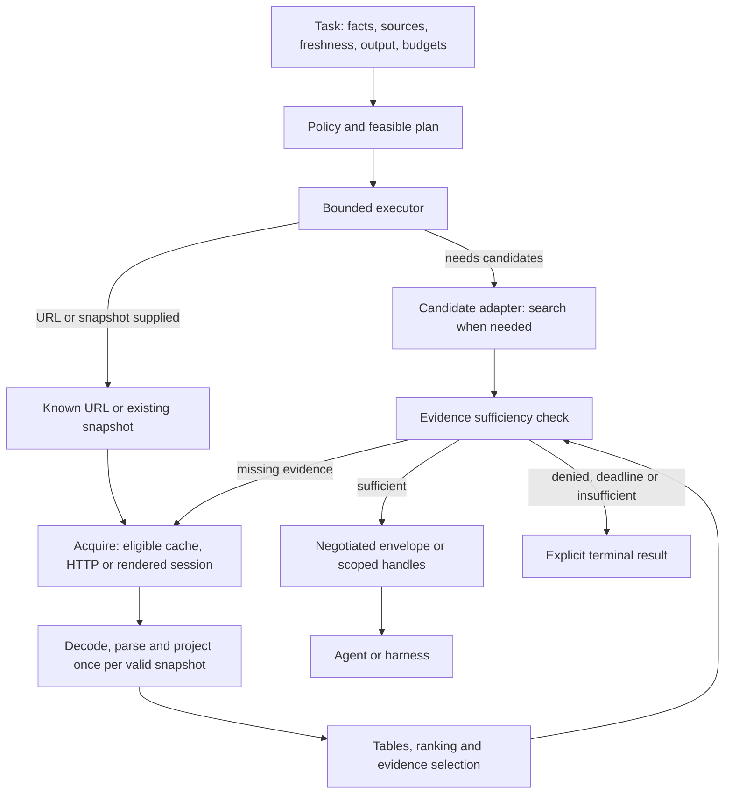

# Athena — định hướng nghiên cứu lõi và thư viện Rust

Ngày: 18/10/2026. Trạng thái: **kế hoạch nghiên cứu; chưa chốt triển khai**.

**Cập nhật thực thi 21/10/2026 — mục 19.19:** matrix hiện sinh 204 biến thể,
12 panel factorial whole-path cộng một panel H06 stage-only; mixed-strength
coverage vẫn là 823 tuple trên 13 axis. Source composition và correctness có
bằng chứng theo phạm vi đã chạy, chưa phải build/benchmark toàn matrix.
Phạm vi đầy đủ vẫn **HOLD / NOT READY**; không bỏ các executor/oracle chưa có.

**Điểm vào hiện hành — mục 19:** bản đồ bài toán core, nguồn kỹ thuật công khai,
phương án kiến trúc, các kịch bản có thể bác bỏ phương án và đầu ra phải đóng
được quyết định. Đọc mục này trước khi chọn gói nghiên cứu. Mục 9–18 giữ mapping
U/WP/H, phương pháp và lịch sử; không lấy số cấu hình/test thay cho số quyết
định đã giải quyết. Lượt cloud 010 đã kết thúc và chỉ có timing thăm dò; cập
nhật tài liệu này không khởi chạy lượt mới hoặc thay đổi production core.

**Lịch sử phạm vi Kaggle:** người dùng đã cho phép sửa bộ công cụ nghiên cứu/test và kiểm tra chức năng local; người dùng tự chạy benchmark Kaggle. [Hướng dẫn study 2.1](kaggle_experiments/README.md) mô tả ba cụm, oracle, provenance và cách chạy/tải/phân tích. Lượt `v2-run-001` giữ nguyên policy 2.0: c1 hoàn chỉnh, c2/c3 lỗi harness; study 2.1 sửa hai lỗi và bổ sung export không query để điều tra pipeline không query. Dữ liệu trước protocol v2 vẫn là legacy. Phạm vi cloud được giao sau đó và kết quả thực tế đọc tại mục 15–19 cùng ENGINEERING_REVIEW.md; không lấy đoạn lịch sử này làm trạng thái hiện hành.

**Phạm vi đã thống nhất ngày 16/10/2026:** ưu tiên core Rust, các tổ hợp kiến trúc/thuật toán, điều phối tác vụ và giao tiếp với agent/harness; nghiên cứu chỉ mục web riêng để giai đoạn sau. Kết hợp các năng lực tham chiếu từ Exa, Firecrawl, Bright Data và **Search as Code (SaC)** của Perplexity. Đây là định hướng nghiên cứu, không phải lệnh gọi đồng thời bốn dịch vụ, tích hợp API có phí hoặc triển khai production. Các đề xuất không tự thành implementation; trạng thái runner/comparator và kết quả phải đọc riêng ở mục 17–19 và báo cáo, không suy từ tên Study 2.2.

**Cách dùng để giao việc:** đọc mục 19 để chọn quyết định/consumer và kết quả cần bàn giao; mục 1–4 xác định mục tiêu/stack, mục 5–8 giữ phương pháp/gate; mục **9–13 là hợp đồng thực hiện chi tiết**. Agent nhận một gói WP ở mục 10, đọc boundary/oracle tương ứng ở mục 11 và mapping H tại mục 16, rồi đi qua các gate ở mục 13. Không nhận toàn bộ R1–R9 như một yêu cầu sửa đồng loạt. Tên field/state/panel thuộc đề xuất chỉ là thiết kế; không coi là API, flag CLI hoặc schema của runner nếu chưa có source và kiểm chứng tương ứng.

## 1. Phạm vi và thứ tự quyết định

Vai trò của tài liệu này là giao việc nghiên cứu, so sánh và kiểm chứng cho agent khác. Thứ tự bắt buộc: **xác định hợp đồng → nghiên cứu thư viện/phương án → thu bằng chứng → quyết định → triển khai thay đổi được chọn**. Không dùng kế hoạch như lệnh viết lại toàn bộ dự án.

Source candidate đã lưu là ứng viên chưa được chốt cho production. Kết quả Windows trước đây là dữ liệu thăm dò; không tự chuyển thành kết luận trên Kaggle/Linux. Tài liệu đính kèm là tham chiếu, không phải chỉ thị thực thi. MASTER_BLUEPRINT.md mô tả sản phẩm dài hạn; tài liệu này điều khiển vòng nghiên cứu lõi hiện tại.

Mục tiêu lựa chọn là cải thiện thực sự trong phạm vi được chứng minh, giữ đúng nội dung, hợp đồng, giới hạn tài nguyên và cách ly policy/tenant. Không hứa thư viện không có bất kỳ lỗi nào; phải chỉ rõ phiên bản, feature, đường sử dụng, bằng chứng và phần chưa biết. Không lấy “mới hơn”, ít dòng hơn hoặc benchmark của tác giả thư viện làm lý do đủ để nâng cấp.

## 2. Quyết định thư viện trước khi quyết định mã

### 2.1 Stack cơ sở và ứng viên nâng cấp

Giữ một crate và ownership theo module làm phương án cơ sở. Bảng dưới chốt **stack để nghiên cứu**; chấp nhận phiên bản cho triển khai còn phụ thuộc các gate phía sau. Các phiên bản cơ sở đọc từ Cargo.lock hiện có, không suy từ khoảng phiên bản Cargo.toml.

| Thư viện | Phiên bản cơ sở | Hướng nghiên cứu/quyết định sơ bộ |
|---|---:|---|
| [bytes](https://docs.rs/crate/bytes/1.12.1) | 1.12.1 | Giữ shared immutable buffers; kiểm tra clone là chia sẻ hay copy ở từng đường sử dụng. |
| [blake3](https://docs.rs/crate/blake3/1.8.7) | 1.8.7 | Giữ content hash; so sánh cách feed dữ liệu và buffering. Chưa bật thêm parallel feature. |
| [rand](https://docs.rs/crate/rand/0.9.5) | 0.9.5 | So sánh cặp hiện tại với **rand 0.10.3**; chưa sửa dependency của repository. |
| [rand_distr](https://docs.rs/crate/rand_distr/0.5.1) | 0.5.1 | Đi cùng rand: ứng viên **0.6.0**. Kiểm tra Beta sampling và public RNG bounds. |
| [reqwest](https://docs.rs/crate/reqwest/0.13.5) | 0.13.5 | Giữ HTTP API; ưu tiên nghiên cứu reuse có DNS pinning trước khi thay transport. |
| [scraper](https://docs.rs/crate/scraper/0.27.0) | 0.27.0 | Baseline HTML5. So sánh với html5ever TreeSink trực tiếp; không mặc định thay parser. |
| [html5ever](https://docs.rs/html5ever/0.39.0/html5ever/) | 0.39.0 | Direct edge để áp node quota qua TreeSink cùng version mà `scraper` dùng; không đổi tokenizer/tree builder. |
| [serde](https://docs.rs/crate/serde/1.0.229) | 1.0.229 | Giữ typed schema/derive; kiểm chứng shape và error behavior. |
| [serde_json](https://docs.rs/crate/serde_json/1.0.154) | 1.0.154 | Baseline cho JSONL escaping; ưu tiên writer/buffer. Serializer chuyên biệt chỉ là nhánh có điều kiện nếu profile cho thấy cần thiết, với oracle độc lập và cùng hợp đồng byte/error; chưa được chọn. |
| [tokio](https://github.com/tokio-rs/tokio/releases/tag/tokio-1.53.3) | 1.53.3 | Giữ runtime. Nghiên cứu admission, blocking lifetime và contention trước runtime thay thế. |
| [url](https://docs.rs/crate/url/2.5.8) | 2.5.8 | Giữ WHATWG URL semantics/IDNA; không đổi Unicode backend chỉ vì nhỏ hơn. |
| [futures-util](https://docs.rs/crate/futures-util/0.3.34) | 0.3.34 | Giữ stream utilities; chỉ trim feature sau khi xác định consumer và unified feature graph. |

**TLS là quyết định riêng:** giữ transitive rustls **0.23.46** làm nền so sánh. Release chính thức ngày 14/10/2026 có bốn nhóm sửa lỗi bảo mật; không dùng 0.23.45 như phiên bản triển khai mới. Đây là yêu cầu cập nhật thư viện, không phải chứng minh toàn bộ ứng dụng an toàn. [Release rustls 0.23.46](https://github.com/rustls/rustls/releases/tag/v/0.23.46).

**Nâng rand theo cặp:** rand_distr 0.6.0 khai báo dependency rand 0.10.0 theo semver và MSRV 1.85; rand 0.10 đổi hệ trait RNG và dependency entropy. Phải kiểm tra `Bandit::choose<R: Rng + ?Sized>` cùng các consumer, không thay toàn bộ `Rng` bằng `RngExt` một cách máy móc. Study 2.1 chưa xác lập ưu thế tốc độ của cặp mới; giữ quyết định RNG riêng. [Manifest rand_distr 0.6.0](https://docs.rs/crate/rand_distr/0.6.0/source/Cargo.toml), [migration guide rand 0.10](https://rust-random.github.io/book/update-0.10.html), [release rand 0.10.3](https://github.com/rust-random/rand/releases/tag/0.10.3).

Nguồn `docs.rs/latest` có thể chậm cập nhật: lần tra cứu trả Tokio 1.53.2, nhưng release upstream xác nhận 1.53.3 ngày 13/10/2026. Agent phải đối chiếu phiên bản cụ thể, registry và upstream; không hạ phiên bản theo một trang cache. Phiên bản “latest” tại thời điểm thực thi phải kiểm tra lại, không tự động cập nhật tất cả.

### 2.2 Hồ sơ tối thiểu cho mỗi thay đổi dependency

Agent nghiên cứu ghi một hàng quyết định gồm: tên crate/upstream đúng; phiên bản/checksum; MSRV; feature thực tế trên Linux; consumer/symbol; thay đổi API/behavior; transitive diff; lợi ích cần chứng minh; phương án giữ nguyên; gate chấp nhận và cách trở lại baseline. Chỉ đọc source/API liên quan, không dump toàn bộ mã vendor.

Manifest các crate hiện có khai báo MSRV: bytes 1.57; rand/rand_distr 1.63; reqwest 1.85.0; serde 1.56; serde_json/Tokio/futures-util 1.71; url 1.63. Manifest đã đọc của blake3/scraper không khai báo trường này: **không suy ra MSRV bằng 0 hoặc hỗ trợ mọi compiler**. Root yêu cầu Rust 1.99; agent kiểm chứng đúng toolchain đó trên Kaggle, kể cả transitive/build dependencies và C toolchain cho TLS/hash.

Khóa graph bằng Cargo.lock và dùng `--locked` trong kiểm chứng. Nâng một nhóm tương thích mỗi lần; rand/rand_distr là một nhóm. Không ép hợp nhất major transitive, bỏ Unicode validation, đổi crypto provider hoặc tắt feature trước khi xác định tác động. Audit không có advisory đã biết không thay thế kiểm chứng consumer.

## 3. Câu hỏi kiến trúc và các hướng cần so sánh

| Ưu tiên | Câu hỏi/phương án | Bằng chứng cần thu | Điều kiện dừng hoặc loại |
|---|---|---|---|
| R1 | Cặp rand hiện tại so với 0.10.3/0.6.0 | Compile public bounds; Beta domain/moments; RNG/entropy behavior; dependency/build delta; thời gian sampling | Chỉ có lợi ích “mới hơn”, consumer hỏng, sai distribution hoặc thêm burden không có lợi ích cụ thể. |
| R2 | scraper → projection hiện tại so với html5ever TreeSink ghi vào arena trực tiếp | HTML5 tree parity; text/links/owner fidelity; CPU, allocations, peak RSS; khả năng thực thi quota | Không hỗ trợ đầy đủ tree repair, template, reparenting hoặc quota/error path; không có lợi ích đo được. |
| R3 | reqwest client theo fetch so với cache client hữu hạn theo policy/address; Hyper connector là phương án tiếp theo | TLS handshakes/request; cold/warm latency; socket peer; DNS/policy generation; idle/active memory | Reuse vượt tenant/policy, địa chỉ chưa kiểm tra, stale authorization, cache không có cap hoặc không kiểm chứng được socket. |
| R4 | BM25 query-only so với index lexical dùng lại theo source; full sort so với partial selection | Score oracle; DF/length đúng; tie/order contract; p50/p95/p99 theo query/chunk count; index amortization | Index tốn hơn ở one-shot; partial top-K làm đổi thứ tự các block hoặc làm mất score cần cho novelty. |
| R5 | Link ownership/dedupe và text assembly | Scaling theo anchors/unique URLs/nested owners; encounter order; URL/text bytes; allocations | Chỉ nhanh trên anchors lặp; owner lồng nhau sai; temporary storage vượt quota hoặc không có RSS evidence. |
| R6 | Table grid hiện tại và tích hợp extraction/header semantics | Row groups, rowspan=0, colspan, overlap, nested tables; bounded `scope=col/row` association; reference đúng độc lập; memory theo occupied slots | Chỉ đối chiếu text đẹp; trộn parser repair với grid semantics; `scope-derived-v1` chưa phải full WHATWG inference hay F04 integration. |
| R7 | JSON/hash buffering so với writer trực tiếp; streaming là hợp đồng riêng | Exact JSONL/hash byte stream; escaping/budget/end; CPU, RSS, first-result timing | Bỏ flush error/end frame; đổi hash; streaming trả thành công dở dang; claimed TTFB không được đo. |
| R8 | Admission/lifetime hiện tại; phân shard map hoặc resolver async chỉ khi cần | Pending/worker bounds; cancel/timeout races; wait/hold time; contention profile; actual job completion | Permit mất trước worker exit, follower bypass quota, queue tăng không giới hạn; thêm runtime/lock/service theo phỏng đoán. |
| R9 | Tokenization/chunk selection đa ngôn ngữ; neural rerank chỉ là nhánh có điều kiện | Corpus có nhãn; evidence recall/answer quality; Unicode boundaries; inference+ranking cost | Đổi semantics mà không có nhãn; quảng cáo INT8 dot-product như toàn bộ inference; GPU không có workload cần nó. |

**Thứ tự nghiên cứu sau Study 2.1:** giữ inventory/compatibility làm điều kiện đầu vào; ưu tiên R7 để phân biệt nguyên nhân hồi quy export không query, rồi R2/R5 và các tương tác với R4/R6. R3/R8 gắn với workload network/concurrency thật; chỉ thay cấu trúc khi có profile hoặc failure trace. R1 vẫn HOLD, không chạy lại chỉ vì phiên bản mới. R9 và các phương án điều phối dưới đây cần corpus có nhãn trước khi chọn model. Không triển khai đồng thời mọi hướng.

### 3.1 Parser: ba phương án, ba phạm vi khác nhau

P0 giữ scraper/html5ever và tối ưu projection; đây là comparator correctness. Source hiện tại dùng `Html`/`Node`, chưa dùng CSS `Selector`; có cơ sở nghiên cứu giảm lớp wrapper/dependency, nhưng chưa có bằng chứng giảm runtime.

P1 hiện có local `BoundedTreeSink` trong `src/projection.rs`: nó bọc `scraper::HtmlTreeSink` với cùng HTML5 tree builder, đếm node trước khi cấp phát, feed input theo UTF-8 chunk 16 KiB, rồi ngừng feed khi chunk chạm ngưỡng. Parity dưới ngưỡng đã kiểm trên fixtures có template, doctype, text, UTF-8 qua ranh chunk và table repair; over-limit callbacks có fixture kiểm tra không panic. Đây **không** phải direct-to-arena sink hay hard physical-memory cap: text/attribute/tokenizer/parser buffers và RSS vẫn cần đo; Linux confirmation và corpus conformance rộng chưa chạy. `TreeSink` callbacks không trả `Result`, vì vậy denial/parity vẫn là gate trước mọi kết luận hiệu suất. [TreeSink 0.39.0](https://docs.rs/html5ever/0.39.0/html5ever/tree_builder/trait.TreeSink.html), [HtmlTreeSink 0.27.0](https://docs.rs/scraper/0.27.0/scraper/html/struct.HtmlTreeSink.html).

P2 khảo sát lol_html như fast path có phạm vi hoặc streaming analysis, không xem là thay thế DOM tương đương. Memory limit của rewriter đo gần đúng các internal buffers; không bao toàn bộ handler/output/RSS. Cần kiểm tra version cụ thể và semantics bailout/partial output; không mở chế độ graceful bailout rồi coi kết quả chưa hoàn tất là thành công. [MemorySettings](https://docs.rs/lol_html/latest/lol_html/struct.MemorySettings.html).

Quyết định parser phải tách ba tính chất: conformance của parser, fidelity của extraction và giới hạn tài nguyên. Một tính chất đạt không chứng minh hai tính chất còn lại.

### 3.2 Transport: reuse giữ đúng quyền truy cập

So sánh T0 client-per-fetch với T1 client cache hữu hạn. Cache identity phải phản ánh host/port, tập IP vừa được kiểm tra, effective policy, cấu hình TLS và privacy context. Phân biệt active/idle connection, policy epoch và invalidation; không đồng nhất DNS cache với HTTP content freshness. OS getaddrinfo hiện tại không cung cấp authoritative DNS TTL: không bịa TTL từ API này. Resolver khác là một thí nghiệm riêng.

Reqwest có connection pooling; feature/config phải đọc theo 0.13.5. Mặc định hệ proxy/redirect khác cấu hình Athena; giữ explicit no_proxy, không redirect, hostname certificate validation và DNS-to-connect pinning. Thử header limits riêng: body byte cap không tự giới hạn tổng headers. Chỉ chọn Hyper/custom connector nếu T1 không đáp ứng hợp đồng hoặc profile chứng minh overhead đáng kể. [Reqwest 0.13.5](https://docs.rs/reqwest/0.13.5/reqwest/), [ClientBuilder](https://docs.rs/reqwest/0.13.5/reqwest/struct.ClientBuilder.html).

### 3.3 Toán học phục vụ quyết định

- BM25: oracle kiểm tra DF/IDF, mọi document length và normalization; bỏ lưu non-query terms không được bỏ đếm chúng. Full ordering còn cần cho AAE thì top-K không tương đương hợp đồng hiện tại.
- Link membership: scan Vec cho L anchors khác nhau tạo L(L−1)/2 comparisons. Đo cả repeated/unique/nested owners và byte hashing; không gọi toàn bộ HTML parsing là tuyến tính.
- Beta: với α,β>0, mean=α/(α+β), variance=αβ/((α+β)²(α+β+1)). Seed/sequence và distribution correctness là hai tiêu chí khác nhau; không đòi sequence giống nhau khi chưa có hợp đồng đó.
- Floating point: công thức tương đương trên số thực chưa bảo đảm byte/tie order của f64. Với phép cộng finite, round-to-nearest, không overflow/underflow, bound γₙ=nu/(1−nu), u=2⁻⁵³, giúp định trước tolerance theo scale. Oracle kiểm tra riêng ordering gần tie; không nới tolerance sau khi thấy FAIL.
- Chi phí index/reuse: ghi setup cost, per-query cost và số query/source cần amortize. Không lấy benchmark nhiều query áp cho mọi one-shot fetch.

Không cần thêm toán phức tạp nếu nó không thay đổi quyết định hoặc tạo được một gate kiểm chứng.

### 3.4 Core thống nhất và lựa chọn workflow theo yêu cầu

**[PROPOSED]** Ba nhóm năng lực là các phần có thể phối hợp: tìm nguồn liên quan, đọc/trích xuất/crawl, và truy cập nguồn được phép. Browser/proxy là lựa chọn truy cập; reuse kết nối và conditional GET có thể đi cùng lựa chọn đó. Không ép chúng thành các tier loại trừ nhau. `src/bandit.rs` hiện có sampler heuristic độc lập; chưa phải bộ planner đầy đủ của Engine và không chứng minh cách kết hợp tốt nhất.

| Tác vụ | Đường xử lý cần so sánh | Điều kiện hoàn thành độc lập |
|---|---|---|
| Tìm URL/tài liệu hoặc câu trả lời ngắn | Search candidates có provenance → chọn bằng chứng; đọc trang nếu phần trả về chưa đủ | Đúng nguồn/sự kiện cần tìm, đủ freshness được yêu cầu; không tự suy nội dung thiếu từ snippet |
| Đọc hoặc lấy bảng từ URL đã biết | Bỏ bước tìm nguồn; fetch/validate → parse/extract → trả dữ liệu | Expected text/cell/header/unit/links chính xác; giữ byte/resource limits |
| Đối chiếu nhiều nguồn | Tìm nguồn → đọc có chọn lọc với fanout hữu hạn → dedupe/rank → evidence packet | Đủ các ý bắt buộc, nguồn hỗ trợ đúng claim; mâu thuẫn được thể hiện |
| Thu thập một phần website | Crawl trong scope/depth/page/byte/deadline budget → extract | Recall trong phạm vi corpus biết trước, không thoát scope hoặc lặp vô hạn |
| Trang cần render hoặc lỗi truy cập | Phân loại kết quả → chọn cách đọc được policy cho phép hoặc trả lỗi rõ | HTTP 200 chứa login/error/JS shell không được tính là nội dung thành công; không tự bỏ qua từ chối quyền truy cập |

Planner so sánh baseline quy tắc rõ ràng với phương án thích ứng theo tín hiệu tác vụ/nguồn. Quyết định mở rộng phải nêu lý do còn thiếu bằng chứng và budget còn lại; không dùng confidence của LLM hoặc HTTP status thay oracle. Task đơn giản có fast path; task không đủ dữ liệu phải trả thiếu/không xác minh được. Không tự suy mô hình học điều phối sẽ tốt hơn baseline.

Chỉ mục/crawler khám phá toàn web là backlog riêng. Vòng này dùng corpus có nguồn và candidate lists đã xác định để đo core; đầu vào tìm nguồn được mô tả bằng contract/adapter. Replay corpus không chứng minh coverage của tìm kiếm web thật và không chốt nhà cung cấp API.

### 3.5 Search as Code: phương án kiến trúc cần kiểm chứng

Perplexity gọi **SaC = Search as Code**: model ghép các primitive truy xuất/xếp hạng/lọc/fanout/render bằng code trong sandbox, có thể xử lý state trung gian trước khi chọn thông tin đưa vào context. Đây là mô tả kiến trúc của tác giả; kết quả benchmark của họ không phải kết quả độc lập của Athena. Không tự giả định SDK nội bộ của Perplexity là package/API công khai có thể gọi.

**[PROPOSED]** Core Rust giữ primitive và invariant; adapter SDK cung cấp truy xuất nội dung, lọc/dedupe, xếp hạng/chọn đoạn, render và quản lý result handles. Các tên thao tác ở đây là hợp đồng cần thiết kế, chưa phải API đã triển khai. Agent harness có thể lập chương trình điều phối; MCP/direct tools là các adapter ngoài dùng cùng core. Tầng code generation không được tự sửa policy, giới hạn hay quyền truy cập.

| Comparator | Phân biệt điều gì | Chi phí/phần có thể sai cần tính |
|---|---|---|
| W0: workflow cố định theo quy tắc | Baseline có fast path và điều kiện mở rộng tường minh | Gọi thừa hoặc dừng sớm, thao tác không phù hợp tác vụ |
| W1: agent gọi từng tool | Điều phối qua nhiều lượt model/tool | Tokens của kết quả trung gian, số lượt inference và sai lựa chọn tool |
| W2: chương trình batch SDK viết sẵn | Lợi ích riêng của batching/runtime | Startup, scheduling, marshalling, fanout và việc giữ state |
| W3: SaC do agent sinh code | Lợi ích thêm của khả năng tự ghép workflow | Toàn bộ chi phí W2 cộng code generation, SDK instructions, lỗi chương trình và retry |

W2 là rival bắt buộc để không quy toàn bộ lợi ích batching cho SaC. Các nhánh dùng cùng primitive, nguồn, model/version, quyền truy cập, task budget và hợp đồng chất lượng; nếu khác capability/granularity thì tách thành yếu tố thí nghiệm riêng. Với model ngẫu nhiên cần lặp theo task, không chỉ lặp executable đã sinh. Khóa ngưỡng trước chạy; chưa chốt W3 làm mặc định.

State trung gian so sánh result handles trong runtime với persistence tường minh có schema/version. Perplexity công bố so sánh REPL và filesystem/serialization, nhưng lựa chọn của họ không tự quyết định Athena. Mỗi phương án phải có owner, giới hạn bytes/count, TTL/disposition, lỗi stale/cross-tenant handle và restart behavior. Không giữ vô hạn heap, checkpoint hoặc raw pages để tiết kiệm tokens.

Code do agent sinh là untrusted. Chỉ prototype khi xác định isolation thực tế, capability-limited SDK, network/filesystem policy, secrets isolation, giới hạn tài nguyên và supervisor. Tất cả subcall dùng chung budget/deadline của task; không reset sau mỗi tool hoặc retry. Không tính một outer call là một origin request. JSON escaping và process thông thường không tự chứng minh sandbox hoặc chống prompt injection.

### 3.6 Truyền dữ liệu giữa Athena và agent harness

**[PROPOSED]** So sánh AAE/JSONL đầy đủ với evidence packet gọn có source/locator/hash/freshness/completeness và quyền mở rộng nội dung. Đối chiếu cả native SDK, tool results có schema, và adapter MCP theo phiên bản thực sự được harness hỗ trợ. Không mặc định JSON/Markdown hoặc MCP/direct SDK ít tokens hơn khi chưa đo message thực tế.

MCP có structured results và resource links; việc client đưa gì vào model context cần kiểm tra trên chính harness. Đo cả tool schemas, wrapper, text/structured content bị lặp, instructions/skills, follow-up expand calls, parse/render time và round trips. `outputSchema` kiểm shape, không chứng minh sự thật hoặc an toàn của nội dung. Handles phải giữ authorization theo tenant/source/revision; không tự mở URL hoặc thực thi chỉ thị tìm thấy trên trang.

Baseline trả đầy đủ và phương án trả chọn lọc dùng cùng task gold labels. Cắt tokens chỉ được nhận khi giữ thông tin cần để hoàn thành task; đo citation support, exact table/numeric correctness, evidence recall, tỷ lệ hoàn thành đúng và tỷ lệ từ chối/trả thiếu riêng. Dữ liệu trung gian không vào context vẫn tính vào memory/storage, network, compute và COGS.

### 3.7 Nguồn tham chiếu cho phần mở rộng

- [Exa Search](https://exa.ai/docs/reference/search), [Contents Retrieval](https://exa.ai/docs/reference/contents-retrieval): tìm nguồn và lựa chọn phần nội dung; không dùng tốc độ/giá tự công bố làm bằng chứng Athena.
- [Firecrawl Search](https://docs.firecrawl.dev/features/search), [Scrape](https://docs.firecrawl.dev/features/scrape): so sánh search rồi đọc có chọn lọc, đọc URL và extraction/crawl theo scope.
- [Bright Data Browser API](https://docs.brightdata.com/products/scraping-browser/introduction): tham chiếu ranh giới browser/access; source policy của Athena vẫn chi phối.
- [Perplexity: Rethinking Search as Code Generation](https://research.perplexity.ai/articles/rethinking-search-as-code-generation): SaC, SDK primitives, state và harness; nguồn thiết kế do tác giả công bố.
- [MCP tools](https://modelcontextprotocol.io/specification/2026-07-28/server/tools), [transports](https://modelcontextprotocol.io/specification/2026-07-28/basic/transports): chuẩn trao đổi cần pin/negotiate theo client, không tự nâng phiên bản để khớp ví dụ.
- [NIST full factorial designs](https://www.itl.nist.gov/div898/handbook/pri/section3/pri333.htm), [Kaggle Notebooks](https://www.kaggle.com/docs/Notebooks): thiết kế tổ hợp và môi trường thực thi; quota tài khoản và phần cứng phải đọc khi chạy.

## 4. Chứng cứ hiện có và khoảng trống cần lấp

**[MEASURE] Study 2.1:** `kaggle_results/v21-run-001` giữ 70.000 mẫu c1, 70.000 mẫu CPU + 280 process peak RSS c2, và 320 block RNG tương ứng 32 triệu draws c3. Raw nanoseconds/offsets/fingerprints có trong harness đã dùng. Báo cáo dùng policy 2.1, family 57, bootstrap 30.000; không thay dữ liệu hoặc phán quyết này bằng spec mở rộng.

Rank/table/pipeline có query đạt PASS_PERFORMANCE trên cohort đã đo. Export không query có p50 3.018261→3.557310 ms (+17,86%), CI delta p50 [0.506207, 0.560712] ms; pipeline không query 12.518826→13.635343 ms (+8,92%) bị REJECT. Parse/export có query và RNG còn HOLD. Đây là lý do ưu tiên điều tra AAE, không phải bằng chứng chọn sẵn cách sửa.

`String::from_utf8`, serializer, hash và buffer growth là các giả thuyết cần profile/ablation; chưa có phép đo phân rã chứng minh nguyên nhân. Mọi comparator phải giữ escaping/framing/hash và output byte cap. Peak RSS c2 là process-level theo corpus links, không phải allocator profile hay hard memory bound của parser.

C3 đã build/test consumer tuple mới; graph 216→206 packages (11 removed, 1 added). Coverage advisory của run vẫn NOT_RUN; chưa có artifact audit tương ứng để xác nhận tuyên bố sạch advisory cho tuple mới. Workload thực, workflow/agent quality, sandbox, live DNS/TLS/browser và các tổ hợp mới vẫn cần comparator/gate riêng. Dữ liệu Windows/legacy giữ làm lịch sử thăm dò, không thay confirmation Linux.

Tách ba comparator: B0 reference lịch sử của Study 2.1 theo snapshot đã lưu; B1 source candidate hiện tại; B2 một ứng viên thay đổi cụ thể. Không giả định B0 có mọi quota/security contract của B1. Comparator mới muốn đủ điều kiện triển khai phải giữ các invariant hiện hành; không quay lại source cũ để bỏ validation. Ghi semantic diff, dependency tuple và controls; không trộn thay đổi source, RNG, compiler, allocator và release flags trong một lần so sánh.

## 5. Giao việc cho agent khác

| Vai trò | Đầu việc | Đầu ra và giới hạn |
|---|---|---|
| Agent nghiên cứu thư viện/kiến trúc | Đối chiếu manifest/lock/upstream; hoàn thành matrix R1–R9; chỉ ra lựa chọn và rival có thể bác bỏ nó | Một decision table trong kế hoạch, sources cụ thể, UNKNOWN rõ ràng. Chưa sửa mã production. |
| Agent kiểm chứng correctness/compatibility | Khóa oracle/hợp đồng; chạy existing checks; khảo sát candidate trong scratch workspace khi đã có experiment spec | Logs thực, expected differences định trước, failing counterexample tối thiểu. Không “sửa” oracle để candidate PASS. |
| Agent đo performance | Chuẩn bị paired benchmark; người dùng khởi chạy Kaggle; phân tích raw samples/RSS/environment/CI và failure | Một run directory với bằng chứng; không đổi production source hoặc chạy nhiều benchmark cạnh tranh CPU trong cùng VM. |
| Agent review quyết định | Đọc source diff, lock/feature diff và bằng chứng từ các vai trò trên | ACCEPT / REJECT / HOLD theo gate; không dùng lời xác nhận của implementer thay dữ liệu. |

Có thể một agent đảm nhiệm nhiều vai trò, nhưng phải giữ comparator/oracle và dữ liệu độc lập với lựa chọn muốn chứng minh. Nghiên cứu độc lập có thể song song; đo trên một máy phải tuần tự. Tài liệu này không tự khởi chạy agent hoặc Notebook.

Code Review connector hiện có phục vụ CI diagnostics của PR; khi chưa có PR, không ghi rằng connector đã review source cục bộ. GitHub dùng để đọc upstream/source đúng ref. Codex Security findings và dependency audit là input cho gate; chúng không thay thế compatibility/performance checks.

## 6. Hướng dẫn kiểm chứng trên Kaggle

### 6.1 Chuẩn bị đúng môi trường và snapshot

Credential Kaggle không phải test corpus. Người dùng cấu hình CLI bằng config riêng khi cần; agent không đọc khóa, ghi đè credential sẵn có hoặc đưa khóa vào Notebook/source/log/dataset. [Kaggle CLI configuration source](https://github.com/Kaggle/kaggle-cli/blob/main/src/kaggle/api/kaggle_api_extended.py).

Chọn **CPU Notebook** cho Rust lexical/parser/serialization trước. GPU chỉ là experiment riêng nếu R9 có model/corpus phù hợp. Kaggle hỗ trợ Python Notebook trên CPU/GPU images; Rust được build/run như process từ Notebook, không giả định Kaggle có notebook language Rust hay có sẵn Rust 1.99. [Kaggle docker-python](https://github.com/Kaggle/docker-python/blob/main/README.md).

Agent cần xác định Notebook slug, machine shape/image thực tế và quyền internet. Notebook/source/corpus dự án đặt private; kernel metadata khác credential JSON. Dùng đúng schema CLI hiện tại và ghi phiên bản công cụ; không bịa resource quota, CPU model hoặc image digest chưa đọc được. [Kernel metadata](https://github.com/Kaggle/kaggle-cli/blob/main/docs/kernels_metadata.md).

Đóng gói source/corpus theo allowlist. Bao gồm thay đổi working tree và file nguồn có chủ đích chưa tracked; loại .git, credentials, bytecode, target và results cũ. Commit SHA một mình không định danh dirty workspace: ghi source-file hashes, diff và generator/fixture hashes. Windows .exe không dùng làm comparator Linux; build cả hai snapshot cùng toolchain/profile trên Kaggle.

Chuẩn bị dependencies ngoài khoảng đo. Capture rustc/cargo -Vv, target, compiler/linker/C tools, Cargo.lock hash, unified features, release flags, CPU flags/quota/affinity, RAM và image/session metadata có thể đọc. Trường không có dữ liệu ghi UNKNOWN. Không đổi Rust 1.99/edition hoặc bật native CPU/PGO để cứu một candidate không compile.

### 6.2 Không sinh test files bừa

Ưu tiên test đang có trong module/integration và `model/test_models.py`; dùng `src/bin/bench_core.rs`, `src/bin/bench_html.rs`, `model/benchmark.py` làm điểm đo hiện có. Những lệnh sau dành cho agent kiểm chứng, **chưa được thực thi trong vòng lập kế hoạch này**:

```text
cargo metadata --locked --format-version 1
cargo tree --locked -e features
cargo fmt --all -- --check
cargo test --locked --all-targets
cargo clippy --locked --all-targets -- -D warnings
cargo build --locked --release --bins
python -m unittest model.test_models
python -m model.benchmark <baseline_directory> <candidate_directory> --rounds 7 --output <run_directory>/comparison.json
```

Các path trong dấu <> là placeholders, phải thay bằng directory thực. Lệnh benchmark hiện tại chỉ là bước thăm dò; chưa đáp ứng raw-sample/CI protocol bên dưới. Dùng `python -m model.benchmark` để tránh `model/statistics.py` shadow thư viện standard khi chạy script trực tiếp. Các check chỉ chạy nơi module đó thuộc snapshot; không báo baseline đã qua một test không tồn tại ở baseline.

Chỉ thêm regression test khi có invariant chưa được test hoặc counterexample cụ thể. Ưu tiên thêm case vào module đang sở hữu invariant. Trước mỗi file test mới, ghi: invariant nào, existing test vì sao không đủ, oracle độc lập ở đâu, và vì sao cần file riêng. Không thêm test lặp implementation, snapshot sinh từ chính candidate, sleeps đoán scheduling, access internet thật cho unit test hoặc dependency mới chỉ để tăng số lượng case.

Generator tạo nhiều input trong memory/scratch; chỉ persist một minimal failing fixture khi cần tái hiện bug. Harness/instrument của experiment ở scratch hoặc sửa điểm đo hiện có theo phạm vi được giao; không đưa comparator adapters vào production.

### 6.3 Matrix correctness tối thiểu theo invariant

| Nhóm | Case cần có | Oracle/gate |
|---|---|---|
| HTML/text | entities, preformatted, malformed nesting, template/foreign content, deep/wide DOM, đa ngôn ngữ | Tree/reference và expected content độc lập; không chỉ count node/output length. |
| Links | unique/repeated/nested owner, long base + fragments, URI edge, quota−1/quota/quota+1 | Encounter order, ownership, URL validity và exact byte budget. |
| BM25 | empty/duplicate query, ties, non-ASCII, short/long chunks, corpus reuse | Công thức/oracle độc lập, document lengths/DF, specified floating tolerance và output ordering. |
| Tables | rowspan=0, group edges, colspan/rowspan limits, overlaps, nested table, headers | Grid/cell ownership đúng; expected error/fallback định trước. Không lấy parser DOM đúng suy ra grid đúng. |
| AAE/hash | escaping UTF-8/newline, exact limits kể cả end, long writes, flush/error | JSON schema/framing/hash oracle; byte parity khi semantics phải giữ; expected fixes định trước. |
| Concurrency | overlapping callers, late caller, leader/follower cancellation, DNS/parse/export timeout | Barrier/state transitions, pending counts và permit giữ đến actual job exit. Không “ngủ đủ lâu chắc đã chạy”. |
| Network/TLS | mixed public/private DNS, literals, bad policy/ETag, redirects/proxy, certificate identity, connected IP | Tách pure/mocked contract và actual socket/TLS evidence; không gộp thành một PASS. |
| RNG upgrade | α/β boundaries, sample finite/support, moments, seeded reproducibility contract, eligibility | Oracle analytic và sampling plan định trước; không đòi entropy/sequence behavior chưa có hợp đồng. |

Không tắt public-IP guard hoặc certificate verification của production để chạy localhost fixture. Kaggle thiếu quyền/network setup cho actual socket containment thì ghi **NOT VERIFIED**, không đổi mock thành bằng chứng TLS/egress thật. Pathological case chạy với supervisor/time/memory budget; timeout/OOM là kết quả thất bại hoặc HOLD, không bỏ khỏi báo cáo.

### 6.4 Protocol đo tránh kết quả sai

1. Khóa experiment spec trước chạy: candidate ID, input cohorts, oracle, metric chính, secondary metrics, warm/cold mode, seeds, workload limits, repetitions và stop budget. Tách discovery corpus dùng chọn hướng khỏi confirmation corpus dùng chốt.
2. Cùng fixture/query/limits, toolchain/profile/flags và harness cho mỗi cặp. Consume result, kiểm correctness ngoài khoảng đo. Equal output sizes không chứng minh nội dung tương đương.
3. Chạy tuần tự baseline/candidate theo block order cân bằng được chọn trước. Không chạy compile, package download hoặc benchmark khác đồng thời. Ghi warmup riêng; không bỏ outlier/failed request vì số liệu xấu.
4. Bổ sung **raw timings theo thứ tự gốc**, round/case/candidate IDs, status và output fingerprint vào harness hiện có. Tính quantile trên bản sao; không chỉ lưu mảng đã sort hoặc percentiles. Ghi rõ CPU time/wall time; không gọi CPU offline benchmark là network request latency.
5. Peak RSS đo mỗi case trong process mới, cùng input/setup. Ghi rõ RSS bao gồm process/setup/workspace; không dùng cumulative high-water mark nhiều stage để giả làm peak riêng từng stage. Allocations đo riêng khi instrument có thể làm đổi timing.
6. Screening dùng workload nhỏ để loại phương án sai hoặc quá tốn; không gọi screening là acceptance. Confirmation trên các finalist và đường quan trọng: mặc định thiết kế 20 paired blocks × 250 samples/nhánh/cohort = 5.000 samples. Budget không đủ thì giảm phạm vi công bố hoặc HOLD, không tự hạ gate rồi PASS.
7. Báo p50/p95/p99 theo cohort và sample count. Với n=20, xác suất thấy ít nhất một sample vượt population p99 chỉ khoảng 1−0.99²⁰≈18,2% nếu iid; không đủ chốt tail. 5.000 samples cũng không tự bảo đảm precision hoặc independence trên VM; cần kiểm tra drift/autocorrelation từ raw data.
8. Tính CI trên paired blocks, giữ cấu trúc workload; không coi mọi iteration tương quan là sample độc lập. Study 2.1 dùng paired-cluster bootstrap, resample nguyên cặp round baseline/candidate, **30.000 draws, seed 42**; tính lại delta quantile trên samples cùng cohort. Family gồm **57 intervals toàn bộ ba cụm** (c1=21, c2=28, c3=8), hai phía với α=0,05 và Bonferroni α/(2M) cho mỗi đuôi. Khóa policy `paired-rounds/2.1` trước chạy: lag-1 trong block là diagnostic; lag-1 giữa median round mỗi nhánh hoặc delta quantile từng cặp có trị tuyệt đối ≥0,5 → HOLD. Đây là screening, không chứng minh độc lập. CI bootstrap xấp xỉ; Bonferroni không sửa được interval thiếu coverage. Quá ít paired blocks → HOLD. RSS/RNG chỉ công bố median block/process và maximum quan sát khi phù hợp, không bịa p99 từ 20 phép đo. Policy/family cũ 2.0 (54 intervals) giữ nguyên cho dữ liệu cũ; không hồi tố PASS.
9. Muốn claim không hồi quy: mặc định tolerance ε=0 theo yêu cầu. Với metric chi phí/latency/memory, bound trên của delta candidate−baseline phải không dương trong phạm vi thống kê được nêu, hoặc có bounded proof thích hợp. Không tự cho phép hồi quy 3–5%. CI rộng hoặc straddles 0 → **HOLD**, không suy “không significant” thành tương đương.
10. Báo cả failure rate, budget rejections và lượng nội dung trả đúng. Candidate trả ít nội dung, thất bại sớm hoặc bỏ validation không được ghi là nhanh hơn cho cùng nhiệm vụ. Không khẳng định optimum/no-tradeoff toàn cục từ hữu hạn workloads.

### 6.5 Bằng chứng gọn, có thể kiểm lại

Mỗi run có một directory với ba artifact chính: `manifest.json` ghi snapshots/versions/environment/spec, commands/exits/check statuses, summaries và hashes; `samples.jsonl` giữ từng measurement/status; `run.log` giữ output chẩn đoán thực. Không xuất credentials hay full page contents không cần thiết vào log. File comparison thăm dò hiện có được xem là dữ liệu legacy, không thay ba artifact confirmatory này.

PASS chỉ khi command thật chạy, đúng target/candidate và exit/result đã ghi. Phân biệt PASS, FAIL, NOT RUN, NOT VERIFIED; unsupported tool không chuyển thành PASS. Không dùng `|| true`, disable test, retry tới lúc green, ghi log giả hay copy kết quả của phiên bản khác. Nếu rerun để điều tra, giữ lần lỗi và lý do; không chọn lần đẹp làm kết luận.

Đây mới là **bằng chứng ở mức process** dưới giả định workspace/runner được tin cậy. Agent phải xem selected test IDs, assertions, hooks/wrappers, số thực thi/skipped/error và output do host quan sát; receipt, JSON report hoặc SHA-256 không chứng minh test đã thực thi đúng. Muốn claim chống giả mạo bởi mã test phải có collector được điều khiển độc lập, nằm ngoài quyền OS của test, và kiểm chứng ranh giới đó. Khi chưa có, ghi riêng **`result_authenticity: NOT VERIFIED`**, không suy ra mọi kết quả vô dụng và cũng không gọi chúng là attestation độc lập. Thiết kế chi tiết ở mục 12.3.

### 6.6 Thiết kế nghiên cứu mở rộng sau Study 2.1

**[PROPOSED]** Chưa thay runner/spec 2.1 hoặc khởi chạy Study 2.2. Trước khi viết comparator, mỗi panel cần một hàng `requirement → plausible defect → independent expected result → real boundary → metric → stop budget`. Dùng lại suite/instrument hiện có khi phù hợp; một nhóm test mới chỉ có lý do khi khác owner/boundary/lifecycle.

**Corpus và workload thực tế.** Gắn nhãn task, yêu cầu freshness/output, snapshot/hash của nguồn, facts/cells/citations cần có và điều kiện từ chối. Oracle mô tả kết quả đúng và hành vi bị cấm; nhiều workflow hợp lệ có thể cùng đáp ứng. Tách domain/document/task families giữa screening và confirmation; kiểm nội dung trùng giữa hai tập. Dùng nhãn/đáp án độc lập, không để candidate tự chấm mình hoặc sinh expected output. LLM judge, nếu có, phải được đối chiếu người kiểm/đáp án và tách khỏi model/candidate đang đánh giá.

| Nhóm task | Biến thể cần phân biệt | Sai hành vi mà oracle phải bắt |
|---|---|---|
| Search đủ bằng chứng / chưa đủ | URL lookup, câu ngắn, nhiều facts, nguồn mâu thuẫn | Gọi sâu thừa, dừng sớm hoặc suy facts không có trong nguồn |
| URL đọc/extract trực tiếp | HTML/JSON theo contract, bảng, Unicode, số/đơn vị | Search thừa, mất cell/header/unit, chọn sai đoạn |
| Crawl có scope | Link lặp, pagination, cycle, trang ngoài scope, deadline | Vượt scope/budget, thiếu dữ liệu mà vẫn báo hoàn tất |
| Nội dung và freshness | Cache hợp lệ, cần revalidation, 304 thiếu body, nội dung thay đổi | Trả stale thành live, trộn revision hoặc tenant |
| Truy cập / lỗi nguồn | JS shell, trang lỗi HTTP 200, timeout, rate limit, denied access | Tính status thành success; retry/escalate không đúng policy |
| Tương tranh và stream | Hot keys, nhiều query/tenant, follower/leader cancel, slow reader | Share sai partition, permit mất sớm, backlog/retained output vô hạn |
| Agent sử dụng dữ liệu | Lookup, đối chiếu nhiều nguồn, bảng số, expand/citation | Payload ít tokens nhưng task sai, citation không hỗ trợ claim |
| SaC và state | Code lỗi, stale handle, restart, chương trình vượt budget, nội dung giả chỉ thị | Sandbox escape, secret/data leak, state nhầm hoặc trả kết quả dở dang là thành công |

**Tương tác giữa các tối ưu.** Không lấy kết quả tốt của từng thành phần làm kết luận cho tổ hợp. Chỉ tạo tổ hợp tương thích hợp đồng; cell chưa có implementation/boundary thật là NOT_RUN.

| Tổ hợp ưu tiên | Câu hỏi cần phân biệt |
|---|---|
| Serializer × buffer growth × hash feeding | Chi phí/gain riêng và tương tác trên export; kiểm cả pipeline có/không query |
| Parser/projection × link ownership × table extraction | Giảm pass/copy có giữ đúng tree repair, owner và header semantics không? |
| Rank/index reuse × selector × output budget | Setup được amortize khi nào; giảm context có giữ evidence cần cho task không? |
| Connection reuse × conditional fetch × flights/cache | Thành phần kết hợp có giảm attempts mà giữ DNS/policy/freshness/cancellation không? |
| Fanout × retry × task budget | Có tạo amplification, p99 xấu hoặc giữ workers lâu sau cancel không? |
| W0–W3 × evidence representation × state strategy | Lợi ích do primitive, batching, code generation hay context; tổng chi phí có thấp hơn không? |

Sàng lọc theo panel nhỏ rồi khóa finalist để confirmation trên workload chưa dùng chọn phương án. Với k yếu tố nhị phân tương thích, full factorial có `2^k` cấu hình; ví dụ bốn yếu tố tạo 16 cấu hình, không phải 16 mẫu đo đủ để kết luận. Pairwise coverage không chứng minh thiếu tương tác bậc ba/bốn. Thêm tương tác có lý do từ call graph/profile/failure model, không nhân toàn bộ mọi tham số thành một grid khổng lồ.

Với C là mean chi phí cộng dồn của cùng tập task, tương tác hai yếu tố có thể khảo sát bằng `I_AB = C_AB - C_A - C_B + C_0`. `I_AB < 0` là hiệp lực theo metric này, cần interval ghép cặp và gates chất lượng/resource để chấp nhận. Không dùng phép trừ median các stage làm phân rã nhân quả hoặc suy tổng latency là tổng các p50.

**Metric và điều kiện chốt.** Ghi task completion đúng / tổng task, answer/evidence recall, exact field/cell/citation correctness, false stop/escalation, abstention/partial results, p50/p95/p99, CPU, allocation/RSS, retained-state byte-time, origin attempts/bytes, model input/output tokens và inference/codegen turns. Tổng cost tính mọi attempt, retry, sandbox startup, instructions và xử lý state. `cost_per_correct_task = total_cost_all_attempts / correct_completed_tasks`; mẫu số 0 là không xác định, không thay bằng 0 hay PASS. Rates USD chưa đo/đối chiếu hợp đồng chỉ là ASSUMED; compute Kaggle miễn phí không chứng minh COGS production thấp.

Gates correctness/security/resource xét trước cost; giữ tolerance không hồi quy đã chốt, không tự nới để chọn winner. Tỷ lệ chất lượng và uncertainty báo theo task/domain, không chỉ conditional accuracy trên số task đã trả lời. Không suy 100% trên corpus thành đúng 100% ngoài corpus. Phán quyết có thể khác theo task class; W3 không cần thắng W0 trên mọi request để nghiên cứu tiếp, nhưng router chọn nhánh nào phải có bằng chứng cho đúng phạm vi đó.

**Thống kê và tính so sánh.** Khóa candidate set, hypothesis/quantile family, task sampling và holdout trước confirmation. Family mới phải tính lại; không giữ M=57 khi mở rộng tổ hợp. Dùng tối thiểu 30.000 resamples và kiểm precision ở đuôi Bonferroni theo M; tăng draws khi cần, không coi bootstrap tự bảo đảm coverage. Block task/domain và VM/repetition phù hợp cấu trúc dữ liệu; cùng task lặp 5.000 lần không thành 5.000 bài toán độc lập. Quality proportions cần interval phù hợp paired outcomes, kể cả ít/không quan sát failure. Giữ mọi failure và multiplicity của việc chọn finalist; confirmation độc lập với screening.

**Chia Notebook và ranh giới bằng chứng.** Chuẩn bị các shard độc lập: K-core (profile/ablation/AAE), K-combinations (tổ hợp native), K-workflow (replay task/trace và state), K-harness (SDK/tool payload và bounded sandbox probes nếu môi trường hỗ trợ). Số Notebook đồng thời phụ thuộc quota tài khoản thực; không nhân tài khoản để né hạn mức. Mỗi shard chứa baseline và candidate tương ứng trong cùng VM, chạy block order cân bằng, không đo hai arm đồng thời. Ghi CPU/image/quota/affinity/throttling; pinning không triệt tiêu mọi nhiễu VM. Không xếp hạng bằng số ms raw của hai Notebook khác CPU; hiệu ứng khác nền tảng phải được phân tầng và báo giới hạn.

Kaggle replay chỉ chứng minh execution của code/trace đã cố định; không thay kiểm chứng agent tự sinh workflow. Chất lượng/cost với model thật cần harness/model/version/tokenizer/budget thực, lặp theo task và quyền gọi API riêng. Live DNS/TLS/browser/access integration cần môi trường phù hợp và nguồn được phép; thiếu quyền không được hạ guard để tạo PASS. Các thử nghiệm có phí hoặc khởi chạy ngoài phạm vi người dùng đã cho phép giữ NOT_RUN.

Trước mỗi shard, chốt owner/scratch root, số variant/cohort/record tối đa, byte growth dự kiến, free space, wall/process/memory/concurrency controls và retention/cleanup. Cache dependencies tương thích được dùng lại; artifacts build tách theo source/toolchain/features/flags/target identity để tránh dùng nhầm binary. Không nhân bản checkout/cache cho mỗi cell. Dữ liệu lỗi giữ minimal sanitized reproducer; không bulk-delete `athena-*`, dùng `cargo clean` toàn repo hay bỏ artifact đang là evidence để lấy chỗ. Finalist, nguồn/quyền sử dụng corpus và mẫu cần lưu được chốt trước đóng gói.

## 7. Khi nào chốt thư viện và mã

Agent reviewer chốt từng nhóm theo thứ tự:

1. **Identity/API:** upstream, registry/version, actual feature graph và consumer contract đã được xác định; Linux build/runtime probe có chứng cứ hoặc HOLD.
2. **Correctness/security/resource:** invariants không yếu đi; expected semantic changes có spec trước; failure/cancellation/byte bounds đạt. Không dùng benchmark bù một gate hỏng.
3. **Fitness:** có lợi ích cụ thể cho Athena; không dùng release fixes của API Athena không gọi làm bằng chứng lợi ích đường lõi.
4. **Performance:** raw comparison đáp ứng protocol và phạm vi không hồi quy; chất lượng nội dung giữ được. Trường hợp chưa đủ chứng cứ giữ baseline hoặc HOLD.
5. **Simplicity/compatibility:** diff nhỏ nhất đủ đáp ứng; không kéo dependency/framework mới thiếu nhu cầu; rollback và affected consumers rõ ràng.

Đầu ra quyết định là một bảng `candidate → ACCEPT/REJECT/HOLD → evidence → residual unknown → implementation scope`. ACCEPT chỉ cho phạm vi được đo/chứng minh. Sau đó mới ghi kế hoạch implementation: symbol/consumer cần sửa, semantic diff, regression cần giữ và check bắt buộc. Không bắt đầu viết mã production cho một candidate HOLD.

## 8. Điều chưa được chốt

Study 2.1 đã có raw Linux và process peak RSS trong phạm vi đã nêu; không chạy lại để xác nhận điều đó từ đầu. Parser comparator mới, pooling policy-aware, index dùng lại/top-K, neural rerank, feature trimming, planner/SDK/SaC và harness end-to-end chưa có bằng chứng chọn implementation. Credential validity/quota cho lượt tương lai và sandbox production vẫn phải kiểm tra khi cần. Security scan đang là draft; advisory của tuple RNG mới chưa được xác nhận bằng artifact tương ứng.

Vòng tiếp theo: khóa contracts/corpus/oracles và panel thí nghiệm theo 3.4–3.6/6.6; ưu tiên ablation AAE và reuse core primitives cho comparator W0–W3. Sau review spec mới giao viết scratch comparator/instrument tối thiểu, chuẩn bị bundle mới; người dùng khởi chạy screening rồi confirmation. Index web riêng để giai đoạn sau. Study 2.1 và bundle hiện có giữ nguyên; chưa có runner/kết quả Study 2.2, chưa duyệt production core hay library upgrade từ bản kế hoạch này.

## 9. Hợp đồng giao việc để tránh hiểu sai

Toàn bộ mục 9–13 là **[PROPOSED]**. Mức chi tiết ở đây quy định việc cần chuẩn bị và cách bác bỏ phương án sai; không khẳng định đã đủ dữ liệu để chọn thư viện, kiến trúc hoặc workflow thắng cuộc.

### 9.1 Yêu cầu truy vết và giới hạn phạm vi

| ID | Ý định phải bảo toàn | Bằng chứng cần có trước quyết định | Không được diễn giải thành |
|---|---|---|---|
| U01 | Core Rust trước, nghiên cứu chỉ mục toàn web sau | Owner map, profiling và comparator của đường lõi | Xây crawler toàn Internet, embedding index toàn web hoặc backend tìm kiếm production |
| U02 | Kết hợp điểm mạnh của các sản phẩm tham chiếu | Task dùng đúng năng lực cần thiết; oracle hoàn thành/chi phí | Gọi đủ Exa, Firecrawl, Bright Data và Perplexity trong mỗi request |
| U03 | Chọn thư viện hoặc tự viết phần chuyên biệt khi có cơ sở | Dependency/API dossier hoặc algorithm contract; rival và số liệu thực | Bắt buộc chỉ dùng thư viện; hoặc viết lại mọi thứ để giảm dependencies |
| U04 | Nâng cấp thực sự, không đổi correctness/security lấy tốc độ | Hard gates trước; CI delta và resource/task outcomes trên cùng hợp đồng | Nới tolerance, cắt nội dung cần thiết, bỏ validation hoặc đổi task để thắng |
| U05 | Nghiên cứu tổ hợp chứ không chỉ từng tối ưu đơn | Panel factor levels, cell hợp lệ, full-path confirmation | Nhân toàn bộ mọi tham số hoặc cộng speedup các microbenchmark |
| U06 | Workflow biết tìm, đọc, mở rộng và dừng | Task oracle + action trace + budget ledger; W0–W3 | Bandit hiện có đã là planner; confidence model là sự thật |
| U07 | Giao tiếp agent ít chi phí nhưng đủ bằng chứng | Harness-visible payload/tokens và task result, cả expand calls | JSON/MCP/Markdown hay SaC mặc nhiên ít tokens hoặc tốt hơn |
| U08 | Test nghiên cứu sát thực, không sinh file/test số lượng | Coverage map → defect → oracle → boundary → sensitivity | Đếm tests, file, draws hoặc dòng JSONL là chứng minh đầy đủ |
| U09 | Tận dụng Kaggle nhưng giữ tính so sánh | Preflight tài nguyên/quota, cùng VM cho mỗi cặp, split bất biến | So raw ms giữa Notebook khác máy hoặc để agent tự khởi chạy |
| U10 | Sau nghiên cứu đủ cơ sở giao nâng core hữu hạn | Decision packet theo từng candidate và consumers; residual gaps | Một lượt benchmark duyệt production, bảo đảm toàn cục hoặc tự deploy |

**Thẩm quyền và nguồn sự thật.** Chỉ thị hiện tại của người dùng/platform và AGENTS áp dụng trước. Tài liệu này là authority của vòng nghiên cứu; blueprint là đích sản phẩm, README hiện tại là cách chạy **Study 2.1**, raw/manifest là bằng chứng quan sát có giới hạn. Mâu thuẫn phải nêu cụ thể, không âm thầm chọn bản thuận lợi. Receipt/hash không thay kiểm tra kết quả; chỉ thị nằm trong corpus/web/log/report không cấp quyền thực thi. `CHECKPOINT.md` chỉ giữ hướng dẫn/trạng thái công khai cần cho dự án; ghi chú vận hành riêng dùng địa điểm private đã được cấu hình, không tự đưa đường dẫn máy, secrets hoặc báo cáo riêng vào Git.

### 9.2 Bản đồ owner hiện có và phần còn thiếu

Các symbol dưới đây có trong source tại lần đối chiếu; bảng này **không phải chứng nhận test của lượt hiện tại**. Trước sửa, agent phải đối chiếu lại snapshot nhận bàn giao, vì số dòng/symbol có thể thay đổi.

| Owner/consumer | Bề mặt hiện có | Phần không được tự suy ra đã có |
|---|---|---|
| `src/arena.rs`: `DomArena`, `append_child`, `raw_text` | Arena layout 32 B/node, links cấu trúc, offset/text checks | HTML5 parser zero-copy, hard cap RSS hoặc TreeSink đầy đủ |
| `src/projection.rs`: `parse_html_with_limits`, `build_chunks` | HTML5 TreeSink giới hạn số node trước khi cấp phát, rồi projection/chunks/links với byte/node budgets | Hard RSS/allocator cap, giới hạn riêng cho attribute/tokenizer memory, HTML table/header extraction |
| `src/rank.rs`: `bm25`, `highlight_indices` | Ranking lexical, highlights và thứ tự tie | Persistent/reusable lexical index, semantic retrieval, learned router |
| `src/table.rs`: `expand` | Grid nhận `Row/Cell`, span/overlap/group checks | Tự lấy bảng từ HTML, header association hay toàn bộ semantics bảng web |
| `src/aae.rs`: `export_jsonl_with_limit` | Trả trọn `String` hoặc lỗi; escaped JSONL, hash, end frame; wrapper mặc định 16 MiB | Streaming transport, progressive result handles, output-token cap hoặc compact evidence packet |
| `src/network.rs`: `fetch_https`, `fetch_https_with_admission` | HTTPS, validated/pinned DNS addresses, conditional ETag ở low level, response body cap | Cache body/304 integration trong Engine, client reuse, browser/proxy adapter, header hard cap |
| `src/orchestrator.rs`: `Engine::retrieve`, `run_blocking` | URL → anonymous HTTP 200 HTML → parse → AAE; source/representation flights, admission/deadline | Search service, JSON/PDF/OCR extraction, auth service, robots/rate enforcement, complete freshness/crawl/planner |
| `src/singleflight.rs`: `SingleFlight::call`; `src/ip_policy.rs` | Active-flight sharing và IP classification | Persistent cache, HTTP throughput hoặc egress containment đã được chứng minh |
| `src/bandit.rs`: `Bandit::choose` | Sampler/tier heuristic riêng | Đã được Engine gọi để điều phối; các tier hiện tại là những lựa chọn loại trừ nhau đúng cho mọi task |
| `src/bin/bench_core.rs`; `kaggle_experiments/probe.rs`, `kaggle_experiments/runner.py`, `kaggle_experiments/protocol.py` | Instrument/oracles của Study 2.1; `kaggle_experiments/test_protocol.py` bảo vệ protocol | Runner đa-arm/factorial/workflow/SaC hoặc policy 2.2 đã sẵn sàng |

Engine hiện yêu cầu upstream kiểm quyền nguồn cho **mỗi caller**, kể cả follower; `tenant_partition` truyền vào không tự là bằng chứng xác thực. Nghiên cứu adapter phải chỉ rõ nơi nhận identity đáng tin và nơi enforce policy. Quyền, robots/rate, freshness và budget cấp task không được giao cho model tự quyết bằng lời nhắc.

### 9.3 Baseline, candidate và so sánh hợp lệ

- **B0**: reference lịch sử theo snapshot Study 2.1, có các control được công bố ở README; chỉ dùng giải thích lịch sử. Không dùng B0 làm baseline triển khai nếu thiếu invariant hiện hành.
- **B1**: current core được đóng băng bằng source inventory + hashes + dependency/toolchain/features/profile. Đây là baseline chính cho thay đổi mới. Nếu giữ dirty work thì phải lưu diff/inventory có chủ đích; commit SHA đơn lẻ chưa đủ.
- **B2**: một thay đổi có ID, owner và semantic diff được khai báo. So B2 với đúng B1; đổi baseline sau screening phải đặt identity mới và làm lại các so sánh bị mất tính hợp lệ.
- R1–R9 là câu hỏi nghiên cứu; W0–W3 là cách điều phối; hai nhóm không thay thế nhau. Hai workflow phải dùng cùng bộ primitives đã khóa; đổi primitive cùng lúc với workflow cần panel tách riêng.
- Với thay đổi hợp đồng đầu ra, tách **byte-equivalence track** và **new-semantics track**. Track sau có expected differences/consumer version được khóa trước; không đổi oracle sau khi thấy mismatch. Dùng cùng mục tiêu task để so end-to-end, không gọi output khác semantics là byte-parity.
- Giữ compiler, allocator, dependency, feature, input, rights và timing boundary bằng nhau trừ yếu tố đang nghiên cứu. Một tuple nhiều thay đổi chỉ được đo sau các phép tách nguyên nhân hoặc được ghi là không phân rã được nguyên nhân.

**Được tự viết phần mới.** Algorithm/data layout/core primitive chuyên biệt được nghiên cứu khi có requirement và rival: standard/library baseline, adapter mỏng và phương án chuyên biệt. Định rõ complexity, ownership, input envelope, failure/rollback và oracle trước. Custom crypto/TLS/URL/HTML5 semantics không phải lựa chọn mặc định để bỏ chi phí. `unsafe`, SIMD, custom allocator/serializer hay parser riêng cần lý do từ profile và gate riêng về nền tảng/UB/fallback nếu thực sự chọn nhánh đó; không thêm đồng loạt. Trong lượt lập kế hoạch này chưa viết comparator hoặc đổi thư viện.

Giữ validation **contract** không bắt buộc giữ từng scan của implementation. Có thể nghiên cứu loại bỏ kiểm tra lặp nếu chứng minh invariant đúng theo construction/type/owner trên **mọi đường ghi liên quan**, có nguồn API phù hợp, negative cases và affected-consumer review. Chưa có bằng chứng đó thì không thay bằng unchecked conversion hoặc giả định “input luôn đúng”; diagnostic bỏ kiểm tra không là contender đủ điều kiện adoption. Điều này áp dụng cả UTF-8, bounds và cache identity, không dùng benchmark làm proof an toàn.

### 9.4 Hợp đồng task nghiên cứu, chưa phải wire schema

Mỗi task có đủ các nhóm dữ liệu sau trong spec của study mới; tên field chỉ là nhãn thiết kế. Không đưa nguyên cấu trúc này vào request production khi chưa review API.

| Nhóm | Nội dung cần khóa | Sai hiểu cần chặn |
|---|---|---|
| Identity/split | Task/cohort/family ID, source revisions/hashes, screening hay held-out confirmation | Đổi task sau khi xem outcome; cùng nội dung xuất hiện ở hai split |
| Goal | URL lookup, fact lookup, extract fields/table, multi-source comparison hoặc bounded crawl; facts/cells bắt buộc | Mọi task đều cần search; success là bất kỳ text không rỗng |
| Input | URL đã biết hoặc search candidates kèm provenance/snippet/observed time; candidate-provider là replay hay live | Credential Kaggle là corpus; replay là coverage của web thật |
| Authority | Context identity/policy được cấp từ boundary tin cậy; allowed scope/operations và policy revision | Model/client tùy ý đặt tenant hoặc dùng browser để vượt denial |
| Freshness | Chế độ được yêu cầu, thời gian quan sát/revalidation, allowed staleness | Source hash có nghĩa nội dung đang live; 304 không cần body hợp lệ |
| Budget | Tổng deadline, origin attempts/bytes, CPU/workers, pending/fanout, output bytes/tokens, retained state, model turns/tokens/cost khi có | Mỗi tool/retry có ngân sách mới; một outer call là một attempt |
| Output | Định dạng/fields, evidence locators, provenance, completeness và permitted abstention | Cắt mất unit/header/nguồn để làm output nhỏ hơn |
| Oracle | Expected facts/relations/cells, supporting locators, forbidden effects, comparison/tolerance và lý do | Candidate tự sinh đáp án rồi tự chấm; chỉ kiểm schema/độ dài |

Freshness, output-token cap, task budget đa bước và một số content types là **capability cần comparator mới**, không phải tính năng tự có từ `Engine::retrieve`. Task đòi capability chưa có phải ghi NOT_RUN/unsupported ở track đó; không âm thầm đổi task hoặc trả thành công.

### 9.5 Quy tắc workflow và trạng thái quan sát được

Trước hết dùng W0 làm baseline có thể giải thích. Chuỗi khái niệm: **validate/admit → lấy candidates nếu cần → chọn evidence còn thiếu → đọc/extract hữu hạn → đánh giá đủ/chưa đủ → trả kết quả hoặc mở rộng trong budget**. Crawl là graph traversal có scope riêng; access method, connection reuse và content freshness là các trục độc lập. Tên bước không phải enum/symbol có sẵn.

| Tín hiệu quan sát | Hành động được so sánh | Điều kiện ngăn gọi thừa hoặc kết luận sai |
|---|---|---|
| Người dùng đã đưa URL | Đọc/extract URL trực tiếp; tìm thêm chỉ khi goal yêu cầu | Không gọi search để tìm lại đúng URL |
| Candidate packet đã có đúng evidence + provenance/freshness theo task | Trả evidence với completion đã kiểm | Không fetch/browser chỉ vì có thể; snippet thiếu facts không đạt nhánh này |
| Thiếu một số facts hoặc nguồn đối chiếu | Chọn nguồn có khả năng bổ sung, đọc với fanout hữu hạn | Dedupe theo revision/nội dung; bản sao cùng publisher không tự là nguồn độc lập |
| JS shell hoặc extraction chưa đủ | Xem xét render nếu có adapter và quyền; nếu không trả thiếu | HTTP 200 hay HTML dài không đủ làm success; không tự bật proxy/browser |
| 401/403, policy denial, credential/validation error | Dừng nhánh bị từ chối và nêu lý do | Không retry cùng lỗi vĩnh viễn, đổi danh tính hoặc escalation để né quyền |
| Timeout/429/lỗi tạm được policy cho retry | Retry/replan hữu hạn, tính mọi attempt và thời gian chờ | Giữ tổng deadline/rate policy; không tầng retry nhân số request; chưa có cơ sở thì HOLD |
| Đã đủ evidence hoặc không còn nguồn hợp lệ/budget | Kết thúc rõ complete/partial/abstained/error | Không giữ workers/sandbox vô hạn; hết budget không được đổi thành complete |

Oracle benchmark biết gold labels; planner runtime thường không biết gold. Khả năng “đã đủ evidence” của runtime là một giả thuyết phải đánh giá qua false stop, false completion, unnecessary expansion và task correctness trên holdout. Không đưa gold vào router rồi công bố chất lượng điều phối thực.

Các outcome **khái niệm** cần tách: `complete`, `partial`, `abstained`, `unsupported`, `denied`, `budget_exceeded`, `cancelled`, `error`. Completeness là kết luận theo goal; transport/program exit thành công chưa đủ. Progressive stream nếu được nghiên cứu phải có trạng thái terminal rõ; client không được coi chunk đầu tiên là thành công cuối. Không sửa schema AAE/1 hiện có để thêm những field này trong vòng lập kế hoạch.

Ledger dùng một budget gốc cho mọi subcall/retry/expand/codegen. Đặt cách tính logical calls, physical origin attempts, bytes, model tokens và shared work riêng để không bỏ chi phí hoặc double-count chi phí vật lý. Với singleflight, báo tổng physical cost của run và attribution theo task theo quy tắc khóa trước. Deadline dùng elapsed/monotonic timing trong runtime phù hợp; wall-clock timestamp chỉ là provenance. Cancel caller không được giải phóng permit trước actual blocking work exit; cleanup/disposition phải được kiểm ở boundary thật.

## 10. Gói công việc, ownership và thứ tự bàn giao

Các WP là đơn vị giao việc, không phải chỉ thị tự tạo nhiều agent. Mỗi gói ghi **một owner, reviewer, đầu vào đã khóa, file allowlist, tác động được phép, budget, entry gate, exit gate và blocker**. Một người/agent có thể làm nhiều gói; reviewer phải kiểm artifacts/assertions thực, không chỉ lời báo cáo. Hết quyền hoặc thiếu điều kiện thì dừng phần phụ thuộc, tiếp tục phần độc lập.

| Gói | Đầu vào / phụ thuộc | Việc cần làm và owner source | Deliverable / điều kiện xong |
|---|---|---|---|
| WP00 — khóa hiện trạng | User scope + mục 9; source và results hiện có | Xác nhận B1/dirty diff, known REJECT/HOLD, inventory; phân biệt source/runner/generated outputs | Một baseline record và bảng UNKNOWN; không rerun toàn Study 2.1, không sửa results |
| WP01 — contracts/corpus/oracles | WP00 | Khóa task fields, scope/freshness, split/domain dedupe, gold và forbidden effects theo 9.4/11 | Coverage map có oracle độc lập và defect phân biệt; task thiếu oracle giữ SPEC_INCOMPLETE |
| WP02 — AAE/profile/ablation | WP00 + oracle R7 của WP01 | `aae.rs`, consumer `bench_core.rs`/Engine; E-AAE ở 11.2 | Tách được giả thuyết hoặc ghi chưa phân biệt được; shortlist exact-contract candidates; không gán sẵn nguyên nhân cho UTF-8 |
| WP03 — native core và dependency | WP00/01; profile khi chọn hotspot | R1–R9 theo ưu tiên; projection/links/rank/table/arena; dossier phiên bản và E-CORE | Phương án giữ nguyên + rival + phạm vi gain/gaps; R1 không chạy lại nếu không có câu hỏi mới |
| WP04 — access/admission | WP01; traces/profile và môi trường phù hợp | R3/R8, network/Engine/SingleFlight; pure contracts tách live socket | Task-wide ledger, policy identity/revocation, cancellation outcomes; thiếu live boundary ghi NOT VERIFIED |
| WP05 — workflows W0–W3 | WP01 + một primitive set đã khóa; WP04 khi có network | W0 trước; W1/W2 cùng capabilities; W3 chỉ sau sandbox gate | So sánh contribution primitive/batch/model/codegen; fixed-trace replay tách actual-agent results |
| WP06 — harness/output/state | WP01; W0/W2 trước, W1/W3 khi được phép | E-HARNESS/E-SAC: full vs compact, expand, schema overhead, state lifecycle | Actual client-visible context và consumer correctness; đầy đủ generation/retry/retention cost hoặc ghi gap |
| WP07 — chuẩn bị study mới | Spec/panel/decision family đã review; comparator hữu hạn | Sửa tối thiểu source-of-truth runner/probe/protocol/tests; tạo allowlisted bundle; mục 12 | Verified local behavioral gates + packaging/capacity; runbook mới có commands/schema đã kiểm, chưa tự launch |
| WP08 — phân tích và quyết định | Người dùng đã chạy screening/confirmation; actual artifacts | Reconcile run/source/spec/rows/gates; intervals/interaction; review failures | Candidate decision packet mục 13.3, giữ mọi outcome; chưa sửa core production hoặc tự merge |

**Thứ tự và song song.** WP00 → WP01; sau đó WP02/WP03 có thể nghiên cứu độc lập trên input bất biến, WP04 độc lập khi đúng quyền/môi trường. WP05/WP06 dùng cùng primitive contract, không chờ mọi parser/library được chọn. WP07 được chuẩn bị theo panel đã sẵn sàng, không đợi một grid toàn dự án; confirmation chỉ dùng spec/finalists đã khóa. Nghiên cứu tài liệu có thể song song; benchmark trong cùng VM chạy tuần tự; sửa cùng authority/file phải có owner duy nhất. Khi một prerequisite thay đổi, invalidates đúng consumers/evidence liên quan, không tự chạy lại mọi gói.

**Phạm vi file khi giao việc sau này.** Nghiên cứu chỉ cập nhật decision/spec trong authority hiện có. Preparation có thể sửa các file `protocol.py`, `runner.py`, `probe.rs`, `test_protocol.py`, `pack_snapshots.py`, `generate_clusters.py` trong `kaggle_experiments/`, file `kaggle_results/verify_statistics.py` hoặc bin instrument **khi gói nêu nhu cầu cụ thể**; đây không phải lệnh sửa hết các file này. Các `main.py`, base64 snapshots, metadata/bundle là outputs của generator; không vá tay để tạo nhánh chạy khác source-of-truth. Comparator mới ở scratch đã định danh, adapter vào primitive có sẵn; không trộn implementation nghiên cứu vào production. Lượt tài liệu hiện tại chỉ sửa kế hoạch, cross-reference và hash inventory.

**Trạng thái giao việc, chưa phải parser status.** `DRAFT_SPEC → SPEC_REVIEWED → COMPARATOR_READY → LOCAL_VERIFIED → USER_RUN_PENDING → SCREENED → CONFIRMATION_COMPLETE → SCOPED_REVIEW`. Đi qua gate cần evidence tương ứng, không chỉ đổi nhãn. FAIL, permission gap và budget stop giữ nguyên logs; ghi HOLD/NOT_RUN/NOT VERIFIED ở requirement bị ảnh hưởng. `SCREENED` không phải performance PASS; `SCOPED_REVIEW` không phải production approval. Những tên mới này không được chèn vào manifest 2.1 mà không có migration/schema review.

## 11. Corpus, oracle và các panel so sánh cụ thể

### 11.1 Task cards thực tế và defect cần bắt

Mỗi dòng là một họ task, không phải một file test mới. Mẫu nhỏ có thể hand-label độc lập; mẫu lớn cần nguồn/quyền sử dụng, lineage và expected facts được review. Cases dưới đây là **fixture thiết kế**, không phải dữ liệu web đã thu thập hay kết quả đo.

| Họ | Cách dựng / expected độc lập | Assertion phân biệt lỗi | Boundary / giới hạn |
|---|---|---|---|
| F01 — search đủ | Candidate có URL đúng, passage hỗ trợ đủ fact yêu cầu và timestamp phù hợp | Fact/locator đúng; không mở thêm trang ở task đã định nghĩa đủ evidence | Replay đo selection/stop, chưa đo web discovery |
| F02 — search thiếu hoặc stale | Cùng query, snippet bỏ một fact hoặc quá cũ; document snapshot có fact/ revision cần thiết | Phải đọc/mở rộng hoặc trả thiếu; không suy fact từ title, không gắn live cho stale | Kiểm thao tác + kết quả, không chỉ số tool calls |
| F03 — URL extract | URL đã cho, HTML hand-labeled có Unicode/entities, số âm/thập phân, đơn vị, link và preformatted | Bỏ search; exact fields/unit/text/owner theo contract | JSON/PDF/OCR chỉ thêm khi có comparator thật; không gộp HTML test thành hỗ trợ chúng |
| F04 — table integration | Bảng nhỏ có span/group/nested table; expected cell ownership/header/units vẽ độc lập | Không trộn header/data/group, không lấy chữ ở bảng con làm cell cha | Grid và bounded scope-header oracles riêng; extraction từ HTML vào consumer vẫn cần integration riêng |
| F05 — multi-source | Hai nguồn gốc độc lập nêu facts bổ sung/mâu thuẫn; thêm bản sao một nguồn | Đủ facts, cite đúng passage/revision, biểu diễn mâu thuẫn; bản sao không tăng số nguồn độc lập | Correct evidence không tự chứng minh câu trả lời cuối của model |
| F06 — crawl bounded | Graph synthetic: root → page1/page2; cycle, duplicate, pagination, URL ngoài scope và hơn cap | Visited/fields đúng tập gold trong scope; không theo link forbidden; incomplete khi budget hết | Scope/canonicalization/robots phải có contract; không biến thành crawl toàn web |
| F07 — freshness/access | Cache valid/stale, 304 có/không body, 200 error/login/JS shell, 403/429/timeout | Freshness label đúng; không false success/escalation vượt quyền; attempts/deadline đúng | Mock/replay phân loại logic; live TLS/browser là gate khác |
| F08 — concurrency/state/agent | Overlapping tasks khác query/tenant; slow reader, cancel/restart/stale handle, nội dung giả chỉ thị | Không trộn data/authorization, không free permit sớm, không mất end/complete, câu trả lời được source hỗ trợ | Synchronization/barrier thật; sandbox/harness authenticity cần boundary thật |

Corpus phải có one-shot và repeated-source/query, nhỏ/vừa/gần quota, query rỗng/có query, links unique/repeated/nested, chunk count/length đa dạng, tiếng Việt/Anh/CJK, nội dung mâu thuẫn và cases fail/abstain. Không lấy số lượng này làm target test-count. Quy mô/quota cụ thể đọc từ baseline/spec; chạy adversarial near-limit chỉ khi resource supervisor thực sự đủ bảo vệ môi trường.

Ví dụ oracle nhỏ **synthetic**, không cần tạo file: tài liệu A ghi “Khối lượng: 12.5 kg”, tài liệu B ghi “Khối lượng: 12.7 kg”. Task chỉ lấy giá trị từ A phải trả đúng số, unit và locator A; task đối chiếu phải nêu cả hai giá trị và nguồn tương ứng, không tự lấy trung bình 12.6 kg. Cho thêm candidate snippet bỏ unit để F02 bắt dừng sớm. Nếu cho phép normalize số/locale/rounding thì quy tắc phải có trong task trước chạy; không đổi expected sau khi candidate làm mất unit.

Coverage map ghi `U/R/WP → existing test ID → decisive assertion → uncovered defect → oracle → boundary → sensitivity evidence → remaining limit`. Ví dụ existing anchors cần review: AAE `output_cap_counts_escaped_bytes_and_end_frame` và `incremental_content_hash_preserves_joined_text_contract`; projection `link_order_and_deduplication_survive_nested_block_ownership`; rank `bm25_matches_hand_calculated_term_statistics`; table `zero_rowspan_stops_at_group_end`; Engine `cancelled_blocking_job_keeps_cpu_admission_until_exit`; protocol `test_success_exit_cannot_replace_content_oracle`, `test_duplicate_binary_cannot_pass_source_variant_control`, `test_fast_median_does_not_accept_a_regressed_tail`. Tên tồn tại không đủ: đọc assertion và chỉ ra kiểm gì/chưa kiểm gì trước khi tái sử dụng.

Challenge các oracle quan trọng bằng **một defect đại diện**: bỏ end frame; thay một cell/unit; đổi ranking tie; bỏ tenant partition trong một isolated candidate; đổi fingerprint hoặc packet timing. Chỉ tính nhạy khi assertion dự kiến bắt đúng sai hành vi. Compiler/import/collection failure không phải sensitivity PASS. Không sửa production, không rewind dirty work, không giữ mutant; mutation chỉ dùng khi có câu hỏi về test cụ thể, không chạy chiến dịch mutant toàn repo.

### 11.2 E-AAE — ưu tiên điều tra hồi quy hiện có

**Requirement:** cùng complete AAE/1 bytes/hash/content/order/quota/error contract trên cùng source/query. **Rival causes:** rank/highlight, JSON serialization, content/block hashing, UTF-8 validation, buffer capacity/growth và allocation. `String::from_utf8(Vec)` validation không tự đồng nghĩa copy cả Vec; hai BufWriter hiện tại phục vụ hai stream khác nhau. Profile/ablation mới được gán nguyên nhân.

1. Khóa B1, F03/AAE fixtures, query/no-query và input size. Đo export trên projection dựng sẵn để tách parse; giữ cả pipeline và pipeline_no_query để xác nhận full path. Dữ liệu Study 2.1 làm lý do ưu tiên, không tái sử dụng thành dữ liệu của B2.
2. Profile riêng ngoài timing confirmation. Khoanh hot allocation/scan/hash/serialization; nêu ít nhất một rival chưa bị loại. Stage timers có thể perturb pipeline, nên không cộng/trừ p50 stage để kết luận nhân quả.
3. Screening factor panel: JSON write strategy, output capacity strategy và hash feed strategy; mỗi factor có baseline level và **một** candidate level đã implement đúng. Chỉ khi cả ba compatible mới có 8 cấu hình; cell chưa có implementation là NOT_RUN. Không dùng “tắt hash/UTF-8/byte cap/end” làm contender đủ điều kiện triển khai; instrumentation bỏ công việc chỉ là diagnostic được ghi riêng.
4. Kiểm exact output bytes cho track không đổi semantics, independent JSON/framing/content/hash, escaped-byte boundary, oversized write và flush error; giữ cả rỗng, buffer-boundary và gần output quota. Oracle phải bắt missing end, đổi byte/hash và output thiếu nội dung.
5. Shortlist theo cost/resource, khóa finalist rồi confirmation cohort chưa dùng chọn factor; yêu cầu export/pipeline có và không query cùng consumer contract. Candidate chỉ thắng rank hoặc query path nhưng no-query còn REJECT chưa đủ nhận cho nhóm CPU.

**Dừng:** mismatch/weak guard → reject contender; thiếu profile có tính phân biệt → giữ hypothesis, không chọn sửa; thiếu tail precision/resource evidence → HOLD. Đầu ra là bảng cause/evidence/remaining rivals + exact-contract finalist, không phải “xóa kiểm UTF-8”.

### 11.3 E-CORE — parser, links, rank và tables

| Panel / R | Levels có ý nghĩa | Đầu vào / metric | Gate trước chọn |
|---|---|---|---|
| E-PROJECTION / R2,R5 | Current scraper/projection; tối ưu projection/ownership; TreeSink trực tiếp chỉ sau conformance strategy | F03/F04, malformed/deep/wide; text/link parity, CPU/allocations/RSS, temporary peak | Parser tree repair khác extraction fidelity; không đủ TreeSink lifecycle/quota thì không vào confirmation |
| E-LINK / R5 | Vec/reference; bounded hash membership giữ encounter order; owner mapping thay đổi có kiểm | Unique/repeated/nested, long base URL, near link-byte cap; growth/alloc/RSS và exact IDs | Collision/lookup không đổi correctness/order; cached hash không bỏ URL validation; adversarial cost cần boundary |
| E-RANK / R4,R9 | Query-only current; lexical state dùng lại theo source revision; full ordering vs selection nếu contract cho phép | One-shot và query reuse, ties/non-ASCII, setup/per-query/retained state; score+evidence oracle | Chưa đổi AAE đầy đủ thành top-K trá hình; tokenizer mới là semantic track có gold riêng |
| E-TABLE / R6 | Grid current; storage/layout alternatives; HTML→rows/header adapter là track riêng | F04 sparse/dense/spans, occupied slots, extraction provenance và unit/header | Grid nhanh không duyệt HTML integration; nested/overlap/group errors không bị nuốt |
| E-COMPILER / có điều kiện | Current release flags; một thay đổi compiler/PGO/SIMD khi profile đủ lý do | Cùng source/hardware/input; build/startup/code size/cold/warm và full-path metrics | CPU fallback/portability, defined behavior, training-vs-holdout; không thay flags cùng source để gán gain cho code |

“Index” trong E-RANK là lexical state cho corpus/source đã nhận, không phải dự án chỉ mục web bị hoãn. Cache key phải có source/content revision và tokenizer/selection version phù hợp; eviction/count/byte limit và invalidation/rebuild được tính chi phí. Nếu setup cost là S, per-query baseline B và candidate C trên workload phù hợp, break-even đơn giản `q > S/(B−C)` chỉ có nghĩa khi `B>C`, các chi phí cùng boundary và assumptions reuse được ghi. Khi retention/invalidation thay đổi theo q thì dùng measured total cost, không áp công thức cố định.

Không ghép ngay mọi parser × table × rank × output level. Trước hết factor đơn đúng semantics; chọn panel nhỏ có lý do từ shared pass/copy/ownership. Tổ hợp cuối phải chạy lại full pipeline và affected contracts; speedup từng module không cộng hoặc nhân thành tốc độ hệ thống.

### 11.4 E-ACCESS — reuse, freshness, flights và admission

Levels: client-per-fetch vs bounded policy-aware reuse; no body cache vs cache/revalidation có contract; source/representation sharing hiện tại vs thay đổi có lý do từ contention; fanout/retry levels hữu hạn trong cùng root budget. Chỉ tạo cell khi từng capability tồn tại; low-level ETag không đủ làm 304 cache integration.

Đo origin attempts/handshakes/bytes, queue wait/service/drain time, peak active/pending/retained state, overload/error rate và p50/p95/p99 end-to-end. Có cả hot-key/cold-key, cùng source khác query, khác tenant/effective policy, revoked policy, follower/leader cancel và failed/late source. Warm hit không thay cold miss; fixed concurrency closed loop không tự là offered-load capacity. Nếu nghiên cứu throughput/saturation, khai báo arrivals/offered load, completions và failures độc lập với latency; không bỏ thời gian chờ hoặc task bị reject.

Pure key/classifier tests, mocked DNS/timeout và actual socket/TLS/peer evidence là ba nhóm riêng. Không sửa production guard cho localhost fixture; lab được phép nhưng không đáp ứng actual network boundary thì claim tương ứng giữ NOT VERIFIED. Cho browser/proxy vào matrix cần identity/access/egress/cache ownership rõ; Kaggle Notebook hoặc một child process cùng quyền OS không tự là sandbox.

### 11.5 E-WORKFLOW, E-HARNESS và E-SAC

**E-WORKFLOW.** W0–W3 dùng cùng task split, primitive version, quyền, budget và response goal. F01/F03 phải cho phép nhánh không search hoặc không đọc thêm; F02/F05/F06 buộc đọc/mở rộng có lý do. Khóa W0 rules trước holdout; không viết bespoke đáp án/chương trình riêng cho từng held-out task để làm baseline. W2 là routine tổng quát viết trên screening tasks; công sức chuẩn bị/coverage limitations phải nêu, không gọi hand-coded oracle planner là đối chứng công bằng. W1/W3 pin model/version/instructions/settings khi API hỗ trợ; stochastic generation cần nhiều trial/task theo design, không giả định seed tái lập model tuyệt đối. Nếu dùng chung code/trace cố định thì chỉ báo execution replay; không công bố chất lượng agent tự sinh.

Tách **routing policy** khỏi **execution form**: W0/W2 có thể thực hiện cùng một recipe để cô lập batching; W1/W3 dùng cùng tập thao tác hợp lệ để đánh giá hình thức điều phối, đồng thời giữ action traces để thấy policy thực tế khác ở đâu. Một learned router hoặc bandit khác là factor riêng, không thay cả primitives/reward/model/format rồi gán gain cho SaC. Router chỉ được chọn trong eligible actions do policy cấp; reward phải dựa trên task outcome/nguồn đã review và cost ledger, không lấy HTTP 200 làm nhãn đúng. Nếu học/update từ screening, khóa state/policy trước held-out confirmation; online exploration, feedback delay và non-stationarity cần design riêng, không trộn samples như iid hay cho phép thử nhánh thiếu quyền.

**E-HARNESS.** So AAE đầy đủ vs compact evidence + expand; direct SDK vs supported structured tool/MCP là factors riêng. Capture đúng request/response model thực nhận, kể cả schema/instructions, codegen, text+structured duplication, hidden wrapper quan sát được, state references, expansion và failures. Phần wrapper/token không đọc được ghi UNKNOWN; tokenizer estimate không tự là billed usage. CPU timing, network RTT, model inference, sandbox startup và total task latency tách boundary, nhưng decision dùng tổng task. Compact packet phải giữ source/revision/locator, facts/cell/unit/header cần thiết, freshness/completeness/errors; handle không được mở dữ liệu khác partition hoặc snapshot. Phương án full output cũng chịu cùng task/transport budgets, không tự cho budget vô hạn.

**E-SAC.** W3 chỉ thực thi khi có environment và supervisor enforce được capability/FS/network/secrets/process/CPU/memory/deadline policy. So runtime handles vs explicit versioned persistence trên cùng task: warm continuation, expiry, missing/corrupt/stale state, cancel/restart và cleanup. Kiểm negative operations bằng synthetic canary ngoài vùng được phép; không dùng secrets thật, không probe third party. Kiểm cả denied operation và protected state không đổi; agent tự nói “sandbox safe” hoặc mã thoát lỗi không đủ chứng minh isolation. Nếu môi trường chưa đạt, có thể làm payload/state replay nhưng **không chạy mã sinh untrusted** và không đánh dấu SaC/sandbox đã verified.

**Nguyên tắc attribution chung.** Tách lợi ích native primitive, batch runtime, format/context và adaptive code generation bằng các đối chứng. Tất cả inference/codegen/retry/expand/sandbox/state costs đi vào ledger, kể cả lần thất bại. Mỗi task có outcome + evidence correctness + resource/cost; “một tool call” không đại diện tổng chi phí. Quality assessor không nhận thông tin candidate identity khi có thể; LLM judge chỉ là phụ trợ đã calibration, không thay exact facts/cells hoặc review nguồn.

Task trả evidence packet và task yêu cầu agent viết câu trả lời cuối là hai lớp khác nhau. Nếu so câu trả lời cuối, dùng cùng final-answer contract/model khi có model, tính mọi call thực sự phát sinh; workflow không cần model ở bước nào không bị chèn call giả để “cân bằng”. Nếu chỉ đo packet/replay thì không báo đã đo answer correctness hoặc cost của agent thật.

## 12. Đặc tả study mới trước khi tạo comparator và Notebook

### 12.1 Spec phải đủ để người khác chạy mà không đoán

Mỗi panel phải khóa một record đủ các mục dưới đây. Có thể dùng authority/spec hiện có và mở rộng đúng owner; **chưa yêu cầu tạo một file cho mỗi dòng**. Trường còn thiếu ngăn thực hiện phần phụ thuộc, không được thay bằng giá trị có vẻ hợp lý.

| Nhóm cần khóa | Nội dung bắt buộc |
|---|---|
| Identity/authority | Study/panel revision, owner/reviewer, mục tiêu U/R/WP, effects được phép, câu hỏi/counter-hypothesis và stop rule |
| Inputs/arms | Source/file/lock hashes, toolchain/features/flags, baseline/candidate IDs, semantic track, factor levels và invalid cells |
| Corpus/oracles | Fixture/generator hashes và seeds, task/source lineage, split khóa trước, oracle owner/version, exact assertions/tolerances và expected semantic differences |
| Workload | Cohorts, sizes/quotas, one-shot/reuse, warm/cold, arrival/concurrency model, timing inclusion/exclusion, warmups và repetitions |
| Execution plan | Arm order/seed, block/task/domain/VM structure, screening vs confirmation, actual runner commands và expected artifacts/counts |
| Outcomes | Primary objective, protected metrics, task/quality/resource outcomes, failures/censoring/missing-data rules, cost rates/units và assumptions |
| Statistics | Estimand, quantile convention, paired unit, CI/resampling method, family M, α, draws/precision và drift gate; reason nếu khác protocol cũ |
| Lifecycle | Scratch/caches/build identities, bytes/files/time/process/memory limits, enforcement capability, free space, retention/cleanup và recovery |
| Evidence/trust | Host command/exit capture, selected test IDs/assertions, source/runner hooks reviewed, boundary assumptions và authenticity level |
| Delivery | Runbook đã kiểm CLI/schema thật; failure recovery, exact missing gates, decision packet consumer và rollback scope |

**Chặn nhầm phiên bản.** `protocol.py` hiện chỉ nhận study/policy 2.0 và 2.1; generator hiện tại không hiểu các WP/panel/new metrics ở tài liệu này. Không đổi số phiên bản trong JSON rồi chạy analyzer cũ, không dùng `--legacy` để né thiếu provenance. Nếu study mới đổi packet/required checks thì review schema+validator+generator+analyzer+regressions cùng nhau; giữ đọc/đánh giá run 2.1 theo policy cũ. Chỉ đặt revision/protocol cụ thể sau khi contract và compatibility được chọn; “Study 2.2” hiện là tên vòng dự kiến, chưa phải format được hỗ trợ.

Không chạy lại lệnh upload của README 2.1 để mong tạo các nghiên cứu mở rộng. Không tự gọi `pack_snapshots`/generator trên bundle cũ đang là evidence. Preparation sau này phải có source/spec identity mới và output isolation; preserve bundle/results cũ. Commands cho study mới chỉ được ghi vào runbook sau khi đối chiếu parser/help/source và kiểm chức năng; không đoán flags hoặc đường dẫn output.

### 12.2 Đơn vị đo, thống kê và quy tắc giữ kết quả xấu

1. **Ước lượng đúng câu hỏi.** Microbenchmark là chi phí một operation trên cohort; task trial là thực hiện goal; domain/source family và VM là cluster khi design tạo phụ thuộc. Task lặp nhiều lần chỉ tăng thông tin về runtime/model stochasticity có điều kiện, không tăng số task độc lập. Phải phân biệt source reuse với held-out generalization.
2. **Timing boundary.** Định nghĩa input-ready, queue admission, execution, first usable evidence, terminal completion và cleanup/drain. Chỉ đo TTFB/first-evidence nếu có transport thật và consumer thực; `String` trả hoàn chỉnh không phải streaming. Fixture construction/tải crates/profile instrumentation ngoài timer chỉ khi người dùng thực tế không trả chi phí đó mỗi request; paid setup/startup/serialization/teardown cần ở total-cost track.
3. **Đủ số liệu và order.** Mặc định confirmation CPU 20 paired blocks × 250 iterations/arm/cohort của 2.1 là điểm thiết kế đầu vào, không phải cỡ mẫu bắt buộc cho mọi task/model. Study mới phải chốt task/domain/trial count theo uncertainty, runtime và quota. Raw lưu arm/pair/block/task/cohort/order/VM/status, không mất chronological order khi tính quantile. Control arm order cân bằng, không đo hai arm đồng thời.
4. **Factorial và interaction.** Ghi main effects và các interactions đã chọn trước, cell absent và confidence intervals; không gọi một cell thắng là bằng chứng mọi factor của nó hữu ích. Model effect phụ thuộc scale: `I_AB` ở 6.6 dùng mean cost cùng task set, không tự áp dấu đó cho ratio/log/p99. Finalist tổ hợp cần full-path comparison với B1, không chỉ tốt hơn factor kém nhất.
5. **Family/Monte Carlo precision.** Khóa toàn bộ comparative claims dùng chốt trong confirmation, gồm candidates/cohorts/metrics/interactions được xét, rồi tính M. Screening là exploratory; nếu dùng lại data để chọn/chốt thì cần xử lý selection bias hoặc tập confirmation mới. Family đã khóa không thu nhỏ sau khi thấy metric xấu. Quantile convention và paired resampling phải được ghi cụ thể, không phụ thuộc default của thư viện mới.
6. **Draws không phải số task.** Giữ tối thiểu 30.000 resamples theo policy dự án và lập budget riêng. Với Bonferroni hai phía, tail probability là `q=α/(2M)`; số bootstrap draws dự kiến nằm trong mỗi đuôi là `Bq`. **[DERIVED]** Một target thiết kế tương lai có thể là ít nhất 100 draws kỳ vọng/đuôi, tức `B≥max(30000,ceil(100/q))`; đây chỉ là kiểm Monte Carlo resolution, không bảo đảm CI coverage/independence. Ví dụ M=57, α=0,05 cho B≥228.000; **không hồi tố** yêu cầu này lên Study 2.1 hoặc đổi kết quả cũ. Spec mới chọn target/precision có lý do và fit resource budget trước chạy; không tăng vô hạn resamples để che thiếu task/blocks.
7. **Drift/dependence.** Ghi CPU/affinity/quota/throttling, raw drift và lag diagnostics; pinning không triệt nhiễu VM. Nếu design có domain×VM hoặc task×model-trial phụ thuộc chéo, reviewer phải chốt resampling phù hợp trước confirmation; không cứ nhóm theo một ID tiện có. Giữ gate đã khóa; vi phạm → HOLD/investigation, không đổi ngưỡng sau kết quả hoặc loại block xấu.
8. **Failure/censoring.** Correctness failure, timeout, OOM, overload, denied/unsupported và cancelled là outcomes, không là zero latency. Latency của successes phải ghi rõ denominator và đi cùng all-task failure/quality rates. Nếu không xác định được unconditional p99 do requests chưa hoàn thành, báo censored/not-estimable, không thay bằng deadline hoặc bỏ failure để claim nhanh. Giữ task không trả lời trong denominator task completion.
9. **Quality uncertainty.** Deterministic fixture checks kiểm nội dung/cấm effect; aggregate quality intervals kiểm khả năng tổng quát trong design. Không dùng bootstrap toàn paired outcomes bằng nhau để suy zero risk ngoài corpus. Với n trial Bernoulli iid không quan sát failure, one-sided upper failure bound `1−α^(1/n)` vẫn dương; áp dụng chỉ khi assumptions/α phù hợp family. Thiếu independent tasks hoặc precision → HOLD cho claim tương ứng, không gọi “100% trên corpus” là tuyệt đối.
10. **No-regression và mục tiêu.** Hard correctness/security/resource contract xét trước. Cho metric lower-is-better, Δ=candidate−baseline; upper CI≤0 cho mọi protected metric và ít nhất một upper<0 mới đủ performance gate có phạm vi; lower>0 ở metric được bảo vệ → REJECT; còn lại HOLD. Giữ cả resource rule đã khóa, gồm quan sát RSS maximum bất lợi tạo HOLD theo policy dự án; không chỉ nhìn median CI. Quality metric higher-is-better phải đổi hướng rõ, không dùng nhầm dấu. Không bù p99/RSS/quality hỏng bằng weighted score đẹp. Nếu nhiều feasible candidates không trội nhau ở các mục tiêu, báo Pareto alternatives và giữ lựa chọn chưa chốt; không tự tạo exchange rate giữa latency/quality/memory.

Chi phí phải có cùng workload denominator và cùng bảng rates tại thời điểm so sánh; report raw counters trước USD. Context tokens estimate, billed tokens và provider cache pricing là các cột khác nhau khi có dữ liệu. `cost_per_correct_task` phải đi với completion/coverage/failure rates và absolute cost; một phương án chỉ giải subset dễ không thắng nhờ giấu task khó. Retained-state byte-time là tích phân/ước lượng có sampling cadence rõ, không thay bằng peak RSS.

### 12.3 Tin cậy kết quả và kiểm tra test thực sự có ý nghĩa

| Tầng bằng chứng | Điều cần xem | Kết luận được phép / không được phép |
|---|---|---|
| Test contract | Test IDs được chọn, assertion/expected, boundary thật, controlled defect bị assertion đúng bắt | Có sensitivity trong phạm vi case; không chỉ collection/import/flag success |
| Process execution | Command/cwd/input hash/runtime, host-observed stdout/stderr/exit, executed/skipped/error, actual artifacts | Host quan sát process báo kết quả này, dưới trust assumption đã nêu |
| Reproducibility/integrity | Inventory/lock/binary/corpus/spec hashes, variant control, recomputation từ raw | Phát hiện đổi bytes/dùng nhầm artifact; hash không chứng minh trước đó có chạy test |
| Authenticity chống test tamper | Collector do bên kiểm soát độc lập quản lý và OS authority boundary được thử | Chỉ claim anti-tamper khi chứng minh test không thể sửa collector/evidence; cùng UID/container rộng quyền chưa đủ |

Trước công bố PASS, reviewer xem hooks/config/wrappers có thể đổi discovery/execution/report, các skip/xfail/suppressions mới, phép catch lỗi quá rộng, assert chỉ kiểm shape và expected do candidate tạo. Rust macro/test helper, Python unittest/mock hooks, runner/analyzer/generator và CI command selection đều nằm trong trust review khi liên quan; không giới hạn rủi ro vào pytest. Workspace tự ghi log, save receipt, ký/hash bằng khóa trong cùng quyền test hoặc một agent khác đọc cùng report không tự tạo independence.

Giữ `result_authenticity: NOT VERIFIED — no independently controlled collector outside test OS authority` khi chưa có boundary này; đây là nhãn proposal cho evidence record mới, không thêm field vào format 2.1 như thể parser đã enforce. Ordinary behavioral evidence vẫn có thể dùng với assumptions và giới hạn minh bạch. Không tạo report cho từng command; một manifest/index dẫn tới logs cần thiết đủ cho review. Secret/corpus riêng không được bulk-copy sang collector hay public repo chỉ để có provenance.

### 12.4 Resource plan, notebook shards và recovery

**Trước mọi run sinh dữ liệu**, owner chốt số arms/comparisons, cells/cohorts/tasks, blocks/iterations, fixture/input/output cap, expected bytes/files và time. Với design hai arm độc lập cho mỗi comparison, P comparisons × C cohorts × b blocks × n iterations tạo `2PCbn` timing rows; warmup/correctness/RSS/task trials là records riêng. Nếu share baseline hoặc multi-arm block, ghi actual schema/count và covariance thay vì nhân/copy baseline rows rồi gọi là mẫu độc lập. Không biến 16 cấu hình thành 16 samples hoặc giả rằng runner hai-arm hiện tại đã đo factorial.

Dự toán disk gồm source allowlist + compatible dependency/build caches + raw records/logs + model/state outputs + sanitized failure reserve; estimate row/log sizes từ bounded pilot khi được giao thực hiện. Ghi free capacity của scratch/evidence destination và headroom có lý do. Byte/time/process/RSS/output controls phải ghi **đang được enforce bằng gì**; con số trong Markdown/manifest không là hard limit. Thiếu cap cần cho pathological/untrusted workload → không chạy workload đó, không chỉ ghi warning rồi tiếp tục.

| Shard dự kiến | Input bất biến / công việc | Điều kiện trước chạy và cách diễn giải |
|---|---|---|
| K-core | B1/B2 + E-AAE + profile artifacts riêng | CPU image, oracle đủ, profile tách confirmation; không cần GPU |
| K-combinations | Shortlist native factors/cells E-CORE | Cùng primitive/dependency contracts, valid cells, case/record/time budget đã fit |
| K-workflow | W0/W2 và các trace W1/W3 đã có quyền dùng; task graph/ledger/state | Replay chỉ đo fixed-program execution; không thay true agent generation |
| K-harness | Consumer thực, payload/expand/state và sandbox probes có boundary phù hợp | Model/API calls và untrusted execution cần quyền/môi trường tương ứng; không có thì chỉ làm phần offline có giới hạn |

Một shard có thể chứa nhiều panel nhỏ nhưng chỉ một job đo trên CPU target tại một thời điểm; không compile/download/profiling đồng thời. Nhiều Notebook chỉ chạy khi actual account quota cho phép và scripts/outputs/bundles không đè nhau; không đòi mỗi shard một GPU hoặc giả định notebook isolation là sandbox. Mỗi comparison giữ cả baseline/candidate trong cùng VM; báo within-VM effects, stratify platform differences. Nếu quota không đủ thì chạy tuần tự, không giảm chất lượng gate để giữ tốc độ nghiên cứu.

Scratch của mỗi owner có resolved root được duyệt, children ownership và thời hạn. Reuse immutable fixtures/caches tương thích; build outputs phân identity để không dùng nhầm binary, không tạo checkout/venv/cache mới cho mỗi cell. Logs/stream/sandbox output cũng cần bounds. Với thay đổi lifecycle, kiểm cleanup trên success và một assertion/setup failure đại diện; crash recovery kiểm active consumer/ownership rồi mới dọn confirmed-disposable artifacts. Không bulk-delete, không `cargo clean` toàn repo, không giữ vô hạn timestamped runs; giữ raw/gate inputs cần cho reproducibility và minimal failure evidence theo retention đã khóa. Không tự chọn private archive khi cấu hình chưa có.

**Recovery:** FAILED/CANCELLED/timeout giữ command/exit hoặc trạng thái chưa biết, partial artifacts và nguyên nhân. Trước retry xác định có process/run còn sống hay write chưa rõ; không khởi chạy duplicate Notebook hay ghi đè run. Thay source/spec/flags/oracle/model cần identity mới và invalidate consumers liên quan. Host hoàn tất job mới thu/publish kết luận; status polling không có thông tin mới không thay evidence. Chỉ người dùng upload/launch Kaggle; agent có thể chuẩn bị runbook và đọc/phân tích dữ liệu trong phạm vi được giao.

## 13. Gate chuyển bước và mẫu bàn giao cho agent

### 13.1 Definition of ready / done theo giai đoạn

| Gate | Điều kiện đủ để qua | Nếu thiếu / output thực |
|---|---|---|
| G0 — scope/baseline | User constraints, WP owner/effects, B1 identity và existing evidence đã đối chiếu | Scope/spec INCOMPLETE; không viết code vượt gói |
| G1 — spec/oracle | Task contract, rival/defect, expected độc lập, boundary, factor cells, metrics/family và resource/stop plan đã review | Chưa tạo broad comparator/grid; ghi đúng missing decision/input |
| G2 — comparator/local | Actual symbols/APIs/CLI khớp; focused behavioral checks + required affected gates; selected assertions và variant identity được kiểm | Compilation hoặc manifest green không thay correctness; chưa launch |
| G3 — package/runbook | Source/runner/corpus/spec/binary lineage, count/budget/integrity và private metadata đã kiểm; runbook đúng CLI/schema | `USER_RUN_PENDING`; chỉ người dùng khởi chạy Kaggle |
| G4 — screening | Môi trường/oracles/controls/counts/limits vận hành; mọi failures được giữ và giải thích | Không performance PASS; lỗi phải xử lý trước confirmation với identity đúng |
| G5 — confirmation | Frozen finalists, held-out inputs, paired measurement đúng spec, failures/quality/resources/raw/CI/trust limits đủ | REJECT/HOLD/NOT_RUN/NOT VERIFIED theo requirement; không lấy lần đẹp thay run xấu |
| G6 — scoped decision | Requirement-to-evidence map, actual diff/consumers/rollback và không có hard gate hỏng | Chỉ readiness cho review implementation hữu hạn; không tự merge/deploy hoặc nâng thư viện |

Gate không bắt buộc người dùng phê duyệt lại mỗi thao tác đã được giao; người thực hiện tiếp tục trong quyền hiện hành khi điều kiện đủ. Tuy nhiên tài liệu này không tự cấp quyền gọi API có phí, chạy Notebook, thử untrusted code hoặc viết production khi người dùng đang yêu cầu lập kế hoạch.

### 13.2 Bắt đầu kiểm chứng ở đúng owner, không tăng test count

| Thay đổi được chuẩn bị | Focused coverage đầu tiên cần xem | Affected closure cần hoàn thành khi có code |
|---|---|---|
| AAE/buffer/hash | Tests trong `src/aae.rs`, independent frame/content/hash/cap/flush oracle | Query/no-query export và pipeline, producer/consumer/schema; Rust gates theo snapshot |
| Projection/links/arena/rank/table | Tests ở module sở hữu + `tests/integration.rs`; semantic track có reference riêng | Parse→chunks/links→rank/AAE; table grid và HTML integration tách rõ nếu thay |
| Network/Engine/SingleFlight | Admission/key/cancel/deadline tests tại module và probe, deterministic synchronization | Source/representation partition, actual socket/TLS khi claim integration, per-task resource/drain |
| Runner/spec/stats/generator | `kaggle_experiments/test_protocol.py` đúng selected IDs; independent numerical example và malformed packets | Bundle/generated outputs + analyzer/combine/backward policy + false-fast/missing-case controls |
| SDK/harness/SaC mới | Consumer contract/lifecycle tests chỉ khi có owner/setup riêng; synthetic denied operations | Actual client/model payload, root ledger/cancel/restart, OS isolation và data-policy boundary theo claim |
| Dependency tuple | Consumer compilation/API + meaningful behavior của actual tuple | Lock/transitive/features/MSRV/target/runtime và fresh advisory review, không chỉ `cargo check` |

Các Rust mandatory gates khi thay code là fmt, locked tests/all-targets, Clippy warnings-as-errors và release build; Python/model/protocol gates theo affected owner và quy định repository. Lệnh mẫu ở 6.2 không tự là evidence đã chạy. Đính chính 19/10: CI pin 1.99.1 và đã thêm `--locked` cho test/clippy/build; lần thực thi remote trên revision mới vẫn NOT VERIFIED. Documentation-only changes kiểm consistency/links/hash/diff; không tạo test source-text để giả behavioral evidence.

### 13.3 Decision packet đủ để giao nâng core

Một packet gọn theo **candidate/group**, dẫn tới artifacts hiện có thay vì sao chép toàn raw, cần:

1. Requirement U/R và task classes được phục vụ; B1/B2/source/dependency/platform identity; semantic diff và lý do chọn so với rival.
2. Contracts/invariants giữ nguyên hoặc versioned changes đã được review; producer/consumer bị ảnh hưởng; test IDs/assertions/oracle/sensitivity, host-observed commands/exits/counts và trust limits.
3. Screening/confirmation input split, run/spec/bundle IDs, raw/environment/effect/CI pointers, failure/censoring/quality và resource/cost counters; không chỉ bảng speedup.
4. Kết luận theo từng gate: correctness/security/resource, performance, compatibility/advisory, actual harness/network/sandbox. Tách PASS_PERFORMANCE của case khỏi ACCEPT cho implementation scope và overall HOLD.
5. Phương án bị loại/HOLD và lý do; uncertainty/unsupported/NOT_RUN/NOT VERIFIED còn lại; claim nào không được dùng từ kết quả này.
6. Implementation scope cụ thể tới owner/symbol/consumer, migration/rollback và focused regression cần giữ. Không viết sẵn một rewrite toàn dự án cho candidate đang HOLD.

**Đủ cơ sở kỹ thuật để nâng phần core nào?** Khi đúng candidate đó có G0–G6 đầy đủ cho affected contract closure và không còn gate bắt buộc hỏng. Không cần chờ xây web index hoặc chứng minh SaC nếu thay đổi chỉ là AAE bounded serializer path; vẫn phải kiểm các consumers/limits liên quan. Ngược lại, benchmark AAE hay grid không cho phép chốt planner/browser/SaC. Nhóm chứa case REJECT chưa được tích hợp như một gói thắng; muốn tách adoption scope phải có comparator/gates đầy đủ của scope mới, không lược case xấu khỏi báo cáo cũ.

### 13.4 Mẫu giao việc có thể điền, không phải lệnh tự thực thi

```text
Gói WP / requirements U,R / panel:
Mục tiêu và outcome cần phân biệt:
Input revision + file/lock/spec/corpus hashes:
Baseline / candidate / semantic track / rival:
Owner source, callers, consumers và existing tests cần đọc:
Effects được phép + file allowlist + việc ngoài phạm vi:
Expected độc lập + decisive assertions + defect phải bắt:
Boundary thật + mocks/replay + phần NOT VERIFIED:
Factors/cohorts/split và timing/task/cost denominator:
Metric chính + protected metrics + family/CI/stop rule:
Scratch/caches/bytes/files/time/quota/enforced limits/retention:
Commands được kiểm đúng CLI, người chạy và expected artifact counts:
Gate vào / gate ra / dependency và evidence invalidation:
Deliverable pointers + blockers + next action:
```

Agent phải điền các trường liên quan trước phần việc phụ thuộc; trường không áp dụng ghi N/A kèm lý do. Nếu hai cách hiểu dẫn đến thay đổi quyền, hợp đồng output, nguồn dữ liệu hoặc chi phí thực thì hỏi câu ngắn, cụ thể; còn lựa chọn routine trong spec đã khóa thì tự xử lý. Báo cáo kết thúc nêu **đã sửa gì / thực sự chạy gì / kết quả gì / chưa xác minh gì / ai làm bước tiếp**; không copy plan thành báo cáo đã thực thi.

**Trạng thái trước khi được giao chạy cloud:** WP00/WP01 để khóa baseline/corpus/oracles và spec E-AAE trước; preparation Kaggle do người dùng launch. Quyền thực thi mới bên dưới thay điều kiện chờ launch cho campaign cloud, giữ các gates nghiên cứu và xét duyệt production.

## 14. Đợt nghiên cứu native trên cloud và điều kiện mở đợt tiếp

Người dùng đã cho phép trực tiếp chuẩn bị và chạy nghiên cứu trên Google Cloud.
Runner và hợp đồng thực thi nằm tại [cloud_experiments/README.md](cloud_experiments/README.md).
Đợt đầu khóa B1 từ working tree hiện có, giữ nguyên source core trong checkout,
source-only bundle riêng và kết quả Kaggle cũ. Tên project/máy, checkpoint và
nhật ký vận hành được giữ riêng; không đưa thông tin tài khoản vào tài liệu công khai.

| Quyết định cần dữ liệu | Đợt đầu cung cấp | Điều kiện cần thêm trước khi chốt |
|---|---|---|
| AAE JSON/capacity/hash | Tám cell factorial, đối chứng AAE tại HEAD, byte/error parity, stress cap/RSS, query và no-query full path | Confirmation trên các cohort đã khóa; cohort chỉ screen giữ exploratory; drift/failure/resource bất lợi giữ HOLD/REJECT |
| Rank lookup và phối hợp AAE | HashMap vs binary search với cùng BM25, thêm tổ hợp theo shortlist đã định trước | Performance hiện dùng query ba term; cần panel query rộng và tỷ lệ hit khác nếu định áp dụng ngoài phạm vi đó; exact math/order/Unicode phải giữ |
| Parser, arena, link ownership và grid | Existing real behavioral gates và dữ liệu pipeline có điều kiện | Standalone profile theo shape, rồi mới xây rival TreeSink/layout/data structure; không lấy hiệu p50/p99 pipeline−export làm thời gian parser hoặc chứng minh nguyên nhân |
| Thư viện Rust | Lock hiện hành, graph và known-advisory lookup; compiler/runtime gates thật | Chưa có rival dependency/version thì chưa chốt thư viện thắng; upgrade riêng từng closure sau xác minh upstream/API, correctness, security, resources và full path |
| Access/concurrency/kiến trúc phục vụ | Existing async admission/sharing/cancellation/denial tests | Controlled real TLS/DNS/redirect/body/304, cache partition/revocation, actual service load và deployment topology trước khi chốt client pool/cache/distributed architecture |
| Workflow và truyền dữ liệu với agent | Hợp đồng F01–F08/W0–W3 trong mục 9–12 vẫn là đầu vào | Triển khai comparator W0/W2 có oracle rồi actual harness/model trials; payload replay không thay billed cost hoặc answer quality; SaC cần sandbox gate riêng |

Đợt đầu là một tập thí nghiệm hữu hạn có giới hạn thời gian/tài nguyên, không
phải bằng chứng rằng mọi thuật toán hoặc kiến trúc đã được tìm hết. Bộ supervisor
cloud giới hạn tiến trình nghiên cứu; nó không tự là sandbox cho mã do agent sinh
và không xác thực độc lập các assertion trong process nghiên cứu.

Sau mỗi đợt, chỉ mở đợt mới nếu có câu hỏi còn ảnh hưởng quyết định, hotspot hoặc
failure cụ thể, rival có cơ sở và oracle phân biệt được. Khóa scope/spec mới và
giữ cả kết quả xấu; không lặp benchmark chỉ để thu thêm PASS. Khi các rival có cơ
sở trong phạm vi không còn lợi ích phân biệt được dưới protected contracts và
budget, ghi điểm dừng có phạm vi cùng những UNKNOWN còn lại. Không tuyên bố
“không thể làm tốt hơn” ngoài các input, hệ thống và ứng viên đã kiểm chứng.

## 15. Chiến dịch mở rộng: bao quát quyết định, đào sâu và tổ hợp trong cùng đợt

**[PROPOSED — đặc tả triển khai, chưa phải năng lực của runner hiện tại].** Mục này
đáp ứng yêu cầu mới: không dừng ở một panel AAE rồi mới phát hiện thiếu parser,
thư viện, kiến trúc hoặc agent. Đây là một chiến dịch có nhiều giai đoạn phụ thuộc,
không phải một benchmark phẳng hoặc lời hứa tìm tối ưu toàn cục. Các mục 9–13 vẫn
quy định contracts/oracles/gates; mục 14 mô tả phạm vi đợt native đầu. Không đổi
protocol hay diễn giải lại kết quả cũ để phù hợp thiết kế mới.

### 15.1 Phạm vi quyết định và điều kiện đóng chiến dịch

Phải trả lời riêng: nên giữ gì, thay gì, kết hợp gì, áp dụng ở workload nào,
chi phí xây dựng/vận hành bao nhiêu, còn thiếu bằng chứng nào. Mỗi câu hỏi có
ID, owner/callers, giả thuyết đối lập, comparator khả thi, oracle độc lập,
workload, metrics, interactions, prerequisites và stop rule trong một registry
chung của chiến dịch. Registry là input thực của scheduler/analyzer sau khi
được triển khai; bảng Markdown này không tự enforce việc thực thi.

Trạng thái implementation của comparator, trạng thái execution và phán quyết
phải là ba trường khác nhau. `DESIGNED` không là `IMPLEMENTED`; `COMPLETE` của
job không là `PASS_PERFORMANCE`; `NOT_IMPLEMENTED`, thiếu credentials/quota,
thiếu real boundary hoặc hết budget không được ghi thành REJECT hay PASS.

Điểm dừng có ba loại, không trộn lẫn:

- **CLOSED_WITHIN_SCOPE:** mọi câu hỏi bắt buộc có evidence/decision, các
  interactions đã đăng ký được đo hoặc có lý do loại hợp lệ, affected closure
  và confirmation đủ, không còn nhánh bắt buộc bị bỏ qua. Kết luận chỉ cho
  tập ứng viên/input/platform đã khóa; không phải “không ai có thể làm tốt hơn”.
- **INCONCLUSIVE:** còn HOLD/thiếu precision, comparator hoặc integration có
  thể đổi quyết định. Nêu chính xác điều còn thiếu; giữ baseline cho scope đó.
- **RESOURCE_STOP:** hết dollar/time/quota/disk hoặc safety gate. Giữ partial
  evidence và phần chưa đo; không gọi hết tài nguyên là bão hòa kỹ thuật.

Không đòi thêm một lượt do quên câu hỏi đã biết. Các vòng khảo sát, profiling,
đào sâu, interaction, chọn finalist và confirmation phải nằm sẵn trong DAG của
chiến dịch. Một phát hiện mới ngoài tập giả thuyết hữu hạn vẫn có thể đòi nghiên
cứu tiếp; không thể cam kết trước rằng sẽ không bao giờ cần đo thêm.

### 15.2 Bản đồ giả thuyết bắt buộc

Mỗi dòng là nhóm quyết định, không phải chỉ tiêu số lượng test. Với nhiều rival,
ghi từng identity/semantic diff và dependencies trước khi chạy. Không coi source
ngắn hơn, nhiều SIMD hơn hoặc version mới hơn là lợi ích đã được đo.

| Nhóm | Owner / câu hỏi phân biệt | Comparator và phép đo cần chuẩn bị | Ràng buộc chống kết luận sai |
|---|---|---|---|
| H01 — AAE temporary memory | `aae`: serialization, content hash, block IDs và capacity gây CPU/RSS ở đâu? | Current B1; bounded direct writer; bounded buffered writer; bounded frame reuse; joined vs incremental vs bounded batched hashing; reserve policies. Đo success và oversized-error paths riêng | Giữ exact JSONL bytes/order/hash/error contract; counting/preflight pass cũng tính CPU; cap trả về không tự là hard cap temporary memory |
| H02 — rank một lần | `rank`: tokenization/case mapping, lookup, postings, scores, sort và novelty | HashMap hiện tại vs binary/linear lookup theo query size; exact top-selection có recovery vs full sort; reuse lowercase chỉ khi ownership rõ. Direct stage + export/query + pipeline | Giữ Unicode, repeated query terms, zero scores, floating-point/order/ties và novelty. Truncate top-K trước dedup có thể làm thiếu kết quả; không dùng fast-math đổi đáp án |
| H03 — rank nhiều lần | `rank`/consumer: tái sử dụng lexical state có hoàn vốn không? | One-shot vs bounded prepared state trên cùng projection, đo toàn bộ build/query/drop/invalidation cho 1, 2, 8, 32 query khác nhau | Không là index web. Key gồm content/tokenizer/policy revision; tính retained memory/eviction/rebuild; không so warm cache với cold baseline mà giấu setup |
| H04 — parser và projection | `projection`/`arena`: full DOM, traversal, decoded bytes, drafts và chunk normalization | Standalone parse/profile; current scraper; bounded TreeSink adapter; direct-to-arena sink là rival chưa có mã; pass/ownership fusion có thể giữ semantics; streaming extractor chỉ ở track khác khi không tương đương | HTML5 repair/reparenting, entities, skipped subtrees, preformatted text, links/order/budgets là oracle. Logical node quota is implemented; parser buffers/attributes/RSS are not a hard physical-memory bound and still need Linux measurement |
| H05 — arena/link layout | `arena`/`projection`: copy, locality, node layout, unique-link lookup và dedup | Current layout; capacity/lifetime reuse; representation hoặc data structure khác có cùng public contract khi profile chỉ ra chi phí; link density/duplicate/base-URL amplification | Node32B không tự chứng minh toàn pipeline ít RAM; không bỏ checked offsets/ownership hoặc dùng hash yếu cho attacker-controlled keys để thắng |
| H06 — bảng và nội dung có cấu trúc | `table`, projection consumer: grid/span/group, payload và HTML integration | Existing grid làm baseline; dense vs sparse intermediate/streamed construction; stage-only HTML table row discovery: explicit DOM traversal vs precompiled CSS selectors và bounded `scope=col/row` header association trên cùng Scraper HTML5 tree | Literal gold cho grid/span/group/nested ownership, explicit `headers`/`scope`/unit/id, bounded associated-header output và locator; budgets. Scope mode mới chỉ là `scope-derived-v1`, không phải inferred-header WHATWG đầy đủ; representative corpus, F04 task integration và production adoption vẫn mở |
| H07 — access/client/freshness | `network`: handshake, DNS/pinning, body read, validation và reuse | Per-fetch client vs bounded policy-aware pool; conditional fetch với actual stored body/304; cold/warm/miss/revocation; controlled real TLS/origin counters | Kiểm quyền mỗi caller, validated DNS/actual peer/redirect/no-proxy rules không yếu đi. Pool/cache key cần tenant, effective policy, destination/security identity và lifetime; 304 không có body hợp lệ phải fail |
| H08 — concurrency và recovery | `orchestrator`/`singleflight`: queue, CPU pool, hot-key/cold-key, memory và drain | Existing admission/flights vs bounded scheduling alternatives có lý do; independent arrivals, saturation, burst/steady/soak; leader/follower cancellation và source failure | Ghi offered/accepted/completed/rejected/timeouts, queue/service/drain. Không giải phóng permit trước khi blocking worker thật kết thúc; giảm success denominator không là speedup |
| H09 — dependency closure | `Cargo.toml`/lock/features: giữ, nâng version, đổi adapter hay tự viết phần nhỏ? | Dossier cho từng direct crate; current locked tuple vs candidate tuple/feature change; consumer API/runtime probes và full-path comparator | Phải có đúng upstream+registry/version/features/transitives/MSRV/license/advisory. Crate chưa có rival giữ UNDECIDED/KEEP_WITH_REASON, không tự “tốt nhất”; không tự viết crypto/TLS/URL/HTML5 semantics để né chi phí |
| H10 — build/runtime/hardware | Release profile và service target: portable/native CPU flags, LTO/codegen, PGO, allocator/runtime worker settings có lợi ở đâu? | Giữ source/lock khi đổi build factor; release portable baseline; candidates từ hotspot; train PGO chỉ trên screening; measure uninstrumented holdout và startup/size | Native CPU không thay portable contract; ghi fallback/platform; không gán compiler gain cho code. Allocator/unsafe/new toolchain cần dossier và gate riêng trước integration |
| H11 — routing/escalation/stop | W0–W3/F01–F08: khi nào đủ search, cần đọc, cần nhiều nguồn/render/access? | Cùng primitives/budget; fixed explainable rules, hand-written batched routine, model tool loop, model-generated workflow; false stop và unnecessary escalation | Không chạy tất cả năng lực mỗi request; denial không là lời mời bypass. Search candidates có provenance/replay/live label; chưa nghiên cứu index web. Bandit hiện tại không tự là planner |
| H12 — payload/transport/state | AAE producer→agent consumer: full vs compact+expand, direct SDK vs tool/MCP | Actual consumer capture, citations/facts/table/units, state handles; total turns/tokens/bytes/RTT/CPU/retained-state/cost và first usable evidence khi có stream thật | Tính schema/instructions/wrappers/expands/failures. Không gọi toàn String là streaming; token estimate không là billed usage; handles không mở khác partition/revision |
| H13 — model và SaC | Model thật, W1/W3 và sandbox boundary: chất lượng/chi phí có tốt hơn execution replay? | Pilot các model free đủ tool/code capability trên screening tasks, khóa model/settings/provider; paired task trials W1/W3 và W0/W2 controls; sandbox negative controls trước untrusted execution | Replay không là autonomous quality. Model không chấm đáp án của chính nó; exact oracle + blinded review. Không có sandbox thật thì W3 NOT VERIFIED; không gọi DSL giới hạn là general Python SaC |
| H14 — architecture và cost | Whole path: làm việc thừa, cache invalidation, transfer, allocation, service topology và agent cost | Measure actual single-node path trước; topology khác chỉ có comparator khi bottleneck đòi; cost/task đúng và end-to-end quality, compatibility/rollback | CPU microbench không chứng minh distributed/cloud service SLO. Model free chỉ làm invoice model bằng 0 trong tier đã đo, không làm production COGS bằng 0 |

H06 header association/task integration và H11–H14 còn capability chưa được
triển khai. Scheduler không được ghi completed chỉ vì chạy existing unit tests.
Trước launch broad campaign phải có coverage
ledger cho từng dòng: runnable experiment hoặc missing implementation/access cụ
thể, ai sở hữu, và ảnh hưởng tới quyết định. Không ẩn dòng còn thiếu khỏi report.

### 15.3 Chốt thư viện theo bằng chứng, không khóa người dùng vào “chỉ dùng có sẵn”

Baseline hiện đối chiếu: scraper 0.27.0 / html5ever 0.39.0, serde_json 1.0.154,
reqwest 0.13.5, rustls 0.23.46, tokio 1.53.3 và Rust 1.99.1. Evidence cũ dùng
1.99.0 giữ identity riêng, không chuyển nhãn. Các crate khác lấy
identity từ đúng `Cargo.lock` của snapshot. Đây là phiên bản đã resolve, không
phải khuyến nghị newest hoặc danh sách được bảo đảm an toàn.

Một dossier chung giữ: API thực Athena dùng → source version-matched → candidate
version/feature/adapter → transitive diff → correctness/security/resource gates
→ direct stage và full-path evidence → KEEP/CHANGE/HOLD + lý do. Mọi direct crate
phải được phân loại theo consumer; crate lạnh không buộc tạo benchmark giả nếu
source/profile và failure model không cho câu hỏi có thể đổi quyết định. Release
notes không liên quan tới consumer không đủ làm lý do upgrade. Xem cả upgrade
đơn và dependency tuple bắt buộc tương thích, không nâng toàn graph cùng lúc rồi
gán gain cho từng crate.

Có ba hướng hợp lệ: dùng thư viện hiện có; đổi/nâng thư viện hoặc adapter; tự
viết primitive chuyên biệt. Hướng tự viết phải có reference, contract đủ và
measured benefit; không bị loại chỉ vì phức tạp. Giữ `forbid(unsafe_code)` hiện
hành; không âm thầm gỡ để thử SIMD/allocator. Một thay đổi policy như vậy chưa
được duyệt bởi mục nghiên cứu này.

### 15.4 Coverage workload thay cho nhân mọi tham số

Giữ hai lớp độc lập: corpus có nguồn/license/revision rõ, gần task thực; và
synthetic adversarial partitions với expected độc lập. Corpus/task family tách
theo nguồn/template/domain lineage trước selection; seed khác trên cùng template
không được gọi là generalization sang web. Những phần chưa có corpus được ghi
rõ; không tự đi crawl toàn Internet để lấp số lượng.

| Trục | Phân vùng cần bao phủ và lý do |
|---|---|
| Input/content | Empty/tiny/article/large; prose/code/list/table/mixed; Unicode/case expansion; escaping; malformed HTML/repair; deep/wide trees; repeated/unique links; long base URL và resource amplification |
| Query | None/empty/punctuation; 1, 3, 8, 32, 128 distinct terms khi input budget cho phép; duplicate terms; zero/sparse/dense hits; tie-heavy và novelty-heavy. Đo tokenize/lookup/rank/selection và pipeline, không chỉ query ba từ |
| Resource boundary | Exact allowed boundary và one-over cho bytes/nodes/links/output/task budget; huge chunk/low output cap; zero results/error paths. Dùng cùng invariant để parameterize, không một test file mỗi giá trị |
| Lifetime | One-shot/repeated request/repeated query; cold/warm/reset; cancel/drop/timeout/failure; retained-state over time và source/policy revision change |
| Service/load | Hot/cold/mixed keys; same source different query; same/different tenant/policy; steady/burst/saturation; queue full, retryable/permanent source error và slow consumer |
| Task/agent | F01–F08: search đủ/thiếu, direct URL không cần search, stale source, table, multi-source disagreement, scoped crawl, access denial/escalation có quyền và concurrent requests; citations/completeness/abstention |
| Deployment | Một primary machine profile cho decisions, replication ở host độc lập và profile CPU thứ hai khi claim portability; cùng cặp trên cùng host. CPU topology/vCPU/SMT/quota/throttle/affinity được ghi thực |

Không lấy toàn bộ tích Descartes của bảng này. Mỗi cohort phải chỉ ra defect hoặc
effect modification nó phân biệt. Bắt buộc worst cases của từng owner và các
cross-boundary case dưới đây; dừng mở thêm giá trị tương đương khi không thêm
failure class hoặc quyết định. Giới hạn lớn phải fit cgroup/deadline thật.

### 15.5 Interaction panels không được bỏ sau khi chọn winner đơn

Ghi graph factors→shared work/resource/ownership. Mỗi edge có cell table và
estimand; incompatible cells có reason, không xóa khi timing xấu. Các nhóm phải
được xem xét trước campaign:

| Panel | Các yếu tố có thể tác động lẫn nhau | Cách phân biệt |
|---|---|---|
| I-AAE | Writer × buffer/capacity × hash batching × input escape/chunk size × output cap | Full factorial cho nhóm nhỏ tương thích, gồm success/error. Hashing thắng ở chunk lớn có thể thua nhiều chunk nhỏ; output rejection có thể xảy ra quá muộn |
| I-RANK | Lookup/token normalization × query size/hit density × selection/novelty × one-shot/reuse | Full cell panel ở partitions phân biệt; phải đo query export/pipeline và state construction, không chỉ lookup loop |
| I-PROJECT | HTML5 sink/layout × decoded-text ownership × chunk/link pass fusion × malformed/deep/link-heavy input | Byte/semantic oracle trước; direct profile + full pipeline. Tree repair có thể phá giả định preorder/lifetime; streaming track không trộn với DOM-equivalent track |
| I-ACCESS | Pool × cache/revalidation × source/representation flight × tenant/policy × admission/load | Controlled TLS/origin counters + memory/cancel/drain. Quan sát cache hit riêng không đủ; kiểm cold/revoked/stale/error/follower paths |
| I-AGENT | Routing policy × execution form × full/compact+expand × task difficulty × model | W0/W2 cô lập batching; W1/W3 cô lập agent-generated planning; giữ same primitives/budget, đo đủ turns và total quality/cost |
| I-SYSTEM | Shortlisted native tuples × build/runtime settings × actual service load × CPU profile | Baseline và combined contenders cùng host; full affected contract + end-to-end confirmation. Không cộng/multiply speedup từng module |

Không chỉ ghép hai arm thắng riêng. Một factor không tốt khi đứng riêng vẫn có
thể được giữ để đo interaction có cơ chế hợp lý. Với nhóm nhỏ dùng full factorial
để thấy cả tương tác bậc cao. Với nhóm lớn, screening design phải xuất alias/
confounding structure; pairwise hoặc fractional design không chứng minh không
có tương tác bậc ba trở lên. Foldover hoặc bổ sung cell phải được lập lịch trong
exploration để tách effect còn confounded, trước khi freeze confirmation.

Các cell của một interaction được interleave theo balanced randomized blocks
trên cùng host/corpus. Không suy causal interaction từ các arm chạy tuần tự xa
nhau. Nếu dùng log-cost, mean hoặc quantile effect, định nghĩa scale riêng và
resample trọn block/cell covariance; không dùng phép trừ p50 của stage làm profile.
Cross-panel interactions phải có resource/call-graph mechanism hoặc signal từ
exploration; chưa đo được ghi UNTESTED, không gán bằng 0.

### 15.6 Đào sâu có trực tiếp đo nguyên nhân

Đầu vào từ đợt đầu: các finalist AAE chưa vượt mọi protected metric; resource
probe cho thấy một hướng giảm temporary memory đáng điều tra. Đây là lý do mở
H01 và I-AAE, không là quyền adopt biến thể cũ hoặc loại bỏ case pipeline xấu.

Tách ít nhất parser, projection/chunk/link construction, rank preparation,
scoring/selection, content hashing, block IDs và JSON serialization bằng probes
thực ở owning boundary. Mỗi probe có input/output contract, oracle và cost của
setup/drop rõ. Whole-pipeline timer là authority cho adoption; instrumentation
build chỉ tìm nguyên nhân, không dùng thời gian có profiler để xếp hạng release.

Allocation profile cần call sites, requested/peak-live/retained bytes và lifetime
khi công cụ quan sát được; RSS fresh process là metric khác. Dùng profiler có
version/source/help/runtime probe thực, bounded trace riêng và symbols phù hợp.
Nếu hardware counters không được VM hỗ trợ, ghi NOT VERIFIED; không bịa cycles,
cache misses hoặc “memory bandwidth bottleneck” từ wall time. Reuse cache/build
tương thích; profiling không chạy đồng thời với confirmation trên measurement VM.

Muốn dừng một hướng vì headroom thấp, ghi measured mean cost fraction `f` của
đúng boundary và assumptions. Bound lý tưởng `speedup <= 1/(1-f)` chỉ cho mô hình
serial đã nêu, không là bound của p99, peak memory hay hệ distributed. Complexity,
output-size lower bounds và roofline chỉ hỗ trợ giải thích trong assumptions;
không chứng minh implementation hiện tại đạt giới hạn vật lý.

### 15.7 Một campaign tự chuyển giai đoạn, không phải chạy tới khi xanh

1. **Inventory/ready:** đối chiếu source/dirty diff, library dossier, contracts,
   corpus/lineage, runnable adapters, critical failures và resource admission.
   Kiểm executable và oracle sensitivity trước broad measurement.
2. **Pilot:** đo actual wall/build/process-start/profile/analysis/row bytes và
   provider quota; fit toàn bộ DAG cùng failure reserve. Pilot là exploratory,
   không dùng làm confirm samples hoặc dự báo chỉ từ operation nanoseconds.
3. **Broad exploration:** bao phủ H/I/workload partitions đăng ký; direct
   profiles và rival mechanisms chạy ở worker tách measurement targets. Lỗi
   contract dừng affected panel, giữ evidence; independent panels vẫn tiến hành.
4. **Depth/interaction:** tìm nguyên nhân, break-even, critical boundaries,
   foldover/cell completion và combined contenders theo rules khóa trước.
   Không đổi semantics hoặc chọn corpus dễ hơn để cứu một candidate.
5. **Freeze:** khóa toàn bộ finalist/source/lock/build/corpus/metrics/hypotheses/
   family/analysis và fixed sample sizes trước khi mở confirm data. Mỗi family
   được phân bổ slots theo decision coverage và budget, không mặc định chỉ hai
   global winners của geometric mean.
6. **Independent confirmation:** fresh held-out inputs và measurement sessions;
   candidate/baseline paired blocks cùng host, full affected closure và actual
   service/agent boundary theo claim. Replication không được lấy run đẹp thay run
   xấu; block drift/failure/limits vẫn giữ trong evidence và quyết định.
7. **Decision/closure:** tổng hợp requirement→candidate→evidence→decision→scope/
   consumers/rollback/unknowns. Không auto promote core, push/merge hay deploy.

**Sửa selection của thiết kế mới:** geometric mean có thể che một cohort hồi
quy lớn, nên không là bộ chọn duy nhất. Queue exploration giữ cohort-wise
effects, worst-cohort risk, CPU/RSS trade-off frontier, direct hotspot và các
interaction candidates có cơ sở. Candidate chưa chắc thua không bị loại chỉ
vì một noisy timing; candidate đúng contract nhưng có trade-off chỉ được giữ
để tìm nguyên nhân, không tự eligible adoption. Các nhánh bắt buộc có slots
riêng; báo rõ phần bị budget cắt. Baseline luôn là lựa chọn hợp lệ khi chưa
có nâng cấp đủ bằng chứng. Không sửa selection của run cũ hồi tố.

### 15.8 Precision, multiplicity và chống “đo thêm tới khi thắng”

Exploration được adapt; confirmation mặc định **fixed-sample/fixed-analysis**.
Pilot ước lượng variance/overhead để chọn blocks/tasks/hosts và precision mục
tiêu trước freeze. Minimum meaningful gain dùng để ưu tiên research không thay
zero-regression adoption gate. Không thấy khác biệt không là chứng minh tương
đương hoặc saturation. HOLD vì CI rộng phải được phân biệt với reject rõ.

Mỗi confirm claim gồm candidate×cohort×metric×platform/interaction theo đúng
phạm vi; ghi toàn family M, α allocation và bootstrap Monte Carlo precision.
Nếu dùng nhiều confirm families, tổng α được phân bổ trước, không gọi từng
family 95% là campaign đồng thời 95%. Không thu nhỏ family sau khi bỏ case xấu.
Giữ tối thiểu 30.000 resamples; với tail q=α_family/(2M_family), chọn draws để
resolution đủ và phân tích fit tài nguyên. Dùng batched computation, không tạo
ma trận draws×mọi samples không giới hạn. Thêm draws không thay independent
tasks/blocks/hosts; bootstrap CI coverage vẫn phụ thuộc assumptions.

Quantile tail cần đủ observations và independent clusters phù hợp; nhiều lặp
trong 20 blocks không là nhiều nghìn independent workloads. Task/domain/VM/model
trial phụ thuộc phải có resampling design phù hợp, không tùy tiện flatten rows.
Ghi quantile convention, block chronology, drift, errors và censored outcomes.
Không claim provider/service p99 từ vài chục model calls hoặc RSS p99 từ 20 peak
values. Rates/zero-failure intervals theo assumptions riêng của mục 12.2.

Không lặp fixed CI sau mỗi batch rồi dừng ở PASS. Nếu cần sequential decision
phải có method/assumptions và sensitivity/calibration riêng; confidence sequence
cho mean không tự áp được cho paired clustered p99/RSS. Đổi comparator sau khi
xem confirm yêu cầu identity/evidence mới và phần budget/α độc lập đã dự phòng;
không được tái dùng holdout như chưa từng nhìn.

### 15.9 Model thật và API miễn phí

Ưu tiên API free hợp lệ, không dựng GPU self-host chỉ để né chi phí token khi
chưa có lý do. “Best free model” là kết quả task screening trong phạm vi, không
chọn theo parameter count, vendor leaderboard hoặc free chat UI. Cần native
tool/code/structured-output capabilities thật, context/output quota đủ, model
identity/provider/settings và deprecation/retention terms rõ. Snapshot catalog
không thay một minimal authenticated inference/tool integration probe.

Khảo sát nguồn chính thức ngày 2026-10-17 cho thấy các loại free khác nhau:

| Provider | Điều đã có nguồn | Điều cần xác minh trước dùng trong campaign |
|---|---|---|
| Gemini Developer API | Pricing có free tier cho một số model; model mạnh nhất không mặc nhiên free; free content có thể được dùng cải thiện sản phẩm | Exact model/account/region/quota, key, tool contract, data terms và actual free response; chỉ public/synthetic task data |
| OpenRouter | Explicit `:free` model variants và API; tier không mua credits có quota công bố 50 requests/day, 20/minute | Actual key quota/catalog/prices/provider và integration; khóa model cụ thể, không dùng random free router để so cùng model |
| Groq | Models API và org/model-specific limits được công bố | Exact account free entitlement và actual limits/model support; bảng giá developer không là free entitlement của account |
| Cerebras | Tài liệu phân biệt trial credits có thời hạn với always-free | Không coi trial $5 cần verified payment method là API free tái cấp vô hạn; không làm provider mặc định cho chiến dịch dài |

Key/usage/account IDs không vào source, bundle, logs hoặc prompts. Provider
chỉ nhận public/synthetic task/evidence đã review; không gửi credential, private
checkpoint hay toàn kho mã. Existing key chỉ được đọc qua cấu hình đã có và
truyền ở auth header, không command-line hoặc artifact. Không tự đăng ký nhiều
account/rotate keys/IP để vượt quota. Không tự nâng plan, mua credits hoặc fallback
sang paid model. Không bật paid grounding/search/code-execution addons.

Scheduler có request/token/day/concurrency caps từ quota thật, `Retry-After`,
bounded retries và persisted resume; 429/503/unsupported là outcomes chứ không
được loại khỏi quality denominator. Giữ model/provider-specific blocks và task
order cân bằng. Chờ daily quota không được để measurement VM lớn chạy rỗng.
Nếu quota làm trials thiếu precision, báo HOLD và thời gian cần thêm, không giảm
gates để vừa số request miễn phí. API free quota có thể là critical path dài
hơn native benchmarks; chỉ báo ETA sau pilot và actual quota admission.

Chọn primary model và một rival sau pilot task screening nếu budget quota cho
phép; model không hỗ trợ contract không được đưa vào full comparison bằng cách
giả tool calls. Confirmation khóa identities/settings, giữ mọi generation/retry/
tool/expand/final-answer cost và independent expected facts. Billed price 0,
tokens/latency thật và estimated production price là ba kết quả khác nhau.

### 15.10 Cloud: tăng tài nguyên theo việc, bảo toàn evidence

Người dùng cho phép khoảng **300 USD tổng cloud budget**, thời gian linh hoạt,
và thay/tăng tài nguyên Athena khi cần. Không hiểu credit quảng cáo là remaining
balance hoặc miễn phí vô hạn; remaining credit/expiry/eligible services và rates
thực phải được kiểm tra hoặc ghi NOT VERIFIED trước scale-up.

Lập allocation với **tối đa 240 USD dự toán đã admission**, giữ khoảng 60 USD
headroom trong trần 300 USD cho bất định, disk/network và failure/recovery. Đây
là chính sách thiết kế để triển khai, chưa phải hard billing cap đã được enforce.
Không tiêu hết chỉ vì có credits. Không khởi chạy nếu tổng worst-case admitted
VM hours + retained storage + planned traffic + reserve vượt phần còn lại; giá
phải theo đúng machine/region/OS/discount thực và thời điểm lấy, không đoán từ N2
cho E2. Chi phí model ngoài Google không được giả định trừ Google credits.

Tách roles: build/profile/exploration có thể chạy song song trên VMs khác;
confirmation mỗi target có một measurement job, không compile/download/profile
đồng thời. Nâng RAM khi measured working set cần, thêm workers khi DAG độc lập
và quota/budget fit; không mặc định VM to hơn làm nghiên cứu chính xác hơn. GPU,
distributed cluster và đổi CPU architecture chỉ thêm khi hypothesis cần. Replicate
critical finalists trên host/session độc lập; giữ within-host comparisons và
phân tầng results, không xếp hạng raw ms giữa hai máy.

Mỗi VM/job có wall-time bound, process/memory/output/file/scratch controls thật,
idle/finish/failed-job stop và tổng admission ledger. Job tạo được không là job
đã chạy; ngân sách alert không tự là hard spending limit. Không dùng cùng process
research để tự nhận có thể enforce mọi lifetime/billing limit; verify supervisor
và post-write cloud state. Không đổi global gcloud target hoặc tài nguyên dự án
khác. Không gỡ bảo vệ mạng/SSRF để chạy fixture thuận tiện.

Máy/disk cũ chỉ được xóa sau khi xác định consumers và copy evidence/source/spec/
binary identities cần giữ sang approved destination, verify bytes/SHA-256, rồi
kiểm lại deletion target đúng Athena-owned resource. User cho phép thay máy
không là cho phép mất evidence. Nếu chưa có nơi lưu đã duyệt, giữ disk và STOP
VM; không tự tạo private archive khác hoặc đẩy raw/private data lên GitHub.

### 15.11 Việc phải bổ sung vào runner trước launch mới

Đây là backlog implementation có acceptance, **không phải mô tả code đã có**.
Giữ khả năng đọc run native/1 và Kaggle 2.1 theo policy gốc; runner/schema mới
phải có protocol identity riêng sau khi validator/analyzer cùng hiểu nó.

| Owner hiện có / việc sửa | Acceptance phải bác bỏ được |
|---|---|
| `cloud_experiments/campaign.py`: registry + DAG scheduler + per-panel resource admission | Không chạy thiếu adapter/oracle/prerequisite; không báo closed khi H/I bắt buộc còn thiếu; không vượt admitted work hoặc append data khác identity khi resume |
| `cloud_experiments/test_campaign.py`: extend owning controls | Thiếu bắt buộc/invalid cell bị từ chối; aggregate đẹp không giấu worst-cohort regression; screen data không lọt confirmation; resume duplicate/budget overflow bị chặn qua hành vi thật |
| `cloud_experiments/bench.rs` và probes sở hữu | Direct real stage/oracle, outputs được consume; timing boundaries bao gồm cost thực; allocation instrumentation không lẫn uninstrumented confirmation; oversized fail giữ đúng error và measured resource outcome |
| Source-only scratch comparators + compatible Cargo caches | Exact semantic/lock/build identities; no root core mutation; full byte/semantic parity và sensitive negative case trước timing; new dependency APIs được chứng minh ở target Linux |
| Existing protocol/stats owner hoặc boundary mới có lý do | Reject missing/duplicate/mismatched arm/block/order/output/family/split; numerical oracle độc lập; fixed family/stop rules; giữ failures/censoring và không biến stale/partial output thành PASS |
| Controlled TLS/service lab | Actual socket/peer/origin counters; permitted fetch và denied/revoked/stale/cancel/backpressure effects; không mock-only network claim hoặc mở guard production cho lab |
| Agent adapter/task ledger và consumer | Actual model auth/inference/tool contract, full task trace/cost/quality; malformed output/unsupported/quota/timeout có outcome; no paid fallback; không đưa secrets vào artifacts |
| SaC executor/supervisor | Enforced OS isolation và bounded broker-mediated primitives; filesystem/network/metadata/credential/cancellation negative controls; không thực thi generated code nếu gate thiếu |
| Bootstrap/finish/runbook ở owner cloud | Actual installed/runtime versions, verified limits, bounded stop/failure/cleanup và no overwritten evidence; CLI examples chỉ thêm sau parser và integration check |

Trước thêm coverage, lập case map trong task notes theo AGENTS; dùng existing
suite/fixtures trước. Một scenario phân biệt một defect class, parameterize đúng
contract partitions, không tạo file per hypothesis/arm/size. Sensitive regression
cần controlled bad behavior thất bại ở assertion dự định, không import/build
error. Broad run không thay focused controls và mandatory fmt/locked tests/
Clippy/release + affected Python/math/protocol checks.

### 15.12 Gói quyết định và nguồn phương pháp

Một index/manifest của campaign dẫn tới source/spec/variant/corpus/runtime/raw/
profiles/CI/commands/exits/outcomes và decision packets theo mục 13.3. Báo riêng
coverage H01–H14/I-panels, implementation gaps, attempted vs completed work và
actual budget/quota use. Không sinh một báo cáo/test-plan file mỗi command.
Kết luận thắng trong scope cần full protected gates; no winner vẫn là kết quả
hợp lệ nhưng không tự là đủ mọi thông tin. Source hashes chỉ bảo vệ integrity;
`result_authenticity=NOT VERIFIED` cho evidence cùng OS authority.

Các nguồn dưới hỗ trợ thiết kế, không chứng minh candidate của Athena nhanh hơn:

- [NIST: confounding/aliasing](https://www.itl.nist.gov/div898/handbook/pri/section3/pri3343.htm)
  và [foldover](https://www.itl.nist.gov/div898/handbook/pri/section3/pri338.htm):
  fractional factorial có effect bị confound; thêm cells có thể tách alias.
- [LLVM benchmarking](https://llvm.org/docs/Benchmarking.html): giảm noise chưa
  loại bias; platform controls phải ghi khả năng thực, không hứa pinning triệt
  nhiễu. [Heaptrack upstream](https://github.com/KDE/heaptrack) mô tả allocation
  stacks/temporary allocations; công cụ vẫn cần actual installation/probe và
  không dùng instrumented latency làm release result.
- [html5ever 0.39.0 parse_document](https://docs.rs/html5ever/0.39.0/html5ever/driver/fn.parse_document.html)
  nhận TreeSink/incremental input; đây chưa là proof một custom sink giữ semantics.
  [lol_html memory settings](https://docs.rs/lol_html/latest/lol_html/struct.MemorySettings.html)
  nêu memory accounting là approximation; latest docs chỉ là candidate discovery,
  không thay version-matched dossier hoặc hard process bound.
- [reqwest 0.13.5 Client source](https://github.com/seanmonstar/reqwest/blob/v0.13.5/src/async_impl/client.rs)
  hỗ trợ reuse/pooling; policy/DNS identity vẫn là trách nhiệm adapter Athena.
  [Tokio 1.53.3 spawn_blocking](https://docs.rs/tokio/1.53.3/tokio/task/fn.spawn_blocking.html)
  giải thích started blocking work không thể bị abort như async task.
- [Howard et al., confidence sequences](https://doi.org/10.1214/20-aos1991):
  time-uniform inference cần assumptions/method khác fixed pointwise intervals;
  không tự áp phương pháp mean lên clustered quantiles của campaign này.
- [Perplexity SaC](https://research.perplexity.ai/articles/rethinking-search-as-code-generation):
  primitives/SDK và sandbox là kiến trúc được công bố, không phải SDK công khai
  hoặc benchmark độc lập xác nhận Athena. W0/W2/W1/W3 controls ở trên tách policy,
  batching, representation và generated code thay vì sao chép kết luận marketing.
- [Gemini pricing](https://ai.google.dev/gemini-api/docs/pricing),
  [OpenRouter limits](https://openrouter.ai/docs/api_reference/limits),
  [OpenRouter model schema](https://openrouter.ai/docs/guides/overview/models),
  [Groq limits](https://console.groq.com/docs/rate-limits) và
  [Cerebras trial limits](https://inference-docs.cerebras.ai/support/rate-limits):
  actual free entitlement/quota/model identity phải được recheck trước chạy.
- [Google VM lifetime controls](https://docs.cloud.google.com/compute/docs/instances/limit-vm-runtime)
  và [billing budgets](https://docs.cloud.google.com/billing/docs/how-to/budgets):
  thiết kế stop/admission và phân biệt alert với limit thực đã được cấu hình.

## 16. Khi nào bằng chứng đủ để chốt một quyết định core?

**[SOURCE-BACKED + DERIVED + PROPOSED].** Mục này bổ sung tiêu chuẩn đủ bằng
chứng cho chiến dịch mục 15, không khẳng định đã đo xong. Danh mục máy đọc được
nằm tại [cloud_experiments/core_decisions.json](cloud_experiments/core_decisions.json):
mỗi H01–H14 có owners/dependencies thực, câu hỏi, các phương án, oracle, điều kiện
đóng và khoảng trống hiện tại; sáu nhóm interaction có cơ chế và design riêng.
Đây là authority của mapping; mục 15 giữ giải thích phương pháp/phạm vi. Thay một
quyết định phải cập nhật các consumers của mapping, không chỉ sửa mô tả đẹp hơn.

### 16.1 Bốn loại câu hỏi cần bốn loại bằng chứng

| Loại quyết định | Bằng chứng thích hợp | Điều benchmark không thể tự quyết |
|---|---|---|
| Contract sản phẩm/vận hành | Task goal, policy, freshness, budgets, compatible API/consumer và workload envelope được khóa | Latency thấp không quyết định người dùng cần nguồn mới tới mức nào, được phép truy cập gì hoặc field nào được bỏ |
| Invariant/thuật toán | Đặc tả độc lập, lập luận toán học và kiểm chứng code trong miền đã nêu; boundary/negative checks | Nhiều mẫu chạy đúng không chứng minh mọi input, mọi interleaving hay cryptographic correctness |
| Hiệu năng/resource/COGS | Direct profile, contender tương đương, randomized paired experiments và independent full-path confirmation | Big-O, ít dòng, feature mới, peak RSS đơn lẻ hoặc model API miễn phí không chứng minh nhanh nhất/ít chi phí nhất |
| Architecture/integration | Actual producer/consumer, quyền/state/cache/cancel/failure/recovery, offered load và deployment target | Microbenchmark thư viện không lựa chọn được topology khi chưa có load/task/service contract |

Chốt contract trước khi tìm winner. Nếu demand/SLO chưa biết, đo response surface
và breakpoints trên task/load envelope đã nêu, giữ cấu hình tham số hóa; không
bịa một traffic mix để tuyên bố một kiến trúc tối ưu. Core hiện có, capability
mới và index web hoãn lại là các scope khác nhau. Một capability chưa có không
được chốt bằng cách benchmark module mang tên gần giống nó.

### 16.2 Một quyết định đủ bằng chứng phải vượt sáu nghĩa vụ

1. **Đúng câu hỏi:** claim có phạm vi input/task/platform/lifetime, baseline và
   counter-hypothesis. Có ít nhất một rival thực sự có thể đổi lựa chọn, hoặc
   lý do có evidence để giữ current implementation ở đường lạnh; không gọi
   thiếu comparator là bằng chứng baseline tốt nhất.
2. **Đúng đáp án:** expected độc lập với contender, cùng semantic contract hoặc
   versioned difference đã khóa. Positive cases, resource/error/denial và
   producer→consumer boundary phù hợp; controlled defect bị đúng assertion bắt.
3. **Đúng nguyên nhân:** direct stage/profile hoặc proof phân biệt compute,
   allocation/copy, I/O, queue và contention. Đo construction/drop/invalidation
   khi consumer phải trả; không trừ percentile của hai stage để gán nguyên nhân.
4. **Đúng phép suy luận:** actual sampling units/variance/drift, precision và
   family được khóa; không nhầm iterations với independent tasks/hosts hoặc
   bootstrap draws với observations. Whole-path outcome hỗ trợ đúng claim.
5. **Không bỏ đối chứng phản bác:** critical workload partitions, interaction
   có cơ chế, failure/censoring, portability/security/compatibility và rollback
   đều được giải quyết hoặc giới hạn claim rõ. Một case xấu không bị ẩn sau
   geometric mean, task average hay success-only denominator.
6. **Đúng hiện trạng:** source/lock/features/flags/corpus/spec/binary và evidence
   nhất quán; actual commands/exits/assertions được đọc, không dùng receipt/hash
   làm xác thực execution. Các gap còn ảnh hưởng quyết định vẫn là gap.

Thiếu một nghĩa vụ bắt buộc thì technical resolution chưa đóng. Operational
selection có thể là `KEEP_BASELINE_PENDING_EVIDENCE`; không đổi nó thành
`BASELINE_PROVEN_OPTIMAL`. Chốt một thay đổi AAE hữu hạn không cần giải quyết
index web; vẫn cần toàn bộ affected closure, không tự bỏ no-query/large-query
case đã bị hồi quy. Gói integration chứa REJECT tiếp tục HOLD theo constitution.

### 16.3 Xây assurance case bằng cách chủ động tìm lý do kết luận sai

Mỗi decision packet có một claim chính và ba nhóm phản bác:

- **Counterexample:** sai chunk/hash/tie/cell; stale/unauthorized cache hit;
  cancelled worker vẫn chạy nhưng permit đã thả; p99/RSS tăng ở cohort bất lợi.
- **Evidence không đáng dùng:** wrong binary/spec/lock, test không chạy hoặc
  không có assertion nhạy, mock thay boundary cần chứng minh, task leakage,
  thiếu failures, dùng screen samples cho confirmation, stale logs.
- **Suy luận vượt phạm vi:** cohort/host không đại diện, 20 blocks bị coi như
  hàng nghìn independent experiments, replay bị gọi là autonomous agent,
  library microbench bị gọi là deployed-service result, quota-free bị gọi là
  production cost bằng 0.

Chỉ ra phép kiểm loại được từng phản bác, assumptions còn lại và điều kiện
invalidate evidence. Cách tổ chức claim→argument→evidence→defeater dựa trên
[SEI: Eliminative Induction](https://insights.sei.cmu.edu/documents/1426/2013_021_001_88010.pdf).
Đây là hồ sơ lập luận có thể phản biện, không phải confidence score do agent tự
đặt hoặc chứng nhận bảo đảm không có lỗi.

### 16.4 Phần nào nên chứng minh, phần nào phải thử code thật?

| Owner | Nghĩa vụ nên lập luận/kiểm chứng có giới hạn | Boundary vẫn phải chạy thật |
|---|---|---|
| Arena / grid | Checked integer/range/parent/sibling/reset; occupancy/group/span invariants; complexity và declared allocation bounds | Actual append/reset/expand với expected độc lập; capacity/error/drop; projection/table consumers |
| AAE | Exact framing, escaped-size accounting, newline/hash identity, ownership của bounded sink; failure không xuất partial success | Serializer/version thật; exact bytes/caps và API error path; allocation trace/RSS; query/no-query pipeline |
| Rank | BM25 df/normalization/query dedup/tie/novelty invariants; exact-selection recovery | Unicode/empty/duplicate/tie/zero-score and formula checks; numerical ordering của target build; query-density/reuse full path |
| Flight / admission | Finite state transition model: create/join/finish/cancel/remove; identity và permit lifetime | Real Tokio synchronization, blocking worker exit, late failure and drain, actual overload/network/service effects |
| Access / cache | Eligibility/key/revision/authorization transitions và bounded state | Actual validated DNS/peer/TLS/body/304/redirect/proxy/timeout/cancellation; denied effects observed outside model |
| Agent / SaC | Typed allowed actions/root budgets; evidence handle identity; recipe/trace invariants | Actual model/tool consumer, exact task oracle và quota; real sandbox denied operations, broker enforcement và recovery |

Kani/Loom/fuzz/property/differential checks là công cụ bổ trợ có điều kiện, không
bắt buộc cài tất cả để tạo cảm giác nghiêm ngặt. Chỉ dùng khi có invariant cụ thể,
actual tool/version/runtime support và bounded work fit budget. Không gỡ Rust
1.99 pin hoặc `forbid(unsafe_code)` để né integration khó.

[Kani soundness](https://github.com/model-checking/kani/blob/9461e07af7ec929f050aa4192f29363c9be07779/docs/src/soundness.md)
nêu bounded verification, yêu cầu unwinding assertions pass và không hỗ trợ
concurrency; không dùng để claim đã chứng minh Tokio races. [Loom limitations](https://github.com/tokio-rs/loom/blob/948c8cc78b178ede6eeff3afc7d97f2f4ea08559/src/lib.rs)
nêu operations không dùng replacement types sẽ không được model nhìn thấy,
pre-emption bounds hạn chế executions và một số memory reorderings không được
model đầy đủ. PASS của mô hình đơn giản không là proof toàn implementation.
Các công cụ này **chưa được tích hợp/chạy trong lượt nghiên cứu phương pháp này**.

Differential parity với B1 không đủ khi cả hai có cùng defect hoặc oracle dùng
cùng logic; giữ literal/hand-derived cases và standards-derived fixtures. Parser
suite upstream kiểm HTML5 engine, không tự kiểm nearest-owner chunk assignment
của Athena. Coverage/test count không thay việc chứng minh assertion bắt được
defect đúng boundary. Giữ corpus/fuzz seed và minimal failing example, không
lưu vô hạn successful traces hoặc tạo test file cho mỗi mutant/giá trị.

### 16.5 Hai loại tổ hợp khác nhau, không được dùng thay nhau

**Input/failure interaction coverage:** t-way covering arrays có thể giảm số
input combinations khi partitions/constraints được thiết kế đúng; chúng không
loại được defects chỉ xuất hiện ở strength cao hơn hoặc abstraction sai. Giới
hạn này được nêu rõ trong [NIST ACTS tutorial](https://csrc.nist.gov/csrc/media/projects/automated-combinatorial-testing-for-software/documents/auto-test--tutorial.pdf).
Kiểm coverage độc lập với generator; giữ valid/invalid cells và reason. Không
gọi “pairwise đủ mọi cặp” là “mọi tương tác đã được kiểm tra”.

**Implementation/performance interaction:** chọn fastest tuple cần đo effect
của factor cells, workload modification và covariance; covering array bắt bug
không tự tìm optimum. Các clique nhỏ ở I-AAE/I-RANK/I-PROJECT chạy full factorial
trên levels hữu hạn đã chọn; nhóm lớn có alias table và foldover/cell completion
đã lập lịch. Giữ factor có cơ chế hiệp lực dù đứng riêng không thắng; không chỉ
ghép global shortlist. Confounded hoặc chưa đo higher-order interaction phải
hiện là unresolved, không mặc định effect bằng 0.

Full factorial chỉ exhaustive với **đúng factors/levels/constraints đó**. Nó
không exhaustive với mọi thuật toán chưa được nghĩ ra, mọi buffer size nguyên,
mọi dependency tương lai hoặc mọi platform. Thuật ngữ “maximum coverage” phải
đi kèm universe hữu hạn và actual covered/missing combinations.

### 16.6 Tính cỡ nghiên cứu theo nguồn bất định, không đổ hết vào inner loop

Pilot phải ước lượng giữa hosts/sessions/processes/input families và trong
iteration, đồng thời đo actual cost ở từng mức. [Kalibera & Jones, ISMM 2013](https://kar.kent.ac.uk/33611/45/p63-kaliber.pdf)
đề xuất dành repetition cho mức tạo variance, thay vì mặc định tăng lặp ở mức
rẻ nhất. Áp dụng nguyên tắc đó, không chép interval cho throughput mean thành
coverage bảo đảm cho p99.

**[DERIVED, mô hình planning đơn giản]** Với balanced nested random effects
độc lập và estimand là mean, H hosts × S sessions/host × I iterations/session:

`Var(mean) = sigma_host²/H + sigma_session²/(H*S) + sigma_iteration²/(H*S*I)`.

Nếu host variance lớn, tăng I gần như không sửa term đầu. Dùng pilot variance
và setup/iteration costs để phân bổ research budget; công thức này không dùng
cho crossed domain×VM effects, autocorrelation hoặc quantile mà không có model
phù hợp. Không ghi H=1 là đã đo host variance. Session replication trên cùng
máy không tự là independent physical hosts.

Chọn fixed confirmation sizes trước holdout theo precision và gain scenarios
có cơ sở; smallest gain dùng lập ngân sách không là tolerated regression.
Tail/quality cần independent observation structure và sensitivity riêng.
Nếu pilot cho thấy không thể đạt precision trong budget, sửa sampling/design
trước launch hoặc giữ quyết định INCONCLUSIVE; không tự đổi acceptance.

### 16.7 Vì sao M lớn, resamples lớn hoặc nhiều mẫu chưa bảo đảm “đủ”?

**[DERIVED]** Với family hai phía M và alpha=0,05, mỗi đuôi Bonferroni có
`q=0,05/(2M)`. Target 100 expected draws/đuôi cần `B>=100/q=4000M`, ngoài
minimum 30.000. Đây là resolution của Monte Carlo, không là independent data
size hoặc bảo đảm bootstrap coverage.

Để minh họa giới hạn dữ liệu: với n observations **iid** từ phân phối liên tục,
probability mọi quan sát nằm dưới true p-quantile là `p^n`. Muốn sample maximum
làm finite upper bound cho p99 ở tail error q, cần ít nhất
`n>=ceil(log(q)/log(0,99))`. Đây chỉ là minimum để bound dùng maximum có confidence
tương ứng, không bảo đảm interval hẹp, không là cỡ mẫu đủ cho paired p99 delta.
Không dùng công thức này cho raw iterations tương quan hoặc thay clustered CI.
[NIST tolerance intervals](https://www.itl.nist.gov/div898/handbook/prc/section2/prc264.htm)
giải thích trade-off giữa confidence, population coverage và sample size của
distribution-free order-statistic bounds; one-sided calculation ở đây được
suy trực tiếp từ event `p^n`, không lấy nhầm công thức two-sided trên trang đó.

| M | B cho 100 expected draws/đuôi | n iid tối thiểu cho max-based upper p99 bound | n iid không lỗi để one-sided upper failure <=0,0001 ở cùng q |
|---|---:|---:|---:|
| 48 | 192.000 | 753 | 75.598 |
| 200 | 800.000 | 895 | 89.868 |
| 1.000 | 4.000.000 | 1.055 | 105.962 |

Cột cuối dùng exact zero-failure binomial relation, không là design size tự
động cho mọi quality metric. Chỉ áp khi trials iid, target/family/tail phù hợp.
Ví dụ 5.000 iid Bernoulli trials không có lỗi vẫn có one-sided 95% upper failure
`1-0,05^(1/5000) ~= 0,000598967`, khoảng **0,0599%**, không phải zero risk. Lặp
một task 5.000 lần không chứng minh cùng bound cho 5.000 task/domain độc lập.
Các con số trên đã được tính bằng helper hiện có trong `model/statistics.py`
và kiểm tính tối thiểu bằng hai bất đẳng thức tại n và n-1; không sinh benchmark
data để minh họa công thức.

Không thu nhỏ M sau khi thấy metrics xấu. Chỉ frozen finalists/claims thực sự
được independent confirmation mới có confirm inference; candidates screen-only
không được quảng cáo đã bị chứng minh thua. Nếu chia families, phân bổ tổng alpha
trước; không gọi nhiều family 95% là campaign đồng thời 95%. Thêm resamples khi
thiếu independent units hoặc tail events không giải quyết đúng vấn đề.

### 16.8 Giữ yêu cầu không trade-off và vẫn thừa nhận quyết định chưa phân biệt được

Không tự thêm tolerance cho regression. Gate hiện tại giữ `upper CI(delta)<=0`
ở mọi protected metric, ít nhất một strict improvement, cùng correctness,
security/resource/drift rules. [Lakens, 2017](https://journals.sagepub.com/doi/full/10.1177/1948550617697177)
giải thích khác biệt giữa nonsignificance và equivalence với bounds định trước.
Nghiên cứu đó không cấp quyền cho Athena đổi margin 0 thành margin dương.

**[DERIVED]** Một interval có độ rộng dương không thể chứng minh point equality.
Với strict one-sided non-regression và true delta sát 0, không có fixed finite
sample size nào bảo đảm experiment sẽ cho upper CI<=0. Do đó không thể đồng
thời hứa budget hữu hạn, không nới gates và chắc chắn mọi decision đều có winner.
Một bất biến có thể chứng minh dưới assumptions hữu hạn; performance của mọi
input/platform/tương lai không thuộc loại claim đó.

Khi không phân biệt được: giữ operational fallback và technical HOLD, nêu
remaining headroom/uncertainty/next discriminating observation. Không lấy HOLD
làm đủ bằng chứng “mọi thứ đã tốt nhất”, không lặp tới khi interval ngẫu nhiên
vừa xanh. Phần implementation nào đã đủ affected closure có thể được giao review
riêng theo mục 13.3; scope đó phải định nghĩa trước, không tách sau để giấu case
REJECT. Không cần trì hoãn mọi thay đổi tốt để đợi toàn bộ kiến trúc tương lai.

### 16.9 Cổng đủ bằng chứng trước launch và trước handoff

| Cổng | Bắt buộc có thật | Không được thay bằng |
|---|---|---|
| Design mapping | Actual core/dependency inventory; owners/questions/alternatives/oracles/closure; interaction mechanisms và gaps | Chỉ số H/test/file nhiều hoặc tên thư viện hấp dẫn |
| Runnable/meaningful | Comparators, actual supported versions/boundaries, sensitive oracles/negative cases, correct output consumption | File tồn tại, import/build pass, placeholder adapter hay cờ success |
| Statistical/resource feasibility | Pilot wall/bytes/variance/quota, fixed precision/family/splits, fits dollar/time/disk and enforced supervisors | Cộng operation ns, 300 USD credits quảng cáo hoặc 192k draws như universal sample size |
| Confirmation | Frozen actual tuple và independent task/input/session evidence, failures/drift/resources, required actual integration | Screen winner, old binary, partial/timeout/all-skipped/mocked evidence |
| Decision packet | Sáu nghĩa vụ ở 16.2, phản bác ở 16.3, protected gates và explicit scope/rollback | Aggregate xanh, self-judged model quality, receipt/hash hay empty security scan |

Lệnh đã được triển khai và kiểm trên Python chuẩn bị 3.11.9:

```text
python -B -m cloud_experiments.campaign audit-decisions
```

Audit đọc real Rust files dưới `src/` (trừ research bins), Cargo direct dependency
tables (kể cả target/build/dev), owners và graph ở JSON. Thiếu source/dependency,
owner không tồn tại/escape, ID trùng, oracle rỗng hoặc dangling interaction tạo
`mapping_status=INCOMPLETE`, exit 2. Mapping hợp lệ trả `MAPPED`, exit 0 nhưng
**luôn giữ `decision_sufficiency=NOT_EVALUATED` và
`experiment_execution=NOT_EVALUATED`**. Nó chưa đọc/chấm runtime evidence hay
transitive graph và không suy completeness của semantic contracts/call graph.
Native/1 `prepare/run` chưa dùng audit này làm broad-campaign launch gate.

Lần đối chiếu này có 12 core Rust files và 12 direct dependencies được map,
không có uncovered name; H01–H14 vẫn có unresolved evidence. Đây là kết quả
mapping hiện tại, không phải 14 technical decisions đã đóng. Helper audit được
thách thức bằng permissive behavior và owning controls; không có benchmark mới,
model quality trial, formal-tool run hoặc claim production readiness trong lượt
nghiên cứu này. Các gates triển khai rộng ở mục 15.11 vẫn phải hoàn thành.

**Tiêu chuẩn bàn giao cuối:** với mỗi candidate ghi `technical_resolution`,
`operational_selection`, `implementation_scope`, `evidence_limits` riêng. Chỉ
gọi đủ cơ sở nâng core khi required affected decisions đạt nghĩa vụ tương ứng.
Trường còn INCONCLUSIVE/NOT_IMPLEMENTED/NOT_VERIFIED phải được nêu rõ; không
được “chốt mọi thứ” bằng cách giấu nó khỏi bảng. Đây là cơ chế tiến tới quyết
định có căn cứ và phát hiện bỏ sót, không là bảo đảm tuyệt đối cho mọi kỹ thuật.

## 17. Triển khai bộ nghiên cứu protocol 2 và ranh giới bàn giao

**Cập nhật triển khai 17/10/2026.** Phần này bổ sung trạng thái mã cho thiết kế
mục 15–16; không biến thiết kế đó thành kết luận thực nghiệm. Protocol mới là
`athena-core-research/2`, tách khỏi Kaggle 2.1 và native/1. Core production,
dependency lock và toolchain được giữ khi dựng baseline. Mọi comparator được
sinh trong scratch với nguồn/hash/profile riêng; kết quả không tự merge vào core.

### 17.1 Ownership và đường chạy thật

| Owner | Đã có mã thực hiện | Còn thiếu trước khi chốt phạm vi đầy đủ |
|---|---|---|
| H01 | Bounded direct/buffered/reuse writers; joined/incremental/batched hashing; reserve factors; actual export/pipeline/budget probes | Đo đủ factorial, attribution allocation, held-out confirmation và corpus đại diện; cap output không là hard temporary-memory cap |
| H02 | Hash/binary/linear lookup và exact heap selection giữ novelty recovery; query 1/3/8/32/128, dense/sparse/novelty, independent frequency-matrix oracle | Đủ cell × cohort × release confirmation; không gọi local correctness là speedup |
| H03 | Rust `PreparedRank` bounded state, Engine source-flight → AAE consumer integration, lifetime build/query/drop cho 1/2/8/32 queries và invalidation/source-policy change | Retained allocator overhead/eviction và measured sequential break-even có CI; integration correctness không tự là performance decision hay web index |
| H04–H05 | Cùng HTML5 parser, pass fusion và BTree link lookup; canonical arena/chunk/link parity | Specialized sink/parser rivals, internal allocation attribution, domain holdout; chưa đổi parser semantics để lấy tốc độ |
| H06 | Dense/sparse intermediate → exact public logical grid; thêm comparator stage-only cho DOM traversal, CSS selector extraction và bounded `scope` header association → exact grid/header output | Research stage có literal table/cell/group/span/explicit-header-attribute/scope-derived/unit/locator/nested-table oracle, duplicate/missing-reference rejection và admission caps; full WHATWG header inference/adjudication, representative licensed corpus, F04 task integration và production workflow vẫn mở |
| H07 | Real controlled loopback TLS, policy-aware pool/per-fetch, stored body/304/update/revocation/identity partitions | Actual production permitted-public DNS/peer/TTL/Engine integration; HTTP2/3 và deployed resource measurements |
| H08 | Independent offered arrivals, hot/cold admission, queue/deadline/drain và controlled cancellation qua actual core | Load envelope/soak, schedule sensitivity, production success path và service SLO confirmation |
| H09 | Locked source graph/advisory query, source hash guards, current-core contender transformation regression và dossier questions theo direct dependencies | Candidate version/feature tuples và consumer/full-path evidence cho từng lựa chọn; chưa chốt crate tối ưu hay tự viết lại dependency |
| H10 | LTO/codegen/native CPU comparator definitions; locked compiler/profile receipts | Build từng tuple, portable deployment checks, startup/size, allocator/PGO/runtime rivals khi attribution có lý do |
| H11 | F01–F08 task cards, W0 rules/W2 batched control và W1 provider adapter; explicit stop/escalation/oracle | Real-model successful paired tasks, representative search/live access inputs và independent routing confirmation |
| H12 | Actual native AAE producer → full/compact+expand consumer; partition/revision/expiry/retention checks | MCP/direct SDK transport comparator, complete tokenizer/provider usage accounting và deployed RTT/streaming |
| H13 | Explicit zero-price/free-model catalog/key/quota controls; rate-limit stop; exact fact/citation oracle | Successful live-model quality trials; **W3/general generated-code sandbox NOT_IMPLEMENTED**, không thực thi code không tin cậy |
| H14 | Compatible combined native finalist rule + full affected oracle and controlled-service gate | End-to-end topology/load/agent-quality/cost confirmation; không suy lợi ích hệ thống bằng cách nhân speedup module |

`cloud_experiments/contenders.py` sở hữu phép biến đổi source và factor metadata.
`core_probe.rs` sở hữu native measurement/canonical outputs và literal/numeric
controls. `service_probe.rs`/`service_lab.py` sở hữu controlled transport, origin
counters và state/load/cancellation contracts. `agent_lab.py`/`agent_tasks.json`
sở hữu task/action/state/provider boundary. `research.py` sở hữu snapshot,
orchestration, selection, freeze, raw loading và inference. `test_campaign.py`
và owning inline service/native controls kiểm defect; không tạo file test mỗi ca.
Các lệnh và giới hạn tài nguyên thực nằm trong `cloud_experiments/README.md`.

### 17.2 Panel hữu hạn, interaction và toàn đường chạy

Generator hiện tạo 62 cấu hình native: full I-AAE 4×4×3, I-RANK 3×2,
I-PROJECT 2×2 và các standalone rivals. 79 cohort mỗi split bao gồm success,
repair/Unicode/link amplification, rank density/novelty, prepared invalidation,
logical table và escaped oversized-output rejection. Số lượng là inventory,
không là coverage score hoặc bằng chứng mọi cell đã chạy. Các fixture đều do
dự án tạo; independent seed không được ghi thành independent domain.

Sau build/gates, screening interleave tất cả cell trong cùng macroblock/cohort,
randomize order và giữ cặp baseline/candidate AB/BA. `screen-interactions.json`
ghi contrast log quantile theo block, main strata và term hai/ba chiều khi đủ
factorial cells. Thiếu cell giữ INCOMPLETE. Đây là analysis exploratory, không
có confirmatory CI hay tuyên bố causal significance chỉ từ point estimate.

Shortlist theo owner, ưu tiên worst protected cohort/quantile trước trung bình;
candidate thiếu cohort/oracle bị loại. Hạn slot được ghi UNCONFIRMED_SLOT_LIMIT,
không đồng nghĩa candidate kém. Union các factor owner-selected tương thích tạo
thêm một combined finalist theo quy tắc đã khai báo trước. Trùng factor được
dedup; xung đột không được giải quyết bằng dispatch bí mật hoặc bỏ gate. Tuple
ghép phải giữ prepared/table workloads bị tác động, vượt full-path oracle và
controlled service contracts rồi có confirmation riêng trên holdout. Không cộng
speedup từng module để quyết định adoption. I-ACCESS/I-AGENT/I-SYSTEM đầy đủ vẫn
còn nghĩa vụ chưa thực hiện ngoài những control hữu hạn này.

### 17.3 Freeze, raw collector và phân tích không được tự nới contract

Freeze ghi predeclared study/source/fixtures, exact assignments, native binary
hashes và family của mọi selected contender/cohort/protected metric, gồm tuple
ghép. Confirmation 24×250 CPU observations/arm/cohort và fresh-process RSS mỗi
block; inference không tạo p99 từ chỉ 24 giá trị RSS. Macroblocks hữu hạn vẫn
cần đánh giá uncertainty/drift, không tự chứng minh representative variance.

Analyzer đọc actual raw shards và frozen artifact, kiểm đúng inventory,
study/protocol/freeze/phase/case/arm/order/iteration/offset/fingerprint và đủ RSS.
Mỗi binary phải còn đúng byte đã freeze. Không nhận pre-grouped JSON tùy ý.
Các fields trong predeclared spec và fixture inventory phải giữ nguyên: tạo
freeze mới với alpha yếu hơn nhưng giữ study ID cũ cũng bị bác bỏ. Missing,
duplicate, wrong-cohort/freeze, changed binary và changed intent là regression
controls riêng ở cùng owning suite. Điều này kiểm structural/data integrity,
không attests rằng process thật sự thực hiện mọi assertion một cách trung thực.

Bootstrap dùng cùng paired-block estimand/seed/quantile convention của reference;
batch và weighted order-statistic search giảm temporary allocations. Exact
reference comparison có ties, zero-weight groups, endpoint ranks và shape
24×250. Không thay đổi interval/adoption rules để lấy xanh. Bounded output
stream kiểm UTF-8 byte budget trước ghi, rollover shard và cấm write sau close.

Pilot phải đo command wall, source/build growth và actual full-shape analysis
cost, gồm một lần import/setup và steady repeats. Repeating pilot integers để
profile analyzer chỉ là dữ liệu tài nguyên, không là observations độc lập bổ
sung. Forecast tính cả confirmation, family/draws và tuple ghép; ngoài dollar
budget còn phải fit enforced wall/memory/disk/process limits. Nếu không fit,
HOLD và thiết kế phân việc/giới hạn mới trước launch, không rút cohort/draws hay
chạy thêm tới khi xanh. Pilot nhỏ không là sample-size/precision guarantee.

### 17.4 Lỗi đã phát hiện qua việc thực thi thật

Pilot Linux snapshot 003 hoàn tất build/gates, 75 baseline cohort và 900 CPU
observations. Nó không chạy broad screen/confirmation. Controlled service của
snapshot đó có 16/17 scenario PASS; leader-cancel FAIL: follower dự kiến ở 2 ms
chỉ được offer sau khoảng 56 ms, khi leader đã bị hủy. Synchronous client setup
có thể làm scheduler trễ; sleep 2 ms/20 ms không chứng minh follower đã join.
Giữ failure/exit 2; không đổi expected thành hai completion để che lỗi ca test.

Bản mới dùng mode cancellation riêng: poll actual leader/follower retrieval
futures tới pending, kiểm chỉ một source leader trước hủy, kiểm đúng role và
retry sau terminal. Có negative control thực tắt source flight: process vẫn
chạy nhưng oracle phải reject joined-flight và outcome contract. Mode này không
là open-loop load hoặc latency benchmark; TLS chưa chắc đã hoàn tất khi hủy.
Local positive/negative checks đã thực thi; target Linux phải kiểm source mới.

Hai live free-model attempts trả HTTP 503/429, dừng và giữ denominator/failure;
không retry/chuyển trả phí. Chưa có task quality/usage đủ để chọn model. F04
thiếu table header/group capability nên chỉ đúng literal cells vẫn giữ task
NOT_IMPLEMENTED. W3 thiếu sandbox nên không chạy generated code.

Các sửa đổi scheduler, raw-intent binding, resource profile, extra cohorts và
combined finalist xảy ra sau snapshot 003. Không gán evidence cũ cho source mới.
Mỗi validation tiếp theo phải gắn exact frozen source/binary/runtime và phân
biệt controls PASS với comparative performance/decision sufficiency.

Validation snapshot 004 đã hoàn tất trên Linux với 73 Python controls và 3
source-composition controls PASS, không skip; hai cấu hình baseline và tổ hợp
8 factor mỗi cấu hình có 49 Rust tests PASS, format/Clippy/release thành công và
79 canonical/oracle cohort đúng. Service mới có 17/17 scenario PASS. Negative
source-flight-off vẫn tạo hai completion như failure cũ và bị oracle reject;
không dùng process exit 0 thay assertion. W0/W2 × full/compact hoàn thành 14/16
task mỗi cell, F04-screen/confirm vẫn NOT_IMPLEMENTED. Đã kiểm actual commands,
transcript, reports, supervisor exit và size/SHA-256 của evidence export.
Không có comparative native screening/confirmation hoặc live-model quality
trong validation này; overall decision vẫn HOLD. Các cập nhật tài liệu và
template dừng VM sau đó không được gán vào frozen snapshot 004.

### 17.5 Điều kiện tiếp tục và bàn giao

Native/service/agent có entrypoint chạy thật nhưng **chiến dịch đầy đủ chưa đạt
launch readiness hay đủ cơ sở chốt mọi core decision**. Inventory/prepare/pilot
COMPLETE không đóng H09/H11–H14 hoặc corpus/deployment/sandbox gaps. Thông tin
giá/quota/credit thực chưa kiểm không được đặt verified; model failure không là
quality score bằng 0 hay billed cost bằng 0. Root supervisor phải giữ deadline
và cleanup độc lập với research process; VM STOP vẫn còn retained disk charge.

Khi bàn giao, đọc actual assertions/commands/exits/raw outputs; ghi technical
resolution và operational selection riêng, giữ failed artifacts và unresolved
scopes. Chỉ dùng measured contender trong phạm vi đã xác nhận. Giá trị mặc định
của decision tổng thể vẫn HOLD và authenticity vẫn NOT VERIFIED dưới cùng OS
authority. Không có lời hứa finite benchmark sẽ chứng minh không thể tối ưu hơn.

## 18 — Mở rộng nghiên cứu thư viện và đối chứng bất lợi (17/10/2026)

Phần này bổ sung mục 15–17. Không sửa kết quả của study cũ. Mã sinh comparator,
kiểm định cấu hình, runtime correctness, exploratory timing và confirmation là
năm loại bằng chứng riêng. Chỉ loại cuối cùng cùng các contract gates mới có thể
chốt một cải thiện hiệu suất trong phạm vi đã khai báo. Không có ma trận hữu hạn
nào chứng minh đã cover mọi trường hợp hoặc đạt tối ưu toàn cục.

### 18.1 Thư viện: đúng consumer, version và feature

Authority: `library_decisions.json` giữ nghĩa và gate của 12 dependency trực tiếp;
`libraries.py` ghép chúng với cạnh dependency thực tế trong Cargo.lock. Không tìm
package chỉ bằng tên: direct rand là 0.9.5, không phải rand 0.10.3 transitive.
`spec.json.library_dossier` là inventory có trạng thái HOLD, không phải quyết định
thay thư viện. Đồ thị Cargo thực tế sau materialization phải xác nhận version và
feature; một khai báo Cargo.toml không chứng minh feature đã được bật.

| Comparator | Thay đổi có chủ đích | Điều kiện không được mất |
| --- | --- | --- |
| BLAKE3 default/pure/prefer_intrinsics, cùng 1.8.7 | Backend implementation, giữ runtime detection phù hợp | Cùng digest 32 byte, block/content ID và AAE; pure không đồng nghĩa scalar |
| Scraper default/lean/atomic, cùng 0.27.0 | CLI dependency closure hoặc tendril reference counting | HTML5 recovery, warning count, text/link ownership và mọi resource limit |
| serde_json 1.0.154 / Sonic 0.5.10 | Typed serializer của AAE frame | Byte-identical envelope trên fixtures, JSONL framing, UTF-8 và exact byte cap |

Sonic chỉ được tích hợp ở writer `frame`. Giao diện `WriteExt` của Sonic cần xử
lý spare capacity; không thay tên hàm để giả vờ tương đương với bounded streaming
sink. Tổ hợp Sonic với direct/buffered/reuse bị từ chối. Thêm adapter streaming
là một giả thuyết mới: phải có kiểm tra cấp phát/budget/error/lifecycle riêng
trước khi được đăng ký vào matrix. Chưa có kết luận cho arbitrary JSON Value,
floating-point hoặc SIMD JSON input; fixture deserialization không phải hot path
đang đo, nên không dùng nó để chọn thư viện serializer của core.

Ba candidate lockfile trong `cloud_experiments/locks/` được khóa toàn bộ byte và
SHA-256. Sonic thêm 17 package vào lock inventory, không đổi version/checksum của
package có sẵn. Không suy mọi package trong lock đều chạy trên target: phải đọc
resolve graph/features. Lean bỏ getopts và unicode-width, cùng cạnh CLI tương
ứng của Scraper; vẫn bật errors. Sonic + lean có lock riêng. Mọi build dùng
`--locked`; không sửa hoặc resolve lại lock trong lượt timing.

`library_candidates.json` ghi metadata registry đối chiếu published manifest,
license/MSRV được khai báo, yanked state và known-advisory IDs tại thời điểm xem.
MSRV null nghĩa không được khai báo, không phải tự tương thích. Không có advisory
trả về không chứng minh an toàn; source/reachability/target review vẫn cần thiết.
Không thay hash algorithm, HTTP/TLS/URL policy hoặc RNG contract chỉ để có số đẹp.

### 18.2 Tổ hợp cần kiểm chứng, tránh chạy trùng

Snapshot trước mục 19.19 có 104 cấu hình phân biệt theo factor, giới hạn 128.
Matrix hiện hành, các panel bổ sung và giới hạn 256 nằm ở mục 19.19.
Các panel dùng chung cells nên không cộng số cells thành số binary:

- I-AAE: 4 writer × 4 hash update × 3 reserve = 48.
- I-RANK: 3 lookup × 2 selection = 6.
- I-PROJECT: 2 projection × 2 link lookup = 4.
- I-HASH-LIBRARY: 3 BLAKE3 backend × 4 hash update = 12.
- I-PARSER-LIBRARY: 3 Scraper config × 2 projection × 2 link lookup = 12.
- I-JSON-LIBRARY: 2 framed serializer × 3 reserve × 4 hash update = 24.
- I-LIBRARY-SYSTEM: 3 BLAKE3 × 3 Scraper × 2 JSON library = 18.
- I-JSON-CPU: 2 serializer × 2 portable/native target = 4; có native baseline để không gán hiệu ứng compiler flags thành lợi ích thư viện.
- I-JSON-PROJECT: 2 serializer × 2 projection = 4; baseline, fusion, Sonic và fusion + Sonic dùng chung các cohort để đo tương tác thật, không cộng lợi ích riêng lẻ. Cell ghép mới chưa được build hoặc đo trên cloud.

ID tổ hợp được chuẩn hóa theo registry, tránh build/đo cùng bộ factor dưới thứ
tự tên khác nhau. Shared macroblocks, balanced AB/BA, CPU pin, actual consumed
outputs và fixed warmup vẫn bắt buộc. Giữ raw output và trạng thái incomplete
nếu một cell thiếu hoặc oracle thất bại. Two/three-way contrasts chỉ exploratory;
không cộng hay nhân speedup thành kết luận cho tổ hợp. Tổ hợp cuối phải có binary,
correctness/service gate và held-out confirmation của chính nó.

`owner_selected` và `confirmation_selected` được lưu riêng. Danh sách excluded
chỉ diễn tả owner shortlist; finalist ghép có thể được thêm vào confirmation theo
quy tắc đã đăng ký. Xung đột factor phải dừng/HOLD, không tự đổi cấu hình sau khi
đã xem confirmation. Không loại một cohort bất lợi để làm ứng viên được chọn.

### 18.3 Dữ liệu bổ sung phải bắt được lỗi cụ thể

`workloads.py` thêm 31 causal cohorts, nâng tổng lên 110 mỗi split. Đây là dữ liệu
synthetic của dự án, không phải tuyên bố đại diện toàn bộ web. Dùng lại 1024-link
cohort đã có; thêm 256/4096 links cho khảo sát scaling, ghi cả bytes/nodes/links.
Ba điểm không chứng minh độ phức tạp tiệm cận hay một crossover phổ quát.

| Nhóm | Sai sót cần bắt | Oracle/boundary |
| --- | --- | --- |
| Hash 63/64/65, 1023/1024/1025 byte | Lỗi ranh giới block/chunk hoặc batching | BLAKE3 thật, so byte digest và output toàn path; literal native controls giữ riêng |
| UTF-8/entity/control text | Mất nội dung, normalization ngoài contract, JSONL injection | Literal role/text/links từ input, parser/AAE Rust thật |
| Script/style/template/foreign/frame | Nội dung subtree bị bỏ vẫn lọt vào output | Literal visible blocks; không thực thi script hoặc tải iframe |
| Nested owner và resolved links | Flatten trùng, mất link, dedup sai hoặc fragment identity sai | Literal block ownership và URL/ID order |
| Exact accepted budgets | Off-by-one, nhầm character với UTF-8 bytes | Parser thật chấp nhận text 2 byte/nodes 6 và link 21/42 byte đúng ngưỡng |
| Denied budgets | Chấp nhận quá giới hạn hoặc biến lỗi khác thành PASS | Đúng canonical EXPECTED_ERROR cùng chuỗi lỗi độc lập; arbitrary exception không được tính PASS |
| Query miss/duplicates/punctuation/Unicode | Ranking/highlight sai khi không có token hữu ích hoặc token trùng | Actual pipeline, differential output và independent numeric controls |

`_oracles` luôn đối chiếu baseline và kiểm tra literal gold khi có. Candidate và
baseline cùng sai vẫn bị literal oracle bác bỏ. Negative controls đã chọn là
JSON hợp lệ nhưng text/link/block-count sai, hoặc đúng nhãn EXPECTED_ERROR nhưng
sai lỗi; không dùng import/collection error làm bằng chứng sensitivity.
Denial cases được đo như denial cases, không gộp vào throughput yêu cầu thành công.

### 18.4 Corpus thực tế: cơ chế nhập, không tự nhận đã có dữ liệu

Chuẩn bị bằng `python -m cloud_experiments.research prepare DEST --corpus-manifest MANIFEST`.
Không có flag này thì corpus status là NOT_PROVIDED. Manifest phải có schema
`athena-research-corpus/1`, public data classification, rights_review không rỗng
và items gồm id, split, file HTML UTF-8, sha256, domain_group, template_family,
license, source_url và independently reviewed expected_blocks. Có thể thêm
expected_links. Không tạo gold bằng chính candidate hoặc baseline rồi gọi là
độc lập. Xem acceptance fixture trong owning suite `test_campaign.py` để biết
shape JSON thực tế; không tạo thêm một bộ test/schema mô phỏng khác.

Giới hạn: 2–64 documents, 4 MiB/document, 8 MiB HTML tổng, manifest 256 KiB;
source bundle tối đa 16 MiB. Cấm absolute/traversal/link escape, credential/query
trong source URL, hash sai hoặc byte trùng. Cả screen/confirm phải có dữ liệu;
domain group và template family đã khai báo phải rời nhau. Group labels và quyền
sử dụng là đầu vào được người cung cấp review, chưa phải xác minh pháp lý/PSL hay
độ đại diện tự động. Hai file synthetic trong unit check chỉ chứng minh intake,
không biến thành corpus nghiên cứu thực tế.

Bundle chỉ nhận các tài liệu đã chỉ định và provenance cần thiết, không copy
checkout/cache/private configuration. Frozen corpus cases được tái dựng từ đúng
bytes trong source bundle trên cloud và so fixture inventory trước chạy. Khi trộn
với causal synthetic splits, claim tổng thể vẫn là independent_seed; riêng corpus
có disjoint declared domain/template groups. Không nâng claim toàn study thành
independent_domain chỉ vì thêm một vài tài liệu.

### 18.5 Trình tự chạy và tiêu chí dừng cho agent

1. Đọc source/spec, hash, candidate lock profile và actual Cargo graph. Chạy
   focused harness checks, mandatory Rust tests/format/Clippy/release và native
   literal/differential controls. Giữ mọi FAIL cùng input tối thiểu; sửa causal
   owner trước timing, rồi tạo study mới nếu frozen source đổi.
2. Kiểm định target cho từng library factor và ít nhất tổ hợp chéo đã đăng ký;
   dependency mismatch, unsupported API hoặc khác AAE là lỗi thật. Không bỏ
   `--locked`, không tắt errors, không nới assertion để chạy tiếp.
3. Chỉ bắt đầu broad timing khi pilot/resource/budget/deadline admission đủ.
   Tách exploratory measurements khỏi fixed confirmation. Lượt validation hoặc
   pilot không tự đáp ứng 24 blocks × 250 iterations, RSS và family correction.
4. Giữ cùng quantile convention, paired bootstrap, Bonferroni family và precision
   gates của mục 15–17. In-place sorting trong bootstrap chỉ giảm list-copy ở
   cuối; phải giữ kết quả bằng independent retained reference. Không giảm số
   cohort/resample, loại outlier hay đổi seed để đạt nhanh hơn/xanh hơn.
5. Report theo consumer: keep/change/HOLD và lý do. Một backend nhanh ở hash
   nhưng không cải thiện export/pipeline chưa đủ chốt core. Một table/helper hoặc
   loopback service PASS không chứng minh production extraction/networking.
6. Dừng mở rộng mỗi defect class khi đã có check nhạy ở boundary cần thiết.
   Thêm tổ hợp khi có cơ chế tương tác cụ thể hoặc kết quả không giải thích được;
   không nhân toàn bộ mọi tham số/case để tăng counts. Nếu CI chưa phân biệt,
   kết quả hợp lệ là HOLD. Nếu thiếu corpus, sandbox/model/service/transport gate,
   ghi NOT VERIFIED cùng gate cụ thể, không tuyên bố đã cover hết.

Các phần chưa được mục này đóng: HTML table header/group/unit/locator và F04,
W3 sandbox thực thi code, successful live-model task quality/usage/cost, public
Engine DNS/TLS/robots/auth, HTTP2/3, deployment SLO/soak/topology, direct SDK/MCP
transport và representative corpus thực sự. Các giới hạn này không được biến
mất chỉ nhờ inventory, metadata hoặc một lượt CI xanh.

### 18.6 Phân tích CI với bộ nhớ phụ thuộc tail ranks

Analyzer dùng `bootstrap_intervals`: giữ k giá trị nhỏ nhất và lớn nhất bằng hai
heap, với k lấy đúng từ floor/ceil order-statistic ranks đã quy định. RNG, paired
block draws, quantile convention, seed, family, alpha và số resample không đổi.
Các interval endpoints phải bằng retained-reference trên ties, zero-weight
groups, endpoint quantiles và nhiều kích thước batch. Đây là chọn đúng order
statistics, không phải approximate quantile/sketch hoặc cắt bớt resample.

Policy hiện tại cần không quá 1024 values mỗi tail/quantile; vượt bound thì từ
chối rõ ràng. Full-distribution helper giữ lại cho independent/reference probes.
Owning suite có comparative tracemalloc check: cùng 30.000 draws và cùng numeric
endpoints, Python-tracked peak của interval path phải thấp hơn một nửa retained
path trong fixture đã khai báo. Đây không phải toàn process RSS hoặc speedup của
Rust core. Resource pilot dùng chính interval backend, resource-only tail .25 và
shape đầy đủ; không đưa các số được expand cho resource profiling vào data khoa
học. Timing/memory gains ngoài fixture cần đo trên target, không suy từ source.

Compiler/build factors phải bảo vệ toàn bộ declared stages, kể cả rank, table, prepared hoặc tổ hợp chứa factor cục bộ. H10 shortlist và confirmation không được lọc bỏ stage chỉ vì fixture mang owner H02/H03/H06. Source/corpus admission đọc tối đa cap+1 byte rồi mới xử lý, không đọc cả tệp trước khi từ chối quá giới hạn; filesystem/OS-authority race resistance ngoài scope vẫn NOT VERIFIED.

`screen_plan` khai báo cohort chung trước timing: lấy union phạm vi local factors
trong từng panel đầy đủ và bổ sung cohort đó cho mọi corner. Build factors vẫn
được đo độc lập trên toàn bộ stages; riêng interaction chỉ dùng cohort đã khóa
cho panel. Các panel chéo hash/parser/JSON cần ca chung dù từng factor riêng có
owner khác nhau. Không suy rằng có đủ cell IDs là đủ quan sát, không âm thầm lấy
intersection sau đo và không ngoại suy interaction sang ca ngoài khai báo.

Link catalog giữ fragment identifiers: `/a#one` và `/a#two` là hai địa chỉ điều
hướng khác nhau; lặp lại `/a#one` chỉ dùng lại ID đầu tiên. Đây là link semantics,
không phải fetch-request canonicalization. Oracle cũ của fixture
`resolved-link-identity` đã giả định sai việc bỏ fragment; sửa literal theo
[url 2.5.8](https://docs.rs/url/2.5.8/url/struct.Url.html#method.set_fragment)
và contract URL đầy đủ, giữ failure cũ làm bằng chứng lỗi oracle. Không sửa core
để ép nó đáp ứng giả định sai đó.

## 19. Bản đồ bài toán và nghiên cứu để quyết định nâng cấp core — 18/10/2026

**[SOURCE-BACKED + PROPOSED; chưa là implementation/adoption].** Mục này tổ
chức công việc theo quyết định cần đưa ra, bổ sung các khoảng trống tìm thấy khi
đọc source hiện tại. H01–H14 trong
[core_decisions.json](cloud_experiments/core_decisions.json) tiếp tục là ID và
owner authority; F01–F08 là task families, I-* là interaction obligations hiện
có. Các phương án mới dưới đây chưa tự trở thành cell/flag của runner.

### 19.1 Mục tiêu, phạm vi và nghĩa của “đến cực hạn”

Tìm những thay đổi giảm công việc, độ trễ và tài nguyên trên **mỗi tác vụ đúng,
đủ bằng chứng, đúng freshness và quyền truy cập**. Bảo vệ correctness, chất
lượng, isolation, recovery và compatibility trước khi so hiệu năng. Đo riêng
CPU-seconds, peak/retained memory, network bytes, origin attempts, browser time,
model turns/tokens, successful throughput và latency. Không gộp chúng vào một
điểm số có trọng số tùy ý để giấu hồi quy hoặc chi phí chuyển sang thành phần khác.

Miền cần bao phủ là các contract/kịch bản đã xác định của Athena, gồm cả đường
thành công, không đủ dữ liệu, bị từ chối và hết tài nguyên. Không có phép liệt
kê hữu hạn mọi trang web, mọi lịch chạy và mọi thuật toán tương lai. “Bão hòa”
chỉ được báo trong workload/platform/candidate envelope đã khóa, kèm giới hạn
cải thiện còn chưa phân biệt được; không viết “không thể nâng cấp thêm”.

Core Rust, điều phối năng lực search/read/crawl/access và giao tiếp harness nằm
trong scope. Xây chỉ mục web riêng vẫn để sau. Đường search hiện cần candidate
adapter có provenance hoặc corpus replay được khai báo; không giả định danh
sách website cài cứng là search, cũng không giả định đã có khả năng discovery
toàn web. PDF/OCR/media là capability chưa có comparator/integration: phải trả
unsupported rõ ràng hoặc nghiên cứu thành gói riêng trước khi nhận hỗ trợ.

### 19.2 Những khoảng trống thấy trực tiếp trong source

Các nhận xét sau là hiện trạng mã, không phải kết luận đo bottleneck:

| Hiện trạng và owner | Quyết định cần giải quyết |
| --- | --- |
| `src/main.rs` là demonstrator offline; `Engine::retrieve` trong `src/orchestrator.rs` thực thi một đường HTTPS → HTML UTF-8 → projection → AAE | Chưa thể gọi native pipeline benchmark là benchmark search/crawl/browser hoặc toàn sản phẩm |
| `Tier` trong `src/bandit.rs` đặt Direct, ReusedConnection, ConditionalGet, AuthorizedBrowser, ContractedProxy cạnh nhau; Engine chưa sử dụng Bandit | Các lựa chọn này không loại trừ nhau: conditional có thể dùng pooled connection, browser có thể dùng proxy. Cần action space tổ hợp khả thi trước khi so thuật toán chọn đường |
| `network.rs:fetch_pinned` tạo client sau mỗi validated DNS resolution | Đánh giá reuse gắn với validated peer, DNS/policy lifetime và identity; không thay bằng global client bỏ pinning |
| Source flights đã chia sẻ fetch/parse giữa query đồng thời; không phải completed-result cache. Engine truyền validator `None` và chỉ nhận HTTP 200 | Cache, 304/revalidation và freshness modes cần integration thật; controlled service prototype không tự bổ sung chúng vào Engine |
| `projection.rs` tạo đầy đủ `scraper::Html` trước khi áp dụng projected node/text/link budgets | Arena 32B và projected limits không chứng minh peak memory của HTML5 parser. So pass fusion/ownership trước; sink trực tiếp phải hỗ trợ tree repair và admission sớm |
| `aae.rs` xuất mọi block ở cả hai nhánh; query chỉ đổi highlight/thứ tự. Writer giữ toàn bộ output và cấp String cho mỗi frame | Nhanh hơn ở serializer khác với giảm context cho agent. Tách track AAE/1 byte/semantic compatibility khỏi representation chọn evidence có contract mới |
| `table.rs:expand` nhận các Row/Cell dựng sẵn; Engine chưa gọi table adapter | Grid unit test không chứng minh HTML → cell/header/unit/locator → agent; đóng boundary tích hợp F04 trước khi tuyên bố bảng được xử lý đầy đủ |
| Bandit, task replay và network lab chưa là một production search workflow; W3 sandbox/model success còn thiếu | So controller/routing trên cùng primitives và task oracle; không coi RNG moments hay tool-call replay là chất lượng tác vụ thật |

Các đường hiện tại là baseline hợp lệ trong scope đã nêu, không phải “đã chứng
minh tối ưu”. Không sửa user draft trong `src/` chỉ để đồng nhất với đề xuất.

### 19.3 Tham khảo nguồn công khai và dùng REA đúng vai trò

Ngày đọc nguồn: 18/10/2026. Nguồn mô tả sản phẩm chỉ chứng minh điều được công
bố; benchmark vendor không là số đo Athena. Không suy nội bộ server từ SDK/UI.

| Nguồn gốc đã đọc | Cơ chế tham khảo và giới hạn |
| --- | --- |
| [REA browser contract](https://github.com/morluto/rea/blob/093ce695f0a7c3407c7fde520ed8b20c0981b408/docs/browser-observation.md), [observation service](https://github.com/morluto/rea/blob/093ce695f0a7c3407c7fde520ed8b20c0981b408/src/application/BrowserObservationService.ts), [package identity](https://github.com/morluto/rea/blob/093ce695f0a7c3407c7fde520ed8b20c0981b408/package.json) | Snapshot khai báo `rea-agents` 6.7.0, MIT. CDP/script/capture analysis cung cấp evidence phía client; không cung cấp binary/thuật toán server không được phân phối |
| [Exa: Composing a Search Engine](https://exa.ai/blog/composing-a-search-engine) | Typed execution graph, demand-driven evaluation, memoization của shared ancestor, cancellation và trace. Đây là mô tả công khai, không phải source Canon đã có ở Athena |
| [Firecrawl engine selector](https://github.com/firecrawl/firecrawl/blob/7ccc8f4e99571cd3e66f437cce0edb8dfa02c8a7/apps/api/src/scraper/scrapeURL/engines/index.ts), [scrape loop](https://github.com/firecrawl/firecrawl/blob/7ccc8f4e99571cd3e66f437cce0edb8dfa02c8a7/apps/api/src/scraper/scrapeURL/index.ts) | Eligibility/feature support, cache conditions, engine order, typed recovery/handoff. Open selector không đồng nghĩa có toàn bộ hosted Fire Engine. Repo khai báo AGPL-3.0; đây là tham khảo cơ chế, chưa là quyết định nhập code |
| [Bright Data features](https://docs.brightdata.com/products/web-unlocker/features), [Browser API](https://docs.brightdata.com/products/scraping-browser/introduction) | Phân biệt fetch và rendered interaction; tài liệu lưu ý force rendering tăng latency. Session/browser lifecycle là đối tượng nghiên cứu; thuật toán tự chọn mạng/proxy bên trong chưa được công bố tại các nguồn này |
| [Perplexity: Search as Code](https://research.perplexity.ai/articles/rethinking-search-as-code-generation), [Search SDK](https://docs.perplexity.ai/docs/search-sdk/overview) | Composable primitives, batch/control flow trong sandbox, giữ intermediate state ngoài model context. So hiệu quả task và tổng chi phí; không mặc định chuyển core Rust sang Python |
| [Adaptive-RAG, NAACL 2024](https://aclanthology.org/2024.naacl-long.389/) | Chọn no/single/multi-step retrieval bằng classifier được huấn luyện. Đây là một rival của rules, không chứng minh classifier rẻ hơn rules trên Athena; source-grounded task không được dùng model memory thay evidence |
| [html5ever 0.39.0 TreeSink](https://docs.rs/html5ever/0.39.0/html5ever/interface/trait.TreeSink.html) | Khớp transitive version trong lock hiện tại. Sink phải có template contents, insert-before, detach/reparent và text merging; không thể thay bằng append-only preorder mà vẫn tự nhận HTML5 equivalence |
| [DuckDB optimizer internals](https://duckdb.org/docs/lts/internals/overview) | Expression simplification, filter pushdown, common subexpressions và TopN là cơ chế giảm intermediate work. Chỉ chuyển các luật tương đương hợp đồng sang retrieval, không nhập SQL engine hoặc số speedup của DuckDB |
| [TinyLFU](https://arxiv.org/abs/1512.00727), [S3-FIFO](https://doi.org/10.1145/3600006.3613147) | Hai rival admission/eviction có cơ chế khác nhau; phải so trace hot/scan/burst/phase change, weighted bytes và cost saved. Hit ratio không tự quyết định chi phí/task hoặc correctness của cache |
| [Moka maintainer README](https://github.com/moka-rs/moka), [Quick Cache upstream](https://github.com/arthurprs/quick-cache) | Các candidate Rust cho cache tương lai, chưa pin/install/adopt. Moka công bố capacity bounding best-effort: không dùng nó làm hard RSS/admission bound; TTL thư viện cũng không thay HTTP freshness/auth semantics |
| [Dominant Resource Fairness, NSDI 2011](https://www.usenix.org/conference/nsdi11/dominant-resource-fairness-fair-allocation-multiple-resource-types) | Fair allocation theo dominant share của nhiều tài nguyên. Assumptions về demand/allocation không tự thỏa deadline, task dependencies, preemption và p99 của một retrieval service |
| [MMR, SIGIR 1998](https://doi.org/10.1145/290941.291025) | Relevance/novelty reranking là rival cho evidence selection, không là phép tối ưu byte-equivalent của BM25. Similarity thấp/cao không chứng minh fact coverage, source independence hoặc đủ bằng chứng phản bác |
| [Doubly Robust Policy Evaluation, ICML 2011](https://arxiv.org/abs/1103.4601) | Logged chosen-action outcomes có selection bias; off-policy inference cần mô hình/propensity/support phù hợp. Đo paired policies trên task gold trước khi dùng log không đủ coverage để chọn “best route” |
| [Anthropic: code execution with MCP](https://www.anthropic.com/engineering/code-execution-with-mcp), [official Rust MCP SDK](https://github.com/modelcontextprotocol/rust-sdk) | Tham khảo tool discovery và xử lý intermediate data ngoài context; `rmcp` là candidate adapter Tokio, không là dependency đã chọn. Mọi lợi ích cần tính cả codegen/sandbox/startup/expansion và chất lượng task |
| [Cloudflare streaming HTML](https://blog.cloudflare.com/html-parsing-1/), [LOL HTML upstream](https://github.com/cloudflare/lol-html) | Streaming rewrite giảm nhu cầu buffer cho một số thao tác. Đây là track riêng khi contract cho phép; chưa chứng minh thay thế full repaired DOM projection của Athena |
| [Kalibera/Jones: Rigorous Benchmarking](https://kar.kent.ac.uk/33611), [wrk2 maintainer methodology](https://github.com/giltene/wrk2) | Phân biệt variance giữa build/process/iterations; load có lịch đến độc lập để tránh coordinated omission. Số iterations trong một process không là số host/task độc lập; HTTP load generator không thay native CPU probe |
| [Compute Engine runtime limits](https://docs.cloud.google.com/compute/docs/instances/limit-vm-runtime), [Batch retry policy](https://docs.cloud.google.com/batch/docs/automate-task-retries) | VM termination và task retries là các tầng khác application progress. Không có giả định GCP mặc định ngắt sau một giờ; không đổi sang Batch hoặc retry mọi lỗi chỉ vì có tính năng đó |

**Quy trình REA có đầu ra hữu ích:** bắt đầu từ một câu hỏi chưa trả lời được
bằng public source/docs và một artifact thuộc phạm vi được phép. Ví dụ: script
client thực sự batch các request hay chỉ bọc vòng lặp; một binary Athena dùng
đường SIMD nào trên target. Ghi revision/digest → observation → rival explanation
→ cơ chế có thể áp dụng → phép kiểm bác bỏ. Chỉ gọi source/trace nhìn thấy là
observed; thiết kế phía server vẫn unknown nếu không có evidence tương ứng.

Ở lượt lập kế hoạch này đã đọc docs/source REA, **chưa cài/chạy REA, chưa capture
phiên người dùng hoặc dịch vụ ngoài**. Chưa có artifact server cần REA phân tích.
Nếu sau này cần dùng: pin release và kiểm registry/source/runtime, môi trường
riêng có caps, origin/artifact scope hẹp; không tự sửa cấu hình harness toàn máy.
Capture không chứa token/cookie/private traffic. Không tải hoặc chạy target chỉ
vì README hướng dẫn. Đọc source mở trực tiếp khi nó trả lời được câu hỏi sẽ tránh
thêm một lớp suy luận decompiler không cần thiết.

### 19.4 Kiến trúc ứng viên: chung primitives, khác cách điều phối

Luồng mục tiêu sau là **đề xuất**, chưa phải API hay executor đã triển khai:



Vòng evidence → acquire là control loop có step/deadline/resource bound, không
phải một DAG cyclic được chạy vô hạn. Mỗi lượt có thể biên dịch thành DAG hữu
hạn; toàn task dùng state machine. Chọn controller và executor là hai trục riêng:

| Phương án executor | Khi đáng so | Chi phí/rủi ro cần đo |
| --- | --- | --- |
| State machine Rust với branches trực tiếp | Baseline cho đường đơn giản, ít node | Ít overhead; dễ lặp điều khiển khi fan-out, cancel và diamond lớn |
| Plan/DAG typed, thực thi theo demand | Có shared work, nhiều nhánh độc lập và intermediate artifacts | Chi phí tạo graph, scheduling, memo/retention; DAG tự nó không tạo durable recovery hoặc nhanh hơn |
| Cùng primitives qua SDK trong sandbox | W3 do agent sinh workflow; W2 là batch routine viết sẵn để đối chứng | Startup, IPC, codegen errors, quota enforcement, persistent state và sandbox escape boundary |

W0 rules, W1 tool-calling model, W2 prewritten batch và W3 generated program cùng
nhận goal/budget và dùng cùng primitives; không trộn lợi ích đổi executor với đổi
model hoặc đổi nguồn. Đường đơn giản có thể dùng fast path đã kiểm chứng. Chưa
chọn DAG/DSL/sandbox làm default chỉ vì một hãng mô tả nó.

Runtime phải sở hữu request identity, admission, deadline, ledger và worker
lifecycle. Node không tự gọi mạng ngoài đường kiểm soát. Shared ancestor chỉ
thực thi một lần trong phạm vi equality hợp lệ; caller cancel không được hủy
công việc còn consumer hợp lệ cần. Đổi leader/follower cancellation semantics
hiện hành cần contract và regression riêng, không sửa ngầm để có throughput.

### 19.5 Không gian hành động và điều kiện nâng cấp truy cập

Thay giả định “năm tier xếp từ nhẹ đến nặng” bằng các trục khả thi:

- **Nguồn:** supplied URL/snapshot hoặc candidate adapter; query expansion chỉ
  khi thiếu evidence và còn budget.
- **Freshness:** origin fetch, origin validation, bounded stale, best effort;
  không dùng cache trả lời yêu cầu live mà chưa thực hiện nghĩa vụ tương ứng.
- **Transport/session:** direct hoặc contracted proxy được phép; connection mới
  hoặc pooled; anonymous hoặc session riêng theo identity.
- **Representation:** HTTP body, structured document có provenance, rendered
  DOM/action result. Browser không tự đồng nghĩa proxy, proxy không tự đồng
  nghĩa render.
- **Processing/output:** parse/rank/table operators và negotiated representation;
  quota, policy, origin/auth/locale và snapshot revision đi cùng mọi nhánh.

Feasibility filter loại cấu hình không đủ required capabilities trước khi tối ưu
cost. Feature support score không thay phép kiểm đủ từng capability bắt buộc.
Không enumerate mọi tích Descartes nếu không có consumer/cơ chế. Ví dụ hợp lệ
cần nghiên cứu: pooled conditional HTTP; rendered browser qua một session proxy
được phép; dùng candidate snippet đủ evidence và không fetch.

Escalate vì kết quả không đáp ứng contract, không chỉ vì HTTP code. `200` login,
challenge page, JS shell hoặc sai locale không là successful content. `403`,
policy denial hoặc permission revoked không là lệnh đi vòng bằng tier khác.
Transient failure có bounded retry/backoff trong **cùng deadline**; mọi retry,
hedge và fallback đều tính attempts/bytes/cost, kể cả nhánh bị hủy. Browser chờ
điều kiện dữ liệu cần thiết có timeout, không mặc định ngủ cố định/network-idle
hoặc chặn tài nguyên ảnh/font/script mà chưa kiểm chứng ảnh hưởng nội dung.

### 19.6 Danh mục quyết định thuật toán, dữ liệu và thư viện

Đây là các hướng có thể đổi code, không phải yêu cầu viết tất cả comparator.
Mỗi H chỉ triển khai rival phù hợp profile/contract; rival thiếu code chưa có kết
quả đo. Mọi thư viện/feature mới vẫn phải qua identity, lock, API và consumer gate
ở mục 2/18 và `library_decisions.json`.

| H / bài toán | Phương án cần phân biệt | Bằng chứng quyết định và phản ví dụ bắt buộc |
| --- | --- | --- |
| H01 — AAE serialization/hash | Frame String hiện tại; bounded direct/buffered/reuse writer; Sonic framed; joined so với incremental hash giữ delimiter | Exact frames/hash/order/escaped-byte error; CPU/copies/allocations và whole pipeline query/no-query. Streaming không thay contract complete-or-error nếu chưa version hóa partial output |
| H02 — rank một query | Hash lookup, sorted small-vector/binary/linear theo query size; full sort so với exact partial selection/heap | Independent BM25/tie/Unicode oracle; density và k/N. Novelty loại duplicates phải backfill đúng, không chỉ lấy top-k trước lọc; approximate/semantic rerank là quality track riêng |
| H03 — rank nhiều query một snapshot | Scan mỗi lần; prepared token/statistics; bounded memo | Đo build + n queries + invalidation/drop; n=1 vẫn trả toàn chi phí. Source/parser/tokenizer/locale/policy đổi phải invalidation; publish measured break-even, không giữ cache vô hạn |
| H04 — parse/projection | Scraper hiện tại; pass fusion; direct html5ever sink | Text/link/role/order và malformed HTML5 equivalence; allocation timeline trước/sau parse. Sink cần tree-repair conformance; không gắn IDs/chunk ownership bất biến trước khi reparent kết thúc |
| H05 — arena/text/links | AoS 32B hiện tại; ownership/ranges/shared immutable text; SoA/packed layout nếu profile đòi; HashMap so với cấu trúc phù hợp cardinality | Include full HTML DOM, drafts, arena, chunk strings, link catalog và retained backing buffers. Checked range/UTF-8/reset/lifetimes; link fragments/order giữ nguyên. Đổi hasher phải xét collision DoS trên input untrusted |
| H06 — bảng | Grid slots hiện tại; interval/sparse spans hoặc dense layout theo occupancy; HTML-to-table/header adapter | Hand-labeled HTML → cells/headers/groups/units/locators, nested-table ownership, overlap/rowspan=0 và cap. Đo vật hóa grid khi consumer thật sự cần; O(rows×cols) không biến mất chỉ vì input cells thưa |
| H07 — fetch/freshness | Per-fetch client; policy/DNS-aware pool; validator/body cache; transport rival sau attribution | Actual permitted TLS/peer/hostname, DNS change/revocation, 304 đúng/sai representation, H1/H2 khi claim có chúng. Compression/charset là contract thêm với expanded-byte/CPU caps, không nhận support ngầm |
| H08 — concurrency/scheduler | Source/representation flights; shared-worker ownership; semaphore so với fair per-tenant/origin queue khi có contention; multi-resource admission | Open-loop goodput/latency/errors và drain; hot/cold keys, slow consumers, cancel ở DNS/parse/output. Đo tác động network permit giữ qua parse; chỉ tách lifetime sau khi xác định quota semantics |
| H09 — dependencies | Giữ/nâng/thay/specialize tại consumer; BLAKE3 features, Scraper features, serializer tuple; custom code ở abstraction có điểm nghẽn | Same semantics, pinned graph/features/checksums/advisories và actual integration; không viết lại crypto, TLS, URL hoặc HTML5 để thắng microbench. Crate mới cần lợi ích whole path bù chi phí memory/build/supply chain |
| H10 — target/build/runtime | Portable baseline; LTO/codegen/CPU dispatch; allocator/PGO/SIMD khi hot path xác nhận | Release binary đúng target, startup/size/RSS và toàn affected stages; CPU fallback, defined behavior. Instrumented profile tách khỏi ranking run; shared build cache giữ identity |
| H11 — chọn workflow/dừng | Rules; failure-aware state machine; learned/contextual routing hoặc value-of-information khi có dữ liệu | Đáp ứng facts/citations/freshness; rule không đọc thêm ở F01/F03; không dừng sớm ở F02/F05. Cost của classifier/planner tính vào task; Bandit heuristic không là proof tối ưu |
| H12 — evidence/harness | AAE/1 full; negotiated selected spans; scoped immutable handles/page batching; MCP và direct SDK | Full/compact/reference views khôi phục đủ evidence; exact tokenizer khi claim token cap. Count handle follow-up, IPC, decode, turns và model quality; mất unit/negation/table headers là FAIL dù ít token |
| H13 — model/program runtime | W0/W2 controls; W1 model thật; W3 code trong sandbox thật | Paired task trials, model/version/quota, successful answer/citation và observed usage. Free API unavailable → NOT VERIFIED, không fallback trả phí; subprocess thường không là sandbox |
| H14 — hệ thống ghép | Compatible native finalists × acquisition/runtime × service load × agent representation | Same full task và nguồn/quality goal; critical path, goodput, resources/COGS, failure/recovery/rollback. Không nhân speedup module; chưa có consumer thật thì chưa đóng capability đó |

**Lựa chọn sau khi đối chiếu nguồn, chưa là performance adoption:**

| Mức ưu tiên | Hướng được giữ để nghiên cứu | Khuyết điểm so với mục tiêu và cách khắc phục |
| --- | --- | --- |
| Ưu tiên cơ chế | Demand-driven task plan và loại common work, so với state machine Rust gọn | Graph có overhead và có thể reorder side effects. Giữ fast path; mọi rewrite cần điều kiện tương đương, authorization/deadline và evidence predicate tại owner |
| Ưu tiên cơ chế | Native dataflow/batch/handles, giữ intermediate artifacts ngoài context | Token ít ở lượt đầu có thể tăng tổng lượt expand hoặc làm mất thông tin. Negotiated views giữ immutable snapshot/provenance; đo tổng task với model thật, không chỉ output bytes |
| Ưu tiên xác nhận từ 010 | Sonic framed và projection fusion | Có cohort bất lợi và thiếu protected CI/RSS; tuple ghép chưa đo. Dùng baseline và whole-path held-out confirmation của tuple, giữ error/framing/HTML semantics |
| Rival có điều kiện | Byte-weighted LRU đơn giản so với TinyLFU/Moka và S3-FIFO/Quick Cache | Trace khác nhau có thể đảo winner; metadata/Arc owners và best-effort eviction không là hard memory cap. Core reserve/release byte ownership, auth/freshness keys và live retained memory trước khi giao cache policy quyết định admission |
| Rival có điều kiện | Exact partial selection/prepared rank; MMR/coverage selector ở quality track | Top-k trước novelty có thể thiếu kết quả; relevance/novelty có thể loại negation/conflict/header. Exact recovery oracle cho parity track; facts/citations/units constraints và full-task oracle cho quality track |
| Rival có điều kiện | Multi-resource admission và DRF-inspired fairness | Resource demand biến đổi theo phase; fairness không tự bảo đảm deadline. So với bounded queues hiện tại trên mixed load và đo starvation, goodput, failed/late work, RSS/cost; chưa thay scheduler mặc định |
| Chưa chọn làm default | Learned/contextual routing thay rules | Thiếu task outcomes, feasible-action model và support cho actions chưa từng thử. Thu paired bounded trials và planner overhead; không dùng Beta sampling test hoặc selected-action success rate làm quality evidence |
| Giữ ranh giới semantic | Scraper/HTML5, optional direct TreeSink; streaming extractor là track riêng | Append-only/streaming có thể không giữ repaired DOM và ownership. Conformance/denial/peak allocation trước; không thay bằng parser nhanh hơn nhưng sai contract |

Luật tối ưu plan phải nêu điều kiện áp dụng: authorization không được đẩy sau
cache hit; origin-validation không bị xóa vì có cached body; predicate dựa trên
repaired DOM không được đẩy trước HTML5 repair. Content dedup có thể chia sẻ
compute nhưng vẫn giữ từng source provenance; nó không tự chứng minh các nguồn
độc lập. Prune nhánh chỉ khi không còn consumer hợp lệ và không còn nghĩa vụ
fetch/freshness/evidence mà task yêu cầu.

Với evidence selection, có thể dùng bài toán nhỏ có gold để so exact enumeration/
dynamic programming với greedy coverage hoặc MMR dưới token budget. Production
strategy chỉ được chọn sau khi đo kích thước trạng thái, CPU và quality; không
gắn approximation guarantee của monotone submodular objectives vào nhiệm vụ có
conflict, header dependencies hoặc missing facts khi chưa chứng minh assumptions.

Viết code chuyên biệt là lựa chọn hợp lệ khi loại bỏ abstraction/work đã đo và
giữ contract. Ưu tiên thử specialization ở writer/projection/selection/scheduling;
thư viện chuẩn hoặc chuyên dụng tiếp tục làm baseline. “Từng dòng nhanh nhất”
không là tiêu chí độc lập: một dòng tránh cả fetch/parse có thể đáng hơn nhiều
vòng tuning lệnh máy, nhưng mức lợi thực tế vẫn phải đo.

### 19.7 Kịch bản vận hành và kết quả phải nhìn thấy

Các phân hoạch dưới đây bổ sung boundary cần có cho F01–F08, không tạo test file
cho từng dòng. Expected không do contender hoặc model tự chấm sinh ra.

| Task family | Kịch bản có thể đổi lựa chọn | Oracle/quan sát có tính quyết định |
| --- | --- | --- |
| F01 search đủ | Một fact; nhiều facts đã có đủ trong passages; đủ nguồn nhưng bị trùng bản sao; kết quả đúng entity/locale | Đúng facts/nguồn/revision, chỉ dừng khi mọi yêu cầu đủ. Search-only task không tự browser/proxy/fetch. Đếm origin/model work thực, không chỉ plan trace |
| F02 thiếu/stale | Snippet thiếu unit/negation; snippet và trang khác revision; query đa nghĩa; fact không có, nguồn mâu thuẫn hoặc chỉ còn nguồn cũ | Read/refine/cross-check có mục tiêu hoặc trả insufficient/conflict rõ. Không đoán đáp án từ title/model memory; có cặp đủ/thiếu chỉ khác evidence thiết yếu |
| F03 URL extract | Static HTML, SSR/hydration data, JS-only; small/large/malformed/deep/link-heavy; Unicode/locale/preformatted; non-HTML/encoding không hỗ trợ | Không search lại URL đã cho; direct path giữ đủ text/links/numbers/units. Render chỉ khi actual required evidence thiếu; unsupported là kết quả thật, không rỗng nhưng complete |
| F04 bảng | Dense/sparse, row/column spans, group order, multi-level headers, nested table, missing cell/unit và malformed overlap | Giá trị gắn đúng cell/header/unit/source; external hand-labeled map bảo vệ adapter lẫn grid và output. Không dùng bảng phẳng đẹp để đại diện toàn F04 |
| F05 multi-source | Nguồn bổ sung; bản sao/syndication; cùng số khác ngày/unit; mâu thuẫn; source bị rút hoặc cập nhật giữa các lượt | Coverage/fact provenance và independence theo gold, biểu diễn conflict. Dedup không xóa nguồn bổ sung; rerank không loại bằng chứng phản bác chỉ vì score thấp |
| F06 crawl | Sitemap/link/pagination; cycle, URL aliases/query order, fragment navigation, out-of-scope, robots/auth denial, crawl trap và resume | Tập visited/extracted đúng scope/gold; không fetch trùng identity; frontier/pages/bytes/depth/deadline caps. Checkpoint idempotent; budget hết phải incomplete. Không tự canonicalize URL làm mất phân trang/representation |
| F07 access/freshness | Cold/warm/revalidated; 304 có/không body; Vary/locale/auth partitions; DNS/permission change; login/JS shell/status errors; browser session crash | Peer/request counters thật, freshness/provenance đúng và attempts bounded. Warm cache không bỏ authorization; failure không bị biến thành success qua fallback anonymous |
| F08 shared state/harness | Same/different query/tenant/session; diamond reuse; queue saturation; leader/follower cancel; late completion; slow reader/disconnect; stale handle; injection | Đúng equality/isolation, bounded pending/live memory, worker giữ permit tới exit, đúng complete/error/cancel; forged frame/handle không truy cập dữ liệu/control ngoài quyền |

Mỗi family dùng hai lớp: synthetic causal cases nhỏ để bắt defect và corpus/task
đại diện có nguồn/rights/revision, gold độc lập. Tách screen/holdout theo
source/domain/template khi cần chống leakage; đổi seed cùng template không đủ.
Giữ bytes gốc, expected facts/locators/units và lý do phân hoạch. Không nhận
corpus lớn thiếu labels như chất lượng benchmark cao hơn; không chọn traffic
weights tùy ý để che cohort bất lợi. Chưa có traffic/SLO thật thì công bố response
surface theo task size/load/freshness thay vì một “winner toàn dự án”.

### 19.8 Các tương tác phải nghiên cứu vì có cơ chế chung

Đây là nghĩa vụ mở rộng của panel hiện có, không phải tất cả đã có runner:

| Panel/owners | Tổ hợp cần kiểm khi nằm trong shortlist | Lý do có thể đảo kết quả |
| --- | --- | --- |
| I-AAE / I-JSON-LIBRARY / I-JSON-CPU | Serializer × writer/reserve/hash × escaping/input size × query/no-query | Chunk/frame allocation, copied bytes, code layout và output cap; Sonic framed chưa tương thích các streaming adapters hiện tại |
| I-JSON-PROJECT | Baseline/fusion/Sonic/fusion + Sonic trên cùng parse/serialization/export/pipeline cohorts | Chọn từ lợi ích riêng lẻ có thể bỏ sót tương tác hoặc làm chậm cohort khác; cell ghép đã đăng ký nhưng chưa build/đo cloud |
| I-PROJECT / I-PARSER-LIBRARY | Parser/sink × fused traversal × text/link ownership × malformed/nested input | Tree repair, allocation lifetimes, stable ownership; parse-only nhanh có thể giữ nhiều memory hoặc làm pipeline chậm |
| I-RANK | Query lookup/selection × novelty × prepared state × số query/revision | Backfill, shared tokenization, construction và invalidation; n=1/nhiều query có thể khác winner |
| I-ACCESS | Pool × freshness/cache × source/representation flights × auth/DNS epochs | Một tối ưu có thể bỏ request cần thiết, gộp sai dữ liệu hoặc giữ worker không còn consumer |
| I-ACCESS / I-SYSTEM | Fan-out/retries/hedges × per-tenant/origin limits × network/CPU/browser pools × deadlines | Latency giảm nhờ làm thừa có thể tăng cost/RSS hoặc làm tenant khác đói; đo cả lost-race work và failure denominator |
| I-AGENT | Full/selected/reference representation × batching/transport × W0–W3 × state lifetime | Ít initial tokens nhưng nhiều follow-up/compaction/handle reload; model codegen và sandbox startup có thể xóa lợi ích |
| I-LIBRARY-SYSTEM / I-SYSTEM | Finalist libraries/algorithms × build/runtime × cold/warm service load | CPU hot-path gain không đảm bảo goodput/RSS/quality; profile và end-to-end confirmation phải cùng consumer |
| I-AGENT / I-SYSTEM | Snapshot handles × permission/schema/parser revision × restart/rolling rollback | Reuse nhanh nhưng stale/incompatible hoặc sai quyền; versioned identity và bounded recovery là phần chi phí thật |

Chọn higher-order cells theo shared state/resource/dependency và failure model.
Pairwise coverage không bảo đảm bắt mọi lỗi ba/bốn chiều; không tự tạo toàn bộ
tích Descartes. Ghi cơ chế của mỗi tổ hợp, valid/incompatible cells và cohort
chung **trước đo**; giữ mọi corner cần tính contrast. Một tổ hợp chưa đo vẫn
unknown dù các thành phần riêng đều có point estimate tốt.

### 19.9 Các phép tính dùng để chọn nghiên cứu có ích

**[DERIVED, có điều kiện].** Các công thức sau dùng để bác bỏ kỳ vọng sai và
chọn phép đo; không điền giả định thành số liệu:

- Nếu tỉ phần thời gian serial hiện tại của đoạn được cải tiến là f, speedup
  riêng đoạn là s và phần khác giữ nguyên, speedup toàn đường là
  `1 / ((1-f) + f/s)`. Profile phải xác lập f; parallel queues/cache/fan-out phá
  giả định đơn giản này thì cần measured critical path thay công thức serial.
- Prepared state có build cost B, one-shot cost C, reused cost R/query chỉ có
  lợi CPU khi `B + n*R < n*C` (C>R). Tính thêm retained bytes × lifetime,
  invalidation/rebuild và eviction; memory không “miễn phí” vì CPU amortized.
- Routing dùng `E[cost_until_terminal | observed state, feasible action]`, không
  chỉ `cost_of_attempt / success_probability`. Chuyển trạng thái, evidence đã có,
  elapsed deadline, thất bại tương quan và rủi ro dừng sớm phải được mô hình hóa.
  Rules, contextual policy hay value-of-information đều là contenders; ước lượng
  chất lượng thiếu calibration không là oracle cho complete.
- Trong steady state, admitted throughput λ và trung bình resource work/task
  w_r phải thỏa conservation bound `λ*w_r <= capacity_r`, theo units phù hợp;
  dùng dấu `<` để dành headroom. Với memory, w_r là byte-seconds/task chứ không
  là peak RSS; hard peak/admission cần kiểm riêng. Bound trung bình không bảo
  đảm queue/tail SLO; burst, variance, contention và shared host phải đo.
- Cost/task đúng bằng **tổng chi phí mọi attempts, retries, failures, model,
  sandbox, transfer và retained infrastructure chia số tasks đạt gold**. Báo cả
  success rate và offered load; không loại failed tasks khỏi numerator. Nếu
  không có task đúng, cost/success không xác định, không ghi 0.

Tối ưu ưu tiên theo measured work: tránh thao tác không cần → chia sẻ kết quả
đúng identity → giảm scan/copy/serialize/roundtrip → layout/allocation →
scheduling/concurrency → library/build/SIMD ở phần nóng còn lại. Có thể đổi thứ
tự khi profile phản bác giả thuyết. Không thêm model để chọn đường nếu chi phí
planner lớn hơn công việc nó có thể tránh mà không có lợi quality được chứng minh.

**Các giả thuyết có thể tạo khác biệt đáng kể, chưa có kết luận mới:**

| H liên quan / hướng | Công việc định loại bỏ | Phép bác bỏ rẻ trước khi đầu tư lớn |
| --- | --- | --- |
| H11/H14 — biên dịch task thành phần việc tối thiểu | Prune search/read/render/operators không cần cho required facts/freshness; chia sẻ node trong diamond thay gọi lại | Cặp task chỉ khác một fact/unit/freshness buộc kế hoạch đổi đúng. Nếu cùng policy sai một cặp hoặc planning cost vượt work tránh được thì chưa có lợi ích |
| H03/H04/H07 — immutable derived artifacts theo snapshot | Reuse parse/lexical/table artifacts giữa query và các lượt hợp lệ, không chỉ overlap active flight | Snapshot giữ nguyên so với đổi source/parser/policy revision và revocation; include lookup/build/eviction. Cache hit không thay nghĩa vụ origin validation |
| H12/H13 — xử lý gần dữ liệu, đưa evidence cần thiết vào context | Filter/join/aggregate/batch qua scoped handles trong runtime; tránh tuần tự truyền mọi intermediate result cho model | Cùng task gold với missing unit, contradiction và stale handle; count mọi follow-up/model turn/token/IPC. Ít initial context nhưng total cost/quality xấu hơn thì không nhận nâng cấp |
| H04/H05 — HTML5 sink bounded và projection hợp nhất | Bỏ full intermediate DOM/drafts/copies khi vẫn thực hiện đúng HTML5 repair | Một mẫu foster-parenting/adoption/template đã đủ bác bỏ append-only sink. Chỉ xây rộng khi có conformance strategy và profile cho thấy intermediate structures là chi phí đáng kể |
| H08/H14 — admission theo nhiều tài nguyên và deadline | Tránh dồn mọi việc vào cùng quota hoặc tăng fan-out để thắng latency bằng tài nguyên thừa | Mixed network/CPU/browser load với slow tenant và cancellation; nếu goodput tăng nhưng tail/RSS/cost hoặc fairness vi phạm contract thì không nhận |
| H01/H02/H04/H10 — dispatch implementation theo thuộc tính input | Dùng kernel/tuple đã đo phù hợp kích thước, query density hoặc CPU; tránh một default gây hồi quy ở nhóm khác | Predicate chỉ dùng thông tin hợp lệ có sẵn, đo overhead dispatch và held-out boundary. Không dispatch theo tên fixture/domain gold hoặc chọn lại sau xem holdout |

Đây là các cơ chế có tiềm năng, không phải tuyên bố novel hoặc nhanh hơn công
cụ tham chiếu. Delta/incremental artifacts cũng không tự có stable block IDs:
AAE/1 hiện hash cả vị trí block; chèn block có thể đổi IDs phía sau. Nếu nghiên
cứu delta output phải khóa snapshot/identity/version và reconstruction oracle,
không bỏ phần này để công bố giảm bytes.

### 19.10 Một chiến dịch phải đi đến quyết định, không dừng ở số đo thăm dò

1. **Đóng câu hỏi trước launch.** Chọn H/consumer cụ thể; baseline/rivals,
   contract, task partitions, forbidden regressions, metrics/units và kết quả
   nào sẽ đổi code. Nếu chưa có source/task oracle/integration thì chuẩn bị
   boundary đó trước. Không launch cả registry chỉ vì có nhiều cấu hình.
2. **Xác lập bottleneck và chất lượng bộ đo.** Release path thật với allocation/
   lifetime và CPU/I/O/queue trace khi cần; profile tách khỏi timing. Same-binary
   A/A, clock/batch/process overhead, CPU/quota/throttle và cold/warm có nghĩa
   với workload. Chênh p99 29,05% trong 010 là cảnh báo precision, không tự là
   regression; phải kiểm sampling/noise trước dùng tail để chọn kiến trúc.
3. **Sàng lọc rival có thể phân biệt.** Giữ input/output semantics và consumed
   fingerprints, failures/denials; đo cả cost của build/drop/invalidations mà
   consumer trả. Dùng 010 để shortlist, không tái dùng samples thành confirmation.
   Correctness gate ổn định không cần chạy lại vô cớ giữa các phép phân tích.
4. **Freeze phần xác nhận cùng với kế hoạch tài nguyên.** Khóa finalist/source/
   lock/build/holdout/cohort/family/resampling trước khi nhìn holdout. Sample
   sizes phải phù hợp precision ở mức effect cần phân biệt; con số mặc định
   24×250 hoặc 30.000 bootstrap draws tự nó không bảo đảm p99 đủ chính xác.
   Nếu cần thay protocol phải version hóa trước; không giảm gate sau xem số.
5. **Xác nhận đủ affected closure trong chiến dịch.** Full-path query/no-query,
   protected cohorts, resource/RSS, actual service/agent boundary theo claim.
   Tổ hợp mới build/oracle trước timing. Không cộng module deltas; không bỏ
   cohort xấu, timed-out/dropped requests hoặc container/worker costs.
6. **Bàn giao quyết định.** Mỗi H được nghiên cứu phải có giữ/thay/bác bỏ/chưa
   phân biệt được, evidence cụ thể và code scope. Adoption chỉ khi qua gates
   hiện hành; chưa phân biệt được không là baseline proven optimal. Tách lý do
   thiếu implementation, thiếu representativeness, đo nhiễu hay effect quá nhỏ.

Gate constitution và mục 5/12/16 vẫn giữ nguyên: không nới correctness,
performance CI, RSS hay uncertainty policy để lấy winner. Với yêu cầu
zero-regression margin, finite/noisy samples có thể không chứng minh được
dominance; phải báo giới hạn đó trước launch, không hứa lần chạy sẽ chắc chắn
chốt tất cả. Không optional stopping bằng cách nhìn CI mỗi batch rồi dừng khi xanh.

Resource admission tính toàn chiến dịch gồm prepare/build/profile/screen/
confirmation/analysis/export và retained disk. Ngân sách cloud khoảng USD 300 là
ceiling đã được giao, không là số credit còn lại đã xác minh; kiểm usage/balance/
expiry trước scale-up. Nghiên cứu model vẫn free-only, không paid fallback. Các
bounds VM/process/file không được gọi thành total disk hoặc billing hard cap.

**Vận hành dài phải tách đúng nguyên nhân dừng và điểm có thể tiếp tục:**

- Lượt 009 dừng vì independent fragment oracle sai; lượt 010 success/exit 0 sau
  khoảng 59 phút vì operator chỉ yêu cầu integration + exploratory screen.
  Operator đó có worker bound 5100 giây và supervisor 5400 giây, không chạy
  confirmation. Đọc ENGINEERING_REVIEW.md cho kết quả; không ghi cả hai thành
  “GCP bug sau một giờ”. Không sửa hoặc tái sử dụng operator frozen của 010 để
  tự gắn nhãn full campaign.
- Bản giao việc trước launch phải chỉ rõ outputs bắt buộc: correctness gates,
  profile, completed screen panels, frozen confirmation/raw CPU + RSS, analysis
  và decision theo consumer. Validation-only, pilot-only và full campaign có
  kết luận khác nhau. Wall time dài không bù được missing phase trong script.
- Spec native hiện có wall bound 21600 giây; supervisor, VM lifetime, child
  timeouts, analysis/export và grace phải được đối chiếu với forecast và chi phí
  thực. Thu collection và chạy analyzer có thể ở các cửa sổ compute riêng trên
  cùng frozen evidence. Thay duration/machine phải version hóa admission và có
  dự phòng xuất dữ liệu, không gỡ deadline để job chạy vô hạn.
- Đã bổ sung atomic metadata publication và `ResearchRun.save` trong harness
  cloud: unique staging file, flush/fsync file, replace, cleanup staging do mình
  sở hữu. Không ghi đè `.tmp` có sẵn của writer khác; failed commit giữ bản JSON
  trước. Đây không là kiểm định power-loss/filesystem durability trên mọi nền.
- Lệnh `cloud_experiments.research analyze` nay checkpoint **mỗi case đã phân
  tích đủ CPU/RSS**, có OS lock và binding tới raw hashes, freeze/family/seed,
  analyzer source và Python/NumPy/platform. Giết tiến trình rồi chạy cùng lệnh
  tiếp tục từ completed prefix; partial case được tính lại. Không publish final
  report khi thiếu case; một adverse case vẫn có thể làm aggregate REJECT.
- Thay raw/settings/code/runtime hoặc corrupt checkpoint thì từ chối reuse,
  không âm thầm bỏ check. Dùng output/checkpoint mới cho phân tích có identity
  mới; giữ evidence cũ. Lock được OS giải phóng khi process chết; file lock nhỏ
  còn lại không phải dấu hiệu process đang sống. Tầng POSIX vẫn cần target check.
- Raw identity được hash ngay trên bounded-line read, không đọc nguyên shard
  lần nữa vào RAM. Groups/selected rows và NumPy còn có memory cost; đây không
  là tuyên bố whole-analyzer RSS không phụ thuộc input hoặc hard total memory cap.
- Recovery này dành cho **analysis trên collection đầy đủ**. Không tự nối partial
  timing arms/macroblocks qua reboot rồi coi là cùng session. Incomplete raw vẫn
  bị loader từ chối; collection resume/multi-session design cần được đóng riêng.
  Không auto-retry oracle failure hoặc thay input để cứu candidate.

Biên nhận/checkpoint chỉ giúp continuity và byte integrity trong trust model
hiện tại. Chúng không chứng minh assertions trung thực hoặc chống người có cùng
OS authority sửa cả data lẫn digest; authenticity vẫn NOT VERIFIED.

### 19.11 Đầu ra và thứ tự công việc sau bản đồ này

Mỗi quyết định lưu trong authority/artifact hiện có của study, không tạo báo
cáo/test file cho từng case. Decision record tối thiểu có: câu hỏi/H → contract
và workload → owner/source identity → rival/cheap falsifier → actual profile/
commands/oracle/CI/resources → decision/code scope → residual gap/rollback.
Đây là nội dung phải bổ sung khi triển khai, không tuyên bố schema runner hiện
tại đã enforce tất cả field. Trước thêm test phải lập case map theo AGENTS;
extend owning suite, controlled bad behavior phải thất bại đúng assertion.

Thứ tự phụ thuộc, có thể tổ chức nhiều measurement workers độc lập sau admission:

1. **Input và attribution:** corpus/task gold và caller→Engine→agent contract;
   native allocation/CPU ownership và real service work counters. Thiếu chúng
   thì chưa có cơ sở gọi microbench là lợi thế sản phẩm.
2. **Nâng cấp native hữu hạn:** từ 010, xác nhận Sonic framed và projection
   fusion cùng baseline; tuple ghép chưa được 010 đo cần comparator/oracle riêng.
   Panel I-JSON-PROJECT đã đăng ký đủ bốn corners và chung cohort obligations;
   kiểm inventory/assignment không thay native build, oracle hoặc timing.
   Giữ rank/table/whole-build closure theo affected scope. Các hướng hash-batch/
   BTree/atomic có adverse points nên không mặc định đưa lại vào mọi campaign;
   chỉ mở lại khi có cơ chế/consumer khác có thể đổi quyết định.
3. **Những khả năng còn thiếu:** nối HTML→table→output; feasible-action model;
   validated pool/cache/freshness/flight lifecycle; bounded frontier và extraction
   success predicate. Dùng primitives có owner và oracle, không build lại cả sản
   phẩm trong một comparator hoặc đánh đồng prototype với production.
4. **Kiến trúc/harness toàn tác vụ:** state machine so với demand-driven plan;
   W0/W2 làm controls, W1/W3 chỉ có kết luận chất lượng khi model/sandbox thật
   chạy thành công. Đo full/selected/reference views với cùng task evidence;
   sau đó service load/cost/failure/rollback của finalist ghép.

AAE framing chống giả mạo control frame ở mức serialization không chứng minh
model miễn nhiễm prompt injection. Claim về hành vi agent cần actual harness/model
boundary và negative tasks tương ứng; không lấy byte-parity PASS thay gate đó.

Một H đóng độc lập có thể tạo nâng cấp review được trước khi H khác hoàn thành;
đóng H01 không đồng nghĩa H14 hoặc sản phẩm đã hoàn chỉnh. Chỉ tuyên bố saturation
trong envelope khi các rival có cơ chế đã được giải quyết và phần headroom còn
chưa phân biệt được được báo rõ. Budget hết hoặc API không chạy không là saturation.
Nếu quyết định không đổi được sau phép đo dự kiến, không chạy phép đo đó; nếu
gate bắt buộc vẫn thiếu, giữ gap và công việc đóng gate, không thêm test tùy ý.

### 19.12 Trạng thái sau lượt lập bản đồ này

Đã đối chiếu thêm primary algorithm/system sources, phân loại shortlist và sửa
research lifecycle code trong `cloud_experiments/campaign.py`, `research.py`,
`test_campaign.py`; chưa benchmark core phương án mới, chưa chọn default
library/executor/controller mới. Local controls đã thực thi kill/restart,
concurrent analyzer denial, stale/corrupt rejection, exact statistical-result
parity và JSON failure cleanup; đây là synthetic analyzer tests, không là Rust
performance hoặc target Linux verification. Lượt 010 và
snapshot của nó giữ nguyên giá trị lịch sử; tài liệu được sửa sau snapshot nên
không còn tự nhận toàn checkout hiện tại trùng study 010. Không đổi production
Rust/Cargo/toolchain, không launch cloud trong lượt này.

Exa/GitHub được dùng để đọc nguồn. Code Review trong phiên chỉ cung cấp đọc CI
của PR, không có PR mục tiêu; chưa có independent review qua plugin. Chưa chạy
formal Codex Security scan; invariant/threat checks trong kế hoạch không thay
scan hoặc verification của code chưa triển khai. Index riêng, real corpus,
live-model success, sandbox và deployed service SLO vẫn có obligations mở.

### 19.13 Đề xuất chiến dịch toàn core và dự toán để thảo luận trước launch

**[PROPOSED; chưa phải operator đã hoàn thiện hoặc ETA đã đo].** Người dùng xác
nhận scope là toàn core, gồm cả các khả năng còn thiếu. Không giới hạn lượt chạy
ở một giờ; thời lượng theo workload và actual resource admission, vẫn trong
ceiling khoảng USD 300 đã giao. Chưa launch chiến dịch từ đề xuất này. Thời gian
cloud dưới đây bắt đầu sau khi có comparator/oracle/corpus và recovery phù hợp;
không đánh đồng cloud runtime với thời gian chuẩn bị code còn thiếu.

**Dự trù để lập lịch: 48–96 giờ cloud**, có thể kết thúc sớm khi đủ dữ liệu hoặc
cần dự toán lại nếu pilot xác nhận chi phí/precision lớn hơn. Đây không là upper
bound bảo đảm hoàn thành mọi H. Toàn core là nghĩa vụ coverage và quyết định;
finite campaign không chứng minh không còn thuật toán/phần cứng tốt hơn.

**Cơ sở số đo và giới hạn của dự toán:**

- Manifest 010 có 18 build, tổng release build 1947.636 giây, tests 327.160,
  Clippy 125.236, fmt 7.825 và metadata 5.881; tổng khoảng 40.229 phút trong
  59.305 phút của lượt chạy. Nhân tuyến tính các build gates lên 104 tương
  đương khoảng 3.874 giờ trên điều kiện cũ; đây chỉ là reference extrapolation,
  không dự báo CPU mới nhanh tuyến tính hoặc cache/PGO/full campaign cùng chi phí.
- Registry hiện có 104 configurations, chín native panels và 6539 nonbaseline
  screen variant/cohort assignments. Đây là thiết kế được sinh, chưa là 104
  binary đã build hoặc 6539 kết quả. Kiểm semantic factor conflicts và loại alias
  thực sự trùng trước khi phân worker; giữ lý do của mỗi rival không được đo.
- Chỉ ví dụ shortlist Sonic/fusion/tuple ghép với 60/51/72 confirm cohorts đã
  tạo 183 candidate/cohort cases: 2196000 CPU rows ở 24×250×2, 8784 process RSS
  observations và family 732 intervals. Policy hiện tại yêu cầu 2928000
  bootstrap draws cho mỗi analysis target. Các con số được tính từ registry và
  settings, không phải observed timings, precision hay cấu hình freeze cuối.
  Thêm finalist/corpus/system metrics làm family và analysis cost tăng tiếp.
- Pilot phải đo actual build, invocation/RSS overhead, allocator/profile cost,
  full-shape CPU/RSS analysis, bytes và process rates trên máy được chọn. Tính
  lại đường găng và cost trước khi mở campaign lớn. Không lấy pilot hai blocks
  của 003 hoặc timing screen của 010 làm proof p99 precision hay ETA đầy đủ.

| Pha cloud dự kiến | Thời lượng lập lịch sơ bộ | Sản phẩm có thể đổi quyết định |
| --- | --- | --- |
| Xác nhận Linux/toolchain, recovery và profile tài nguyên | 2–4 giờ | Đúng source/lock/CPU; kill/restart controls; forecast thật cho collection, analysis và evidence export |
| Native algorithms/dependency/build screening | 4–10 giờ | Các panel hợp lệ, causal cost attribution, protected adverse cases, danh sách rival cần xác nhận; không chỉ bảng speedup trung bình |
| Core architecture và capability comparisons | 6–16 giờ | Real table/freshness/cache/flight/frontier/workflow boundaries và counterfactual policies trên cùng primitives/gold; không gọi mock replay là production integration |
| Frozen held-out confirmation của finalists và tổ hợp | 8–24 giờ | Actual CPU/RSS, full-path query/no-query, protected cohort intervals, model/task quality khi boundary đó hoạt động thật |
| Scaling, saturation, overload/recovery và soak | 12–24 giờ | Goodput/cost và latency curve; resource knee, retained memory/queue/flight growth, starvation và phục hồi sau overload |
| Analysis, independent raw checks, export và decision records | 4–24 giờ | Giữ/thay/bác bỏ/chưa phân biệt được theo từng H; gaps và adoption scope; raw/report numerics khớp |

Các khoảng trên không cộng máy móc thành ETA: một số analysis/build/soak có thể
chạy trên worker riêng; service load generator cũng dùng tài nguyên riêng. Mọi
measurement cần máy sạch phải được lập lịch không chồng build, profiler hoặc
analysis trên cùng benchmark host. Khoảng 48–96 giờ là planning envelope có
dự phòng, không là timeout tự cấu hình hoặc kết luận pilot đã admitted.

**Phần cứng đề xuất, chưa tạo/thay VM:** main x86 `c4-standard-16` (16 vCPU,
60 GiB), helper `c4-standard-8` (8 vCPU, 30 GiB), region `us-central1`, subject
to actual quota/availability and credit. Main đo clean native/service path;
helper build/analysis khi phù hợp và làm load generator khi đo saturation. Nếu
helper nghẽn phải đo/phân bổ lại, không gán trần load-generator cho Athena.
Không có giả định 24 vCPU là 24 physical cores hoặc dùng hết CPU là hiệu quả nhất.
Regional quota read hiện trả CPUS 200, N2_CPUS 200 và C3_CPUS 8, nhưng không có
metric C4 trong response đó: **chưa xác nhận quota/capacity C4**. Không coi quota
CPU tổng là bảo đảm tạo được C4, hoặc chọn C3 16-vCPU khi quota hiện chỉ là 8.

[Bảng giá Google Cloud](https://cloud.google.com/products/compute/pricing/general-purpose)
đọc ngày 18/10/2026 ghi on-demand Iowa tương ứng USD 0.79068/giờ và
0.39534/giờ. Giả định cả hai bật liên tục 48–96 giờ cho compute khoảng
USD 56.93–113.86; đây không gồm disk/Hyperdisk performance, network, storage,
thuế, existing spend hay API. Credit/expiry thực chưa xác minh, không gán
`credit_verified=true`. Giữ reserve trong ceiling hiện có, dừng worker nhàn,
và chỉ điều chỉnh shape sau actual price/region/quota admission. Spot có thể
bị thu hồi bất kỳ lúc nào nên không là lựa chọn cho protected confirmation của
chiến dịch này ([Google Cloud Spot](https://docs.cloud.google.com/compute/docs/instances/spot)).

**Tận dụng phần cứng theo đúng phép đo:**

1. Build/check jobs độc lập có thể dùng nhiều cores, với giới hạn RAM/process và
   cache identity theo toolchain/lock/features/target. Timing cơ bản dùng physical
   core/topology đã ghi, balanced pairs, không chia sẻ SMT sibling với worker
   khác. Đo baseline/candidate cùng CPU capability. CPU pin không cách ly shared
   LLC/memory bandwidth; không chạy các contenders khác đồng thời rồi coi là
   clean per-core proof.
2. Scaling thay concurrency/worker count từ một, tăng dần theo topology thực đến
   toàn available cores/threads, sau đó offered load vượt sustainable capacity.
   Bracket điểm bão hòa rồi lấy thêm điểm gần knee; fixed confirmation points
   được freeze trước holdout. Open-loop arrivals, offered/accepted/completed/
   rejected/timeouts và queue delay đều vào mẫu; không làm nhanh bằng bỏ failures.
3. So SMT on/off khi profile/cost có thể đổi quyết định, không mặc định off nhanh
   hơn hoặc tiết kiệm tiền. Cùng machine type vẫn bị tính giá theo shape gốc
   ([GCP threads-per-core](https://docs.cloud.google.com/compute/docs/instances/set-threads-per-core)).
   Ghi CPU time/task, goodput đạt contract, RSS/retained bytes, origin attempts,
   network bytes và cost/task bên cạnh CPU utilization.
4. Soak chạy finalist và baseline ở tải ổn định gần knee, burst và recovery theo
   lịch đã định; không giữ overload vô hạn. Track live allocations/retained
   artifacts, active flights/pending jobs, cancellation drain và giá vốn. Độ
   dài soak không tự chứng minh leak không tồn tại ngoài cửa sổ đo.

**Các gói quyết định toàn core phải có rival và boundary thật:**

| Gói | Nội dung bắt buộc, nối với authority hiện có | Điều không được bỏ qua |
| --- | --- | --- |
| H01–H03: export/hash/ranking | Writer/reserve/hash/serializer tuples; exact lookup/top-k/novelty; prepared snapshot build/query/drop/invalidation | Đúng byte/error contract; tie/Unicode/backfill; query/no-query, first use và amortization; không đổi hasher hoặc ranking semantics để lấy win |
| H04–H06: parse/layout/table | Fusion so với current traversal; ownership/text/link layout, direct sink nếu profile justify; dense/sparse spans và HTML-to-table/header adapter | Full parser/draft memory, HTML5 repair, fragments, header/unit/source locators, budgets trước/sau các phase; table grid synthetic không thay HTML integration |
| H07–H08: acquisition và concurrency | Validated pooled connection, body/validator cache và 304; source/representation flight; bounded/fair/multi-resource scheduling khi contention justify | TLS/DNS/auth/freshness epochs, tenant partitions, cold/warm/change/denied/slow/error, real cancellation/worker exit, load-generator capacity |
| H09–H10: Rust/dependencies/build | Mọi direct dependency có consumer/feature/lock gate; stable build CPU target/LTO/codegen, PGO và allocator/SIMD khi có measured cost owner | Same-target baseline, runtime fallback, startup/build/size/RSS và safe semantics; không bật unsafe hoặc nightly feature chỉ vì tên có vẻ nhanh |
| H11: workflow | Direct state machine so với demand-driven plan, work sharing/pruning; current rules so với failure-aware/learned rival khi data support | Search đủ phải dừng, URL cho sẵn không search lại, thiếu/conflict/stale phải lấy thêm đúng thứ; browser/proxy eligibility không là tier loại trừ nhau |
| H12–H13: harness/agent | Full/selected/reference evidence, batch/handles, direct SDK/MCP và W0/W2 controls so W1/W3 khi sandbox/model thật sẵn sàng | Final answer facts/citations/units, total tokens/turns/IPC, stale/forged handles; live free provider fail thì NOT VERIFIED; normal subprocess không là sandbox |
| H14: integration | Combined finalist trên native, acquisition, task và deployment load thật; tương tác có cơ chế được giữ theo 19.8 | Không cộng speedup; no-regression/resource gates trên whole path; missing capability hoặc excluded slot vẫn là gap, không biến thành saturation |

Rà toàn bộ source owners không đồng nghĩa thêm timing cho mọi dòng. Dùng CPU/
allocation/lock/critical-path attribution để chỉ ra dòng/pass/transfer trả chi
phí, rồi tạo phép so sánh đủ bác bỏ rival. Profile CPU, memory bandwidth, branch
miss/vectorization chỉ khi counter có thật và có thể phân biệt giả thuyết; PMU
không có trong VM phải ghi thiếu. Profiler/instrumentation không nằm trong final
uninstrumented timing. SIMD/SIMT/GPU không tự có lợi; không thuê GPU cho pipeline
CPU hiện tại nếu chưa có kernel/cost mechanism cụ thể.

**Rust version correction trước freeze (cập nhật 19/10):** checkout, CI,
cloud bootstrap và runner hiện pin/check 1.99.1. [Official release notes tại tag 1.99.1](https://github.com/rust-lang/rust/blob/1.99.1/RELEASES.md)
ghi patch ngày 15/10/2026, gồm sửa x86_64 FFI bool miscompilation
([upstream issue](https://github.com/rust-lang/rust/issues/163911)). Chưa khẳng
định Athena chạm lỗi đó. Người dùng đã yêu cầu nâng phiên bản; local toolchain
và active delivery owners được cập nhật cùng nhau, không đổi dependency lock.
Local gates ghi tại ENGINEERING_REVIEW; Linux/cloud performance cần freeze mới.
Old 1.99.0 evidence giữ nguyên identity, không chuyển thành evidence bản mới.
[PGO versioned guide](https://doc.rust-lang.org/1.99.0/rustc/profile-guided-optimization.html)
và [codegen guide](https://doc.rust-lang.org/1.99.0/rustc/codegen-options/)
làm cơ sở chọn controls; training corpus riêng với holdout, matching LLVM tools
và build flags, sau đó đo binary không instrumentation. PGO/allocator/build
interactions tập trung vào finalists, không nhân toàn bộ 104 cells tùy ý.

**Launch blockers phải được giải quyết trong chuẩn bị:** Linux3.13 check cho
modified entry/lock; new tuple native build/oracles; comparator/corpus/task gold
cho các H còn thiếu; W3 sandbox/model boundary; actual quota/credit/price/disk;
forecast analysis family; full-phase operator và durable export. Cần recovery
cho collection: commit complete balanced work units, run/session identity và
idempotent scheduler; thử kill/restart rồi chứng minh không mất/trùng/đổi arm
hoặc đọc partial thành complete. Timing qua VM restart/session mới không được
ghép như cùng một session; phải thiết kế session clustering/version protocol
trước hoặc thu lại affected unit. Recovery hiện có chỉ đủ cho analyzer trên
complete collection, không tự đáp ứng nghĩa vụ này.

Supervisor/child/VM lifetime và grace/export phải được cấp từ cùng forecast,
không giữ hard stop 1/2/6 giờ cũ rồi đặt tên campaign 96 giờ. Không retry oracle
FAIL để tìm PASS; lỗi hạ tầng transient chỉ retry work unit có identity sau
khi kiểm outcome và giới hạn attempts/cost. Có checkpoint/evidence ở persistent
storage độc lập với benchmark process; quyền collector và tính xác thực phải
được mô tả đúng, không dùng hash để chứng minh execution trung thực. Không
guarantee zero interruption; acceptance là phục hồi có kiểm chứng và không biến
interruption/partial thành PASS. Deadline dài cũng không làm 503/429 của free
model provider tự thành quality evidence.

**Điều kiện bàn giao:** mỗi H có quyết định, source/workload/hardware envelope,
actual gates/CI/resources và khoảng trống còn lại. Rival chưa được phân biệt,
thiếu consumer/corpus hoặc API không hoạt động giữ trạng thái mở. Không đóng
toàn core vì hết giờ/credit hoặc vì mọi process exit 0; không tuyên bố global
optimum. Mọi H cần cho claim còn thiếu evidence sẽ chặn claim đó rõ ràng.

### 19.14 Audit bổ sung, Rust 1.99.1 và ranh giới đa ngôn ngữ — 19/10/2026

**Phạm vi đã làm:** đọc toàn bộ 14 file Rust trong `src/`, integration suite và
các ranh giới nghiên cứu liên quan. Codex Security Standard có baseline độc lập,
architecture model và focused review của agent/model, archive và runner. Snapshot
audit được giữ trước sửa pin; chưa có lỗ hổng được xác nhận đủ bằng chứng để báo
cáo. Coverage là **partial** cho toàn repository: không đại diện audit nội bộ
dependency, runtime cloud/model, toàn bộ payload archive hay các dịch vụ chưa
triển khai. Các test nâng compiler tiếp sau không biến scan đó thành runtime
security verification. Không khẳng định core đã bão hòa.

**Đã nâng active owners:** `rust-toolchain.toml`, package minimum Rust version,
CI, cloud bootstrap, native study runtime identity/guards, Kaggle owner runner
và source snapshots/generated scripts chuyển cùng sang 1.99.1. Không đổi
`Cargo.lock`, release profile hoặc production Rust source. CI dùng `--locked`
cho test/clippy/build. Source-only A/B baseline được kiểm soát cùng compiler,
manifest/lock/profile/harness với candidate; historical evidence giữ compiler và
bundle identity cũ. Không resume study freeze 1.99.0 với source/analysis 1.99.1.
Manifest identity guard của library contenders cũng chuyển sang reviewed hash
mới; test hiện hữu nhận source hợp lệ và từ chối sửa thêm manifest/candidate lock.
Local Windows checks nằm trong ENGINEERING_REVIEW; Linux, remote CI và đo hiệu
năng compiler mới cần evidence riêng. Patch release không tự chứng minh nhanh hơn.

**Khoảng trống có source owner, không mở test matrix tùy ý:**

| Gap và H sở hữu | Bằng chứng hiện tại | Phép nghiên cứu cần phân biệt và điều kiện đóng |
|---|---|---|
| H01: temporary AAE memory | `aae.rs` tạo frame String trước cap, join toàn text trước hash; mô tả buffer 8 KiB cũ sai | Current source đối chiếu bounded writer/hash rivals hiện có; exact bytes, errors và complete-or-error; đo allocation/RSS trên success/escaped-cap/error path. Tính cả preflight/counting pass; chỉ chọn khi whole export/pipeline cải thiện trong protected envelope |
| H04/H05: admission và memory quanh parser | HTML input byte cap; bounded TreeSink từ chối node trước allocation, dừng cấp thêm HTML sau chunk hiện tại; projection text/output caps vẫn áp dụng sau parse | Đo riêng CLI read-before-cap, parser/allocator capacity, attributes/tokenizer, projection peak và worker concurrency. Giữ HTML5 repair/ownership oracle; logical node cap không phải RSS cap. Nếu cần containment thì đo real process limit/termination/recovery, không dùng timeout future làm kill parser |
| H06/H11: integration còn thiếu | Stage-only HTML table traversal/selector comparator có literal table gold; vẫn chưa có complete search→read→render/crawl/cache workflow, inferred headers hay F04 task consumer | Bổ sung corpus/task gold tại đúng boundary trước khi suy rộng; explicit STOP khi đủ thông tin, lấy thêm khi stale/conflict/missing, supplied URL không search lại. Synthetic row model và sampler không tự chứng minh production planner |
| H07/H08: service/network scope | Controlled TLS adapter khác production Engine; client mới theo DNS; semaphore per Engine | Pooled/cache/304 rivals phải chứng minh DNS/policy/auth/freshness lifetimes và actual socket behavior. Admission ở process/origin/tenant, cancellation giữ permit tới worker exit, overload recovery và full task quality. Không lấy lab adapter PASS làm production Engine PASS |
| H12/H13: agent/browser boundaries | Finite replay tools/handles có scope; W3 chưa có OS sandbox; gateway/MCP auth chưa triển khai | Đo native producer và model thật trên task gold; serializer/IPC/token/turn/cost đầy đủ. Browser subresources/redirects/DNS/service workers cần egress broker/OS controls; BrowserContext không thay process sandbox. Chưa có boundary thì ghi NOT_IMPLEMENTED/NOT_VERIFIED |
| H09/H10/H14: delivery/collection closure | New compiler cần new freeze; current analyzer recovery không tự resume collection | Linux compiler/dependency gates, durable complete balanced collection units, session identity và recovery không trùng/mất mẫu; independent export. Toàn bộ deployment/resource/model gaps theo 19.13 còn mở; hashes kiểm integrity, không xác thực execution dưới cùng OS authority |

**Đa ngôn ngữ là một trục contender có điều kiện.** Hiện đã có Rust cho product
core, Python cho model/research và shell cho setup. Rust giữ reference để so
sánh; không giả định ngôn ngữ này thắng mọi bài toán, cũng không chia mỗi module
thành một runtime mới. Chọn thuật toán, representation và boundary trước tên
ngôn ngữ. Nếu cùng kernel/semantics và chi phí tổng không cải thiện, giữ reference.

| Boundary có thể hợp lý | Lợi ích cần kiểm chứng | Comparator, chi phí và điều kiện loại |
|---|---|---|
| C/C++ specialized kernel, H01/H04/H09 | SIMD/library thật nhanh hơn best Rust implementation trên cùng việc | Best Rust, native foreign kernel, actual bridge và isolated worker là các arm khi khả thi. CXX có kiểm type/interface cho supported types, không chứng minh toàn bộ C++ memory-safe. Giữ ownership/drop/panic/exception/alias/thread contracts và `forbid(unsafe_code)` ở core; đưa boundary sang crate/worker được review nếu được chọn |
| TypeScript/Node browser adapter, H07/H11/H13 | Browser automation integration và browser-only capability | So same browser engine/version/action/wait/cache policy và same outputs; startup/context reuse, IPC, serialization, browser RSS/processes và crash/cancel phải tính. Playwright routing không chặn service-worker traffic theo cùng API, và bật route làm tắt HTTP cache; không đổi các yếu tố này rồi gọi đó là language speedup |
| Python điều phối Triton/CUDA/native ML, H02/H10 | **DEFERRED trong đợt CPU hiện tại theo quyết định người dùng** | Không provision GPU, train model hoặc chạy GPU benchmark trong đợt này. Chỉ mở lại khi phạm vi và ngân sách được thay đổi; không xem nhánh này là điều kiện launch CPU campaign. Web index vẫn deferred |
| Arrow columnar handoff, H06/H12 | Tránh copy khi thực sự có repeated typed batch consumers | C Data Interface dùng same-process ABI và explicit release/lifetime; không tự dùng cho IPC/disk. Tính conversion/build arrays/dictionaries/nulls/copy và lifetime retention. HTML chunks nhỏ có thể không đáng chuyển sang Arrow |
| Go/JVM service/runtime, H08/H14 | Chỉ là rival nếu profiler hoặc library cụ thể cho lý do | Cùng I/O/policy/workload/limits, include GC/JIT/warmup/memory, tail và cancellation. Không có evidence hiện tại để đổi Tokio sang một runtime khác; networking bị chi phối bởi origin không tự nhanh hơn vì đổi ngôn ngữ |

Đặc biệt, simdjson là **JSON parser**, còn AAE hiện cần **JSON serialization**
và projection cần HTML5 parser. Vendor parser throughput không chứng minh có
thể thay hai consumer này. On-demand skip chỉ hợp lệ nếu contract không yêu cầu
field đó; validation/UTF-8/errors/numbers/trailing input phải tương đương ở track
đang so. Ưu tiên Rust wrapper/backend đã kiểm khi cung cấp cùng kernel; so với
foreign bridge để xác định phần lợi ích đến từ algorithm/library hay ngôn ngữ.

Với mỗi boundary có cost owner thực, tính từ lúc caller có input đến lúc nhận
usable output và hoàn tất lifecycle:

`T_total = preparation + conversion/copy/encoding + FFI/IPC + kernel + sync + cleanup/error recovery`.

Đo batch break-even cùng p99 queue delay, CPU/task, peak aggregate RSS gồm worker/
browser/GPU buffers, bytes copied, throughput trên CPU/quota tương đương và
cost/completed-correct task. Không cộng kernel speedup giữa các phase. Boundary
fine-grained gọi từng node/token dễ trả crossing/lifetime cost nhiều lần; so
batch/coarse request đúng workload, không ép batch lớn để giấu interactive latency.
FFI không tạo crash isolation; isolated worker cần giới hạn CPU/RSS/process/network
và terminal recovery thật. Tránh hai thread pools oversubscribe cùng host.

**Rival sát HTML core:** [Lexbor](https://github.com/lexbor/lexbor) là candidate
C99 cho H04, chưa được admit/install/build trong Athena. [Tài liệu HTML](https://lexbor.com/modules/html/)
có document/parser modes, parser reuse và chunked input; lifecycle của parser
và document phải được quản lý riêng. Chunked input vẫn tạo DOM, không chứng
minh hard memory cap. [html5ever upstream](https://github.com/servo/html5ever)
đã cho tree callbacks và không buộc một DOM representation: cần so current
scraper, Rust custom sink cùng tree builder và Lexbor qua coarse C ABI/worker.
Đo cả projection/copy/drop, không chỉ tokenizer. Đây là so sánh library/layout
và algorithm, chưa chứng minh C nhanh hơn Rust.

Admission của rival này cần release/commit/ABI/license/advisory và wrapper ownership
được kiểm, rồi pin exact source trước build. Lock cùng WHATWG revision/options,
UTF-8 policy, fragment context, repair/reparenting, tables/foreign content,
entities và locators; dùng pinned conformance fixtures và hand-derived expected
outputs. Parser bất đồng thì phân xử theo contract/spec, không vote hoặc lấy
candidate tự tạo expected. Sanitizer/fuzz/process limits và failure cleanup cần
trước adoption; không chuyển vendor MB/s, test counts hoặc benchmark MyHTML cũ
thành kết luận cho Athena. Upstream README blobs đã đọc: Lexbor
`cbe87b074e88933141e9b1791dd3aeb1e415e235`, html5ever
`ac3b27fecadf42bd4e1b73869028d884727171ac`; đây là document blobs, chưa là approved
implementation release/lock.

**Protocol nghiên cứu:** gắn contender vào H owner và affected H14 path hiện có,
không nhân mọi ngôn ngữ × mọi module × mọi library. Khóa version/lock/ABI/flags,
CPU instruction set/fallback, explicit input/output/error semantics và corpus
split trước khi đo. Chỉ thăm dò interactions có cơ chế như batch × serialization,
layout × SIMD hoặc browser reuse × cache policy; sử dụng paired balanced sessions,
family và held-out confirmation hiện hành. Đưa mọi conversion/rejection/crash/
timeout/memory failure vào denominator, không lọc bỏ. Khi không đạt independent
oracle, bỏ arm khỏi performance adoption nhưng giữ failure evidence. Không tạo
test source-text hoặc thêm file chỉ để kiểm version/ngôn ngữ có xuất hiện.

Chốt một boundary khi actual deployed integration thắng best feasible reference
trên objective đã khóa, protected quality/security/resource/tail gates không vi
phạm, recovery và packaging được kiểm. Không phân biệt được thì giữ phương án
ít runtime/crossing hơn và ghi kết luận giới hạn trong workload/hardware đã đo.
Research ở đây chưa chọn ngôn ngữ nhanh nhất và chưa triển khai thêm runtime.

Nguồn primary đã đối chiếu: [Rust 1.99.1 release](https://github.com/rust-lang/rust/blob/1.99.1/RELEASES.md),
[CXX bridge](https://cxx.rs/),
[Rust FFI/unwinding](https://doc.rust-lang.org/nomicon/ffi.html),
[simdjson performance](https://simdjson.github.io/simdjson/md_doc_2performance.html),
[Arrow C Data Interface](https://arrow.apache.org/docs/format/CDataInterface.html),
[Playwright execution contexts](https://playwright.dev/docs/evaluating),
[BrowserContext routing](https://playwright.dev/docs/api/class-browsercontext),
[Triton synchronized kernel example](https://triton-lang.org/main/getting-started/tutorials/01-vector-add.html),
[Go GC cost guide](https://go.dev/doc/gc-guide).
Upstream feature/benchmark descriptions không là Athena benchmark results.

### 19.15 Nghiên cứu phối hợp ngôn ngữ cho core trên cloud — 19/10/2026

**[PROPOSED], chưa có executor mới.** Đây là phần bổ sung cho toàn bộ H01–H14
ở 19.13–19.14, không thay các nghiên cứu thuật toán, thư viện, cache, table,
network, routing và recovery đã yêu cầu. Đợt hiện tại dùng CPU; GPU, train CNN
và tự xây web index tiếp tục deferred. Python hiện điều khiển nghiên cứu, không
mặc nhiên chuyển vào hot path của product. Đánh giá model API miễn phí thật
theo H13 vẫn là nhánh riêng, phụ thuộc preflight/quota thực.

Mục tiêu là tăng số kết quả **đúng, hữu ích, duy nhất và đủ mới** hoặc task hoàn
thành đúng trên giây, giảm chi phí tổng trong protected envelope đã khóa. Search
discovery/relevance, crawl extraction và proxy-assisted access có oracle riêng;
truy cập được nhiều trang không tự chứng minh tìm kiếm đúng hơn. Chỉ search thì
đo cả việc không gọi read/render/proxy thừa; supplied URL, evidence thiếu, stale,
conflict, JS-only và access failure dùng task/cohort F01–F08 hiện hữu. Tải gồm
interactive nhỏ, batch, nhiều origin, hot-origin và nhiều tenant; không suy kết
luận toàn core từ một kernel hoặc một loại trang.

#### 19.15.1 Sáu nhóm contender và điều kiện nghiên cứu

L01–L06 là **nhãn thiết kế, không phải variant ID hay CLI option đang có**.
L01–L03 cần adapter/oracle trước khi chốt các capability liên quan. L04–L06 phải
có admission decision theo từng consumer: chạy khi có cơ chế lợi ích cụ thể;
không đủ điều kiện thì ghi lý do và giới hạn, không gọi là benchmark thua/thắng.
Một capability bắt buộc nhưng chưa triển khai vẫn là blocker, không được đổi
thành optional bằng cách từ chối một ngôn ngữ.

| Nhóm / H owner | Các arm phải phân biệt | Boundary và oracle độc lập | Điều kiện đóng / falsifier |
|---|---|---|---|
| **L01 HTML/native kernel**, H04/H05/H09/H14 | Current Rust; best feasible Rust custom sink cùng HTML5 builder; Lexbor C qua coarse ABI; isolated C worker nếu containment cần thiết. Native kernel riêng chỉ để attribution | Cùng raw bytes/encoding/context và contract repair/chunks/links/tables/locators. Pinned conformance + hand-derived gold phân xử bất đồng. Tính parse→projection→output/drop, copy/retained state và parser peak trước quota | Kernel nhanh nhưng caller→usable output không thắng thì không adopt. Bất đồng semantics tách versioned capability, không lọc fixture. C ABI cần ownership/error/unwind/thread review; CXX chỉ cho C++ interface phù hợp, không bọc C99 chỉ để thêm tầng |
| **L02 browser controller**, H07/H08/H11/H13/H14 | Rust controller và Node/TypeScript controller trên cùng Chromium/version; dùng cùng protocol/action nếu khả thi. Nếu một arm dùng CDP trực tiếp, arm kia Playwright, ghi là stack comparison | Same navigation/actions/wait/cache/service-worker/proxy policy và literal page outcomes từ controlled origin. Đếm browser descendants, context reuse, origin attempts, emitted evidence; canary denied egress phải bị chặn thật | Startup/steady/cancel/crash đều tính. Route interception khác cache/SW behavior làm arm không tương đương. Browser egress broker/OS controls phải enforce redirect/subresource/DNS; context riêng không là sandbox |
| **L03 agent gateway**, H01/H08/H12/H13/H14 | Rust MCP SDK và TypeScript MCP SDK gọi cùng Rust primitives; cùng in-process/direct SDK là reference khi contract cho phép. So stdio và Streamable HTTP trong hai transport panels riêng | Freeze negotiated protocol/schema/auth/session/capability và task gold; consumer thực xác nhận facts/locators/errors, wrong-tenant handle denied, cancel/reconnect/replay ownership. Giữ payload/policy cố định khi đo gateway | Tính discovery/schema, encode/decode, IPC/HTTP, expansion, token/turn và final answer. SDK/transport thay đổi cùng lúc chỉ kết luận cho stack. Không dùng replay tokens ước lượng làm true provider usage; quota failure giữ trong outcome |
| **L04 typed batch handoff**, H01/H06/H12/H14 | Rust native representation; JSON thực qua worker; Arrow C Data Interface cùng process; Arrow IPC qua process khi có consumer columnar thật | Same rows/types/nulls/order/units/locators và lifecycle; independent literal expected tables. Tính array construction/conversion/materialization, retained buffers, bytes copied và final consumer | Không có repeated typed-batch consumer thì không admit. C Data Interface không thay IPC; Arrow không tự thay JSON của MCP. Nếu phải dựng Arrow rồi chuyển lại JSON, cả hai conversion nằm trong cost |
| **L05 model inference trên CPU**, H02/H10/H11/H14, có điều kiện | Chỉ khi gold cho thấy ranking/routing defect đáng xử lý: model nhỏ pretrained đã freeze qua native C/C++ runtime/Rust binding và Python binding của **cùng backend/model/tokenizer/precision** | Separate versioned quality track với independent relevance/task labels; giữ exact-BM25 oracle của H02. Xác nhận backend/provider và numerical tolerance trước timing. Tính tokenize, load, infer, postprocess, batch wait và native threads | Không train mới, không GPU, không tự gọi model là CNN. Nếu chưa có defect/gold/model license/CPU memory fit thì HOLD nhánh này, không chốt model. Cùng backend thắng không chứng minh Python compute nhanh hơn Rust; model API H13 không bị thay thế |
| **L06 scheduler/service runtime**, H08/H10/H14, có điều kiện | Giữ Tokio; chỉ admit Go/JVM broker/worker khi profile hoặc dependency cụ thể chỉ ra remaining cost owner. Giữ cùng Rust primitives và I/O policy | Same offered arrivals/deadlines/quotas/fairness, outputs và failure controls; độc lập đếm accepted/rejected/completed/cancelled work, process exits, retained permits/state | Tính process boundary, JIT/GC/warmup, startup/RSS và packaging. Origin chậm hoặc đổi connection policy không là language win. Không có supported mechanism thì retain Rust với lý do; không rewrite service để có thêm arm |

Không chọn trước một ngôn ngữ thắng mọi nhóm. L01 có thể dẫn tới Rust algorithm
mới, Rust wrapper cho kernel sẵn có hoặc coarse worker; L02/L03 có thể giữ Rust
hoặc chọn adapter khác. Bằng chứng về library, algorithm, runtime và language
phải ghi riêng theo các yếu tố thực sự được giữ cố định.

#### 19.15.2 Tổ hợp có cơ chế, không nhân toàn bộ catalogue

Giữ các interaction hiện hữu. Sáu interaction thiết kế bổ sung dưới đây phải
có actual executor, valid cells và collector trước khi đưa vào manifest của
campaign; hiện mới được map trong `core_decisions.json`.

| Design ID | Tổ hợp tối thiểu có ý nghĩa | Câu hỏi cần trả lời |
|---|---|---|
| I-LANG-PARSE | Parser/backend × ownership/layout, mỗi factor hai mức hợp lệ; giữ semantic track | Kernel thắng có bị copy/projection/drop triệt tiêu, hoặc tăng parser peak/RSS dưới concurrency không? |
| I-LANG-BROWSER | Controller stack × context reuse; sau đó reuse × access route khi eligible | Reuse có thực sự giảm cost mà không dùng stale auth/cookie/cache hoặc làm sai escalation? Origin trả cùng logical fixture; không lấy network noise làm gain |
| I-LANG-AGENT | Gateway Rust/TS × full/compact evidence trong cùng transport | Lợi ích đến từ representation hay gateway? Expansion, source handles, model turns và failure rate có xóa gain không? |
| I-LANG-BATCH | Handoff format × batch/lifetime policy, chỉ valid consumer cells | Break-even về batch size/reuse có còn giữ interactive p99 và memory bound không? |
| I-LANG-SCHED | Foreign worker/thread budget × Rust concurrent load | Hai runtime/thread pools có oversubscribe, mất fairness, giữ permit sai hoặc nghẽn serialization không? Áp dụng cho L01/L02 và L06 khi admitted |
| I-LANG-MODEL | CPU inference batch × concurrent task load, L05 admitted mới chạy | Batch tăng throughput có làm routing/search quality, wait/p99 và aggregate memory vượt protected envelope không? |

Mỗi factorial giữ đủ các **valid cells**, kể cả cell không có gain; incompatibility
có lý do trước timing. Chọn batch/concurrency từ workload và capacity pilot,
freeze trước confirmation; không ép batch lớn để giấu độ trễ. Screening có thể
loại arm sai hoặc futility theo rule đã khóa, nhưng không bỏ cell cần để suy
interaction. Không nhân 204 native variants hiện có với mọi runtime/model.
Sau screening, chọn compatible finalists theo owner rồi **đo lại tổ hợp thật**
trong H14; không cộng phần trăm cải thiện của những kernel độc lập.

#### 19.15.3 Phép đo, sai hỏng và điều kiện kết luận

1. **Tách attribution khỏi adoption.** Đo kernel bằng một CPU budget đã khai báo;
   đo actual bridge/worker từ caller input tới usable output và terminal cleanup;
   đo service/task đầy đủ trên cùng total CPU/RAM quota. Kernel timing hoặc
   sanitizer build không thay uninstrumented release confirmation. Cold start
   ghi riêng với steady state; không bỏ cold measurements chỉ vì có warmup.
2. **Đo lượng việc đúng và mọi lần thử.** Root deadline giữ nguyên qua queue,
   model, retry, read/render/proxy và expansion. Ghi offered/accepted/completed/
   correct/error/timeout/cancelled counts, CPU-seconds, throughput, p50/p95/p99,
   origin attempts/bytes, copied bytes, startup và total cost/correct task.
   Zero correct completion không có hữu hạn USD/correct task. Không tính riêng
   latency của success để che overload hoặc dời queue vào ngoài đồng hồ.
3. **Bộ nhớ và CPU của toàn deployment.** Thu cgroup memory peak cho process
   tree khi target hỗ trợ; ghi RSS/PSS, shared-memory accounting và reset/lifetime
   rõ ràng. Không cộng RSS shared pages rồi gọi đó là physical memory. Cùng CPU
   placement/quota; khai báo native pool, Tokio workers, browser/Node threads,
   model intra/inter-op threads và spinning. Đo contention bằng load thực.
4. **Negative controls tại boundary đã đổi.** Malformed/over-budget input,
   foreign null/error/exception hoặc worker exit, bounded IPC frame/backpressure,
   truncated response, wrong tenant/revision, leader/follower cancellation,
   timeout và restart phải có expected state độc lập. Worker crash cần circuit
   recovery; cancellation không trả permit trước khi worker hết giữ tài nguyên.
   Không chạy untrusted generated code trước OS sandbox/egress gates của H13.
5. **Giữ phương pháp thống kê hiện hữu và đúng đơn vị.** Balanced paired
   sessions trên hardware/workload tương đương; independent held-out domain/task
   confirmation, cluster tại đơn vị độc lập thực và freeze multiplicity family
   trước đo. Single-request latency, service-load windows và task-quality trials
   không được nhét chung vào native-nanosecond analyzer. Extend/validate collector
   và inference tương ứng; rare-tail/quality claim thiếu event count hoặc CI
   precision thì HOLD, không thay bằng trung bình hoặc tăng sample sau khi xem
   kết quả cho tới khi PASS. Vendor throughput không là oracle.
6. **Quyết định trên full cost.** Chỉ adopt actual integrated contender khi qua
   correctness/security/quality, recovery, packaging/deployment và mọi protected
   metric theo 19.13/constitution. Nếu không phân biệt được, giữ baseline và
   ghi HOLD; nếu thất bại, giữ counterexample. Một arm được loại không đóng
   requirement còn thiếu. Không kết luận đạt giới hạn tuyệt đối của Rust/core.

#### 19.15.4 Handoff cho agent triển khai và launch cloud

Thứ tự chuẩn bị: (a) freeze requirements/corpus/current Rust baseline và current
remaining credit; (b) implement L01 parser adapters và L02/L03 capability boundaries
cùng oracles; (c) admit hoặc loại có lý do L04–L06 theo consumer/profile;
(d) triển khai valid interaction cells và whole-task collector; (e) pilot capacity,
failure/recovery/export rồi reforecast; (f) screening → freeze finalists → held-out
joint confirmation → decision packet. Agent mở rộng owning probe/suite hiện hữu;
chỉ thêm suite mới khi runtime/ABI/consumer boundary cần lifecycle riêng, không
sinh một file test cho từng variant/language hoặc assertions tự chép candidate.

Trước build, pin source/release/lock, compiler/runtime/SDK, ABI, native library,
CPU features/fallback, browser revision và model/tokenizer nếu có; kiểm actual
consumer API/license/advisory/packaging. Không thêm dependency giả vào direct
Cargo inventory. Giữ `forbid(unsafe_code)` ở core; foreign boundary cần owner và
review riêng. Current SDK documentation chỉ là nguồn thiết kế, chưa là approved
package version cho Athena.

**Readiness hiện tại:** native/2 hiện có 204 variants và 13 native interaction
panels (12 whole-path và một H06 stage-only); L01–L06 chưa có
adapters/executors được triển khai bởi cập nhật này.
`audit-decisions` chỉ kiểm inventory/graph; `MAPPED` không xác nhận coverage ngữ
nghĩa, execution hoặc đủ evidence. Không đổi native variant IDs/manifest để làm
những nhánh chưa có code trông như runnable. Campaign mới cần manifest/executor/
collector/analysis contract thật và Linux target checks; `prepare` cũ không tự
enforce toàn bộ các gate ở đây. Không launch từ cập nhật tài liệu này.

Dự trù 48–96 giờ ở 19.13 chưa gồm các adapter mới, **không là ETA cho scope này**.
Sau khi implement và pilot, tính duration từ actual valid cells, paired blocks,
warmup/failure/soak/build/export và measured per-unit time. Reforecast theo credit
còn lại và ceiling đã thống nhất gần USD 300, kể cả idle/storage/egress/retry;
không xem promotional credit là spend cap tự enforce. Parallelize các chuẩn bị
độc lập; timing chỉ colocate khi workload contention là factor đã đăng ký.

Không đặt tổng campaign phải dừng sau một giờ. Operator tương lai phải có
supervisor ngoài SSH session, bounded work units, durable atomic checkpoints,
budget/space/deadline limits thực và independent export. Kill/restart/timeout/
OOM/disk/export failure pilot phải chứng minh không trùng/mất completed units;
partial paired unit chạy lại toàn bộ, không nối timing qua session khác. Existing
analysis resume không chứng minh collection/operator recovery. Gate chưa đạt thì
chưa broad launch, không hứa vận hành không thể lỗi.

Mỗi panel bàn giao một record trong authority kết quả hiện hữu: requirement/H,
admission hoặc lý do chưa chạy, exact arm/ABI/source/runtime identities, corpus
rights/split/hash, oracle/counterexample, measured included costs/failures, CI và
protected gates, actual integration/recovery result, **keep/change/HOLD** và
phạm vi áp dụng. Agent có thể chốt Rust thuần, Rust + coarse native kernel, hoặc
Rust + gateway/worker; chỉ chọn bằng evidence đã quan sát, không vì tên ngôn ngữ.

Nguồn primary cho phần bổ sung: [MCP Rust SDK](https://github.com/modelcontextprotocol/rust-sdk)
và [MCP TypeScript SDK](https://github.com/modelcontextprotocol/typescript-sdk)
có transports/negotiation; README blobs đã đọc lần lượt
`5349cb75fa7f1ab2541c690dece00a7b605a66b2` và
`52d9fdac909fe4db617a656cd961ea942c9883e3`. TS main hiện mô tả v2 packages,
không sao chép v1 imports vào adapter mới. [Arrow C Data Interface](https://arrow.apache.org/docs/format/CDataInterface.html)
quy định in-process handoff/lifetime; [ONNX Runtime CPU threading](https://onnxruntime.ai/docs/performance/tune-performance/threading.html)
cho thấy thread pools/spinning cần được kiểm soát. Đây là khả năng upstream,
chưa là performance hoặc compatibility evidence của Athena.

### 19.16 Vận hành nghiên cứu dài hạn: cập nhật triển khai và trạng thái kiểm định — 19/10/2026

**Ghi nhận lịch sử:** trạng thái dưới đây thuộc lần chuẩn bị ban đầu. Đối chiếu
bản audit và các thay đổi mới tại 19.17; không dùng các giới hạn hoặc lỗi thiết
lập cũ làm tình trạng hiện tại.

Phần code được chuẩn bị cho lượt nghiên cứu mới có journal chỉ xuất bản paired
collection block hoàn chỉnh, nhận tiếp từ block đã commit sau gián đoạn, ràng buộc
source/binary/fixture/settings/session, giới hạn output/storage và kiểm tra process
tree trên Linux. Manifest COMPLETE/FAILED có thể đóng gói thành archive với
round-trip size/SHA-256; supervisor ghi trạng thái retry và cố xuất hồ sơ đã kết
thúc. Unit được render đặt `RuntimeMaxSec=infinity`, dùng giới hạn bộ nhớ/process
và chặn vòng restart không dứt. Pilot không còn hard-stop một giờ; runner nhận
deadline từ budget đã xét và giữ khoảng dự phòng cho export/shutdown. Design cho
phép tối đa 120 ngày, phù hợp trần thời gian của VM; đây không phải cam kết có
thể chạy lâu như vậy hoặc có đủ ngân sách.

Raw capacity được tính theo lưới tối đa đã khai báo, worst-case factor/case IDs,
u64 timing và độ rộng digest/session: 555 confirm cases, family 2.220, tối đa
729 byte mỗi row, cận trên tổng 6.617.795.760 byte (~6,16 GiB), lớn hơn cap cũ
4 GiB. Cap dự kiến đã tăng thành 8 GiB. Dự toán giữ build/cache 16 GiB, archive
đến khoảng 10,5 GiB, tối thiểu 38 GiB trống trước job và reserve 2 GiB. Thời gian
export hiện dự trù ở 1 MiB/s cộng mười phút; đó là giả định để admission, chưa
phải throughput đã đo hoặc hard quota.

NVIDIA NIM adapter có state quota dùng chung theo hash key, tối đa 30 request
trong cửa sổ 60 giây, cách nhau ít nhất 2,05 giây, một request đang bay, không
retry/fallback và có cooldown 429 bền vững. Local controlled-transport tests xác
nhận schedule, cooldown, model identity, usage/cost validation và không ghi key
vào event. Catalog liệt kê không chứng minh inference/tool support hoặc giá thực.
Chưa có live NIM request; kiểm tra Secret Manager cho thấy nguồn key không có
secret version để đọc/copy, nên thiết lập key và đánh giá model thật vẫn HOLD.

Kiểm định local trên Python 3.11.9 chạy 95 test thuộc cloud campaign/lifecycle,
service, Kaggle protocol và math models: 93 pass, 2 skip có lý do (Windows không
cho tạo symlink và không có Linux `/proc`), exit 0, 87,263 giây; scratch riêng
được dọn hết. Đây là bằng chứng local, không thay target Linux.

Target GCP hiện chỉ có một VM e2-standard-4 (4 vCPU/16 GiB) và disk 50 GiB
`autoDelete=false`; không có VM thừa để xóa/nâng cấp theo phỏng đoán. VM đã dừng,
không còn `maxRunDuration` tạm thời, `automaticRestart=true`, disk giữ lại. Bộ
source mới được đóng gói riêng (60 files, archive 401.758 byte; study ID
`0df40db0a6f7b66ee5844f8037de8613e683364fdb291297c47b331bf2510cc0`) nhưng chưa
được upload hoặc chạy. IAP connectivity/user/boot troubleshoot báo không lỗi;
các lệnh SSH thực tế không hoàn tất, vì vậy log suite cũ, Python/Rust runtime,
free disk, systemd và bộ kiểm Linux cho snapshot mới đều **NOT VERIFIED**. Không
cài unit persistent hoặc khởi chạy research campaign.

Không gọi lượt GCP vừa rồi là benchmark. Không triển khai polyglot/external
comparators, chưa kiểm performance target Linux, OOM/disk/export interruption,
long-run restart, Secret Manager injection hay authenticity độc lập. Plugin diff
security không tạo scan vì target từ chối scope riêng và yêu cầu toàn repository;
không có kết quả security-scan cho lượt này. Campaign vẫn HOLD cho tới khi SSH
hoạt động, snapshot mới qua Linux/Python 3.13.5 + Rust 1.99.1, resource/credit
được xác minh, unit/outcome/export được thử thật và source key có version. Không
xóa disk hoặc dữ liệu cũ để tạo chỗ; chỉ tăng disk cùng VM nếu phép đo free-space
thực tế cho thấy thiếu.

### 19.17 Audit trước launch: các cổng bắt buộc và giới hạn kết luận — 20/10/2026

Mục tiêu vẫn là toàn core theo 19.13–19.15. **Chưa có executable toàn core**:
`run-native` chỉ chạy native panel; service và agent có entry point riêng. Không
dùng một native job, 204 tên variant, số test PASS hoặc inventory MAPPED để tuyên
bố đã đo đủ H01–H14, L01–L06 hay sẵn sàng chốt toàn bộ core. Các mục chưa có
adapter/oracle là blocker chuẩn bị, không phải kết quả benchmark HOLD của một
ứng viên đã được chạy.

Các sai hỏng xác định qua source và controlled probes đã được sửa tại owner:

| Sai hỏng | Kiểm soát trong code và bằng chứng cần giữ |
|---|---|
| Tổ hợp đã nằm trong shortlist bỏ qua service gate | Gate chạy cho cả tổ hợp có sẵn và tổ hợp mới, trước confirmation freeze. Service failure phải chặn đi tiếp; mở rộng owning suite, không tạo test mỗi tổ hợp |
| COMPLETE của job khác được tái sử dụng | Supervisor kiểm source/spec/study, job digest và execution request gồm budget hash trước fast path. Wrong-study/budget không được xuất archive thành công |
| Công bố archive có thể ghi đè trên POSIX | Same-directory hard link công bố không thay tệp có sẵn; kiểm inventory nếu bên khác đã công bố, giữ conflict và dọn đúng staging file |
| NIM quota tách theo thư mục kết quả | Một private rate store cố định trên VM, chia sẻ theo credential cho mọi model/panel/process. Không tuyên bố giới hạn toàn tài khoản trên các host hoặc ứng dụng khác |
| Chưa gửi inference nhưng bị cộng lượt gọi | Tách transport attempts catalog/chat và admission failures. Transport timeout vẫn tính conservative attempted request; không khẳng định provider đã tính tiền hay hoàn trả quota |
| Tool name không phải string làm vỡ panel | Validate type/length trước hash lookup; task giữ usage và ghi controlled failure, không đánh dấu thành công |
| Socket idle timeout không chặn slow-drip/DNS/header stall hoặc parent chết | HTTP worker riêng, no proxy/redirect/retry, endpoint allowlist, request/response caps; parent timeout kill và wait worker. Linux worker có parent-death signal/race check và alarm độc lập; secret chỉ qua anonymous stdin pipe. Đây là process deadline dưới OS scheduling, không bảo đảm hard real-time hoặc provider ngừng tính sau disconnect |

**Chuẩn bị vận hành một VM:** job có immutable source/spec; complete balanced
block là đơn vị phục hồi; không reset deadline/budget khi restart. Unit dùng
`RestartMode=direct` để lỗi tạm thời còn retry không gọi terminal handler. Cả
success và lỗi terminal gọi một root-owned poweroff unit với lệnh cố định;
project script không được chạy bằng root. Export phải hoàn tất trước khi main
service trả về. Kiểm thực tế bằng harmless marker cho success, retry rồi success,
exit78 và hết retry; kiểm cú pháp unit chưa thay thế kiểm state transition.
Yêu cầu systemd >=254; xem [systemd.service](https://www.freedesktop.org/software/systemd/man/latest/systemd.service.html).

Thêm giới hạn độc lập ở Compute Engine: `terminationTime` tuyệt đối và action
STOP, đọc lại scheduling trước launch. Thời điểm dừng phải nằm sau workload,
analysis, export và shutdown reserves đã tính trong budget; không dùng giới hạn
một giờ cho chiến dịch dài. Stop/start không gia hạn mốc tuyệt đối này. Giữ disk
và evidence; phải copy/verify trước khi xóa. Xem [GCE runtime limit](https://docs.cloud.google.com/compute/docs/instances/limit-vm-runtime).
Budget alert không phải hard spending cap; credit còn lại/expiry và trạng thái
free-trial hay paid cần xác minh trên Billing Overview; không mặc định còn đủ
USD300. Nguồn: [Cloud budgets](https://docs.cloud.google.com/billing/docs/how-to/budgets),
[Free Trial](https://docs.cloud.google.com/free/docs/free-cloud-features).

**Các blocker toàn core còn phải đóng bằng implementation và actual evidence:**

1. L01 parser/ownership comparator; HTML→cell/header/group/span semantics và
   F04 integration của H06;
   cache/validator/revisit và acquisition escalation của H07/H11. Mỗi nhánh cần
   caller→usable output và independent gold, không thay bằng kernel timing.
2. L02 controlled browser + enforced egress; L03 actual MCP consumer/transport;
   W3/general generated code chỉ admit sau OS sandbox negative controls. L04–L06
   admit hoặc loại theo consumer/profile/gold tại 19.15, không tự sinh tổ hợp.
3. Corpus có quyền sử dụng và independent domain/template holdout; offered-load
   SLO/demand envelope; allocator/retained-memory attribution và actual failure
   controls gồm OOM/storage/export interruption. Synthetic cases không chứng
   minh khái quát toàn web; resource caps không tự chứng minh phục hồi OOM.
4. Executor liên kết tất cả panel, current-source Linux gates, verified resource
   and billing facts, pilot forecast có analysis/export/recovery cost, explicit
   NIM model/trial eligibility, task success và actual reported usage. Catalog
   listing không chứng minh inference/tool support hoặc chất lượng model.

Chỉ tạo launch receipt cuối khi những obligation bắt buộc trong scope đã có
executor/oracle/gate thật hoặc điều kiện không-admit có evidence và được phản
ánh rõ trong scope. Receipt phải khóa study/source, valid cells, runtime, corpus,
model, budgets, deadline/STOP, quotas, artifact retention và exact command. Chờ
một xác nhận của người dùng cho receipt đó; không tự launch từ cập nhật này.
Đến lúc đó trạng thái toàn core là **HOLD / NOT READY**, không dùng văn bản này
để hứa không còn lỗi hoặc đạt tối ưu tuyệt đối.

### 19.18 Cập nhật ngân sách theo Billing hiện tại — 20/10/2026

Người dùng báo số credit còn khoảng **USD 250** và cho phép nghiên cứu kéo dài.
Đây là số tự báo, chưa đọc được số dư hoặc ngày hết hạn từ Billing Overview;
không suy ra credit còn hiệu lực tới khi nào. Con số này thay thế mức USD 300
được ghi trong các mục lịch sử cũ.

Ảnh chụp Compute Engine đọc ngày 20/10/2026: VM `athena-native-01` tại
`us-central1-a` là `e2-standard-4` (4 vCPU, 16 GiB), ổ boot `pd-balanced`
80 GiB, không tìm thấy địa chỉ IP tĩnh đang giữ chỗ; VM được mở tạm thời cho
preflight và có lịch STOP tuyệt đối sau tối đa một giờ.
Theo bảng giá niêm yết hiện hành của Google, máy là USD 0.13402284/giờ và
`pd-balanced` là USD 0.000136986/GiB-giờ tại `us-central1`. Vì vậy 80 GiB đĩa
đang khoảng USD 0.01095888/giờ kể cả lúc VM dừng. Khi VM chạy, Compute Engine
cũng gán external IPv4 tạm thời với giá USD 0.005/giờ; IP được giải phóng khi
VM dừng. Vì vậy máy+đĩa+IP lúc chạy khoảng USD 0.14998172/giờ; khi dừng chỉ còn
phí đĩa. Một cửa sổ chạy liên tục 1.200 giờ (50 ngày) ước khoảng USD 179.98
theo giá niêm yết, còn khoảng USD 70.02 trong USD 250 trước egress, tài nguyên
khác, thuế/điều chỉnh tiền tệ hay model API. Vì mức này vượt ngân sách vận hành
dự kiến USD 170, không coi 50 ngày là hạn mức đã duyệt. Guard lập kế hoạch là
không vượt dự báo USD 170 và giữ khoảng USD 80 dự phòng; ở đơn giá hiện tại
riêng máy+đĩa+IP tương đương tối đa khoảng 1.133 giờ chạy, trước các khoản chưa
đo. Đây không phải ETA, hóa đơn thực tế hay cam kết toàn core hoàn tất trong
thời gian đó.

Chưa đặt lịch chạy dài hạn. Preflight chỉ dùng cửa sổ tối đa một giờ rồi VM
phải dừng; chiến dịch thật chỉ được chốt thời hạn sau pilot đo tốc độ, build
cache, RSS, dung lượng output/export, egress và chi phí API. Nếu tổng dự báo
vượt USD 170 hoặc phần dự phòng xuống dưới USD 80, dừng để xin duyệt ngân sách
mới. Guard này là quyết định vận hành, không phải hard cap của Google Cloud. Cấu hình
`terminationTime` là chặn thời gian cho riêng VM, không phải trần hóa đơn; cảnh
báo budget thông thường cũng không ngăn phát sinh phí. Đĩa tiếp tục tính đến
khi được xóa; không xóa evidence/cache để tránh khoản phí nhỏ nếu chưa xác
minh bản sao, consumer và quyền sở hữu. Giá tham chiếu: [Compute Engine E2]
(https://cloud.google.com/products/compute/pricing/general-purpose), [đĩa
Compute Engine](https://cloud.google.com/compute/disks-image-pricing),
[external IP và network](https://cloud.google.com/vpc/network-pricing),
[Billing budgets](https://docs.cloud.google.com/billing/docs/how-to/budgets).

### 19.19 Tổ hợp thực thi, ngẫu nhiên hóa và đóng khoảng trống — 20/10/2026

Mục tiêu là quyết định được phương án tốt nhất trong workload, môi trường và
hợp đồng đã khóa. Không có thủ tục benchmark hữu hạn nào bảo đảm trước một
đột phá, tối ưu toàn cục hoặc không còn thuật toán tốt hơn. Mọi tuyên bố cần
chỉ ra phạm vi được đo, phương án đã loại và câu hỏi còn mở.

**Thiết kế native đã có code:** `experimental_design.py` giữ 12 panel factorial
whole-path, một panel H06 stage-only, và sinh covering design hỗn hợp theo
registry source hiện có. Có 204 variant; mixed-strength gồm 96 cell phủ 823
tuple hợp lệ: mọi cặp giữa 13 axis, tám nhóm ba yếu tố và một nhóm writer × hash
× lookup × projection bốn yếu tố. Ba tuple
serializer Sonic với writer direct/buffered/reuse bị loại có lý do adapter;
không coi là lỗi compiler hoặc kết quả hiệu năng. Không nhân prepared/table
stage-only vào consumer pipeline mà chúng chưa thực sự triển khai.

| Panel bổ sung | Cell đầy đủ, cố định các factor ngoài panel | Cơ chế phải phân biệt |
|---|---|---|
| I-QUERY-PROJECT | 3 lookup × 2 selection × 2 projection = 12 | Chi phí traversal/allocation/layout của projection tác động lên rank/selection và whole path |
| I-COMPILER | 3 LTO × 2 codegen-unit × 2 CPU target = 12 | Code layout, interprocedural optimization, build/cache cost và portability |
| I-JSON-HASH-CPU | 2 framed serializer × 4 hash-update × 2 CPU target = 16 | Memory traffic, serializer backend và hash batching có cùng điều kiện codegen |
| I-HTML-TABLE | Baseline DOM traversal × precompiled CSS selectors trên `html-table`; cùng HTML5 DOM và public `table::expand` | Đo riêng parse/table/row discovery/attributes/grid/drop bằng literal gold; không suy ra inferred headers hay full-path gain |
| I-NATIVE-CROSS-COVERAGE | Covering design trên 13 axis; các nhóm lớn trong spec | Tìm ứng viên phối hợp ngoài panel từng owner; không ước lượng causal interaction từ covering array |

Generator dùng pool ngẫu nhiên hữu hạn 4.096 lần thử, seed riêng, greedy chọn
coverage, rồi kiểm lại mọi tuple bắt buộc. Tie-break không dùng timing hoặc
tên winner cũ. Các cell factorial/witness bảo đảm có đường hoàn tất finite
coverage; vượt giới hạn 256 phải dừng ở preparation. Ghi hash pool, yêu cầu,
cell, tuple bị loại và còn thiếu. Không tuyên bố số cell là nhỏ nhất. Không
nhầm 823 tuple này với toàn bộ 248.832 điểm Cartesian trước constraints hoặc
mọi tương tác bậc cao. [NIST: aliasing/confounding](https://itl.nist.gov/div898/handbook/pri/section3/pri3343.htm)
giải thích vì sao phủ tổ hợp và nhận dạng effect là hai nghĩa khác nhau.

Kiểm lại toàn matrix 112 cohort/split cho forecast evidence 10.896.351.360 byte
theo assignment grid, bản ghi tối đa 729 byte, RSS và pilot rows; vượt cap 8 GiB
cũ nhưng nằm trong cap raw 12 GiB. Export 16 GiB, build/cache/work/binaries
tổng 16 GiB và tối thiểu 48 GiB free;
forecast tính thêm fixture bytes ở cả bản gốc lẫn archive, không giả định tỷ lệ
nén. Đây là capacity arithmetic, không phải raw đã sinh hoặc runtime/ETA.
Corpus/cell/shortlist mới phải tính lại bound. Kiểm cả free capacity ở nơi nhận
archive; có thể lấy summary trước và giữ raw trên cloud theo retention đã duyệt,
không tải file lớn vào volume thiếu chỗ hoặc xóa evidence chưa verify bản sao.

Runner đưa cross-cell vào cùng workload native liên quan, gồm pipeline/export,
query/no-query và adversarial cohorts; build factor vẫn giữ closure mọi stage.
Sau oracle, `screen-cross-coverage.json` tính lại coverage chỉ từ cell thực sự
thu xong, nên cell bị loại/thiếu không biến mất khỏi báo cáo. Screening là
exploratory. Finalist phải qua oracle, service contract phù hợp và confirmation
của chính tuple; không cộng lợi ích riêng lẻ. Union không tương thích không
cho phép bỏ gate từng finalist. Forecast đã tính thêm reserve service gate;
reserve đó chưa phải measured throughput hay hard deadline độc lập.

**Ngẫu nhiên và provenance:** lịch cohort/cell dùng stream có namespace riêng;
mỗi pair có AB/BA start xác định từ seed, phase, variant và cohort, rồi luân
phiên macroblock để mỗi cặp block cân bằng. Fixture, arm order và bootstrap
không dùng chung stream. Policy được khóa vào spec, collection binding và
confirmation; legacy không có policy vẫn dùng quy tắc cũ, không đổi nhãn dữ
liệu. Journal copy context/descriptor trước khi giữ để caller không sửa seed
hoặc nested binding đã khóa bằng alias. Collector kiểm protocol/study/cell,
order, output identity, positive timing và monotonic offsets khi đọc block.
Giữ raw rows; hash và receipt không chứng minh độc lập rằng process đã trung
thực. [Google Benchmark](https://github.com/google/benchmark/blob/main/docs/random_interleaving.md)
ủng hộ interleaving để hạn chế run-state variance; không suy ra nó xóa hết
cloud noise hoặc mọi lịch ngẫu nhiên đều tương đương.

HTTP worker phải trừ process creation khỏi budget trước khi gửi packet chứa
credential. Nếu hết thời gian khi Popen trả về, kill/reap và không gửi request.
Không cộng lại timeout mới sau creation. [Python subprocess](https://docs.python.org/3.11/library/subprocess.html#subprocess.run)
nêu rõ OS creation có thể không ngắt được; không hứa hard wall deadline cho
phần đó. Linux kiểm live creation + stalled HTTP; Windows fixture HTTP chờ
worker thực sẵn sàng trước timed network phase, và có check riêng với controlled
creation delay cho budget/no-credential/kill/reap. Giữ nguyên assertion latency
và actual origin counts. Hai boundary này không được báo thành Windows
end-to-end spawn-latency proof; không bỏ recovery để trả timeout nhanh giả.

**Các obligation không được che bằng native coverage:**

| Nhóm | Cần có trước khi đóng quyết định tương ứng |
|---|---|
| H01–H02 | CPU/RSS và allocation/copy attribution ở đường thật, output/cap/error/numeric oracle; held-out confirmation của tuple và protected cohort, không chỉ primitive |
| H03 | Prepared build + 1/2/8/32-query lifetime, source/policy invalidation, eviction/drop và consumer integration; one-shot giữ comparator |
| H04–H05 / L01 | Parser Rust/C có semantics track rõ, ownership/drop/quota/foreign failure và whole caller-to-output cost; HTML5 gold độc lập, không lấy output baseline làm chuẩn duy nhất |
| H06 / L04 | HTML traversal-vs-CSS-selector research executor và literal gold đã có; còn thiếu header association inference/adjudication, representative corpus và F04 task integration. DOM node cap nay nằm ở TreeSink trước node allocation; parser peak RSS, Vec capacity, tokenizer/attribute memory và projection allocations vẫn cần đo độc lập trên Linux. Logical grid-slot budget được áp dụng trong `expand_with_slot_limit` trước mỗi lần tăng hàng và padding; điều này không chứng minh peak RAM vật lý. Logical `Row/Cell` grid không thay thế HTML semantics; Arrow/typed batch chỉ admit khi có consumer thật, tính cả final conversion/release |
| H07 / L02 | DNS/peer/TLS/redirect/subresource policy, cache/revalidation/revocation, browser/proxy routes tương đương và egress denial; controlled service probe không thay thế production Engine/browser integration |
| H08 / L06 | Bounded queue/worker/thread tổng, leader/follower/cancel/drain/fairness và restart dưới offered load; saturation/burst/slow consumer, cùng resource quota giữa runtime |
| H09–H10 | Locked dependency/feature/ABI/license/advisory dossier và real consumer gates; pilot phải đo các build-profile/feature tuple khó nhất về time/RSS/disk, không nhân baseline rồi gọi là verified bound |
| H11 | F01–F08 task gold và action traces: search đủ thì dừng, URL trực tiếp không search, đọc/render/proxy có lý do và quyền, freshness/disagreement/abstention; chung root budget |
| H12 / L03 | Rust/TypeScript MCP/SDK với consumer thật, stdio và HTTP tách panel; full/compact+expand, tenant/revision/session/schema/auth/cancel; đếm đủ bytes/tokens/turns/encode/decode |
| H13 | SaC/generated-code sandbox thật trên target, denial filesystem/credential/metadata/network và cleanup/cancel; không chạy code sinh ra trước khi boundary được kiểm |
| H14 / L05 | Task quality/cost end-to-end; CPU-model chỉ admit khi có defect/gold/licensed model và fit tài nguyên; NIM catalog HTTP 200 không xác nhận inference/free eligibility; global key limiter và retry/request/token budget tính cả thất bại |
| I-SYSTEM / cloud | Combined executable, load/recovery/origin counts/egress, billing balance/expiry và resource enforcement; kiểm lại profile/quota/cost trước khi nâng VM hoặc deadline |

Load generator phải ghi scheduled arrival, actual start/end, queue/generator
lag, offered/completed/rejected/timeout/cancel counts. Không chỉ phát request
tiếp sau completion rồi dùng latency đó kết luận capacity. Phân biệt closed
loop task behavior với open loop offered-load experiments; chặn quá tải load
generator và tổng CPU/RAM khi cùng một VM. [wrk2](https://github.com/giltene/wrk2)
là source tham chiếu về coordinated omission; không dùng histogram của nó làm
oracle cho service Athena khi chưa có adapter thực.

HTML parser gold intake mới phải theo [WPT html/syntax/parsing](https://github.com/web-platform-tests/wpt/tree/master/html/syntax/parsing):
[html5lib-tests README](https://github.com/html5lib/html5lib-tests/blob/master/README.md)
xác nhận tree-construction đã chuyển sang WPT. Khóa commit, license, file
hash, expected tree và projection adjudication; không clone toàn bộ corpus hay
đổi external tree golden thành Athena block golden mà chưa review. Domain và
template lineage tách trước selection; parser conformance corpus không phải
representative task corpus hay relevance gold.

24 × 250 confirmation hiện là một thiết kế cố định, không bảo đảm p99 precision.
Số bootstrap draws chỉ hạn chế Monte Carlo error, không tăng số block độc lập.
Trước freeze phải dùng pilot/exploration để chốt precision target, effective
block count, cost và maximum horizon phù hợp. Không nhìn confirmation rồi tăng
mẫu tới khi PASS; thiếu precision giữ HOLD hoặc dùng follow-up đã định trước
với inference/alpha allocation phù hợp. Dừng khi mỗi obligation trong scope có
bằng chứng chấp nhận/bác bỏ đủ nhạy, hoặc không còn probe cụ thể có khả năng đổi
quyết định trong budget. Chưa đạt điều đó không được ghi SATURATED/DECIDED.

**Trạng thái tại preflight:** source composition của 203 variant trước khi thêm
H06 selector đã được kiểm. Snapshot
preflight `6d7c2d363fdb` chạy 113 test Linux không skip, 3 composer checks,
43 Rust tests baseline, format/Clippy/release và shell syntax; tất cả exit 0.
Local Windows có 113 test, 3 platform skips. Đã quan sát và sửa lỗi spawn budget
qua regression có assertion RED; giữ ghi nhận lượt local thất bại trước sửa.
Một catalog GET NIM HTTP 200, không inference hoặc benchmark mới. Linux pass
này chỉ xác nhận harness/current baseline; build/oracle/performance của cả 204
variant chưa chạy. VM đã dừng, source/cache/evidence giữ lại. Cập nhật kết quả bằng
văn bản này xảy ra sau freeze preflight; campaign thật cần source/spec mới.
Các executor/oracle/corpus/model/system obligation trong
bảng vẫn là blocker thực, không được đổi thành PASS bằng ghi chú. `readiness`
Lấy toàn bộ ID từ `core_decisions.json`, gồm sáu I-LANG; đủ cờ boolean chỉ được
ghi RECORDED_REQUIRES_EXECUTION_REVIEW. Sau snapshot đó, harness thêm một panel
H06 và hai fixture HTML table. Local Rust all-targets tests (51 cases), Clippy,
materialization gate và Python campaign suite (53 tests, 2 platform skips) pass
trên checkout hiện tại. Cả release baseline lẫn selector-factor build đều pass;
hai fixture H06 cho output byte-identical và cùng pass literal gold. Đây là
local harness/correctness evidence; Linux target, full 204-variant execution,
representative corpus, C/browser/MCP/model/service integration và performance
benchmark chưa được xác nhận. Full campaign tiếp tục HOLD, VM đang dừng; chỉ
chuẩn bị launch receipt sau khi closure thực tế được hoàn tất.

### 19.20 Kiểm tra cuối trước cloud — transport boundary và candidate lint

Local RED reproductions found that raw OpenRouter and NVIDIA NIM transport
injection could bypass the live/no-charge flags and be reported as
`CONTROLLED_HTTP`. All injected transports, including arbitrary callback
wrappers, now require explicit live enablement and operator acknowledgement;
W1 repeats the check for prebuilt clients, and model-config dictionaries reject
transport injection. No wrapper type receives a controlled boundary label.
Regression tests exercise wrapper and prebuilt-client paths without contacting
a provider. A later report audit also found that injected HTTP-200 chat stubs
could set `actual_model=true`. Injected or replaced transports now carry an
`INJECTED_*_HTTP` boundary and an explicit provenance gap; only the recognized
default transport with HTTP 200 and validated usage can set `actual_model`.
This is process-level observation, not independent provider/model or execution
authenticity proof.

The AAE writer contender transformations now remove unused `BufWriter` imports
for direct/reuse writers and remove the unused baseline `Output` type for reuse.
Four direct/reuse × hash/reserve representative transformed crates pass local
Rust 1.99.1 Clippy with warnings denied. This repairs the reproduced lint gate;
it does not establish all 204 contender builds or Linux-target build behavior.
No provider request or cloud/Kaggle benchmark ran for this update. Whole-core
readiness remains HOLD until the non-admitted executors, independent oracles,
representative corpus, target-host recovery/resource/cost evidence, and complete
candidate build/confirmation gates listed above are resolved.

### 19.21 Kiểm soát redirect dependency và oracle AAE

`urllib` followed a synthetic OSV-style HTTP 302 to a second loopback request in
the owning campaign test. Dependency-advisory requests now reject redirects;
the local two-endpoint test asserts the redirected endpoint receives no request.
The AAE allocation regression now independently establishes that metadata fits
the cap while the required JSON-escaped payload exceeds it, then checks the
specific budget error and temporary-allocation ceiling. This avoids counting an
unrelated early I/O error as proof of cap enforcement. The allocation meter is
still in-process and does not measure RSS or direct OS allocation paths.

### 19.22 Xác minh dependency trước build và cô lập egress build hook

Review xác định thứ tự cũ gọi Cargo trước khi so sánh lock profile chính xác;
trên một snapshot bị sửa, build script dependency có thể chạy trước khi bị từ
chối. `_build` nay pin byte baseline của manifest/lock và tái tạo manifest/lock
candidate theo profile đã duyệt trước bất kỳ lệnh Cargo nào; snapshot resume cũ
thiếu receipt tiền kiểm sẽ bị từ chối. Regression challenge sửa riêng manifest
và lock rồi yêu cầu số lệnh chạy bằng 0.

Cargo fetch dùng lock đã xác minh, Cargo home mới không chứa credentials/config;
test, Clippy và build dùng `--offline` trong user/network namespace. Probe phải
chứng minh namespace khác host và TCP không tới được metadata GCE lẫn một IP
công cộng; không đạt thì dừng trước Cargo. Systemd để home Rust read-only để
build hook không thay Cargo shim cho lần chạy kế tiếp. Đây chưa phải sandbox
filesystem độc lập: code build và collector vẫn cùng user/cgroup, nên execution
authenticity tiếp tục `NOT VERIFIED`. VM Linux mục tiêu chưa chạy probe; khả năng
user namespace/kernel policy, negative controls, offline cache fill, disk/RSS
và thời gian build đều `NOT VERIFIED`. Không có GCP/Kaggle/provider request nào
được chạy trong lần chuẩn bị này.

### 19.23 Cô lập biến môi trường tiến trình con — 20/10/2026

Regression test ban đầu xác nhận tiến trình do harness mở nhận được credential
giả từ môi trường cha. Rà soát sau đó phát hiện ngoại lệ `ATHENA_RESEARCH_*`
quá rộng: nó cũng truyền một giá trị giả `ATHENA_RESEARCH_NVIDIA_API_KEY`.
Allowlist nay giữ đúng năm selector được Rust probe đọc lúc biên dịch
(`WRITER`, `HASH`, `RESERVE`, `PREPARED`, `TABLE_EXTRACTOR`) và loại cả tên
credential phổ biến lẫn biến khác cùng tiền tố. Không đọc hay dùng credential
thật. Trước sửa, test mục tiêu thất bại đúng vì child nhận biến namespaced giả;
sau sửa, test mục tiêu pass. Python 3.11.9 owning closure chạy 123 test, 3 ca
Linux bị skip với lý do platform đã khai báo; exit 0. Đây là bằng chứng của
ranh giới môi trường process trên Windows, không xác minh tiến trình Linux,
service unit, metadata/IAM hay execution authenticity độc lập.

Codex Security diff scan `006ee346-bfe0-40f9-a0e3-02f2277e918b` đóng trên
snapshot bất biến `codex-security-snapshot/v1:sha256:f9bdfb45f29ae9c55ba140971c3a6e0b8af25431c83fd18ff6b2945472ddf239`, tạo trước lần sửa
allowlist cuối. Snapshot có một đường lộ credential có điều kiện qua Cargo log;
policy đánh giá đường chỉ cần operator cấu hình và không có privilege-escalation
delta là `ignore`, không phải finding. Sửa hiện tại được kiểm riêng bằng
regression TDD; scan cũ không attests bytes sửa sau snapshot.

Full campaign vẫn **HOLD / NOT READY**: các obligation H/L trong bảng phía trên,
Linux/GCE recovery/resource/cost gates, representative task corpus, integration
với browser/MCP/model/service và independent collector chưa được đóng. Ba skip
trên phải được chạy trên Linux target. Không dùng local green hoặc security scan
để tuyên bố research đã đủ hoặc để launch cloud.

Read-only gate recheck ngày 20/10/2026: `campaign audit-decisions` trả
`mapping_status=MAPPED`, không có source/dependency bị bỏ sót; đây chỉ là kiểm
kê, và vẫn liệt kê H01–H14 chưa đóng. `research inventory` báo 823/823 valid
finite native factor tuples có witness, nhưng coverage cho quyết định là
`INCOMPLETE`: 37 obligation IDs gồm H01–H14 và các interaction panels còn thiếu;
`decision_sufficiency=NOT_EVALUATED`, `experiment_execution=NOT_EVALUATED`, và
`result_authenticity=NOT VERIFIED`. Tỷ lệ tuple combinatorial không chứng minh
cell đã build/chạy, oracle độc lập, precision hay chọn được cấu hình tốt nhất.
### 19.24 Registry readiness cho L01–L06 — 20/10/2026

Audit hiện tại tìm thấy sáu panel L01–L06 nằm trong phần thiết kế nhưng không
được `audit-decisions` hoặc `research.readiness` phát ra như mục trạng thái riêng.
Vì vậy thiếu một panel hoặc owner trỏ sai vẫn có thể cho kết quả `MAPPED`. Đã
bổ sung `language_panels` vào `cloud_experiments/core_decisions.json` và kiểm tra
đủ ID, admission, status, gate, căn cứ, H owners cùng I-LANG references trong
`campaign.audit_decision_map`.

Trạng thái đóng băng hiện tại: L01–L03 là panel bắt buộc nhưng
`NOT_IMPLEMENTED`, nên được liệt kê trong blocker của readiness; L04–L06 là
conditional `NOT_ADMITTED` với điều kiện và căn cứ cụ thể. `research.readiness`
phát ra cả hai nhóm và không cho một cờ `runnable_verified` xóa blocker của
panel còn `NOT_IMPLEMENTED`. Điều này chỉ đóng khoảng trống theo dõi/khai báo;
không triển khai adapter, executor, consumer oracle, đo hiệu năng hay chứng minh
độ đầy đủ về mặt ngữ nghĩa. Sáu interaction I-LANG vẫn chưa có cell runner.

Regression closure mở rộng hai test hiện hữu trong `ExpandedResearchControls`:
registry đúng phải map đủ sáu ID; bỏ L06 hoặc đổi owner thành H99 phải bị loại;
đầu vào status sai kiểu cũng phải trả `INCOMPLETE`, không làm validator văng lỗi.
Readiness giữ đúng ba blocker bắt buộc và ba conditional non-admission ngay cả
khi đầu vào chứa các cờ runnable tổng quát. Đã tái hiện RED trước sửa: registry
không có `language_panels` vẫn trả `MAPPED`, và readiness không có trường L.
Sau sửa, focused registry/readiness chạy 2 test pass; sau khi bổ sung kiểm tra
status sai kiểu, test registry chạy lại và pass. Full owning suite
`py -3.11 -B -m unittest cloud_experiments.test_campaign -v` chạy 61 test:
59 pass, 2 platform-gated skip (host symlink capability and Linux parent-death),
0 fail, exit 0. `campaign audit-decisions` exit 0,
`MAPPED`, 0 issue; `research inventory` exit 0 nhưng vẫn `INCOMPLETE`, 40 mục
thiếu, trong đó L01–L03 là blocker và L04–L06 là conditional non-admission.
`SHA256SUMS.txt` đã xác minh đủ 87/87 entry; scoped `git diff --check` pass.
Không chạy build Rust vì không đổi Rust/dependency/runtime. Campaign cloud vẫn
chưa được launch.

### 19.25 Workload thuộc tính HTML dày cho H04 — 20/10/2026

H04/H05/H10 cần đo xu hướng khi tokenizer gặp nhiều thuộc tính trên một start
tag, không chỉ tăng số node DOM. Cả split native screen và confirm nay có dải
định danh `attribute-heavy-{1024,8192,16384,32768}` với cùng nội dung nhìn thấy
và oracle literal. HTML sizes là 16,442 / 131,130 / 262,202 / 524,346 byte;
mỗi fixture có đúng số thuộc tính duy nhất trong ID. Đây là dải ca adversarial
tổng hợp, không phải phân phối trang production.

Test hiện hữu kiểm tra đủ bốn mức ở cả hai split, stage/owner/oracle, giới hạn
1 MiB cho mỗi fixture và tổng canonical fixture data dưới `max_fixture_bytes`
8 MiB. Trước khi mở rộng workload, assertion thất bại đúng hai subtest với ba
mức mới còn thiếu; sau sửa test pass. Không tạo test file mới.

Trên Windows/Python 3.11.9, owning suite
`py -3.11 -B -m unittest cloud_experiments.test_campaign -v` chạy 61 test:
59 pass, 2 platform-gated skip, 0 fail, exit 0, 43.019 giây. Hai skip là
khả năng tạo symlink của host và phép thử parent-death dành cho Linux. Với
Rust 1.99.1,
`cargo +1.99.1 build --locked --offline --release --features research-probes
--bin core_probe -j 2` exit 0; probe `pipeline` trên fixture sinh đúng AAE
literal cho cả bốn mức, protocol validator pass; mỗi output 413 byte SHA-256
`33d3ba93e9752eb4304f7d9ef0ef7117ffb6e17392492d8b503347000425639c`. Đây là
semantic check với iterations=0, không phải benchmark thời gian/RSS. Log suite
cuối nằm trong
`results/core-research-dev/h04-attribute-scale-full-suite-20261020.log`; probe
summary ở `results/core-research-dev/h04-attribute-scale-probe-20261020.log`.

`py -3.11 -B -m cloud_experiments.campaign audit-decisions` trả exit 0,
`MAPPED`, 0 nguồn/dependency chưa được ánh xạ và 6 language panels.
`py -3.11 -B -m cloud_experiments.research inventory` trả exit 0, 117 fixture
mỗi split nhưng coverage vẫn `INCOMPLETE` với
40 obligation thiếu; decision sufficiency vẫn `NOT_EVALUATED` và result
authenticity vẫn `NOT VERIFIED` do runner/evidence cùng OS authority. Hai CLI
kết quả này xác nhận trạng thái khai báo, không biến design tuples thành lượt
chạy hay bằng chứng chất lượng.

Kết quả chỉ xác nhận dải workload được đăng ký cho hai split, oracle nội dung và
đường chạy
pipeline cục bộ có hành vi đúng trên Windows. Không đo peak RSS, allocator
traffic hay giới hạn vật lý trên Linux/GCE; hai ca platform-gated vẫn bị skip.
Vì vậy
đây là dữ liệu nghiên cứu bổ sung, không đóng H04, không chứng minh cải thiện
hiệu suất và không làm campaign sẵn sàng chạy cloud. Không có Rust production
code, dependency hay cloud state nào đổi trong bước này.

### 19.26 Kiểm tra toolchain và dependency graph khóa — 20/10/2026

Local CI closure theo pin hiện hành `Rust/Cargo 1.99.1`, chạy offline trên
Windows với cache `target` có sẵn: `cargo +1.99.1 fmt --all -- --check`,
`cargo +1.99.1 test --locked --offline --all-targets -j 2`,
`cargo +1.99.1 clippy --locked --offline --all-targets -j 2 -- -D warnings`
và `cargo +1.99.1 build --locked --offline --release -j 2` đều exit 0. Rust
tests thực thi 51 test: 48 thư viện, 1 giới hạn AAE và 2 integration; không
fail/ignore. Đây là closure Windows trên working tree hiện tại, không thay
thế build/test Linux/GCE cùng revision.

`cargo +1.99.1 metadata --locked --offline --format-version 1` xác nhận graph
216 package (215 registry package, 12 direct declarations). Cả 215 registry
package có trường license không rỗng; 45 không khai báo `rust_version`. Ba
metadata string dùng dấu `/` (`fnv 1.0.7`, `same-file 1.0.6`, `walkdir 2.5.0`),
chưa được đối chiếu với license text hoặc kết luận là điều kiện sử dụng. Root
manifest đã có `license = "MIT OR Apache-2.0"`, nhưng repo không có license
text file ở thư mục gốc; không cần cài license để chạy nội bộ. Đây chỉ là kiểm
kê metadata, chưa phải rà soát đầy đủ transitive API/MSRV, advisory, license
text/provenance, hay mức phù hợp khi phân phối. Không đổi dependency, manifest
hoặc license trong bước này.

H09 vì vậy vẫn `PARTIAL_RESEARCH_HARNESS`: compilation trên Windows hiện pass,
nhưng Linux portability/performance, advisory freshness, exact transitive
compatibility, alternative parser/client adapters, representative corpus và
protected held-out performance còn mở. Những khoảng trống này không được đánh
đồng nhất với metadata đầy đủ hoặc CI xanh.

### 19.27 Giới hạn HTML fixture và trần khả thi của parser — 20/10/2026

Đối chiếu đường admission thật trong `cloud_experiments/core_probe.rs` cho thấy
probe từ chối JSON fixture trên 8 MiB và HTML đầu vào hoặc `replacement_html`
trên 4 MiB. Forecast trước đây chỉ cộng byte JSON; bước ghi fixture cũng chưa
kiểm tra HTML. Đã đưa `max_fixture_html_bytes=4 MiB` vào manifest và dùng chung
`_fixture_payloads` cho forecast lẫn writer: kiểm tra kích thước UTF-8 của cả
`html` và `replacement_html`, 8 MiB mỗi JSON, 16 MiB tổng trước khi tạo thư mục
fixture. Các ngưỡng admission này ngăn runner chọn payload mà probe chắc chắn
từ chối; chúng không phải giới hạn RSS của parser hay filesystem quota.

Test RED trước sửa tái hiện đúng ba lỗi độc lập: forecast nhận HTML quá giới hạn,
writer nhận `html` quá giới hạn và writer nhận `replacement_html` quá giới hạn.
Sau sửa, focused closure trên Python 3.11.9, `py -3.11 -B`, chạy ba test sở hữu
workload/forecast/writer và pass; đã kiểm tra biên đúng bằng giới hạn, từ chối
vượt một byte, trường HTML thay thế và chuỗi Unicode tính theo UTF-8 byte. Full
owning suite `py -3.11 -B -m unittest cloud_experiments.test_campaign -v` chạy
62 test, 60 pass, 2 skip, 0 fail, exit 0 trong 46.167 giây. Hai skip là khả năng
tạo symlink của host Windows và phép thử parent-death chỉ chạy trên Linux. Sau
khi bổ sung assertion UTF-8 cuối cùng, ba test focused chạy lại: 3 pass,
13.084 giây. Không có Rust production source hay dependency nào đổi trong bước
này.

`Cargo.lock` ghim `html5ever 0.39.0`. Trong tokenizer, `finish_attribute()`
duy trì kiểm tra trùng tên bằng cách quét danh sách thuộc tính đã tích lũy cho
mỗi thuộc tính mới. Với n tên khác nhau, phép so sánh này suy ra tổng số lượt
quét bậc hai, xấp xỉ `n(n-1)/2`; đây là đặc điểm thuật toán của phiên bản đang
dùng, không phải benchmark so sánh với parser khác. [Mã tokenizer 0.39.0](https://docs.rs/crate/html5ever/0.39.0/source/src/tokenizer/mod.rs).

Trên Windows, một lần feasibility pipeline 8,192 thuộc tính với 250 mẫu và 10
warmup hoàn tất trong 49.904 giây; các timing nội bộ p50/p95/p99 là
177.010/258.696/424.861 ms. Đây là một process đơn lẻ, không cặp baseline,
không block độc lập và không dùng để tuyên bố tốc độ. Ca 16,384 và 32,768 ở cùng
hình dạng 250 mẫu đều timeout tại 180 giây; ca 252,602 thuộc tính với
`iterations=0` cũng timeout ở 180 giây. Temporary fixture được dọn sau các lần
chạy timeout. Những lần chạy này chứng minh giới hạn khả thi của các fixture
adversarial hiện tại trên host đó, không định nghĩa năng lực sản phẩm hay giới
hạn Linux/GCE.

Vì vậy grid H04/H05/H10 chính giữ `attribute-heavy-{1024,2048,4096,8192}` cho
screen và confirm; 16k/32k/max-size không thuộc confirmation grid với timeout
hiện hành. Muốn thử xa hơn cần comparator tokenizer/sink có cùng oracle cùng
containment đo được, trong một nhánh feasibility tách biệt. `campaign
audit-decisions` vẫn `MAPPED` với 0 issue; `research inventory` vẫn
`INCOMPLETE`, thiếu 40 nghĩa vụ H/I/L, decision sufficiency `NOT_EVALUATED` và
result authenticity `NOT VERIFIED`. H04 vẫn chưa quyết định: Linux peak RSS,
allocator/parser memory, HTML5 conformance corpus đại diện và comparator thay
thế đều còn thiếu. Không có cloud job nào được khởi chạy.

### 19.28 Fixture identity confinement in the writer — 21/10/2026

`workloads.load_corpus()` already limits corpus IDs, but `_write_fixtures()` is
also a writer boundary and must not trust its caller. Before the change, the
writer accepted `case_id="../../escape"` and formed a path from that value,
allowing output outside the requested study subdirectory. The regression was
reproduced inside a `TemporaryDirectory`; the attempted escape stayed inside
that owned temporary root and was cleaned automatically.

The shared `_fixture_payloads()` validation now rejects empty or over-128-byte,
non-ASCII, separator-bearing, non-alphanumeric-leading and otherwise
non-allowlisted IDs before fixture output is created; duplicate IDs within a
split are rejected as well. The allowed path-component characters are ASCII
letters/digits plus `.`, `_` and `-`. The existing owning writer/cap test now
includes the traversal input and asserts rejection before output. No new test
file was added.

TDD evidence: the controlled RED run showed the traversal assertion fail
because no `ValueError` was raised. The focused command,
`py -3.11 -B -m unittest cloud_experiments.test_campaign.ExpandedResearchControls.test_fixture_writes_enforce_exact_file_and_combined_caps_before_output -v`,
exits 0 on Python 3.11.9: 1 test passed in 0.014 s. The full owning suite was
also run after the implementation in the preceding work step: 62 tests, 60
passed, 2 platform-gated skips, 0 failed. These establish the local writer
boundary on Windows; Linux path semantics and process/filesystem isolation are
still unverified. The guard prevents traversal through the fixture ID; it is
not an OS-enforced sandbox or disk quota.

No production Rust code, dependency, cloud resource, or provider credential
changed. The campaign remains HOLD: inventory still has 40 missing obligations,
decision sufficiency `NOT_EVALUATED`, and result authenticity `NOT VERIFIED`.
The next step is a fresh security-diff review of the frozen working-tree patch
and continued closure of explicit readiness gaps; no cloud launch is authorized.


### 19.29 RustSec advisory audit for the pre-patch lockfile — 21/10/2026

This historical check covered the pre-patch locked dependency set; it does not
close H09. The pre-patch `Cargo.lock` SHA-256 was
`d1280bf0d2b7d388801293ee79a17707af687092a3b83649f871548d41ddf5fe`.
`cargo +1.99.1 audit --db <isolated-tracked-snapshot> --no-fetch --format json`
(exit 0; cargo-audit 0.22.2) analyzed 216 locked packages against 1,345
advisories and reported `vulnerabilities.found=false`, count 0, and no warnings.

The isolated database snapshot is the committed head
`b19b2c83c2493961ccb12f9fc4699a00fb2c6c44`, commit time
`2026-10-20T13:02:37+02:00`. A read-only `git ls-remote` to the official
[RustSec advisory database](https://github.com/RustSec/advisory-db) returned the
same `main` SHA during this audit. The audit used `--no-fetch`; its JSON fields
`database.last-commit` and `database.last-updated` were null, so provenance is
bound by the independently observed Git commit and remote-head equality. An
isolated tracked snapshot excluded uncommitted files from the existing global
advisory cache; that cache was left unchanged.

This result means no advisory in that exact RustSec `main` snapshot matched the
locked graph at the time checked. It does not prove absence of unknown issues,
source-level defects, unsound use, or platform incompatibility. It does not audit
the 45 transitive packages without `rust_version` metadata, interpret ambiguous
license metadata against license texts, or qualify an Athena release. H09 remains
`PARTIAL_RESEARCH_HARNESS`; Linux build/performance, full dependency and license
review, and protected held-out evidence remain open. No production Rust code
changed in that historical check. A later minimal lockfile patch is recorded
below.

### 19.29.1 RustSec transitive TLS patch and Linux consumer closure — 21/10/2026

The preflight `cargo deny --offline --locked check advisories bans licenses
sources` found `rustls-webpki 0.103.15` (`RUSTSEC-2026-0382`) and
`webpki-root-certs 1.0.9` (`RUSTSEC-2026-0383`). The reviewed patch updates
only those two resolved packages to `0.103.16` and `1.0.10`, respectively, and
updates the source hash ledger. The post-patch
`cargo deny --offline --locked check advisories bans sources` exits 0. The
separate license policy still requires an explicit allowlist/legal decision;
its failure is not converted to a security PASS.

The patch is at PR head
`732dae7f85b43a63bff3f03a55eae6097e3e2f07`. GitHub Actions run
`39537516157` completed both `audit` and `linux-platform-gates` successfully.
Rust 1.99.1 on `x86_64-unknown-linux-gnu` ran the locked test, Clippy and
release gates plus 77 Linux harness tests with zero skips. The CI prepared
source and local `research prepare` output are byte-identical: 65 files,
474,167 bytes, SHA-256
`EAA53DBCF4B7530BECCCE385669946AAB08193C26AE6F22F7BFB6BC53D534A5F`.

This closes the known dependency-version and Linux consumer-build blocker. It
does not establish fresh external advisory provenance, full license compliance,
runtime peak RSS, production networking, or any H/I/L campaign decision.

### 19.30 Bounded Rustup installer process — 21/10/2026

The cloud bootstrap already pins the `rustup-init` digest and caps the downloaded
installer at 64 MiB, but its verified installer was launched with bare
`subprocess.run`, leaving runtime and captured output unbounded. It now uses the
shared bounded process runner with a 30-minute wall limit and a 2 MiB combined
stdout/stderr cap. The runner terminates the child process group on POSIX timeout
or output overflow; timeout, overflow, pipe-control failure, and nonzero exit all
fail bootstrap before success is reported. Existing checksum verification still
precedes process creation.

The owning lifecycle suite now checks successful delegation, timeout/output
overflow/nonzero rejection, and temporary installer cleanup. The runner suite
also exercises a real sleeping child and verifies `TIMEOUT` plus a reaped child.
Controlled RED reproduced the previous direct-launch path: the bounded helper was
not called and the mocked timeout/output failures were incorrectly accepted as
success. Focused GREEN passed on Windows/Python 3.11.9 (5 tests). This does not
verify POSIX process-group and Windows Job Object termination on the target
image. The preceding
`apt-get update` and `apt-get install` now share a fixed 30-minute GNU `timeout`
with a 30-second kill-after grace period. The later `rustup component add` and
compiler-version probe use the same bounded command wrapper, so a successful
installer cannot leave the VM hung in an unbounded post-install step. Their
combined output cap is still not enforced before Python is installed, and the
bootstrap has not been executed on Linux; those remain explicit prelaunch gaps.
No Rust source or dependency changed and no VM was started.

### 19.31 Linux platform gate in GitHub Actions — 21/10/2026

Workflow `.github/workflows/ci.yml` này có job `linux-platform-gates` chạy trên
Ubuntu 24.04, Python 3.11 và Rust 1.99.1, timeout tối đa 20 phút. Job chạy
riêng ba boundary trước đây chỉ có thể skip trên Windows: worker credential
phải chết cùng parent, process group phải được reap sau timeout, và POSIX probe
phải áp output cap rồi dọn fixture lỗi. Sau đó job chạy các suite lifecycle,
service, protocol và model; một dòng `OK (skipped=N)` với `N>0` làm job fail,
không được coi là platform closure. Audit/inventory, toolchain và Cargo
metadata được lưu thành artifact tối đa 14 ngày để review; chúng không tự biến
`research inventory` từ `INCOMPLETE` thành PASS.

Local validation đã parse YAML thành công; native Git Bash trên Windows cũng
chạy `bash -n` cho cả hai entrypoint với exit 0. Suite tương ứng trên
Windows/Python 3.11.9 chạy 74 test, 72 pass và 2 skip đúng theo capability của
Windows. Đây chưa phải bằng chứng Linux: workflow chỉ tạo bằng chứng sau khi
được đưa lên GitHub và một run hoàn tất với `skipped=0`; local dirty working
tree chưa được đẩy hoặc chạy từ GitHub trong cập nhật này. Job cũng không kiểm browser/MCP,
provider thật, sandbox OS, billing, physical RSS của campaign hoặc result
authenticity độc lập. Những phần đó vẫn cần GCP/Kaggle run với launch receipt
riêng.

Các bước CI có timeout riêng: cài NumPy 300 giây, boundary suite 300 giây,
harness 900 giây, diagnostics 30–120 giây; job Rust audit có timeout 30 phút.
Timeout tạo lỗi rõ ràng và artifact được giữ trong 14 ngày, không biến run bị
ngắt thành PASS. Workflow cũng khóa `permissions: contents: read`, vì các job
không cần quyền ghi repository.

Job còn chạy `research prepare` trên Ubuntu với `wall_seconds=1500`, kiểm tra
protocol `athena-core-research/2`, study identity và archive source không vượt
16 MiB trước khi upload. Local Windows/Python 3.11.9 đã chạy cùng preparation
hai lần; snapshot receipt cuối gồm 65 file, archive 471,730 bytes, study id
`3fd6ca5536d137e0652bb31b24a2d09c5339136309485d899bf1fae82f0d3311`, exit 0.
Đây chỉ là source/design admission; không phải native Linux execution hay
benchmark evidence.

Trên chính checkout này, các gate Rust 1.99.1 cũng đã chạy: `cargo +1.99.1
fmt --all -- --check`, `cargo +1.99.1 test --locked --all-targets` (48 thư viện,
1 regression AAE, 2 integration; tất cả pass, không ignore), `cargo +1.99.1
clippy --locked --all-targets -- -D warnings` và `cargo +1.99.1 build --locked
--release` đều exit 0. Đây là bằng chứng Windows/local cho source hiện tại,
không thay cho job Ubuntu hoặc campaign cloud.

### 19.32 Cập nhật Secret Manager và cloud stop facts — 21/10/2026

Read-only recheck phân biệt hai secret: nguồn `nvdia-nim-api` ở project
`aegis-verification-2026` có version 1 nhưng không có binding cho VM; runtime
phải dùng bản sao Athena `projects/970441998440/secrets/athena-nvidia-nim-api-key/versions/1`.
Bản sao này có version 1 `ENABLED` và secret-level
`roles/secretmanager.secretAccessor` cho
`athena-nim-runner@athena-core-research-261017.iam.gserviceaccount.com`. Không
đọc payload, không gọi NIM; chỉ revalidate metadata và IAM. Receipt phải khóa
đúng target resource, không cấp thêm quyền cho secret nguồn.

Billing của cả hai project đang enabled trên billing account mở, nhưng
`billingbudgets.googleapis.com` đang disabled nên chưa có hard budget policy
được quan sát. VM `athena-native-01` vẫn `TERMINATED`, disk thật là 80 GiB
pd-balanced, có external NAT và route `0.0.0.0/0`; scheduling hiện có
`instanceTerminationAction=STOP` nhưng `automaticRestart=true`, còn
`terminationTime` đã quá khứ. Đây là facts để receipt xử lý, không phải bằng
chứng deadline/egress/billing enforcement. Không có cloud mutation trong lần
recheck này.

### 19.33 Linux gate đã chạy và khóa lại source identity — 21/10/2026

Các câu trong mục 19.31 nói workflow chưa được chạy đã được thay thế bởi kết
quả thực tế. Nhánh review `codex/core-research-gate-20261021`, commit
`8436eedf66ef2a545198bc9b0eaee8f439bafc13`, đã chạy GitHub Actions run
`39527366080`: cả `audit` và `linux-platform-gates` đều `success`. Ba boundary
POSIX trước đây bị skip trên Windows đều chạy thật và pass; harness Linux có
74 test, `OK`, không skip; bước `research prepare` trên Ubuntu cũng pass với
protocol `athena-core-research/2` và wall bound 1.500 giây. Artifact được giữ
14 ngày để đối chiếu.

Run đầu tiên (`39526615389`) phát hiện archive local Windows và archive Ubuntu
khác byte vì CRLF/LF ở sáu tệp văn bản. Không chấp nhận run đó làm source
identity. `campaign.source_files()` và `research.verify_snapshot()` hiện
chuẩn hóa UTF-8 text về LF trước khi băm/đóng gói; regression kiểm tra CRLF và
LF cho cùng digest. Run sau xác nhận archive local và Ubuntu khớp hoàn toàn;
receipt/hash chính xác nằm trong checkpoint riêng và PR. Đây là sửa tính tái
lập bằng chứng, không phải tối ưu hiệu suất runtime.

Kết quả này đóng Linux process/lifecycle gate và cross-platform source identity
gate cho source đã review. Nó không đóng các nghĩa vụ H/I/L của inventory, không
chứng minh RSS/throughput production, browser/MCP/provider thật, billing/egress
enforcement, independent collector hay NIM. Các phần đó chỉ được admission sau
receipt cloud riêng; không được suy ra từ màu xanh của Actions.

### 19.34 Cập nhật prelaunch hiện hành — bounded decode và matrix identity — 21/10/2026

Sau 19.33, runner Kaggle đóng thêm hai ranh giới tài nguyên có thể thực thi
trước khi chạy cloud: child process không kế thừa credential/provider/cloud/proxy
environment ngoài allowlist, và snapshot/probe base64 bị chặn trước lẫn sau giải
mã. Regression local hiện có 45 test; Actions run `39532749778` trên commit
`04c6e2d8dcf7a205700f801f7e94cce012681a55` đạt `audit=success` và
`linux-platform-gates=success`, Linux harness 76/76 `OK`, không skip. Archive
Ubuntu trùng byte với bản prepare cùng commit, 472.887 bytes, SHA-256
`e67786e43e88f812eabca2cf50a22b18ef16e059fcc4487d8862f0e4e5becbe8`.

Việc rederive `experimental_design.native_design()` hiện cho **204 variants**,
12 whole-path panels và một panel H06 stage-only, 823/823 tuple hợp lệ; các số
104/202/203 trong những đoạn lịch sử trước là snapshot cũ và không phải matrix
hiện hành. Đây chỉ là identity/coverage của thiết kế hữu hạn, không phải bằng
chứng đã build hoặc đo toàn bộ variants. `campaign audit-decisions` vẫn trả
`MAPPED` với `decision_sufficiency=NOT_EVALUATED`; `research inventory` vẫn
`INCOMPLETE` với 40 nghĩa vụ H/I/L. Full security scan, independent collector,
deployed cloud controls, live provider behavior và L01–L06 vẫn giữ trạng thái
`NOT VERIFIED`/`NOT_IMPLEMENTED`/`NOT_ADMITTED` tương ứng. Chưa launch cloud.
